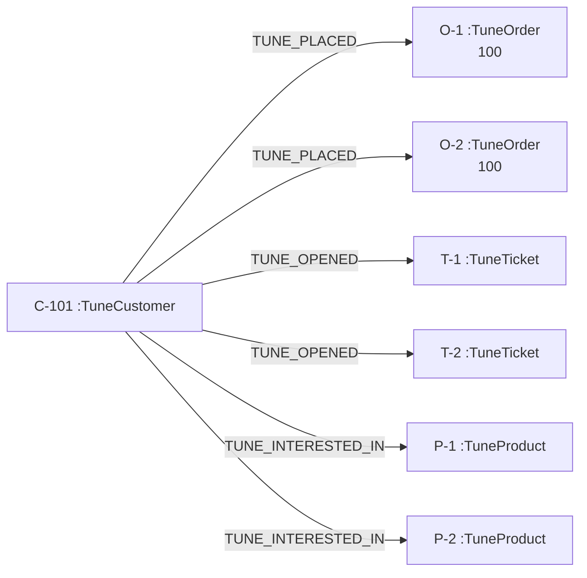
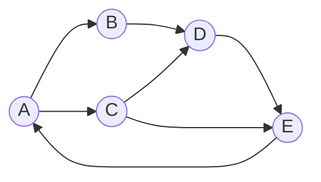

# Truy vấn chậm vì thiếu chỉ mục, tích Descartes hoặc duyệt quá rộng trong Neo4j

Khi một API đọc dữ liệu đồ thị chậm, nguyên nhân không nhất thiết là máy chủ Neo4j thiếu CPU hoặc RAM. Rất nhiều truy vấn Cypher chạy lâu vì **chọn điểm bắt đầu không hiệu quả**, **kết hợp hai tập dữ liệu không có quan hệ**, hoặc **mở rộng quá nhiều cạnh và đường đi** trước khi lọc kết quả.

Ba nhóm lỗi đặc biệt thường gặp:

1. **Thiếu chỉ mục (*index*) hoặc không tận dụng được chỉ mục:** Neo4j phải xét nhiều node/relationship để tìm một đối tượng vốn có khóa cụ thể.
2. **Tích Descartes (*Cartesian product*) hoặc nhân số hàng:** hai tập kết quả được ghép theo mọi tổ hợp ngoài ý muốn; số hàng tăng theo phép nhân thay vì phép cộng.
3. **Duyệt đồ thị quá rộng (*unbounded/high-fan-out traversal*):** truy vấn từ một node đi quá nhiều cạnh, quá sâu hoặc liệt kê quá nhiều path, làm tăng DB Hits, CPU và bộ nhớ.

Bài thuộc chương **Xử lý sự cố** của module **DATABASE_ENGINE_GRAPH_NEO4J**. Phạm vi module gồm mô hình property graph, node, relationship, Cypher, index, constraint, tối ưu truy vấn, nhập dữ liệu, tích hợp Java Driver/Spring Data Neo4j và vận hành Neo4j. Mục tiêu của bài là chẩn đoán dựa trên bằng chứng, **sửa đúng truy vấn mà không làm sai ngữ nghĩa nghiệp vụ**, rồi kiểm chứng cải thiện bằng kế hoạch thực thi và số liệu.

Sau khi học, bạn có thể đọc `EXPLAIN`/`PROFILE`, nhận diện `NodeByLabelScan`, `NodeIndexSeek`, `CartesianProduct`, `Expand`, `VarLengthExpand` và số hàng trung gian, lựa chọn index phù hợp, sửa phép tổng hợp bị nhân hàng, khống chế path traversal và xây runbook xử lý query chậm an toàn.

> **Phạm vi phiên bản:** Các ví dụ Cypher thông dụng áp dụng cho Neo4j 5 và các dòng Neo4j hiện đại. Một số tên operator, tính năng index, cú pháp quantified path patterns và chỉ số profile phụ thuộc version/runtime/edition. `PROFILE` **thực sự thực thi truy vấn**: chỉ chạy trên dữ liệu thử nghiệm hoặc truy vấn đọc đã đánh giá rủi ro; không dùng `PROFILE` cho câu ghi có thể phá hủy dữ liệu production.

## 1. Không tối ưu theo cảm giác: xác định triệu chứng trước

Cùng là “API chậm 15 giây” nhưng có ít nhất năm khả năng:

| Triệu chứng | Dấu hiệu quan sát | Hướng kiểm tra |
| --- | --- | --- |
| Chậm lúc **định vị node** | Plan dùng `NodeByLabelScan`/`Filter` trên tập lớn; DB Hits cao | Index, constraint, predicate, kiểu dữ liệu |
| Chậm do **nhân hàng** | `Rows` tăng đột biến, có `CartesianProduct` hoặc mở rộng nhiều nhánh | Quan hệ nối, cardinality, tổng hợp từng nhánh |
| Chậm do **duyệt rộng** | `Expand(All)`, `VarLengthExpand` hoặc shortest-path search xử lý nhiều path | Node xuất phát, loại/hướng cạnh, độ sâu, vị trí lọc |
| Chậm do **chờ khóa** | `SHOW TRANSACTIONS` cho `waitTime` lớn, trạng thái waiting/blocked | Transaction đang giữ lock, batch ghi, thời gian mở transaction |
| Chậm **ngoài Neo4j** | Query log cho thấy Cypher ngắn nhưng HTTP p99 cao | Driver pool, retry, mạng, serialize JSON, service khác |

**Một node lookup không có index khác hoàn toàn với một query bị chặn bởi lock.** Thêm index vào trường khóa không sửa được client đang giữ transaction mở để chờ HTTP call; tăng transaction timeout cũng không giảm số path mà Cypher phải duyệt.

### Đầu ra điều tra cần có

Trước khi thay đổi bất kỳ index hoặc query nào, ghi nhận:

- Query template và **database thực sự** được truy cập.
- Loại workload: đọc online, ghi transaction, import hoặc phân tích toàn graph.
- Kích thước graph: số node/relationship theo nhãn/loại, độ lớn và độ lệch fan-out.
- Tham số đại diện (đã che dữ liệu nhạy cảm) và tình trạng cache.
- `EXPLAIN`: estimated rows, operator và index dự định dùng.
- `PROFILE` trên môi trường an toàn: actual `Rows`, `DB Hits`, memory và thời gian.
- Độ trễ p50/p95/p99 từ ứng dụng, tần suất query và mức tải đồng thời.

Đừng so sánh query A ở database rỗng với query B trên production rồi khẳng định B “đã nhanh hơn gấp mười”.

## 2. Mô hình dữ liệu thực hành

Dùng **database test riêng** và các nhãn bắt đầu bằng `Tune` để tránh nhầm dữ liệu nghiệp vụ. Ví dụ gồm:

- 3 node `:TuneCustomer`, khóa `customerId`.
- 4 node `:TuneProduct`, khóa `sku`.
- 2 node `:TuneOrder` với cùng `amountMinor = 100`, đều được khách hàng C-101 đặt.
- 2 node `:TuneTicket` được khách hàng C-101 mở.
- Một mạng `:TunePerson` có nhiều đường đi từ A đến E.



### 2.1. Tạo node khách hàng và sản phẩm

```cypher
UNWIND [
  {id: 'C-101', name: 'Mai', region: 'north'},
  {id: 'C-102', name: 'An',  region: 'south'},
  {id: 'C-103', name: 'Vy',  region: 'north'}
] AS item
MERGE (c:TuneCustomer {customerId: item.id})
SET c.name = item.name,
    c.region = item.region;
```

```cypher
UNWIND [
  {sku: 'P-1', category: 'BOOK'},
  {sku: 'P-2', category: 'BOOK'},
  {sku: 'P-3', category: 'GAME'},
  {sku: 'P-4', category: 'DEVICE'}
] AS item
MERGE (p:TuneProduct {sku: item.sku})
SET p.category = item.category;
```

### 2.2. Tạo đơn hàng và phiếu hỗ trợ

```cypher
UNWIND [
  {id: 'O-1', amountMinor: 100},
  {id: 'O-2', amountMinor: 100}
] AS item
MATCH (c:TuneCustomer {customerId: 'C-101'})
MERGE (o:TuneOrder {orderId: item.id})
SET o.amountMinor = item.amountMinor
MERGE (c)-[:TUNE_PLACED]->(o);
```

```cypher
UNWIND ['T-1', 'T-2'] AS ticketId
MATCH (c:TuneCustomer {customerId: 'C-101'})
MERGE (t:TuneTicket {ticketId: ticketId})
MERGE (c)-[:TUNE_OPENED]->(t);
```

```cypher
UNWIND ['P-1', 'P-2'] AS sku
MATCH (c:TuneCustomer {customerId: 'C-101'})
MATCH (p:TuneProduct {sku: sku})
MERGE (c)-[:TUNE_INTERESTED_IN]->(p);
```

Với graph test sạch, `C-101` có đúng **2 Order, 2 Ticket và 2 Product quan tâm**. Nếu chạy trên database đang có node cùng nhãn/khóa, dữ liệu bổ sung có thể làm các con số kỳ vọng thay đổi. Dùng database test trống và không dùng `DETACH DELETE` toàn bộ trên production.

### 2.3. Tạo mạng duyệt có nhiều path

```cypher
UNWIND [
  ['A', 'B'],
  ['A', 'C'],
  ['B', 'D'],
  ['C', 'D'],
  ['D', 'E'],
  ['C', 'E'],
  ['E', 'A']
] AS pair
MERGE (src:TunePerson {personId: pair[0]})
MERGE (dst:TunePerson {personId: pair[1]})
MERGE (src)-[:TUNE_KNOWS]->(dst);
```



A có thể tới E bằng `A → C → E` hoặc `A → B → D → E` và `A → C → D → E`. Đây là graph rất nhỏ; trong một mạng xã hội, số đường đi có thể tăng nhanh hơn nhiều lần.

### 2.4. Kiểm tra dữ liệu đã tạo

```cypher
MATCH (c:TuneCustomer)
RETURN count(c) AS customers;
```

```cypher
MATCH (p:TuneProduct)
RETURN count(p) AS products;
```

```cypher
MATCH (:TuneCustomer {customerId: 'C-101'})
      -[:TUNE_PLACED]->(o:TuneOrder)
RETURN count(o) AS orders, sum(o.amountMinor) AS totalMinor;
```

Với fixture đúng: `customers = 3`, `products = 4`, `orders = 2`, `totalMinor = 200`. Những giá trị này là **kỳ vọng trên fixture**, không phải số liệu performance. Kế hoạch thực thi trên 3–4 node cũng không chứng minh planner sẽ chọn cùng operator trên dữ liệu triệu node.

## 3. Công cụ cốt lõi: `EXPLAIN` và `PROFILE`

Neo4j Cypher có hai chế độ xem execution plan:

| Cách gọi | Có thực thi câu query? | Trả về gì? | Dùng khi nào? |
| --- | --- | --- | --- |
| `EXPLAIN` | **Không** | Plan dự kiến, operator, `Estimated Rows` | Kiểm tra trước khi chạy, kể cả truy vấn ghi nguy hiểm |
| `PROFILE` | **Có** | Plan cùng số liệu thực tế: `Rows`, `DB Hits`, memory nếu hỗ trợ | Điều tra read query trên môi trường an toàn |
| Chạy bình thường | Có | Kết quả nghiệp vụ | Đo latency/error rate ở workload thật |

Ví dụ:

```cypher
EXPLAIN
MATCH (c:TuneCustomer {customerId: 'C-101'})
RETURN c.name;
```

Và, trong database test:

```cypher
PROFILE
MATCH (c:TuneCustomer {customerId: 'C-101'})
RETURN c.name;
```

**Đừng chạy `PROFILE MATCH ... DELETE ...` trên production**. `PROFILE` thực thi lệnh nên có thể thay đổi hoặc xóa dữ liệu.

### 3.1. Đọc số liệu nào trong plan?

| Trường/operator | Ý nghĩa và hướng xử lý |
| --- | --- |
| `Estimated Rows` | Số hàng planner ước tính; không phải số thực |
| `Rows` | Số hàng operator **thực sự** tạo khi `PROFILE` |
| `DB Hits` | Đếm thao tác truy cập ở storage layer, không đồng nghĩa số dòng kết quả |
| `Memory (Bytes)` | Bộ nhớ peak theo operator khi có; không cộng tất cả cột như tổng bộ nhớ query |
| `Page Cache Hits/Misses` | Cho biết mức cache/I/O nếu runtime/edition cung cấp |
| `NodeByLabelScan` | Duyệt các node theo label; có thể đắt khi label lớn và predicate chọn lọc |
| `AllNodesScan` | Xem xét mọi node; xem query có điểm bắt đầu tốt hơn không |
| `NodeIndexSeek` | Dùng index tìm theo predicate; thường tốt với khóa chọn lọc |
| `NodeUniqueIndexSeek` | Tìm qua index hỗ trợ uniqueness constraint trong một số plan |
| `Filter` | Áp điều kiện; xem lọc diễn ra trước hay sau khi tạo nhiều hàng |
| `Expand(All)` / `Expand(Into)` | Duyệt relationship; quan sát fan-out và hướng |
| `VarLengthExpand` | Duyệt quan hệ với độ dài biến thiên; kiểm tra upper bound và số path |
| `CartesianProduct` | Nhân mọi cặp hàng giữa hai input |
| `Sort` / `Distinct` / `EagerAggregation` | Cần sắp xếp/khử trùng/tổng hợp, có thể tốn RAM |
| `ProduceResults` | Trả về dữ liệu cuối; đầu ra ít không chứng minh operator trước đó ít việc |

Tên operator có thể khác giữa runtimes hoặc dòng Neo4j mới. Cần xem **toàn bộ luồng dữ liệu trong plan**, không chỉ tìm một từ khóa.

### 3.2. Điểm quan trọng: số hàng trung gian

Một truy vấn cuối cùng trả 10 record vẫn có thể đã xử lý hàng triệu record trước đó. Nếu `Rows` tăng đột biến ở một operator rồi `LIMIT 10` chỉ cắt đầu ra, CPU và DB Hits **có thể vẫn cao**.

Tư duy chẩn đoán:

```text
Đầu vào có bao nhiêu node?
   |
   v
Operator nào làm số hàng tăng?
   |
   +--> Scan quá nhiều? -> kiểm tra điểm bắt đầu, index
   |
   +--> CartesianProduct? -> kiểm tra các pattern độc lập
   |
   +--> Expand/path? -> kiểm tra fan-out, depth, filter
   |
   v
Đã lọc/tổng hợp trước hay sau bước tăng hàng?
   |
   v
Có giữ đúng ngữ nghĩa kết quả sau khi sửa?
```

## 4. Nhóm nguyên nhân 1: thiếu index trên điểm bắt đầu

Giả sử database lớn có hàng triệu node `:Customer` và API tìm đúng một người theo `customerId`. Nếu không có index phù hợp, planner có thể phải quét nhiều node để kiểm tra predicate.

Câu query:

```cypher
MATCH (c:TuneCustomer)
WHERE c.customerId = 'C-101'
RETURN c.customerId AS customerId, c.name AS name;
```

Trước khi có index, ở graph đủ lớn, `EXPLAIN` có thể cho kế hoạch dùng `NodeByLabelScan` rồi `Filter`. Đây là **dấu hiệu cần điều tra**, không phải bằng chứng mọi label scan đều sai: với label chỉ có vài node hoặc một query cần đọc phần lớn node, scan có thể hợp lý hơn seek.

### 4.1. Xem index đang tồn tại

```cypher
SHOW INDEXES
YIELD name, type, entityType, labelsOrTypes,
      properties, state
RETURN name, type, entityType,
       labelsOrTypes, properties, state
ORDER BY name;
```

Cần kiểm tra:

- Index có áp cho **đúng label/relationship type** không?
- `properties` có đúng property mà query so sánh không?
- `state` đã `ONLINE` chưa?
- Index thuộc loại gì: `RANGE`, `TEXT`, `POINT`, `LOOKUP`, `FULLTEXT` hoặc loại hỗ trợ truy vấn đặc biệt?
- Dữ liệu có đúng kiểu? `customerId` là chuỗi hay number?
- Query có biểu thức làm index không được dùng hiệu quả không?

### 4.2. Tạo uniqueness constraint cho khóa thật sự duy nhất

```cypher
CREATE CONSTRAINT tune_customer_id_unique IF NOT EXISTS
FOR (c:TuneCustomer)
REQUIRE c.customerId IS UNIQUE;
```

Uniqueness constraint có index hỗ trợ và giúp truy vấn bằng khóa nghiệp vụ. Sau đó:

```cypher
EXPLAIN
MATCH (c:TuneCustomer {customerId: 'C-101'})
RETURN c.name AS name;
```

Ở dataset lớn với tính chọn lọc cao, thường mong đợi index seek. **Không hứa `NodeIndexSeek` luôn xuất hiện**: planner dùng thống kê/cost, runtime và kích thước graph để chọn. Trong fixture 3 node, label scan có thể rẻ hơn, và việc index được tạo đúng không có nghĩa plan nhất thiết dùng nó.

### 4.3. Chỉ cần index, không cần unique?

Nếu `:Event` có nhiều bản ghi cùng `eventType` và bạn chỉ cần tra cứu:

```cypher
CREATE RANGE INDEX tune_order_amount_idx IF NOT EXISTS
FOR (o:TuneOrder)
ON (o.amountMinor);
```

Index này giúp cân nhắc truy vấn theo `amountMinor`, nhưng giá trị 100 xuất hiện trong cả hai đơn. **Đừng đặt uniqueness constraint** cho `amountMinor`: nó sẽ sai nghiệp vụ.

Quy tắc:

- Dữ liệu có yêu cầu **không trùng khóa** → uniqueness constraint thích hợp.
- Dữ liệu được phép trùng, cần tăng tốc `WHERE`/range/sort theo điều kiện hỗ trợ → index phù hợp.
- Cần tìm văn bản chứa từ hoặc không gian địa lý → xem `TEXT`, `FULLTEXT`, `POINT` theo ngữ nghĩa cụ thể.
- Cần biết label/relationship type → token lookup index, nhưng nó **không giải quyết predicate property**.

### 4.4. Chọn index theo operator truy vấn

| Predicate mục tiêu | Index nên đánh giá | Điều cần xác minh |
| --- | --- | --- |
| `c.customerId = $id` | RANGE hoặc uniqueness backing index | Equality chọn lọc, đúng label, kiểu |
| `o.createdAt >= $from` | RANGE trên `createdAt` | Temporal type thống nhất, selectivity |
| `c.tenantId = $t AND c.customerId = $id` | Composite RANGE/constraint | Thứ tự và cách dùng các property trong predicate |
| `p.name STARTS WITH 'Neo'` | RANGE có thể hỗ trợ prefix | Collation/kiểu STRING, plan |
| `p.name CONTAINS 'graph'` | TEXT hoặc full-text theo ngữ nghĩa | `CONTAINS` không giống full-text lexical search |
| `place.location` trong bán kính | POINT | Loại point, CRS và predicate spatial |
| `c:Customer` đơn thuần | Token lookup index | Chỉ lọc label, không lọc property |

Index không phải phép màu: nếu query trả 70% node cùng nhãn, planner có thể chọn scan; index có chi phí disk/memory và cập nhật khi ghi. Tạo hàng trăm index “để phòng” có thể khiến write throughput và maintenance kém đi.

## 5. Composite index cho truy vấn nhiều tenant

Một hệ thống có nhiều khách hàng dùng chung graph thường định danh node bằng cặp `(tenantId, customerId)`.

```cypher
CREATE CONSTRAINT tune_tenant_customer_key IF NOT EXISTS
FOR (c:TenantCustomer)
REQUIRE (c.tenantId, c.customerId) IS UNIQUE;
```

Và truy vấn:

```cypher
MATCH (c:TenantCustomer {
  tenantId: $tenantId,
  customerId: $customerId
})
RETURN c.name AS name;
```

Index backing constraint có thể giúp định vị chính xác theo bộ khóa. Cần lưu ý:

- `tenantId` phải xuất phát từ **principal đã được xác thực và được phép**, không tin vào chuỗi bất kỳ do client gửi.
- Constraint uniqueness không tự bảo đảm hai property **luôn tồn tại** nếu ứng dụng cho phép thiếu chúng; schema/edition có thể hỗ trợ constraint bổ sung.
- Truy vấn chỉ tìm theo `customerId` mà **không biết tenantId** có thể không dùng composite index theo cách mong đợi; cần xem plan thực tế và pattern truy cập.
- Index giúp định vị node, **không tự giới hạn** số relationship node đó có thể mở rộng.

Nếu tenant có một “supernode” kết nối hàng triệu node khác, bước index seek vẫn nhanh nhưng `Expand` sau đó có thể rất tốn tài nguyên. Đây là khác biệt giữa **find start node** và **traversal cost**.

## 6. Tại sao có index mà planner vẫn không dùng?

Có ít nhất sáu lý do phổ biến:

1. **Dữ liệu quá nhỏ** hoặc predicate không đủ chọn lọc; scan có chi phí ước tính thấp.
2. **Sai nhãn hoặc property:** tạo index `:Person(email)` nhưng query dùng `:User(email)`.
3. **Index chưa ONLINE** sau khi tạo; dữ liệu đang được populate.
4. **Kiểu tham số sai:** trong store dùng String nhưng code truyền Integer, hoặc temporal type khác.
5. **Predicate không tương thích** với loại index, ví dụ dùng `CONTAINS` nhưng chỉ có RANGE index và dữ liệu lớn.
6. **Biểu thức trên property** làm việc tra cứu khó tối ưu, ví dụ `toLower(c.email) = $email`; cần chuẩn hóa khi ghi hoặc index/biểu thức có tính năng phù hợp.

Ví dụ một cách viết cần xem xét:

```cypher
MATCH (c:TuneCustomer)
WHERE toLower(c.name) = 'mai'
RETURN c.customerId;
```

Nếu hệ thống thường tìm tên không phân biệt hoa thường, cân nhắc **lưu property chuẩn hóa**:

```cypher
MATCH (c:TuneCustomer)
SET c.nameNormalized = toLower(c.name);
```

```cypher
CREATE RANGE INDEX tune_customer_name_normalized IF NOT EXISTS
FOR (c:TuneCustomer)
ON (c.nameNormalized);
```

```cypher
MATCH (c:TuneCustomer {nameNormalized: $nameNormalized})
RETURN c.customerId;
```

Đầu vào `$nameNormalized` phải được chuẩn hóa **nhất quán** ở ứng dụng. Ví dụ trên chỉ minh họa case-folding đơn giản; xử lý tiếng Việt, Unicode normalization, khoảng trắng và tìm kiếm gần đúng có thể cần quy tắc khác hoặc full-text search.

### Dùng `USING INDEX` hay không?

Cypher hỗ trợ index hints trong những trường hợp phù hợp, nhưng không nên dùng như bước đầu tiên:

- Hint không làm index **tự tồn tại** hoặc tự cải thiện tính chọn lọc.
- Một hint sai có thể cản trở kế hoạch tốt hơn khi dữ liệu thay đổi.
- Trước khi dùng hint, kiểm tra schema, thống kê, predicate và plan thật.
- Khi cần force replan cho chẩn đoán, xem tùy chọn `CYPHER replan=force EXPLAIN ...` theo version; đừng dùng “xóa cache” bừa trên production.

**Kết luận:** “Không thấy `IndexSeek`” là tín hiệu cần hỏi *vì sao*, không tự động là chỉ thị “tạo một index bất kỳ”.

## 7. Nhóm nguyên nhân 2: tích Descartes do các pattern độc lập

Tích Descartes xảy ra khi mỗi hàng từ tập A được kết hợp với **mọi hàng** tập B. Nếu A có `m` hàng và B có `n` hàng, đầu ra tối đa `m × n` hàng trước các bộ lọc tiếp theo.

Ví dụ lỗi trên fixture:

```cypher
PROFILE
MATCH (c:TuneCustomer), (p:TuneProduct)
RETURN c.customerId AS customerId,
       p.sku AS sku;
```

Với đúng 3 Customer và 4 Product, câu này trả:

\[
3 \times 4 = 12 \text{ hàng}
\]

Nhưng không có quan hệ nào bảo đảm c và p có liên quan. Trong graph lớn, 100.000 khách hàng × 50.000 sản phẩm tương ứng **5 tỷ cặp** trước khi phân trang hay lọc.

`PROFILE` trên câu này chỉ nên chạy với fixture nhỏ; trên production có hàng triệu node, ưu tiên `EXPLAIN` để tránh tạo kết quả cực lớn.

### 7.1. Cách tìm trong execution plan

```cypher
EXPLAIN
MATCH (c:TuneCustomer), (p:TuneProduct)
RETURN c.customerId, p.sku;
```

Trong plan có thể thấy `CartesianProduct`. Nếu không có operator cùng tên nhưng số `Rows` vẫn tăng theo phép nhân vì một cơ chế kết hợp khác, phải tiếp tục xem cardinality và pattern.

Đừng chỉ tìm chữ `CartesianProduct` rồi dừng. Hai lần mở rộng từ một node chung, ví dụ 2 đơn hàng và 2 phiếu hỗ trợ, cũng có thể tạo 4 hàng **mà không cần một CartesianProduct operator tách rời**.

### 7.2. Sửa bằng quan hệ nghiệp vụ thực sự có

Nếu yêu cầu là “khách hàng quan tâm sản phẩm nào”, câu đúng:

```cypher
MATCH (c:TuneCustomer)-[:TUNE_INTERESTED_IN]->(p:TuneProduct)
RETURN c.customerId AS customerId,
       p.sku AS sku
ORDER BY customerId, sku;
```

Với fixture, khách hàng C-101 có 2 liên kết quan tâm, nên có 2 hàng. Câu query diễn đạt **mối quan hệ trong đồ thị**, thay vì mọi cặp khách hàng–sản phẩm.

Nếu yêu cầu là “sản phẩm cùng vùng với khách hàng”, có thể nối bằng `region` **khi đó thực sự là điều kiện nghiệp vụ**; nhưng phép join theo thuộc tính vẫn có thể đắt nếu hai tập lớn. Trong bài toán cần kết nối thường xuyên, cân nhắc mô hình relationship hoặc lookup được index thay vì ghép mọi cặp.

### 7.3. Khi tích Descartes là cố ý

Không phải mọi Cartesian product đều sai. Ví dụ phân tích yêu cầu tạo mọi cặp trong **hai tập nhỏ đã được giới hạn chính xác**. Khi đó:

- Bảo đảm đầu vào bị ràng buộc theo nhu cầu.
- Tính trước upper bound `m × n` và giới hạn tài nguyên.
- Không dùng query tạo mọi cặp khi chỉ cần kiểm tra một cặp tồn tại.
- Chọn batch và lưu kết quả nếu số cặp quá lớn.
- Kiểm tra tác động bộ nhớ khi kết hợp với `collect`, `ORDER BY` hoặc write.

**Không “sửa” Cartesian bằng cách thêm `LIMIT 10` ở cuối rồi coi mọi vấn đề đã hết**: planner vẫn có thể phải làm rất nhiều việc trước khi trả 10 hàng, tùy operator và kế hoạch.

## 8. Nhân hàng do nhiều nhánh: lỗi khác nhưng hậu quả tương tự

Một khách hàng có:

- 2 Order, mỗi Order `amountMinor = 100`.
- 2 Ticket.

Query:

```cypher
PROFILE
MATCH (c:TuneCustomer {customerId: 'C-101'})
MATCH (c)-[:TUNE_PLACED]->(o:TuneOrder)
MATCH (c)-[:TUNE_OPENED]->(t:TuneTicket)
RETURN c.customerId AS customerId,
       count(o) AS ordersCount,
       count(t) AS ticketsCount,
       sum(o.amountMinor) AS totalMinor;
```

Các kết hợp hàng trung gian:

| Order | Ticket | Amount |
| --- | --- | ---: |
| O-1 | T-1 | 100 |
| O-1 | T-2 | 100 |
| O-2 | T-1 | 100 |
| O-2 | T-2 | 100 |

Kết quả của query **sai về ngữ nghĩa** nếu muốn số Order/đơn và tổng tiền thực:

- `count(o) = 4`, nhưng thực tế có 2 Order.
- `count(t) = 4`, nhưng thực tế có 2 Ticket.
- `sum(o.amountMinor) = 400`, nhưng tổng tiền đúng là 200.

Đây là dạng **row multiplication** do hai nhánh cùng xuất phát từ một Customer, không nhất thiết là một Cartesian product operator hiển thị tường minh.

### 8.1. Vì sao `DISTINCT` không chữa được mọi phép tổng?

`count(DISTINCT o)` có thể đếm đúng 2 Order, nhưng:

```cypher
sum(DISTINCT o.amountMinor)
```

chỉ cộng **các giá trị amount khác nhau**. Hai Order có cùng `amountMinor = 100`, nên biểu thức đó trả 100 — **vẫn sai**, dù vì lý do khác.

**Khóa của Order là `orderId`, không phải số tiền của nó.** Phép tổng cần duy trì một hàng trên mỗi thực thể Order, sau đó mới cộng.

### 8.2. Sửa bằng subquery tổng hợp từng nhánh

Với Neo4j hỗ trợ scope clause `CALL (c)` (từ 5.23 trong Cypher 5):

```cypher
MATCH (c:TuneCustomer {customerId: 'C-101'})
CALL (c) {
    OPTIONAL MATCH (c)-[:TUNE_PLACED]->(o:TuneOrder)
    RETURN count(DISTINCT o) AS ordersCount,
           sum(o.amountMinor) AS totalMinor
}
CALL (c) {
    OPTIONAL MATCH (c)-[:TUNE_OPENED]->(t:TuneTicket)
    RETURN count(DISTINCT t) AS ticketsCount
}
RETURN c.customerId AS customerId,
       ordersCount,
       coalesce(totalMinor, 0) AS totalMinor,
       ticketsCount;
```

Với fixture, kết quả kỳ vọng `ordersCount = 2`, `totalMinor = 200` và `ticketsCount = 2`. Khi một nhánh không có node, `OPTIONAL MATCH` và `count`/`coalesce` cho phép xử lý trường hợp không có bản ghi theo logic báo cáo.

**Điểm mấu chốt:** mỗi subquery tạo **một hàng tổng hợp cho một Customer**, trước khi nhánh tiếp theo được xét. Điều này tránh nhân hai collection với nhau.

Phiên bản Neo4j cũ có thể dùng cú pháp subquery dạng `CALL { WITH c ... }`. Không thay đổi ngẫu nhiên giữa cú pháp các phiên bản khi copy ví dụ vào project.

### 8.3. Không phải lúc nào cũng cần materialize cả collection

Nếu chỉ cần `count(o)`, một query trả scalar aggregate thường ít tốn bộ nhớ hơn:

```cypher
MATCH (c:TuneCustomer {customerId: 'C-101'})
OPTIONAL MATCH (c)-[:TUNE_PLACED]->(o:TuneOrder)
RETURN c.customerId AS customerId,
       count(o) AS ordersCount;
```

Không nên `collect(o)` hàng triệu node rồi dùng `size(orders)` nếu database có thể đếm trực tiếp. `collect` giữ tập dữ liệu và có thể làm transaction memory tăng đáng kể.

## 9. Tích Descartes do dấu phẩy hoặc `MATCH` thiếu biến chung

Những mẫu dễ tạo dữ liệu không liên kết:

```cypher
MATCH (u:User), (p:Product)
RETURN u, p;
```

```cypher
MATCH (a:Account)
MATCH (b:Account)
RETURN a, b;
```

Nếu muốn “cặp tài khoản có giao dịch”, phải mô tả cạnh:

```cypher
MATCH (a:Account)-[:TRANSFERRED_TO]->(b:Account)
RETURN a.accountId, b.accountId;
```

Nếu muốn “so sánh từng account với một nhóm account tham chiếu” thì cần **thu hẹp hai tập theo điều kiện nghiệp vụ** và biết trước số cặp sẽ tạo.

**Một `WITH` đơn giản không tự nối hai pattern độc lập.** Ví dụ `MATCH (a) WITH a MATCH (b) RETURN ...` vẫn có thể tạo mọi cặp nếu `MATCH (b)` không có ràng buộc nào với a.

**Một `DISTINCT` sau Cartesian không giúp loại bỏ chi phí đã phát sinh**; nó chỉ có thể khử trùng sau khi các hàng được tạo.

## 10. Nhóm nguyên nhân 3: mở rộng đường đi quá rộng

Khác với database quan hệ, điểm mạnh của Neo4j là đi theo cạnh. Tuy nhiên, nếu bắt đầu từ một node có rất nhiều hàng xóm, mỗi bước mở rộng có thể làm số phương án tăng rất nhanh.

Giả sử số cạnh trung bình theo mỗi bước xấp xỉ `b` và cho phép độ dài `d`. Một hình dung sơ bộ số **nhánh có thể được xét** gần:

\[
1 + b + b^2 + \cdots + b^d
\]

Ví dụ `b = 20`, `d = 5` cho tổng hơn 3 triệu nhánh theo mô hình cây lý tưởng. Graph thật có chu trình, relationship uniqueness, điều kiện lọc và cấu trúc cộng đồng nên con số thực có thể khác rất xa. Nhưng trực giác quan trọng: **tăng độ sâu thêm một bước có thể tăng công việc rất nhiều**.

### 10.1. Ví dụ query không giới hạn độ sâu

```cypher
// Chỉ minh họa, KHÔNG chạy vô điều kiện trên graph lớn.
MATCH p = (a:TunePerson {personId: 'A'})
          -[:TUNE_KNOWS*]->
          (b:TunePerson)
RETURN p;
```

Với mạng có chu trình và nhiều nhánh, query tìm **các path** chứ không chỉ tập node đích. Có thể có nhiều path dẫn tới cùng node, làm số kết quả tăng nhanh. Nếu không giới hạn rõ, độ sâu có thể vượt xa nhu cầu kinh doanh.

Trong Neo4j hiện đại, Cypher còn có **quantified path patterns / quantified relationships** theo chuẩn GQL; cú pháp `*` truyền thống vẫn được hỗ trợ trong một số dòng nhưng không phải cú pháp GQL conformant. Dù viết theo cú pháp nào, **độ sâu và predicate** vẫn quyết định phạm vi duyệt.

### 10.2. Bounded traversal theo yêu cầu nghiệp vụ

Giả sử nghiệp vụ là “người A biết ai trong tối đa ba bước theo chiều `:TUNE_KNOWS`”:

```cypher
MATCH (a:TunePerson {personId: 'A'})
MATCH (a)-[:TUNE_KNOWS*1..3]->(b:TunePerson)
RETURN DISTINCT b.personId AS reachablePerson
ORDER BY reachablePerson;
```

Lợi ích:

- Có **điểm bắt đầu** rõ ràng.
- Chỉ xét một **relationship type**.
- Giữ **chiều** quan hệ như dữ liệu lưu.
- Giới hạn độ dài tối đa 3.
- Trả **node đích phân biệt**, thay vì materialize mọi path đầy đủ.

Tuy nhiên, `DISTINCT` ở cuối **không đảm bảo database tránh duyệt nhiều path trùng đích trước đó**. Đừng gọi đây là giải pháp tối ưu tuyệt đối; phải đo plan và chọn thuật toán phù hợp nếu bài toán chỉ là reachability.

### 10.3. `LIMIT` chỉ giới hạn kết quả, không luôn giới hạn công việc

```cypher
MATCH p = (a:TunePerson {personId: 'A'})
          -[:TUNE_KNOWS*1..10]->
          (b:TunePerson)
RETURN DISTINCT b.personId
ORDER BY b.personId
LIMIT 10;
```

Một query có `ORDER BY` và `DISTINCT` có thể phải thu thập/so sánh rất nhiều ứng viên trước khi biết **10 kết quả cuối**. Thêm `LIMIT` vào cuối không nhất thiết giải quyết traversal explosion.

Các câu hỏi cần đặt:

1. Có cần tối đa 10 node **bất kỳ** hay 10 node **đúng theo thứ tự**?
2. Có cần tất cả path hay chỉ cần biết node nào đạt được?
3. Có thể giới hạn độ sâu còn 2 hoặc 3 dựa trên SLA nghiệp vụ?
4. Có thể lọc **ngay từng bước mở rộng** thay vì sau khi có path?
5. Có nhiều nguồn/đích hay chỉ một cặp xác định?
6. Có thể tính trước kết quả bằng job, GDS hoặc cache nếu API hỏi lặp lại?

## 11. Chiều, loại cạnh và supernode

Một query không chỉ định loại quan hệ:

```cypher
MATCH (a:TunePerson {personId: 'A'})-[*1..3]-(b)
RETURN DISTINCT b;
```

có thể mở rộng qua **nhiều loại cạnh** và cả hai chiều; nó rộng hơn rất nhiều so với chỉ các cạnh `:TUNE_KNOWS` có hướng đi ra.

Sửa theo ngữ nghĩa:

```cypher
MATCH (a:TunePerson {personId: 'A'})
MATCH (a)-[:TUNE_KNOWS*1..3]->(b:TunePerson)
RETURN DISTINCT b.personId;
```

### 11.1. Supernode là gì?

Một node có bậc rất lớn, ví dụ tài khoản quảng cáo, người nổi tiếng hoặc sản phẩm cực phổ biến, có thể nối với hàng trăm nghìn node. Ngay cả traversal một bước cũng có thể trả lượng hàng lớn.

Cách phân tích:

- Xác định node xuất phát có bao nhiêu relationship cùng type/hướng.
- Xem liệu node đó thực sự cần được mở rộng không.
- Phân đoạn theo thời gian/trạng thái/type/nguồn quan hệ.
- Nếu bài toán chỉ cần count, không tải toàn bộ node/relationship.
- Cân nhắc cách mô hình hóa riêng cho sự kiện, quan hệ có thời hạn hoặc đối tượng toàn cục.
- Kiểm thử với **node bậc cao nhất** trong dữ liệu đại diện, không chỉ node trung bình.

Không tạo một index trên ID của supernode rồi kỳ vọng toàn bộ hàng trăm nghìn cạnh sau nó tự biến mất. Index giải quyết **bước tìm node nguồn**, không giải quyết **số cạnh cần mở rộng**.

### 11.2. Đo degree trên một node cụ thể

```cypher
MATCH (a:TunePerson {personId: 'A'})
MATCH (a)-[r:TUNE_KNOWS]->()
RETURN count(r) AS outgoingKnows;
```

Với fixture, A có 2 cạnh đi ra. Trên production, dùng cùng logic cho một số node đã được xác định bằng khóa/index; không quét toàn bộ mạng chỉ để tìm bậc nếu chưa đánh giá chi phí.

## 12. Lọc sớm, nhưng phân biệt lọc sau traversal và lọc trong traversal

Một query dạng:

```cypher
MATCH p = (a:Person {personId: $personId})
          -[:KNOWS*1..5]->
          (b:Person)
WHERE all(n IN nodes(p) WHERE n.active = true)
RETURN DISTINCT b.personId;
```

đảm bảo kết quả path chỉ gồm node active theo điều kiện, **nhưng** các predicate kiểm tra toàn path có thể được áp dụng sau khi một phần đường đã được tạo. Chi phí có thể vẫn lớn.

Trong Neo4j hỗ trợ **quantified path patterns** và **inline predicates**, có thể đưa điều kiện về node/relationship vào pattern để **prune ứng viên sớm**. Cần kiểm tra đúng cú pháp và phiên bản Cypher; không viết một cú pháp mới rồi suy rằng chạy ở mọi Neo4j 5.x.

Ví dụ định hướng theo Cypher hiện đại, điều kiện trên relationship của mỗi bước:

```cypher
// Neo4j hỗ trợ quantified relationships và inline predicates.
MATCH (a:Person {personId: $personId})
      -[r:KNOWS WHERE r.active = true]->{1,3}
      (b:Person)
RETURN DISTINCT b.personId;
```

Ví dụ chỉ yêu cầu các cạnh trong path có `active = true`; nó **không tự kiểm tra mọi node trung gian có active**. Nếu nghiệp vụ đòi cả node và cạnh hợp lệ, cần quantified path pattern có node predicates tương ứng và kiểm thử trên dữ liệu có node trung gian không hợp lệ.

**Khuyến nghị:** đo `PROFILE` của cách viết trước/sau trên dataset tương đương, không đánh giá chỉ bằng việc câu query trông “có WHERE sớm hơn”.

## 13. Tìm path ngắn nhất khác liệt kê mọi path

Nếu yêu cầu là “tìm **một đường ngắn nhất** từ A tới E”, truy vấn liệt kê mọi path `*1..10` rồi `ORDER BY length(p) LIMIT 1` không phải lựa chọn tối ưu mặc định.

Một biểu thức truyền thống:

```cypher
MATCH (a:TunePerson {personId: 'A'})
MATCH (b:TunePerson {personId: 'E'})
MATCH p = shortestPath((a)-[:TUNE_KNOWS*]->(b))
RETURN [n IN nodes(p) | n.personId] AS path,
       length(p) AS hops;
```

Với fixture, có thể tìm được đường ngắn nhất gồm 2 cạnh, ví dụ A → C → E. Câu này dùng dạng shortest path truyền thống; Neo4j mới cũng hỗ trợ **`ANY SHORTEST`**, `SHORTEST` và các cú pháp path selection theo phiên bản.

Điều cần nắm:

- **Shortest path** là bài toán tối ưu theo số cạnh với cú pháp Cypher tương ứng.
- Nếu trọng số thể hiện **chi phí thực** (giá, thời gian, khoảng cách), cần cân nhắc **Dijkstra/GDS** hoặc thuật toán phù hợp, không mặc định shortest theo số hop chính là rẻ nhất.
- Khi có **một cặp nguồn–đích đã xác định**, planner thường có nhiều cơ hội tối ưu hơn so với hàng nghìn cặp chưa biết.
- Một số predicate yêu cầu kiểm tra toàn bộ path có thể khiến shortest-path query rơi vào chiến lược tìm kiếm tốn kém hơn; xem plan và tài liệu theo version.

Không dùng `shortestPath()` khi yêu cầu nghiệp vụ là “tất cả đường hợp lệ”, vì nó **thay đổi ngữ nghĩa kết quả**.

## 14. Trả về node, path hay scalar: dữ liệu trả về cũng có chi phí

Một câu truy vấn có thể chọn đúng đường đi nhưng chậm ở bước truyền dữ liệu vì trả hàng nghìn node/relationship với nhiều property:

```cypher
MATCH p = (a:TunePerson {personId: 'A'})
          -[:TUNE_KNOWS*1..3]->
          (b:TunePerson)
RETURN p;
```

Nếu UI chỉ cần danh sách mã người dùng:

```cypher
MATCH (a:TunePerson {personId: 'A'})
MATCH (a)-[:TUNE_KNOWS*1..3]->(b:TunePerson)
RETURN DISTINCT b.personId AS personId
ORDER BY personId;
```

Việc trả **projection scalar** thay vì toàn bộ path giúp giảm payload và chi phí serialization, nhưng không tự thay đổi mọi phép mở rộng bên trong plan.

Cần phân biệt:

- **Tối ưu số hàng được duyệt:** ảnh hưởng DB Hits, CPU, memory.
- **Tối ưu hình dạng kết quả:** ảnh hưởng lượng dữ liệu gửi qua Bolt, mapper Java và JSON.
- **Tối ưu số round trip:** ảnh hưởng network và connection pool.

Một query tốt phải cân bằng cả ba, không chỉ làm `RETURN` ngắn hơn.

## 15. Đo và so sánh trước/sau theo cùng điều kiện

Khi tối ưu một truy vấn, ghi bảng đo:

| Tín hiệu | Trước | Sau | Cách diễn giải |
| --- | --- | --- | --- |
| `Estimated Rows` | Lớn hay nhỏ? | Thay đổi? | Planner có ước lượng hợp lý không? |
| `Rows` tại operator nặng | Hàng triệu? | Ít hơn? | Bước nhân/duyệt đã giảm chưa? |
| `DB Hits` | Cao? | Thấp hơn? | Có giảm truy cập storage không? |
| `Memory (Bytes)` | Có spike? | Có giảm? | Còn Sort/Distinct/collect lớn không? |
| Latency p95 | Cao? | Đạt SLO? | Dữ liệu/độ đồng thời tương đương? |
| Số dòng kết quả | Đúng? | Vẫn đúng? | Có thay đổi ngữ nghĩa không? |
| CPU/I/O | Bất thường? | Ổn định hơn? | Có chuyển tải sang một phần khác không? |

**Không điền số liệu giả rồi gọi là benchmark.** Hãy chạy trên dataset đại diện, lặp lại số lần hợp lý, ghi thời điểm tải hệ thống, tránh thay đổi nhiều biến cùng lúc.

Một kế hoạch tốt:

1. Lưu baseline query và tham số đã được ẩn thông tin nhạy cảm.
2. Chụp `EXPLAIN`/`PROFILE` và kết quả nghiệp vụ trong môi trường an toàn.
3. Chỉ đổi **một yếu tố chính**: index, pattern nối, độ sâu hoặc hình dạng trả dữ liệu.
4. Chờ index `ONLINE` nếu vừa tạo.
5. So plan và cardinality.
6. Chạy test kết quả, kể cả ca null/trùng/cycle/tenant.
7. Đo latency, DB Hits, CPU và bộ nhớ trong điều kiện tương đồng.
8. Viết kết luận và lưu chiến lược rollback nếu đổi schema/query có rủi ro.

### Planner statistics và plan cache

Neo4j dùng thống kê để ước lượng cardinality và tạo execution plan. Plan có thể được cache, và replanning xảy ra theo quy tắc/setting phiên bản. Nếu đã bổ sung index nhưng plan chưa như kỳ vọng:

- Kiểm tra index `ONLINE`.
- Kiểm tra biểu thức query có thật sự tương thích với index không.
- Kiểm tra nhãn/property/type của dữ liệu.
- So `EXPLAIN` của cùng query trên dataset đại diện.
- Xem khả năng replan theo tài liệu, không xóa plan cache toàn hệ thống tùy tiện.
- Đánh giá liệu index thật sự chọn lọc hơn scan hay không.

**Index seek không phải KPI cuối cùng**; đúng ngữ nghĩa và độ trễ/chi phí tổng thể mới là mục tiêu.

## 16. Có thể xem query chậm từ hệ thống đang chạy ở đâu?

Khi incident đã diễn ra, cần biết query nào đang hoặc đã chạy. Không nhất thiết query bạn đo local là query đang gây tải.

### 16.1. Transaction đang mở

```cypher
SHOW TRANSACTIONS
YIELD database, transactionId, username,
      elapsedTime, currentQueryElapsedTime,
      status, currentQueryStatus,
      waitTime, activeLockCount,
      currentQuery
RETURN database, transactionId, username,
       elapsedTime, currentQueryElapsedTime,
       status, currentQueryStatus,
       waitTime, activeLockCount,
       currentQuery
ORDER BY elapsedTime DESC
LIMIT 20;
```

Cần phân biệt:

- `elapsedTime` là tuổi transaction.
- `currentQueryElapsedTime` là thời gian query hiện hành.
- `waitTime` cao có thể là tranh chấp **lock**, không phải node scan.
- `currentQuery` có thể chứa dữ liệu nhạy cảm; che trước khi chia sẻ.
- Quyền xem transaction người khác tùy role/edition; query cũng có thể thấy transaction của chính người quan sát.

Nếu `currentQueryElapsedTime` thấp nhưng `elapsedTime` cao và `idleTime` tăng, xử lý **transaction lifecycle** trước, không tự kết luận thiếu index.

### 16.2. Query đã hoàn tất

`SHOW TRANSACTIONS` chỉ phản ánh trạng thái hiện tại. Với query đã chạy xong, dùng **query log** được cấu hình theo edition và phiên bản, metric query latency, distributed tracing và log ứng dụng.

Không bật log toàn bộ tham số chứa mật khẩu/token/dữ liệu nhạy cảm chỉ để điều tra một sự cố. Với Neo4j Enterprise và môi trường hỗ trợ, cấu hình threshold có thể giúp ghi những truy vấn vượt ngưỡng mà không thu tất cả query.

### 16.3. Đối chiếu query với service/endpoint

Neo4j Java Driver hỗ trợ transaction metadata:

```java
import java.time.Duration;
import java.util.Map;

import org.neo4j.driver.TransactionConfig;

TransactionConfig config = TransactionConfig.builder()
    .withTimeout(Duration.ofSeconds(5))
    .withMetadata(Map.of(
        "service", "customer-api",
        "operation", "recommend-related",
        "traceId", "trace-042"
    ))
    .build();
```

Metadata chỉ dùng mã không nhạy cảm. Không đính password, bearer token, PII hoặc toàn bộ HTTP payload. Khi điều tra, đối chiếu metric `traceId` ở application với query log và transaction hiện hành.

## 17. Java Driver: query đúng, giới hạn kết quả và tránh đọc cả graph

Ví dụ service chỉ lấy mã sản phẩm mà khách hàng quan tâm:

```java
import java.time.Duration;
import java.util.List;
import java.util.Map;

import org.neo4j.driver.Driver;
import org.neo4j.driver.Session;
import org.neo4j.driver.SessionConfig;
import org.neo4j.driver.TransactionConfig;

public final class ProductInterestService {
    private final Driver driver;

    public ProductInterestService(Driver driver) {
        this.driver = driver;
    }

    public List<String> findInterestedSkus(String customerId) {
        String cypher = """
            MATCH (c:TuneCustomer {customerId: $customerId})
                  -[:TUNE_INTERESTED_IN]->(p:TuneProduct)
            RETURN p.sku AS sku
            ORDER BY sku
            LIMIT 50
            """;

        TransactionConfig config = TransactionConfig.builder()
            .withTimeout(Duration.ofSeconds(5))
            .withMetadata(Map.of(
                "service", "customer-api",
                "operation", "list-interested-products"
            ))
            .build();

        try (Session session = driver.session(
                SessionConfig.builder().withDatabase("neo4j").build())) {
            return session.executeRead(tx ->
                tx.run(cypher, Map.of("customerId", customerId))
                  .list(row -> row.get("sku").asString()),
                config
            );
        }
    }
}
```

Điểm cần chú ý:

- `customerId` là **tham số** Cypher, không ghép chuỗi vào query.
- `Driver` nên được dùng lại theo vòng đời service, `Session` mở ngắn.
- `withDatabase` chọn database tường minh; đổi thành tên database thực tế theo registry/ủy quyền.
- `withTimeout` giới hạn transaction, **không thay thế tối ưu plan**.
- `executeRead` có thể retry callback khi gặp transient error; callback nên chỉ làm tác vụ đọc và không có side effect ngoài database.
- `.list()` tạo toàn bộ collection kết quả trong JVM; ví dụ có `LIMIT 50` nên phù hợp. Query trả hàng triệu node cần cursor/stream/pagination hoặc thiết kế khác.
- `LIMIT` giải quyết giới hạn payload nhưng phải **kiểm chứng plan** để biết có giảm công việc duyệt hay không.

Nếu query trả path đầy đủ, object mapper/serializer còn phải xử lý node, relationship và property; điều này có thể làm p95 HTTP cao ngay cả khi Cypher đã tương đối nhanh.

## 18. Spring Data Neo4j: mapping object graph cũng ảnh hưởng hiệu năng

Với Spring Data Neo4j, một phương thức repository có thể trông đơn giản:

```java
Optional<Customer> customer = repository.findById(customerId);
```

Nhưng nếu entity `Customer` ánh xạ nhiều collection relationship và query được thiết kế để lấy graph lớn, chi phí có thể nằm ở việc **fetch/hydrate object graph** hơn là tìm node gốc.

Những câu hỏi cần kiểm tra:

1. Repository đang chạy **Cypher nào**?
2. Có index/constraint trên ID/property filter không?
3. Query trả bao nhiêu node/relationship, có nhân hàng giữa các collection không?
4. DTO màn hình chỉ cần vài field hay thật sự cần aggregate đầy đủ?
5. Có **N+1 round trips** khi service lặp qua khách hàng rồi truy vấn đơn hàng từng người?
6. Có đang `save()` một object graph chỉ được tải một phần và gây cập nhật relationship ngoài ý muốn không?

### 18.1. Dùng DTO cho báo cáo

Nếu chỉ cần `customerId` và số đơn, không bắt buộc dựng cả `Customer.orders`:

```cypher
MATCH (c:TuneCustomer {customerId: $customerId})
OPTIONAL MATCH (c)-[:TUNE_PLACED]->(o:TuneOrder)
RETURN c.customerId AS customerId,
       count(o) AS ordersCount;
```

Ánh xạ kết quả sang DTO bằng `Neo4jClient` hoặc custom query, không cố tạo entity thiếu relationship rồi gọi `save()` trở lại.

### 18.2. N+1 khác Cartesian nhưng đều có thể gây chậm

Nếu API tải 100 Customer và gọi một query cho từng Customer để lấy Order, có thể có **101 round trips** dù mỗi query dùng index. Đây là N+1.

Không phải cứ thấy API chậm là cần thêm index. Có thể cần:

- Query theo danh sách IDs, trả dữ liệu đã được nhóm.
- Pagination hoặc lazy API ở tầng dịch vụ.
- Trả DTO chỉ chứa dữ liệu UI cần.
- Giảm số lần gọi Driver/Repository trong vòng lặp.
- Giới hạn số node/relationship mỗi request.

Không “sửa” N+1 bằng cách tải toàn bộ graph vào một lần nếu điều đó làm JVM hết bộ nhớ.

## 19. Những biện pháp dễ làm sai khi chữa query chậm

| Biện pháp | Vì sao có thể sai? | Cách làm đúng |
| --- | --- | --- |
| Thêm index cho **mọi property** | Tăng chi phí ghi, disk và bảo trì | Chọn predicate thực tế, đo selectivity |
| Dùng `USING INDEX` cho mọi query | Ép kế hoạch không phù hợp | Chẩn đoán planner, chỉ hint khi có bằng chứng |
| Thêm `LIMIT 10` vào cuối query | Có thể vẫn expand, sort, aggregate rất nhiều | Giới hạn phạm vi sớm và xem plan |
| Dùng `DISTINCT` để chữa Cartesian | Phải xử lý hàng rồi mới khử trùng | Sửa điều kiện nối/mô hình |
| Dùng `sum(DISTINCT amount)` | Gộp nhầm hai Order có cùng giá trị | Tổng hợp trên tập Order duy nhất |
| Bỏ quan hệ type/hướng | Duyệt nhiều loại cạnh hơn | Chọn type/direction đúng |
| Cho path `*` không giới hạn | Bùng nổ đường đi | Giới hạn depth, lọc/prune |
| Tăng heap để tránh mọi lỗi | Không giảm cardinality hoặc lock | Sửa query, sizing dựa trên số liệu |
| Tăng timeout từ 5s lên 5 phút | Giữ tài nguyên lâu, lỗi xuất hiện muộn | Timeout theo SLO và giảm khối lượng |
| Chạy `PROFILE DELETE` trên production | `PROFILE` thực thi câu ghi | Dùng `EXPLAIN` hoặc test clone |
| Xóa index “không dùng” ngay | Có thể phục vụ query khác | Đo workload toàn hệ thống trước |
| Dùng ID nội bộ Neo4j thay business ID | Không bền vững qua dữ liệu/restore | Constraint và khóa nghiệp vụ |
| Bỏ điều kiện `tenantId` để tăng tốc | Có thể rò rỉ dữ liệu khách hàng | Giữ policy, tối ưu index phù hợp |
| Tăng concurrency để query nhanh hơn | Có thể tăng tranh CPU/I/O/lock | Giới hạn tải, lập lịch và đo |
| Đánh giá trên fixture 3 node rồi kết luận performance | Planner trên dataset nhỏ có thể chọn scan | Thử dataset đại diện |

**Không chấp nhận tối ưu làm mất tính đúng đắn của ứng dụng.** Một query “nhanh hơn” nhưng trả thiếu node, tính sai tổng tiền hoặc lộ dữ liệu tenant khác là regression nghiêm trọng.

## 20. Runbook từng bước khi nhận cảnh báo query chậm

### Bước 1 — Xác nhận lỗi và phạm vi

Ghi thời điểm, database, service/endpoint, mức p95/p99, số request lỗi và phiên bản vừa triển khai. Phân biệt query tương tác với job import/GDS chạy dài hợp lệ.

### Bước 2 — Lấy query và context an toàn

Từ log, tracing hoặc `SHOW TRANSACTIONS` lấy query template và tham số mô tả **không nhạy cảm**. Nếu có nhiều instance trong cluster, xác nhận đúng server/database. Không copy nguyên PII/token vào ticket.

### Bước 3 — Loại trừ chờ lock, pool và network

Nếu `waitTime` lớn và transaction bị `Blocked`, điều tra lock holder và transaction lifecycle. Nếu Cypher log nhanh nhưng HTTP chậm, xem Driver pool, retry, serialize và dependency khác.

### Bước 4 — `EXPLAIN` trước khi sửa

Xem operator nguồn:

- `NodeByLabelScan` trên label lớn và predicate chọn lọc → kiểm tra index.
- `CartesianProduct` hoặc số hàng nhân mạnh → kiểm tra pattern độc lập.
- `VarLengthExpand`/`Expand` tạo hàng khổng lồ → kiểm tra fan-out và độ sâu.
- `Sort`/`EagerAggregation` trên tập lớn → kiểm tra thời điểm tổng hợp.

### Bước 5 — Chọn **một** thay đổi chính

Ví dụ:

- Thêm uniqueness constraint hoặc index cho key thực.
- Thay hai pattern rời bằng relationship nghiệp vụ.
- Dùng subquery tổng hợp từng nhánh.
- Ràng buộc relationship type, chiều và max depth.
- Thay trả tất cả path bằng node IDs hoặc shortest-path operator theo yêu cầu.
- Chia API ra các read model thay vì hydrate graph quá rộng.

### Bước 6 — Kiểm chứng ngữ nghĩa

Đối chiếu số node, Order, sum, dữ liệu null/trùng, path có chu trình, supernode và tenant authorization. Dùng fixture có **hai Order cùng số tiền** để bắt lỗi `sum(DISTINCT amount)`.

### Bước 7 — Đo plan và tài nguyên

Với query đọc an toàn, chạy `PROFILE` trên dữ liệu đại diện. So `Rows`, `DB Hits`, memory, latency và kết quả đúng. Nếu mới tạo index, kiểm tra `ONLINE`.

### Bước 8 — Phát hành và quan sát

Triển khai theo quy trình, có rollback plan cho query/schema. Theo dõi p95/p99, error rate, CPU, memory, lock và thời gian thực hiện khi nhiều request đồng thời.

### Bước 9 — Ngăn tái diễn

- Viết integration test kiểm tra Cypher trên Neo4j test.
- Viết performance regression test cho dataset có fan-out cao.
- Code review query có `MATCH (a), (b)`, `*` không upper bound hoặc `collect` lớn.
- Duy trì index migration và tài liệu schema.
- Cảnh báo query chậm theo workload và SLO.
- Bắt buộc kiểm tra quyền tenant ở mọi path quan trọng.

## 21. Kiểm thử hồi quy trên dữ liệu thật sự đại diện

### 21.1. Test correctness

Một bộ tối thiểu:

| Ca | Kỳ vọng |
| --- | --- |
| Tra Customer theo ID tồn tại | Đúng một Customer theo constraint |
| ID không tồn tại | Không tự tạo node nếu chỉ đọc |
| Hai Order có cùng `amountMinor` | Tổng tiền đúng 200 |
| Hai Order và hai Ticket | Không nhân thành 4 Order hay 400 tiền |
| Path A→E có nhiều tuyến | Kết quả theo **node đích** hoặc **path** đúng yêu cầu |
| Graph có chu trình | Query depth bounded không chạy vô hạn |
| Node có bậc cực cao | Query có giới hạn tài nguyên và latency hợp lý |
| Tenant Beta trùng customerId với Acme | Không đọc/ghi lẫn tenant |
| Thiếu property/`null` | Điều kiện/aggregate có ngữ nghĩa đúng |

### 21.2. Test kế hoạch và hiệu năng

Không nên assert cứng rằng mọi lần đều có `NodeIndexSeek`: planner/version/stats có thể đổi. Thay vào đó:

- Assert index/constraint **đã tồn tại và `ONLINE`** khi cần.
- Đo DB Hits, Rows, thời gian hoặc ngân sách tài nguyên trên dataset đủ lớn/ổn định.
- Kiểm tra query không sinh ra tập hàng trung gian bất thường.
- Ghi phiên bản Neo4j/Driver, dữ liệu và thống kê test.
- Cho phép sai số hợp lý giữa máy CI; không đặt ngưỡng 5 ms cứng trên runner không ổn định.
- Thử đường đi hiếm và supernode, không chỉ ví dụ dễ.

**Neo4j Harness** rất hữu ích cho correctness Cypher trên graph nhỏ; **Testcontainers/staging với dữ liệu đủ đại diện** phù hợp hơn cho regression hiệu năng/plan ở kích thước thật. Không dùng benchmark trong JVM của Harness để kết luận throughput production.

## 22. Bài tập tự kiểm tra

**Bài 1 — Scan hay Seek.** Một database có 2 triệu `:Customer`, truy vấn tìm `customerId='C-101'` nhưng plan dùng `NodeByLabelScan` và `Filter`. Hãy liệt kê những điều cần kiểm tra trước khi tạo index và giải thích vì sao chỉ trên ba node planner có thể không chọn seek.

**Bài 2 — Chọn index.** Bạn cần (a) tìm email duy nhất, (b) lọc Order theo khoảng `createdAt`, (c) tìm `name CONTAINS 'graph'`. Chọn loại index/constraint để cân nhắc cho mỗi truy vấn. Phân biệt text index và full-text search.

**Bài 3 — Cartesian.** `MATCH (a:Customer), (p:Product) RETURN a, p` trên 20.000 customer và 5.000 product có tối đa bao nhiêu hàng trước khi lọc? Viết query thay thế nếu yêu cầu là sản phẩm khách hàng đã mua.

**Bài 4 — Nhân hàng.** Một Customer có 3 Order và 4 Ticket. Query cùng mở hai nhánh tạo tối đa bao nhiêu hàng? `count(o)` và `sum(o.amountMinor)` có thể sai ra sao? Dùng subquery tổng hợp từng nhánh.

**Bài 5 — `DISTINCT` sai.** Hai Order có số tiền giống nhau đều `100`. Vì sao `sum(DISTINCT amountMinor)` trả sai tổng? Hãy trình bày một cách tổng hợp theo Order ID thay vì giá trị tiền.

**Bài 6 — Traversal explosion.** `MATCH p=(a)-[:KNOWS*]->(b) RETURN p` có vấn đề gì trên graph có hub lớn? Sửa theo yêu cầu “người liên quan trong tối đa 3 bước”; giải thích vì sao kết quả `DISTINCT b` không chứng minh traversal đã rẻ.

**Bài 7 — `LIMIT` và Sort.** Query có `ORDER BY score DESC LIMIT 10` nhưng `PROFILE` cho thấy hàng triệu `Rows` trước Sort. Vì sao kết quả 10 hàng vẫn chậm? Đề xuất cách thiết kế index/filter hoặc materialized ranking.

**Bài 8 — Shortest path.** Nghiệp vụ yêu cầu một tuyến ít hop nhất, không phải mọi path. Tại sao không dùng query liệt kê tất cả path rồi sắp xếp? Khi trọng số là chi phí thực thì nên cân nhắc thuật toán nào?

**Bài 9 — Multi-tenant.** Tại sao việc thêm index cho `Customer.customerId` rồi bỏ `tenantId` để tìm nhanh hơn là nguy hiểm? Thiết kế composite key/index và query giữ ranh giới tenant.

**Bài 10 — Driver.** Viết Java Driver code dùng `SessionConfig.withDatabase`, tham số `$customerId`, transaction timeout và trả tối đa 50 sku. Khi nào `.list()` không nên dùng?

**Bài 11 — Đo trước/sau.** Hãy mô tả bảng kết quả ghi `Rows`, `DB Hits`, memory, p95 và số lượng kết quả đúng trước/sau. Khi query nhanh hơn nhưng trả thiếu Order, bạn có được phát hành không?

**Bài 12 — Chẩn đoán nhầm.** `SHOW TRANSACTIONS` cho thấy `elapsedTime=90s` nhưng `currentQueryElapsedTime=20ms`, `waitTime` tăng. Có nên tạo index ngay không? Hãy nêu cách kiểm tra lock holder và các nguyên nhân khác.

### Checklist thực hành tối ưu query

- [ ] Có baseline latency và kế hoạch truy vấn từ môi trường an toàn.
- [ ] Phân biệt scan/index, Cartesian/row multiplication, traversal và lock wait.
- [ ] Kiểm tra index đúng label/property/type và `ONLINE`.
- [ ] Không tạo uniqueness constraint trên property không thực sự duy nhất.
- [ ] Không dùng index hint để che một predicate hoặc join sai.
- [ ] Mọi `MATCH` độc lập đều có lý do nghiệp vụ rõ ràng.
- [ ] Các nhánh một-nhiều được tổng hợp mà không nhân sai hàng.
- [ ] Không dùng `sum(DISTINCT value)` để khử trùng thực thể.
- [ ] Traversal có điểm xuất phát, type/direction, depth và điều kiện phù hợp.
- [ ] Không coi `LIMIT`/`DISTINCT` cuối query là bảo đảm tài nguyên nhỏ.
- [ ] Trả DTO/scalar khi không cần hydrate toàn bộ node/path.
- [ ] Đã giữ đúng tenant authorization và ngữ nghĩa nghiệp vụ.
- [ ] `PROFILE` chỉ chạy có kiểm soát, không thực thi câu ghi nguy hiểm trên production.
- [ ] Đã kiểm chứng correctness, fan-out xấu nhất và benchmark đại diện.
- [ ] Có kế hoạch rollout, rollback và cảnh báo query chậm tái diễn.

## 23. Tài liệu chính thức để đối chiếu

Cú pháp và tên operator cần được xác minh theo Neo4j/Cypher version của hệ thống:

- [Neo4j Cypher Manual — Understanding query plans](https://neo4j.com/docs/cypher-manual/current/planning-and-tuning/execution-plans/): `EXPLAIN`, `PROFILE`, `Estimated Rows`, `Rows`, `DB Hits` và memory.
- [Neo4j Cypher Manual — Operators in detail](https://neo4j.com/docs/cypher-manual/current/planning-and-tuning/operators/operators-detail/): `CartesianProduct`, scan, seek, expansion, aggregation và sorts.
- [Neo4j Cypher Manual — Query tuning](https://neo4j.com/docs/cypher-manual/current/planning-and-tuning/query-tuning/): nguyên tắc lọc dữ liệu, giới hạn traversal và plan/replanning.
- [Neo4j Cypher Manual — Performance indexes](https://neo4j.com/docs/cypher-manual/current/indexes/performance-indexes/): RANGE, TEXT, POINT và token lookup.
- [Neo4j Cypher Manual — Create indexes](https://neo4j.com/docs/cypher-manual/current/indexes/performance-indexes/create-indexes/): cú pháp `CREATE INDEX`, loại index và điều kiện sử dụng.
- [Neo4j Cypher Manual — Variable-length paths](https://neo4j.com/docs/cypher-manual/current/patterns/variable-length-paths/): quantified path patterns, inline predicates và nguy cơ duyệt quá rộng.
- [Neo4j Cypher Manual — Shortest paths](https://neo4j.com/docs/cypher-manual/current/patterns/shortest-paths/): khác biệt giữa shortest-path và liệt kê mọi path.
- [Neo4j Operations Manual — Monitoring](https://neo4j.com/docs/operations-manual/current/monitoring/): log, metrics và quan sát hiệu năng.
- [Neo4j Java Driver Manual — Transactions](https://neo4j.com/docs/java-manual/current/transactions/): managed transactions, timeout và metadata.

**Ghi nhớ:** hiệu năng Cypher phụ thuộc vào **số thực thể phải đọc và số hàng/đường đi phải xử lý**. Thiếu index làm điểm bắt đầu đắt; tích Descartes và các nhánh độc lập làm kết quả trung gian nhân lên; traversal không giới hạn làm số path bùng nổ. Hãy dùng `EXPLAIN`/`PROFILE` để tìm đúng operator, sửa truy vấn theo **ngữ nghĩa graph thực sự**, rồi đo lại cả **độ đúng, cardinality, DB Hits và latency** trước khi triển khai.
