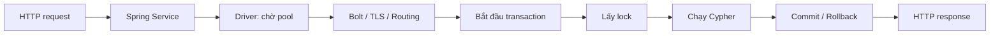
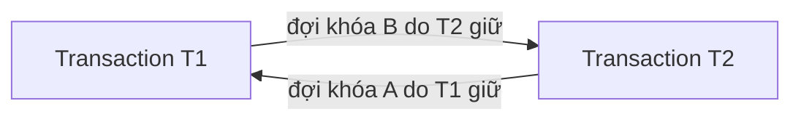
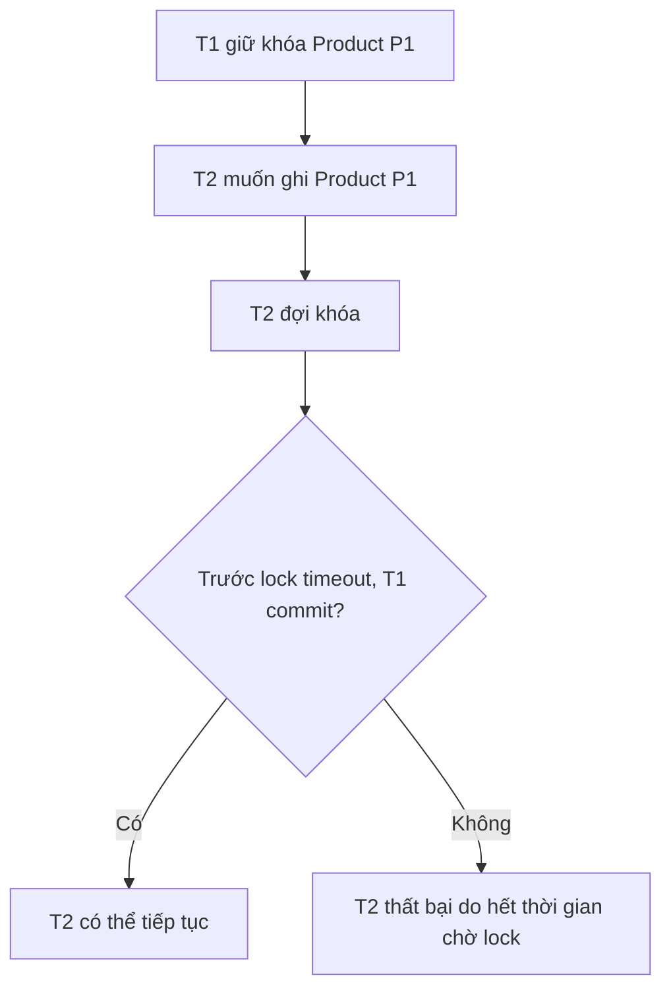
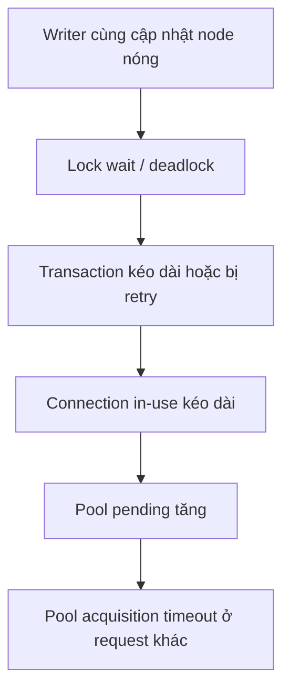

# Deadlock, hết thời gian giao dịch và cạn connection pool trong Neo4j

## 1. Mục tiêu: xác định đúng tầng lỗi trước khi tăng giới hạn

Trong **Neo4j**, ứng dụng lưu và truy vấn dữ liệu liên kết theo mô hình **property graph** với node, relationship và property. Các truy vấn **Cypher** như `MATCH`, `MERGE`, `SET` và duyệt đường đi có thể được thực thi đồng thời từ nhiều service Java. Khi tải tăng hoặc dữ liệu xuất hiện những node được cập nhật rất thường xuyên, ba nhóm sự cố thường bị nhầm lẫn:

- **Deadlock:** hai hay nhiều transaction giữ những khóa mà transaction khác cần, tạo vòng chờ khiến không transaction nào tiến được nếu không có một transaction bị hủy.
- **Hết thời gian giao dịch:** transaction tồn tại lâu hơn giới hạn áp dụng, có thể do Cypher nặng, chờ lock, kết quả đọc chậm hoặc một bước xử lý bên trong transaction mất quá lâu.
- **Cạn connection pool:** ứng dụng không lấy được Bolt connection từ pool của **Neo4j Java Driver** trong thời gian chờ cho phép. Lỗi này có thể xuất hiện **trước khi** transaction mới được mở.

Bài thuộc chương **Xử lý sự cố** của mô-đun `DATABASE_ENGINE_GRAPH_NEO4J`. Nội dung liên hệ **Neo4j server**, **Cypher**, **Neo4j Java Driver**, **Spring Boot/Spring Data Neo4j**, transaction, index/constraint và hoạt động giám sát.

Sau bài này, bạn có thể:

1. Nhận diện deadlock, lock acquisition timeout, transaction timeout và pool acquisition timeout từ **giai đoạn phát sinh** và tín hiệu đi kèm.
2. Hiểu đồ thị chờ khóa (*wait-for graph*) và lý do Neo4j phải hủy một transaction để phá deadlock.
3. Dùng `SHOW TRANSACTIONS`, `SHOW SETTINGS`, `EXPLAIN`/`PROFILE` và metric để khoanh vùng nguyên nhân.
4. Giảm deadlock bằng giao dịch ngắn, thứ tự lấy khóa nhất quán và truy vấn/index phù hợp.
5. Viết retry có giới hạn với Java Driver, hiểu khác biệt giữa retryable transient error và lỗi dữ liệu/quyền.
6. Chẩn đoán cạn pool, session giữ kết nối lâu, driver routing, TLS, truy vấn fan-out và tải theo replica.
7. Thiết kế cảnh báo, bài kiểm thử tải và runbook an toàn khi sự cố tái diễn.

> **Phạm vi phiên bản:** Ví dụ nhắm tới Neo4j 5.x, Java Driver 5.x, Spring Boot 3.x, Spring Data Neo4j tương ứng và Java 17+. Tên mã lỗi, property, cột quản trị, khả năng observability và chiến lược retry có thể thay đổi theo phiên bản/edition, nhất là với Neo4j Aura hoặc cluster. Luôn đối chiếu tài liệu và kiểm tra trực tiếp môi trường hiện hành trước khi chỉnh production.

## 2. Bản đồ vòng đời request và nơi phát sinh lỗi

Một yêu cầu ghi quan hệ có thể đi qua:



Thời gian chờ của những giai đoạn này **không phải một đồng hồ chung**.

| Tình huống | Điểm phát sinh thường gặp | Cần điều tra đầu tiên |
| --- | --- | --- |
| Deadlock | Neo4j phát hiện vòng chờ khóa giữa transaction | Thứ tự ghi/khóa, query và dữ liệu nóng |
| Lock acquisition timeout | Transaction đợi khóa quá thời hạn được cấu hình | Transaction giữ khóa lâu, `waitTime`, mức đồng thời |
| Transaction timeout | Transaction không hoàn tất trong ngân sách thời gian | Query plan, lock wait, vòng đời transaction, timeout riêng |
| Pool acquisition timeout | Driver chờ connection nhưng không nhận được | Pool in-use/pending, session/transaction dài, tải |
| Connect/TLS/routing failure | Chưa tạo được hoặc không dùng được connection tới server | DNS, cert, địa chỉ quảng bá, port, cluster |
| HTTP gateway timeout | Client/proxy bỏ cuộc trước khi backend trả đáp án | HTTP deadline và tình trạng công việc dưới database |

**Ví dụ:** Một API trả `504 Gateway Timeout` không chứng minh Neo4j đã rollback transaction. Có thể gateway đã dừng chờ, trong khi backend vẫn đang chạy hoặc chuẩn bị commit. Muốn biết outcome phải xem transaction/driver response và thiết kế **idempotency** cho retry.

### 2.1. Ba giới hạn cần phân biệt

```text
Driver:  chờ lấy connection tối đa 3 giây
Neo4j:  chờ một lock tối đa       5 giây
Neo4j:  transaction mặc định    20 giây
```

Các con số chỉ là **giả định của ví dụ**. Request A có thể lỗi ở giây 3 vì không lấy được connection, dù chưa tạo transaction. Request B đã có connection, chờ khóa quá 5 giây và thất bại trước mốc 20 giây. Request C không chờ khóa nhưng duyệt graph quá rộng và chạm transaction timeout.

Đừng suy luận “tăng tất cả lên 120 giây là an toàn”: điều đó có thể chỉ làm tài nguyên bị giữ lâu hơn, tăng số request đang xếp hàng và tạo thêm deadlock.

## 3. Deadlock hình thành như thế nào?

### 3.1. Chu trình chờ khóa

Giả sử hai transaction đồng thời cập nhật hai node `:StockItem` có ID `A` và `B`:

| Bước | Transaction T1 | Transaction T2 |
| --- | --- | --- |
| 1 | Lấy khóa ghi node A | Lấy khóa ghi node B |
| 2 | Muốn lấy khóa node B → phải chờ T2 | Muốn lấy khóa node A → phải chờ T1 |
| 3 | Chờ T2 nhả B | Chờ T1 nhả A |



Đây là **vòng chờ**: dù cả hai transaction đều có thời gian rất dài, chúng không thể tự tiến tiếp nếu không có thay đổi. Neo4j có cơ chế phát hiện deadlock và **chọn một transaction để kết thúc/rollback**, cho phép transaction khác tiếp tục khi khóa được giải phóng.

**Phân biệt:**

- Hai transaction cùng tranh node A nhưng T1 đang chạy và T2 chờ đơn thuần **chưa phải deadlock**; chỉ là **lock contention**.
- Deadlock có thể xảy ra rất nhanh, **trước khi** hết transaction timeout.
- Một deadlock làm **một hoặc một số transaction thất bại**; ứng dụng phải xử lý lỗi, không giả định Neo4j tự phát lại toàn bộ thao tác của tầng nghiệp vụ.
- Có thể xuất hiện deadlock với **relationship**, index/constraint hay các thao tác `MERGE` phức tạp; không giới hạn ở ví dụ hai node.

### 3.2. Ví dụ dữ liệu thực hành

Chỉ chạy các câu lệnh ghi sau trên **database test**. Dùng nhãn riêng để tránh nhầm với dữ liệu nghiệp vụ:

```cypher
CREATE CONSTRAINT troubleshooting_stock_id_unique IF NOT EXISTS
FOR (s:TsStockItem)
REQUIRE s.id IS UNIQUE;
```

```cypher
UNWIND ['A', 'B'] AS itemId
MERGE (s:TsStockItem {id: itemId})
ON CREATE SET s.revision = 0;
```

Một câu ghi có thể khiến transaction cần khóa ghi đối với node:

```cypher
MATCH (s:TsStockItem {id: $itemId})
SET s.revision = coalesce(s.revision, 0) + 1
RETURN s.id AS itemId, s.revision AS revision;
```

**Tình huống mô phỏng** cần hai session/transaction riêng:

```text
T1: BEGIN
T1: cập nhật A, giữ transaction chưa commit

T2: BEGIN
T2: cập nhật B, giữ transaction chưa commit

Hai thao tác tiếp theo phải chạy ĐỒNG THỜI:
T1: cập nhật B  → có thể chờ T2
T2: cập nhật A  → có thể tạo vòng chờ

Neo4j phát hiện vòng chờ và hủy một transaction.
```

Đây là **kịch bản điều phối**, không phải một chuỗi Cypher để dán liên tiếp vào một tab. Nếu chạy tuần tự `T1 cập nhật B` rồi đợi kết quả trước khi gửi `T2 cập nhật A`, bạn có thể chỉ gặp **lock timeout**, không tạo được deadlock. Muốn tái hiện cần hai transaction mở trên hai session độc lập và điều khiển được thời điểm các lệnh chờ. **Không thực hành trên production** hoặc các node dữ liệu thật.

### 3.3. Vì sao MERGE và cạnh graph làm tranh chấp phức tạp hơn?

Một lệnh:

```cypher
MATCH (a:Service {id: $callerId})
MATCH (b:Service {id: $dependencyId})
MERGE (a)-[:DEPENDS_ON]->(b);
```

không chỉ là câu “ghi một cạnh”. Nó có thể đọc/tìm node, kiểm tra sự tồn tại của relationship rồi tiến hành ghi với các khóa mà engine cần. Nhiều luồng đồng thời tạo/xóa relationship quanh cùng node hoặc cùng cặp đầu mút có thể tạo contention.

Để giảm rủi ro:

- Có **constraint/index** phù hợp trên khóa định danh để `MATCH` không quét cả graph.
- Chọn chiến lược **ghi cùng thứ tự** khi nghiệp vụ đụng nhiều entity.
- Tránh giữ transaction mở trong lúc gọi HTTP bên ngoài, gửi email hoặc đợi một job khác.
- Không gom một tập graph lớn vào một transaction chỉ để giảm số lần gọi driver.
- Điều tiết số writer cùng tác động lên **node nóng**; cân nhắc đổi thiết kế counter hoặc phân vùng workload.

**Cảnh báo:** Sắp xếp dữ liệu đầu vào bằng `ORDER BY` không phải lời bảo đảm engine sẽ luôn lấy **mọi loại khóa nội bộ** theo một thứ tự duy nhất. Đây là chiến lược giảm tranh chấp cần kiểm chứng theo query và phiên bản, không phải chứng minh hình thức rằng deadlock sẽ biến mất.

## 4. Lock acquisition timeout khác deadlock

### 4.1. Chờ khóa quá thời gian

Giả sử T1 cập nhật một node `:Product` rồi làm công việc dài trước commit, trong khi T2 muốn cập nhật cùng node:



T2 chờ T1 nhưng T1 **không** chờ tài nguyên của T2. Đây không phải vòng deadlock. Neo4j có thể kết thúc transaction chờ khóa theo cấu hình **`db.lock.acquisition.timeout`**.

Ví dụ cấu hình **Neo4j 5**, chỉ để minh họa:

```properties
# neo4j.conf — chỉ áp dụng sau khi kiểm tra phiên bản và thay đổi được phê duyệt
db.lock.acquisition.timeout=5s
```

Trong những bản Neo4j có setting này, giá trị `0s` thường biểu thị **tắt giới hạn lock acquisition timeout**, không phải “không được chờ khóa”. Phải kiểm tra `SHOW SETTINGS` để xác nhận setting và giá trị áp dụng thật. Không nên tắt timeout chỉ vì đang gặp contention.

### 4.2. Giảm thời gian giữ khóa

Ví dụ **không nên**:

```text
BEGIN transaction
  1. SET stock ...
  2. Gọi API thanh toán bên ngoài (chờ 10–30 giây)
  3. Ghi audit vào hệ thống khác
  4. COMMIT transaction Neo4j
```

Khóa graph có thể bị giữ trong lúc đợi thao tác ngoài database. Nếu cần phối hợp thanh toán/gửi sự kiện, cân nhắc mô hình **transaction ngắn + outbox/event + idempotency** phù hợp, thay vì giữ Neo4j transaction xuyên một cuộc gọi mạng không có bảo đảm thời gian.

## 5. Transaction timeout: giao dịch sống quá lâu

### 5.1. Những nguyên nhân phổ biến

Transaction có thể bị timeout vì:

1. Query Cypher có **cardinality/fan-out** quá lớn, ví dụ mở rộng đường đi `*1..6` từ node có hàng nghìn cạnh.
2. Thiếu index/constraint, phải scan nhiều node để tìm khóa nghiệp vụ.
3. Nhiều thao tác ghi hoặc đọc kết quả streaming trong **một transaction rất dài**.
4. Chờ lock hoặc xử lý ở application callback trong khi transaction vẫn mở.
5. Server quá tải CPU, memory, page cache hoặc disk I/O.
6. Client đã đặt một **transaction timeout riêng** ngắn hơn dự kiến.

Ví dụ cấu hình server Neo4j 5:

```properties
db.transaction.timeout=20s
```

Trong cấu hình được tài liệu hóa ở nhiều phiên bản Neo4j 5, `0s` thường là **không đặt timeout mặc định**. Đây là setting cho **mặc định** transaction; ứng dụng có thể đặt timeout theo từng transaction. Không được coi nó là giới hạn tổng thời gian của HTTP request.

### 5.2. Phân biệt những khoảng chờ hay bị nhầm

| Giới hạn | Cấu hình/địa điểm tiêu biểu | Phạm vi |
| --- | --- | --- |
| Transaction mặc định | `db.transaction.timeout` (Neo4j 5) | Vòng đời transaction ở server |
| Lock wait | `db.lock.acquisition.timeout` (Neo4j 5) | Thời gian cố lấy khóa |
| Timeout riêng cho giao dịch | `TransactionConfig.withTimeout(...)` trong Java Driver | Ngân sách của một transaction được chỉ định |
| Retry budget của driver | `spring.neo4j.max-transaction-retry-time` hoặc Driver Config tương ứng | Tổng thời gian retry lỗi transient theo cơ chế driver |
| Connection acquisition | `spring.neo4j.pool.connection-acquisition-timeout` | Chờ connection trong pool |
| HTTP timeout | Framework, ingress/load balancer, client HTTP | Chờ response ngoài database |

**Quan trọng:** Timeout riêng do driver chỉ định có thể **ghi đè mặc định** `db.transaction.timeout` ở những bản Neo4j hiện đại. Không tự suy rằng timeout server mặc định luôn là “trần” cho tất cả transaction. Kết quả thực tế còn chịu giám sát định kỳ, network và các yếu tố khác; không cam kết dừng chính xác ở mili giây cuối cùng.

### 5.3. Rollback và partial commit

Một transaction ghi:

```cypher
UNWIND $rows AS row
MERGE (p:TsImportItem {id: row.id})
SET p.payload = row.payload;
```

Nếu nó **chưa commit** và bị kết thúc/rollback do timeout, những ghi của **transaction đó** không trở thành thay đổi đã commit. Tuy nhiên, nếu ứng dụng đã chia một file lớn thành nhiều transaction, các transaction **đã commit trước đó vẫn tồn tại**.

Ví dụ:

```text
Batch 1: 500 records → COMMIT
Batch 2: 500 records → COMMIT
Batch 3: 500 records → transaction timeout → ROLLBACK
```

Không thể trả lời “mọi dữ liệu đã rollback” vì **1.000 record thuộc hai batch trước đã commit**. Cần thiết kế checkpoint, khóa idempotency và cách resume an toàn.

**Cạnh tranh giữa timeout và commit response:** một lỗi truyền thông ngay sau khi gửi lệnh commit có thể khiến client **không biết chắc** commit đã diễn ra hay chưa. Không phát lại thao tác tăng số lượng/gửi tiền một cách mù quáng; dùng định danh nghiệp vụ duy nhất hoặc ledger sự kiện để đối soát.

## 6. Connection pool cạn: lỗi trước khi Cypher bắt đầu

### 6.1. Neo4j Java Driver quản lý kết nối thế nào?

Neo4j Java Driver duy trì các **Bolt connection** có thể tái sử dụng thay vì kết nối TCP/TLS mới cho mỗi request. Một **Driver** thường dùng lâu dài ở phạm vi ứng dụng; **Session** có phạm vi ngắn và không thread-safe, được đóng sau công việc.

Trong chế độ routing `neo4j://`/`neo4j+s://`, Driver có thể quản lý pool theo **server address**. Vì vậy không được hiểu `maxConnectionPoolSize=30` là toàn bộ deployment chỉ có tối đa 30 connection tới mọi nơi.

Hình dung:

```text
Spring service requests
      │
      ▼
Neo4j Driver pool (mỗi endpoint liên quan)
  • in-use: connection đang làm việc
  • idle: connection có thể tái sử dụng
  • pending: yêu cầu đang chờ connection
      │
      ▼
Bolt/TLS → Neo4j
```

Nếu các connection đang dùng chưa được trả về pool, một request mới có thể chờ đến khi quá **connection acquisition timeout**. Lúc đó request có thể **chưa thực thi câu Cypher nào**.

### 6.2. Ba lý do khiến pool cạn

1. **Concurrency cao hơn năng lực pool**: quá nhiều request đồng thời mở transaction.
2. **Connection bị giữ quá lâu**: query chậm, transaction chờ lock, stream chưa tiêu thụ hết, session/transaction không đóng đúng hoặc làm công việc ngoài database trong callback.
3. **Không tạo được connection mới**: network/TLS/routing failure, giới hạn connection phía server hoặc một endpoint không phản hồi; triệu chứng ngoài mặt có thể giống pool saturation.

### 6.3. Đừng nhầm với JDBC/HikariCP

Spring Boot có thể vừa kết nối PostgreSQL qua **HikariCP**, vừa kết nối Neo4j qua Java Driver. Các metric `hikaricp.connections.active` **không** đo pool Bolt. Muốn hiểu Neo4j phải instrument Driver/connection pool tương ứng, hoặc đo acquisition wait bằng cơ chế được driver hỗ trợ.

### 6.4. Kích thước pool và số replica

Giả sử có 8 pod Spring Boot, mỗi pod cấu hình tối đa 30 connection **cho một server liên quan**:

```text
8 pod × 30 = 240 connection theo giới hạn lý thuyết
```

Đây **không phải** số connection thực tế, và với routing nhiều server, tổng số kết nối có thể khác. Nếu tăng từ 30 lên 100 mà không sửa transaction giữ connection lâu, tải vào Neo4j có thể tăng và **làm thêm deadlock/lock wait**.

Để chọn pool size, nên đo:

- Số request/giây, đỉnh concurrency và thời gian giữ connection.
- Pool in-use/idle/pending và thời gian chờ acquisition.
- Query p50/p95/p99, transaction duration, retry count.
- Số replica, số server routing, giới hạn kết nối và tài nguyên Neo4j.

**Ví dụ ước lượng:** ở mức 50 request/giây, mỗi request giữ connection trung bình 0,4 giây, độ đồng thời trung bình xấp xỉ **20 connection** theo quan hệ throughput × thời gian giữ. Đây chỉ là ước lượng tải trung bình khi giả định ổn định, **không phải** pool size đủ cho mọi burst, p99 và retry.

## 7. Bảng so sánh nhanh bốn lỗi

| Đặc điểm | Deadlock | Lock timeout | Transaction timeout | Pool acquisition timeout |
| --- | --- | --- | --- | --- |
| Vòng chờ giữa nhiều transaction? | **Có** | Không bắt buộc | Không bắt buộc | Không ở tầng khóa graph |
| Transaction đã mở? | Có | Có | Có | Có thể **chưa** |
| Có thể xảy ra rất nhanh? | Có | Theo lock wait budget | Theo transaction budget | Theo pool wait budget |
| Dấu hiệu cần tìm | Deadlock-detected, rollback victim | Blocked/`waitTime` cao | Transaction terminated/time budget | Pool pending/acquisition wait |
| Sửa nguyên nhân | Thứ tự khóa, hot node, giao dịch ngắn | Giảm tranh chấp/giữ khóa | Query plan, batch, timeout hợp lý | Rút ngắn connection hold, giới hạn concurrency |
| Có thể retry? | Có điều kiện, khi lỗi transient và thao tác an toàn | Có điều kiện | Tùy lỗi và timeout, không retry vô hạn | Tùy availability/budget và idempotency |
| Tăng pool giúp không? | Không trực tiếp, có thể làm xấu đi | Không trực tiếp | Không trực tiếp | Có thể sau khi xác minh server còn năng lực |

Mã lỗi cụ thể như **`Neo.TransientError.Transaction.DeadlockDetected`** có thể xuất hiện trong nhiều phiên bản; những bản Neo4j mới hơn cũng có cơ chế phân loại/trạng thái lỗi theo GQL. Đừng dựa duy nhất vào một chuỗi exception cố định: lưu **error code, status, stage, thời điểm, query operation** và đối chiếu danh mục lỗi của phiên bản hiện hành.

## 8. Quan sát transaction đang chạy: SHOW TRANSACTIONS

Với tài khoản được cấp quyền quản trị/quan sát phù hợp, dùng:

```cypher
SHOW TRANSACTIONS
YIELD database, transactionId, username, status,
      elapsedTime, waitTime, activeLockCount
RETURN database, transactionId, username, status,
       elapsedTime, waitTime, activeLockCount
ORDER BY elapsedTime DESC;
```

| Trường | Cách đọc khi xử lý sự cố |
| --- | --- |
| `transactionId` | Định danh để tra log hoặc kết thúc có kiểm soát |
| `status` | Transaction đang chạy, blocked hoặc trạng thái tương ứng theo bản Neo4j |
| `elapsedTime` | Transaction sống bao lâu; bao gồm thời gian chờ |
| `waitTime` | Thời gian chờ liên quan đến lock; giá trị cao gợi ý contention |
| `activeLockCount` | Số lock đang được giữ theo cách Neo4j thống kê |
| `database` | Database liên quan trong hệ multi-database |
| `username` | Service identity; cần phân quyền xem metadata vận hành |

Đây là **ảnh chụp tức thời**: deadlock victim có thể đã rollback và biến mất trước khi bạn chạy lệnh. Vì vậy cần metrics và log lưu theo thời gian để kiểm chứng quá khứ.

### 8.1. Gắn metadata transaction để dễ tra cứu

Trong Java Driver, có thể gắn metadata ít nhạy cảm:

```json
{
  "application": "graph-catalog",
  "operation": "inventory.adjust",
  "workload": "interactive"
}
```

Với Neo4j hỗ trợ cột đó:

```cypher
SHOW TRANSACTIONS
YIELD transactionId, elapsedTime, waitTime, status, metaData
RETURN transactionId, elapsedTime, waitTime, status, metaData
ORDER BY elapsedTime DESC;
```

Không đưa mật khẩu, email khách hàng, token, mã định danh thay đổi liên tục hoặc toàn bộ tham số nhạy cảm vào metadata. Tên operation từ **allowlist ổn định** giúp liên hệ log/metric/trace mà không gây cardinality khổng lồ.

### 8.2. Kiểm tra cấu hình hiệu lực với SHOW SETTINGS

```cypher
SHOW SETTINGS
YIELD name, value, defaultValue, isDynamic
WHERE name IN [
  'db.transaction.timeout',
  'db.lock.acquisition.timeout',
  'db.transaction.concurrent.maximum',
  'db.memory.transaction.max'
]
RETURN name, value, defaultValue, isDynamic
ORDER BY name;
```

Lưu ý:

- Đây là nhóm tên **Neo4j 5**, không mặc định hợp lệ cho Neo4j 4.x hoặc bản mới có thay đổi.
- `SHOW SETTINGS` cần quyền thích hợp và **có thể không khả dụng trên Aura**.
- `isDynamic` phản ánh khả năng thay đổi động, không phải quyền thay đổi và cũng không đảm bảo giá trị lưu bền sau restart nếu chưa cập nhật cấu hình triển khai.
- Kiểm tra trên **server/instance liên quan**, bởi cấu hình trong cluster không nên được suy ra từ chỉ một máy.

Không thay setting chỉ vì một trace chậm; cần đo ngưỡng thực tế, tác động tới các workload khác và có rollback config.

## 9. EXPLAIN/PROFILE: xem Cypher có làm quá nhiều việc không?

Một transaction có thể timeout dù không đợi khóa nếu query xử lý quá nhiều path:

```cypher
MATCH (u:User {id: $userId})-[:FOLLOWS*1..5]->(other:User)
RETURN DISTINCT other.id AS relatedUserId
LIMIT 20;
```

Một node có hàng nghìn neighbor có thể tạo ra số lượng path tăng rất nhanh. `LIMIT 20` giới hạn **số dòng trả cuối**, không bảo đảm engine chỉ phải đọc 20 relationship.

Xem kế hoạch dự kiến:

```cypher
EXPLAIN
MATCH (u:User {id: $userId})-[:FOLLOWS*1..5]->(other:User)
RETURN DISTINCT other.id AS relatedUserId
LIMIT 20;
```

Chỉ trên môi trường được phép thực thi query hoặc query đọc an toàn:

```cypher
PROFILE
MATCH (u:User {id: $userId})-[:FOLLOWS*1..5]->(other:User)
RETURN DISTINCT other.id AS relatedUserId
LIMIT 20;
```

Kiểm tra:

- **Index Seek/Scan:** có index phù hợp để định vị `User.id` hay đang quét toàn nhãn?
- **Rows:** số dòng trung gian tăng mạnh ở bước nào?
- **DB Hits:** engine truy cập dữ liệu bao nhiêu lần theo định nghĩa thống kê của nó; **không phải** số lần đọc disk vật lý.
- **Expand/VarLength:** bao nhiêu node/relationship/path được thăm qua mỗi hop?
- **Sort/Distinct/Aggregation:** có bước cần giữ nhiều dòng hoặc bộ nhớ không?

**`PROFILE` thực thi truy vấn**; không chạy nó với câu `MERGE`/`DELETE` trên production chỉ để xem plan. Với câu ghi, dùng `EXPLAIN` để xem plan hoặc dựng bản sao dữ liệu test cho `PROFILE`.

### 9.1. Index không tự sửa tranh chấp khóa

Ví dụ:

```cypher
CREATE CONSTRAINT stock_item_sku_unique IF NOT EXISTS
FOR (s:StockItem)
REQUIRE s.sku IS UNIQUE;
```

Constraint unique trên `sku` giúp bảo vệ định danh và thường tạo index phục vụ truy vấn tìm node bằng SKU. Nó có thể **giảm thời gian tìm kiếm**, nhưng **không loại bỏ** contention khi hàng trăm writer cùng cập nhật một node `StockItem {sku:'HOT'}`. Phải kết hợp kiểm soát concurrency, transaction ngắn và mô hình ghi phù hợp.

## 10. Retry đúng cách: tránh nhân đôi tác động nghiệp vụ

### 10.1. Khi nào nên thử lại?

Deadlock victim thường thuộc nhóm lỗi **transient**: một transaction mới có thể thành công nếu các khóa khác đã được giải phóng. Tuy nhiên một lỗi retryable ở tầng database **không có nghĩa** toàn bộ thao tác nghiệp vụ của ứng dụng an toàn khi chạy lại.

| Lỗi | Có nên retry tự động? |
| --- | --- |
| Deadlock/transient transaction conflict | Có thể, **trong ngân sách hữu hạn**, nếu callback an toàn để chạy lại |
| Lock acquisition timeout | Có thể cân nhắc backoff, nhưng phải xử lý nguyên nhân contention |
| Pool acquisition timeout khi quá tải | Chỉ khi còn request budget và có cơ chế điều tiết; tránh bão retry |
| DNS/TLS/certificate không hợp lệ | **Không** retry vô hạn; cần sửa cấu hình/cert |
| Unique constraint violation do dữ liệu trùng thật | **Không** retry mù quáng; kiểm tra input/invariant |
| Cypher syntax error | **Không** retry trước khi sửa query |
| Authorization/invalid credentials | **Không** đổi sang tài khoản admin hoặc retry không giới hạn |
| Timeout do query fan-out cố hữu | Retry cùng query thường lặp lại lỗi và chiếm tài nguyên |

### 10.2. Managed transactions của Java Driver

Java Driver hỗ trợ `session.executeRead` và `session.executeWrite`. Với các lỗi transient được phân loại phù hợp, driver có thể **retry callback** theo chiến lược và ngân sách retry cấu hình. Ví dụ Java 17+, Neo4j Java Driver 5.x:

```java
import java.time.Duration;
import java.util.Map;
import org.neo4j.driver.Driver;
import org.neo4j.driver.Session;
import org.neo4j.driver.SessionConfig;
import org.neo4j.driver.TransactionConfig;

public final class InventoryRevisionWriter {
    public static long incrementRevision(
        Driver driver, String database, String itemId
    ) {
        if (itemId == null || itemId.isBlank()) {
            throw new IllegalArgumentException("itemId is required");
        }

        TransactionConfig txConfig = TransactionConfig.builder()
            .withTimeout(Duration.ofSeconds(8))
            .withMetadata(Map.of(
                "application", "catalog-api",
                "operation", "inventory.revision"
            ))
            .build();

        try (Session session =
                 driver.session(SessionConfig.forDatabase(database))) {
            return session.executeWrite(tx ->
                tx.run("""
                    MATCH (s:TsStockItem {id: $itemId})
                    SET s.revision = coalesce(s.revision, 0) + 1
                    RETURN s.revision AS revision
                    """, Map.of("itemId", itemId))
                  .single()
                  .get("revision")
                  .asLong(),
                txConfig
            );
        }
    }
}
```

**Đây là ví dụ kỹ thuật về callback/retry**, không phải thiết kế hoàn chỉnh của nghiệp vụ tồn kho:

- `executeWrite` quản lý commit/rollback cho callback và có thể **thử callback nhiều lần** khi gặp transient error thích hợp.
- Việc tăng `revision` ở đây diễn ra **trong Neo4j transaction**; nếu một attempt bị rollback trước commit thì thay đổi của attempt ấy không được commit. Tuy nhiên, nếu một request nghiệp vụ **đã commit mà client mất phản hồi**, request mới từ HTTP có thể chạy lại, tăng thêm lần nữa.
- Không gửi email, gọi cổng thanh toán, publish event ra hệ ngoài hoặc thực hiện side effect không có idempotency **bên trong callback**.
- Nếu không tìm thấy item, `.single()` sẽ lỗi; ứng dụng thật nên phân biệt **404/business exception** và lỗi transient, không retry sai đối tượng.
- `withTimeout(8s)` là timeout cho mỗi transaction attempt, **không phải giới hạn tuyệt đối cho toàn bộ HTTP request**.

Với nghiệp vụ thay đổi số lượng/tài chính, cần **idempotency key** riêng cho lệnh nghiệp vụ:

```text
commandId = "adj-2026-00042"
itemId    = "A"
delta     = +5

Trong cùng transaction:
  1. Bảo đảm commandId chưa được áp dụng.
  2. Ghi marker/ledger có unique constraint trên commandId.
  3. Chỉ khi marker mới hợp lệ, cập nhật item.
  4. Commit cùng lúc.
```

Đây là **khung thiết kế**, không phải một phép `MERGE` ngắn được bảo đảm chống mọi race. Cần triển khai constraint/index, điều kiện ghi và kiểm thử đồng thời để bảo đảm một `commandId` chỉ tác động một lần.

### 10.3. Retry budget và backoff

Không đặt retry vô hạn ở mọi tầng:

```text
HTTP client:     retry 3 lần
Spring service:  retry 3 lần
Neo4j driver:    retry 3 lần

Trường hợp xấu: số lần xử lý có thể nhân lên rất nhiều.
```

Một chính sách tốt hơn:

1. Đặt **request deadline** và **tổng ngân sách retry** rõ ràng.
2. Chọn **một tầng chính** chịu trách nhiệm retry lỗi transient của Neo4j; các tầng khác tránh chồng retry không kiểm soát.
3. Dùng **exponential backoff có jitter**, giới hạn số attempt và concurrency.
4. Bỏ retry khi lỗi không transient, khi request deadline hết hoặc circuit breaker đang mở.
5. Gắn `commandId`/idempotency cho thao tác có thể bị lặp.
6. Theo dõi retry count, retry delay và tỷ lệ request cuối cùng thành công sau retry.

Với managed transaction của driver, hãy cấu hình retry budget theo phiên bản Java Driver/Spring Boot và đo xem nó **có đủ nhỏ so với deadline HTTP hay không**.

## 11. Spring Boot/Spring Data Neo4j: cấu hình pool và timeout

Một cấu hình minh họa cho Spring Boot 3.x:

```yaml
spring:
  neo4j:
    uri: ${NEO4J_URI}
    authentication:
      username: ${NEO4J_USERNAME}
      password: ${NEO4J_PASSWORD}
    pool:
      max-connection-pool-size: 30
      connection-acquisition-timeout: 3s
      max-connection-lifetime: 1h
    max-transaction-retry-time: 10s

  data:
    neo4j:
      database: ${NEO4J_DATABASE}
```

Trong đó:

| Property | Nghĩa | Không có nghĩa |
| --- | --- | --- |
| `spring.neo4j.pool.max-connection-pool-size` | Số connection tối đa theo cơ chế pool của driver | Số transaction tối đa toàn server/cụm |
| `spring.neo4j.pool.connection-acquisition-timeout` | Thời gian chờ lấy connection | Server query timeout |
| `spring.neo4j.pool.max-connection-lifetime` | Vòng đời tối đa của connection được giữ trong pool | Transaction tự động bị hủy sau 1 giờ |
| `spring.neo4j.max-transaction-retry-time` | Ngân sách retry cho transient failures của driver | Không phải `db.transaction.timeout` hay một quy tắc retry vô hạn |
| `spring.data.neo4j.database` | Database được chọn cho SDN | Không thay thế kiểm tra quyền Neo4j |

Các ngưỡng **30/3s/1h/10s chỉ để học**, không phải default hoặc khuyến nghị sản xuất. Đối chiếu tên property chính xác với phiên bản Boot đang chạy; nếu tự định nghĩa bean `Driver`, cần kiểm tra cấu hình Boot có còn tác dụng không.

### 11.1. Đừng tạo Driver mới cho từng HTTP request

Ví dụ phản diện:

```java
// Sai về quản lý tài nguyên nếu lặp trong mỗi request:
// Driver driver = GraphDatabase.driver(uri, authToken);
// ... run query ...
// Không đóng đúng driver/session
```

Mỗi Driver có thể duy trì pool và các tài nguyên riêng. Trong Spring Boot, ưu tiên inject **bean `Driver` do Boot quản lý**, dùng session theo phạm vi ngắn và để context đóng Driver khi shutdown.

### 11.2. Transaction boundary trong SDN

Một method `@Transactional` của Spring Data Neo4j có thể gồm nhiều repository calls trong **một transaction**. Không giả định vòng lặp 10.000 phần tử tự commit từng lô; nó có thể giữ transaction dài, chiếm connection và lock.

Nếu cần batch:

- Chia ranh giới transaction theo batch ở service phù hợp/`TransactionTemplate`.
- Dùng checkpoint và unique business key; retry một batch không làm ghi trùng.
- Đừng trộn Java Driver transaction tự mở và SDN transaction rồi kỳ vọng chúng tự cùng một transaction.
- Kiểm thử những thao tác chỉ đọc có thể dùng `@Transactional(readOnly = true)`, nhưng thuộc tính này không thay thế quyền đọc do Neo4j server thực thi.

### 11.3. Pool timeout có thể là hậu quả của deadlock

Chuỗi tác động:



Nếu chỉ thấy lỗi pool và tăng `max-connection-pool-size`, ta có thể đẩy **nhiều writer hơn** vào cùng node, làm tranh chấp khóa nặng hơn. Cần đọc cả metric server và driver.

## 12. Điều tra từng bước theo runbook

### 12.1. Bước 1 — Xác định triệu chứng và phạm vi

Ghi lại:

- Thời điểm bắt đầu/kết thúc, môi trường, database và operation.
- Số request/giây, p95/p99, error rate, HTTP 5xx, các Pod bị ảnh hưởng.
- Lỗi xuất phát từ **driver**, **Cypher transaction**, **lock**, **network** hay **gateway**.
- Có release/config/index/migration/job import vừa chạy không?
- Chỉ một tenant hoặc một node nóng bị ảnh hưởng, hay toàn hệ thống?

Không dán nguyên connection URI có password, nội dung query chứa PII hoặc thông tin xác thực vào ticket.

### 12.2. Bước 2 — Liên kết client và server

Ở tầng ứng dụng:

- `graph.operation.duration` và `http.duration` phân theo operation/outcome.
- Pool active/idle/pending, **acquisition wait** và kết nối lỗi.
- Số lần retry, backoff, số request đang chạy.
- Connection failure, TLS/routing/DNS lỗi trên từng endpoint.

Ở tầng server:

- Active/blocked transactions, lock wait, deadlock/rollback/timeout.
- Query duration, DB Hits/rows và plan.
- CPU, heap/GC, page cache, disk I/O và Bolt connection.

Không **lấy HTTP p95 trừ server query p95** để suy ra pool wait p95: các phân vị có thể đến từ **những request khác nhau** và các khoảng đo có thể chồng lấn.

### 12.3. Bước 3 — Khoanh vùng transaction và query

Nếu có quyền:

```cypher
SHOW TRANSACTIONS
YIELD database, transactionId, status, elapsedTime,
      waitTime, activeLockCount, metaData
RETURN database, transactionId, status, elapsedTime,
       waitTime, activeLockCount, metaData
ORDER BY elapsedTime DESC;
```

Sau đó kiểm tra query template theo `operation` bằng log/trace đã được kiểm soát; dùng `EXPLAIN` hoặc `PROFILE` an toàn trên môi trường test với dataset đại diện.

### 12.4. Bước 4 — Đặt giả thuyết có thể bác bỏ

| Giả thuyết | Bằng chứng cần tìm | Thử nghiệm có kiểm soát |
| --- | --- | --- |
| Deadlock do thứ tự update ngược | Deadlock exception, cùng cặp entity, query update A/B đảo chiều | Sắp thứ tự thao tác ở app và chạy load test |
| Khóa giữ quá lâu | `waitTime` cao, transaction dài, callback gọi API ngoài | Rút ngắn transaction, tách I/O ngoài |
| Pool quá nhỏ so với tải hợp lệ | Pending cao, DB còn capacity, transaction/query bình thường | Tăng pool có giới hạn, đo cả phía server |
| Query fan-out | Plan có nhiều rows/DB Hits, scan, depth lớn | Thêm index/giới hạn hop/đổi truy vấn |
| Retry storm | Retry count cao, traffic DB vượt request đầu vào | Giảm tầng retry, thêm jitter và concurrency limit |
| Routing/TLS lỗi | Connection creation failure trên một endpoint | Sửa DNS/CA/advertised address, giữ `+s` |
| Bị chặn bởi batch import | Lock wait/pool pending tăng trùng giờ import | Giảm batch concurrency, cô lập job và đo lại |

Chọn **một thay đổi chính** cho mỗi lượt thử khi có thể. Nếu cùng lúc tăng pool, timeout và heap, rất khó biết vấn đề nào được khắc phục.

### 12.5. Bước 5 — Khôi phục trong lúc sự cố

Các biện pháp tạm thời có thể cân nhắc theo mức độ:

1. **Giảm concurrency** của writer hoặc pause batch import nếu đang gây tranh chấp.
2. Tạm thời hạn chế endpoint truy vấn graph sâu hoặc đặt rate limit.
3. Điều chỉnh traffic/routing khi một Neo4j member lỗi và có phương án được hỗ trợ.
4. Cho phép request lỗi được trả mã rõ ràng, kèm retry-after hợp lý khi có chính sách.
5. Với transaction bị kẹt nghiêm trọng, đội vận hành có quyền có thể **terminate có kiểm soát**, sau khi xem ảnh hưởng của rollback.

Không dùng tài khoản app để terminate tùy tiện transaction của người khác; thao tác quản trị như `TERMINATE TRANSACTIONS` đòi quyền phù hợp và có thể khiến công việc hợp lệ thất bại.

## 13. Ba kịch bản chẩn đoán minh họa

### Kịch bản A: deadlock khi điều chỉnh hai tài khoản

**Dữ liệu:** `Wallet A` và `Wallet B`. Yêu cầu chuyển A→B và B→A diễn ra đồng thời, mỗi transaction cập nhật node nguồn trước.

**Tín hiệu:**

- Một transaction nhận deadlock-detected/transient error.
- Các yêu cầu liên quan chạm cùng cặp node.
- Thứ tự lấy khóa trong hai luồng đảo chiều.
- Một số request khác thành công sau khi victim rollback.

**Khắc phục:**

1. Xác nhận không có side effect ngoài transaction trong callback.
2. Thiết kế thứ tự chạm node nhất quán theo business ID.
3. Rút ngắn transaction, thêm index khóa nghiệp vụ.
4. Cho phép retry bounded với idempotency key; tránh cộng trừ tiền hai lần khi client retry request.
5. Load test nhiều cặp A/B, xác nhận số deadlock giảm và ledger cân bằng.

**Không kết luận:** “Tăng `db.lock.acquisition.timeout` từ 5s lên 60s sẽ loại deadlock.” Vòng chờ không được giải quyết bằng cách chỉ đợi lâu hơn.

### Kịch bản B: transaction timeout vì mở rộng đường đi quá rộng

**Dữ liệu:** mạng quan hệ `User-[:FOLLOWS]->User`, query đi tối đa 6 hop, sau đó `DISTINCT` và `LIMIT 20`.

**Tín hiệu:**

- Transaction timeout tăng khi gặp một số user có fan-out lớn.
- `PROFILE` cho thấy rows/DB Hits phình nhanh qua bước expand.
- Pool in-use có thể tăng vì các query giữ connection lâu.
- CPU server cao, không nhất thiết có lock wait.

**Khắc phục:**

1. Thêm điều kiện chọn node xuất phát bằng khóa được index.
2. Giảm độ sâu hoặc dùng thuật toán/chiến lược duyệt được giới hạn rõ.
3. Giới hạn tập ứng viên trước bước mở rộng khi bài toán cho phép.
4. Đo cardinality và latency trên dataset đại diện.
5. Chỉ nới timeout sau khi truy vấn và giới hạn kết quả đã hợp lý.

### Kịch bản C: cạn pool khi Neo4j không quá tải CPU

**Số liệu minh họa:**

```text
Pod app:            6 replica
Pool max:           20 connection/endpoint
Pool in-use:        gần mức tối đa
Pool pending:       tăng liên tục
HTTP p95:           2,5 giây
Neo4j CPU:          35%
Long transactions:  nhiều transaction mở 10–30 giây
```

**Chẩn đoán:** CPU 35% không chứng minh DB “rảnh”; có thể đang đợi lock/disk hoặc client. Đọc `SHOW TRANSACTIONS`, query logs và tracing để xem ai giữ connection. Kiểm tra session có đóng đúng, kết quả streaming có được consume và transaction có bao gồm xử lý HTTP ngoài.

**Khắc phục:** rút ngắn transaction, đóng session/consume result đúng, giới hạn concurrent requests. Nếu sau đó query và database còn capacity nhưng pool wait vẫn cao, thử tăng pool **từng bước** có benchmark, không tăng một lần từ 20 lên 200.

## 14. Chia lô nhập và kiểm soát node nóng

Khi nhập hàng triệu node/relationship bằng `MERGE`, một transaction lớn vừa tốn bộ nhớ vừa có thể giữ lock lâu, dẫn đến timeout và ảnh hưởng traffic tương tác.

Một lựa chọn trong Neo4j mới là:

```cypher
UNWIND $rows AS row
CALL (row) {
  MERGE (p:TsImportItem {id: row.id})
  SET p.payload = row.payload
} IN TRANSACTIONS OF 500 ROWS;
```

**Lưu ý phiên bản:** Cú pháp `CALL (row) { ... }` sử dụng variable scope clause, có trong Neo4j 5.23 trở lên và các bản mới hỗ trợ. Với bản 5.x cũ hơn, phải dùng cú pháp và điều kiện được tài liệu của bản đó cho phép.

**Giới hạn kỹ thuật:**

- `IN TRANSACTIONS` cần chạy từ **implicit transaction**, không đặt trực tiếp trong callback managed transaction `executeWrite` của Java Driver.
- Mỗi batch **commit riêng**, nên lỗi ở batch sau không rollback batch trước.
- `OF 500 ROWS` chỉ giới hạn số dòng mỗi batch, không cam kết byte hay thời gian giữ khóa.
- Nếu nhiều worker cùng `MERGE` vào một ID nóng, chia batch **không tự loại contention**; phải điều tiết/chia khóa đầu vào hoặc đổi kiến trúc ghi.
- Cần checkpoint, idempotency và constraint unique trên `TsImportItem.id` để bảo vệ cách retry.

**Không chạy đoạn ghi minh họa trên production.** Trong môi trường thật, chọn batch size bằng phép thử tải và đo transaction duration, lock wait, pool pending, RAM/GC và tỷ lệ rollback.

### 14.1. Nguyên tắc với hot node

Một node chứa counter như:

```cypher
MATCH (p:Product {sku: $sku})
SET p.viewCount = coalesce(p.viewCount, 0) + 1;
```

có thể bị hàng nghìn request cùng tranh khóa. Những hướng thay thế tùy nghiệp vụ:

- Gom sự kiện vào hàng đợi rồi cập nhật theo đợt.
- Ghi event/relationship riêng có khóa unique thay vì tăng một property mỗi lần.
- Phân vùng counter, hợp nhất định kỳ khi chấp nhận tính trễ.
- Dùng cache/rate limit và hạn chế người dùng trực tiếp ghi node nóng.

Mỗi lựa chọn có đánh đổi **độ trễ quan sát, tính nhất quán, chi phí và khả năng đọc**. Đừng thay mô hình dữ liệu chỉ để làm metric deadlock đẹp hơn nếu nghiệp vụ đòi cập nhật đồng bộ chính xác.

## 15. Quan sát và cảnh báo

### 15.1. Metrics xuyên tầng

| Lớp | Tín hiệu | Giúp trả lời |
| --- | --- | --- |
| HTTP/API | p50/p95/p99, RPS, 5xx, request deadline | Người dùng có bị ảnh hưởng? |
| Graph operation | Duration theo operation, retry count/outcome | Luồng nào đang lỗi và mất bao lâu? |
| Driver pool | In-use/idle/pending, acquisition latency | Request đang đợi connection? |
| Bolt/routing | Reconnect, TLS/DNS/routing failures | Có endpoint không truy cập được? |
| Server transaction | Active, blocked, deadlock/rollback, lock wait | Có tranh chấp/transaction dài? |
| Cypher | Query duration, DB Hits, rows, index scan | Query có đọc quá nhiều dữ liệu? |
| JVM/storage | CPU, heap/GC, page cache, disk latency | Hệ thống có thiếu tài nguyên? |
| Batch import | Batch committed, checkpoint, retry, throughput | Job nền có gây contention không? |

Tên metric thực tế cần kiểm tra theo **Neo4j version/edition/Java Driver/exporter**. Không dùng **HikariCP** metric thay cho Neo4j Driver pool và không mặc định mọi driver có cùng tên gauge. Với Spring Boot, có thể dùng Micrometer/Actuator để đo **graph operation duration** ở tầng service, nhưng phải ghi rõ phạm vi đo có bao gồm pool wait, network, retry và mapping DTO hay không.

### 15.2. Thiết kế alert có ý nghĩa

Một số nguyên tắc:

- **Deadlock rate tăng cùng số request lỗi:** cần xem thiết kế transaction và hot-node traffic.
- **Pool pending tăng kéo dài + p95 API xấu:** xem query/transaction duration và số connection đang dùng.
- **Lock wait cao + rollback tăng:** xem các transaction ghi chung node/relationship.
- **Transaction timeout tăng + DB Hits/Rows tăng:** nghi ngờ truy vấn fan-out/index.
- **Routing/TLS errors tăng nhưng CPU thấp:** ưu tiên điều tra network/certificate/advertised address.

Không alert chỉ vì **CPU > một con số ngẫu nhiên**. Kết hợp tác động người dùng, saturation và ngưỡng có **thời gian duy trì**, tránh alert fatigue.

### 15.3. Bảo mật dữ liệu chẩn đoán

Không ghi trong metric labels:

```text
password
accessToken
raw Cypher kèm PII
customerEmail
requestId với giá trị mới cho mọi request
```

Dùng operation name từ allowlist như `inventory.adjust`, `product.details` và `graph.import-batch`. Request ID có thể nằm trong log/trace có quyền truy cập và thời hạn lưu trữ; nó không nên trở thành nhãn time series có cardinality vô hạn.

## 16. Khả năng theo phiên bản và môi trường

| Môi trường | Điều cần xác minh |
| --- | --- |
| Neo4j 4.x | Tên setting có thể có tiền tố `dbms.`; câu lệnh/cột quản trị và error code theo bản cũ |
| Neo4j 5.x | `db.transaction.timeout`, `db.lock.acquisition.timeout`, `SHOW SETTINGS`/`SHOW TRANSACTIONS` theo edition và quyền |
| Những bản Neo4j mới hơn | GQL status/error classification, defaults, deprecations, cú pháp Cypher |
| Neo4j Aura | Không mặc định chỉnh được `neo4j.conf` hoặc chạy đầy đủ lệnh quản trị; dùng công cụ dịch vụ hỗ trợ |
| Driver 5.x / phiên bản khác | Retry policy, transaction config, pool metrics, exception shape |
| Spring Boot 3.x / SDN | `spring.neo4j.pool.*`, health, transaction manager, logging và retry config |
| Docker/Kubernetes | Số replica, cgroup limit, termination/grace, kết nối routing, readiness |

**Một lỗi có thể mang cùng ý nghĩa nhưng khác tên exception** khi thay driver/server. Hãy dựa vào **tầng phát sinh**, mã lỗi phân loại và telemetry thực tế, không chỉ tìm đúng một chuỗi trong stack trace.

## 17. Những cách “sửa nhanh” nguy hiểm

| Cách làm hấp tấp | Tại sao nguy hiểm | Phương án tốt hơn |
| --- | --- | --- |
| Tăng mọi timeout lên 5 phút | Giữ connection/lock lâu, che query lỗi | Đo và sửa tầng gây chờ |
| Tăng pool lên 200 ngay | Có thể tăng concurrency và contention | Benchmark, giới hạn writer, nâng dần nếu đủ capacity |
| Retry mọi exception vô hạn | Bão retry và ghi lặp | Retry transient bounded + idempotency |
| Dùng tài khoản admin để xem/sửa nhanh | Mở rộng quyền và rủi ro bảo mật | Tài khoản vận hành có quyền cụ thể |
| Tắt TLS vì driver lỗi | Mất xác thực server và an toàn đường truyền | Sửa cert/CA/SAN/DNS |
| Đóng/kill mọi transaction dài | Có thể phá import/migration hợp lệ | Phân loại workload, terminate có kiểm soát |
| Chỉ nhìn CPU database | Bỏ qua lock, disk, pool và app serialization | Metrics + logs + traces xuyên tầng |
| Dựa vào `LIMIT 20` để bảo đảm query nhẹ | Fan-out/aggregation vẫn có thể lớn | Giới hạn tập node, hop và xem plan |
| Tăng heap mà không đổi container memory | OOMKill hoặc GC nhiều hơn | Lập ngân sách memory tổng thể |
| Ghi log cả query params/password | Lộ dữ liệu nhạy cảm | Masking, operation ID, giới hạn retention |
| Rollback HTTP request tự động sau lỗi commit chưa rõ | Có thể nhân đôi side effect | Command ID + ledger đối soát |

## 18. Bài tập thực hành có gợi ý

### Bài 1 — Deadlock hay chỉ chờ khóa?

T1 đang giữ khóa node A và xử lý một thao tác độc lập. T2 muốn sửa A nên chờ T1. T1 **không đợi** tài nguyên nào do T2 giữ.

**Câu hỏi:** đây là deadlock không?

**Gợi ý:** **không**. Đây là lock contention đơn hướng. Nếu thời gian chờ đủ lâu, T2 có thể gặp `db.lock.acquisition.timeout`. Deadlock đòi vòng chờ giữa transaction.

### Bài 2 — Tạo vòng chờ

T1 giữ khóa A và cần B. T2 giữ khóa B và cần A. Giải thích vì sao tăng transaction timeout không làm chu trình tự hết.

**Gợi ý:** hai transaction phụ thuộc vòng; một bên cần rollback hoặc giải phóng khóa để bên kia tiến tiếp. Neo4j có cơ chế deadlock detection để chọn transaction victim.

### Bài 3 — Pool timeout trước khi query bắt đầu

Ứng dụng có 20 connection đang dùng và hàng chục request đang chờ. Một request mới báo lỗi sau 3 giây, dù Neo4j transaction timeout mặc định là 20 giây.

**Gợi ý:** lỗi **pool acquisition** ở phía driver; request có thể chưa mở transaction. Điều tra active/pending, session/transaction dài, query duration và routing; không tăng `db.transaction.timeout` để chữa pool.

### Bài 4 — Kết quả benchmark mâu thuẫn?

API p95 là 900 ms, graph service p95 là 740 ms, query server p95 là 180 ms và pool wait p95 là 490 ms. Có được tính 740 − 490 = 250 ms là p95 query+mapping không?

**Gợi ý:** không. **Các phân vị không trừ được như thời gian của cùng request.** Cần trace/span tương ứng từng request hoặc đo phạm vi nối tiếp không chồng lấn để phân rã.

### Bài 5 — Retry và side effect

Trong `executeWrite` callback, service thực hiện `SET stock = stock - 1` rồi **gửi email xác nhận** trước khi callback hoàn thành. Sau một lỗi transient, driver retry callback.

**Gợi ý:** email có thể được gửi nhiều lần dù một attempt transaction bị rollback. Di chuyển side effect sang outbox/event và cơ chế gửi idempotent sau commit; dùng command ID tránh xử lý lặp từ HTTP.

### Bài 6 — Batch và rollback

Job nhập 2.200 dòng, chia batch 500. Hai batch đầu commit, batch thứ ba timeout; còn batch thứ tư và thứ năm chưa có thông tin.

**Đáp án:** 1.000 dòng của hai batch đầu có thể đã commit theo giả định; batch thứ ba rollback. Không được suy rằng tất cả 2.200 dòng đã rollback hoặc các batch sau đã chạy. Cần checkpoint/idempotency và kiểm tra outcome thực.

### Bài 7 — Kiểm tra nguyên nhân thật trước khi tăng pool

Một pod có pool maximum 30, `in-use=30`, `pending=45`, CPU Neo4j khoảng 35%, lock wait cao và nhiều transaction mở hơn 20 giây.

**Gợi ý:** pool cạn có thể là **hậu quả** của transaction chờ khóa. Trước tiên giảm contention/transaction duration, sau đó đánh giá pool dưới cùng mức tải. CPU thấp không đủ chứng minh server khỏe.

### Bài 8 — Thiết kế runbook 15 phút đầu

Bạn nhận alert “5xx tăng + pool pending cao” sau khi một job import bắt đầu. Hãy viết danh sách kiểm tra trong 15 phút đầu với điều kiện dừng job và phương án phục hồi API.

**Gợi ý:** xác định tác động, xem metric pool/lock/transaction, kiểm tra batch concurrency và hot nodes, tạm giảm/pause job theo quyền, giám sát readiness/p95, tránh restart storm hoặc retry vô hạn; lưu timeline và bằng chứng, rồi sửa batch/checkpoint sau sự cố.

## 19. Checklist trước khi đưa vào production

- [ ] Đã phân biệt deadlock, lock wait, transaction timeout và pool acquisition timeout.
- [ ] Có transaction timeout và lock timeout phù hợp với workload; xác minh giá trị đang chạy theo đúng phiên bản.
- [ ] Có dashboard p95/p99, errors, retry, pool in-use/pending, lock wait và transaction duration.
- [ ] Java Driver được tái sử dụng, session đóng đúng và result được consume trong phạm vi phù hợp.
- [ ] Transaction ngắn; không gọi dịch vụ ngoài hoặc đợi user input khi đang giữ lock.
- [ ] Những luồng cập nhật nhiều node có chiến lược thứ tự khóa nhất quán khi phù hợp.
- [ ] Index/constraint trên business key được kiểm tra; query plan không scan/fan-out quá mức.
- [ ] Có giới hạn hop, kết quả, phân trang và batch theo số dòng/thời gian/tài nguyên.
- [ ] Managed transaction callback không chứa side effect ngoài Neo4j không idempotent.
- [ ] Retry có backoff, jitter và tổng deadline; không retry lỗi không transient.
- [ ] Các lệnh ghi quan trọng có command ID/ledger hoặc cơ chế chống xử lý lặp đã kiểm thử.
- [ ] Pool sizing dựa trên concurrency thực, số replica và routing endpoints.
- [ ] Có test deadlock/lock timeout/pool saturation trên môi trường cô lập.
- [ ] Có cơ chế tạm giảm concurrency hoặc dừng batch import khi ảnh hưởng API.
- [ ] `SHOW TRANSACTIONS` và quản trị terminate chỉ dành cho tài khoản được cấp quyền.
- [ ] Không ghi password/token/PII vào logs, trace metadata hoặc metric labels.
- [ ] Đã thử rollback/commit outcome không rõ, phục hồi sau transient failure và graceful shutdown.
- [ ] Có runbook, owner, điều kiện can thiệp và kế hoạch rollback config.

## Kết luận

**Deadlock, transaction timeout và connection pool cạn thường xuất hiện cùng nhau, nhưng không phải cùng một lỗi.** Deadlock là vòng chờ khóa giữa các transaction; lock timeout là chờ khóa quá hạn; transaction timeout là vượt ngân sách vòng đời giao dịch; pool acquisition timeout là chờ **kết nối** quá lâu, đôi khi trước cả khi Cypher bắt đầu. Vì vậy, hướng xử lý đúng là **xác định giai đoạn lỗi → liên kết metric của app/pool/server → xem transaction và query plan → sửa contention/query/concurrency → chỉ sau đó cân nhắc timeout/pool size**. Retry giúp phục hồi một số lỗi transient nhưng phải bị giới hạn và có **idempotency** để tránh tác động nghiệp vụ bị nhân đôi. Khi thiết kế đúng khóa nghiệp vụ, transaction ngắn, batch có checkpoint, bảo mật telemetry và kiểm thử tải, hệ thống Neo4j có thể tiếp tục phục vụ ổn định ngay cả khi graph và số request tăng mạnh.

### Tài liệu tham khảo

- [Neo4j Operations Manual — Transaction management](https://neo4j.com/docs/operations-manual/current/database-internals/transaction-management/)
- [Neo4j Operations Manual — Show and terminate transactions](https://neo4j.com/docs/operations-manual/current/database-internals/show-and-terminate-transactions/)
- [Neo4j Operations Manual — Configuration settings](https://neo4j.com/docs/operations-manual/current/configuration/configuration-settings/)
- [Neo4j Cypher Manual — Execution plans](https://neo4j.com/docs/cypher-manual/current/planning-and-tuning/execution-plans/)
- [Neo4j Cypher Manual — Indexes and constraints](https://neo4j.com/docs/cypher-manual/current/constraints/)
- [Neo4j Java Driver Manual — Transactions](https://neo4j.com/docs/java-manual/current/transactions/)
- [Neo4j Java Driver Manual — Performance](https://neo4j.com/docs/java-manual/current/performance/)
- [Spring Data Neo4j Reference](https://docs.spring.io/spring-data/neo4j/reference/)
- [Spring Boot Reference — Neo4j configuration](https://docs.spring.io/spring-boot/reference/data/nosql.html#data.nosql.neo4j)
