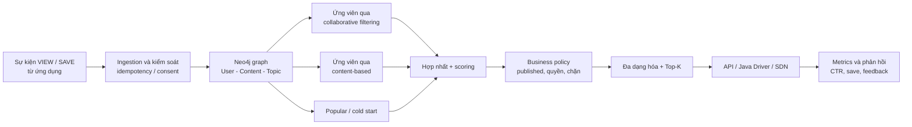
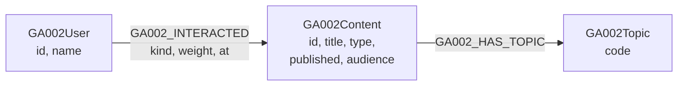
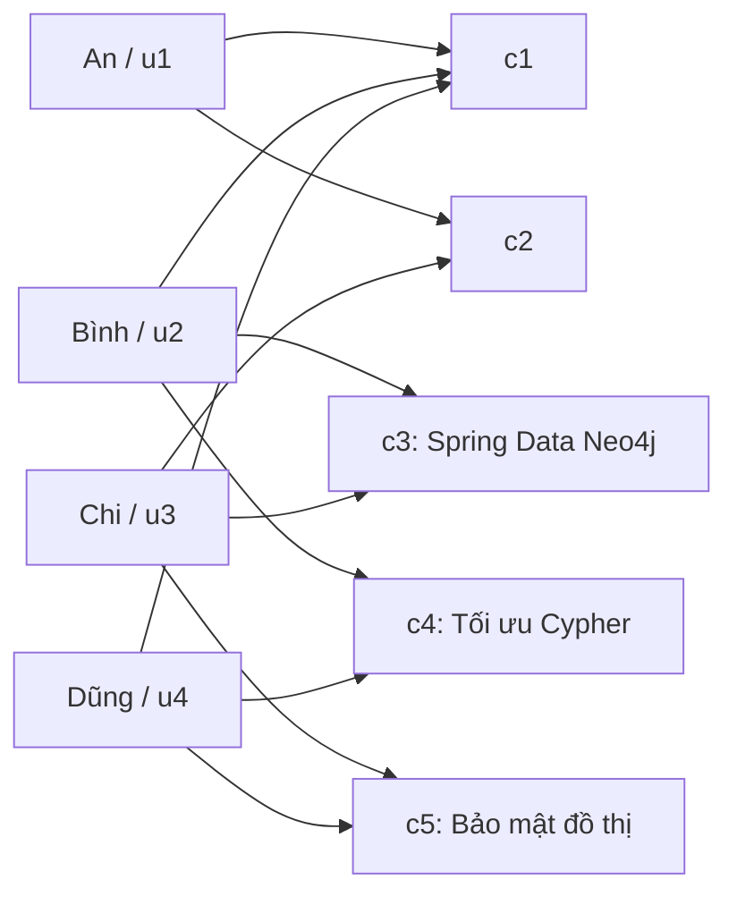

# Gợi ý sản phẩm hoặc nội dung dựa trên quan hệ và hành vi

## 1. Bài toán: từ các mối quan hệ đến danh sách gợi ý có ích

Một nền tảng học tập có hàng nghìn bài viết, khóa học và tài liệu Neo4j. Người dùng đã xem một số nội dung, lưu một số bài, theo dõi chủ đề yêu thích. Khi mở trang chủ, hệ thống cần trả lời: **"Nội dung nào người dùng này có khả năng quan tâm tiếp theo?"**

Trong Neo4j, bài toán này phù hợp với **property graph**: node biểu diễn người dùng, nội dung, chủ đề; relationship biểu diễn hành vi và ngữ nghĩa liên kết. Cypher giúp đi qua các đường quan hệ như:

```text
(Người dùng hiện tại)-[:INTERACTED]->(Nội dung đã xem)
                      <-[:INTERACTED]-(Người dùng tương tự)
                      -[:INTERACTED]->(Nội dung chưa xem)
```

hoặc:

```text
(Người dùng)-[:INTERACTED]->(Nội dung đã thích)
              -[:HAS_TOPIC]->(Chủ đề)
              <-[:HAS_TOPIC]-(Nội dung liên quan)
```

Hai lối duyệt tạo hai nhóm **ứng viên gợi ý** khác nhau. Tiếp theo, hệ thống cần lọc các mục không hợp lệ, tính điểm, sắp xếp, giải thích và trả kết quả nhanh cho ứng dụng qua **Neo4j Java Driver** hoặc **Spring Data Neo4j**.

Bài học thuộc chương **Ứng dụng đồ thị** của module `DATABASE_ENGINE_GRAPH_NEO4J`: sử dụng Neo4j để mô hình hóa dữ liệu liên kết theo property graph, truy vấn node/relationship/đường đi bằng Cypher và vận dụng index, constraint, tối ưu truy vấn cùng tích hợp Java.

**Mục tiêu học tập:**

1. Thiết kế graph `User–Content–Topic` và mô hình hóa hành vi có trọng số.
2. Tạo gợi ý **collaborative filtering** dựa trên người dùng có tương tác chung.
3. Tạo gợi ý **content-based** từ các chủ đề nối với nội dung người dùng từng quan tâm.
4. Hợp nhất nguồn ứng viên, chuẩn hóa điểm, lọc nội dung đã xem hoặc không được phép.
5. Xử lý **cold start**, độ mới, thiên lệch phổ biến, đa dạng hóa và giải thích gợi ý.
6. Triển khai câu truy vấn có tham số bằng Java Driver; hiểu lúc nào chọn `Neo4jClient`.
7. Dùng `EXPLAIN`/`PROFILE`, index, giới hạn độ rộng truy vấn và đo đánh giá offline/A/B.

## 2. Kiến trúc đề xuất: candidate generation → ranking → policy filtering



| Bước | Đầu vào | Đầu ra | Rủi ro cần kiểm soát |
|---|---|---|---|
| **Ghi hành vi** | User, nội dung, event, thời gian | Relationship hoặc sự kiện nguồn | Trùng event, dữ liệu không có consent |
| **Tạo ứng viên** | Các đường đi trong graph | Tập nội dung chưa tương tác | Fan-out, người dùng/nội dung nhiều bậc |
| **Tính điểm** | Overlap, trọng số hành vi, chủ đề | Điểm cho mỗi candidate | Hai thang điểm khác nhau, thiên lệch hành vi |
| **Lọc chính sách** | Published, quyền truy cập, tenant, stock | Tập ứng viên hợp lệ | Lộ nội dung nội bộ/cross-tenant |
| **Xếp hạng và đa dạng** | Điểm + ràng buộc UX | Top-K cuối | Gợi ý lặp, một chủ đề áp đảo |
| **Đo lường** | Impression/click/save/conversion | Metric offline và online | Feedback loop, leakage, chỉ tối ưu click |

Đường graph chỉ là **nguồn tín hiệu**. Neo4j không mặc nhiên có một thuật toán "tự hiểu người dùng"; chất lượng phụ thuộc dữ liệu, định nghĩa hành vi, mục tiêu và kiểm thử.

## 3. Mô hình dữ liệu: node và relationship

Ta xây một mô hình nhỏ, dễ kiểm chứng bằng Cypher. Tên nhãn có tiền tố `GA002` để không trùng với dữ liệu nghiệp vụ.



### 3.1. Ý nghĩa các node

| Node | Thuộc tính | Vai trò |
|---|---|---|
| `GA002User` | `id`, `name` | Định danh chủ thể; không dùng tên làm khóa |
| `GA002Content` | `id`, `title`, `type`, `published`, `audience` | Bài viết, khóa học hoặc một sản phẩm có thể gợi ý |
| `GA002Topic` | `code` | Chủ đề dùng chung, ví dụ `neo4j`, `java` |

### 3.2. Ý nghĩa relationship

| Loại | Hướng | Thuộc tính | Ý nghĩa |
|---|---|---|---|
| `GA002_INTERACTED` | `User → Content` | `kind`, `weight`, `at` | Dấu hiệu người dùng đã tương tác |
| `GA002_HAS_TOPIC` | `Content → Topic` | Không cần trong lab | Nội dung được gắn chủ đề |

Trong lab, **mỗi cặp user–content chỉ có một cạnh `GA002_INTERACTED`**, đại diện hành vi tổng hợp/ưu tiên được lưu gần nhất. Điều này giữ phép tính đơn giản, nhưng **không** phù hợp để lưu mọi sự kiện xem, click, mua hàng theo lịch sử.

Ở production, thường cần tách:

- **Event log bất biến** ở hệ thống sự kiện/warehouse: mỗi view/click/purchase có `eventId`, `occurredAt`, `userId` và chính sách giữ dữ liệu.
- **Cạnh tương tác tổng hợp** trong Neo4j: `weight`, `lastAt`, `count` hoặc các đặc trưng phục vụ đọc nhanh.
- Cơ chế chống nạp lặp bằng `eventId`, batch/checkpoint và quy tắc xử lý event đến muộn.

Không tạo một relationship trùng cho mỗi lần click nếu câu truy vấn xếp hạng giả định mỗi cặp user–content chỉ có một cạnh; nếu muốn nhiều cạnh, phải chủ động tổng hợp trước khi tính điểm.

### 3.3. Gợi ý sản phẩm so với nội dung

Với thương mại điện tử, đổi `GA002Content` thành `Product` và giữ nguyên ý tưởng `User–Product–Category/Brand`. Nhưng **điều kiện hợp lệ** của product có thể gồm tồn kho, giá, vùng bán, tình trạng bị khóa, pháp lý và khả năng giao hàng. Điểm tương tự cao **không** cho phép bỏ qua lọc sản phẩm không thể bán. Trong bài này, chúng ta minh họa bằng nội dung có `published` và `audience`.

## 4. Tạo fixture có thể chạy lại

**Chỉ chạy lệnh ghi trên database thực hành**. Dữ liệu mẫu đủ nhỏ để kiểm tra kết quả bằng tay; số lượng không đại diện cho quy mô hay độ chính xác của một hệ thống đề xuất thật.

### 4.1. Tạo constraint theo khóa nghiệp vụ

```cypher
CREATE CONSTRAINT ga002_user_id IF NOT EXISTS
FOR (u:GA002User)
REQUIRE u.id IS UNIQUE;
```

```cypher
CREATE CONSTRAINT ga002_content_id IF NOT EXISTS
FOR (c:GA002Content)
REQUIRE c.id IS UNIQUE;
```

```cypher
CREATE CONSTRAINT ga002_topic_code IF NOT EXISTS
FOR (t:GA002Topic)
REQUIRE t.code IS UNIQUE;
```

Constraint giúp `MATCH (me:GA002User {id: $userId})` bắt đầu từ một node xác định và giúp `MERGE` theo ID dễ kiểm soát hơn. Đừng tự tạo index cho mọi property; hãy chọn theo workload và kiểm tra plan.

### 4.2. Tạo sáu người dùng

```cypher
UNWIND [
  {id: 'u1', name: 'An'},
  {id: 'u2', name: 'Bình'},
  {id: 'u3', name: 'Chi'},
  {id: 'u4', name: 'Dũng'},
  {id: 'u5', name: 'Hà'},
  {id: 'u6', name: 'Người mới'}
] AS row
MERGE (u:GA002User {id: row.id})
SET u.name = row.name;
```

`u6` **chưa có hành vi** để minh họa cold start.

### 4.3. Tạo bảy nội dung

```cypher
UNWIND [
  {id: 'c1', title: 'Neo4j căn bản',
   type: 'ARTICLE', published: true, audience: 'PUBLIC'},
  {id: 'c2', title: 'Java Driver',
   type: 'COURSE', published: true, audience: 'PUBLIC'},
  {id: 'c3', title: 'Spring Data Neo4j',
   type: 'ARTICLE', published: true, audience: 'PUBLIC'},
  {id: 'c4', title: 'Tối ưu Cypher',
   type: 'COURSE', published: true, audience: 'PUBLIC'},
  {id: 'c5', title: 'Bảo mật đồ thị',
   type: 'ARTICLE', published: true, audience: 'PUBLIC'},
  {id: 'c6', title: 'Nền tảng dữ liệu',
   type: 'ARTICLE', published: true, audience: 'PUBLIC'},
  {id: 'c7', title: 'Bản nháp nội bộ',
   type: 'ARTICLE', published: false, audience: 'INTERNAL'}
] AS row
MERGE (c:GA002Content {id: row.id})
SET c.title = row.title,
    c.type = row.type,
    c.published = row.published,
    c.audience = row.audience;
```

`c7` cố tình **chưa được xuất bản**. Một user khác có tương tác với `c7`, nhưng thuật toán không được đề xuất nó cho người dùng công khai.

### 4.4. Chủ đề và quan hệ gắn thẻ

```cypher
UNWIND [
  'neo4j', 'beginner', 'java', 'spring',
  'performance', 'security', 'data'
] AS code
MERGE (:GA002Topic {code: code});
```

```cypher
UNWIND [
  {content: 'c1', topic: 'neo4j'},
  {content: 'c1', topic: 'beginner'},
  {content: 'c2', topic: 'neo4j'},
  {content: 'c2', topic: 'java'},
  {content: 'c3', topic: 'java'},
  {content: 'c3', topic: 'spring'},
  {content: 'c4', topic: 'neo4j'},
  {content: 'c4', topic: 'performance'},
  {content: 'c5', topic: 'neo4j'},
  {content: 'c5', topic: 'security'},
  {content: 'c6', topic: 'beginner'},
  {content: 'c6', topic: 'data'},
  {content: 'c7', topic: 'neo4j'},
  {content: 'c7', topic: 'security'}
] AS row
MATCH (c:GA002Content {id: row.content})
MATCH (t:GA002Topic {code: row.topic})
MERGE (c)-[:GA002_HAS_TOPIC]->(t);
```

### 4.5. Hành vi và trọng số đơn giản

Để bài tập có thể tính tay:

| kind | weight | Diễn giải trong lab |
|---|---:|---|
| `VIEW` | 1 | Đã xem; tín hiệu yếu |
| `SAVE` | 3 | Đã lưu; tín hiệu tích cực hơn |

**Trọng số 1 và 3 là giả định thiết kế**, chưa phải hệ số suy ra từ thí nghiệm. Trên sản phẩm thực, một view lướt 1 giây có thể không phản ánh sở thích; một SAVE có thể mạnh hơn, nhưng còn phụ thuộc ngữ cảnh, vị trí hiển thị và tính mới.

```cypher
UNWIND [
  {user: 'u1', content: 'c1', kind: 'VIEW', weight: 1},
  {user: 'u1', content: 'c2', kind: 'SAVE', weight: 3},
  {user: 'u2', content: 'c1', kind: 'VIEW', weight: 1},
  {user: 'u2', content: 'c3', kind: 'SAVE', weight: 3},
  {user: 'u2', content: 'c4', kind: 'VIEW', weight: 1},
  {user: 'u2', content: 'c7', kind: 'VIEW', weight: 1},
  {user: 'u3', content: 'c2', kind: 'SAVE', weight: 3},
  {user: 'u3', content: 'c3', kind: 'SAVE', weight: 3},
  {user: 'u3', content: 'c5', kind: 'VIEW', weight: 1},
  {user: 'u4', content: 'c1', kind: 'SAVE', weight: 3},
  {user: 'u4', content: 'c4', kind: 'SAVE', weight: 3},
  {user: 'u4', content: 'c5', kind: 'VIEW', weight: 1},
  {user: 'u5', content: 'c6', kind: 'SAVE', weight: 3}
] AS row
MATCH (u:GA002User {id: row.user})
MATCH (c:GA002Content {id: row.content})
MERGE (u)-[r:GA002_INTERACTED]->(c)
SET r.kind = row.kind,
    r.weight = row.weight,
    r.at = datetime('2026-11-10T10:00:00Z');
```

Fixture có **13 relationship tương tác**, ngày giờ cố định để tiện chạy lại. Nếu muốn lưu thời điểm chính xác của từng event, ứng dụng phải truyền `occurredAt` và áp dụng quy tắc chống event đến trễ; **đừng** lấy ngày giờ của ví dụ làm “ngày hiện tại” khi triển khai thật.

### 4.6. Kiểm tra số lượng và tính đúng của fixture

```cypher
MATCH (u:GA002User)
WITH count(u) AS users
MATCH (c:GA002Content)
WITH users, count(c) AS contents
MATCH (t:GA002Topic)
WITH users, contents, count(t) AS topics
MATCH (:GA002User)-[r:GA002_INTERACTED]->
      (:GA002Content)
WITH users, contents, topics, count(r) AS interactions
MATCH (:GA002Content)-[h:GA002_HAS_TOPIC]->
      (:GA002Topic)
RETURN users, contents, topics,
       interactions, count(h) AS topicLinks;
```

Kỳ vọng trong database thực hành chỉ có dữ liệu tiền tố `GA002`:

| users | contents | topics | interactions | topicLinks |
|---:|---:|---:|---:|---:|
| 6 | 7 | 7 | 13 | 14 |

Kiểm tra riêng hành vi của An:

```cypher
MATCH (u:GA002User {id: 'u1'})
      -[r:GA002_INTERACTED]->(c:GA002Content)
RETURN c.id AS contentId, c.title AS title,
       r.kind AS action, r.weight AS weight
ORDER BY contentId;
```

Kỳ vọng `c1 / VIEW / 1` và `c2 / SAVE / 3`. Mọi gợi ý cá nhân hóa tiếp theo cho `u1` phải loại hai nội dung này khỏi tập kết quả.

## 5. Collaborative filtering: những người có hành vi giống nhau còn quan tâm gì?

Đây là **user-based collaborative filtering** dựa trên đường đi trong graph: một người được coi là “tương tự” khi họ tương tác với một hay nhiều nội dung mà người hiện tại cũng đã tương tác.



### 5.1. Xây điểm đơn giản, có thể giải thích

Đặt:

\[
\operatorname{overlap}(u,v)
= |\{i \mid u\text{ và }v\text{ cùng tương tác với }i\}|
\]

\[
\operatorname{CF}(u,c)
= \sum_{\substack{v\ne u\\v\text{ đã tương tác với }c}}
\operatorname{overlap}(u,v)\cdot w(v,c)
\]

Trong đó `w(v,c)` là trọng số hành vi của người tương tự `v` lên candidate `c`. Mẫu này chưa đưa recency, độ hiếm item hay mức đáng tin cậy vào điểm. Mục đích là hiểu và kiểm chứng đường đi, không phải công thức tối ưu cho mọi hệ thống.

### 5.2. Cypher tạo ứng viên cộng tác

```cypher
MATCH (me:GA002User {id: $userId})
      -[:GA002_INTERACTED]->(seed:GA002Content)
      <-[:GA002_INTERACTED]-(peer:GA002User)
WHERE peer <> me
  AND seed.published = true
  AND seed.audience = 'PUBLIC'
WITH me, peer, count(DISTINCT seed) AS overlap
ORDER BY overlap DESC, peer.id
LIMIT $maxPeers
MATCH (peer)-[r:GA002_INTERACTED]->
      (candidate:GA002Content)
WHERE candidate.published = true
  AND candidate.audience = 'PUBLIC'
  AND NOT EXISTS {
    MATCH (me)-[:GA002_INTERACTED]->(candidate)
  }
RETURN candidate.id AS id,
       candidate.title AS title,
       sum(overlap * coalesce(r.weight, 1))
           AS collaborativeScore,
       count(DISTINCT peer) AS supportingPeers
ORDER BY collaborativeScore DESC, id ASC
LIMIT $limit;
```

**Tham số thực hành:** `$userId = 'u1'`, `$maxPeers = 100`, `$limit = 20`. Với fixture hiện tại, có ba peer cùng ít nhất một nội dung với An: `u2`, `u3` và `u4`. Mỗi peer có `overlap = 1`.

Kết quả:

| id | title | collaborativeScore | supportingPeers |
|---|---|---:|---:|
| `c3` | Spring Data Neo4j | 6 | 2 |
| `c4` | Tối ưu Cypher | 4 | 2 |
| `c5` | Bảo mật đồ thị | 2 | 2 |

Giải thích bằng tay:

- `c3`: `u2` SAVE (3) + `u3` SAVE (3) = **6**.
- `c4`: `u2` VIEW (1) + `u4` SAVE (3) = **4**.
- `c5`: `u3` VIEW (1) + `u4` VIEW (1) = **2**.

`c7` không được trả về, dù `u2` có VIEW nó, vì `published=false` và `audience='INTERNAL'`. `c1` và `c2` cũng không xuất hiện vì An đã tương tác. `c6` không có peer tương tự nào đưa ra nên không nằm trong nguồn cộng tác.

### 5.3. Từng phần Cypher có ý nghĩa gì?

1. `MATCH (me {id: $userId})` neo truy vấn tại một user có khóa duy nhất.
2. Đường đi `me → seed ← peer` tìm người có nội dung chung.
3. `count(DISTINCT seed)` đếm nội dung **phân biệt** để không tăng điểm sai khi graph có quan hệ lặp.
4. `ORDER BY ... LIMIT $maxPeers` giới hạn số peer cần mở rộng. Trên dữ liệu lớn, đây là một **ngân sách nghiệp vụ**, làm thay đổi kết quả khi không lấy hết peer.
5. `MATCH peer → candidate` lấy nội dung người tương tự đã tương tác.
6. `NOT EXISTS { ... }` loại candidate đã được người hiện tại xem/lưu.
7. `sum(overlap * weight)` tính điểm, `count(DISTINCT peer)` dùng cho chỉ số hỗ trợ/giải thích.
8. `ORDER BY score DESC, id` đảm bảo thứ tự có quy tắc khi điểm bằng nhau.

**Lưu ý cardinality:** đường đi `user → item ← peer → candidate` có thể nở rộng mạnh nếu một item rất phổ biến (hàng triệu user) hoặc một peer tương tác với rất nhiều item. `LIMIT` ở cuối **không ngăn** máy chủ sinh nhiều dòng trước khi `sum`. Khi tải lớn, cần giới hạn/tiền tính ứng viên từ đầu, chọn seed đáng tin, phân cụm hoặc batch offline.

### 5.4. Những giới hạn của user-based CF

- **Popularity bias:** nội dung phổ biến có nhiều người liên kết, dễ áp đảo mục ít người biết.
- **Sparsity:** người mới hoặc user chỉ có một view sẽ khó tìm peer tương tự.
- **Nhạy với spam:** tài khoản bot tạo tương tác giả để tăng điểm.
- **Không đồng nhất mức ý thích:** một view ngắn có thể không mang ý nghĩa giống SAVE.
- **Quyền riêng tư:** không được tiết lộ danh tính người khác chỉ vì họ trùng sở thích.

Đối với giải thích công khai, thay `"Bình và Chi đã xem..."` bằng một lý do tổng hợp như `"Được nhiều người có sở thích tương tự quan tâm"` khi chính sách riêng tư cho phép. Với nhóm quá nhỏ, nên **ẩn cả số lượng** để tránh suy ngược hành vi của từng người.

## 6. Content-based filtering: chủ đề người dùng quan tâm dẫn đến nội dung mới

Khi user có ít người tương tự, graph chủ đề vẫn có thể tạo ứng viên: từ nội dung người dùng đã tương tác, tìm các chủ đề của nó rồi tìm nội dung khác cùng chủ đề.

### 6.1. Công thức điểm theo chủ đề chung

```text
Điểm Content(u, c)
  = tổng trọng số tương tác của u
    trên các (seed, topic) mà topic cũng được gắn cho c.
```

Trong fixture mỗi nội dung chỉ có một relationship tới mỗi topic. Nếu dữ liệu nguồn có tag trùng hoặc event trùng, cần chuẩn hóa/đếm phân biệt theo **đúng đơn vị nghiệp vụ** trước khi tính điểm.

### 6.2. Cypher lấy candidate dựa trên topic

```cypher
MATCH (me:GA002User {id: $userId})
      -[action:GA002_INTERACTED]->
      (seed:GA002Content)-[:GA002_HAS_TOPIC]->
      (topic:GA002Topic)<-[:GA002_HAS_TOPIC]-
      (candidate:GA002Content)
WHERE seed.published = true
  AND seed.audience = 'PUBLIC'
  AND candidate.published = true
  AND candidate.audience = 'PUBLIC'
  AND NOT EXISTS {
    MATCH (me)-[:GA002_INTERACTED]->(candidate)
  }
RETURN candidate.id AS id,
       candidate.title AS title,
       sum(coalesce(action.weight, 1))
           AS contentScore,
       collect(DISTINCT topic.code) AS sharedTopics
ORDER BY contentScore DESC, id ASC
LIMIT $limit;
```

**Tham số:** `$userId = 'u1'`, `$limit = 20`.

| id | title | contentScore | Chủ đề dẫn tới gợi ý |
|---|---|---:|---|
| `c4` | Tối ưu Cypher | 4 | `neo4j` |
| `c5` | Bảo mật đồ thị | 4 | `neo4j` |
| `c3` | Spring Data Neo4j | 3 | `java` |
| `c6` | Nền tảng dữ liệu | 1 | `beginner` |

Vì `u1` VIEW `c1` (weight 1) và SAVE `c2` (weight 3):

- `c4`, `c5` cùng `neo4j` với **cả `c1` và `c2`** nên điểm là 1 + 3 = **4**.
- `c3` cùng `java` với `c2` nên điểm **3**.
- `c6` cùng `beginner` với `c1` nên điểm **1**.

Danh sách `sharedTopics` là một tập giá trị thu từ `collect(DISTINCT ...)`; **thứ tự phần tử bên trong tập không được bảo đảm** nếu không sắp xếp riêng. `c7` lại bị loại do unpublished/internal.

### 6.3. Khi content-based hữu ích hơn CF?

Nó có thể hoạt động với một user mới có **vài tín hiệu ban đầu**, ví dụ người học chỉ lưu một bài về Java nhưng chưa có peer trùng tương tác đáng kể. Nó cũng có thể gợi ý nội dung mới chưa có lượt xem nếu nội dung đã được gắn chủ đề.

Nhưng nếu metadata chủ đề thiếu/chung chung, những đề xuất có thể kém liên quan. Nội dung có quá nhiều tag cũng có thể bị cộng điểm nhiều lần hơn những nội dung gắn tag cẩn trọng. Có thể dùng **trọng số cho topic**, TF–IDF cho tag hoặc embedding/vector search khi khối lượng dữ liệu và chất lượng đo đạc cho phép; không mặc nhiên chọn thuật toán phức tạp hơn.

## 7. Gợi ý hỗn hợp: kết hợp CF, content và ràng buộc nghiệp vụ

Hai tập ứng viên ở trên có **thang điểm khác nhau**. Không nên cộng trực tiếp `collaborativeScore + contentScore` rồi khẳng định đã có một mô hình cân bằng. Một cách đơn giản để học là **chuẩn hóa theo giá trị lớn nhất trong tập ứng viên**, rồi lấy tổ hợp có trọng số.

\[
\operatorname{CFNorm}(c) =
\begin{cases}
\operatorname{CF}(c)/\max_{x}\operatorname{CF}(x), & \max\operatorname{CF}>0\\
0, & \text{nếu không có điểm CF dương}
\end{cases}
\]

\[
\operatorname{ContentNorm}(c) =
\begin{cases}
\operatorname{Content}(c)/\max_{x}\operatorname{Content}(x), & \max\operatorname{Content}>0\\
0, & \text{nếu không có điểm content dương}
\end{cases}
\]

\[
\operatorname{Hybrid}(c)
= 0.7\,\operatorname{CFNorm}(c)
+ 0.3\,\operatorname{ContentNorm}(c).
\]

**0,7/0,3 là số minh họa**, cần được điều chỉnh theo dữ liệu đánh giá thật. Chuẩn hóa theo max của tập hiện tại **không đảm bảo điểm có thể so sánh ổn định giữa hai user hoặc hai thời điểm**; với production, cân nhắc calibration dựa trên phân phối và đo offline/online.

### 7.1. Tính thử trên fixture

Điểm CF lớn nhất bằng `6`, điểm content lớn nhất bằng `4`. Với `u1`:

| Candidate | CF | Content | Hybrid xấp xỉ |
|---|---:|---:|---:|
| `c3` | 6 | 3 | `0.925` |
| `c4` | 4 | 4 | `0.767` |
| `c5` | 2 | 4 | `0.533` |
| `c6` | 0 | 1 | `0.075` |

Xếp hạng cuối dự kiến: **c3 → c4 → c5 → c6**. Nếu API lấy Top-3, kết quả là `c3`, `c4`, `c5`. `c1/c2` đã xem và `c7` không xuất bản không được hợp nhất vào bảng dù bất kỳ thuật toán nào gán điểm.

### 7.2. Code Java 17+ để hợp nhất hai tập ứng viên

Hai query Cypher ở mục 5 và 6 nên trả candidate ID và điểm đã tổng hợp; ở tầng Java có thể làm phép hợp nhất rõ ràng:

```java
import java.util.ArrayList;
import java.util.Comparator;
import java.util.HashMap;
import java.util.HashSet;
import java.util.List;
import java.util.Map;
import java.util.Set;

public final class HybridRanker {
    public record SourceScore(String id, double score) {}
    public record HybridScore(String id, double score) {}

    public static List<HybridScore> merge(
            List<SourceScore> collaborative,
            List<SourceScore> contentBased,
            int limit) {
        if (limit < 1) {
            throw new IllegalArgumentException("limit must be positive");
        }

        Map<String, Double> cf = new HashMap<>();
        Map<String, Double> content = new HashMap<>();
        collaborative.forEach(s ->
            cf.merge(s.id(), s.score(), Double::sum));
        contentBased.forEach(s ->
            content.merge(s.id(), s.score(), Double::sum));

        double cfMax = cf.values().stream()
            .mapToDouble(Double::doubleValue).max().orElse(0.0);
        double contentMax = content.values().stream()
            .mapToDouble(Double::doubleValue).max().orElse(0.0);

        Set<String> ids = new HashSet<>(cf.keySet());
        ids.addAll(content.keySet());

        List<HybridScore> output = new ArrayList<>();
        for (String id : ids) {
            double a = cfMax > 0
                ? cf.getOrDefault(id, 0.0) / cfMax : 0.0;
            double b = contentMax > 0
                ? content.getOrDefault(id, 0.0) / contentMax : 0.0;
            output.add(new HybridScore(id, 0.7 * a + 0.3 * b));
        }

        return output.stream()
            .sorted(Comparator
                .comparingDouble(HybridScore::score).reversed()
                .thenComparing(HybridScore::id))
            .limit(limit)
            .toList();
    }
}
```

Đoạn code nhận danh sách đã được lọc điều kiện hợp lệ ở Neo4j. Trong ứng dụng thật, **không nên chỉ dựa vào việc query trước đã lọc**: sau khi hợp nhất, phải kiểm tra lại policy cho danh sách cuối nếu có thay đổi quyền/xuất bản/tồn kho trong lúc xử lý. Việc `merge` gộp trùng cùng ID trong từng nguồn là một bảo vệ cơ bản; hãy xác định rõ semantics nếu một nguồn có nhiều record điểm cho cùng ID.

**Candidate budget quan trọng:** nếu chỉ lấy `LIMIT 3` ở mỗi nguồn trước khi hợp nhất, `c6` có thể bị loại khỏi tập content trước khi ranking. Khi benchmark fixture, dùng `$limit=20` cho mỗi nguồn và `Top-3` ở cuối; production cần chọn số ứng viên trung gian dựa trên độ chính xác và giới hạn tài nguyên.

## 8. Người dùng mới và nội dung mới: xử lý cold start

### 8.1. Không có hành vi: lấy phổ biến có kiểm soát

`u6` chưa có cạnh `GA002_INTERACTED`. Cả CF và content-based sẽ trả **0 ứng viên**; đó không phải lỗi Neo4j. Một fallback có thể dùng điểm tương tác tổng của những nội dung đã xuất bản:

```cypher
MATCH (viewer:GA002User {id: $userId})
MATCH (c:GA002Content)
WHERE c.published = true
  AND c.audience = 'PUBLIC'
  AND NOT EXISTS {
    MATCH (viewer)-[:GA002_INTERACTED]->(c)
  }
OPTIONAL MATCH (other:GA002User)
      -[r:GA002_INTERACTED]->(c)
RETURN c.id AS id,
       c.title AS title,
       coalesce(sum(r.weight), 0) AS popularity,
       count(DISTINCT other) AS uniqueUsers
ORDER BY popularity DESC, id ASC
LIMIT $limit;
```

**Tham số:** `$userId = 'u6'`, `$limit = 20`.

| id | popularity |
|---|---:|
| `c2` | 6 |
| `c3` | 6 |
| `c1` | 5 |
| `c4` | 4 |
| `c6` | 3 |
| `c5` | 2 |

`c7` bị loại. Trường hợp người dùng có một phần lịch sử nhưng không có candidate sau lọc, **fallback có thể vẫn dùng query này**; điều kiện `NOT EXISTS` tiếp tục loại item họ đã tương tác.

**Điểm cần sửa ở quy mô lớn:** query tính popularity bằng cách duyệt mọi candidate và event có thể tốn tài nguyên. Nên **tiền tính Top-N phổ biến** theo cửa sổ thời gian, ngôn ngữ/tenant và loại nội dung, lưu bảng/cache có TTL và kiểm tra điều kiện được phép truy cập trước khi trả.

### 8.2. Nội dung mới chưa có lượt xem

Một nội dung mới có tag `neo4j` có thể không xuất hiện ở CF (chưa ai tương tác), nhưng vẫn có cơ hội được content-based gợi ý. Để nó không bị chôn dưới hàng nghìn nội dung phổ biến:

- Dành một tỷ lệ nhỏ vị trí cho **exploration** có giới hạn.
- Dùng freshness/quality signal với cửa sổ thời gian, không dùng thời gian đăng đơn thuần làm chất lượng.
- Có thể lựa chọn nội dung theo ngôn ngữ, chủ đề theo dõi hoặc nội dung biên tập.
- Phân biệt nội dung mới **đã phê duyệt** với nội dung nháp: `published=false` **không được** vào exploration.

### 8.3. Không có profile người dùng

Nếu `userId` không tồn tại hoặc caller chưa xác thực, không mặc nhiên lấy fallback "cho user mới" rồi xem như user hợp lệ. Service phải định nghĩa rõ **khách chưa đăng nhập** có được xem danh sách công khai hay không, danh sách đó độc lập danh tính thế nào, và không dùng một user ID do client tự khai để xem hành vi người khác.

## 9. Chọn tín hiệu hành vi: tránh xem mọi click là sự quan tâm

| Hành vi | Tín hiệu khả dĩ | Rủi ro |
|---|---|---|
| `VIEW` | Người dùng đã mở nội dung | Có thể click nhầm, dwell time rất ngắn |
| `SAVE` / bookmark nội dung | Quan tâm rõ hơn | Có thể lưu để đọc sau nhưng không đọc thật |
| `COMPLETE` | Đã hoàn thành bài/khóa học | Không nhất thiết muốn học lại nội dung tương tự |
| `PURCHASE` | Giao dịch đã hoàn tất | Có thể là mua tặng; cần tránh gợi ý lại hàng không phù hợp |
| `DISLIKE` / Hide | Tín hiệu tiêu cực rõ ràng | Phải được dùng làm điều kiện loại trừ |
| `FOLLOW_TOPIC` | Sở thích khai báo trực tiếp | Có thể cũ hoặc thay đổi theo thời gian |
| `IMPRESSION` | Nội dung đã được hiển thị | Không phải positive interaction, cần dùng để đánh giá bias |

Các hệ thống thực thường dùng nhiều mức trọng số và **time decay**. Ví dụ với thời gian tính theo ngày:

\[
w_{\mathrm{effective}}(a,\Delta t)
= w_{\mathrm{base}}(a)\cdot
\exp(-\lambda\max(0,\Delta t))
\]

Với `lambda = 0.05/day` và một SAVE cách đây 20 ngày, điểm hiệu lực xấp xỉ `3 × e^{-1} ≈ 1.104`, thấp hơn SAVE mới. Đây chỉ là cách biểu diễn **quy tắc suy giảm**, không phải giá trị hiệu chỉnh sẵn cho sản phẩm.

**Thời gian phải được chuẩn hóa** (UTC, event-time vs ingest-time), xử lý event đến muộn, future timestamp và dữ liệu không có consent. Không để một lượt truy cập tự động/bot làm thay đổi mạnh top recommendation.

### 9.1. Event node khi cần lịch sử chi tiết

Nếu cần phân biệt một người xem cùng nội dung 10 lần, một cạnh aggregate có thể không đủ. Có thể dùng một event log bên ngoài, hoặc một mô hình graph:

```text
(User)-[:GA002_DID]->(InteractionEvent {eventId, kind, occurredAt})
          -[:GA002_TARGETS]->(Content)
```

Khi đó query recommendation nên đọc **feature aggregate đã tính** thay vì mở rộng mọi event để xếp hạng realtime. Cần uniqueness theo `eventId`, TTL/retention, và quy trình tuân thủ quyền xóa dữ liệu.

## 10. Lọc chính sách, quyền riêng tư và khả năng giải thích

Điểm recommendation **không thể vượt qua quyền truy cập**. Ví dụ một khóa học nội bộ có cùng chủ đề với các khóa công khai nhưng không được trả về cho tài khoản bên ngoài.

### 10.1. Các lớp lọc nên có

1. **Published/approval:** chỉ nội dung `published = true`, được kiểm duyệt và có trạng thái phục vụ hợp lệ.
2. **Audience/tenant:** chỉ tài nguyên đúng tenant và phạm vi `PUBLIC`/`TEAM`/`PRIVATE` của user.
3. **Block/hide:** không trả nội dung user đã ẩn hoặc thuộc chủ đề họ chặn.
4. **Already consumed:** tùy sản phẩm, ẩn nội dung đã mua/học xong, nhưng có thể giữ bài cần ôn lại.
5. **Compliance:** giới hạn vùng bán, tuổi, phân loại và yêu cầu pháp lý (đặc biệt với gợi ý sản phẩm).
6. **Availability:** còn tồn kho, khóa học còn mở, link chưa bị xóa hoặc gói dịch vụ được phép.

Một điều kiện loại chủ đề đã chặn (giả sử hệ thống có cạnh này) có thể viết:

```cypher
MATCH (me:GA002User {id: $userId})
MATCH (candidate:GA002Content {id: $contentId})
WHERE candidate.published = true
  AND candidate.audience = 'PUBLIC'
  AND NOT EXISTS {
    MATCH (me)-[:GA002_BLOCKED_TOPIC]->
          (:GA002Topic)<-[:GA002_HAS_TOPIC]-(candidate)
  }
RETURN candidate.id AS allowedId;
```

Ví dụ dùng loại relationship `GA002_BLOCKED_TOPIC` **chưa tạo trong fixture**; nó minh họa cách thêm policy khi ứng dụng có chức năng đó. Nếu candidate có cả topic được phép và topic bị chặn, mẫu trên **loại toàn bộ candidate**. Đó là một lựa chọn chính sách, không phải quy tắc chung của mọi sản phẩm.

**Không dùng `WHERE candidate.tenantId = $tenantId` như cơ chế duy nhất chống truy cập trái phép** trong hệ thống cần cách ly nghiêm ngặt: còn cần xác thực principal, authorization, RBAC hoặc tách database theo threat model. User ID/tenant ID phải được lấy từ ngữ cảnh xác thực tin cậy, không chỉ từ request body.

### 10.2. Giải thích có ích mà không lộ hành vi cá nhân

Có thể hiển thị những lý do:

- `"Liên quan đến chủ đề Java bạn đã lưu"` — dựa trên sở thích **của chính user**.
- `"Phù hợp với những bài học Neo4j trước đây"` — lý do theo topic.
- `"Được nhiều người có sở thích tương tự quan tâm"` — chỉ khi đạt ngưỡng bảo vệ riêng tư.

Không công khai tên peer hoặc lịch sử đọc của họ nếu không có quyền và mục đích phù hợp. `supportingPeers=2` trên fixture giúp **kiểm chứng kỹ thuật**, không đồng nghĩa số 2 được phép hiển thị trên sản phẩm thật.

## 11. Đa dạng hóa danh sách để tránh đề xuất cùng một thứ

Nếu chỉ xếp theo điểm, Top-10 có thể là mười bài `neo4j`, dù người dùng cũng học `java` và `data`. Có thể đa dạng hóa **sau bước lọc chính sách** bằng một thuật toán đơn giản.

Ví dụ quy tắc UI cho `Top-3`:

1. Lấy ứng viên điểm cao nhất hợp lệ.
2. Trong các vị trí còn lại, giới hạn tối đa **hai nội dung có cùng topic chính** nếu có đủ ứng viên thay thế.
3. Giữ deterministic tie-break theo ID; ghi log `reasonCodes` để kiểm chứng.

Một kỹ thuật phổ biến là **Maximal Marginal Relevance (MMR)**:

\[
\operatorname{MMR}(c)
= \alpha\,\operatorname{relevance}(c)
- (1-\alpha)\max_{s\in S}\operatorname{similarity}(c,s)
\]

Trong đó `S` là các nội dung đã chọn, `similarity` có thể dựa trên Jaccard của tập topic hoặc embedding. `alpha` cân bằng phù hợp và đa dạng. **MMR không phải hàm built-in Cypher**: có thể tính ở tầng Java đối với một tập ứng viên nhỏ đã lấy về, hoặc dùng cơ chế tính điểm được thiết kế riêng.

Đừng đánh đổi đến mức loại nội dung rất phù hợp chỉ để “cho đa dạng”; hãy kiểm tra các metric coverage, satisfaction, completion và mục tiêu kinh doanh.

## 12. Gọi truy vấn recommendation từ Java Driver

Đối với một API đọc, nên truyền `userId`, `maxPeers`, `limit` bằng **tham số Cypher**, không ghép chuỗi từ request. Mẫu Java Driver 6.x (blocking API):

```java
import java.util.List;
import java.util.Map;
import org.neo4j.driver.AccessMode;
import org.neo4j.driver.Driver;
import org.neo4j.driver.SessionConfig;
import org.neo4j.driver.Record;

public final class GraphRecommendationReader {
    public record Candidate(
        String id, String title,
        long score, long supportingPeers
    ) {}

    private static final String CYPHER = """
        MATCH (me:GA002User {id: $userId})
              -[:GA002_INTERACTED]->(seed:GA002Content)
              <-[:GA002_INTERACTED]-(peer:GA002User)
        WHERE peer <> me
          AND seed.published = true
          AND seed.audience = 'PUBLIC'
        WITH me, peer, count(DISTINCT seed) AS overlap
        ORDER BY overlap DESC, peer.id
        LIMIT $maxPeers
        MATCH (peer)-[r:GA002_INTERACTED]->
              (candidate:GA002Content)
        WHERE candidate.published = true
          AND candidate.audience = 'PUBLIC'
          AND NOT EXISTS {
            MATCH (me)-[:GA002_INTERACTED]->(candidate)
          }
        RETURN candidate.id AS id,
               candidate.title AS title,
               sum(overlap * coalesce(r.weight, 1)) AS score,
               count(DISTINCT peer) AS supportingPeers
        ORDER BY score DESC, id ASC
        LIMIT $limit
        """;

    private final Driver driver;

    public GraphRecommendationReader(Driver driver) {
        this.driver = driver;
    }

    public List<Candidate> recommend(
            String authenticatedUserId, int limit) {
        if (authenticatedUserId == null
                || authenticatedUserId.isBlank()
                || limit < 1 || limit > 50) {
            throw new IllegalArgumentException("Invalid request");
        }

        var config = SessionConfig.builder()
            .withDatabase("neo4j")
            .withDefaultAccessMode(AccessMode.READ)
            .build();

        try (var session = driver.session(config)) {
            return session.executeRead(tx ->
                tx.run(CYPHER, Map.of(
                    "userId", authenticatedUserId,
                    "maxPeers", 100,
                    "limit", limit
                )).list(row -> new Candidate(
                    row.get("id").asString(),
                    row.get("title").asString(),
                    row.get("score").asLong(),
                    row.get("supportingPeers").asLong()
                ))
            );
        }
    }
}
```

**Điều quan trọng:**

- `authenticatedUserId` phải đến từ context đã xác thực, **không** từ một tham số tự do cho phép xem profile người khác.
- `Driver` nên được khởi tạo **một lần** cho ứng dụng và dùng lại; `Session` được mở/đóng theo thao tác.
- `executeRead(...)` quản lý transaction, có thể retry lỗi tạm thời; không có side effect ngoài Neo4j trong callback.
- `list(mapper)` vật hóa kết quả thành `List<Candidate>`; vì đã có `LIMIT 50` nên phù hợp cho ví dụ. Không trả `Result` ra ngoài session đã đóng.
- `AccessMode.READ` là gợi ý routing, **không thay thế** RBAC hay authorization.
- Mã này minh họa **nguồn CF**, chưa làm hybrid, fallback hay kiểm tra business policy nâng cao.

Nếu API có SLO chặt, cấu hình timeout/tracing thích hợp và đo thời gian connection acquisition, query, mapping. Không mặc định mỗi query kết thúc dưới 100 ms chỉ vì có `LIMIT`.

### 12.1. Spring Data Neo4j: entity graph hay DTO?

Với Spring Data Neo4j, `Neo4jRepository` phù hợp CRUD entity; nhưng một câu recommendation trả `id, title, score` **không phải entity graph đầy đủ**. Thường nên dùng `Neo4jClient` hoặc custom `@Query` với projection được kiểm chứng:

```java
import java.util.Collection;
import java.util.Map;
import org.springframework.data.neo4j.core.Neo4jClient;

record ContentCard(String id, String title) {}

Collection<ContentCard> cards = neo4jClient.query("""
        MATCH (c:GA002Content)
        WHERE c.published = true AND c.audience = 'PUBLIC'
        RETURN c.id AS id, c.title AS title
        ORDER BY id
        LIMIT $limit
        """)
    .bind(10).to("limit")
    .fetchAs(ContentCard.class)
    .mappedBy((typeSystem, row) ->
        new ContentCard(
            row.get("id").asString(),
            row.get("title").asString()
        ))
    .all();
```

`neo4jClient` là instance `Neo4jClient` do Spring inject. Đoạn trên minh họa ánh xạ DTO cho truy vấn đọc; muốn gợi ý theo user thì thay query bằng Cypher ở mục 5 hoặc 6 và bind thêm tham số. **Tránh ánh xạ một lát cắt graph thành entity rồi `save()`**, vì dữ liệu relationship thiếu có thể gây thay đổi không mong muốn.

## 13. Tối ưu Cypher và kiến trúc khi graph lớn

Các đường duyệt recommendation có thể trở thành truy vấn tốn CPU/RAM nếu một item được hàng triệu người xem, hoặc một user có hàng chục nghìn interaction. Những hướng kiểm soát:

### 13.1. Bắt đầu từ node chọn lọc và dùng index hợp lý

```cypher
EXPLAIN
MATCH (me:GA002User {id: 'u1'})
      -[:GA002_INTERACTED]->(seed:GA002Content)
RETURN seed.id AS id
ORDER BY id;
```

Với constraint `ga002_user_id`, planner thường có thể bắt đầu bằng **index seek theo ID**. `EXPLAIN` chỉ hiển thị kế hoạch dự kiến; `PROFILE` **thực thi** truy vấn và cho số liệu `Rows`, `DB Hits` và các chỉ số tùy phiên bản. Đo trên dữ liệu đại diện, không suy hiệu năng từ fixture 7 nội dung.

### 13.2. Hạn chế bùng nổ quan hệ

| Tín hiệu | Rủi ro | Kỹ thuật |
|---|---|---|
| Nội dung rất phổ biến | Seed kéo theo quá nhiều peer | Loại seed quá phổ biến hoặc hạ trọng số, giới hạn/cắt mẫu peer |
| User có lịch sử dài | Nhiều seed tạo nhiều đường trùng | Chọn top seed gần đây, bỏ view yếu, tiền tính trọng số |
| Nhiều candidate lặp | Aggregation lớn, `DISTINCT` tốn memory | Gom theo ID đúng giai đoạn; materialize feature offline |
| Nhiều loại relationship | Nhân dòng khi mở nhiều nhánh tùy chọn | Chia thành các query nguồn độc lập, merge ở tầng ranking |
| Lọc ở cuối | Query đã mở rộng hàng triệu dòng trước khi loại | Đưa điều kiện publish/authorization vào các bước càng sớm càng có thể |
| Sorting mọi kết quả | `ORDER BY` và `LIMIT` cuối chưa đủ hạn chế chi phí | Cắt ứng viên trước ranking, cache, precompute Top-N |

Một query hoàn toàn online có thể phù hợp ở hàng chục nghìn node, nhưng không mặc định phù hợp khi graph có hàng trăm triệu tương tác. Hãy so:

1. **Online Cypher cho ứng viên tức thời**: chính xác theo trạng thái graph đang có, dễ giải thích nhưng tốn traversal.
2. **Batch/near-real-time precomputation**: tính top user-neighbor, item-item hoặc popularity vào feature/cache; nhanh hơn ở read path nhưng có độ trễ cập nhật.
3. **Hybrid**: các nguồn precomputed tạo danh sách ngắn, Neo4j lấy quan hệ/thuộc tính mới và áp policy trước khi trả.

### 13.3. Item–item recommendation và Graph Data Science

Thay vì tìm peer mỗi lần, có thể tiền tính mức gần nhau của hai nội dung dựa trên **user đồng tương tác** hoặc topic chung:

```cypher
MATCH (a:GA002Content {id: $contentId})
      <-[:GA002_INTERACTED]-(u:GA002User)
      -[:GA002_INTERACTED]->(b:GA002Content)
WHERE b <> a
  AND b.published = true
  AND b.audience = 'PUBLIC'
RETURN b.id AS id,
       count(DISTINCT u) AS coUsers
ORDER BY coUsers DESC, id
LIMIT $limit;
```

Đây là gợi ý `"Nhiều người xem A cũng xem B"`; vẫn phải tránh item đã xem, nội dung nháp và fan-out lớn. Neo4j **Graph Data Science (GDS)** có những thuật toán tương tự như node similarity, embedding và link prediction tùy phiên bản/license/plugin, nhưng **không phải** luôn cài sẵn. GDS thích hợp khi cần tạo feature hàng loạt hoặc đánh giá graph projection, không cần dùng nó để hiểu mẫu Cypher căn bản ở bài này.

### 13.4. Cache và độ tươi

Ứng viên có thể được cache theo user hoặc nhóm sở thích với `asOf` và TTL. Tuy nhiên:

- Sau khi user hoàn thành/lưu một nội dung, cache cũ có thể còn gợi ý lại nó.
- Khi nội dung chuyển `published=false`, **lọc policy phải phản ánh trạng thái mới** trước khi trả.
- Nếu user có quyền theo tenant/nhóm, cache key cần ngữ cảnh quyền, không chỉ `userId`.
- Với Neo4j cluster, sử dụng bookmarks khi một lượt đọc phụ thuộc transaction ghi trước đó; **bookmark không làm Redis/HTTP cache tự bắt kịp**.

## 14. Đánh giá thuật toán: offline trước, A/B sau

Một hệ thống gợi ý không thể được đánh giá chỉ bằng câu `EXPLAIN`. Cần đo **chất lượng đề xuất** song song với độ trễ và tài nguyên.

### 14.1. Chia dữ liệu theo thời gian

Giả sử có event lịch sử từ tháng 9 tới tháng 11:

1. Lấy event trước ngày `T` làm **training graph**.
2. Giữ các event người dùng phát sinh **sau T** làm **holdout**.
3. Tạo Top-K ứng viên bằng **chỉ thông tin có trước T**.
4. So candidate với item mà user thực sự quan tâm ở holdout.

**Không random split các sự kiện của cùng người dùng theo cách làm tương lai rò sang quá khứ.** Nếu một nội dung chỉ được xuất bản sau T, nó không nên xuất hiện trong candidate set trước T.

### 14.2. Các metric cần phân biệt

| Metric | Đo lường | Khi sử dụng |
|---|---|---|
| `HitRate@K` | Tỷ lệ user có ít nhất một item holdout nằm trong Top-K | User có khám phá được thứ phù hợp không? |
| `Precision@K` | Số item liên quan trong Top-K chia K | Độ chính xác danh sách đề xuất |
| `Recall@K` | Số item liên quan trong Top-K chia tổng item holdout liên quan | Mức thu hồi item liên quan |
| `NDCG@K` | Đánh giá thứ tự, ưu tiên item liên quan xuất hiện sớm | Chất lượng ranking |
| `MRR` | Trung bình nghịch đảo vị trí item liên quan đầu tiên | Tầm quan trọng của mục đầu danh sách |
| `Coverage` | Tỷ lệ catalog có cơ hội được đề xuất | Tránh chỉ gợi ý vài item phổ biến |
| `Diversity / novelty` | Mức khác nhau và ít phổ biến trong danh sách | Khám phá và giảm lặp |
| `p95/p99, QPS, memory, DB Hits` | Chi phí phục vụ | Đảm bảo khả năng mở rộng |

Ví dụ **giả định**: user `u1` sẽ SAVE `c3` trong cửa sổ tương lai (chưa có trong training graph), hệ thống đề xuất Top-3 là `[c3, c4, c5]`. Khi chỉ có `c3` trong holdout:

- `HitRate@3 = 1` với user này.
- `Precision@3 = 1/3`.
- `Recall@3 = 1`.
- Reciprocal rank = `1` vì `c3` ở vị trí 1.

**Đây không phải kết quả đánh giá thật từ fixture**: sự kiện tương lai chỉ được giả định để minh họa cách tính. Đánh giá production cần tập user đủ rộng, mẫu âm hợp lý, xử lý bias do hệ thống cũ chỉ hiển thị một phần catalog và confidence interval.

### 14.3. Online A/B và guardrail

Sau khi đạt chất lượng offline tối thiểu, so hai nhóm được phân bổ công bằng:

- **Control:** xếp theo popularity/content-based hiện tại.
- **Treatment:** hybrid graph CF + topic + policy filtering.

Chỉ số online có thể gồm **CTR**, tỷ lệ lưu/đăng ký/mua, số nội dung hoàn thành, session satisfaction; kèm guardrail **p95 latency**, lỗi 5xx, database CPU/heap, tỷ lệ nội dung không hợp lệ, complaint/hide rate và privacy incident.

**CTR tăng không đồng nghĩa trải nghiệm tốt hơn**. Clickbait có thể tăng click nhưng giảm completion. Nếu doanh nghiệp có mục tiêu dài hạn, cần đánh giá giữ chân, sự hài lòng, công bằng tiếp cận và tác động của feedback loop.

## 15. Kiểm thử đúng đắn bằng Cypher

Các kiểm tra sau chạy với fixture ban đầu (trước khi tạo thêm event/node tùy bài tập).

### 15.1. Không đề xuất nội dung đã xem

Giả sử đã thu được candidate ID `c3`, `c4`, `c5`, `c6` từ hai nguồn. Kiểm tra:

```cypher
MATCH (me:GA002User {id: 'u1'})
UNWIND ['c3', 'c4', 'c5', 'c6'] AS candidateId
MATCH (candidate:GA002Content {id: candidateId})
RETURN candidate.id AS id,
       EXISTS {
         MATCH (me)-[:GA002_INTERACTED]->(candidate)
       } AS alreadyInteracted
ORDER BY id;
```

Kỳ vọng cả bốn hàng có `alreadyInteracted = false`.

### 15.2. Nội dung nháp phải bị chặn

```cypher
MATCH (c:GA002Content {id: 'c7'})
RETURN c.id AS id, c.published AS published,
       c.audience AS audience;
```

Kết quả: `c7`, `false`, `INTERNAL`. Mọi API công khai phải loại nó **dù điểm có cao**.

### 15.3. Kiểm tra bảng điểm CF trực tiếp

Chạy query mục 5 với `u1`; so bảng kỳ vọng `c3=6`, `c4=4`, `c5=2`. Nếu điểm tăng bất ngờ:

- Xem có relationship tương tác trùng cặp user–content không.
- Kiểm tra có một seed tạo nhiều đường sang cùng peer không.
- Kiểm tra dữ liệu đã thêm mới và `$maxPeers` có làm thay đổi tập peer không.
- Kiểm tra ràng buộc published/audience trên **cả seed và candidate**.

### 15.4. Kiểm tra query rỗng là trạng thái hợp lệ

Với `u6`, hai query personalized phải trả **0 dòng**; fallback phổ biến sẽ trả các content công khai. Với user ID không tồn tại, service phải phân biệt tình trạng không tìm thấy/không được phép thay vì tự coi là cold start.

### 15.5. Kiểm tra schema và điểm bắt đầu query

```cypher
SHOW CONSTRAINTS
YIELD name, type, labelsOrTypes, properties
WHERE name STARTS WITH 'ga002_'
RETURN name, type, labelsOrTypes, properties
ORDER BY name;
```

Kỳ vọng ba constraint ID/code. Trên dữ liệu thật, chạy `PROFILE` ở môi trường an toàn để xác nhận planner có index seek phù hợp và không có đường mở rộng bất thường. Đừng kết luận hiệu năng từ số lượng constraint.

## 16. Những lỗi thường gặp và cách sửa

### 16.1. Chỉ gợi ý mục phổ biến nhất

Kết quả ít cá nhân hóa, tạo vòng lặp "càng nổi càng được xem". Dùng chủ đề, quan hệ người–người, mức tương tác, diversity/exploration và đo coverage bên cạnh CTR.

### 16.2. Không lọc mục đã xem hoặc đã mua

Người dùng liên tục thấy nội dung cũ. Áp `NOT EXISTS` hoặc chính sách theo trạng thái `COMPLETED/PURCHASED`; tuy nhiên có sản phẩm cho phép xem lại, nên "đã tương tác" là **quy tắc nghiệp vụ**, không mặc định đúng toàn ngành.

### 16.3. Tạo một cạnh cho mọi event nhưng query coi là một cạnh

`count(seed)`/`sum(weight)` tăng điểm vì số lần tạo cạnh, không phải số sở thích. Dùng aggregate relationship, `DISTINCT` đúng đơn vị, hoặc tiền tính features từ event log bất biến.

### 16.4. Dùng đầu vào userId chưa xác thực

API có thể tiết lộ sở thích hoặc danh sách đọc của người khác. Bind user theo principal đã xác thực, kiểm tra tenant/quyền và không trả peer ID như lý do gợi ý.

### 16.5. Để nội dung chưa xuất bản đi qua ranking

Chỉ lọc ở UI là quá muộn: ID, title hoặc metadata đã có thể tới API response/log. Lọc policy ngay trong query nguồn và **xác minh lại** trước khi trả nếu trạng thái có thể thay đổi.

### 16.6. Cộng điểm CF và Content không chuẩn hóa

Thang điểm nhiều peer có thể lớn hơn rất nhiều số topic, khiến một nguồn lấn át. Cần normalization/calibration và đánh giá theo mục tiêu có ý nghĩa.

### 16.7. LIMIT cuối không bảo vệ khỏi fan-out

Query vẫn có thể mở rộng hàng triệu cạnh trước khi sort/top-K. Giới hạn peer/seed ngay từ đầu, có index phù hợp, tiền tính ứng viên và đo `Rows/DB Hits`.

### 16.8. Chia dữ liệu train/test sai thời điểm

Sự kiện tương lai lọt vào feature, làm offline metric cao giả tạo. Dùng time-based split, quản lý event time và giới hạn theo ngày phát hành.

### 16.9. Chỉ đo độ trễ query trên graph nhỏ

Một fixture vài node gần như luôn nhanh; production có high-degree node, concurrency, page cache, network và nhiều relationship type. Benchmark với phân phối degree và dữ liệu gần thực tế, không chỉ trung bình.

### 16.10. Tự coi GDS/vector là bắt buộc

Cypher đủ để học và triển khai mô hình gợi ý đơn giản. GDS, vector search và machine learning chỉ nên thêm khi có câu hỏi cần giải quyết, điều kiện license/plugin và đo lợi ích cụ thể.

## 17. Bài tập thực hành

1. **Xác minh fixture:** chạy các câu tạo node/cạnh và kiểm tra `6 user, 7 content, 7 topic, 13 interaction, 14 topic link`.
2. **CF:** với `userId='u1'`, tự tính vì sao `c3=6`, `c4=4`, `c5=2`; kiểm tra `supportingPeers=2` cho cả ba.
3. **Content-based:** tự tính tại sao `c4/c5=4`, `c3=3`, `c6=1` và giải thích vai trò hai seed `c1/c2`.
4. **Hybrid:** chuẩn hóa hai nguồn, tính lại Top-3 với `0.7/0.3`. Sau đó đổi sang `0.3/0.7`, quan sát thứ tự và lý giải vì sao cần A/B.
5. **Cold start:** chạy hai query cá nhân hóa với `u6`. Viết fallback popularity; xác minh `c2/c3` cùng điểm 6 và có thứ tự theo ID.
6. **Kiểm tra policy:** thay `c7.published=true` trong **database test**, giữ `audience='INTERNAL'`. Chứng minh `c7` vẫn bị loại. Trả trạng thái cũ sau thí nghiệm.
7. **Tín hiệu yếu:** đổi tạm trọng số VIEW từ 1 thành 0.2 trong một mô hình thử và so ranking. Nêu lý do không đổi toàn bộ dữ liệu mà không đo hiệu quả.
8. **Thời gian:** thêm `lastAt`/`at` riêng cho từng event; triển khai time decay. Tính điểm một SAVE cách đây 20 ngày với `lambda=0.05/day`.
9. **Hành vi âm:** thêm `GA002_BLOCKED_TOPIC` cho `u1` chặn `security`; lọc nội dung liên quan. `c5` còn được phép không?
10. **Item–item:** cho `contentId='c1'`, tìm các nội dung người đã xem `c1` cũng đã xem, loại `c1` và tài liệu nháp.
11. **Java Driver:** gọi query CF với tham số `u1` và `limit=3`, ánh xạ DTO. Vì sao không được trả `Result` ra khỏi `Session` đã đóng?
12. **SDN:** viết một phương thức `Neo4jClient` trả `id/title/score`; giải thích vì sao không nên dùng `save()` với entity chỉ được nạp một phần relationship.
13. **Tối ưu:** tạo một user tương tác với 10.000 nội dung ở database test, đo số dòng trung gian, phân tích `PROFILE` và đề xuất cắt seed/peer.
14. **Offline evaluation:** giả sử người dùng sẽ tương tác `c3` trong tập holdout, tính `HitRate@3`, `Precision@3`, `Recall@3` và MRR cho Top-3 `[c3,c4,c5]`.
15. **Thiết kế A/B:** mô tả KPI và guardrail khi đưa hybrid ranking vào production. Khi CTR tăng nhưng completion giảm, sẽ xử lý thế nào?
16. **Đạo đức dữ liệu:** thiết kế chính sách consent, retention, xóa dữ liệu tương tác và cách không lộ lịch sử của peer trong lý do gợi ý.

**Tiêu chí hoàn thành:** kết quả query trên fixture khớp bảng kỳ vọng, candidate đã xem/nháp/nội bộ không được đề xuất, có fallback cho user mới, biết giải thích điểm và nhận diện rủi ro fan-out, bias và quyền riêng tư.

## 18. Dọn dữ liệu thực hành

**Chỉ thực hiện trong database học tập** có dữ liệu tiền tố `GA002`. Xóa node sẽ xóa cả relationship liên quan qua `DETACH DELETE`:

```cypher
MATCH (u:GA002User)
DETACH DELETE u;
```

```cypher
MATCH (c:GA002Content)
DETACH DELETE c;
```

```cypher
MATCH (t:GA002Topic)
DETACH DELETE t;
```

```cypher
DROP CONSTRAINT ga002_user_id IF EXISTS;
```

```cypher
DROP CONSTRAINT ga002_content_id IF EXISTS;
```

```cypher
DROP CONSTRAINT ga002_topic_code IF EXISTS;
```

Không xóa database hoặc volume Neo4j chỉ để dọn fixture. Nếu đã mở rộng mẫu với event log, cache, search index hoặc dữ liệu ngoài Neo4j, cần dọn chúng theo đúng **phạm vi sở hữu** và chính sách lưu trữ/consent.

## 19. Tài liệu tham khảo

- [Neo4j Cypher Manual — MATCH](https://neo4j.com/docs/cypher-manual/current/clauses/match/): biểu diễn đường đi user–item–user và lọc node/relationship.
- [Neo4j Cypher Manual — MERGE](https://neo4j.com/docs/cypher-manual/current/clauses/merge/): cập nhật node/cạnh có khóa nghiệp vụ.
- [Neo4j Cypher Manual — Aggregating functions](https://neo4j.com/docs/cypher-manual/current/functions/aggregating/): `count(DISTINCT ...)`, `sum`, `collect`.
- [Neo4j Cypher Manual — EXISTS subqueries](https://neo4j.com/docs/cypher-manual/current/subqueries/existential/): loại candidate đã tương tác và áp điều kiện graph.
- [Neo4j Cypher Manual — Execution plans](https://neo4j.com/docs/cypher-manual/current/planning-and-tuning/execution-plans/): `EXPLAIN`/`PROFILE`, Rows/DB Hits và tối ưu traversal.
- [Neo4j Java Driver Manual — Query the database](https://neo4j.com/docs/java-manual/current/query-simple/): tham số Cypher, `executeRead`, ánh xạ record và quản lý session.
- [Spring Data Neo4j Reference — Neo4jClient](https://docs.spring.io/spring-data/neo4j/reference/neo4j-client.html): truy vấn Cypher tùy chỉnh, DTO và tầng truy cập dữ liệu.
- [Neo4j Graph Data Science Manual](https://neo4j.com/docs/graph-data-science/current/): Node Similarity, thuật toán graph/embedding khi có plugin phù hợp.
