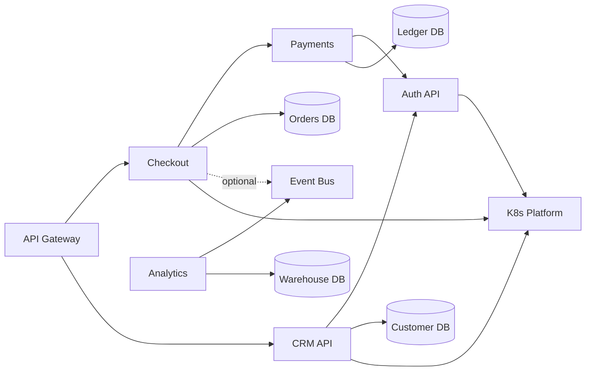
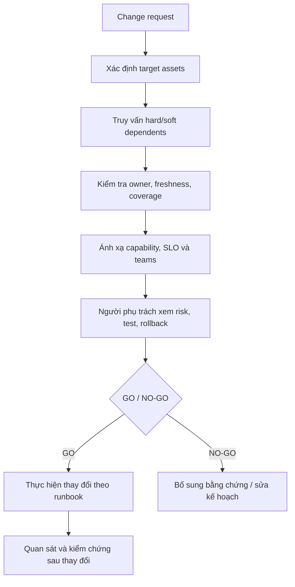

# Phân tích phụ thuộc hệ thống, tài sản và tác động thay đổi bằng Neo4j

## 1. Từ danh sách tài sản sang bản đồ tác động

Một doanh nghiệp có thể có hàng trăm dịch vụ, hàng nghìn máy ảo/container, database, hàng đợi thông điệp, API bên thứ ba và nhiều đội sở hữu. Khi phải nâng cấp một dịch vụ xác thực, di chuyển database hoặc thay cấu hình một cluster, câu hỏi quan trọng không chỉ là **tài sản nào sẽ bị thay đổi**, mà còn là:

- Những hệ thống **phụ thuộc trực tiếp và gián tiếp** vào tài sản đó?
- Năng lực nghiệp vụ nào có khả năng bị gián đoạn?
- Ai là người chịu trách nhiệm và cần được thông báo?
- Phụ thuộc nào là bắt buộc, phụ thuộc nào có thể suy giảm nhưng không làm dừng toàn bộ dịch vụ?
- Có điểm kết nối dùng chung (*shared dependency*) khiến phạm vi ảnh hưởng rộng hơn dự kiến không?
- Bằng chứng nào đủ mới để dựa vào khi quyết định thực hiện một thay đổi?

Đây là bài toán điển hình của **ứng dụng đồ thị**. Trong module `DATABASE_ENGINE_GRAPH_NEO4J`, Neo4j sử dụng **property graph** gồm node, relationship và property; **Cypher** giúp truy vấn chiều phụ thuộc, đường đi, điểm kết nối và tập hệ thống liên quan. **Neo4j Java Driver** hoặc **Spring Data Neo4j** giúp đưa kết quả vào API quản lý thay đổi và hệ thống vận hành.

Bài này tập trung vào **phân tích phụ thuộc hệ thống, tài sản và tác động thay đổi**, không chỉ xây một bản vẽ kiến trúc tĩnh. Ta sẽ tạo một đồ thị cấu hình/tài sản, nạp dữ liệu thử, truy vấn *blast radius*, liên hệ tới đội sở hữu và năng lực nghiệp vụ, kiểm tra chất lượng thông tin rồi sử dụng kết quả trong quy trình change management.

### Mục tiêu học tập

Sau bài học, bạn có thể:

1. Xác định chiều và ý nghĩa của `DEPENDS_ON`, `OWNED_BY`, `DELIVERED_BY`, `TARGETS`.
2. Mô hình hóa service, database, message broker, hạ tầng, team và business capability mà không trộn lẫn khái niệm.
3. Truy vấn **upstream impact** và **downstream dependencies** với giới hạn độ sâu, đúng môi trường.
4. Phân loại quan hệ **bắt buộc, tùy chọn, đồng bộ, bất đồng bộ** và tránh kết luận sai rằng mọi cạnh đều gây outage.
5. Phát hiện mối liên kết thiếu, ownership thiếu, vòng phụ thuộc, rủi ro supernode và dữ liệu đã lỗi thời.
6. Xây dựng bản đánh giá tác động có **đường dẫn giải thích**, độ tin cậy, danh sách người nhận thông báo và kiểm chứng sau thay đổi.
7. Cung cấp kết quả qua Java Driver/API với giới hạn tải, phân quyền và kiểm thử tính đúng của truy vấn.

> **Phiên bản:** Các ví dụ sử dụng cú pháp Cypher thông dụng của Neo4j 5.x. Các truy vấn độ sâu nhỏ đủ để minh họa trên dữ liệu lab; khi graph thực lớn, cần giới hạn fan-out, đánh giá `EXPLAIN`/`PROFILE`, xem xét truy vấn theo lớp hoặc thuật toán phù hợp. Neo4j không tự biết một cạnh «phụ thuộc» có nghĩa là ngừng hoạt động hay giảm chất lượng: đó là hợp đồng nghiệp vụ do người quản lý hệ thống định nghĩa.

## 2. Ngữ nghĩa cạnh quan trọng hơn hình dạng sơ đồ

Trong bài này ta chọn **một hướng chuẩn**:

```text
(A:Component)-[:DEPENDS_ON]->(B:Component)

Diễn giải: "A cần sử dụng B để thực hiện ít nhất một chức năng".
```

Nếu có:

```text
Gateway  -> Checkout -> Payments -> Auth
                       -> OrdersDB
Analytics -> EventBus
Checkout  -> EventBus  (phụ thuộc tùy chọn)
```

thì:

- Muốn biết **Checkout cần gì**, đi **theo chiều `DEPENDS_ON`** từ Checkout sang Payments, OrdersDB và EventBus.
- Muốn biết **nâng cấp Auth có thể tác động tới ai**, đi **ngược chiều phụ thuộc**, từ Auth lần về Payments, Checkout rồi Gateway.
- Nếu chỉ xem những hệ thống đang phụ thuộc trực tiếp vào Auth, sẽ bỏ sót Checkout và Gateway.
- Một relationship từ Checkout đến EventBus được khai báo **tùy chọn** không nên tự động được diễn dịch là «Checkout chắc chắn ngừng hoạt động nếu EventBus hỏng».

### 2.1. Danh mục relationship trong mô hình

| Relationship | Hướng | Ý nghĩa | Ví dụ |
| --- | --- | --- | --- |
| `DEPENDS_ON` | Component sử dụng → Component cung cấp | Quan hệ phụ thuộc kỹ thuật | `(Checkout)-[:DEPENDS_ON]->(Payments)` |
| `OWNED_BY` | Component → Team | Đội chịu trách nhiệm vận hành chính | `(Payments)-[:OWNED_BY]->(FinanceTeam)` |
| `DELIVERED_BY` | Capability → Component | Thành phần trực tiếp triển khai năng lực nghiệp vụ | `(Purchase)-[:DELIVERED_BY]->(Checkout)` |
| `TARGETS` | Change → Component | Tài sản được thay đổi trực tiếp | `(CHG042)-[:TARGETS]->(Auth)` |

**Không đồng nhất tất cả các relationship với `DEPENDS_ON`.** Chẳng hạn `OWNED_BY` giúp xác định người cần thông báo, nhưng một đội sở hữu service không có nghĩa service «phụ thuộc kỹ thuật» vào đội như phụ thuộc database.

### 2.2. Phân biệt phụ thuộc vật lý và phụ thuộc logic

Các chiều phụ thuộc thường gặp:

- **Runtime:** service gọi một API khác khi xử lý request.
- **Data:** service cần database, cache hoặc object storage.
- **Messaging:** service phát/nhận sự kiện qua broker hoặc topic.
- **Infrastructure:** service cần cluster, VM, mạng hoặc DNS.
- **Control plane:** cần IAM, secret manager, service discovery hoặc certificate infrastructure.
- **Business:** một capability được cung cấp bởi nhiều service phối hợp.

Một quan hệ có thể tồn tại dưới nhiều dạng. Thay vì suy ra toàn bộ từ cùng một nhãn, lưu thêm **`mode`, `required`, `source`, `lastVerifiedAt`** và khi cần **`dependencyKind`**. Những thuộc tính đó hỗ trợ phân tích nhưng vẫn phải được định nghĩa rõ.

### 2.3. Kết quả phân tích là «ứng viên tác động», không phải tiên tri

Một cạnh từ A tới B là **bằng chứng A có thể chịu tác động** nếu B thay đổi. A thực sự ngừng hoạt động hay không còn tùy:

- Có circuit breaker, fallback, cache hoặc replica không?
- Thay đổi có ngắt API/data contract hay chỉ là cập nhật không downtime?
- Lưu lượng nào đi qua tuyến phụ thuộc đó?
- Cạnh là yêu cầu bắt buộc hay đường thực thi không quan trọng?
- Thông tin phụ thuộc còn đúng ở thời điểm triển khai không?

Do đó, phân tích đồ thị nên trả **phạm vi cần xác minh, lý do và độ tin cậy**, không khẳng định chắc chắn xác suất outage khi chưa có mô hình sự cố và số liệu lịch sử.

## 3. Kịch bản xuyên suốt: hệ thống thương mại điện tử

Ta có các thành phần trong môi trường `prod`:



Mỗi mũi tên **đi từ consumer tới dependency**. Tên `Orders DB` hay `K8s Platform` là tài sản được truy vấn như một `:Component`, không phải dấu hiệu chúng cùng loại với một API service.

### 3.1. Danh sách service và tài sản

| Key | Loại | Vai trò |
| --- | --- | --- |
| `gateway` | SERVICE | API gateway |
| `checkout` | SERVICE | Điều phối thanh toán/đặt hàng |
| `payments` | SERVICE | Nghiệp vụ thanh toán |
| `crm` | SERVICE | Thông tin khách hàng |
| `auth` | SERVICE | Xác thực |
| `analytics` | SERVICE | Dashboard/phân tích |
| `orders-db` | DATABASE | Dữ liệu đơn hàng |
| `ledger-db` | DATABASE | Sổ cái giao dịch |
| `customer-db` | DATABASE | Hồ sơ khách hàng |
| `event-bus` | BROKER | Chuyển sự kiện bất đồng bộ |
| `warehouse-db` | DATABASE | Kho dữ liệu |
| `k8s-prod` | PLATFORM | Cluster chạy các workload cốt lõi |

### 3.2. Ba capability nghiệp vụ

- `purchase` — **Mua hàng**, được triển khai trực tiếp bởi Checkout.
- `customer-care` — **Chăm sóc khách hàng**, được triển khai bởi CRM.
- `dashboard` — **Bảng điều khiển phân tích**, được triển khai bởi Analytics.

Nếu Auth gặp lỗi, truy vấn đồ thị sẽ cho thấy `purchase` và `customer-care` **có khả năng bị ảnh hưởng gián tiếp**. `dashboard` không nằm trong chuỗi phụ thuộc bắt buộc của Auth theo đồ thị ví dụ.

### 3.3. Hai kịch bản cần phân biệt

1. **CHG-042 nâng cấp Auth API:** Gateway, Checkout, Payments và CRM nằm trong các đường phụ thuộc bắt buộc dẫn tới Auth.
2. **Event Bus gián đoạn:** Analytics cần Event Bus; Checkout có gửi sự kiện qua Event Bus nhưng được gắn `required = false`, do đó kết luận «Checkout chắc chắn unavailable» sẽ không phù hợp với chính sách strict impact. Tuy nhiên, chức năng phát sự kiện của Checkout vẫn có thể bị suy giảm.

Hai kịch bản này sẽ được kiểm chứng bằng Cypher ở những mục sau.

## 4. Mô hình property graph và khóa định danh

### 4.1. Node

```text
(:Component {
  environment: 'prod',
  key: 'auth',
  name: 'Auth API',
  kind: 'SERVICE',
  tier: 1,
  active: true
})

(:Team {teamId: 'platform', name: 'Platform'})
(:Capability {
  environment: 'prod',
  capabilityId: 'purchase',
  name: 'Mua hàng'
})
(:Change {
  changeId: 'CHG-042',
  title: 'Nâng cấp Auth API',
  state: 'PLANNED'
})
```

**Khóa nghiệp vụ `(environment, key)`** xác định duy nhất Component trong ví dụ, vì cùng service `auth` có thể tồn tại ở `dev`, `staging` và `prod`. Không sử dụng internal `id(node)` hoặc `elementId(node)` làm ID ổn định khi tích hợp CMDB và API.

Trong hệ thống multi-tenant, khóa có thể phải gồm `tenantId`. Không tự gắn `tenantId` vào cùng một graph nếu chưa biết ranh giới quản lý: một số tài sản là **shared platform** phục vụ nhiều tenant và cần mô hình truy cập riêng.

### 4.2. Relationship và dữ liệu mô tả nguồn

```text
(:Component {key:'payments'})
  -[:DEPENDS_ON {
      required: true,
      mode: 'SYNC',
      source: 'service-catalog',
      lastVerifiedAt: datetime('2026-11-20T00:00:00Z')
    }]->
(:Component {key:'auth'})
```

| Property | Vai trò | Quy tắc cần thống nhất |
| --- | --- | --- |
| `required` | Có xem là một phụ thuộc bắt buộc để cung cấp chức năng chính không? | Boolean có giá trị mặc định được quản trị |
| `mode` | Kiểu giao tiếp | Ví dụ `SYNC`, `ASYNC` hoặc `INFRA` |
| `source` | Nguồn phát hiện/xác nhận | Catalog, IaC, tracing, chủ dịch vụ |
| `lastVerifiedAt` | Thời điểm được xác nhận là đúng | Dùng kiểu `datetime` với timezone rõ |
| `confidence` | Mức chắc chắn của bằng chứng, nếu có | Phải định nghĩa thang đo và cách cập nhật |
| `validFrom`/`validTo` | Khoảng thời gian quan hệ có hiệu lực, nếu cần | Không nhầm với thời gian nhập record |

Trong bài thực hành, mỗi cặp consumer–provider chỉ có **một** quan hệ `DEPENDS_ON`. Nếu nghiệp vụ có hai interface riêng giữa cùng hai hệ thống, cần **dependency business key** cho từng interface và mô hình multiplicity rõ ràng, thay vì `MERGE` vô tình gộp chúng.

### 4.3. Constraints trước khi nhập dữ liệu

Chạy trên database thử nghiệm:

```cypher
CREATE CONSTRAINT graph_component_key IF NOT EXISTS
FOR (c:Component)
REQUIRE (c.environment, c.key) IS UNIQUE;

CREATE CONSTRAINT graph_team_key IF NOT EXISTS
FOR (t:Team)
REQUIRE t.teamId IS UNIQUE;

CREATE CONSTRAINT graph_capability_key IF NOT EXISTS
FOR (b:Capability)
REQUIRE (b.environment, b.capabilityId) IS UNIQUE;

CREATE CONSTRAINT graph_change_key IF NOT EXISTS
FOR (ch:Change)
REQUIRE ch.changeId IS UNIQUE;
```

Các constraint bảo vệ tính duy nhất của những khóa có mặt, giúp lookup có index hỗ trợ và giảm rủi ro tạo trùng khi nhập lại. Chúng **không tự bảo đảm** Component luôn có `environment/key`, mọi service đều có owner, hoặc mọi cạnh phụ thuộc đều cùng môi trường; những bất biến ấy cần cơ chế kiểm tra/constraint thích hợp theo edition/version và ứng dụng.

## 5. Nhập dữ liệu lab bằng Cypher

### 5.1. Tạo các Component

```cypher
UNWIND [
  {key:'gateway', name:'API Gateway', kind:'SERVICE', tier:1},
  {key:'checkout', name:'Checkout', kind:'SERVICE', tier:1},
  {key:'payments', name:'Payments', kind:'SERVICE', tier:1},
  {key:'crm', name:'CRM API', kind:'SERVICE', tier:2},
  {key:'auth', name:'Auth API', kind:'SERVICE', tier:1},
  {key:'analytics', name:'Analytics', kind:'SERVICE', tier:2},
  {key:'orders-db', name:'Orders DB', kind:'DATABASE', tier:1},
  {key:'ledger-db', name:'Ledger DB', kind:'DATABASE', tier:1},
  {key:'customer-db', name:'Customer DB', kind:'DATABASE', tier:2},
  {key:'event-bus', name:'Event Bus', kind:'BROKER', tier:2},
  {key:'warehouse-db', name:'Warehouse DB', kind:'DATABASE', tier:2},
  {key:'k8s-prod', name:'K8s Platform', kind:'PLATFORM', tier:1}
] AS row
MERGE (c:Component {environment:'prod', key:row.key})
SET c.name = row.name,
    c.kind = row.kind,
    c.tier = row.tier,
    c.active = true;
```

**Ghi chú:** `tier` ở đây là lớp ưu tiên do doanh nghiệp định nghĩa (1 = rất quan trọng), không phải số thứ tự sẵn có của Neo4j. Nếu tổ chức đã có trường phân loại SLA khác, hãy dùng đúng từ điển dữ liệu đó.

### 5.2. Tạo các phụ thuộc

```cypher
UNWIND [
  {consumer:'gateway', provider:'checkout', required:true, mode:'SYNC'},
  {consumer:'gateway', provider:'crm', required:true, mode:'SYNC'},
  {consumer:'checkout', provider:'payments', required:true, mode:'SYNC'},
  {consumer:'checkout', provider:'orders-db', required:true, mode:'DATA'},
  {consumer:'checkout', provider:'event-bus', required:false, mode:'ASYNC'},
  {consumer:'payments', provider:'auth', required:true, mode:'SYNC'},
  {consumer:'payments', provider:'ledger-db', required:true, mode:'DATA'},
  {consumer:'crm', provider:'auth', required:true, mode:'SYNC'},
  {consumer:'crm', provider:'customer-db', required:true, mode:'DATA'},
  {consumer:'analytics', provider:'event-bus', required:true, mode:'ASYNC'},
  {consumer:'analytics', provider:'warehouse-db', required:true, mode:'DATA'},
  {consumer:'auth', provider:'k8s-prod', required:true, mode:'INFRA'},
  {consumer:'checkout', provider:'k8s-prod', required:true, mode:'INFRA'},
  {consumer:'crm', provider:'k8s-prod', required:true, mode:'INFRA'}
] AS row
MATCH (consumer:Component {
  environment:'prod', key:row.consumer
})
MATCH (provider:Component {
  environment:'prod', key:row.provider
})
MERGE (consumer)-[d:DEPENDS_ON]->(provider)
SET d.required = row.required,
    d.mode = row.mode,
    d.source = 'lesson-catalog',
    d.lastVerifiedAt = datetime('2026-11-20T00:00:00Z');
```

`MERGE (consumer)-[d:DEPENDS_ON]->(provider)` có ý nghĩa một phụ thuộc theo mỗi cặp đầu mút trong bài mẫu. Trên hệ thống nhiều writer, **chỉ riêng `MERGE` không phải cơ chế bảo đảm duy nhất tuyệt đối cho mọi cách tạo cạnh đồng thời**. Nếu tính duy nhất của dependency quan trọng, dùng ID nghiệp vụ ổn định, relationship uniqueness constraint được phiên bản/edition hỗ trợ và transaction strategy phù hợp.

### 5.3. Đội sở hữu

```cypher
UNWIND [
  {id:'platform', name:'Platform Operations'},
  {id:'commerce', name:'Commerce'},
  {id:'finance', name:'Finance Engineering'},
  {id:'customer', name:'Customer Systems'},
  {id:'data', name:'Data Platform'}
] AS row
MERGE (t:Team {teamId:row.id})
SET t.name = row.name;
```

```cypher
UNWIND [
  {component:'gateway', team:'platform'},
  {component:'auth', team:'platform'},
  {component:'k8s-prod', team:'platform'},
  {component:'checkout', team:'commerce'},
  {component:'orders-db', team:'commerce'},
  {component:'payments', team:'finance'},
  {component:'ledger-db', team:'finance'},
  {component:'crm', team:'customer'},
  {component:'customer-db', team:'customer'},
  {component:'analytics', team:'data'},
  {component:'event-bus', team:'data'},
  {component:'warehouse-db', team:'data'}
] AS row
MATCH (c:Component {environment:'prod', key:row.component})
MATCH (t:Team {teamId:row.team})
MERGE (c)-[:OWNED_BY]->(t);
```

### 5.4. Năng lực nghiệp vụ

```cypher
UNWIND [
  {id:'purchase', name:'Mua hàng', service:'checkout'},
  {id:'customer-care', name:'Chăm sóc khách hàng', service:'crm'},
  {id:'dashboard', name:'Bảng điều khiển phân tích', service:'analytics'}
] AS row
MERGE (b:Capability {
  environment:'prod', capabilityId:row.id
})
SET b.name = row.name
WITH b, row
MATCH (c:Component {environment:'prod', key:row.service})
MERGE (b)-[:DELIVERED_BY]->(c);
```

### 5.5. Thay đổi cần đánh giá

```cypher
MERGE (ch:Change {changeId:'CHG-042'})
SET ch.title = 'Nâng cấp Auth API',
    ch.state = 'PLANNED';

MATCH (ch:Change {changeId:'CHG-042'})
MATCH (c:Component {environment:'prod', key:'auth'})
MERGE (ch)-[:TARGETS]->(c);
```

Thực tế, mỗi Change cần thêm **cửa sổ triển khai, owner, loại thay đổi, mức ưu tiên, runbook, kết quả kiểm thử và trạng thái phê duyệt**. Đồ thị chỉ là một phần nguồn bằng chứng; không nên để một query tự ý duyệt release khi quy trình yêu cầu người phê duyệt.

## 6. Kiểm tra đồ thị mẫu trước khi phân tích

```cypher
MATCH (c:Component {environment:'prod'})
RETURN count(c) AS componentCount;
```

```cypher
MATCH (:Component {environment:'prod'})
      -[r:DEPENDS_ON]->
      (:Component {environment:'prod'})
RETURN count(r) AS dependencyCount;
```

```cypher
MATCH (b:Capability {environment:'prod'})
RETURN count(b) AS capabilityCount;
```

Kỳ vọng trên database lab chưa có các node cùng khóa: **12 Component**, **14 DEPENDS_ON**, **3 Capability**, **5 Team** và một `Change CHG-042`.

Đừng dùng kết quả `count(*)` sau nhiều `OPTIONAL MATCH` để tự suy ra số component, vì khi ghép các nhánh quan hệ một-nhiều, số dòng có thể bị nhân. Đếm từng population trước, sau đó dùng `DISTINCT`/subquery khi cần.

### 6.1. Truy vấn nhanh để đọc một dependency

```cypher
MATCH (consumer:Component {environment:'prod', key:'checkout'})
      -[r:DEPENDS_ON]->
      (provider:Component)
RETURN provider.key AS dependency,
       provider.kind AS kind,
       r.required AS required,
       r.mode AS mode
ORDER BY dependency;
```

Kỳ vọng: Checkout phụ thuộc `payments`, `orders-db`, `event-bus` và `k8s-prod`. Trong đó `event-bus` có `required = false`; ba cạnh còn lại là bắt buộc trong ví dụ.

## 7. Truy vấn xuôi: một hệ thống cần những gì?

Với câu hỏi **«Checkout phụ thuộc vào tài sản nào trong tối đa 3 bước?»**, đi theo chiều cạnh từ consumer tới provider:

```cypher
MATCH (root:Component {environment:$environment, key:$componentKey})
MATCH p=(root)-[:DEPENDS_ON*1..3]->(dependency:Component)
WHERE all(n IN nodes(p) WHERE n.environment = $environment)
WITH dependency, min(length(p)) AS minHops
RETURN dependency.key AS dependency,
       dependency.kind AS kind,
       minHops
ORDER BY minHops, dependency;
```

Kết quả bao gồm các phụ thuộc trực tiếp như Payments và OrdersDB, rồi các phụ thuộc gián tiếp như Auth và LedgerDB. Số hop là **độ dài đường đi** trong graph, **không phải thời gian lan truyền sự cố**.

### 7.1. Vì sao phải giới hạn độ sâu?

Truy vấn:

```cypher
// Không dùng làm API mở tự do trên graph production:
MATCH p=(c:Component)-[:DEPENDS_ON*]->(x:Component)
RETURN p;
```

có thể sinh số đường đi rất lớn khi graph có nhiều nhánh, nhiều đường nối tới cùng một tài sản hoặc vòng phụ thuộc. Ứng dụng nên:

- Bắt đầu từ **node đã được tìm bằng khóa/index**, không quét mọi component.
- Giới hạn chiều, type, depth, environment và loại dependency.
- Chỉ trả các property/DTO cần thiết.
- Dùng `EXPLAIN`/`PROFILE` để kiểm tra số rows, DB hits, bộ nhớ và thời gian thực thi.
- Với graph quy mô lớn, xem xét thuật toán reachability/BFS có cơ chế giới hạn phù hợp thay vì enumerate mọi path.

**`LIMIT 100` ở cuối query không có nghĩa engine luôn chỉ mở rộng tối đa 100 đường đi**. Nếu cần tìm độ sâu ngắn nhất giữa hai node, hãy chọn truy vấn/thuật toán chuyên biệt thay vì sinh mọi path rồi lọc.

## 8. Truy vấn ngược: ai có thể bị ảnh hưởng nếu một tài sản thay đổi?

Vì `A-[:DEPENDS_ON]->B`, muốn tìm **consumer có thể bị tác động bởi B**, truy vấn dùng:

```cypher
MATCH (target:Component {
  environment:$environment,
  key:$targetKey
})
MATCH p=(consumer:Component)-[:DEPENDS_ON*1..4]->(target)
WHERE all(n IN nodes(p) WHERE n.environment = $environment)
WITH consumer,
     min(length(p)) AS minHops,
     count(p) AS pathsObserved
RETURN consumer.key AS impactedComponent,
       consumer.kind AS kind,
       minHops,
       pathsObserved
ORDER BY minHops, impactedComponent;
```

Tham số thử: `$environment = 'prod'`, `$targetKey = 'auth'`.

Kỳ vọng trên dataset lab:

| Component có thể chịu tác động | Khoảng cách ngắn nhất tới Auth | Lý do |
| --- | ---: | --- |
| `payments` | 1 | Payments gọi trực tiếp Auth |
| `crm` | 1 | CRM gọi trực tiếp Auth |
| `checkout` | 2 | Checkout → Payments → Auth |
| `gateway` | 2 | Gateway → CRM → Auth; còn đường dài hơn qua Checkout |

Truy vấn trả **4 component phân biệt** nếu dữ liệu mẫu không bị chỉnh sửa. `pathsObserved` biểu thị số đường đi được truy vấn tìm thấy **trong giới hạn 4 hop**, không phải số giao dịch, không phải xác suất outage. Nếu query trả nhiều đường cho cùng component, `min(length(p))` chỉ giữ khoảng cách ngắn nhất.

**Chú ý về kết quả:** Target `auth` là **tài sản bị thay đổi trực tiếp** và không xuất hiện trong danh sách consumer vì dùng `*1..4`. Báo cáo tác động cuối phải chứa **cả target và tập consumer bị tác động**, không được đánh rơi target khi tổng hợp.

### 8.1. Chỉ muốn consumer trực tiếp

```cypher
MATCH (consumer:Component {environment:$environment})
      -[r:DEPENDS_ON]->
      (target:Component {
        environment:$environment,
        key:$targetKey
      })
RETURN consumer.key AS directConsumer,
       r.mode AS mode,
       r.required AS required
ORDER BY directConsumer;
```

Với Auth, kết quả trực tiếp là **Payments** và **CRM**. Truy vấn này thích hợp khi cần gọi điện xác nhận các bên tích hợp trực tiếp trước một thay đổi API contract.

## 9. Phụ thuộc bắt buộc, tùy chọn và khả năng suy giảm

Một phân tích **khả năng mất chức năng chính** thường chỉ đi qua cạnh `required = true`:

```cypher
MATCH (target:Component {
  environment:$environment,
  key:$targetKey
})
MATCH p=(consumer:Component)-[:DEPENDS_ON*1..4]->(target)
WHERE all(n IN nodes(p) WHERE n.environment = $environment)
  AND all(r IN relationships(p) WHERE r.required = true)
WITH consumer, min(length(p)) AS minHops
RETURN consumer.key AS hardDependent,
       consumer.kind AS kind,
       minHops
ORDER BY minHops, hardDependent;
```

### 9.1. Kiểm thử với Auth

Với `$targetKey = 'auth'`, kết quả strict impact vẫn gồm **Payments, CRM, Checkout, Gateway**, vì mọi đoạn trên các đường đó đều bắt buộc.

### 9.2. Kiểm thử với Event Bus

Với `$targetKey = 'event-bus'`:

- **Strict impact:** Analytics, vì `Analytics → EventBus` là bắt buộc.
- **All-dependencies impact:** Analytics **và Checkout**, ngoài ra Gateway có thể xuất hiện qua Checkout.
- **Suy giảm chức năng:** Checkout có thể vẫn nhận đơn nhưng mất khả năng phát sự kiện. Gateway có thể vẫn phục vụ API, nhưng một use case phụ thuộc sự kiện cần đánh giá riêng.

Do đó, trong báo cáo nên có ít nhất hai cột:

| Phân loại | Ý nghĩa | Cách dùng |
| --- | --- | --- |
| **Hard dependency candidate** | Có đường đi gồm toàn bộ cạnh `required = true` | Ưu tiên điều tra rủi ro ngừng chức năng chính |
| **Soft/degraded candidate** | Có đường đi chứa cạnh không bắt buộc hoặc có fallback | Kiểm tra rủi ro suy giảm, backlog, retry, mất dữ liệu sự kiện |

Không xem `required = false` là «không cần kiểm tra»; nó chỉ **không đủ bằng chứng để kết luận outage toàn phần**. Mất sự kiện hoặc tăng độ trễ bất đồng bộ vẫn có thể gây hậu quả nghiệp vụ nghiêm trọng.

### 9.3. Không suy ra tác động bằng phép cộng xác suất đơn giản

Hai đường phụ thuộc có thể dùng chung một cluster hoặc cùng traffic. Nếu đặt `confidence = 0.9` cho từng cạnh, không thể mặc nhiên nhân tất cả con số đó để ra «xác suất outage cuối cùng». Độ tin cậy của **bằng chứng có cạnh** và xác suất **sự cố lan truyền** là hai đại lượng khác nhau.

## 10. Change có nhiều tài sản đích

Một change có thể cập nhật cùng lúc Auth, secret manager và network policy. Báo cáo phải tính **hợp của các tập tác động**, không đếm một consumer hai lần rồi hiểu là hai hệ thống khác nhau.

```cypher
MATCH (ch:Change {changeId:$changeId})
      -[:TARGETS]->
      (target:Component {environment:$environment})
MATCH p=(consumer:Component)-[:DEPENDS_ON*1..4]->(target)
WHERE all(n IN nodes(p) WHERE n.environment = $environment)
  AND all(r IN relationships(p) WHERE r.required = true)
WITH consumer,
     collect(DISTINCT target.key) AS targetsReached,
     min(length(p)) AS minHops
RETURN consumer.key AS impactedComponent,
       consumer.kind AS kind,
       targetsReached,
       minHops
ORDER BY minHops, impactedComponent;
```

Truy vấn trên chỉ trả **consumer gián tiếp/trực tiếp của từng target**, chưa trả danh sách những node mà Change `TARGETS` trực tiếp. Truy vấn riêng:

```cypher
MATCH (:Change {changeId:$changeId})
      -[:TARGETS]->
      (target:Component {environment:$environment})
RETURN target.key AS directlyChanged,
       target.kind AS kind
ORDER BY directlyChanged;
```

Khi tổng hợp JSON/API, **union theo `(environment, componentKey)`**, đánh dấu `DIRECT` và `UPSTREAM`. Không union theo display name vì có thể trùng tên.

### 10.1. Phân tầng theo khoảng cách

| Lớp | Ví dụ khi thay Auth | Hành động |
| --- | --- | --- |
| **Target (0 hop)** | Auth | Đội thực thi change và kiểm tra rollback |
| **Direct (1 hop)** | Payments, CRM | Test hợp đồng API, theo dõi lỗi trực tiếp |
| **Indirect (2+ hop)** | Checkout, Gateway | Smoke test luồng nghiệp vụ xuyên service |
| **Capability** | Mua hàng, Chăm sóc khách hàng | Thông báo owner nghiệp vụ, kiểm tra SLO end-to-end |

Khoảng cách trong graph chỉ là một tín hiệu phân tầng. Component ở 3 hop nhưng tier 1 hoặc thuộc luồng thanh toán vẫn có thể quan trọng hơn component ở 1 hop ít sử dụng.

## 11. Gắn tác động kỹ thuật với năng lực nghiệp vụ

Một danh sách 40 microservice ít hữu ích cho người phụ trách sản phẩm nếu không biết **khách hàng sẽ không làm được việc gì**. Vì thế ta gắn `(:Capability)-[:DELIVERED_BY]->(:Component)`.

### 11.1. Truy vấn capability có đường phụ thuộc bắt buộc tới target

```cypher
MATCH (target:Component {
  environment:$environment,
  key:$targetKey
})
MATCH (cap:Capability {environment:$environment})
      -[:DELIVERED_BY]->
      (root:Component)
MATCH p=(root)-[:DEPENDS_ON*0..4]->(target)
WHERE all(n IN nodes(p) WHERE n.environment = $environment)
  AND all(r IN relationships(p) WHERE r.required = true)
WITH cap, min(length(p)) AS minHops
RETURN cap.capabilityId AS capability,
       cap.name AS capabilityName,
       minHops
ORDER BY minHops, capability;
```

Với `auth`, kết quả kỳ vọng:

- `customer-care`: CRM → Auth, **1 hop**.
- `purchase`: Checkout → Payments → Auth, **2 hop**.

Không có `dashboard` vì Analytics không phụ thuộc Auth trong dataset.

**Vì sao dùng `*0..4`?** Khi tài sản đích chính là service được `DELIVERED_BY` trực tiếp, capability đó cần xuất hiện với khoảng cách **0**. `all(...)` trên một đường đi không có relationship là điều kiện đúng; vậy kết quả vẫn bao gồm tác động trực tiếp.

### 11.2. Capability không phải tỷ lệ outage

Một capability có thể do **nhiều** service hỗ trợ, có cơ chế active-active, fallback hoặc chỉ bị ảnh hưởng một nhánh. Việc tìm thấy đường phụ thuộc là tín hiệu «**cần kiểm chứng**», không đủ để tuyên bố capability ngừng hoàn toàn. Mô hình nâng cao có thể mô tả `REQUIRES_ALL`, `REQUIRES_ANY`, fallback và điều kiện hiệu lực, nhưng khi đó **logic lan truyền** phải phản ánh đúng các điều kiện AND/OR.

### 11.3. Liên hệ tới RTO/RPO và SLO

Các capability trọng yếu thường có SLO hoặc yêu cầu khôi phục khác nhau:

- Mua hàng: kiểm tra tỷ lệ đặt hàng thành công, giao dịch không bị nhân đôi, độ trễ checkout.
- Chăm sóc khách hàng: thời gian truy cập hồ sơ và tỷ lệ lỗi tìm kiếm.
- Dashboard: độ mới của dữ liệu, backlog sự kiện và thời gian khôi phục.

Không chỉ thông báo «Auth có 4 dependent services»; hãy mô tả **đường nghiệp vụ phải smoke test** và **chỉ số nào là cổng GO/NO-GO**.

## 12. Tìm đội sở hữu và xây danh sách thông báo

### 12.1. Chủ sở hữu của các hệ thống có khả năng bị ảnh hưởng

```cypher
MATCH (target:Component {
  environment:$environment,
  key:$targetKey
})
MATCH p=(affected:Component)-[:DEPENDS_ON*0..4]->(target)
WHERE all(n IN nodes(p) WHERE n.environment = $environment)
  AND all(r IN relationships(p) WHERE r.required = true)
OPTIONAL MATCH (affected)-[:OWNED_BY]->(team:Team)
WITH team,
     collect(DISTINCT affected.key) AS components
RETURN team.teamId AS teamId,
       team.name AS teamName,
       components
ORDER BY teamId;
```

Với Auth, các đội chính trong đồ thị lab:

- `platform`: Auth, và có thể những component platform khác nếu nằm trong tập bị tác động.
- `finance`: Payments.
- `customer`: CRM.
- `commerce`: Checkout.
- `platform`: Gateway.

Trong query, `collect(DISTINCT affected.key)` giúp một component có nhiều đường dẫn không bị lặp trong cùng nhóm. Nếu owner chưa được gán, `teamId` có thể `null`: đó là **lỗ hổng dữ liệu phải xử lý**, không phải lý do bỏ qua component khỏi cảnh báo.

### 12.2. Chủ sở hữu kỹ thuật khác chủ sở hữu nghiệp vụ

Một thay đổi Auth có thể cần:

- **Change owner**: nhóm chịu trách nhiệm nâng cấp.
- **Component owner**: những team sử dụng Auth.
- **Business owner**: nhóm sản phẩm chịu SLO của Mua hàng/Chăm sóc khách hàng.
- **Incident commander/on-call**: người điều phối khi change thất bại.

Không tự gộp tất cả vai trò trên vào một relationship `OWNED_BY`. Khi hệ thống đủ lớn, bổ sung các loại quan hệ quản trị khác như `HAS_ON_CALL`, `BUSINESS_OWNED_BY` và metadata versioned.

## 13. Tách môi trường, tenant và vùng lỗi

### 13.1. Lọc một mình target là chưa đủ

Truy vấn bắt đầu từ `auth` ở `prod` nhưng không kiểm tra toàn bộ `nodes(p)` có thể vô tình tìm đường đi qua node `staging` nếu importer đã tạo cạnh sai. Vì vậy trong các truy vấn trên có:

```cypher
WHERE all(n IN nodes(p) WHERE n.environment = $environment)
```

Đây là **một lớp bảo vệ của query**, không thay thế quyền truy cập và constraint dữ liệu. Không coi cùng tên `auth` ở `dev` và `prod` là cùng một thực thể.

### 13.2. Phụ thuộc hợp lệ xuyên môi trường

Có trường hợp một dịch vụ `staging` thật sự gọi API `prod` — đây thường là dấu hiệu cần xem xét an toàn, nhưng có thể là chính sách cố ý. Không được xóa mọi cạnh cross-environment mù quáng; phải:

1. Xác nhận nó có thực và được chấp thuận.
2. Gắn metadata ngoại lệ rõ ràng.
3. Phân loại rủi ro và quyền truy cập khác biệt.
4. Đảm bảo truy vấn đánh giá tác động cho production có chế độ include/exclude được duyệt.

Mẫu truy vấn tìm cạnh khác môi trường:

```cypher
MATCH (a:Component)-[d:DEPENDS_ON]->(b:Component)
WHERE a.environment <> b.environment
RETURN a.environment AS consumerEnvironment,
       a.key AS consumerKey,
       b.environment AS dependencyEnvironment,
       b.key AS dependencyKey,
       d.source AS evidenceSource
ORDER BY consumerEnvironment, consumerKey
LIMIT 100;
```

### 13.3. Multi-tenant và tài sản dùng chung

Khi nhiều tenant dùng cùng Auth hoặc cluster:

- Không gắn tất cả dữ liệu riêng của tenant vào graph công khai.
- Định nghĩa khóa identity và quyền xem từng loại node/relationship.
- Có thể mô hình một **shared Component** riêng, gắn với nhiều tenant bằng quan hệ quyền sử dụng.
- API impact phải lọc theo **quyền của actor** và chỉ hiển thị những hệ thống được phép biết, chứ không tin `environment` do client gửi là đủ.

Một truy vấn có predicate tenant là cần thiết nhưng không tự thay thế **authorization** ở tầng ứng dụng.

## 14. Chất lượng dữ liệu CMDB: nếu đầu vào sai, blast radius sẽ sai

### 14.1. Kiểm tra Component thiếu owner

```cypher
MATCH (c:Component {environment:$environment})
WHERE NOT EXISTS {
  MATCH (c)-[:OWNED_BY]->(:Team)
}
RETURN c.key AS componentWithoutOwner,
       c.kind AS kind
ORDER BY componentWithoutOwner;
```

Trong lab, kỳ vọng **0 dòng**. Ở hệ thống thực, owner thiếu phải được đưa vào **data quality backlog**, không tự gán cho «Platform» chỉ vì tiện.

### 14.2. Kiểm tra nhiều owner chính

Nếu mô hình quy định đúng **một** owner chịu trách nhiệm chính:

```cypher
MATCH (c:Component {environment:$environment})
OPTIONAL MATCH (c)-[:OWNED_BY]->(t:Team)
WITH c, count(t) AS ownerCount
WHERE ownerCount <> 1
RETURN c.key AS component,
       ownerCount
ORDER BY component;
```

Nếu tổ chức chủ ý có nhiều owner, cần phân biệt `PRIMARY_OWNER` và `SUPPORTING_TEAM` thay vì coi mọi trường hợp nhiều owner là lỗi.

### 14.3. Kiểm tra cạnh tự phụ thuộc

```cypher
MATCH (c:Component)-[d:DEPENDS_ON]->(c)
RETURN c.environment AS environment,
       c.key AS component,
       d.mode AS mode;
```

Tự phụ thuộc có thể do importer sai khóa, nhưng đôi khi là biểu diễn logic không phù hợp về self-loop. Hãy xác nhận thực tế trước khi sửa.

### 14.4. Kiểm tra vòng phụ thuộc nhiều node

```cypher
MATCH p=(start:Component {environment:$environment})
        -[:DEPENDS_ON*2..6]->(start)
WHERE all(n IN nodes(p) WHERE n.environment = $environment)
RETURN [n IN nodes(p) | n.key] AS cycle
LIMIT 20;
```

**Cảnh báo tải:** Việc enumerate chu trình có thể rất đắt trên graph lớn, ngay cả khi cuối cùng `LIMIT 20`. Nên chạy trên graph thử, theo partition/loại cạnh có giới hạn, hoặc dùng thuật toán strongly connected components trong môi trường phân tích phù hợp. Một vòng phụ thuộc có thể phản ánh vòng gọi API thực sự hoặc mô hình trừu tượng có cả chiều «triển khai» và «sử dụng» bị trộn lẫn.

### 14.5. Relationship không thể tồn tại với đầu mút vật lý bị thiếu

Neo4j không lưu một relationship hợp lệ mà không có hai node đầu mút. Khi một bản ghi nguồn khai báo `checkout → unknown-service` nhưng đầu mút không được tìm thấy, kết quả thường là **cạnh không được tạo** hoặc **cạnh gắn nhầm node**; không phải một cạnh vật lý «dangling» trong graph.

Vì vậy, importer phải có **staging/quarantine** cho bản ghi dependency chưa tìm thấy consumer hoặc provider, và báo cáo:

```text
TOTAL_DEPENDENCY_ROWS
RESOLVED_AND_WRITTEN
MISSING_CONSUMER
MISSING_PROVIDER
DUPLICATE_BUSINESS_KEY
CONFLICTING_DEFINITION
UNAPPROVED_CROSS_ENVIRONMENT
```

Đừng chỉ đếm số relationship trong Neo4j rồi kết luận tất cả bản ghi nguồn đã được nạp đúng.

## 15. Nguồn gốc, độ mới và vòng đời của phụ thuộc

### 15.1. Có cạnh không có nghĩa cạnh còn đúng

Một CMDB có thể được cập nhật từ:

- **IaC/Kubernetes manifests:** khai báo tài nguyên, deployment, config.
- **Service catalog:** owner, tier, API contract, phụ thuộc đã xác nhận.
- **Distributed tracing:** caller/callee thực sự xuất hiện trong trace.
- **Network/flow telemetry:** có kết nối mạng, nhưng chưa chắc là phụ thuộc nghiệp vụ bắt buộc.
- **Cloud inventory:** VM, volume, load balancer, database instances.
- **Change/incident records:** bằng chứng một sự cố đã tác động tới hệ thống nào.

Không nguồn nào tuyệt đối đầy đủ:

- Tracing lấy mẫu có thể **bỏ qua đường đi hiếm**.
- IaC mô tả tài nguyên dự định nhưng không đảm bảo đường gọi thực tế.
- Network flow có thể thấy health checks hoặc traffic quan sát, không chứng minh hard dependency.
- Khai báo thủ công có thể quá hạn khi kiến trúc thay đổi.

### 15.2. Phân loại bằng chứng

| Nguồn | Điểm mạnh | Hạn chế | Cách sử dụng |
| --- | --- | --- | --- |
| Service catalog đã duyệt | Owner và ngữ nghĩa nghiệp vụ rõ | Phụ thuộc cập nhật thủ công | Là nguồn quy tắc bắt buộc/optional |
| IaC/config | Có version và commit, theo môi trường | Có cấu hình nhưng không sử dụng | Phát hiện cấu hình, kiểm tra triển khai |
| Tracing | Cho thấy đường gọi thực tế | Sampling, khoảng quan sát, bất đồng bộ | Bổ sung và xác nhận dependency |
| Cloud inventory | Tìm tài sản hạ tầng có thật | Thiếu quan hệ logic | Mở rộng tầng tài sản |
| Incident history | Có bằng chứng tác động đã xảy ra | Dữ liệu thiên lệch về sự cố cũ | Hiệu chỉnh mức độ ưu tiên/risk |

### 15.3. Kiểm tra độ mới

Giả sử tổ chức yêu cầu quan hệ quan trọng được xác nhận trong 30 ngày:

```cypher
MATCH (a:Component {environment:$environment})
      -[d:DEPENDS_ON]->
      (b:Component {environment:$environment})
WHERE d.lastVerifiedAt IS NULL
   OR d.lastVerifiedAt < datetime() - duration({days:30})
RETURN a.key AS consumer,
       b.key AS provider,
       d.source AS source,
       d.lastVerifiedAt AS lastVerifiedAt
ORDER BY consumer, provider
LIMIT 100;
```

Đây là **ngưỡng ví dụ**, không phải quy chuẩn Neo4j. Quan hệ đến hệ thống rất ít thay đổi có thể cần tần suất xác minh khác với một service ephemeral. Ngược lại, phụ thuộc đã xác nhận hôm qua nhưng thay đổi sau deployment hôm nay cũng đã lỗi thời.

### 15.4. Bản đồ tại thời điểm xảy ra sự cố

Để điều tra «sự cố tháng trước ảnh hưởng hệ thống nào», graph hiện tại **không nhất thiết phản ánh graph tại thời điểm đó**. Có hai hướng:

1. Lưu **lịch sử hiệu lực** của dependency bằng các bản ghi/version có `validFrom`/`validTo`.
2. Lưu **snapshot/topology export** cùng change hoặc incident ID.

Chỉ lưu đè `lastVerifiedAt` và xóa cạnh cũ sẽ mất khả năng tái tạo topology lịch sử. Khi thiết kế mô hình temporal, phải phân biệt **thời điểm quan hệ có hiệu lực** với **thời điểm hệ thống biết đến nó**.

## 16. Xếp hạng rủi ro thay đổi mà không đánh lừa người dùng

### 16.1. Những tín hiệu có thể dùng

| Tín hiệu | Ý nghĩa | Hạn chế |
| --- | --- | --- |
| Số hard dependents | Quy mô consumer có thể chịu tác động | Không phải số user hay mức thiệt hại |
| Số capability liên quan | Tác động nghiệp vụ tiềm năng | Một capability có thể có fallback |
| Tier/criticality | Ưu tiên do doanh nghiệp quy định | Cần owner xác minh và cập nhật |
| Khoảng cách hop | Mức gián tiếp | Xa hơn không tự nghĩa ít rủi ro hơn |
| Shared dependency | Nhiều service dùng chung node | Có thể là dịch vụ đã có HA tốt |
| `lastVerifiedAt`/confidence | Độ mới/chắc chắn của bản đồ | Không phải xác suất outage |
| Change type | Reboot, API contract, schema migration, certificate rotation | Cùng target nhưng tác động rất khác |
| Backout/restore readiness | Khả năng kiểm soát sự cố | Không thay thế tính đúng dữ liệu |

Không nên tính «risk = number of paths × 10» rồi gọi đó là xác suất. Một node có nhiều đường nối tới cùng consumer khiến số path lớn, nhưng vẫn có **một** consumer.

### 16.2. Ví dụ bảng phân loại thay đổi

| Change | Tác động theo graph | Mức cần kiểm tra |
| --- | --- | --- |
| Nâng cấp Auth tương thích, rolling, đã diễn tập | 4 hard dependents; 2 capability | Test contract/API login, monitoring, rollback |
| Thay cấu hình Event Bus | 1 hard dependent, thêm nhánh soft của Checkout | Test Analytics backlog và event publication |
| Migrate LedgerDB schema không tương thích | Payments → Checkout → Gateway | Kiểm tra tính đúng giao dịch, backup và cửa sổ bảo trì |
| Đổi K8s Platform | Auth, Checkout, CRM và downstream qua chúng | Kiểm tra rollout/quorum/PDB và khả năng phục hồi |

Ví dụ `K8s Platform` không nhất thiết là «một single point of failure» nếu cluster có nhiều zone và đủ dự phòng. **Node mô tả tài sản** phải đúng độ chi tiết: nếu muốn phân tích mất một worker node, cần mô hình worker/zone và quan hệ chạy trên nó, không dùng một node cluster chung để suy ra chính xác pod nào chết.

### 16.3. Dữ liệu thiếu phải làm giảm tự tin, không được tính là an toàn

Nếu 30% service thiếu owner hoặc 40% dependency chưa xác minh nhiều tháng, kết quả tác động có thể **underestimate**. Hệ thống nên báo rõ:

```text
Impact analysis: INCOMPLETE
Reasons:
  - 7 components missing ownership
  - 18 dependencies not verified within policy window
  - 3 unresolved source dependency rows
Action: manual review required before GO decision
```

Trên production, không phát hành kết luận «không có impact» chỉ vì truy vấn trả 0 dòng nếu catalog chưa đạt chuẩn chất lượng.

## 17. Hiệu năng: phân tích đồ thị không có nghĩa truy vấn vô hạn

### 17.1. Lookup/index trước khi duyệt

Phần lớn query impact nên bắt đầu:

```cypher
MATCH (target:Component {
  environment:$environment,
  key:$targetKey
})
```

Composite unique constraint trên `(environment, key)` cung cấp một điểm bắt đầu chọn lọc. Tránh:

```cypher
// Không chọn mọi node rồi mới đi sâu nếu chỉ muốn một target:
MATCH p=(c:Component)-[:DEPENDS_ON*1..10]->(x:Component)
WHERE x.key = $targetKey
RETURN p;
```

Query này có thể mở rộng cực rộng trước khi lọc và còn thiếu ràng buộc môi trường.

### 17.2. Tránh số đường đi tăng theo cấp số nhân

Trong graph có nhiều chuỗi phụ thuộc hợp lưu, cùng một consumer có thể có hàng nghìn đường đi đến target. Truy vấn `MATCH p=...` sẽ trả từng path trước khi `DISTINCT`/`min` giảm kết quả.

Các cách giảm chi phí:

- **Độ sâu nhỏ và giới hạn môi trường/type** khi cần trả đường dẫn giải thích.
- Hai chế độ: **summary** trả danh sách component phân biệt, **explain** trả một số đường đi cho component được chọn.
- Giới hạn phạm vi theo hệ thống/capability/tenant; không quét toàn catalog cho mỗi request.
- Lưu cache kết quả impact có version của topology và invalidation khi edge thay đổi.
- Với graph rất lớn, cân nhắc **graph projection và thuật toán BFS/weakly connected components/centrality** theo mục đích, sau khi xác định chiều và semantics của cạnh.

**WCC không trực tiếp trả «thành phần nào sẽ chịu tác động khi Auth ngừng»**; nó chỉ cho biết thành phần liên thông khi bỏ chiều theo thuật toán. **PageRank không phải blast radius**. Để trả downstream impact, vẫn cần traversal/reachability có hướng và policy phù hợp.

### 17.3. `EXPLAIN` và `PROFILE`

```cypher
EXPLAIN
MATCH (target:Component {
  environment:$environment,
  key:$targetKey
})
MATCH p=(consumer:Component)-[:DEPENDS_ON*1..3]->(target)
WHERE all(n IN nodes(p) WHERE n.environment = $environment)
RETURN DISTINCT consumer.key AS impacted;
```

```cypher
PROFILE
MATCH (target:Component {
  environment:$environment,
  key:$targetKey
})
MATCH p=(consumer:Component)-[:DEPENDS_ON*1..3]->(target)
WHERE all(n IN nodes(p) WHERE n.environment = $environment)
RETURN DISTINCT consumer.key AS impacted;
```

Kiểm tra **operator, Rows, DB Hits, fan-out trung gian, memory và latency** trên dữ liệu đại diện. `PROFILE` thực sự chạy câu query; với query ghi cần tránh vô tình tạo/xóa dữ liệu chỉ để xem kế hoạch.

### 17.4. Giới hạn truy vấn API

Một API production nên giới hạn:

- `environment` và `targetKey` phải được kiểm tra quyền.
- Max hop cố định hoặc nằm trong tập allowlist (ví dụ 1–4).
- Max results/đường dẫn giải thích trong từng trang.
- Transaction timeout phù hợp SLA.
- Rate limit/concurrency để một yêu cầu graph nặng không làm nghẽn truy vấn nghiệp vụ khác.
- Cơ chế phân trang/cursor có định nghĩa rõ và phiên bản topology để tránh danh sách thay đổi giữa các trang.

Lưu ý: giới hạn `RETURN ... LIMIT 100` **không phải một ngân sách CPU**; phải có cả điểm bắt đầu chọn lọc và giới hạn mở rộng.

## 18. Đưa phân tích vào ứng dụng Java

### 18.1. Repository port không trả thẳng đồ thị Neo4j

Use case API có thể cần:

```text
analyzeImpact(environment, targetKey)
    -> ImpactSummary {
         directlyChanged,
         hardDependents,
         degradedCandidates,
         impactedCapabilities,
         ownerTeams,
         evidenceFreshness,
         warnings
       }
```

Domain/application service quyết định chính sách phân loại và quyền; persistence adapter thực thi Cypher. Không trả trực tiếp `org.neo4j.driver.Node`, `Relationship` hoặc toàn bộ path sang client, vì có thể lộ metadata, tạo payload lớn và khóa API vào cấu trúc lưu trữ.

### 18.2. Ví dụ Java Driver đọc các hard dependents

```java
import java.util.List;
import java.util.Map;
import org.neo4j.driver.Driver;
import org.neo4j.driver.SessionConfig;

public final class ImpactRepository {
    private final Driver driver;

    public ImpactRepository(Driver driver) {
        this.driver = driver;
    }

    public record Dependent(
        String componentKey,
        String kind,
        int minHops
    ) {}

    public List<Dependent> findHardDependents(
            String environment, String targetKey) {
        try (var session = driver.session(
                SessionConfig.forDatabase("neo4j"))) {
            return session.executeRead(tx -> tx.run(
                """
                MATCH (target:Component {
                  environment:$environment,
                  key:$targetKey
                })
                MATCH p=(consumer:Component)
                  -[:DEPENDS_ON*1..4]->(target)
                WHERE all(n IN nodes(p)
                          WHERE n.environment = $environment)
                  AND all(r IN relationships(p)
                          WHERE r.required = true)
                WITH consumer, min(length(p)) AS minHops
                RETURN consumer.key AS componentKey,
                       consumer.kind AS kind,
                       minHops
                ORDER BY minHops, componentKey
                LIMIT 100
                """,
                Map.of(
                    "environment", environment,
                    "targetKey", targetKey
                ))
                .list(record -> new Dependent(
                    record.get("componentKey").asString(),
                    record.get("kind").asString(),
                    record.get("minHops").asInt()
                )));
        }
    }
}
```

Ví dụ dùng **một Driver chia sẻ** trong ứng dụng, **Session ngắn hạn** và managed read transaction. Đối với dữ liệu nhạy cảm, application layer phải **kiểm tra quyền actor trên component và các node trả về**; truy vấn chỉ lọc `environment` chưa phải authorization.

**Cảnh báo hiệu năng:** `LIMIT 100` giới hạn số DTO trả về, không bảo đảm query chỉ duyệt 100 path. Trên graph lớn, endpoint cần thêm transaction timeout, giải pháp tránh enumerate mọi path và quan sát P95/P99.

### 18.3. Spring Data Neo4j và Cypher projection

Nếu ứng dụng dùng Spring Data Neo4j:

- Có thể dùng `Neo4jClient` hoặc repository query tùy biến để trả projection.
- Use case giữ transaction boundary và quyền truy cập rõ ràng.
- Không phải load toàn bộ collection relationship của một aggregate để trả danh sách impact.
- Tránh N+1: lấy 100 component rồi gọi 100 câu query riêng cho owner/capability khi có thể tổng hợp bằng một query/subquery có kiểm soát.

Ví dụ khung query read model:

```cypher
MATCH (c:Component {
  environment:$environment,
  key:$componentKey
})
OPTIONAL MATCH (c)-[:OWNED_BY]->(t:Team)
RETURN c.key AS componentKey,
       c.kind AS kind,
       collect(DISTINCT t.teamId) AS ownerTeamIds;
```

Không cần trả đối tượng `Component` đầy đủ với mọi relationship nếu API chỉ cần một vài trường để hiển thị.

## 19. Thiết kế API báo cáo tác động thay đổi

### 19.1. Ví dụ hợp đồng

```http
GET /v1/changes/CHG-042/impact?environment=prod
Authorization: Bearer <access-token>
```

Một response **minh họa**:

```json
{
  "changeId": "CHG-042",
  "environment": "prod",
  "directTargets": ["auth"],
  "hardDependents": [
    {"key": "payments", "minHops": 1},
    {"key": "crm", "minHops": 1},
    {"key": "checkout", "minHops": 2},
    {"key": "gateway", "minHops": 2}
  ],
  "businessCapabilities": [
    "customer-care",
    "purchase"
  ],
  "ownerTeams": [
    "platform",
    "finance",
    "customer",
    "commerce"
  ],
  "warnings": [],
  "assessment": "REQUIRES_REVIEW"
}
```

Không tự trả `"SAFE_TO_DEPLOY"` chỉ vì `warnings=[]`; một request thay đổi có tác động vẫn cần tính **loại change, tiến độ test và phê duyệt**. Nếu catalog thiếu owner, dependency cũ hoặc ranh giới tenant không rõ, báo cáo nên chứa warning.

### 19.2. Bảo mật và audit

- Xác thực actor và kiểm tra quyền xem Change, Component, tenant/environment.
- Trả DTO đã lọc; không lộ hostnames, tài sản nhạy cảm hoặc đường kết nối nội bộ cho người dùng không có quyền.
- Lưu `changeId`, topology version, timestamp, policy version và người yêu cầu đánh giá.
- Giới hạn độ sâu và số kết quả, đặt request/transaction timeout và rate limit.
- Tách endpoint **xem impact** khỏi endpoint **phê duyệt/triển khai**.
- Không cho client gửi Cypher tùy ý hoặc ghép label/relationship type từ input không được kiểm soát.

### 19.3. Cập nhật đồ thị khi Change hoàn tất

Sau deploy, một edge dependency có thể xuất hiện hoặc biến mất. API nên truy vết:

1. Topology version mà assessment đã dùng.
2. Những asset trực tiếp đã được thay đổi.
3. Các smoke tests và metric thực tế.
4. Thời điểm inventory/tracing được cập nhật sau release.
5. Nếu impact graph thay đổi đáng kể, có cần **đánh giá lại trước change kế tiếp** không?

Đừng coi một ảnh chụp impact tại thời điểm lập kế hoạch là đúng mãi đến ngày triển khai nếu hệ thống đã thay đổi qua nhiều bản release.

## 20. Từ sơ đồ phụ thuộc đến quy trình change management

### 20.1. Trước thay đổi



Một bản kế hoạch tối thiểu nên nêu:

| Mục | Câu hỏi cần trả lời |
| --- | --- |
| Target và scope | Thay trực tiếp những Component nào, env/tenant nào? |
| Hard/soft impact | Những consumer/capability nào có đường ảnh hưởng? |
| Bằng chứng | Cạnh đến từ đâu, được xác nhận khi nào, có cạnh chưa giải quyết? |
| Owner | Đội nào được báo, ai quyết định go/no-go? |
| Test | Cần chạy contract, smoke, load, failover hoặc DR test nào? |
| Chỉ số | SLO/P95/P99/error/queue backlog nào cần theo dõi? |
| Rollback | Có thể quay lại image/config hay cần restore dữ liệu? |
| Recovery | RTO/RPO, thông tin backup, điểm phục hồi và thẩm quyền? |

### 20.2. Trong thay đổi

- Giữ bản đồ tác động và topology version của change.
- Quan sát telemetry của **target và consumer trực tiếp/gián tiếp**, không chỉ service đang triển khai.
- Đặt **gates** khi latency, lỗi xác thực, queue backlog, database connection hoặc invariant vượt ngưỡng.
- Nếu lỗi xảy ra, dùng graph để **ưu tiên tuyến kiểm tra**, nhưng phải xác nhận nguyên nhân qua logs/traces/metrics.

### 20.3. Sau thay đổi

- So sánh kết quả thực với dự báo tác động.
- Cập nhật cạnh `DEPENDS_ON` đã thêm/bớt.
- Cập nhật thời điểm xác nhận và owner.
- Lưu runbook, incident/change outcome làm dữ liệu học cho lần sau.
- Khi phát hiện dependency không có trong catalog, sửa nguồn dữ liệu phát sinh, không chỉ sửa tay bản đồ hiển thị.

## 21. Kiểm thử graph ứng dụng và chất lượng đánh giá

### 21.1. Unit test cho ngữ nghĩa

Không cần Neo4j để kiểm tra quy tắc:

- `required=true` nghĩa là ứng viên ảnh hưởng hard.
- `required=false` nghĩa là soft/degraded candidate, không mặc nhiên outage.
- Cùng component ở nhiều đường đi chỉ xuất hiện một lần trong danh sách impacted.
- Target luôn có trong `directTargets` ngay cả khi không có dependent.
- Actor không được xem tài sản ngoài quyền của mình.

### 21.2. Integration test trên Neo4j thật

Sử dụng Neo4j test database hoặc Testcontainers tương thích với Driver/SDN:

1. Nạp chính xác **12 Component**, **14 DEPENDS_ON**, **3 Capability**.
2. Truy vấn strict impact của Auth phải trả **Payments, CRM, Checkout, Gateway**.
3. Strict impact của EventBus phải trả **Analytics**, trong khi all-edge impact có thêm Checkout và Gateway.
4. Capability bị ảnh hưởng bởi Auth là **Purchase** và **Customer Care**; không phải Dashboard.
5. Truy vấn owner phải trả các nhóm tương ứng, đồng thời phát hiện component thiếu owner khi cố tình bỏ một cạnh `OWNED_BY`.
6. Thêm node staging cùng `key='auth'` không làm kết quả production trộn môi trường.
7. Tạo dependency cycle trong một fixture riêng để kiểm tra query có giới hạn và không treo.
8. Kiểm tra với thay đổi gồm **hai target** không đếm trùng component.

### 21.3. Kiểm tra dữ liệu thiếu trong ingestion

Tạo một dependency source row có `consumer='checkout'`, `provider='missing-db'`. Khi importer không tìm được provider:

- Không tạo một «placeholder production service» theo suy đoán nếu chưa có policy.
- Ghi bản ghi vào staging/quarantine với source row, reason, timestamp.
- Giữ thống kê `sourceRows = written + rejected + deferred` theo quy tắc tương ứng.
- Đánh dấu assessment có **coverage gap** nếu những cạnh chưa xử lý thuộc target hoặc consumer quan trọng.

### 21.4. Hiệu năng và ổn định

Trên dữ liệu có supernode, fan-out lớn và nhiều đường cùng hội tụ:

- Đo query latency P50/P95/P99 ở độ sâu 1, 2, 4.
- Theo dõi Rows, DB Hits, heap, page cache và CPU.
- Thử mức đồng thời giống API thực.
- Kiểm tra timeout/backpressure/rate limit khi đồ thị có nhiều đường.
- Đảm bảo khi query bị cắt vẫn trả lỗi có kiểm soát, không treo transaction.

Việc test chỉ trên graph 12 node đủ cho **correctness cơ bản**, không đủ để kết luận truy vấn có thể chạy tốt trên hàng triệu relationship.

## 22. Những ngộ nhận và lỗi thường gặp

| Lỗi | Hậu quả | Cách tránh |
| --- | --- | --- |
| Dùng chiều `DEPENDS_ON` ngược khi phân tích tác động | Bỏ sót consumer hoặc nhầm nhà cung cấp | Viết rõ quy ước `consumer → provider` |
| Xem mọi dependency là bắt buộc | Dự báo outage sai cho async/fallback | Lưu `required`, mode và chính sách suy giảm |
| Chỉ đi một hop | Bỏ sót Gateway/Checkout khi Auth đổi | Traversal ngược có giới hạn nhiều hop |
| Trả tất cả path qua API | Payload lớn, bùng nổ đường đi | Summary phân biệt và explain path có chọn lọc |
| Coi số path là số hệ thống | Đếm Gateway nhiều lần | Dùng business key, `DISTINCT` |
| Không phân biệt dev/staging/prod | Báo sai phạm vi và có thể lộ thông tin | Khóa composite, kiểm tra mọi node trên path |
| Coi network flow là hard dependency | Nhận nhầm health check/monitoring thành nghiệp vụ | Kết hợp catalog, tracing, owner confirmation |
| CMDB quá hạn nhưng báo «no impact» | Bỏ sót phụ thuộc không được cập nhật | Freshness/coverage gates và cảnh báo |
| Không nối tới capability hoặc team | Không biết thông báo ai và ảnh hưởng chức năng gì | `DELIVERED_BY`, `OWNED_BY` |
| Tự động khẳng định một sự cố đã lan truyền | Đưa quyết định sai vì thiếu mô hình fallback | Gắn nhãn candidate, xác minh bằng telemetry |
| `LIMIT 100` nên cho rằng query luôn rẻ | Có thể duyệt hàng triệu path trước khi limit | Anchor, giới hạn depth/fan-out, benchmark |
| Chỉ dùng WCC/PageRank để tính impact | Bỏ qua chiều/điều kiện của phụ thuộc | Reachability có hướng và semantics chính xác |
| Không quản lý source rows thiếu đầu mút | Graph có vẻ đầy đủ nhưng thiếu cạnh | Staging/quarantine và đối soát ingestion |
| Thay đổi đã xong nhưng không refresh graph | Lần phân tích sau dùng topology cũ | Đồng bộ catalog + xác nhận sau deploy |
| API trả internal IDs hoặc toàn bộ graph | Lộ hạ tầng, contract không ổn định | DTO, auth, pagination và redaction |

## 23. Bài tập thực hành có lời giải gợi ý

### Bài 1. Phân biệt chiều phụ thuộc và chiều tác động

Cho `Checkout-[:DEPENDS_ON]->Payments-[:DEPENDS_ON]->Auth`. Khi Auth thay đổi, cần đi theo chiều nào để tìm Checkout? Nếu đi từ Checkout sang Auth, đang trả lời câu hỏi gì?

**Đáp án:** Để phân tích tác động từ Auth, cần truy vấn những consumer có đường `DEPENDS_ON` **dẫn tới Auth** (tức đi ngược chiều từ Auth). Đi từ Checkout theo chiều cạnh trả lời **Checkout cần những dependency nào**.

### Bài 2. Dự đoán kết quả lab

Nêu các hard dependents của `auth` trong 4 hop và số capability chịu tác động trong dữ liệu ví dụ.

**Đáp án:** `payments` và `crm` (1 hop), `checkout` và `gateway` (từ 2 hop). Hai capability: `purchase`, `customer-care`. Auth là target trực tiếp, được liệt kê riêng.

### Bài 3. Tác động của Event Bus

Vì sao Event Bus có thể làm Analytics ngừng chức năng nhưng không nhất thiết làm Checkout ngừng nhận order?

**Đáp án:** Cạnh `Analytics → EventBus` khai báo `required=true`; cạnh `Checkout → EventBus` khai báo `required=false`. Tuy vậy, Checkout có thể bị mất hoặc chậm chức năng phát sự kiện; cần đánh giá soft impact.

### Bài 4. Tìm owner của hệ thống bị ảnh hưởng

Viết truy vấn tìm đội sở hữu của những consumer có đường phụ thuộc hard tới `payments` trong tối đa 3 hop.

**Gợi ý:**

```cypher
MATCH (target:Component {environment:'prod', key:'payments'})
MATCH p=(c:Component)-[:DEPENDS_ON*1..3]->(target)
WHERE all(r IN relationships(p) WHERE r.required = true)
  AND all(n IN nodes(p) WHERE n.environment = 'prod')
OPTIONAL MATCH (c)-[:OWNED_BY]->(t:Team)
RETURN DISTINCT c.key AS component, t.teamId AS ownerTeam
ORDER BY component;
```

Kỳ vọng có Checkout và Gateway; owner lần lượt Commerce và Platform.

### Bài 5. Đếm path hay đếm component?

Gateway có hai đường tới Auth: qua CRM và qua Checkout → Payments. Báo cáo ghi «Auth tác động tới Gateway 2 lần». Nhận xét.

**Đáp án:** Sai ngữ nghĩa. Gateway là **một** component bị tác động với **nhiều đường giải thích**; có thể ghi `pathsObserved=2` nhưng không đếm thành hai affected services.

### Bài 6. Thiếu dữ liệu phụ thuộc

Nguồn import có 100 dòng dependency, 95 ghi được, 3 thiếu provider, 2 trùng business key và bị loại. Báo cáo kết quả đánh giá tác động có nên ghi «coverage complete» không?

**Đáp án:** Chưa. Cần ghi đầy đủ 100 dòng được phân loại và 5 trường hợp chưa thành cạnh hợp lệ, xác định chúng có thuộc phạm vi tài sản quan trọng không, rồi đưa vào coverage warning/GO gate theo chính sách.

### Bài 7. Không trộn môi trường

Một service `checkout` staging vô tình phụ thuộc `auth` production. Vì sao truy vấn `WHERE target.environment='prod'` vẫn có thể đưa staging Checkout vào kết quả?

**Đáp án:** Vì chỉ lọc target, không lọc mọi consumer/node trên path. Cần lọc `all(n IN nodes(p) WHERE n.environment='prod')` hoặc có chế độ cross-environment được phê duyệt.

### Bài 8. Dữ liệu nguồn xác thực khác nhau

Tracing phát hiện cạnh Checkout → EventBus nhưng catalog ghi nó không bắt buộc. Có nên tự nâng `required` thành `true` không?

**Đáp án:** Không. Tracing chỉ chứng minh có traffic quan sát, chưa chứng minh hard business dependency. Cần xác nhận service owner, fallback/backlog policy và hợp đồng nghiệp vụ trước khi đổi.

### Bài 9. Đổi một cluster dùng chung

Một cluster có 200 workload, nhưng graph chỉ có node `k8s-prod` và ba service được gắn cạnh phụ thuộc tới nó. Có thể tuyên bố chỉ ba service bị ảnh hưởng bởi mất một worker node cụ thể không?

**Đáp án:** Không. Mô hình chưa đủ chi tiết. Cần inventory pod/deployment/worker/zone và placement thực tế, kết hợp telemetry/failover để tìm blast radius của **worker node**. Node cluster khái quát không cho biết đúng workload nào nằm trên máy đó.

### Bài 10. Quyết định phát hành

Change nâng cấp Auth có 4 hard dependents, 2 capability. Dữ liệu owner đầy đủ nhưng 40% dependency quan trọng đã hơn 90 ngày chưa được xác nhận. Tất cả smoke test đều pass. Có nên tự động phê duyệt?

**Đáp án:** Không tự động. Các phép test có ích nhưng catalog chưa đạt độ mới theo quy định, có nguy cơ bỏ sót dependency. Cần bổ sung xác minh, bằng chứng triển khai và quyết định theo quy trình phê duyệt.

## 24. Checklist xây dựng ứng dụng phân tích tác động

- [ ] Có quy ước rõ **consumer → provider** cho `DEPENDS_ON`.
- [ ] Khóa nghiệp vụ ổn định theo environment/tenant, có constraint phù hợp.
- [ ] Phân biệt node **service, database, broker, platform** và không xem chúng có cùng hành vi sự cố.
- [ ] Phụ thuộc có mode, required, nguồn gốc và thời điểm xác nhận.
- [ ] Có mô hình quản trị **Component → Team** và **Capability → Service**.
- [ ] Truy vấn downstream dependency và upstream impact đúng hướng.
- [ ] Có **direct targets** riêng, không bỏ sót tài sản bị Change tác động trực tiếp.
- [ ] Có phân loại **hard/soft candidates** và bằng chứng giải thích.
- [ ] Có giới hạn hop, fan-out và tổng số kết quả theo use case.
- [ ] Có kiểm tra environment/tenant **trên cả đường đi**, không chỉ target.
- [ ] Có thống kê coverage, owner thiếu, dependency stale và unresolved source rows.
- [ ] Có kiểm tra vòng phụ thuộc/supernode và cách xử lý query nặng.
- [ ] Không dùng centrality/WCC thay thế reachability có hướng.
- [ ] Có kết quả business capability, team notification và SLO cần theo dõi.
- [ ] Có version/topology snapshot hoặc lịch sử cần thiết cho incident replay.
- [ ] API có authorization, DTO, redaction, timeout và rate limit.
- [ ] Java Driver/SDN đóng Session/transaction đúng vòng đời và query được parameter hóa.
- [ ] Có integration test trên Neo4j thật và load test với dữ liệu nhiều nhánh.
- [ ] Có change runbook, canary/gate, bằng chứng sau triển khai và cập nhật graph.
- [ ] Không tự phê duyệt change chỉ dựa một số lượng affected components.

## 25. Tổng kết

Neo4j đặc biệt phù hợp với bài toán **phụ thuộc hệ thống và tài sản** vì một thay đổi ở một điểm có thể lan qua nhiều quan hệ trung gian. Với quy ước `A-[:DEPENDS_ON]->B`, truy vấn xuôi giúp trả lời **A cần gì**, còn truy vấn ngược giúp tìm **ai cần B** và hình thành danh sách ứng viên bị ảnh hưởng. Kết hợp `OWNED_BY`, `DELIVERED_BY` và `TARGETS`, ứng dụng có thể chuyển một tập node/relationship thành **báo cáo tác động có ý nghĩa với đội vận hành và nghiệp vụ**.

Tuy nhiên, **đếm đường đi không phải xác suất outage**. Muốn phân tích hữu ích cần xác định phụ thuộc bắt buộc/tùy chọn, môi trường, owner, chất lượng nguồn, độ mới và cơ chế fallback. Về kỹ thuật, cần khóa business key, ràng buộc Cypher, truy vấn có điểm bắt đầu chọn lọc, giới hạn độ sâu, kiểm thử đồng thời và quản trị hiệu năng. Về vận hành, cần lưu topology version, xác minh trước và sau change, theo dõi SLO, và có người chịu trách nhiệm quyết định GO/NO-GO.

Khi kết hợp đúng **mô hình graph, dữ liệu inventory/tracing đáng tin, Java Driver/Spring Data Neo4j và quy trình change management**, Neo4j không chỉ là nơi lưu một sơ đồ CMDB mà còn là **công cụ đặt câu hỏi về tác động, giải thích rủi ro và hỗ trợ triển khai thay đổi an toàn**.

### Tài liệu tham khảo

- [Neo4j Cypher Manual – Graph patterns](https://neo4j.com/docs/cypher-manual/current/patterns/)
- [Neo4j Cypher Manual – MATCH](https://neo4j.com/docs/cypher-manual/current/clauses/match/)
- [Neo4j Cypher Manual – Variable-length patterns and quantified path patterns](https://neo4j.com/docs/cypher-manual/current/patterns/variable-length-patterns/)
- [Neo4j Cypher Manual – Constraints](https://neo4j.com/docs/cypher-manual/current/constraints/)
- [Neo4j Cypher Manual – Query tuning](https://neo4j.com/docs/cypher-manual/current/planning-and-tuning/)
- [Neo4j Java Driver Manual – Query the database](https://neo4j.com/docs/java-manual/current/query-simple/)
- [Neo4j Java Driver Manual – Transactions](https://neo4j.com/docs/java-manual/current/transactions/)
- [Spring Data Neo4j Reference](https://docs.spring.io/spring-data/neo4j/reference/)
- [Neo4j Graph Data Science – Algorithms](https://neo4j.com/docs/graph-data-science/current/algorithms/)
