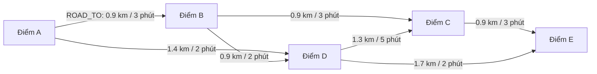
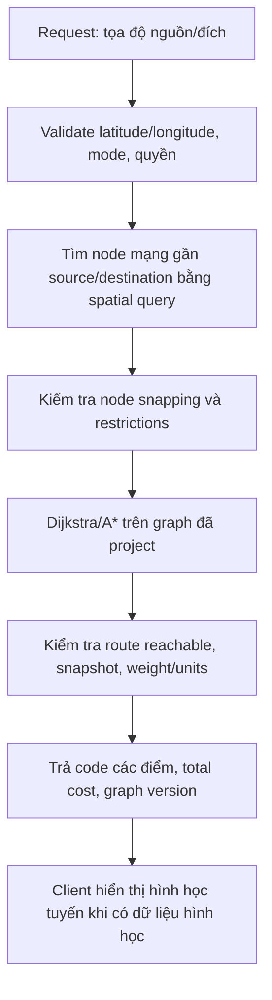

# Định tuyến và mạng lưới khi có dữ liệu trọng số hoặc không gian trong Neo4j

## 1. Bài toán định tuyến khác truy vấn điểm gần nhất như thế nào?

Một ứng dụng giao nhận cần trả lời những câu hỏi như: từ kho **A** đến điểm nhận **E** nên đi qua các nút đường nào, tổng quãng đường bao nhiêu, mất bao lâu và nếu một đoạn bị đóng thì còn tuyến thay thế nào? Đây là bài toán **mạng lưới đường đi** (*network routing*), trong đó đối tượng quan trọng nhất không chỉ là vị trí của các điểm mà còn là **các kết nối hợp lệ giữa chúng**.

Neo4j biểu diễn tốt bài toán này bằng **property graph**:

- **Node** `:RouteStopDemo` đại diện cho giao lộ, bến, điểm giao nhận hoặc nút của mạng lưới.
- **Relationship có hướng** `:ROAD_TO` biểu diễn khả năng di chuyển từ điểm này đến điểm khác.
- **Property của relationship** chứa chi phí như `distanceKm`, `durationMin`, phí cầu đường, mức rủi ro hoặc trạng thái mở/đóng.
- **Property không gian của node** chứa tọa độ `POINT` trong Neo4j, đồng thời có thể lưu riêng `latitude` và `longitude` dạng số cho thuật toán Graph Data Science (GDS).

Sơ đồ tư duy:



**Một bài toán, nhiều câu trả lời đúng tùy mục tiêu:**

| Yêu cầu | Cách tối ưu | Kết quả trên graph minh họa |
| --- | --- | --- |
| Ít chặng trung gian nhất | Ít relationship (*hop count*) | `A → D → E`: 2 chặng |
| Tổng đường đi ngắn nhất | Tổng `distanceKm` | `A → B → C → E`: **2,7 km** |
| Tổng thời gian nhỏ nhất | Tổng `durationMin` | `A → D → E`: **4 phút** |
| Tìm điểm gần tọa độ cho trước | Khoảng cách hình học | Danh sách điểm kèm khoảng cách, **chưa phải tuyến đường** |
| Ba tuyến thay thế ít tốn quãng đường nhất | K đường đi theo trọng số | Có thể dùng Yen's k-shortest paths |

Số liệu minh họa là **dữ liệu giả lập để học thuật toán**, không phải thời gian di chuyển hay bản đồ đường bộ thực tế của một thành phố. Đường thẳng từ A đến E có thể ngắn hơn mọi tuyến đi trên mạng lưới, nhưng **không bảo đảm có đường hợp lệ nối trực tiếp** hai điểm đó.

### 1.1. Ba khái niệm cần phân biệt

1. **Shortest hop path:** tối ưu số quan hệ đi qua, không quan tâm `distanceKm` hay `durationMin`.
2. **Weighted shortest path:** tối ưu **tổng** một property trọng số trên các relationship của tuyến.
3. **Spatial proximity:** tính khoảng cách giữa các tọa độ hoặc tìm node trong vùng địa lý; đó không phải bài toán duyệt toàn bộ mạng đường hợp lệ.

Cypher có cơ chế tìm đường ngắn nhất theo **số chặng**; với bài toán **trọng số tùy biến** và mạng lớn, Neo4j **Graph Data Science (GDS)** cung cấp các thuật toán như Dijkstra, A* và Yen. GDS là thư viện/tính năng riêng cần được hỗ trợ và cài đặt/cấp quyền phù hợp, **không phải** mọi instance Neo4j đều mặc định có các procedure đó.

## 2. Mô hình hóa mạng lưới và lựa chọn trọng số

### 2.1. Chọn node và relationship theo đúng ngữ nghĩa

Với mạng lưới giao thông, node có thể đại diện cho:

- Giao lộ hoặc điểm nối giữa các đoạn đường.
- Trạm dừng, ga, bến trung chuyển.
- Kho hàng, điểm lấy hàng hoặc điểm giao.
- Điểm “trạng thái” của một tuyến khi cần mô hình hóa luật rẽ hoặc phương tiện.

Relationship biểu diễn một **chặng di chuyển được phép**, có hướng:

```text
(A:RouteStopDemo {code:'A'})
  -[:ROAD_TO {distanceKm:0.9, durationMin:3.0}]->
(B:RouteStopDemo {code:'B'})
```

Với đường **một chiều**, giữ đúng chiều `A → B` và **không tự suy ra B → A**. Với đường hai chiều, có thể tạo hai relationship theo hai hướng, vì thời gian/quãng đường/chi phí có thể khác nhau. Khi project `UNDIRECTED` trong GDS, algorithm có thể đi ngược một đường vốn chỉ cho phép một chiều — sai nghiệp vụ nếu không được phê duyệt.

### 2.2. Trọng số phải có ý nghĩa và đơn vị rõ ràng

| Property ví dụ | Đơn vị | Ý nghĩa | Dùng cho |
| --- | --- | --- | --- |
| `distanceKm` | km | Chiều dài đoạn đường thực sự đi được | Tuyến ít km nhất |
| `durationMin` | phút | Thời gian dự kiến di chuyển | Tuyến nhanh nhất trong snapshot hiện tại |
| `tollVnd` | VND | Phí phải trả khi qua đoạn | Tuyến ít phí nhất |
| `energyWh` | Wh | Năng lượng dự kiến tiêu thụ | Tuyến tiết kiệm điện |
| `riskScore` | Thang điểm được chuẩn hóa | Rủi ro theo policy | Tuyến ít rủi ro nhất |
| `isOpen` | Boolean | Đoạn có được phép sử dụng không? | **Lọc cạnh**, không phải trọng số thay thế |

**Không trộn đơn vị vô thức.** Nếu mục tiêu là quãng đường, không cộng trực tiếp `distanceKm` với `durationMin`. Một hàm chi phí đa mục tiêu phải được định nghĩa có chủ đích, ví dụ:

\[
\mathrm{cost}(e) = \alpha \cdot \mathrm{distanceKm}(e)
                  + \beta \cdot \mathrm{durationMin}(e)
                  + \gamma \cdot \mathrm{tollVnd}(e)
\]

Hệ số `α`, `β`, `γ` phải chuyển đổi các đại lượng sang **một đơn vị chi phí chung**, chẳng hạn chi phí quy đổi ra tiền hoặc điểm ưu tiên đã chuẩn hóa. Tổng điểm tối thiểu là kết quả theo **hàm chi phí đó**, không phải tự động là tuyến ít km hoặc nhanh nhất.

Đối với Dijkstra và A* trong GDS, nên sử dụng **trọng số số học dương, hữu hạn** theo yêu cầu thuật toán. Không dùng trọng số âm để biểu diễn “khuyến mãi”, thiếu dữ liệu, hoặc tuyến bị cấm. Trọng số âm có thể làm thuật toán không còn bảo đảm đúng; với trường hợp như vậy phải đổi mô hình/hàm chi phí hoặc chọn thuật toán hỗ trợ cụ thể. Trọng số không tồn tại/NaN cũng phải được làm sạch trước khi project.

### 2.3. Tọa độ và hệ quy chiếu (CRS)

Neo4j hỗ trợ `POINT` theo nhiều hệ tọa độ:

- **WGS 84 địa lý, SRID 4326:** longitude/latitude đo bằng **độ**; `point.distance()` trả khoảng cách địa lý **mét**.
- **Cartesian phẳng:** tọa độ x/y; `point.distance()` trả khoảng cách theo **đơn vị tọa độ** mà ứng dụng đã định nghĩa.

Ví dụ:

```cypher
RETURN point({longitude: 106.7000, latitude: 10.7700}) AS wgs84,
       point({x: 1000.0, y: 2000.0}) AS cartesian;
```

Neo4j hiểu hai giá trị trên theo **CRS khác nhau**. Không lấy latitude/longitude theo độ rồi coi là x/y theo mét; cũng không so trực tiếp hai `POINT` thuộc CRS khác nhau trong cùng một phép đo khoảng cách.

Một lỗi phổ biến là đảo `latitude` và `longitude`. Với dữ liệu ở Việt Nam, latitude thường gần 10–23 độ Bắc, longitude khoảng 102–110 độ Đông. **Không** lấy quy tắc ví dụ làm phép xác thực địa lý hoàn chỉnh; phải kiểm tra CRS và dữ liệu nguồn thực tế.

### 2.4. Định danh điểm ổn định

Mỗi điểm nên có khóa nghiệp vụ như `stopCode` hoặc `code`:

```cypher
CREATE CONSTRAINT route_stop_demo_code_unique IF NOT EXISTS
FOR (s:RouteStopDemo)
REQUIRE s.code IS UNIQUE;
```

GDS có thể trả `nodeId` khi tính toán, nhưng đó không phải business ID bền vững để lưu trong API qua import/backup/migration. Luôn ánh xạ kết quả trở lại `code`, `stationId` hoặc khóa miền nghiệp vụ.

## 3. Tạo bộ dữ liệu thực hành gồm 5 điểm và 7 chặng

**Tất cả câu lệnh tạo dữ liệu dưới đây chỉ được chạy trên database thực hành do bạn sở hữu.** Dùng label `RouteStopDemo` và relationship type `ROAD_TO` tách khỏi mô hình production.

### 3.1. Nạp node: tọa độ kiểu POINT và số cho GDS

```cypher
UNWIND [
  {code:'A', name:'Điểm A', latitude:10.7700, longitude:106.7000},
  {code:'B', name:'Điểm B', latitude:10.7700, longitude:106.7060},
  {code:'C', name:'Điểm C', latitude:10.7700, longitude:106.7120},
  {code:'D', name:'Điểm D', latitude:10.7770, longitude:106.7060},
  {code:'E', name:'Điểm E', latitude:10.7700, longitude:106.7180}
] AS row
MERGE (s:RouteStopDemo {code:row.code})
SET s.name = row.name,
    s.latitude = toFloat(row.latitude),
    s.longitude = toFloat(row.longitude),
    s.location = point({
      latitude:toFloat(row.latitude),
      longitude:toFloat(row.longitude)
    });
```

Ở đây:

- `location` là property Neo4j kiểu `POINT`, phục vụ **spatial query/index**.
- `latitude` và `longitude` là hai property `FLOAT`, được GDS A* sử dụng làm tọa độ cho heuristic.
- Không nhầm `point({longitude,latitude})` với map thông thường: Neo4j tạo giá trị không gian có CRS.
- Cấu hình mapping Spring Data Neo4j hoặc Java Driver có thể dùng `Point` của Neo4j Driver/kiểu được hỗ trợ; nếu cần hiển thị bản đồ, API nên trả các số lat/lon đã xác thực.

Kiểm tra số node:

```cypher
MATCH (s:RouteStopDemo)
RETURN count(s) AS numberOfStops;
```

Trên database demo sạch, kỳ vọng **5 node**.

### 3.2. Nạp relationship một chiều với hai loại trọng số

```cypher
UNWIND [
  {from:'A', to:'B', distanceKm:0.9, durationMin:3.0},
  {from:'B', to:'C', distanceKm:0.9, durationMin:3.0},
  {from:'C', to:'E', distanceKm:0.9, durationMin:3.0},
  {from:'A', to:'D', distanceKm:1.4, durationMin:2.0},
  {from:'D', to:'E', distanceKm:1.7, durationMin:2.0},
  {from:'B', to:'D', distanceKm:0.9, durationMin:2.0},
  {from:'D', to:'C', distanceKm:1.3, durationMin:5.0}
] AS segment
MATCH (a:RouteStopDemo {code:segment.from})
MATCH (b:RouteStopDemo {code:segment.to})
MERGE (a)-[r:ROAD_TO]->(b)
SET r.distanceKm = toFloat(segment.distanceKm),
    r.durationMin = toFloat(segment.durationMin),
    r.isOpen = true;
```

Với dữ liệu mới, `MERGE` trên pattern hai endpoint giúp chạy lại ví dụ mà không tạo thêm quan hệ trùng loại giữa cùng hai node. Quy tắc này **chỉ thích hợp vì fixture giả định tối đa một `ROAD_TO` trên mỗi cặp có hướng**; mạng đường thực có thể có nhiều làn, tuyến hoặc phương thức song song và khi đó phải dùng ID riêng cho từng chặng.

Đối chiếu:

```cypher
MATCH (:RouteStopDemo)-[r:ROAD_TO]->(:RouteStopDemo)
RETURN count(r) AS numberOfRoads,
       min(r.distanceKm) AS minKm,
       min(r.durationMin) AS minMinutes;
```

Kỳ vọng **7 relationship**, `minKm = 0.9` và `minMinutes = 2.0`.

### 3.3. Đọc danh sách chặng theo thứ tự ổn định

```cypher
MATCH (a:RouteStopDemo)-[r:ROAD_TO]->(b:RouteStopDemo)
RETURN a.code AS fromCode,
       b.code AS toCode,
       r.distanceKm AS distanceKm,
       r.durationMin AS durationMin
ORDER BY fromCode, toCode;
```

`ORDER BY` quan trọng trong kiểm thử: nếu không có nó, thứ tự dòng Cypher không được bảo đảm. Kết quả mong đợi:

| Chặng | Km | Phút |
| --- | ---: | ---: |
| A → B | 0,9 | 3 |
| A → D | 1,4 | 2 |
| B → C | 0,9 | 3 |
| B → D | 0,9 | 2 |
| C → E | 0,9 | 3 |
| D → C | 1,3 | 5 |
| D → E | 1,7 | 2 |

## 4. Truy vấn không gian: tọa độ, bán kính và spatial index

### 4.1. Khoảng cách địa lý giữa hai điểm

```cypher
MATCH (a:RouteStopDemo {code:'A'})
MATCH (e:RouteStopDemo {code:'E'})
RETURN point.distance(a.location, e.location) AS straightLineMeters;
```

Với hai WGS-84 POINT, `point.distance` trả số mét theo khoảng cách địa lý ước lượng trên bề mặt Trái Đất. Khoảng cách A–E theo đường thẳng xấp xỉ **2 km**, **không** phải quãng đường lái xe. Trong fixture, đường mạng ít km nhất A–B–C–E vẫn dài **2,7 km**.

### 4.2. Tạo point index

```cypher
CREATE POINT INDEX route_stop_demo_location_idx IF NOT EXISTS
FOR (s:RouteStopDemo)
ON (s.location);
```

`POINT INDEX` là **performance index** giúp Cypher lọc theo distance hoặc bounding box trên property không gian. Nó **không** tự tạo cạnh đường và không tối ưu hóa bài toán đường đi theo trọng số.

Kiểm tra index đã có và trạng thái population:

```cypher
SHOW INDEXES
YIELD name, type, state, populationPercent
WHERE name = 'route_stop_demo_location_idx'
RETURN name, type, state, populationPercent;
```

Trước benchmark cần chờ index ở trạng thái `ONLINE`. Việc query planner dùng index hay không phụ thuộc biểu thức, thống kê và chi phí ước lượng.

### 4.3. Tìm điểm trong bán kính

```cypher
WITH point({
  latitude:$latitude,
  longitude:$longitude
}) AS center, toFloat($radiusMeters) AS radiusMeters
MATCH (s:RouteStopDemo)
WHERE point.distance(s.location, center) <= radiusMeters
RETURN s.code AS code,
       s.name AS name,
       point.distance(s.location, center) AS meters
ORDER BY meters ASC, code ASC
LIMIT 20;
```

Ví dụ tham số để thử: `latitude = 10.7700`, `longitude = 106.7000`, `radiusMeters = 1500`. Query trả điểm trong vùng theo **khoảng cách hình học**, không loại trừ điểm ở bên kia sông, đường cấm hoặc nút đường không thể đi tới.

**Vì sao có `code ASC`?** Hai điểm có thể có cùng khoảng cách; thêm khóa ID phá hòa giúp kết quả có thứ tự xác định cho API và test.

### 4.4. Tìm điểm trong bounding box

```cypher
MATCH (s:RouteStopDemo)
WHERE point.withinBBox(
  s.location,
  point({longitude:106.6990, latitude:10.7690}),
  point({longitude:106.7190, latitude:10.7790})
)
RETURN s.code AS code, s.location AS location
ORDER BY code;
```

Bounding box lọc theo **hình chữ nhật tọa độ**, không phải “đường đi được”, cũng không phải hình tròn bán kính. Trong một hệ thống tuyến đường thật, thường có hai bước:

1. Dùng spatial query để xác định các điểm/nút mạng **gần** vị trí xuất phát và kết thúc.
2. Chọn node hợp lệ rồi chạy thuật toán **routing trên relationship** của mạng lưới.

Hai bước có tiêu chí kiểm tra khác nhau. Một điểm có khoảng cách hình học nhỏ nhất chưa chắc là điểm có thời gian di chuyển trên mạng lưới nhỏ nhất.

### 4.5. Kiểm tra khi point index không được dùng

```cypher
EXPLAIN
MATCH (s:RouteStopDemo)
WHERE point.distance(
  s.location,
  point({longitude:106.7000, latitude:10.7700})
) < 1000.0
RETURN s.code AS code;
```

Đọc execution plan để xem có phù hợp với point index không. `EXPLAIN` chỉ tạo plan; `PROFILE` thực thi query và ghi lại thống kê thực tế (tùy quyền). Không dùng hiệu năng của 5 node demo để khẳng định index sẽ hữu ích trên mạng thực tế hàng triệu node.

## 5. Cypher shortest path tối ưu **số chặng**, không tối ưu tổng trọng số

Với dữ liệu thực hành:

```cypher
MATCH (source:RouteStopDemo {code:'A'})
MATCH (target:RouteStopDemo {code:'E'})
MATCH path = shortestPath((source)-[:ROAD_TO*]->(target))
RETURN [n IN nodes(path) | n.code] AS route,
       length(path) AS hops;
```

Kỳ vọng `route = ['A','D','E']` và `hops = 2`, vì đây là tuyến ít relationship nhất trong fixture. Hàm `shortestPath(...)` (cú pháp Cypher phổ biến trước đây, vẫn được hỗ trợ) **không tự cộng** `distanceKm` hoặc `durationMin`.

Trên các phiên bản Cypher mới hơn còn có **`SHORTEST 1`**, **`ALL SHORTEST`** và đường đi có quantified path patterns; chúng chọn shortest theo **chiều dài pattern/số chặng**, không tự trở thành weighted Dijkstra. Khi dùng Cypher 5/25, kiểm tra cú pháp và khả năng hỗ trợ ở server đích.

### 5.1. Tính tổng trọng số cho một path đã có

```cypher
MATCH (source:RouteStopDemo {code:'A'})
MATCH (target:RouteStopDemo {code:'E'})
MATCH path = shortestPath((source)-[:ROAD_TO*]->(target))
RETURN [n IN nodes(path) | n.code] AS route,
       length(path) AS hops,
       reduce(km = 0.0, r IN relationships(path) |
         km + r.distanceKm) AS totalKm,
       reduce(minutes = 0.0, r IN relationships(path) |
         minutes + r.durationMin) AS totalMinutes;
```

Kỳ vọng tuyến A–D–E có **3,1 km**, **4 phút**. Đây là cách **tính cost của đường đã chọn**, không phải cách thay đổi tiêu chí `shortestPath`: nó đã chọn đường 2 chặng rồi mới tính tổng.

### 5.2. Liệt kê và so chi phí path chỉ phù hợp mạng demo rất nhỏ

```cypher
MATCH (source:RouteStopDemo {code:'A'})
MATCH (target:RouteStopDemo {code:'E'})
MATCH path = (source)-[:ROAD_TO*1..4]->(target)
WITH path,
     reduce(km = 0.0, r IN relationships(path) |
       km + r.distanceKm) AS totalKm,
     [n IN nodes(path) | n.code] AS route
RETURN route, totalKm
ORDER BY totalKm ASC, route ASC
LIMIT 1;
```

Trên fixture, query chọn `A → B → C → E` với **2,7 km**. Nhưng đây chỉ là phép **liệt kê các path tối đa bốn chặng**, sau đó sắp xếp — không phải thuật toán Dijkstra tổng quát. Trên mạng thực tế có nhiều nhánh, số path có thể tăng rất nhanh; chặn chiều dài `*1..4` cũng có thể bỏ qua tuyến tối ưu dài hơn bốn chặng. Dùng GDS weighted pathfinding cho mạng lớn.

## 6. Đưa mạng vào Neo4j Graph Data Science

### 6.1. Kiểm tra GDS có khả dụng

GDS là **thư viện phân tích graph** được cài đặt/cung cấp riêng theo môi trường Neo4j và quyền tài khoản. Nó sử dụng **projected graph** trong bộ nhớ để chạy nhiều thuật toán mà không phải duyệt lại toàn bộ database mỗi lần.

```cypher
RETURN gds.version() AS gdsVersion;
```

Nếu câu này báo không có function, cần kiểm tra việc cài/enable GDS, phiên bản Neo4j, quyền gọi procedure và gói Aura tương ứng. Ví dụ trong bài dùng API **GDS hiện hành**. Không mặc định một database Community Edition tự có mọi thuật toán GDS hoặc đầy đủ tính năng cấp phép.

### 6.2. Chiếu node, tọa độ số và trọng số quan hệ

```cypher
CALL gds.graph.project(
  'route_demo',
  'RouteStopDemo',
  {
    ROAD_TO: {
      orientation:'NATURAL',
      properties:['distanceKm', 'durationMin']
    }
  },
  {
    nodeProperties:['latitude', 'longitude']
  }
)
YIELD graphName, nodeCount, relationshipCount, projectMillis
RETURN graphName, nodeCount, relationshipCount, projectMillis;
```

Giải thích:

- `route_demo`: tên graph nằm **trong catalog bộ nhớ của GDS**, không phải tên database Neo4j mới.
- `RouteStopDemo`: chỉ chiếu node có label đó.
- `ROAD_TO`: chỉ chọn relationship thuộc mạng demo và có đầu cuối trong tập node được chiếu.
- `orientation:'NATURAL'`: giữ **hướng một chiều**, không vô tình tạo đường ngược.
- `distanceKm` và `durationMin`: được chiếu vào graph để thuật toán có thể tối ưu theo hai mục tiêu khác nhau.
- `latitude` và `longitude`: thuộc tính **số**, thích hợp với GDS A*. Property `location` kiểu Neo4j `POINT` **không** được tự động đưa vào projection này.

Khi fixture sạch, dự kiến `nodeCount = 5` và `relationshipCount = 7`. Kiểm tra:

```cypher
CALL gds.graph.list('route_demo')
YIELD graphName, nodeCount, relationshipCount, schema
RETURN graphName, nodeCount, relationshipCount, schema;
```

**Quan trọng:** GDS native projection chỉ nạp những node/relationship và thuộc tính được chọn ở thời điểm project. Nó **không tự cập nhật** theo mọi transaction mới của Neo4j. Nếu bạn cập nhật `durationMin` sau khi đã project, GDS có thể vẫn dùng giá trị cũ cho tới khi project lại/nạp mới bằng quy trình hỗ trợ.

Một named graph có cùng tên đã tồn tại thì lệnh project lần nữa có thể báo lỗi. Hãy dùng tên graph riêng theo run/job hoặc kiểm tra `gds.graph.exists` và chỉ drop graph **do mình sở hữu** khi không còn job đang dùng:

```cypher
CALL gds.graph.exists('route_demo')
YIELD graphName, exists
RETURN graphName, exists;
```

### 6.3. Ước lượng bộ nhớ cho graph lớn

Trong sản xuất, cần ước lượng bộ nhớ **graph chiếu và thuật toán**. Một ví dụ sau khi đã có `route_demo`:

```cypher
MATCH (source:RouteStopDemo {code:'A'})
MATCH (target:RouteStopDemo {code:'E'})
CALL gds.shortestPath.dijkstra.stream.estimate(
  'route_demo',
  {
    sourceNode:source,
    targetNodes:target,
    relationshipWeightProperty:'distanceKm'
  }
)
YIELD nodeCount, relationshipCount, requiredMemory
RETURN nodeCount, relationshipCount, requiredMemory;
```

Số liệu estimate phụ thuộc kích thước graph, properties và cấu hình. Không suy từ graph 5 điểm ra yêu cầu RAM của mạng có hàng triệu nút; sử dụng metric và kiểm tra `gds.graph.list` trong môi trường triển khai.

## 7. Dijkstra: tối ưu tổng trọng số trên quan hệ

### 7.1. Nguyên lý

**Dijkstra** tìm đường có tổng chi phí thấp nhất khi các trọng số phù hợp là **không âm/dương theo yêu cầu thuật toán**. Nó bắt đầu ở node nguồn, mở rộng các lựa chọn theo tổng chi phí đã biết, và chốt chi phí tốt nhất khi tới đích.

Với ba chặng A–B–C–E:

\[
\mathrm{distanceKm}(A,B,C,E) = 0.9 + 0.9 + 0.9 = 2.7
\]

Với hai chặng A–D–E:

\[
\mathrm{distanceKm}(A,D,E) = 1.4 + 1.7 = 3.1
\]

Do đó route ít chặng hơn **không nhất thiết** là route ít km hơn.

### 7.2. Dijkstra theo quãng đường

```cypher
MATCH (source:RouteStopDemo {code:'A'})
MATCH (target:RouteStopDemo {code:'E'})
CALL gds.shortestPath.dijkstra.stream(
  'route_demo',
  {
    sourceNode:source,
    targetNodes:target,
    relationshipWeightProperty:'distanceKm'
  }
)
YIELD index, sourceNode, targetNode, totalCost, nodeIds, costs
RETURN index,
       [nodeId IN nodeIds | gds.util.asNode(nodeId).code] AS route,
       totalCost AS totalKm,
       costs AS cumulativeKm
ORDER BY index;
```

Kỳ vọng với dữ liệu demo:

| route | totalKm | cumulativeKm |
| --- | ---: | --- |
| `['A','B','C','E']` | **2,7** | `[0.0, 0.9, 1.8, 2.7]` |

`totalCost` mang **đơn vị của property trọng số**; ở đây là km. `costs` là chi phí **tích lũy** trên từng node của đường đi, không phải trọng số riêng từng cạnh. Khi so số thực từ Java, dùng dung sai nhỏ thay vì so từng bit.

**Cú pháp lưu ý:** trong GDS hiện hành, `targetNodes` nhận một node hoặc danh sách node; `targetNode` số ít của Dijkstra Source-Target đã bị **deprecated**. Các ví dụ bài này dùng `targetNodes` để tránh API cũ.

### 7.3. Dijkstra theo thời gian

Chỉ cần thay tên property trọng số, **không phải thay graph** nếu đã project cả hai property:

```cypher
MATCH (source:RouteStopDemo {code:'A'})
MATCH (target:RouteStopDemo {code:'E'})
CALL gds.shortestPath.dijkstra.stream(
  'route_demo',
  {
    sourceNode:source,
    targetNodes:target,
    relationshipWeightProperty:'durationMin'
  }
)
YIELD totalCost, nodeIds
RETURN [nodeId IN nodeIds | gds.util.asNode(nodeId).code] AS route,
       totalCost AS totalMinutes;
```

Kỳ vọng `route = ['A','D','E']`, `totalMinutes = 4.0`. Đường ít km nhất A–B–C–E có tổng thời gian **9 phút**, nên hai tiêu chí dẫn đến **hai lựa chọn khác nhau**.

Nếu một property trọng số không được project, đặt sai tên hoặc chứa giá trị không phù hợp, thuật toán có thể báo lỗi hoặc không cho kết quả như dự kiến. Trước khi chạy production, xác minh schema của projection và kiểm tra dữ liệu nguồn.

### 7.4. Nhiều đích từ một nguồn

Trong bài toán phân phối, đôi khi muốn biết **điểm giao gần nhất theo thời gian di chuyển**, chứ không chỉ gần theo tọa độ:

```cypher
MATCH (start:RouteStopDemo {code:'A'})
MATCH (destination:RouteStopDemo)
WHERE destination.code IN ['C','E']
WITH start, collect(destination) AS destinations
CALL gds.shortestPath.dijkstra.stream(
  'route_demo',
  {
    sourceNode:start,
    targetNodes:destinations,
    relationshipWeightProperty:'durationMin'
  }
)
YIELD targetNode, totalCost, nodeIds
RETURN gds.util.asNode(targetNode).code AS destination,
       totalCost AS totalMinutes,
       [id IN nodeIds | gds.util.asNode(id).code] AS route
ORDER BY totalMinutes ASC, destination ASC;
```

Trên fixture, điểm E có đường nhanh nhất **4 phút**, còn tới C qua A–B–C mất **6 phút**. Vì vậy nếu hai địa điểm giao C và E đều chấp nhận được, chọn E theo *network travel time* dù có thể khác thứ tự theo đường thẳng.

Trường hợp nhiều điểm nguồn/đích, khối lượng chạy Dijkstra lặp có thể lớn; phải chọn batch, snapshot và giới hạn số kết quả hợp lý, không đưa mọi cặp điểm vào một request trực tuyến không kiểm soát.

### 7.5. Không có đường đi hợp lệ

Nếu không có đường theo hướng nguồn → đích, thuật toán thường không trả dòng path cho cặp đó. Trong API:

- **Không tìm thấy nguồn hoặc đích:** lỗi xác thực input/ID.
- **Có cả hai node nhưng không có đường:** kết quả `NO_ROUTE` (hoặc trạng thái nghiệp vụ tương ứng).
- **Có đường nhưng trọng số thiếu/không hợp lệ:** lỗi chất lượng dữ liệu/model; không âm thầm quy về 0.
- **Projection lỗi thời hoặc chưa có:** trạng thái hạ tầng/job, cần xử lý riêng.

Không trả một `totalCost = 0` để thay thế “không có đường”: 0 có thể là giá trị hợp lệ trong những mô hình đặc biệt và sẽ gây hiểu nhầm.

## 8. A*: kết hợp trọng số với heuristic từ tọa độ

### 8.1. Cơ chế và giới hạn của heuristic

**A\*** cũng giải bài toán shortest weighted path nhưng dùng thông tin ước lượng còn lại đến đích:

\[
f(n)=g(n)+h(n)
\]

- `g(n)` là tổng chi phí đã đi từ nguồn đến node `n`.
- `h(n)` là ước lượng **cận dưới** của chi phí từ `n` tới đích.
- Nếu heuristic **admissible** (không ước lượng cao hơn chi phí tối ưu thực), thuật toán mới có cơ sở bảo đảm tìm đường tối ưu theo điều kiện tương ứng.

GDS A* sử dụng heuristic **Haversine dựa vào latitude/longitude**, được tài liệu GDS mô tả tính bằng **hải lý (nautical miles)**. Vì vậy **trọng số nên biểu diễn quãng đường**, lý tưởng được chuẩn hóa phù hợp với đơn vị heuristic. Tài liệu cho biết trọng số km/mile cũng có thể dùng, nhưng heuristic hoạt động phù hợp nhất khi tính bằng hải lý. <https://neo4j.com/docs/graph-data-science/current/algorithms/astar/>

**Không dùng A* địa lý này cho `durationMin` một cách máy móc:** heuristic quãng đường (hải lý) không có cùng ý nghĩa với phút và có thể **overestimate** chi phí thời gian thực nếu không quy đổi/kiểm chứng. Dijkstra với `durationMin` là lựa chọn rõ ràng hơn trong ví dụ.

Không nhầm:

- `point.distance()` của Cypher WGS-84 trả **mét**.
- Heuristic A* của GDS dùng **hải lý** theo tài liệu GDS.
- `distanceKm` của ví dụ là **km**, tức đơn vị của `totalCost` kết quả.

**Không cộng trực tiếp các số ở ba đơn vị này** trước khi chuẩn hóa. Các cạnh demo có độ dài lớn hơn khoảng cách địa lý trực tiếp giữa đầu và cuối, nên heuristic trong hải lý là cận dưới phù hợp cho quãng đường theo km trong ví dụ. Với dữ liệu production, cần kiểm chứng điều kiện này; nếu trọng số “quãng đường” thực tế nhỏ hơn khoảng cách địa lý (do lỗi đo, teleport, đường tàu/đường hàng không được mô hình hóa khác), bảo đảm tối ưu có thể bị phá vỡ.

### 8.2. Chạy GDS A* trên cùng graph

```cypher
MATCH (source:RouteStopDemo {code:'A'})
MATCH (target:RouteStopDemo {code:'E'})
CALL gds.shortestPath.astar.stream(
  'route_demo',
  {
    sourceNode:source,
    targetNode:target,
    latitudeProperty:'latitude',
    longitudeProperty:'longitude',
    relationshipWeightProperty:'distanceKm'
  }
)
YIELD totalCost, nodeIds, costs
RETURN [id IN nodeIds | gds.util.asNode(id).code] AS route,
       totalCost AS totalKm,
       costs AS cumulativeKm;
```

Kỳ vọng cùng tuyến tối ưu **A–B–C–E, 2,7 km** như Dijkstra. Với graph chỉ 5 node, A* **không nhất thiết nhanh hơn** Dijkstra; chi phí heuristic có thể nhiều hơn phần mở rộng node tiết kiệm được. Lợi ích của heuristic phải được đo trên mạng có kích thước và cấu trúc thực tế.

**Không được bỏ hai property tọa độ trong projection.** GDS A* cần `latitudeProperty` và `longitudeProperty` là property node dạng số trong graph catalog; việc node Neo4j nguồn chỉ có một property kiểu `POINT` mà projection không có hai property số sẽ không đáp ứng ví dụ này.

### 8.3. Bảng lựa chọn giữa Dijkstra và A*

| Tình huống | Thường chọn | Lý do |
| --- | --- | --- |
| Tối ưu `durationMin` với trọng số dương | **Dijkstra** | Không cần heuristic địa lý; đúng đơn vị phút |
| Tối ưu quãng đường theo graph có tọa độ chính xác | **A\*** hoặc Dijkstra để đối chiếu | Heuristic Haversine có thể hướng tìm kiếm |
| Dữ liệu chỉ có topology, không có trọng số | Cypher shortest-hop/BFS | Đơn vị tối ưu là số chặng |
| Một nguồn, nhiều đích | Dijkstra source-targets hoặc single-source | Chọn biến thể theo số đích và kết quả cần |
| Cần vài tuyến dự phòng | Yen's k-shortest | Không chỉ lấy một tuyến |
| Ràng buộc thời gian theo giờ/ngày hoặc phương tiện | Mô hình mở rộng + thuật toán thích hợp | Cost có thể phụ thuộc state/thời điểm |

## 9. Yen's: lấy nhiều tuyến ít chi phí nhất

Một hệ thống giao vận thường cần một số tuyến dự phòng khi tuyến tốt nhất bị tắc hoặc cần đánh đổi phí và thời gian.

**Yen's k-shortest paths** trong GDS trả tối đa `k` tuyến theo tổng trọng số, không phải danh sách `k` node gần nhất.

```cypher
MATCH (source:RouteStopDemo {code:'A'})
MATCH (target:RouteStopDemo {code:'E'})
CALL gds.shortestPath.yens.stream(
  'route_demo',
  {
    sourceNode:source,
    targetNode:target,
    k:3,
    relationshipWeightProperty:'distanceKm'
  }
)
YIELD index, totalCost, nodeIds
RETURN index,
       [id IN nodeIds | gds.util.asNode(id).code] AS route,
       totalCost AS totalKm
ORDER BY totalKm, index;
```

Trên fixture, ba tuyến dự kiến:

| Thứ tự | Tuyến | Tổng km |
| ---: | --- | ---: |
| 1 | A → B → C → E | **2,7** |
| 2 | A → D → E | **3,1** |
| 3 | A → B → D → E | **3,5** |

Trong GDS, `k:1` của Yen có ý nghĩa tương đương tìm một tuyến ngắn nhất như Dijkstra trên cùng graph. Với nhiều tuyến có **cùng tổng cost**, thứ tự giữa các tuyến hòa có thể khác nhau; API muốn thứ tự hoàn toàn xác định cần thêm quy tắc tie-break phù hợp với kết quả node sequence.

Đừng hiểu ba tuyến đầu là ba phương án **không có đoạn chung**: Yen có thể trả những path chia sẻ node hoặc road segment. Nếu nghiệp vụ yêu cầu các tuyến **ít trùng tuyến**, cần thêm ràng buộc/penalty và bộ lọc domain; k-shortest mặc định không bảo đảm sự đa dạng đó.

## 10. BFS, reachability và các thuật toán mạng lưới khác

**Breadth-First Search (BFS)** thăm các node theo độ sâu từ nguồn, hữu ích khi cần:

- Xác định các nút reachable trong tối đa `N` chặng.
- Tìm khu vực phục vụ theo số lần chuyển trạm.
- Kiểm tra mạng có điểm cô lập, mất kết nối sau một sự cố.

```cypher
MATCH (source:RouteStopDemo {code:'A'})
CALL gds.bfs.stream('route_demo', {
  sourceNode:source,
  maxDepth:2
})
YIELD nodeIds
RETURN [id IN nodeIds | gds.util.asNode(id).code] AS visitedCodes;
```

Danh sách này là **các node được thăm**, **không** phải một tuyến tối ưu cho mọi cặp node. Không dùng thứ tự node BFS trong `nodeIds` làm thứ tự API được cam kết; muốn so tập reachable, chuẩn hóa thành set hoặc sắp xếp để kiểm thử.

Các thuật toán bổ sung trong bài toán mạng:

| Bài toán | Hướng thuật toán/cách làm |
| --- | --- |
| Phân vùng mạng có thể đi tới nhau | Weakly/Strongly Connected Components theo ngữ nghĩa hướng |
| Tính trọng yếu của nút giao thông | Betweenness/Centrality, với giải thích nghiệp vụ phù hợp |
| Một nguồn đến tất cả node có thể đến | Dijkstra Single-Source nếu cần trọng số |
| Nhiều cặp điểm có route | Batch nhiều lần, hoặc all-pairs cho quy mô đã đánh giá |
| Nhiều điểm giao hàng phải ghé, giới hạn tải trọng | Vehicle Routing Problem/biến thể TSP với solver chuyên dụng |
| Tìm tuyến có nhiều điều kiện rẽ, giờ đóng mở | Mở rộng mô hình state/time hoặc thuật toán miền chuyên biệt |

**Dijkstra cho một cặp điểm không tự giải Vehicle Routing Problem (VRP).** VRP còn phải quyết định **thứ tự nhiều điểm ghé**, số xe, năng lực, cửa sổ thời gian và ràng buộc tài xế. Neo4j có thể cung cấp graph và ma trận khoảng cách/thời gian giữa các điểm, còn bước tối ưu lịch trình có thể cần solver riêng.

## 11. Đường bị đóng, cấm rẽ, hạn chế phương tiện và dữ liệu theo thời gian

### 11.1. Đóng một cạnh là thay đổi tính hợp lệ của graph

Giả sử đường D → E bị chặn:

```cypher
MATCH (:RouteStopDemo {code:'D'})
      -[road:ROAD_TO]->
      (:RouteStopDemo {code:'E'})
SET road.isOpen = false;
```

**Không** gán `durationMin = -1` để biểu diễn cấm đi: Dijkstra/A* dựa trên trọng số dương và một giá trị -1 có thể tạo ra route sai. **Không** luôn gán một số cực lớn thay vì lọc cạnh: nếu các tuyến khác còn lớn hơn hoặc đường bị cấm tuyệt đối, kết quả vẫn có thể chứa đoạn không được phép đi.

Nếu graph GDS `route_demo` đã project từ trước, việc sửa `road.isOpen` trong Neo4j **không tự loại cạnh** ở projection đó. Hơn nữa, projection gốc chỉ nạp `distanceKm`/`durationMin`, **không nạp `isOpen`** và cũng không lọc theo nó.

### 11.2. Tạo projection chỉ chứa đường đang mở

Có thể dùng **Cypher projection** của GDS để chọn cạnh hợp lệ ngay lúc project:

```cypher
MATCH (source:RouteStopDemo)-[r:ROAD_TO]->(target:RouteStopDemo)
WHERE coalesce(r.isOpen, true) = true
RETURN gds.graph.project(
  'route_open_demo',
  source,
  target,
  {
    sourceNodeProperties:source { .latitude, .longitude },
    targetNodeProperties:target { .latitude, .longitude },
    relationshipProperties:r { .distanceKm, .durationMin }
  }
) AS projection;
```

Lệnh trên tạo **một graph mới**, chỉ lấy relationship còn mở ở snapshot query. Các node **không có chặng được đưa vào qua các dòng MATCH** có thể không nằm trong projection; nếu nghiệp vụ cần cả node cô lập, phải thiết kế projection để đưa chúng vào đúng cách.

Chạy tìm tuyến nhanh nhất trên graph vừa tạo:

```cypher
MATCH (source:RouteStopDemo {code:'A'})
MATCH (target:RouteStopDemo {code:'E'})
CALL gds.shortestPath.dijkstra.stream(
  'route_open_demo',
  {
    sourceNode:source,
    targetNodes:target,
    relationshipWeightProperty:'durationMin'
  }
)
YIELD totalCost, nodeIds
RETURN [id IN nodeIds | gds.util.asNode(id).code] AS route,
       totalCost AS totalMinutes;
```

Khi D → E bị đóng, kỳ vọng tuyến nhanh nhất chuyển thành **A–B–C–E, 9 phút**. Tuyến A–D–C–E tốn 10 phút; tuyến đi qua B rồi D còn lâu hơn.

**Không xóa graph `route_demo` nếu một job khác vẫn dùng nó.** Sau bài thực hành, graph `route_open_demo` chỉ được drop khi không còn caller cần:

```cypher
CALL gds.graph.drop('route_open_demo', false)
YIELD graphName
RETURN graphName;
```

Muốn chạy lại bài từ đầu, cần mở lại cạnh:

```cypher
MATCH (:RouteStopDemo {code:'D'})-[r:ROAD_TO]->
      (:RouteStopDemo {code:'E'})
SET r.isOpen = true;
```

### 11.3. Hạn chế phương tiện và cấm rẽ

Mạng đường thực tế không chỉ có thuộc tính một cạnh:

- Xe tải bị cấm qua cầu có giới hạn tải trọng.
- Xe máy không được lên một số loại đường.
- Một giao lộ cấm **rẽ trái** từ đoạn X sang đoạn Y, dù cả hai đoạn riêng lẻ đều đi được.
- Đường chỉ mở trong một khoảng giờ nhất định.
- Chi phí qua một đoạn phụ thuộc vào **thời điểm đến**, không phải chỉ thời điểm xuất phát.

Với cấm phương tiện, có thể thêm property như `allowedVehicleTypes` và **lọc** ngay khi tạo graph cho từng phương tiện, hoặc thiết kế nhiều relationship type thích hợp. Đừng giả định `gds.shortestPath.dijkstra.stream` tự hiểu các luật nghiệp vụ nếu chúng không hiện diện trong cấu trúc/chi phí của graph chiếu.

**Cấm rẽ** là một ràng buộc giữa **hai đoạn kế tiếp**, không phải property riêng của một node đường đi. Mô hình node = giao lộ, relationship = đoạn đường có thể **chưa đủ** để biểu diễn “được tới giao lộ này nhưng không được rẽ vào đoạn kia”. Có thể mô hình hóa **trạng thái đoạn đến/đoạn đi** thành các node hoặc ràng buộc chuyển trạng thái; sau đó route trên **state-expanded graph**. Điều này làm graph lớn hơn nhưng diễn đạt được điều kiện chính xác.

### 11.4. Trọng số theo thời điểm không phải lúc nào cũng cộng cố định được

Nếu `durationMin` lấy từ dữ liệu giao thông:

```text
08:00 — A→D: 2 phút, D→E: 2 phút
08:30 — A→D: 8 phút, D→E: 12 phút
```

Một Dijkstra trên projected graph với mỗi cạnh mang **một giá trị cố định** chỉ tối ưu cho **snapshot trọng số đã chọn**. Nó không tự xử lý:

- Thời gian kẹt xe thay đổi **trong lúc xe di chuyển**.
- Thời gian chờ/giờ khởi hành của tàu, xe buýt.
- Quãng nghỉ, giờ giới nghiêm hoặc khoảng thời gian cấm lưu thông.
- Ràng buộc “phải đến trước 17:00” hoặc chi phí thay đổi theo thời gian đến mỗi nút.

Muốn time-dependent routing đúng, cần mô hình chi phí phụ thuộc thời điểm, thuật toán chuyên biệt hoặc đồ thị mở rộng theo trạng thái/thời gian; không gọi một query Dijkstra với `durationMin` tại 08:00 rồi khẳng định tối ưu cho toàn bộ hành trình bất kể thời gian.

### 11.5. Chiến lược refresh và version cho projected graph

Một job routing hoạt động liên tục nên có:

1. **Version dữ liệu nguồn** và mốc thời gian/nhóm update đã xử lý.
2. **Tên graph theo lần nạp**, ví dụ `route_20261125_0800`, tránh drop graph chung của request đang chạy.
3. **Quality checks** về số node/cạnh, missing weights, direction, connectivity trước khi đưa graph mới vào phục vụ.
4. **Chuyển route traffic** sang version mới một cách có kiểm soát khi sẵn sàng.
5. **Drop graph cũ** chỉ khi không còn query nào giữ/tham chiếu graph đó.

GDS graph nằm trong bộ nhớ và có thể mất khi database/DBMS dừng. Vì vậy startup/reroute của ứng dụng phải biết **projected graph có tồn tại chưa**, không mặc định tên graph trong cấu hình tương đương dữ liệu đã nạp.

## 12. Luồng ứng dụng: ghép truy vấn không gian và đường đi

Một request kiểu “đưa hàng từ vị trí người dùng đến địa chỉ nhận” thường gồm:



### 12.1. “Snap” vị trí vào mạng cần điều kiện nghiệp vụ

Một điểm GPS có thể nằm:

- Bên kia đường một chiều.
- Trên đường cao tốc nhưng phương tiện là xe đạp.
- Gần một cầu vượt về tọa độ hai chiều nhưng không có lối lên cầu.
- Trong khu vực cấm xe, trong cảng hoặc đường nội bộ.

Do đó bước tìm node gần nhất bằng `point.distance` chỉ tạo **ứng viên snapping**. Phải kiểm tra phương thức di chuyển, hướng, khả năng kết nối, độ chính xác GPS và luật địa phương trước khi chọn node nguồn/đích.

Trong ví dụ demo, node là các nút đường đã cố định; không mô phỏng trượt điểm dọc một đoạn đường (edge snapping). Với bản đồ thật, cần mô hình segment geometry, khả năng rẽ và các nút kết nối để không đưa ra tuyến sai.

### 12.2. Kết quả GDS là chuỗi node, chưa phải đường polyline chi tiết

`nodeIds`/`path` của GDS biểu diễn đường đi qua các **node và relationship**. Nếu một đoạn đường cong, một cạnh nối hai giao lộ có thể cần **polyline geometry** gồm nhiều điểm trung gian để hiển thị đúng lên bản đồ.

Không chỉ nối hai tọa độ giao lộ bằng một đoạn thẳng rồi coi đó là tuyến đường thật. Thông thường:

- Lưu shape/geometry của road segment trong hệ thống dữ liệu bản đồ phù hợp.
- Gắn khóa segment ổn định lên relationship.
- Dùng path trả về để lấy danh sách segment, kết hợp geometry từng segment **theo đúng hướng di chuyển**.
- Trả GeoJSON hoặc format phù hợp cho frontend, có CRS và precision đúng.

Node route, tổng trọng số và đoạn polyline là **ba loại dữ liệu khác nhau** của API. Bài thực hành chỉ trả **mã các điểm**, không tuyên bố sinh route map có độ chính xác đường bộ thực.

### 12.3. Cấu trúc response

Ví dụ response nghiệp vụ để thiết kế API:

```json
{
  "fromCode": "A",
  "toCode": "E",
  "optimization": "distanceKm",
  "routeCodes": ["A", "B", "C", "E"],
  "totalCost": 2.7,
  "unit": "km",
  "graphVersion": "route_demo",
  "status": "FOUND"
}
```

Đây là **mẫu JSON minh họa**, không phải response được GDS sinh sẵn. Trong production, nếu dùng tên graph động, trả version thực của snapshot dữ liệu chứ không chỉ một tên graph cố định, và cân nhắc không lộ thông tin topo nội bộ nhạy cảm cho client không có quyền.

Với route không tồn tại, xác định response rõ `status = 'NO_ROUTE'` và không bịa chuỗi node/chi phí. Với điểm nguồn/đích sai, báo lỗi input riêng.

## 13. Tích hợp bằng Neo4j Java Driver

Trong backend Java, `Driver` nên được tái sử dụng như singleton/bean. Một `Session` và transaction có vòng đời ngắn. Ví dụ sau gọi **GDS Dijkstra stream** và trả một DTO; giả định graph `route_demo` đã được tạo bởi job có quyền sử dụng catalog thích hợp.

```java
import java.util.List;
import java.util.Map;
import java.util.Optional;

import org.neo4j.driver.Driver;
import org.neo4j.driver.Record;
import org.neo4j.driver.Session;
import org.neo4j.driver.SessionConfig;
import org.neo4j.driver.Value;

public final class RouteQueryService {
    private final Driver driver;

    public record RouteResult(List<String> codes, double totalKm) {}

    public RouteQueryService(Driver driver) {
        this.driver = driver;
    }

    public Optional<RouteResult> shortestByDistance(
            String fromCode, String toCode) {
        if (fromCode == null || fromCode.isBlank()
                || toCode == null || toCode.isBlank()) {
            throw new IllegalArgumentException(
                "Mã điểm nguồn/đích không hợp lệ");
        }

        try (Session session = driver.session(
                SessionConfig.forDatabase("neo4j"))) {
            return session.executeRead(tx -> {
                List<Record> rows = tx.run("""
                    MATCH (source:RouteStopDemo {code:$fromCode})
                    MATCH (target:RouteStopDemo {code:$toCode})
                    CALL gds.shortestPath.dijkstra.stream(
                      'route_demo', {
                        sourceNode:source,
                        targetNodes:target,
                        relationshipWeightProperty:'distanceKm'
                      }
                    )
                    YIELD totalCost, nodeIds
                    RETURN
                      [id IN nodeIds |
                        gds.util.asNode(id).code] AS codes,
                      totalCost AS totalKm
                    """, Map.of(
                        "fromCode", fromCode,
                        "toCode", toCode
                    )).list();

                if (rows.isEmpty()) {
                    return Optional.empty();
                }
                Record row = rows.get(0);
                return Optional.of(new RouteResult(
                    row.get("codes").asList(Value::asString),
                    row.get("totalKm").asDouble()
                ));
            });
        }
    }
}
```

Lưu ý:

- `SessionConfig.forDatabase("neo4j")` là **tên database ví dụ**; trong ứng dụng dùng đúng database chứa `RouteStopDemo` và projected graph tương ứng.
- Tham số `$fromCode`/`$toCode` tránh ghép giá trị người dùng vào Cypher; đừng dùng nối chuỗi để tạo các đoạn `MATCH`.
- `Optional.empty()` ở ví dụ gồm cả hai khả năng **ID không tồn tại** hoặc **không có đường**; API production cần query kiểm tra riêng để trả mã lỗi khác nhau.
- Lỗi không tìm thấy graph GDS, thiếu quyền gọi procedure hoặc timeout phải được xử lý **khác** với `Optional.empty()`, không che thành “NO_ROUTE”.
- `executeRead` thể hiện transaction đọc. Dijkstra `stream` không ghi property/relationship vào Neo4j nguồn.
- Nếu app dùng GDS graph theo tên phiên bản, nên truyền tên graph qua parameter do server xác thực/cho phép, không cho người dùng tùy chọn graph nội bộ bất kỳ.

Java Driver có thể được cấu hình bằng URI `neo4j+s://...`, credential từ secret manager và routing cho cluster. Một request routing có thể cần nhiều query (snap, route, enrich) nên phải thống nhất **snapshot/freshness yêu cầu**; đọc một tọa độ ở transaction mới không làm GDS graph cũ tự cập nhật.

### 13.1. Một điểm “nhiều request, một graph” khác “mỗi request project lại”

Project graph lớn cho **mỗi HTTP request** có thể rất tốn CPU, RAM và gây tranh chấp catalog. Thường:

- Có job nạp/refresh graph ở cadence được phê duyệt.
- Backend query nhiều lần trên graph đã project.
- Khi graph đổi, hệ thống công bố version mới.
- Client nhận version trong response để debug/đối chiếu kết quả.
- GDS catalog được dọn dẹp có điều phối; không để graph phiên bản cũ tồn tại vô hạn.

Nếu ứng dụng cần đường đi theo trạng thái traffic cực kỳ mới, phải đánh giá liệu chu kỳ refresh GDS có đáp ứng SLA hay nên dùng một engine routing chuyên biệt được cập nhật liên tục.

## 14. Spring Data Neo4j: model dữ liệu và gọi thuật toán

Spring Data Neo4j (SDN) thích hợp quản lý **entity** và relationship của miền nghiệp vụ. Một phần node mapping:

```java
import org.springframework.data.neo4j.core.schema.Id;
import org.springframework.data.neo4j.core.schema.Node;
import org.springframework.data.annotation.Version;

@Node("RouteStopDemo")
public class RouteStop {
    @Id
    private String code;

    @Version
    private Long version;

    private String name;
    private Double latitude;
    private Double longitude;

    public String getCode() { return code; }
    public String getName() { return name; }
    public Double getLatitude() { return latitude; }
    public Double getLongitude() { return longitude; }
}
```

Ví dụ chỉ mô tả những property scalar; nếu muốn ánh xạ `location` kiểu Neo4j POINT, cần chọn conversion/kiểu hỗ trợ của phiên bản SDN, không giả định kiểu `java.awt.Point` tự dùng được.

**SDN repository không tự tính Dijkstra** khi gọi `findById` hoặc `save`. Để chạy GDS, dùng **custom Cypher** qua `Neo4jClient` hoặc Java Driver.

Một ví dụ đọc route bằng `Neo4jClient`:

```java
import java.util.List;
import java.util.Map;
import java.util.Optional;
import org.neo4j.driver.Value;
import org.springframework.data.neo4j.core.Neo4jClient;

public final class GraphRouteReader {
    private final Neo4jClient client;

    public record Route(List<String> codes, double km) {}

    public GraphRouteReader(Neo4jClient client) {
        this.client = client;
    }

    public Optional<Route> findRoute(String from, String to) {
        return client.query("""
            MATCH (start:RouteStopDemo {code:$from})
            MATCH (finish:RouteStopDemo {code:$to})
            CALL gds.shortestPath.dijkstra.stream(
              'route_demo', {
                sourceNode:start,
                targetNodes:finish,
                relationshipWeightProperty:'distanceKm'
              }
            )
            YIELD totalCost, nodeIds
            RETURN
              [id IN nodeIds | gds.util.asNode(id).code] AS codes,
              totalCost AS km
            """)
            .bindAll(Map.of("from", from, "to", to))
            .fetchAs(Route.class)
            .mappedBy((typeSystem, record) ->
                new Route(
                    record.get("codes").asList(Value::asString),
                    record.get("km").asDouble()
                )
            )
            .one();
    }
}
```

Ứng dụng thật nên đánh dấu luồng đọc qua transaction phù hợp, cấu hình timeout, xử lý lỗi thiếu GDS/graph, kiểm tra quyền của tài khoản và đóng gói DTO/HTTP error rõ ràng. Khi cần cập nhật trọng số `durationMin` trên relationship, dùng transaction ghi/`Neo4jClient`/repository với quy tắc nhất quán, **sau đó chủ động làm mới projection**.

## 15. Kiểm thử route bằng dữ liệu mong đợi

### 15.1. Bộ kỳ vọng từ fixture

| Trường hợp | Kỳ vọng |
| --- | --- |
| `numberOfStops` | 5 |
| `numberOfRoads` | 7 |
| Điểm A tới E, ít chặng | `A,D,E` — 2 chặng |
| Dijkstra theo `distanceKm` | `A,B,C,E` — 2,7 km |
| Dijkstra theo `durationMin` | `A,D,E` — 4 phút |
| A* theo `distanceKm` | `A,B,C,E` — 2,7 km |
| Yen `k=3` theo km | `A,B,C,E` / `A,D,E` / `A,B,D,E` |
| Đóng cạnh D → E rồi reproject | Tuyến nhanh nhất `A,B,C,E` — 9 phút |
| Tìm A → A | Tùy thuật toán/mô hình, xác nhận rõ semantics “đứng tại chỗ” |
| Tìm E → A | Không có đường theo hướng trên fixture |

Các test nên kiểm tra **đúng code và thứ tự** khi cần route cụ thể. Đối với floating point, dùng tolerance:

```java
import static org.junit.jupiter.api.Assertions.*;

var route = routeService.shortestByDistance("A", "E")
    .orElseThrow();

assertEquals(List.of("A", "B", "C", "E"), route.codes());
assertEquals(2.7, route.totalKm(), 1e-9);
```

Đoạn trên là nội dung một test method giả định đã inject `routeService` và import `List`/JUnit 5. Không coi nó là test class hoàn chỉnh nếu chưa tạo fixture, project graph và kết nối Neo4j.

### 15.2. Test Cypher không để thứ tự không xác định

```cypher
MATCH (s:RouteStopDemo)
RETURN s.code AS code
ORDER BY code ASC;
```

Kỳ vọng list `['A','B','C','D','E']`. Với những path có tổng trọng số hòa nhau, nếu test yêu cầu **đúng một route duy nhất**, phải có quy tắc tie-break hoặc chấp nhận nhiều route đồng tối ưu. Không dựa vào thứ tự tạo relationship hay internal node ID.

### 15.3. Kiểm tra định tuyến trong trường hợp lỗi

Tối thiểu thêm:

- Node nguồn hoặc đích không tồn tại: trả lỗi input/dữ liệu.
- Có node nhưng **không thể đi tới** theo hướng cho phép.
- Cạnh có trọng số `null`, âm, NaN, hoặc khác đơn vị; job phải fail validation hoặc bị lọc đúng chính sách.
- Các cạnh có **hai chiều không đối xứng**: tránh suy ra từ A→B rằng B→A có cùng cost.
- Nhiều cạnh song song giữa cùng hai nút: mô hình có ID chặng riêng, không bị `MERGE` làm mất đường.
- Giả lập thay đổi `isOpen` **sau khi project** để chứng minh GDS không tự thấy cập nhật.
- Thiếu GDS plugin/quyền, graph catalog đã drop hoặc database restart.
- Tọa độ bị đảo lat/lon hoặc khác CRS.
- A* cost lớn hơn Dijkstra trên dữ liệu đã đủ điều kiện heuristic: điều tra dữ liệu/đơn vị/projection.

### 15.4. JUnit và Testcontainers

Với integration test, dùng **Neo4j thật** trong Testcontainers/JUnit để kiểm tra cú pháp Cypher, graph projection và kết quả. Nếu container chỉ cài Neo4j **mà chưa cài GDS**, các test `gds.shortestPath...` sẽ thất bại vì thiếu procedure; cần một image/server test có bản GDS tương thích hoặc đánh dấu những test này thành integration suite riêng.

Không mock `Neo4jClient` rồi kết luận thuật toán Dijkstra/GDS đúng; mock chỉ kiểm tra logic Java, không kiểm tra Cypher, hướng cạnh hoặc project graph. Giữ fixture riêng, cleanup named graph sau test và tránh chạy song song nhiều test cùng dùng một tên graph catalog.

## 16. Hiệu năng, tính nhất quán và vận hành mạng đường

### 16.1. Chi phí tìm đường và dung lượng graph

- Spatial point index giúp giảm số node cần xét khi tìm **ứng viên đầu/đích**, nhưng không tự làm Dijkstra chạy trên một graph nhỏ hơn nếu bạn vẫn project toàn bộ mạng.
- GDS projection chiếm bộ nhớ theo số node, relationship, property và orientation. Graph `UNDIRECTED` có thể lưu hai hướng cho một quan hệ nguồn.
- Một shortest-path call trên một cặp node có thể không hưởng lợi từ tăng `concurrency`: các implementation Dijkstra/A* tương ứng trong GDS thực hiện tính toán một luồng, nên cần đo thực tế thay vì đặt concurrency cao tùy ý.
- Cache tuyến đã tính giúp giảm query lặp, nhưng phải gắn version trọng số/dữ liệu. **Cache key chỉ có `from`/`to` là chưa đủ** nếu có thời điểm, mode, loại xe hoặc trạng thái đường.
- Truy vấn nhiều đích nên giới hạn số candidates, kiểm soát timeout, pool size và nguồn tài nguyên của job GDS.

### 16.2. Điều kiện để so sánh công bằng

Khi so Dijkstra với A*:

1. Dùng **cùng bản graph**, hướng cạnh, nguồn/đích và thuộc tính `distanceKm`.
2. Kiểm tra heuristic admissible, đặc biệt với tọa độ/trọng số cùng ngữ nghĩa.
3. Đo nhiều nguồn/đích đại diện, không chỉ một route rất ngắn.
4. Đo cả latency p50/p95, memory và cost tạo projection nếu workload cần refresh liên tục.
5. Đánh giá chất lượng route: tránh so thời gian chạy trên một kết quả sai hoặc dữ liệu stale.

Nếu muốn tuyến nhanh nhất theo traffic, phải so thuật toán **theo cùng snapshot thời gian**, không đem kết quả theo `distanceKm` đối chiếu như thể đó là cùng mục tiêu.

### 16.3. Bảo vệ dữ liệu và truy cập

Địa chỉ giao hàng và tọa độ người dùng có thể là dữ liệu riêng tư. Không log đầy đủ GPS/route nhạy cảm trong mọi request. API cần xác thực, phân quyền đọc dữ liệu tuyến/đơn hàng theo user, quản lý retention/giảm độ chính xác nếu phù hợp, kết nối Bolt qua TLS, giới hạn quyền GDS và truy vấn Cypher.

Chỉ để các job do tổ chức kiểm soát tạo/drop graph GDS và nạp trọng số mạng. Không để caller public chọn tên graph, Cypher procedure hoặc label tùy ý rồi chuyển thẳng vào database với role admin.

### 16.4. Khi nào Neo4j không đủ để làm một navigation engine đầy đủ?

Neo4j phù hợp khi ứng dụng cần kết hợp **mạng lưới + nghiệp vụ**: kho, khách hàng, tuyến cung ứng, điểm giao, quyền sử dụng đường, phân tích độ quan trọng và kết nối. Tuy nhiên, navigation theo thời gian thực trên mạng quy mô toàn quốc có thể yêu cầu:

- Map matching nâng cao từ GPS nhiễu.
- Turn restrictions/lane guidance và hướng di chuyển chi tiết.
- Dữ liệu giao thông realtime/time-dependent.
- Định tuyến đa phương tiện (đi bộ, bus, metro) theo timetable.
- Hệ thống cập nhật map và precomputation chuyên dụng.

Khi đó có thể phối hợp Neo4j với **routing engine/solver chuyên biệt**, thay vì coi một lời gọi Dijkstra GDS là giải pháp hoàn chỉnh cho mọi chức năng bản đồ.

## 17. Lỗi thường gặp và cách khắc phục

| Triệu chứng | Nguyên nhân điển hình | Cách xử lý |
| --- | --- | --- |
| “Shortest path” ít chặng nhưng nhiều km | Dùng Cypher hop shortest thay vì weighted | Chọn Dijkstra/A* với `distanceKm` |
| Tuyến ít km nhưng mất nhiều thời gian | Chọn sai cost objective | Dùng `durationMin` hoặc hàm chi phí được định nghĩa |
| Query spatial trả node gần nhưng đi đường rất xa | Spatial ≠ network routing | Snap node hợp lệ rồi chạy graph path |
| `point.distance` lớn/nhỏ bất thường | Đảo lat/lon, sai CRS, so km với m | Kiểm tra CRS, đơn vị, dữ liệu GPS |
| Tìm đường ngược chiều một chiều | Project `UNDIRECTED` hoặc tạo cạnh không đúng | Dùng `NATURAL` và mô hình đúng hướng |
| GDS báo missing weight/property | Projection không nạp property hoặc dữ liệu thiếu | Kiểm tra `gds.graph.list` và validate nguồn |
| A* khác Dijkstra dù cùng mục tiêu | Heuristic không admissible/đơn vị sai | Kiểm tra tọa độ và quan hệ giữa cost với khoảng cách |
| Đổi trọng số Neo4j mà route GDS không đổi | Projection cũ trong catalog | Refresh/reproject theo version |
| Cấm đường nhưng route vẫn đi qua | Cạnh vẫn có trong GDS hoặc chỉ gán weight âm | Lọc edge trước project, không dùng weight âm |
| `gds.graph.project` báo trùng tên | Named graph đã tồn tại | Quản lý tên theo job, drop có điều phối |
| Restart DBMS, graph không còn | Catalog graph trong bộ nhớ đã mất | Tạo lại projection theo startup/job |
| API không phân biệt NO_ROUTE với lỗi GDS | Gộp mọi lỗi thành Optional.empty | Thiết kế mã lỗi và giám sát riêng |
| Route JSON không vẽ đúng đường cong | Chỉ trả node centers, không có geometry edge | Ghép polyline của từng segment |
| Thêm secondary/scale CPU nhưng một query không nhanh hơn | Algorithm/cost không scale theo thread như kỳ vọng | Profile, đo và tối ưu graph/model/query |
| Mạng có hai đường giữa hai node nhưng chỉ còn một | `MERGE` theo endpoints đã gộp cạnh song song | Thiết kế khóa edge riêng |

## 18. Bài tập có thể thực hành theo thứ tự

1. **Mô hình:** giải thích node, relationship, hướng, `distanceKm`, `durationMin` và `location` trong mạng 5 điểm.
2. **Dữ liệu:** chạy fixture, xác minh 5 node/7 relationship và thứ tự các chặng bằng `ORDER BY`.
3. **Không gian:** tạo point index, tính `point.distance` giữa A và E, tìm các điểm trong vòng 1500 mét quanh A. Vì sao điểm gần không bảo đảm tuyến nhanh nhất?
4. **Cypher hop:** chạy `shortestPath` và `reduce`, kiểm tra tuyến A–D–E, 2 hop, 3,1 km, 4 phút.
5. **GDS:** project `route_demo` với orientation NATURAL, hai relationship properties và hai node properties latitude/longitude. Đối chiếu node/relationship count.
6. **Dijkstra:** tính tuyến ít km và tuyến nhanh nhất từ A đến E; giải thích vì sao hai câu trả lời khác nhau.
7. **A\*:** dùng vị trí địa lý và trọng số km, đối chiếu route/cost với Dijkstra; giải thích điều kiện heuristic admissible và khác biệt giữa mét/km/hải lý.
8. **Yen:** lấy `k:3` tuyến ít km nhất; phân tích phần đường chung giữa chúng và rủi ro nếu doanh nghiệp cần tuyến dự phòng độc lập.
9. **Đường đóng:** đổi `isOpen=false` trên D→E, kiểm tra `route_demo` cũ, tạo `route_open_demo` rồi so route thời gian mới; xóa graph phụ sau khi xong.
10. **Java:** viết `RouteQueryService` trả `Optional<RouteResult>`, kiểm thử route A→E và trường hợp E→A không reachable.
11. **Vận hành:** phác thảo cách refresh projected graph khi traffic thay đổi mỗi 5 phút mà không drop graph đang phục vụ request.
12. **Nâng cao:** đề xuất mô hình xử lý cấm rẽ tại nút giao và phân biệt bài toán một tuyến với VRP nhiều điểm ghé.

**Tiêu chí hoàn thành:** người học phân biệt spatial proximity và graph route, chọn đúng tiêu chí hop/distance/time, mô hình hóa trọng số/hướng hợp lệ, dùng Cypher POINT/point index, project GDS, chạy Dijkstra/A*/Yen trên cùng fixture, xác minh kết quả qua Java và hiểu projection không tự đồng bộ khi dữ liệu nguồn biến đổi.

## Tài liệu tham khảo chính thức

- [Neo4j Cypher Manual — Spatial functions](https://neo4j.com/docs/cypher-manual/current/functions/spatial/): `point()`, `point.distance()`, WGS-84 và CRS.
- [Neo4j Cypher Manual — Point indexes](https://neo4j.com/docs/cypher-manual/current/indexes/performance-indexes/using-indexes/): spatial filter, `point.withinBBox` và index planning.
- [Neo4j Cypher Manual — Shortest paths](https://neo4j.com/docs/cypher-manual/current/patterns/shortest-paths/): `shortestPath`, `SHORTEST` và semantics số chặng.
- [Neo4j GDS — Native graph projection](https://neo4j.com/docs/graph-data-science/current/management-ops/graph-creation/graph-project/): graph catalog, orientation và nạp trọng số.
- [Neo4j GDS — Cypher projection](https://neo4j.com/docs/graph-data-science/current/management-ops/graph-creation/graph-project-cypher-projection/): tạo graph từ pattern có điều kiện.
- [Neo4j GDS — Dijkstra Source-Target](https://neo4j.com/docs/graph-data-science/current/algorithms/dijkstra-source-target/): `targetNodes`, `relationshipWeightProperty` và đường tối ưu theo cost.
- [Neo4j GDS — A*](https://neo4j.com/docs/graph-data-science/current/algorithms/astar/): heuristic Haversine, latitude/longitude và điều kiện tối ưu.
- [Neo4j GDS — Yen's shortest paths](https://neo4j.com/docs/graph-data-science/current/algorithms/yens/): `k` tuyến có chi phí thấp.
- [Neo4j GDS — Breadth First Search](https://neo4j.com/docs/graph-data-science/current/algorithms/bfs/): duyệt đồ thị theo độ sâu, reachability.
- [Neo4j GDS — Graph management](https://neo4j.com/docs/graph-data-science/current/management-ops/): list/exists/drop, vòng đời graph chiếu.
- [Neo4j Java Driver Manual — Transactions](https://neo4j.com/docs/java-manual/current/transactions/): `executeRead`, `executeWrite`, transaction và retries.
- [Spring Data Neo4j — Neo4jClient](https://docs.spring.io/spring-data/neo4j/reference/appendix/neo4j-client.html): custom Cypher, `fetchAs`, `mappedBy` và ánh xạ DTO.
