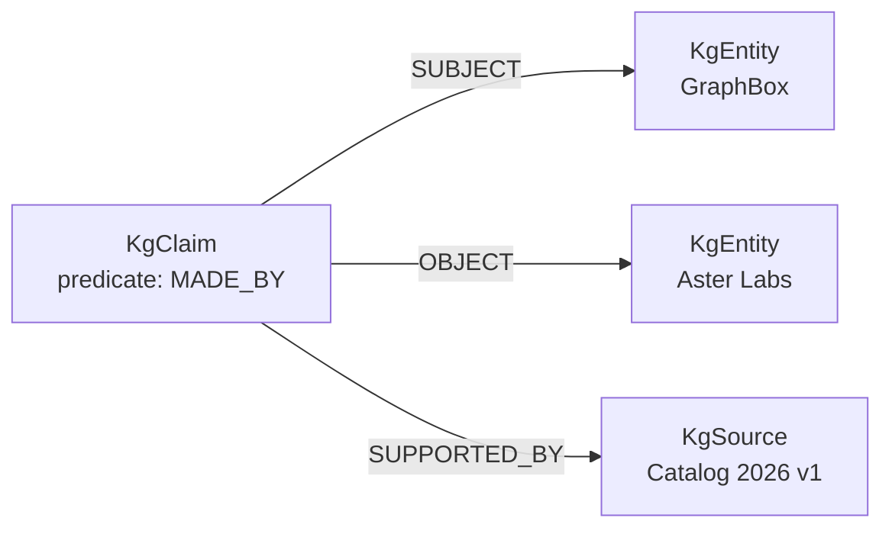
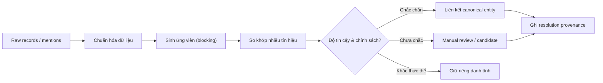
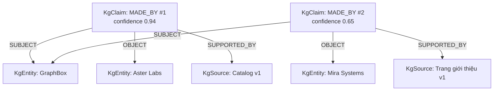
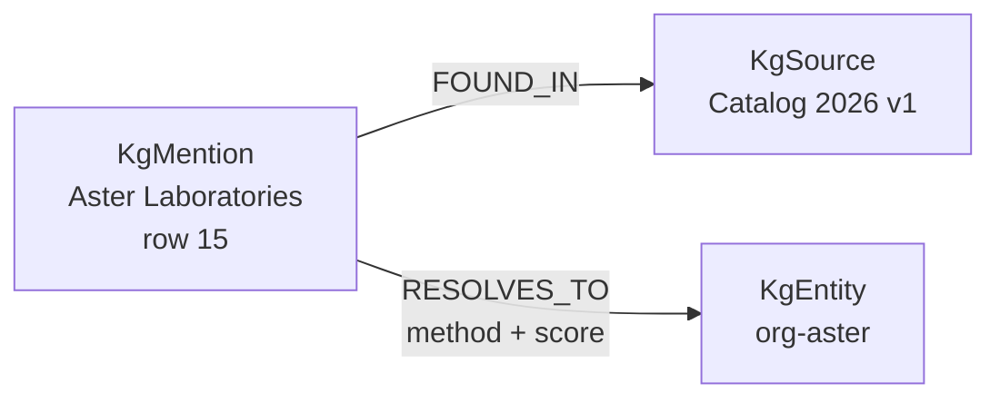
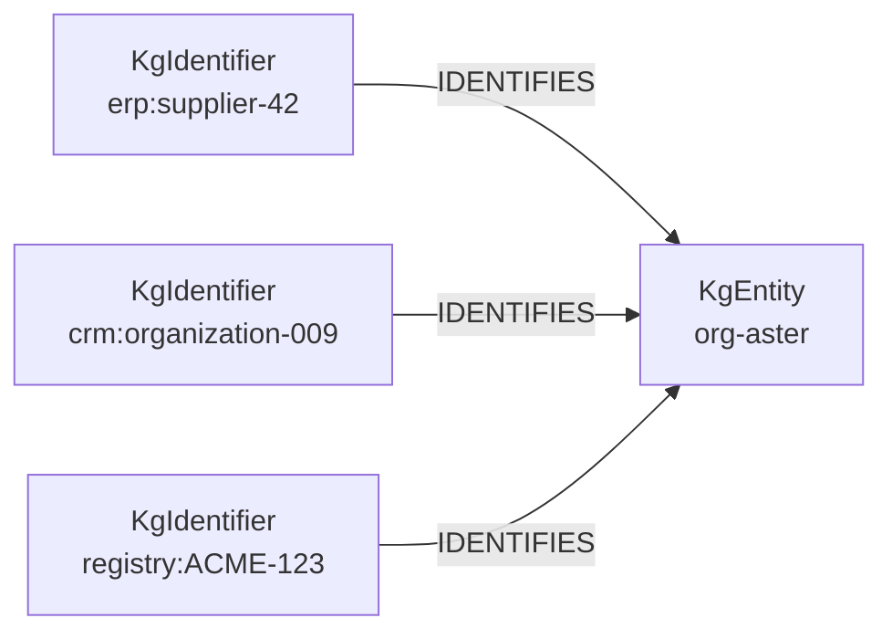
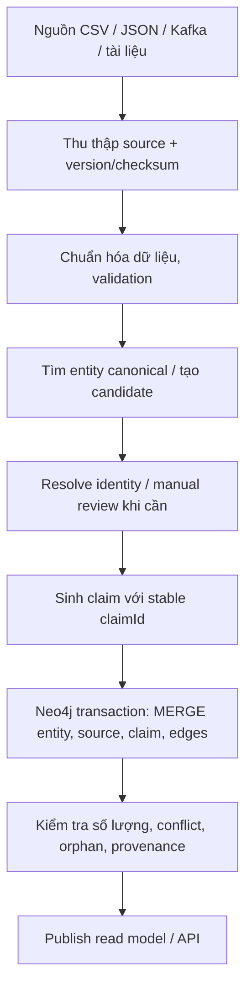
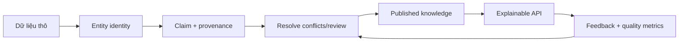

# Đồ thị tri thức: thực thể, quan hệ, nguồn gốc và định danh trong Neo4j

Một cơ sở dữ liệu có thể lưu hàng triệu node và relationship mà vẫn chưa tạo thành **đồ thị tri thức (knowledge graph)** hữu ích. Để ứng dụng trả lời được “Sản phẩm này do đơn vị nào sản xuất, thông tin đến từ đâu, còn đúng tại thời điểm nào?”, graph phải biểu diễn rõ **thực thể**, **ý nghĩa quan hệ**, **danh tính ổn định** và **bằng chứng** cho từng thông tin.

Bài thuộc chương **Ứng dụng đồ thị** của module **DATABASE_ENGINE_GRAPH_NEO4J**. Neo4j dùng mô hình **property graph** với node, relationship và property, cho phép truy vấn bằng **Cypher**, đặt index/constraint, nhập dữ liệu từ nhiều nguồn và tích hợp bằng **Neo4j Java Driver** hoặc **Spring Data Neo4j**. Những công cụ ấy là nền tảng kỹ thuật; để xây dựng knowledge graph đáng tin cậy, còn cần quyết định cách mô hình hóa tri thức và kiểm soát nguồn gốc dữ liệu.

Bài học sử dụng ví dụ giả định về sản phẩm **GraphBox**, hai tổ chức **Aster Labs** và **Mira Systems**, cùng hai tài liệu chứa phát biểu chưa thống nhất về nhà sản xuất. Tất cả tên và tài liệu chỉ dùng để minh họa, không phải dữ liệu doanh nghiệp có thật.

Sau bài này, bạn có thể:

- Phân biệt **đồ thị dữ liệu liên kết** với knowledge graph có định danh, ngữ nghĩa và khả năng giải thích.
- Thiết kế node thực thể, quan hệ có hướng, loại thực thể và thuộc tính theo một mô hình rõ ràng.
- Chọn **canonical ID**, external ID và quy trình **entity resolution** mà không gộp nhầm thực thể đồng tên.
- Lưu **provenance** tới mức phát biểu/claim, cùng thời gian hiệu lực, phiên bản nguồn và độ tin cậy.
- Phát hiện các claim mâu thuẫn nhưng không tùy tiện ghi đè chứng cứ.
- Viết Cypher tạo schema, nhập dữ liệu idempotent, truy vấn nguồn chứng cứ và kiểm tra chất lượng.
- Tích hợp query knowledge graph qua Java Driver hoặc Spring Data Neo4j, có kiểm soát quyền và hiệu năng.

## 1. Knowledge graph là gì?

**Knowledge graph** biểu diễn những đối tượng có ý nghĩa trong một miền kiến thức và cách chúng liên hệ với nhau. Một biểu diễn đơn giản có thể xem như tập các bộ ba:

```text
(subject) --predicate--> (object)

(GraphBox) --MADE_BY--> (Aster Labs)
(Aster Labs) --LOCATED_IN--> (Hà Nội)
```

Trong **Neo4j property graph**:

- **Node** biểu diễn một thực thể, sự kiện, khái niệm hoặc phát biểu.
- **Label** phân loại node theo chức năng, ví dụ `:Product`, `:Organization`.
- **Relationship type** mô tả liên kết có hướng, ví dụ `:MADE_BY`.
- **Property** ghi thuộc tính có kiểu như `name`, `entityId`, `observedAt`.
- **Cypher** dùng để khớp mẫu, truy vấn đường đi và kết hợp nguồn tri thức.

Tuy nhiên, một đường nối `(GraphBox)-[:MADE_BY]->(Aster Labs)` **không trả lời được ngay**: ai đưa ra thông tin, chứng cứ ở tài liệu nào, phát biểu có áp dụng vào tháng hiện tại hay không, và điều gì xảy ra nếu tài liệu khác cho kết luận trái ngược.

### 1.1. Bốn chiều cốt lõi

| Chiều | Câu hỏi giải quyết | Ví dụ |
| --- | --- | --- |
| **Thực thể (entity)** | Đang nói về đối tượng nào? | Sản phẩm `prod-graphbox` |
| **Quan hệ (relation)** | Hai đối tượng liên hệ theo nghĩa gì? | `MADE_BY`, `PART_OF`, `LOCATED_IN` |
| **Định danh (identity)** | Hai tên khác nhau có chỉ cùng một đối tượng không? | “Aster Labs”, “Aster Laboratories” |
| **Nguồn gốc (provenance)** | Ai/tài liệu nào khẳng định quan hệ đó, khi nào? | Catalog bản v1, bản công bố v2 |

Một knowledge graph còn cần **schema/vocabulary**, chất lượng dữ liệu, quyền truy cập, cập nhật và khả năng giải thích nguồn chứng cứ. Không có định danh và provenance, graph dễ trở thành tập liên kết khó kiểm chứng.

### 1.2. Knowledge graph có bắt buộc dùng RDF/OWL không?

**Không.** RDF thường biểu diễn tri thức bằng triple có IRI, literal, blank node, và các chuẩn như RDFS/OWL/SPARQL đem lại khả năng ngữ nghĩa/lập luận chuyên biệt. **Neo4j** là property graph với Cypher; bạn có thể thiết kế một knowledge graph trong Neo4j bằng nhãn, relationship và property.

| Khía cạnh | RDF/OWL | Neo4j property graph |
| --- | --- | --- |
| Định danh phổ biến | IRI/URI | Business key/canonical ID, node |
| Quan hệ | Predicate trong triple | Relationship type hoặc node phát biểu |
| Thuộc tính quan hệ | Thường cần cách biểu diễn/reification tương ứng | Relationship property hoặc claim node |
| Truy vấn | SPARQL | Cypher |
| Suy luận OWL đầy đủ | Phụ thuộc reasoner và profile | **Không tự có** chỉ vì dùng label/relationship |
| Ngữ nghĩa vocab | Ontology có quy tắc chuẩn | Do thiết kế domain/app và quy ước kiểm chứng |

Nếu chuyển dữ liệu từ RDF vào Neo4j, phải **định nghĩa rõ cách ánh xạ** IRI, literal datatype, ngôn ngữ, blank node và provenance. Không giả định import xong là Neo4j tự thực hiện toàn bộ OWL reasoning.

## 2. Bắt đầu từ câu hỏi nghiệp vụ, không bắt đầu từ tên label

Giả sử hệ thống nội bộ nhận dữ liệu sản phẩm từ catalog, website nhà cung cấp và hồ sơ nhập hàng. Những câu hỏi cần trả lời:

1. Có những sản phẩm/tổ chức nào trong dữ liệu đã xác minh?
2. Hai bản ghi tên gần giống có phải **cùng tổ chức** không?
3. “GraphBox do Aster Labs sản xuất” được nguồn nào khẳng định?
4. Nếu website khác nói **Mira Systems**, graph có ghi lại cả hai không?
5. Phát biểu nào có hiệu lực ở thời điểm khách hàng hỏi?
6. Một claim đã qua duyệt, bị phản bác hay cần điều tra?
7. Khi sửa danh tính tổ chức, các claim cũ có còn truy vết được không?

Nếu chỉ cần trả danh sách sản phẩm, một node với `manufacturerName` có thể đủ. Nhưng khi cần nhiều nguồn, giải thích, thời gian và xử lý mâu thuẫn, **mô hình đơn giản đó sẽ mất thông tin quan trọng**.

### 2.1. Phân loại loại thực thể

Một vocabulary tối thiểu:

| Loại thực thể | Ý nghĩa | Thuộc tính thường có |
| --- | --- | --- |
| `Product` | Sản phẩm được nói tới | Mã sản phẩm, tên, phiên bản |
| `Organization` | Nhà sản xuất, nhà cung cấp, khách hàng | Mã tổ chức, tên chuẩn, quốc gia |
| `Person` | Con người, tác giả, người đại diện | ID đáng tin cậy, tên hiển thị |
| `Location` | Địa điểm, cơ sở, khu vực | ID địa lý, loại địa điểm |
| `Document/Source` | Tài liệu/nguồn cung cấp dữ liệu | Source ID, URI, version, timestamp |
| `Claim` | Một phát biểu cụ thể có bằng chứng | Claim ID, predicate, trạng thái, thời gian |

**Phân loại** không nhất thiết dùng một label cho mọi loại. Ví dụ thực hành sử dụng label chung `:KgEntity` và property `kind` để bảo đảm uniqueness của canonical ID theo cùng một tập; production có thể thêm `:KgProduct`, `:KgOrganization` hoặc label chuyên biệt khi query cần. Cách dùng nhiều label phải nhất quán với index/constraint và quy tắc domain.

## 3. Thiết kế quan hệ có ngữ nghĩa rõ ràng

Một relationship type không nên chỉ tên chung như `:CONNECTED_TO` khi miền nghiệp vụ biết rõ ý nghĩa của liên kết.

| Quan hệ | Hướng có nghĩa | Câu hỏi |
| --- | --- | --- |
| `MADE_BY` | Product → Organization | Ai sản xuất sản phẩm? |
| `SUPPLIED_BY` | Product → Organization | Ai cung ứng sản phẩm? |
| `LOCATED_IN` | Organization → Location | Đơn vị ở đâu? |
| `PART_OF` | Organization → Organization | Đơn vị con thuộc tổ chức nào? |
| `AUTHORED_BY` | Document → Person | Ai là tác giả tài liệu? |
| `SUPERSEDES` | Claim mới → Claim cũ | Phát biểu nào thay thế phát biểu trước? |

**Không đồng nhất `MADE_BY` với `SUPPLIED_BY`.** Một nhà phân phối có thể bán sản phẩm nhưng không sản xuất nó. Tương tự `PART_OF` không tự là `OWNS`; cần định nghĩa rõ nghĩa quan hệ, bối cảnh và chiều.

### 3.1. Direct relationship hay node phát biểu?

Có hai cách điển hình để mô hình hóa “GraphBox do Aster Labs sản xuất”.

**Mô hình liên kết trực tiếp:**

```cypher
(:KgEntity {entityId:'prod-graphbox'})
  -[:MADE_BY {sourceId:'catalog-2026-v1'}]->
(:KgEntity {entityId:'org-aster'})
```

Cú pháp trên là **minh họa một pattern**, không phải câu Cypher thực thi độc lập.

Ưu điểm: truy vấn đường đi ngắn, dễ đọc, ít node. Nhược điểm: nếu có hai nguồn cùng khẳng định, nguồn bị sửa, quan hệ bị phủ định hoặc có mâu thuẫn, property gắn trên một relationship có thể không biểu diễn hết **lịch sử bằng chứng và trạng thái độc lập của từng lời khẳng định**.

**Mô hình node phát biểu (claim/assertion):**



Mỗi `KgClaim` là một phát biểu có danh tính riêng:

- `SUBJECT`: thực thể mà phát biểu nói tới.
- `OBJECT`: thực thể đối tượng của quan hệ.
- `predicate`: loại quan hệ, ví dụ `MADE_BY`.
- `SUPPORTED_BY`: nguồn/phiên bản tài liệu làm bằng chứng.
- Các property khác: `confidence`, `validFrom`, `validTo`, `reviewStatus`.

**Lưu ý:** node claim là **cách mô hình hóa do ứng dụng lựa chọn**, không phải cú pháp reification bắt buộc hoặc một cơ chế suy luận tự động của Neo4j.

### 3.2. Chọn mô hình nào?

| Yêu cầu | Direct relationship | Claim node |
| --- | --- | --- |
| Một quan hệ đơn giản, có nguồn ổn định | Phù hợp | Có thể dư |
| Nhiều tài liệu độc lập xác nhận một quan hệ | Cần quy ước nguồn phức tạp | Phù hợp |
| Quan hệ mâu thuẫn cần lưu cả hai phía | Dễ bị ghi đè | Phù hợp |
| Duyệt graph cực nhanh theo quan hệ đã duyệt | Thường thuận lợi | Cần thiết kế query/materialization |
| Bằng chứng, trạng thái duyệt, thời gian hiệu lực | Hạn chế nếu đa nguồn | Phù hợp |
| Lưu lịch sử phát biểu, phiên bản nguồn | Phức tạp hơn | Dễ kiểm toán hơn |

Nhiều hệ thống dùng **hai lớp**: claim có provenance là **nguồn sự thật của tri thức được ghi nhận**, còn relationship trực tiếp là **read model/materialized projection** dành cho truy vấn nhanh. Nếu làm vậy, phải có quy trình cập nhật/xóa relationship dẫn xuất khi claim bị rút lại hoặc thay đổi. Không coi mọi cạnh dẫn xuất là tri thức đã kiểm chứng.

## 4. Định danh thực thể: tên không phải khóa

Tên hiển thị dễ thay đổi, nhập sai, trùng lặp và có nhiều ngôn ngữ. Ví dụ:

```text
Nguồn A:  "Aster Labs", vendor ID = supplier-42
Nguồn B:  "Aster Laboratories", external ID = co-009
Nguồn C:  "Aster Labs", nhưng là một pháp nhân khác
```

Nếu dùng `name` làm khóa duy nhất hoặc `MERGE (o:Organization {name: ...})` trong mọi trường hợp, hệ thống có thể:

- **Gộp nhầm** hai tổ chức trùng tên thành một.
- **Tạo trùng** một tổ chức có hai cách viết tên.
- Mất lịch sử tên cũ khi công ty đổi tên.
- Tạo quan hệ sai từ sản phẩm sang tổ chức không có thật.

### 4.1. Canonical identity

Mỗi thực thể đã được nhận diện nên có **canonical ID** ổn định trong phạm vi knowledge graph, ví dụ:

```text
prod-graphbox
org-aster
org-mira
```

Một cấu trúc entity:

```text
entityId:     "org-aster"         (khóa nội bộ ổn định)
kind:         "Organization"      (loại)
displayName:  "Aster Labs"        (tên hiển thị có thể đổi)
normalizedName: "aster labs"      (dành cho tìm ứng viên)
```

Quy tắc:

1. **Không lấy `id(node)` hay `elementId(node)` làm business key bền vững** xuyên export/import/restore hoặc các vòng đời DB khác.
2. Tên, địa chỉ, email, mã nhà cung cấp có thể là **tín hiệu nhận diện**, không luôn là ID toàn cục.
3. External ID phải kèm **namespace/source system**, ví dụ `erp:supplier-42` và `portal:co-009`.
4. Khi chưa đủ bằng chứng hai bản ghi là một, giữ **hai canonical entity riêng** hoặc trạng thái candidate, không ép merge.
5. Với hệ multi-tenant, xem xét **khóa ghép `tenantId + entityId`**, quy tắc liên tenant và chính sách dữ liệu.

### 4.2. Entity resolution không đồng nghĩa so sánh chuỗi

**Entity resolution** là quá trình quyết định hai mention/record có cùng chỉ một thực thể ngoài đời hay không. Một pipeline thường gồm:



Tín hiệu có thể gồm mã hệ thống đáng tin cậy, mã pháp nhân, địa chỉ chuẩn hóa, tên, thời gian, domain email hoặc mối quan hệ ngữ cảnh. **Không dùng tên trùng nhau làm chứng cứ duy nhất**, đặc biệt với người có tên phổ biến.

### 4.3. `SAME_AS` cần tiêu chuẩn chặt chẽ

Một cạnh `:SAME_AS` hàm ý tính đồng nhất rất mạnh. Nếu ứng dụng cho phép suy rộng/chuỗi `SAME_AS`, một cặp gán sai có thể làm nhiễm toàn graph. Đối với ứng viên chưa được xác minh, cân nhắc trạng thái `POSSIBLY_SAME_AS` hoặc một `ResolutionCandidate` có score và bằng chứng để review.

**Không coi score model 0,91 là “chắc chắn đúng 91%”** trừ khi model được hiệu chuẩn và đánh giá trên phân bố dữ liệu tương tự. Score phục vụ xếp hạng/hỗ trợ quyết định; chính sách merge phải có kiểm soát.

## 5. Provenance: nguồn gốc của từng phát biểu

“Có nguồn gốc” không chỉ có nghĩa lưu `updatedAt` của node. Một entity có thể đến từ nhiều hệ thống; một thuộc tính được hai nguồn khẳng định ở hai thời điểm khác nhau. Cần quyết định **đơn vị gắn chứng cứ**.

| Đơn vị provenance | Lưu được | Hạn chế |
| --- | --- | --- |
| **Toàn bộ tập nhập** | File/batch nào sinh dữ liệu | Không biết claim cụ thể từ dòng nào |
| **Entity** | Entity phát hiện ở nguồn nào | Các claim của entity có thể đến từ nguồn khác |
| **Relationship** | Một cạnh được nguồn nào khẳng định | Khó biểu diễn nhiều claim mâu thuẫn/phiên bản riêng |
| **Claim/statement** | Subject, predicate, object, source, thời gian, status riêng | Số node/query lớn hơn nhưng dễ audit |
| **Trích đoạn/span** | Đoạn văn/bảng nào chứng minh claim | Cần ID đoạn, version tài liệu và bảo vệ nội dung |

Trong bài, chọn **claim-level provenance** và ID nguồn theo **phiên bản**:

```text
KgSource:
  sourceId = catalog-2026-v1
  title = Danh mục sản phẩm, bản 1
  publishedAt = 2026-02-01
  uri = urn:example:catalog:2026:v1

KgClaim:
  claimId = claim-catalog-graphbox-aster-v1
  predicate = MADE_BY
  confidence = 0.94
  validFrom = 2026-02-01
  reviewStatus = PENDING
```

**`sourceId` phải định danh đúng phiên bản nguồn**, không đơn thuần là URL trang hiện tại có thể bị ghi đè. Với tài liệu quan trọng có thể thêm checksum, `documentVersion`, vị trí dòng/trang/đoạn và ID lần ingest.

### 5.1. Nguồn chứng cứ khác với “sự thật”

Một tài liệu chỉ **khẳng định** `MADE_BY`; dữ liệu có thể:

- Do con người viết sai hoặc chưa cập nhật.
- Bị parser/OCR/LLM trích xuất nhầm subject hoặc object.
- Chỉ đúng trong một khoảng thời gian.
- Áp dụng cho một chi nhánh hoặc một phiên bản sản phẩm, không phải mọi sản phẩm.
- Mâu thuẫn với nguồn khác có độ tin cậy cao hơn.

Vì vậy, đặt tên `SUPPORTED_BY` ở đây có nghĩa “claim được ghi nhận từ nguồn này”, **không bảo đảm nguồn đã được độc lập xác thực**. Nếu cần phân biệt trích xuất và chứng thực, có thể dùng các relation như `EXTRACTED_FROM`/`VERIFIED_BY` cùng workflow rõ ràng.

### 5.2. Ba mốc thời gian khác nhau

| Thuộc tính | Câu hỏi | Ví dụ |
| --- | --- | --- |
| `publishedAt` | Tài liệu được phát hành khi nào? | Catalog công bố ngày 01/02/2026 |
| `ingestedAt` / `recordedAt` | Graph nhận thông tin khi nào? | Job import ngày 01/11/2026 |
| `validFrom` / `validTo` | Phát biểu được cho là đúng trong khoảng nào? | Quan hệ sản xuất có hiệu lực từ tháng 2 |

**Không dùng `ingestedAt` thay `validFrom`.** Một hệ thống nhập tài liệu năm 2026 có thể đang mô tả sự kiện xảy ra năm 2023. Với temporal KG, cần phân biệt **valid time** (thời gian thực tế áp dụng) và **transaction/knowledge time** (khi hệ thống biết hoặc ghi nhận phát biểu).

Đối với khoảng hiệu lực, có thể quy ước `[validFrom, validTo)` — bao gồm thời điểm bắt đầu, không bao gồm thời điểm kết thúc. Nếu không có `validTo`, hiểu là chưa biết thời điểm kết thúc, **không tự kết luận claim đúng vĩnh viễn**.

## 6. Đồ thị ví dụ: hai nguồn, hai lời khẳng định

Giả sử catalog v1 ghi “GraphBox do Aster Labs sản xuất”, trong khi một trang giới thiệu khác ghi “GraphBox do Mira Systems sản xuất”. Mô hình không ép chọn người thắng ngay:



Vì hai claim có object khác nhau, chúng là **ứng viên mâu thuẫn** nếu nói về cùng phiên bản sản phẩm, cùng loại quan hệ và khoảng thời gian hiệu lực giao nhau. Không mặc định đây là mâu thuẫn thật nếu Aster sản xuất trước tháng 4 và Mira tiếp quản sau tháng 4.

### 6.1. Tạo uniqueness constraints

Chạy trên **database thực hành**, không trên production chưa được phê duyệt:

```cypher
CREATE CONSTRAINT kg_entity_id IF NOT EXISTS
FOR (e:KgEntity)
REQUIRE e.entityId IS UNIQUE;
```

```cypher
CREATE CONSTRAINT kg_source_id IF NOT EXISTS
FOR (s:KgSource)
REQUIRE s.sourceId IS UNIQUE;
```

```cypher
CREATE CONSTRAINT kg_claim_id IF NOT EXISTS
FOR (c:KgClaim)
REQUIRE c.claimId IS UNIQUE;
```

```cypher
CREATE CONSTRAINT kg_mention_id IF NOT EXISTS
FOR (m:KgMention)
REQUIRE m.mentionId IS UNIQUE;
```

Các constraint bảo vệ canonical keys và hỗ trợ truy cập bằng khóa. **Chúng không tự suy luận hai tên đồng nghĩa** hoặc đảm bảo claim từ hai nguồn là đúng. Những node có thiếu ID hoặc quy tắc dữ liệu sai vẫn cần kiểm tra riêng.

Thêm index tìm ứng viên theo tên chuẩn hóa, không biến tên thành khóa duy nhất:

```cypher
CREATE INDEX kg_entity_normalized_name IF NOT EXISTS
FOR (e:KgEntity)
ON (e.normalizedName);
```

### 6.2. Nhập ba thực thể

```cypher
UNWIND [
  {
    entityId: 'prod-graphbox',
    kind: 'Product',
    displayName: 'GraphBox',
    normalizedName: 'graphbox'
  },
  {
    entityId: 'org-aster',
    kind: 'Organization',
    displayName: 'Aster Labs',
    normalizedName: 'aster labs'
  },
  {
    entityId: 'org-mira',
    kind: 'Organization',
    displayName: 'Mira Systems',
    normalizedName: 'mira systems'
  }
] AS row
MERGE (e:KgEntity {entityId: row.entityId})
ON CREATE SET
  e.kind = row.kind,
  e.displayName = row.displayName,
  e.normalizedName = row.normalizedName;
```

`MERGE` theo `entityId` giúp việc chạy lại với cùng ID không tạo thêm entity. Dùng `ON CREATE SET` để không âm thầm ghi đè thuộc tính của một entity đã tồn tại; trong hệ thống thật cần một **luồng cập nhật có version/audit riêng** nếu tên hiển thị hoặc loại entity thay đổi.

### 6.3. Nhập hai nguồn chứng cứ

```cypher
UNWIND [
  {
    sourceId: 'catalog-2026-v1',
    title: 'Danh mục sản phẩm, bản 1',
    uri: 'urn:example:catalog:2026:v1',
    publishedAt: '2026-02-01'
  },
  {
    sourceId: 'page-2026-v1',
    title: 'Trang giới thiệu, bản 1',
    uri: 'urn:example:page:2026:v1',
    publishedAt: '2026-04-01'
  }
] AS row
MERGE (s:KgSource {sourceId: row.sourceId})
ON CREATE SET
  s.title = row.title,
  s.uri = row.uri,
  s.publishedAt = date(row.publishedAt),
  s.ingestedAt = datetime('2026-11-01T10:00:00Z');
```

`urn:example:...` là URI **giả định** để định danh tài liệu mẫu, không phải trang có nội dung thật. Trong production, lưu ID tài liệu bất biến/phiên bản và liên kết tới kho tài liệu có kiểm soát quyền. Không bắt buộc copy toàn bộ tài liệu nhạy cảm vào graph.

### 6.4. Nhập claim và liên kết provenance

```cypher
UNWIND [
  {
    claimId: 'claim-catalog-graphbox-aster-v1',
    subjectId: 'prod-graphbox',
    objectId: 'org-aster',
    predicate: 'MADE_BY',
    sourceId: 'catalog-2026-v1',
    confidence: 0.94,
    validFrom: '2026-02-01'
  },
  {
    claimId: 'claim-page-graphbox-mira-v1',
    subjectId: 'prod-graphbox',
    objectId: 'org-mira',
    predicate: 'MADE_BY',
    sourceId: 'page-2026-v1',
    confidence: 0.65,
    validFrom: '2026-04-01'
  }
] AS row
MATCH (subject:KgEntity {entityId: row.subjectId})
MATCH (object:KgEntity {entityId: row.objectId})
MATCH (source:KgSource {sourceId: row.sourceId})
MERGE (claim:KgClaim {claimId: row.claimId})
ON CREATE SET
  claim.predicate = row.predicate,
  claim.confidence = row.confidence,
  claim.validFrom = date(row.validFrom),
  claim.recordedAt = datetime('2026-11-01T10:00:00Z'),
  claim.reviewStatus = 'PENDING'
MERGE (claim)-[:SUBJECT]->(subject)
MERGE (claim)-[:OBJECT]->(object)
MERGE (claim)-[:SUPPORTED_BY]->(source);
```

**Giải thích:**

1. `MATCH` tìm entity và source đã tạo; không tạo mới chúng từ tên hiển thị.
2. `MERGE` claim theo **claimId ổn định** tránh tạo claim trùng khi job được chạy lại.
3. `ON CREATE SET` không âm thầm thay metadata claim cũ. Khi nguồn thay revision hoặc phát biểu thay nghĩa, hãy tạo claim/version mới theo chính sách.
4. Ba cạnh `SUBJECT`, `OBJECT`, `SUPPORTED_BY` cho phép đi ngược về thực thể và chứng cứ.
5. `confidence` là **độ tin cậy của phương pháp trích xuất/đối chiếu giả định**, không phải xác suất có chứng nhận rằng nhà sản xuất đúng.
6. `reviewStatus = 'PENDING'` nhắc rằng **chưa có bên kiểm duyệt quyết định**.

**Rủi ro cần kiểm soát:** Nếu `MATCH` không tìm thấy một entity hoặc source, hàng nhập tương ứng sẽ **bị bỏ qua** mà không tạo claim. Production phải kiểm tra số hàng đầu vào/đầu ra, ghi dead-letter hoặc báo lỗi để không mất dữ liệu âm thầm.

### 6.5. Kiểm tra kết quả nhập

```cypher
MATCH (e:KgEntity)
RETURN e.kind AS kind, count(*) AS entities
ORDER BY kind;
```

Kết quả ví dụ: **1 Product**, **2 Organization**.

```cypher
MATCH (c:KgClaim)-[:SUPPORTED_BY]->(s:KgSource)
RETURN c.claimId AS claimId,
       c.predicate AS predicate,
       s.sourceId AS sourceId,
       c.reviewStatus AS status
ORDER BY claimId;
```

Kết quả ví dụ: hai claim ở trạng thái `PENDING`, mỗi claim gắn đúng một source.

## 7. Truy vấn câu trả lời kèm nguồn chứng cứ

Nếu API chỉ trả:

```json
{"manufacturer": "Aster Labs"}
```

người dùng không biết tại sao GraphBox được gán cho Aster Labs, và có thể không hề biết **Mira Systems** cũng được một nguồn khác đề cập.

### 7.1. Trả tất cả claim liên quan

```cypher
MATCH (claim:KgClaim {predicate: 'MADE_BY'})
      -[:SUBJECT]->(p:KgEntity {entityId: $productId})
MATCH (claim)-[:OBJECT]->(maker:KgEntity)
MATCH (claim)-[:SUPPORTED_BY]->(source:KgSource)
RETURN p.displayName AS product,
       maker.displayName AS claimedManufacturer,
       maker.entityId AS manufacturerId,
       claim.claimId AS claimId,
       claim.confidence AS extractionConfidence,
       claim.reviewStatus AS reviewStatus,
       claim.validFrom AS validFrom,
       source.sourceId AS sourceId,
       source.title AS sourceTitle,
       source.uri AS sourceUri
ORDER BY source.publishedAt DESC, claim.claimId;
```

Với `$productId = 'prod-graphbox'`, câu query trả **hai dòng** tương ứng hai lời khẳng định. Đây là hành vi đúng nếu hợp đồng API là **“show all evidence”**.

### 7.2. Truy vấn theo thời gian hiệu lực

```cypher
MATCH (claim:KgClaim {predicate: 'MADE_BY'})
      -[:SUBJECT]->(p:KgEntity {entityId: $productId})
MATCH (claim)-[:OBJECT]->(maker:KgEntity)
MATCH (claim)-[:SUPPORTED_BY]->(source:KgSource)
WHERE claim.validFrom <= date($asOf)
  AND (claim.validTo IS NULL OR date($asOf) < claim.validTo)
RETURN maker.displayName AS manufacturer,
       claim.claimId AS claimId,
       source.sourceId AS sourceId,
       claim.validFrom AS fromDate,
       claim.validTo AS toDate
ORDER BY claim.validFrom DESC;
```

Ứng dụng truyền `$asOf` như chuỗi ngày ISO, ví dụ `'2026-11-25'`; `date($asOf)` tạo giá trị ngày để so sánh. Mẫu này dùng khoảng **`[validFrom, validTo)`**.

Nếu `validTo` chưa được thiết lập, câu query vẫn trả claim từ ngày `validFrom` trở đi. Điều này **không chứng minh claim đúng**, chỉ có nghĩa **không có mốc hết hiệu lực đã được ghi nhận**.

### 7.3. “Giải thích câu trả lời” là truy vấn có hợp đồng

Một màn hình ứng dụng có thể hiển thị:

```text
GraphBox — nhà sản xuất được nhắc tới

Aster Labs
  Claim: claim-catalog-graphbox-aster-v1
  Nguồn: Danh mục sản phẩm, bản 1
  Confidence trích xuất: 0.94
  Trạng thái: PENDING

Mira Systems
  Claim: claim-page-graphbox-mira-v1
  Nguồn: Trang giới thiệu, bản 1
  Confidence trích xuất: 0.65
  Trạng thái: PENDING

Kết luận: có thông tin không thống nhất, chưa xác minh.
```

**Không lựa chọn Aster Labs chỉ vì `0.94 > 0.65`**. Confidence của hai model/nguồn không nhất thiết có thể so sánh trực tiếp. Để công bố “nhà sản xuất chính thức”, ứng dụng cần **quy tắc nghiệp vụ, ưu tiên nguồn, kiểm chứng con người, thời gian và trạng thái review**.

## 8. Phát hiện mâu thuẫn và xử lý không mất chứng cứ

Một query có thể tìm **các cặp claim ứng viên mâu thuẫn** vì cùng product/predicate nhưng object khác nhau:

```cypher
MATCH (leftClaim:KgClaim {predicate: 'MADE_BY'})
      -[:SUBJECT]->(p:KgEntity)
MATCH (rightClaim:KgClaim {predicate: 'MADE_BY'})
      -[:SUBJECT]->(p)
WHERE leftClaim.claimId < rightClaim.claimId
MATCH (leftClaim)-[:OBJECT]->(leftMaker:KgEntity)
MATCH (rightClaim)-[:OBJECT]->(rightMaker:KgEntity)
WHERE leftMaker.entityId <> rightMaker.entityId
RETURN p.entityId AS productId,
       leftClaim.claimId AS firstClaim,
       leftMaker.displayName AS firstMaker,
       rightClaim.claimId AS secondClaim,
       rightMaker.displayName AS secondMaker
ORDER BY productId, firstClaim, secondClaim;
```

**Đây là query sàng lọc ứng viên**, không phải một bộ suy luận mâu thuẫn hoàn chỉnh. Hai claim có thể không thật sự mâu thuẫn nếu:

- Sản phẩm có **nhiều nhà sản xuất hợp pháp**.
- Một claim chỉ đúng với **phiên bản sản phẩm khác**.
- Hai giai đoạn `validFrom/validTo` **không giao nhau**.
- `MADE_BY` được định nghĩa khác nhau giữa nguồn (nhà sản xuất, thương hiệu, nhà phân phối).
- Entity resolution đã gộp nhầm hai tổ chức hoặc hai sản phẩm.

### 8.1. Phân loại trạng thái review

Một workflow minh họa:

| `reviewStatus` | Ý nghĩa nghiệp vụ | Điều phải bảo đảm |
| --- | --- | --- |
| `PENDING` | Chưa được duyệt | Không tự dùng làm “đã xác minh” |
| `APPROVED` | Đã qua quy trình duyệt có thẩm quyền | Ghi reviewer, thời điểm, bằng chứng quyết định |
| `REJECTED` | Bác bỏ theo quy trình | Không xóa lịch sử claim |
| `SUPERSEDED` | Có claim/version mới thay thế | Truy ra claim thay thế và lý do |

Đây là **trạng thái do ứng dụng định nghĩa**, không phải giá trị cố định của Neo4j. Một claim có thể có nhiều nguồn chứng cứ hoặc nhiều lần review; khi cần audit chặt chẽ, nên mô hình `KgReview` hay `KgDecision` riêng, thay vì chỉ ghi đè một property status.

### 8.2. Không xóa claim chỉ vì bị bác bỏ

Nếu claim từ một website bị xác định sai, việc xóa hẳn `KgClaim` sẽ làm mất thông tin **tại sao hệ thống từng đưa ra câu trả lời sai**. Trong môi trường yêu cầu audit, nên:

1. Giữ ID và source/version của claim.
2. Ghi quyết định review, người/tác vụ phê duyệt và lý do.
3. Đánh dấu claim bị bác bỏ hoặc thay thế.
4. Cập nhật **read model** nếu đã materialize cạnh `MADE_BY` trực tiếp.
5. Đảm bảo query nghiệp vụ lọc theo trạng thái chấp nhận, còn query audit có thể thấy lịch sử.

Đối với yêu cầu xóa dữ liệu cá nhân theo pháp luật, chính sách retention có thể buộc xóa hoặc ẩn một phần dữ liệu; **không áp nguyên tắc giữ mọi lịch sử vô điều kiện** nếu xung đột quyền riêng tư.

## 9. Mentions, aliases và entity resolution có provenance

Một record trong tài liệu có thể nhắc tới **“Aster Laboratories”** nhưng canonical entity đã xác minh có tên **Aster Labs**. Hãy giữ cả **mention** (lần nhắc trong nguồn) và **resolution** (quyết định ánh xạ).



### 9.1. Lưu mention và liên kết với canonical entity

Ví dụ trên database mẫu:

```cypher
MATCH (source:KgSource {sourceId: 'catalog-2026-v1'})
MATCH (entity:KgEntity {entityId: 'org-aster'})
MERGE (mention:KgMention {
  mentionId: 'catalog-2026-v1:row-15:maker'
})
ON CREATE SET
  mention.surface = 'Aster Laboratories',
  mention.normalized = 'aster laboratories',
  mention.externalKey = 'supplier:42',
  mention.recordedAt = datetime('2026-11-01T10:00:00Z')
MERGE (mention)-[:FOUND_IN]->(source)
MERGE (mention)-[resolution:RESOLVES_TO]->(entity)
ON CREATE SET
  resolution.method = 'VERIFIED_EXTERNAL_ID',
  resolution.score = 1.0,
  resolution.reviewStatus = 'APPROVED';
```

Ở ví dụ này, `supplier:42` là **khóa nguồn giả định**. Quy tắc `VERIFIED_EXTERNAL_ID` chỉ hợp lệ nếu hệ thống đã kiểm chứng rằng ID của nguồn đó thực sự ánh xạ tới `org-aster`. Không phải cứ có external ID thì hai bản ghi tự đồng nhất.

**Cảnh báo khi sửa mapping:** Nếu sau đó mention được xác định thuộc một entity khác, đừng chỉ `MERGE` thêm một cạnh `RESOLVES_TO` mới rồi giữ cả hai cạnh đều `APPROVED`. Cần một workflow **hủy/đổi trạng thái resolution cũ, ghi quyết định mới và cập nhật các claim phụ thuộc**, hoặc tạo bản ghi resolution có version.

### 9.2. Truy vết lần nhắc và nguồn

```cypher
MATCH (mention:KgMention)-[r:RESOLVES_TO]->
      (entity:KgEntity {entityId: $entityId})
MATCH (mention)-[:FOUND_IN]->(source:KgSource)
RETURN mention.mentionId AS mentionId,
       mention.surface AS surface,
       mention.externalKey AS externalKey,
       r.method AS resolutionMethod,
       r.reviewStatus AS reviewStatus,
       source.sourceId AS sourceId
ORDER BY sourceId, mentionId;
```

Query này trả thông tin **tại sao một lần nhắc được nối với canonical entity**. Nó chưa chứng minh đối tượng là một nếu quy trình review chưa đủ; người đọc phải xem bằng chứng từ `externalKey` và nguồn.

### 9.3. Tìm ứng viên trùng tên không có nghĩa tự gộp

Nếu tạo index `normalizedName`:

```cypher
MATCH (e:KgEntity {normalizedName: $normalizedName})
RETURN e.entityId AS entityId,
       e.displayName AS displayName,
       e.kind AS kind
ORDER BY entityId
LIMIT 20;
```

Một kết quả tìm tên là **candidate set** để kiểm tra. Không dùng `LIMIT 1` rồi mặc định gán mention vào entity đầu tiên. Ở graph lớn, sinh ứng viên bằng tổ hợp namespace/external key, normalized name, loại và ngữ cảnh giúp giảm chi phí hơn so sánh mọi cặp node.

## 10. Chọn canonical ID và quản lý external identifier

Một entity có thể có nhiều ID ngoài:

```text
canonical entityId: org-aster

ERP vendor ID:     erp:supplier-42
CRM account ID:    crm:organization-009
Registry code:     registry:ACME-123
Website handle:    portal:aster-labs
```

**Không dùng `supplier-42` một mình** nếu nhiều hệ thống đều có mã 42. Có thể mô hình hóa riêng node identifier:



Khi cần chứng minh phép ánh xạ, node `KgIdentifier` có thể mang `namespace`, `value`, `verifiedAt`, `sourceId`, `status`; mapping `IDENTIFIES` cũng cần provenance và trạng thái nếu có nguy cơ sai.

### 10.1. Quy tắc thiết kế khóa

| Loại ID | Dùng cho | Có nên dùng làm khóa ngoài dài hạn? |
| --- | --- | --- |
| `entityId` tự quản lý | Định danh canonical entity | **Có**, nếu quản trị ổn định và version |
| External ID có namespace | Đối chiếu liên hệ với nguồn | Có thể, nhưng không tuyệt đối; theo chính sách nguồn |
| Tên hiển thị | Tìm kiếm, UI, alias | **Không** |
| `id(node)` | Định danh nội bộ thuộc store | **Không** |
| `elementId(node)` | Tham chiếu kỹ thuật của Neo4j | Không coi là business key bền vững xuyên di trú |
| ID mention | Vị trí/lần xuất hiện trong một nguồn | Có, cho provenance của mention; không phải entity ID |

Nếu có yêu cầu **xóa hoặc tách entity** sau khi phát hiện merge sai, phải xác định entity nào giữ canonical ID cũ, cách chuyển claim/identifier và cách giữ alias/redirect phục vụ truy vết. Không âm thầm thay toàn bộ node ID nếu client ngoài đã lưu `entityId` làm khóa tham chiếu.

## 11. Quy trình ingest nhiều nguồn có thể chạy lại

Một pipeline tri thức không chỉ parse CSV rồi `CREATE` hàng loạt. Nó cần bảo vệ uniqueness, idempotency, provenance và tính đúng của resolution.



### 11.1. Idempotency theo business key

Sai khi xử lý lại nguồn:

```cypher
// Dễ sinh node trùng khi chạy lại nếu không có khóa kiểm soát.
CREATE (:KgEntity {displayName: 'Aster Labs'});
```

Phù hợp hơn khi đã có canonical ID:

```cypher
MERGE (e:KgEntity {entityId: $entityId})
ON CREATE SET
  e.displayName = $displayName,
  e.kind = $kind;
```

Để `MERGE` hoạt động đúng dưới tải đồng thời, cần **uniqueness constraint** trên ID tương ứng. `MERGE` không tự là giải pháp đồng bộ hóa tất cả trường dữ liệu.

### 11.2. Batch qua UNWIND từ Java Driver

Với nhiều record đã được chuẩn hóa và cấp ID, truyền **tham số list**:

```cypher
UNWIND $rows AS row
MERGE (e:KgEntity {entityId: row.entityId})
ON CREATE SET
  e.kind = row.kind,
  e.displayName = row.displayName,
  e.normalizedName = row.normalizedName
RETURN count(*) AS processed;
```

`count(*)` trong truy vấn này đếm **số hàng đã đi qua pipeline**, **không phải số node mới được tạo**. Trong production cần kiểm tra data quality trước khi gửi và đối chiếu số record thực sự được nhập, đặc biệt khi query có `MATCH` lọc thiếu dữ liệu.

### 11.3. Stable claimId và phiên bản nguồn

Một `claimId` có thể được tạo từ các thành phần có định nghĩa ổn định:

```text
namespace/sourceRevision
+ statement locator trong nguồn
+ canonical subject ID
+ predicate
+ canonical object ID
+ extraction rule/version
```

Không ghép tùy ý bằng dấu phân cách nếu dữ liệu nguồn cũng chứa dấu đó; dùng encoding/hashing theo một quy tắc thống nhất. Thay một nguồn bằng version mới nên có **sourceId và claimId mới** nếu nội dung phát biểu đã thay; không ghi đè claim cũ mà bỏ mất lịch sử.

**Chỉ `MERGE` claim và dùng `ON CREATE SET`** như ví dụ là phù hợp cho lần nhập lại cùng dữ liệu; nếu cùng `claimId` nhưng payload bị thay khác, hệ thống phải báo **ID collision hoặc version mismatch**, không im lặng coi dữ liệu mới là cũ.

### 11.4. Transaction và retry

Một batch có thể cần ghi entity, source, claim và các relationship trong **cùng transaction** để tránh claim không có chứng cứ. Dùng **Neo4j Java Driver managed transaction** hoặc `@Transactional` qua Spring Data Neo4j khi các thành phần cùng transaction manager.

Với lỗi tạm thời, retry là hữu ích **nếu thao tác idempotent**. Một batch không có stable ID và dùng `CREATE` nhiều lần có thể sinh bản ghi trùng sau retry hoặc khi kết nối mất phản hồi đúng lúc commit.

## 12. Query theo đường đi tri thức và giải thích suy luận

Đồ thị tri thức có thể dùng nhiều bước quan hệ để trả lời câu hỏi:

```text
Sản phẩm → nhà sản xuất → quốc gia
Tác giả → công trình → chủ đề
Nhân viên → phòng ban → dự án
```

Nhưng trong graph có claim provenance, mỗi “cạnh ngữ nghĩa” có thể được biểu diễn qua **claim node**. Ví dụ:

```cypher
MATCH (makerClaim:KgClaim {predicate: 'MADE_BY'})
      -[:SUBJECT]->(product:KgEntity {entityId: $productId})
MATCH (makerClaim)-[:OBJECT]->(maker:KgEntity)
MATCH (makerClaim)-[:SUPPORTED_BY]->(makerSource:KgSource)
RETURN product.displayName AS product,
       maker.displayName AS maker,
       makerSource.title AS evidence
ORDER BY maker;
```

Khi thêm claim `LOCATED_IN` của tổ chức, một truy vấn nhiều bước có thể nối hai claim, nhưng **bằng chứng cho hai phát biểu phải được truy ra độc lập**. Nguồn chứng thực nhà sản xuất không tự chứng thực vị trí địa lý.

### 12.1. Không tự suy ra tính bắc cầu hoặc đối xứng

Các quan hệ có quy tắc ngữ nghĩa khác nhau:

- `PART_OF` có thể được ứng dụng quyết định xử lý bắc cầu trong một mô hình tổ chức cụ thể, nhưng phải kiểm tra ngoại lệ.
- `MADE_BY` **không** bắc cầu: “GraphBox do Aster Labs sản xuất” và “Aster Labs thuộc một tập đoàn” không có nghĩa tập đoàn trực tiếp sản xuất GraphBox.
- `SAME_AS` đòi hỏi tiêu chuẩn đồng nhất rất nghiêm ngặt.
- `MENTIONS` không có nghĩa `SUPPORTS`; một tài liệu nhắc tới công ty chưa chắc xác nhận công ty là nhà sản xuất.

Neo4j **không tự suy luận tất cả các tiên đề này**. Nếu ứng dụng cần reasoning, hãy định nghĩa quy tắc, kiểm thử và lưu provenance cho **kết luận suy ra** (derived claim), phân biệt với phát biểu được trích từ nguồn.

### 12.2. Vấn đề đường đi và bùng nổ số hàng

Với graph có nhiều nguồn/claim, tìm toàn bộ path dài có thể tạo rất nhiều hàng. Thiết kế API nên:

- Chỉ cho phép **độ sâu và loại quan hệ đã duyệt**.
- Giới hạn hàng trả về nhưng hiểu rằng `LIMIT` không tự hạn chế mọi công việc trung gian.
- Có timeout transaction và giới hạn concurrency.
- Bắt đầu từ `entityId` được index/constraint bảo vệ.
- Dùng `EXPLAIN`/`PROFILE` để xem cardinality và DB Hits.
- Không cho client ghép trực tiếp label/type hoặc câu Cypher tùy ý từ input.

## 13. Kết hợp Java Driver và DTO có provenance

Một API nên trả **cả kết luận lẫn bằng chứng** khi nghiệp vụ yêu cầu truy vết. Java Driver có thể ánh xạ `Record` sang DTO gọn thay vì trả toàn bộ node/relationship.

Ví dụ Java 17+ (giả định `Driver` đã được tạo bằng credential, TLS và database đúng):

```java
import java.time.LocalDate;
import java.util.List;
import java.util.Map;
import java.util.Objects;

import org.neo4j.driver.Driver;
import org.neo4j.driver.Session;
import org.neo4j.driver.SessionConfig;

public final class KnowledgeGraphLookup {

    public record ManufacturerEvidence(
        String manufacturerId,
        String manufacturerName,
        String claimId,
        String sourceId,
        double extractionConfidence
    ) {}

    public static List<ManufacturerEvidence> findManufacturerClaims(
            Driver driver,
            String database,
            String productId,
            LocalDate asOf) {

        Objects.requireNonNull(driver, "driver");
        Objects.requireNonNull(database, "database");
        Objects.requireNonNull(productId, "productId");
        Objects.requireNonNull(asOf, "asOf");

        String cypher = """
            MATCH (c:KgClaim {predicate: 'MADE_BY'})
                  -[:SUBJECT]->(p:KgEntity {entityId: $productId})
            MATCH (c)-[:OBJECT]->(org:KgEntity)
            MATCH (c)-[:SUPPORTED_BY]->(s:KgSource)
            WHERE c.validFrom <= date($asOf)
              AND (c.validTo IS NULL OR date($asOf) < c.validTo)
            RETURN org.entityId AS manufacturerId,
                   org.displayName AS manufacturerName,
                   c.claimId AS claimId,
                   s.sourceId AS sourceId,
                   c.confidence AS confidence
            ORDER BY sourceId, claimId
            """;

        Map<String, Object> params = Map.of(
            "productId", productId,
            "asOf", asOf.toString()
        );

        try (Session session = driver.session(
                SessionConfig.forDatabase(database))) {

            return session.executeRead(tx ->
                tx.run(cypher, params)
                  .list(record -> new ManufacturerEvidence(
                      record.get("manufacturerId").asString(),
                      record.get("manufacturerName").asString(),
                      record.get("claimId").asString(),
                      record.get("sourceId").asString(),
                      record.get("confidence").asDouble()
                  ))
            );
        }
    }
}
```

**Các điểm cần nhớ:**

- `SessionConfig.forDatabase(database)` chọn đúng knowledge graph database.
- `productId` và `asOf` là **tham số**, không ghép vào chuỗi Cypher.
- `list(mapper)` materialize DTO **trong transaction callback**, tránh đọc `Result` sau khi session đóng.
- DTO trả **claimId/sourceId** giúp ứng dụng mở bằng chứng.
- Vì model lưu nhiều claim, `List` có thể chứa kết quả mâu thuẫn: **không dùng `get(0)` làm sự thật duy nhất**.
- `Driver` nên được dùng lại trong service dài hạn; cấu hình timeout/pool phù hợp tải thực tế.

## 14. Spring Data Neo4j: mapping entity và dùng Neo4jClient

Trong **Spring Data Neo4j (SDN)**, entity đã xác minh có thể được ánh xạ bằng `@Node`, `@Id` và repository. Tuy nhiên, claim graph nhiều loại relationship có thể phức tạp hơn một entity aggregate.

Ví dụ ánh xạ entity đơn giản:

```java
import org.springframework.data.annotation.Id;
import org.springframework.data.neo4j.core.schema.Node;

@Node("KgEntity")
public class KnowledgeEntity {
    @Id
    private String entityId;
    private String kind;
    private String displayName;

    public KnowledgeEntity() {}

    public KnowledgeEntity(String entityId, String kind, String displayName) {
        this.entityId = entityId;
        this.kind = kind;
        this.displayName = displayName;
    }

    public String getEntityId() { return entityId; }
    public String getKind() { return kind; }
    public String getDisplayName() { return displayName; }

    public void setEntityId(String entityId) { this.entityId = entityId; }
    public void setKind(String kind) { this.kind = kind; }
    public void setDisplayName(String displayName) { this.displayName = displayName; }
}
```

Khi cần query provenance nhiều bước, `Neo4jClient` có thể phù hợp hơn việc ánh xạ toàn bộ claim–source–mention thành một aggregate:

```java
import java.util.Collection;

import org.springframework.data.neo4j.core.Neo4jClient;

public record ClaimView(
    String claimId,
    String organizationName,
    String sourceId
) {}

public class ClaimQueryService {
    private final Neo4jClient neo4jClient;

    public ClaimQueryService(Neo4jClient neo4jClient) {
        this.neo4jClient = neo4jClient;
    }

    public Collection<ClaimView> findClaims(String productId) {
        return neo4jClient.query("""
                MATCH (c:KgClaim {predicate: 'MADE_BY'})
                      -[:SUBJECT]->(:KgEntity {entityId: $id})
                MATCH (c)-[:OBJECT]->(org:KgEntity)
                MATCH (c)-[:SUPPORTED_BY]->(s:KgSource)
                RETURN c.claimId AS claimId,
                       org.displayName AS organizationName,
                       s.sourceId AS sourceId
                ORDER BY claimId
                """)
            .bind(productId).to("id")
            .fetchAs(ClaimView.class)
            .mappedBy((typeSystem, record) -> new ClaimView(
                record.get("claimId").asString(),
                record.get("organizationName").asString(),
                record.get("sourceId").asString()
            ))
            .all();
    }
}
```

Với một nghiệp vụ ghi **entity + claim + source**, đặt **`@Transactional` ở service**, bảo đảm repository và `Neo4jClient` dùng cùng Spring Neo4j transaction manager và database. Một `Driver Session` tự tạo riêng **không mặc nhiên** tham gia transaction SDN.

**Lưu ý mapping:** `repository.save(entity)` có thể quản lý những relationship được ánh xạ trên entity. Nếu ứng dụng đồng thời cập nhật graph bằng Cypher tùy biến, phải xác định rõ **phần graph nào thuộc phạm vi aggregate SDN** để không vô tình đồng bộ/xóa những quan hệ ngoài ý định.

## 15. Tối ưu truy vấn knowledge graph

Knowledge graph có thể tăng rất nhanh: một entity được nhắc trong hàng nghìn tài liệu, một nguồn sinh hàng triệu claim, một tên có hàng chục ứng viên identity. Mô hình giàu provenance cần được đo và lập ngân sách query.

### 15.1. Bắt đầu từ khóa đã có constraint

```cypher
EXPLAIN
MATCH (p:KgEntity {entityId: $productId})
MATCH (c:KgClaim {predicate: 'MADE_BY'})-[:SUBJECT]->(p)
MATCH (c)-[:OBJECT]->(org:KgEntity)
RETURN org.entityId AS organizationId
LIMIT 20;
```

Nếu cùng graph đang triển khai thật và quyền cho phép, dùng `PROFILE` để xem:

- `NodeIndexSeek`/`NodeUniqueIndexSeek` cho `entityId`.
- `Expand`/relationship traversal qua `SUBJECT`, `OBJECT`, `SUPPORTED_BY`.
- `Estimated Rows` so với `Rows` khi một product có rất nhiều claim.
- `DB Hits`, operator `Sort`/`Distinct` và bộ nhớ.
- Độ trễ theo nhóm entity “hub” và nguồn có khối lượng lớn.

`PROFILE` **thực thi query**; với câu ghi dữ liệu cần dùng có kiểm soát trên staging. `LIMIT 20` chỉ hạn chế kết quả ở vị trí áp dụng, **không bảo đảm** engine chỉ đọc 20 claim.

### 15.2. Chỉ mục theo mẫu truy vấn

Constraint `KgEntity.entityId`, `KgClaim.claimId` và `KgSource.sourceId` đã phục vụ lookup theo business key. Khi thường lọc claim theo `predicate + reviewStatus`, có thể xem xét thêm index phù hợp:

```cypher
CREATE INDEX kg_claim_predicate_status IF NOT EXISTS
FOR (c:KgClaim)
ON (c.predicate, c.reviewStatus);
```

**Không tạo index chỉ vì một bảng lý thuyết.** Cần đo query plan, selectivity, khối lượng ghi và tác động cập nhật. Index có chi phí lưu trữ và duy trì khi batch import.

### 15.3. Kiểm soát fan-out và phân trang

Nếu entity có hàng triệu mention:

- Không trả toàn bộ `(:KgMention)` trong một API request.
- Ưu tiên truy vấn đúng `entityId`, loại claim và trạng thái duyệt.
- Phân trang có `ORDER BY` ổn định, hoặc cursor theo khóa khi tập dữ liệu lớn.
- Tách **query evidence chi tiết** khỏi query sản phẩm tóm tắt.
- Kiểm tra timeout, memory, connection pool và concurrency.
- Cân nhắc read model đã được duyệt cho thao tác cần latency thấp, đồng thời giữ provenance gốc để giải thích.

## 16. Chất lượng dữ liệu và quản trị tri thức

Một knowledge graph hữu ích phải theo dõi **độ đầy đủ**, **độ chính xác**, **sự nhất quán**, **tính mới** và **khả năng truy vết**.

### 16.1. Bộ kiểm tra chất lượng tối thiểu

| Kiểm tra | Phát hiện | Hành động |
| --- | --- | --- |
| Canonical ID bị trùng | Hai node cùng business key | Uniqueness constraint + xử lý dữ liệu trước import |
| Claim thiếu source | Không thể giải thích căn cứ | Quarantine claim hoặc bắt buộc bổ sung provenance |
| Claim thiếu subject/object | Không có thực thể được nhắc tới | Báo lỗi ingest, không publish |
| Claim bị nghi mâu thuẫn | Nhiều object cho predicate có thể đơn trị | Review theo thời gian/context |
| Mention ánh xạ nhiều entity đã duyệt | Entity resolution không nhất quán | Đóng mapping cũ, ghi quyết định sửa |
| Source phiên bản cũ | Câu trả lời có thể lỗi thời | Kiểm tra nguồn mới và valid time |
| Entity không có owner/tenant | Khó áp dụng quyền/quy tắc | Gắn metadata quản trị |
| Claim bị reject vẫn hiển thị như fact | Read model không lọc trạng thái | Chỉnh policy publish/invalidate cache |

### 16.2. Truy vấn kiểm tra claim thiếu provenance

```cypher
MATCH (c:KgClaim)
WHERE NOT EXISTS {
  MATCH (c)-[:SUPPORTED_BY]->(:KgSource)
}
RETURN c.claimId AS claimWithoutSource
ORDER BY claimWithoutSource
LIMIT 50;
```

### 16.3. Kiểm tra claim thiếu subject/object

```cypher
MATCH (c:KgClaim)
WHERE NOT EXISTS {
  MATCH (c)-[:SUBJECT]->(:KgEntity)
}
OR NOT EXISTS {
  MATCH (c)-[:OBJECT]->(:KgEntity)
}
RETURN c.claimId AS incompleteClaim
ORDER BY incompleteClaim
LIMIT 50;
```

Đây là những kiểm tra **logic** bổ sung, không tự được bảo vệ bởi uniqueness constraint trên `claimId`. Production có thể thêm job validation hoặc quy trình staging/quarantine trước khi publish.

### 16.4. Bảo mật và quyền xem nguồn

Provenance có thể chứa URL tài liệu nội bộ, tên người cung cấp thông tin, đoạn văn bản nhạy cảm hoặc dữ liệu cá nhân. Vì thế:

1. **Không trả raw source URI hoặc excerpt cho mọi user** nếu nguồn có phân loại truy cập.
2. Phân biệt quyền đọc fact đã được publish và quyền xem **bằng chứng gốc**.
3. Với multi-tenant, không dùng một canonical entity để lộ mention/claim của tenant khác nếu không có quyền hợp lệ.
4. Bảo vệ tài khoản Java Driver/SDN bằng TLS, credential không hard-code và least privilege.
5. Kiểm soát retention/audit; không lưu nội dung cá nhân vô hạn chỉ vì graph có khả năng liên kết.
6. Nếu dùng LLM để trích claim, áp dụng kiểm chứng và chống việc tài liệu nguồn không tin cậy điều khiển workflow/công cụ.

**Neo4j Enterprise có RBAC chi tiết hơn Community.** Nhưng RBAC của database không thay thế hoàn toàn authorization nghiệp vụ, đặc biệt khi API công khai nhiều loại claim/provenance cho những nhóm người dùng khác nhau.

## 17. Các lỗi thiết kế thường gặp

| Lỗi | Hậu quả | Cách sửa |
| --- | --- | --- |
| Dùng tên làm canonical ID | Gộp nhầm hoặc tạo trùng entity | Stable entityId + namespace |
| `MERGE` theo toàn bộ property | Tên đổi có thể tạo node mới | `MERGE` theo business key, cập nhật có chính sách |
| Lưu một `manufacturer` property | Mất nguồn chứng cứ và mâu thuẫn | Claim node hoặc mô hình provenance phù hợp |
| Chọn claim có confidence cao nhất làm sự thật | Kết luận sai khi score chưa hiệu chuẩn | Policy nguồn, valid time, review |
| Dùng `id(node)` làm ID tích hợp | Không ổn định xuyên di trú/vòng đời store | Business key và uniqueness constraint |
| Trộn `MADE_BY` với `SUPPLIED_BY` | Quan hệ mang nghĩa sai | Vocabulary và validation |
| Xóa claim bị bác bỏ không có lưu vết | Không thể audit vì sao kết quả từng sai | Review history/retention phù hợp |
| Không version tài liệu | Không biết claim đến từ bản nào | Source ID gắn revision/checksum |
| Dùng `CREATE` trên mỗi retry | Duplicate graph | Stable IDs + `MERGE`/transaction |
| Lấy `LIMIT 1` khi có xung đột | Che sự không thống nhất | Trả candidates + status/evidence |
| Trả mọi path/mention cho client | Fan-out, latency và lộ dữ liệu | Bounded queries, DTO, pagination |
| Nhập claim trước khi source/entity tồn tại | Hàng bị lọc hoặc link thiếu | Validation và thứ tự ingest |

## 18. Quy trình thiết kế knowledge graph từ yêu cầu thật

Một quy trình có thể triển khai theo giai đoạn:

1. **Viết competency questions:** hệ thống phải trả lời được những câu hỏi nào, với bằng chứng ra sao?
2. **Định nghĩa vocabulary:** entity kinds, relation predicates, hướng, cardinality, thời gian và quy tắc ngữ nghĩa.
3. **Chọn canonical ID:** business key, external namespace, xử lý multi-tenant và lịch sử đổi tên.
4. **Thiết kế provenance:** nguồn phiên bản, vị trí trích xuất, batch/algorithm, claimed vs verified, valid time.
5. **Tạo schema:** uniqueness constraints, lookup indexes, kiểm tra dữ liệu orphan.
6. **Dựng ingest pipeline:** chuẩn hóa, candidate matching, entity resolution, review, sinh claimId, transaction.
7. **Kiểm tra conflict:** không tự gộp hoặc chọn claim khi chưa đủ bằng chứng.
8. **Thiết kế API:** trả cả kết luận và chứng cứ khi cần, có chính sách publish/ACL.
9. **Đo hiệu năng:** EXPLAIN/PROFILE, baseline, hub, giới hạn sâu/hàng/thời gian.
10. **Vận hành:** theo dõi source freshness, lỗi import, review backlog, thay đổi chính sách và hồi quy dữ liệu sau migration.

### Phân biệt các bước phát triển



Không đợi tới khi ứng dụng đã có hàng triệu node mới bổ sung canonical ID và provenance. Chỉnh lại danh tính sau này thường tác động tới hầu hết claim, API, cache và dữ liệu tích hợp ngoài.

## 19. Câu hỏi tự kiểm tra

**Câu 1.** Hai tổ chức đều có tên “Aster Labs”. Có nên `MERGE` chúng thành một entity chỉ dựa vào `displayName` không?

<details>
<summary>Đáp án gợi ý</summary>

Không. Tên là thuộc tính hiển thị, không phải định danh toàn cục. Cần business key hoặc external ID có namespace và chứng cứ phù hợp. Khi chưa chắc chắn, giữ riêng hoặc đánh dấu candidate để review.

</details>

**Câu 2.** Vì sao một quan hệ `(GraphBox)-[:MADE_BY]->(Aster Labs)` chưa đủ cho hệ thống cần giải thích câu trả lời?

<details>
<summary>Đáp án gợi ý</summary>

Quan hệ chỉ nói về subject–predicate–object. Nó chưa nêu nguồn, revision, thời gian áp dụng, trạng thái review hoặc claim mâu thuẫn. Có thể gắn source metadata lên relationship hoặc dùng claim node để lưu provenance ở mức phát biểu.

</details>

**Câu 3.** Hai nguồn nói GraphBox do hai tổ chức khác nhau sản xuất. Có chắc dữ liệu mâu thuẫn không?

<details>
<summary>Đáp án gợi ý</summary>

Chưa chắc. Cần kiểm tra phạm vi sản phẩm, quan hệ có đơn trị không, cùng khoảng valid time hay không, định nghĩa manufacturer và entity resolution. Chỉ khi chúng cùng ngữ cảnh, không thể đồng thời đúng, mới kết luận mâu thuẫn thực sự.

</details>

**Câu 4.** Một claim có `confidence = 0.94`, claim khác `confidence = 0.65`. Có thể xóa claim thứ hai và công bố claim đầu là sự thật không?

<details>
<summary>Đáp án gợi ý</summary>

Không. Confidence có thể là điểm từ mô hình trích xuất, không phải thước đo độ đúng được hiệu chuẩn hoặc tương đương giữa nguồn. Cần xem authority, valid time, evidence và review; giữ claim mâu thuẫn để truy vết.

</details>

**Câu 5.** Tại sao nên dùng `sourceId` theo revision thay vì chỉ một URL?

<details>
<summary>Đáp án gợi ý</summary>

Nội dung tại URL có thể thay đổi. Source ID gắn revision/checksum/định danh bất biến giúp biết phát biểu được trích từ chính phiên bản nào; có thể truy lại chứng cứ và phân biệt claim cũ với nguồn cập nhật.

</details>

**Câu 6.** `ingestedAt` và `validFrom` có giống nhau không?

<details>
<summary>Đáp án gợi ý</summary>

Không. `ingestedAt` là thời điểm hệ thống ghi dữ liệu; `validFrom` là thời điểm phát biểu được cho là áp dụng ngoài đời. Một tài liệu nhập hôm nay có thể mô tả một mối quan hệ trong quá khứ.

</details>

**Câu 7.** Vì sao dùng `id(node)` làm khóa lưu trong hệ thống ERP là rủi ro?

<details>
<summary>Đáp án gợi ý</summary>

Đó là định danh kỹ thuật trong Neo4j, không có hợp đồng bền vững như business key xuyên export/import, restore hoặc thay đổi store. Nên dùng `entityId` ổn định với uniqueness constraint và mapping từ external ID có namespace.

</details>

**Câu 8.** Job chạy lại `UNWIND $rows ... MERGE` mà `MATCH` source không tìm thấy. Có thể vẫn báo “ingest thành công” không?

<details>
<summary>Đáp án gợi ý</summary>

Không nên. Những hàng thiếu source sẽ bị loại bỏ khỏi pipeline, có thể không có claim nào được tạo. Phải kiểm tra số input/output, ghi lỗi/quarantine và xác nhận các link provenance đầy đủ trước khi publish.

</details>

**Câu 9.** Một claim bị đánh dấu `REJECTED`. Có nên xóa ngay mọi thông tin về nó?

<details>
<summary>Đáp án gợi ý</summary>

Không mặc định. Với yêu cầu audit, nên giữ lịch sử claim, nguồn và quyết định review; đồng thời ẩn nó khỏi tập tri thức đã được duyệt. Tuy vậy, retention phải tuân thủ quyền riêng tư và quy định xóa dữ liệu nếu có.

</details>

**Câu 10.** API knowledge graph trả 20 claim bằng `LIMIT 20`. Có thể kết luận engine chỉ duyệt 20 claim không?

<details>
<summary>Đáp án gợi ý</summary>

Không. Có thể phải duyệt nhiều relationship, lọc hoặc sắp xếp trước khi lấy 20 hàng. Cần index, giới hạn traversal, timeout, kiểm thử hub và EXPLAIN/PROFILE. Không trả mọi đường đi một cách vô hạn.

</details>

## Ghi nhớ

- **Knowledge graph** không chỉ là nhiều node/relationship: cần **ngữ nghĩa, danh tính bền vững, provenance và quy tắc kiểm chứng**.
- **Canonical ID** là khóa nhận diện của thực thể; tên hiển thị, external ID và mention là các lớp khác nhau.
- **Entity resolution** phải dựa trên nhiều tín hiệu và có thể cần review; đồng tên không đồng nghĩa cùng thực thể.
- **Claim-level provenance** giúp giữ được subject, predicate, object, nguồn, phiên bản, trạng thái và thời gian khi có nhiều lời khẳng định.
- **Confidence không thay thế kiểm chứng**, và hai claim khác nhau không luôn là mâu thuẫn nếu bối cảnh/thời gian khác.
- **Neo4j Cypher** cùng uniqueness constraint, `MERGE`, `UNWIND` giúp nhập graph có khóa/idempotency; cần validation để tránh bỏ hàng thiếu liên kết.
- **Java Driver** và **Spring Data Neo4j/Neo4jClient** có thể trả DTO mang chứng cứ; giao dịch, quyền, timeout và lifecycle phải được quản lý đúng.
- Với yêu cầu tốc độ, có thể materialize graph quan hệ đã được duyệt nhưng **không được đánh mất nguồn gốc** và phải đồng bộ read model khi claim thay đổi.

### Tài liệu tham khảo

- [Neo4j Cypher Manual — Patterns](https://neo4j.com/docs/cypher-manual/current/patterns/)
- [Neo4j Cypher Manual — MERGE](https://neo4j.com/docs/cypher-manual/current/clauses/merge/)
- [Neo4j Cypher Manual — Constraints](https://neo4j.com/docs/cypher-manual/current/constraints/)
- [Neo4j Cypher Manual — Indexes](https://neo4j.com/docs/cypher-manual/current/indexes/)
- [Neo4j Cypher Manual — Query tuning](https://neo4j.com/docs/cypher-manual/current/planning-and-tuning/query-tuning/)
- [Neo4j Java Driver Manual — Transactions](https://neo4j.com/docs/java-manual/current/transactions/)
- [Spring Data Neo4j — Reference](https://docs.spring.io/spring-data/neo4j/reference/)
- [W3C PROV-O: The PROV Ontology](https://www.w3.org/TR/prov-o/)
- [W3C RDF 1.1 Concepts](https://www.w3.org/TR/rdf11-concepts/)
