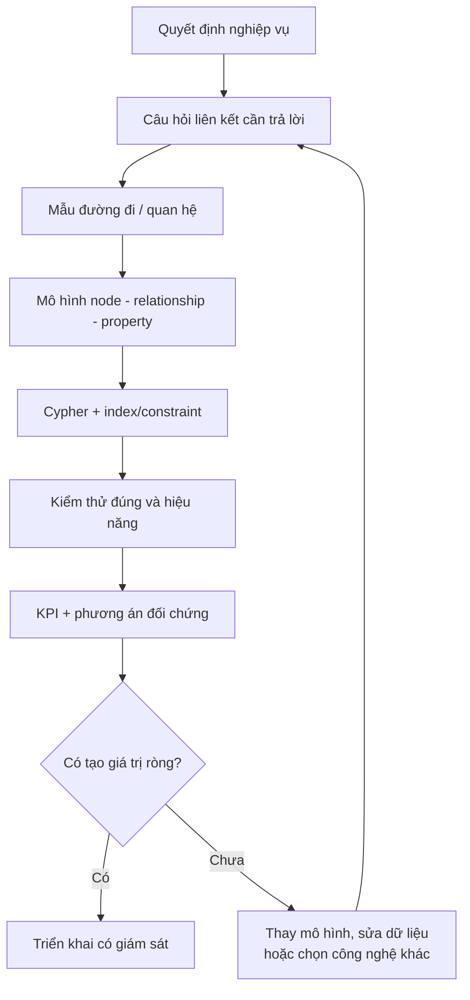
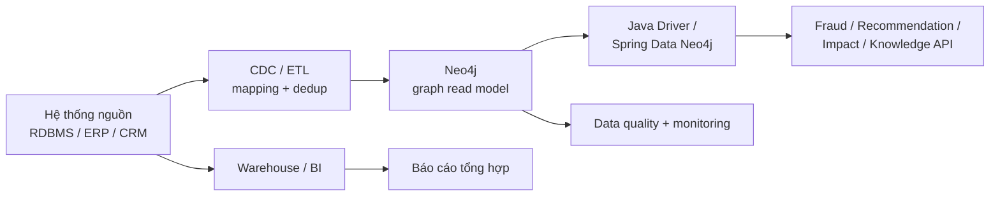
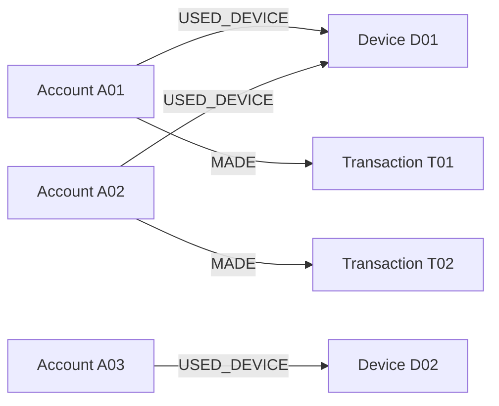
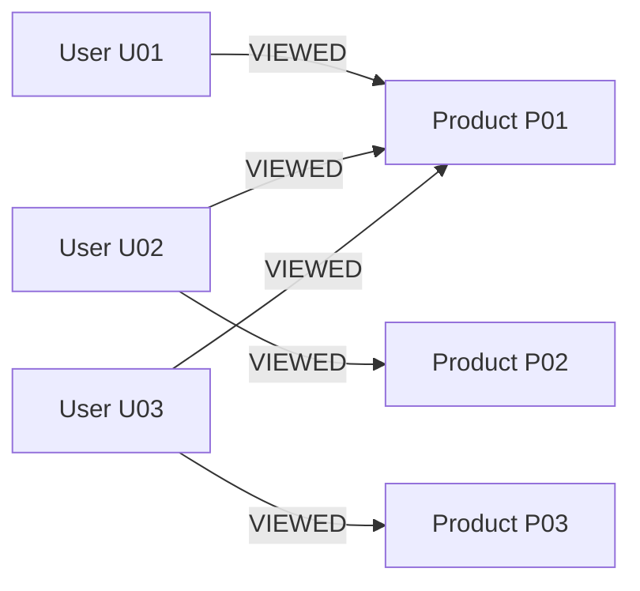
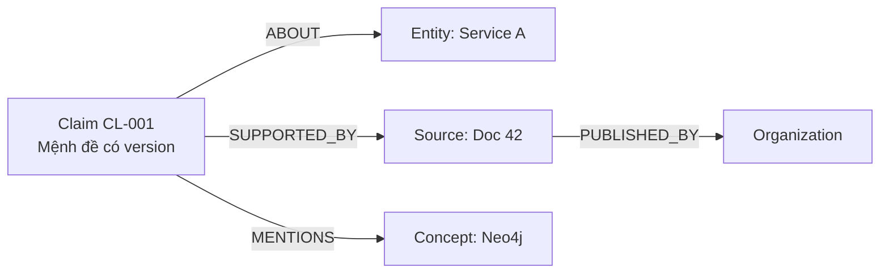
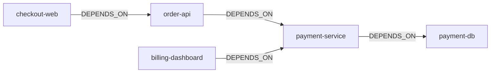
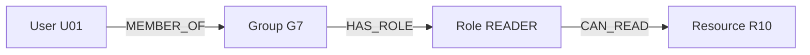
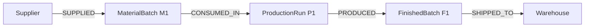

# Lựa chọn mô hình và thước đo thành công cho từng ca sử dụng

**Neo4j** có thế mạnh khi câu hỏi nghiệp vụ phụ thuộc vào **mối liên kết giữa các thực thể**: “Những tài khoản nào dùng chung thiết bị?”, “Sản phẩm nào phù hợp từ lịch sử tương tác?”, “Dịch vụ nào bị ảnh hưởng nếu một thành phần ngừng hoạt động?” hoặc “Một khẳng định được hỗ trợ bởi nguồn nào?”. Dữ liệu được lưu dưới dạng **property graph**, gồm **node**, **relationship** có hướng, nhãn, loại quan hệ và thuộc tính; truy vấn **Cypher** có thể duyệt những đường đi này theo nhu cầu.

Tuy nhiên, **“có quan hệ giữa các bảng” không đủ để quyết định dùng graph database**. Một bài toán chỉ cần tra cứu theo khóa, tổng hợp số liệu đơn giản hoặc lưu giao dịch dạng sổ cái có thể được phục vụ tốt hơn bằng cơ sở dữ liệu quan hệ. Một bài toán tìm kiếm văn bản có thể cần search engine; truy xuất tài liệu theo ngữ nghĩa có thể cần vector search. Việc chọn Neo4j nên xuất phát từ **quyết định nghiệp vụ**, **kiểu truy vấn thực sự**, **chất lượng quan hệ** và **thước đo có thể kiểm chứng**, không phải vì sơ đồ dữ liệu có nhiều mũi tên.

Bài thuộc chương **Ứng dụng đồ thị** của module **DATABASE_ENGINE_GRAPH_NEO4J**. Chúng ta sẽ xây quy trình đánh giá theo từng ca sử dụng, thiết kế mẫu node–relationship–property, viết Cypher để kiểm tra mô hình và xây bộ thước đo thành công từ **giá trị nghiệp vụ → độ chính xác của đồ thị → khả năng thực thi → chi phí vận hành**. Các ví dụ cũng liên hệ tới **index**, **constraint**, tối ưu truy vấn, **nhập dữ liệu**, **Neo4j Java Driver** và **Spring Data Neo4j**.

> **Thông điệp chính:** Mô hình đồ thị tốt phải phục vụ **một tập câu hỏi và quyết định cụ thể**. Thành công không phải “có nhiều node/relationship” hay “truy vấn chạy được”; thành công là **ra quyết định tốt hơn so với phương án đối chứng**, với độ đúng, độ trễ, độ tươi và chi phí đạt ngưỡng đã thống nhất.

## 1. Bắt đầu từ quyết định, không bắt đầu từ nhãn node

Một đề xuất dự án thường nghe như:

- “Chúng ta muốn xây knowledge graph.”
- “Dữ liệu có khách hàng, đơn hàng, thiết bị và nhiều quan hệ.”
- “Muốn dùng graph để gợi ý sản phẩm.”
- “Muốn phát hiện gian lận bằng liên kết.”

Những phát biểu này mô tả **công nghệ hoặc miền dữ liệu**, chưa mô tả **kết quả cần đạt**. Trước khi thiết kế schema, hãy trả lời:

1. **Ai là người ra quyết định?** Nhân viên điều tra gian lận, chuyên viên vận hành, người mua hàng, hệ thống tự động hay người tra cứu tri thức?
2. **Quyết định nào cần cải thiện?** Chọn tài khoản để điều tra, chọn sản phẩm đề xuất, khoanh vùng tác động, xác nhận quyền truy cập hay tìm tài liệu có nguồn?
3. **Cần truy vấn mối liên kết nào?** Một bước, nhiều bước, đường đi ngắn nhất, hàng xóm chung, nguồn gốc hoặc nhóm kết nối?
4. **Tại sao cách hiện tại chưa đáp ứng?** JOIN nhiều tầng phức tạp, thiếu bối cảnh liên kết, dữ liệu nhiều nguồn khó hợp nhất hay thời gian phản hồi không đạt?
5. **Bằng chứng thắng/thua là gì?** Precision/recall, doanh thu gia tăng, thời gian điều tra, độ bao phủ phụ thuộc, độ trễ p95 hay chi phí mỗi quyết định?
6. **Các giới hạn không được vượt là gì?** Quyền truy cập, false positive, dữ liệu nhạy cảm, freshness, ngân sách và độ tin cậy.

### 1.1. Khung từ câu hỏi đến KPI



Ví dụ chuyển yêu cầu mơ hồ thành hợp đồng kiểm chứng:

| Phát biểu ban đầu | Câu hỏi cụ thể | Hành động sau kết quả | Chỉ số |
| --- | --- | --- | --- |
| “Dùng graph chống gian lận” | Tài khoản mới có chia sẻ thiết bị/IP với các trường hợp rủi ro đã xác minh không? | Ưu tiên thứ tự điều tra | Precision@K, tỷ lệ phát hiện, tổn thất trên giao dịch |
| “Dùng graph gợi ý” | Người dùng tương tự đã xem/mua sản phẩm gì mà người hiện tại chưa tương tác? | Xếp hạng sản phẩm | Recall@K, NDCG@K, CTR/đơn hàng tăng thêm |
| “Làm knowledge graph” | Một khái niệm có liên hệ với thực thể nào, được nguồn nào xác nhận? | Trả lời kèm chứng cứ | Độ đúng thực thể/quan hệ, recall truy xuất, tỷ lệ có nguồn |
| “Graph cho phụ thuộc hệ thống” | Service nào phụ thuộc trực tiếp/gián tiếp vào service vừa lỗi? | Khoanh vùng ảnh hưởng | Recall service bị ảnh hưởng, thời gian khoanh vùng, độ tươi |
| “Graph cho phân quyền” | Người dùng nhận quyền truy cập tài nguyên qua nhóm/vai trò nào? | Cho phép/từ chối và giải thích | Zero unauthorized grant, độ đúng quy tắc, p95 authorization |

Chỉ số ở bảng là **ứng viên cần chọn và định nghĩa**, không phải mọi bài toán đều bắt buộc dùng tất cả.

## 2. Chọn Neo4j khi nào và không chọn khi nào?

Graph database thường đáng thử khi:

- Mối liên kết là **dữ liệu hạng nhất**, có thuộc tính, nguồn gốc, thời gian hoặc trạng thái.
- Câu hỏi cần duyệt **nhiều bước với hình dạng thay đổi**: 2-hop, 3-hop, đường đi, tìm cụm kết nối hoặc truy vấn tác động ngược.
- Phân tích giá trị phụ thuộc **cấu trúc mạng**: bậc node, hàng xóm chung, đường đi, cộng đồng hoặc chuỗi nguồn gốc.
- Dữ liệu đến từ nhiều nguồn và cần **liên kết thực thể** bằng khóa/identity được kiểm chứng.
- Bộ truy vấn sẽ tiếp tục phát triển theo mối liên hệ, không chỉ theo một vài phép JOIN cố định.

Graph có thể **không phải lựa chọn chính** khi:

- Phần lớn workload là CRUD theo ID với vài quan hệ cố định và JOIN quan hệ đơn giản.
- Truy vấn là tổng hợp cột lớn, báo cáo OLAP hoặc quét dữ liệu dạng bảng với tính toán số học hàng loạt.
- Vấn đề chính là full-text search hoặc tìm vector gần nhất, còn liên kết đồ thị chưa đem lại giá trị tăng thêm.
- Dữ liệu quan hệ thiếu chất lượng: ghép nhầm danh tính nhiều hơn phát hiện được kết nối hữu ích.
- Nhiều truy vấn xuyên một node “siêu hub”, đường đi quá rộng hoặc yêu cầu ghi cực lớn nhưng không có chiến lược tải và index phù hợp.
- Tính nhất quán với hệ thống giao dịch nguồn quan trọng hơn lợi ích duyệt liên kết, và một bản sao graph đồng bộ trễ không đáp ứng nhu cầu.

### 2.1. Graph có thể là read model bổ sung

Không buộc thay thế toàn bộ database hiện tại. Một kiến trúc thường gặp:



Trong cách này:

- Hệ thống giao dịch gốc vẫn là **source of truth** cho thanh toán, đơn hàng hoặc quyền sở hữu, nếu kiến trúc quy định vậy.
- Neo4j tối ưu cho **truy vấn quan hệ và khám phá liên kết**; cần nêu rõ độ trễ đồng bộ.
- Dữ liệu có thể được làm giàu bằng search/vector/feature store.
- Ứng dụng cần giải quyết trường hợp sự kiện đến trễ, ghi lặp, xóa mềm và thay đổi định danh.

**Trước khi đầu tư**, hãy có phương án đối chứng: SQL JOIN/recursive CTE, search engine, vector retrieval, batch job hoặc một rule engine sẵn có. Câu hỏi không phải “graph có chạy được không?” mà là **“graph cải thiện chất lượng và tổng chi phí so với giải pháp khả thi khác đến đâu?”**.

## 3. Từ ca sử dụng đến mô hình: sáu quyết định thiết kế

### 3.1. Chọn thực thể cần có định danh ổn định

Một node thường đại diện cho một thực thể nghiệp vụ có danh tính hoặc vòng đời riêng: `Account`, `Device`, `Order`, `Product`, `Service`, `Document`.

Đặt câu hỏi:

- Node này có **khóa ổn định** qua nhiều nguồn dữ liệu không?
- Hai record có phải cùng một thực thể thật không, hay mới chỉ **nghi ngờ trùng**?
- Thực thể có vòng đời, trạng thái hoặc quyền riêng cần cập nhật không?
- Có cần liên kết tới thực thể này từ nhiều nơi không?

Ví dụ tài khoản `A-01` có thể đổi tên hiển thị, nhưng `accountId` ổn định hơn `displayName`. Dùng tên làm định danh dễ tạo hai node khi tên đổi hoặc gộp nhầm người có cùng tên.

### 3.2. Chọn quan hệ có ý nghĩa nghiệp vụ và chiều rõ

Đừng tạo một loại `RELATED_TO` chung cho mọi liên hệ nếu nghiệp vụ cần phân biệt:

- `(Account)-[:USED_DEVICE]->(Device)`.
- `(Customer)-[:PLACED]->(Order)`.
- `(Service)-[:DEPENDS_ON]->(Service)`.
- `(Claim)-[:SUPPORTED_BY]->(Source)`.
- `(User)-[:VIEWED]->(Product)`.

Loại và **hướng relationship** là một phần hợp đồng truy vấn. Trong mô hình `A DEPENDS_ON B`, muốn tìm các dịch vụ bị ảnh hưởng khi B lỗi phải đi **ngược hướng** từ B về A, hoặc duyệt A → B rồi lọc B làm đích.

### 3.3. Chọn thuộc tính đặt trên node hay relationship

Một dữ kiện thuộc về:

- **Node** khi mô tả thực thể: `Order.status`, `Service.team`, `Device.deviceId`.
- **Relationship** khi mô tả một kết nối: `VIEWED.at`, `USED_DEVICE.firstSeenAt`, `DEPENDS_ON.criticality`.
- **Event node riêng** khi một hành động có danh tính, nhiều participant, nhiều trạng thái, cần audit hoặc có thể lặp lại: `(:ViewEvent {eventId, occurredAt})` nối tới User/Product.

Không có một cách đúng cho mọi workload. Ví dụ nhiều lượt `VIEWED` giữa cùng User/Product có thể biểu diễn bằng **nhiều event node**, bằng relationship có tập thuộc tính tổng hợp, hoặc bằng event store khác + graph projection. Quyết định theo câu hỏi cần trả lời và chi phí cập nhật.

### 3.4. Tách “bằng chứng” khỏi “sự thật đã xác minh”

Hai Account dùng chung Device **không tự chứng minh gian lận**; một Claim xuất hiện trong tài liệu **không tự chứng minh Claim đúng**; hai sản phẩm được xem cùng nhau **không tự chứng minh người dùng sẽ mua**.

Mô hình nên giữ:

- `sourceId` hoặc bản ghi nguồn.
- `observedAt`, `validFrom`, `validTo` khi nghiệp vụ có thời gian.
- `confidence` hoặc `verificationStatus` với ngữ nghĩa rõ.
- Phiên bản của luật ghép danh tính hoặc mô hình trích xuất.
- Cơ chế giải quyết mâu thuẫn, hủy quan hệ sai và cập nhật nguồn.

**Không biến kết quả suy luận thành cạnh “đã xác thực” mà không lưu dấu vết**.

### 3.5. Thiết kế cho tính chọn lọc và bậc node

Trước khi tạo graph, ước lượng:

- Tổng node/relationship theo nhãn/type.
- Bậc trung bình và **bậc lớn nhất**; một Device dùng chung ở quán internet có thể nối tới hàng nghìn account.
- Tỷ lệ cập nhật, thời gian tồn tại của edge.
- Số bước duyệt cần thiết và giới hạn `LIMIT`/độ sâu.
- Khóa bắt đầu truy vấn có index/constraint không.
- Multi-tenancy và điều kiện quyền có được áp dụng ngay từ node bắt đầu không.

Một graph nhỏ vẫn có thể tạo truy vấn nặng nếu bắt đầu từ một hub lớn rồi mở rộng `*1..N` không giới hạn. Ngược lại, một graph rất lớn vẫn có thể phục vụ nhanh các truy vấn bắt đầu từ **khóa có độ chọn lọc cao**, với độ sâu duyệt được kiểm soát.

### 3.6. Xác định ranh giới nhất quán và xóa dữ liệu

Hỏi rõ:

- Ai được ghi node và relationship?
- Cạnh được tạo cùng transaction với node hay qua pipeline bất đồng bộ?
- Khi source xóa một thực thể, cần xóa node, xóa cạnh, gắn `inactive` hay giữ lịch sử?
- Dữ liệu đến trễ có được ghi với `occurredAt`, hay dùng thời gian ingested?
- Có yêu cầu phục hồi, audit, hoặc xóa dữ liệu cá nhân không?
- Các ứng dụng dùng Java Driver, Spring Data Neo4j, APOC và batch job có **cùng quy tắc identity** không?

Nếu các đường ghi không cùng tuân thủ khóa và semantics, “mô hình đúng trên giấy” không ngăn được graph thực tế trở nên mâu thuẫn.

## 4. Ca sử dụng A — Phát hiện cụm tài khoản có liên kết rủi ro

### 4.1. Câu hỏi và quyết định

Câu hỏi:

> Một tài khoản đang giao dịch có liên hệ tới những tài khoản khác qua thiết bị dùng chung không, và liên hệ nào đáng để nhân viên điều tra xem xét?

Quyết định: **ưu tiên ca điều tra**, không tự động kết luận một người dùng là gian lận chỉ vì chia sẻ thiết bị.

Mô hình tối giản:



| Node/edge | Khóa/thuộc tính | Giải thích |
| --- | --- | --- |
| `Account` | `accountId`, `status` | Định danh tài khoản |
| `Device` | `deviceId`, `deviceType` | Định danh/nhóm thiết bị đã chuẩn hóa |
| `Transaction` | `transactionId`, `occurredAt`, `amountMinor` | Sự kiện giao dịch theo khóa riêng |
| `USED_DEVICE` | `firstSeenAt`, `lastSeenAt`, `source` | Bằng chứng liên kết có thời gian |
| `MADE` | Có thể mang `sourceEventId` | Quan hệ tài khoản thực hiện giao dịch |

**Không dùng IP hoặc device fingerprint làm khóa “một người = một thiết bị” một cách ngây thơ.** IP có thể dùng chung hoặc thay đổi; device ID có thể thiếu, lỗi hoặc bị giả mạo. Mô hình cần phản ánh độ tin cậy của từng loại bằng chứng.

### 4.2. Constraint và dữ liệu ví dụ

Chỉ chạy trên **database thực hành**:

```cypher
CREATE CONSTRAINT account_id_unique IF NOT EXISTS
FOR (a:Account)
REQUIRE a.accountId IS UNIQUE;

CREATE CONSTRAINT device_id_unique IF NOT EXISTS
FOR (d:Device)
REQUIRE d.deviceId IS UNIQUE;
```

```cypher
MERGE (a1:Account {accountId: 'A01'})
SET a1.status = 'ACTIVE'
MERGE (a2:Account {accountId: 'A02'})
SET a2.status = 'ACTIVE'
MERGE (a3:Account {accountId: 'A03'})
SET a3.status = 'ACTIVE'

MERGE (d1:Device {deviceId: 'D01'})
MERGE (d2:Device {deviceId: 'D02'})

MERGE (a1)-[:USED_DEVICE]->(d1)
MERGE (a2)-[:USED_DEVICE]->(d1)
MERGE (a3)-[:USED_DEVICE]->(d2);
```

Truy vấn bắt đầu từ một Account rồi tìm những Account **cùng Device**:

```cypher
MATCH (a:Account {accountId: $accountId})
      -[:USED_DEVICE]->(d:Device)
      <-[:USED_DEVICE]-(other:Account)
WHERE other <> a
RETURN other.accountId AS linkedAccountId,
       count(DISTINCT d) AS sharedDeviceCount
ORDER BY sharedDeviceCount DESC, linkedAccountId
LIMIT $limit;
```

Với `accountId = 'A01'` và `limit = 10`, kết quả có **A02** với `sharedDeviceCount = 1`. `A03` không xuất hiện.

Đây là **tín hiệu quan hệ** chứ không phải nhãn gian lận. Trong production, nên thêm thời gian quan sát, loại thiết bị, độ tin cậy của liên kết, giới hạn bậc hub, tenant/authorization và lịch sử outcome sau điều tra.

### 4.3. Khi nào graph mang lại giá trị?

Graph hữu ích nếu cần:

- Hàng xóm chung nhiều cấp: account → device → account → transaction.
- Phát hiện một cụm liên kết có nhiều loại thực thể.
- Trả **đường dẫn giải thích được**: “A01 chia sẻ D01 với A02”.
- Điều tra những tài khoản liên hệ gián tiếp qua nhiều bước có kiểm soát.

Nếu quy tắc hiện tại chỉ là **“cùng một deviceId thì đặt cờ”**, một phép JOIN/lookup có index trong RDBMS có thể đáp ứng đủ. Hãy đo giá trị tăng thêm của **mối liên hệ nhiều bước** thay vì chỉ chuyển cùng một JOIN sang Cypher.

### 4.4. Thước đo thành công cho chống gian lận

| Lớp | Thước đo | Lưu ý |
| --- | --- | --- |
| Nghiệp vụ | **Tổn thất gian lận thực tế** trên số giao dịch/giá trị giao dịch | Theo dõi theo thời gian, trừ tác động mùa vụ |
| Quyết định | **Precision@K** trong danh sách điều tra ưu tiên | K phụ thuộc năng lực đội điều tra |
| Bao phủ phát hiện | **Recall** trên bộ ca gian lận có nhãn đủ trưởng thành | Nhãn có thể đến trễ, thiếu hoặc sai |
| Chi phí | Số ca điều tra sai, chi phí nhân viên/ca | Một false positive có thể làm tổn hại người dùng |
| Mô hình graph | Tỷ lệ Device có ID đáng tin, cạnh có thời gian/source, tỷ lệ hub đáng ngờ | Tránh kết luận dựa trên liên kết sai |
| Vận hành | Thời gian sinh danh sách nghi vấn, `p95` query, độ trễ ingest | Quyết định có kịp trước giao dịch không? |
| Bảo vệ | Tỷ lệ từ chối nhầm hoặc ảnh hưởng bất công tới nhóm người dùng | Cần đánh giá fairness/quyền riêng tư phù hợp |

Định nghĩa:

\[
\mathrm{Precision} = \frac{TP}{TP+FP},\qquad
\mathrm{Recall} = \frac{TP}{TP+FN}
\]

Trong đó `TP` là ca dương tính thực được phát hiện, `FP` là ca bị đánh dấu nhưng không gian lận, `FN` là ca gian lận bị bỏ qua **trên tập có nhãn phù hợp**.

Không nên chỉ tối đa Recall bằng cách đánh dấu hầu hết tài khoản. Cần đo **precision, số người bị ảnh hưởng và chi phí điều tra** cùng lúc.

### 4.5. Chống rò rỉ dữ liệu khi đánh giá

Nếu nhãn “fraud confirmed” chỉ xuất hiện **sau** thời điểm quyết định, không được đưa thông tin đó vào tập feature tại thời điểm dự đoán rồi báo Recall cao. Chia tập theo **thời gian sự kiện**, giữ những liên kết đã biết tại từng mốc và kiểm tra cả **nhãn đến muộn**.

## 5. Ca sử dụng B — Gợi ý sản phẩm dựa trên hành vi liên kết

### 5.1. Câu hỏi và mô hình

Câu hỏi:

> Người dùng tương tự từng xem các sản phẩm mà người dùng hiện tại chưa xem là ai, và các sản phẩm đó có đáng để gợi ý không?

Mô hình hai phía (*bipartite graph*):



| Thành phần | Ý nghĩa |
| --- | --- |
| `User` | Người dùng với `userId` ổn định, có consent phù hợp |
| `Product` | Sản phẩm với `productId`, phân loại, trạng thái bán |
| `VIEWED` | Hành vi xem; có thể có timestamp, source, session |
| `PURCHASED` | Hành vi mua, thường là tín hiệu mạnh hơn xem |
| `ViewEvent` (tùy chọn) | Khi cần lưu từng lượt xem và phiên tương tác |

Với graph nhỏ, một cạnh `VIEWED` giữa User/Product có thể biểu diễn “đã từng xem ít nhất một lần”. Nhưng nếu cần đếm từng lần, trọng số theo thời gian hoặc audit sự kiện, phải **thiết kế riêng việc lưu event**, không coi một cạnh `MERGE` là đầy đủ lịch sử xem.

### 5.2. Fixture và truy vấn ứng viên

```cypher
CREATE CONSTRAINT user_id_unique IF NOT EXISTS
FOR (u:User)
REQUIRE u.userId IS UNIQUE;

CREATE CONSTRAINT product_id_unique IF NOT EXISTS
FOR (p:Product)
REQUIRE p.productId IS UNIQUE;
```

```cypher
MERGE (u1:User {userId: 'U01'})
MERGE (u2:User {userId: 'U02'})
MERGE (u3:User {userId: 'U03'})
MERGE (p1:Product {productId: 'P01'})
MERGE (p2:Product {productId: 'P02'})
MERGE (p3:Product {productId: 'P03'})
MERGE (u1)-[:VIEWED]->(p1)
MERGE (u2)-[:VIEWED]->(p1)
MERGE (u2)-[:VIEWED]->(p2)
MERGE (u3)-[:VIEWED]->(p1)
MERGE (u3)-[:VIEWED]->(p3);
```

Truy vấn tìm sản phẩm mà **các user có sản phẩm chung** đã xem nhưng U01 chưa xem:

```cypher
MATCH (u:User {userId: $userId})
      -[:VIEWED]->(:Product)
      <-[:VIEWED]-(peer:User)
      -[:VIEWED]->(candidate:Product)
WHERE peer <> u
  AND NOT EXISTS {
    MATCH (u)-[:VIEWED]->(candidate)
  }
RETURN candidate.productId AS productId,
       count(DISTINCT peer) AS peerCount
ORDER BY peerCount DESC, productId
LIMIT $k;
```

Với `userId = 'U01'`, hai ứng viên là **P02** và **P03**, cùng `peerCount = 1`. Câu Cypher có thể chạy làm baseline graph query, **chưa phải mô hình gợi ý production**.

### 5.3. Chọn mức mô hình phù hợp

- **Cạnh VIEWED tổng hợp:** đơn giản, ít dữ liệu, nhanh khi chỉ hỏi “đã xem chưa?”.
- **VIEWED có thuộc tính lastSeenAt/weight:** phù hợp cho tín hiệu tổng hợp theo cặp User–Product; cần định nghĩa update.
- **Event node:** phù hợp khi từng lần xem có session, campaign, thiết bị, nguồn, timestamp, consent và lifecycle riêng.
- **Graph + vector/content:** gợi ý dựa trên hành vi lẫn nội dung sản phẩm; cần chứng minh phần graph giúp tăng kết quả so với vector/keyword/popularity.

Graph dễ chịu hiện tượng **hub sản phẩm phổ biến**: nếu một sản phẩm được hầu hết mọi người xem, tìm peer từ nó có thể tạo rất nhiều đường đi, chi phí cao nhưng tín hiệu phân biệt thấp. Cần lọc theo thời gian, giới hạn candidate, xử lý popularity bias và đo plan/truy vấn trên tập dữ liệu đại diện.

### 5.4. Thước đo thành công cho gợi ý

| Lớp | Metric | Cách hiểu |
| --- | --- | --- |
| Offline ranking | `Recall@K` | Tỷ lệ mục tiêu liên quan được đề xuất trong top K |
| Offline ranking | `NDCG@K` | Đánh giá chất lượng thứ hạng, ưu tiên đúng ở vị trí cao |
| Chất lượng tập kết quả | Coverage, diversity, novelty | Có chỉ gợi ý vài sản phẩm rất phổ biến không? |
| Nghiệp vụ online | CTR, add-to-cart, conversion **incremental** | So với control qua A/B test, không chỉ quan sát trước–sau |
| Người dùng | Unsubscribe, bỏ phiên, phản hồi không liên quan | Guardrail trải nghiệm |
| Dữ liệu | Tỷ lệ user/product có hành vi hợp lệ, freshness | Cold start và dữ liệu trễ |
| Hệ thống | `p95` latency, timeout, cost/1.000 đề xuất | Có đủ nhanh cho trang sản phẩm không? |

**Không dùng một lần click làm bằng chứng gợi ý tạo doanh thu gia tăng.** A/B test hoặc thiết kế thực nghiệm phù hợp cần phân biệt tác động của thuật toán với vị trí hiển thị, chiến dịch marketing và thay đổi hành vi khách hàng.

## 6. Ca sử dụng C — Knowledge graph và truy xuất có nguồn gốc

### 6.1. Từ tài liệu sang thực thể, khẳng định và bằng chứng

Một hệ thống tri thức không nên chỉ gắn mọi tài liệu bằng `RELATED_TO`. Câu hỏi quan trọng có thể là:

> “Thành phần nào sử dụng giao thức X, thông tin đó được trích từ tài liệu nào, cập nhật lần cuối khi nào, và có nguồn nào mâu thuẫn không?”

Mô hình có thể chọn:



Nhiều bài toán cần phân biệt **mệnh đề** (`Claim`) với **thực thể** (`Entity`). Lý do:

- Một source có thể chỉ **khẳng định** một quan hệ, chưa được xác minh.
- Hai source có thể mâu thuẫn.
- Mệnh đề có thời điểm hiệu lực, mức tin cậy và bằng chứng riêng.
- Cần biết **vì sao** hệ thống trả một câu trả lời, không chỉ lấy ra quan hệ trần.

| Thành phần | Thuộc tính gợi ý |
| --- | --- |
| `Entity` | `entityId`, `canonicalName`, `entityType` |
| `Concept` | `conceptId`, `name`, `taxonomyVersion` |
| `Source` | `sourceId`, `uri`, `publishedAt`, `accessLevel` |
| `Claim` | `claimId`, `predicate`, `confidence`, `observedAt`, `validFrom` |
| `SUPPORTED_BY` | `spanStart`, `spanEnd`, `extractorVersion` nếu cần |
| `SAME_AS` / mapping | Chỉ lưu sau khi có chính sách giải quyết entity identity |

**Cẩn trọng với `SAME_AS`:** hai cách viết tên không nhất thiết là một thực thể. Gộp nhầm entity làm lan truyền lỗi theo đường đi và có thể tạo câu trả lời “có liên hệ” không đúng.

### 6.2. Truy vấn minh họa: trả lời kèm nguồn

```cypher
MATCH (e:Entity {entityId: $entityId})
      <-[:ABOUT]-(claim:Claim)
      -[:SUPPORTED_BY]->(source:Source)
WHERE source.accessLevel = 'PUBLIC'
RETURN claim.claimId AS claimId,
       claim.predicate AS predicate,
       claim.confidence AS confidence,
       source.sourceId AS sourceId,
       source.uri AS sourceUri
ORDER BY confidence DESC, sourceId
LIMIT $limit;
```

Đây chỉ là **truy vấn đọc mệnh đề có nguồn**. Giá trị `confidence` phải có định nghĩa rõ: độ tin cậy của extractor, mức đánh giá của chuyên gia hay xác suất được hiệu chuẩn? Không dùng một con số không rõ nguồn để kết luận sự thật.

Nếu có nhiều tổ chức, tenant hoặc loại tài liệu nội bộ, điều kiện `source.accessLevel = 'PUBLIC'` chưa đủ cho authorization: cần chính sách quyền ở tầng database và ứng dụng, dùng tenant/owner đã xác thực.

### 6.3. Đối chứng: search và vector

Knowledge graph thường **bổ sung** chứ không thay thế:

- Full-text search để tìm đoạn chứa từ khóa.
- Vector search để tìm đoạn/khái niệm tương tự về ngữ nghĩa.
- Graph traversal để theo **định danh, loại quan hệ, nguồn và provenance**.
- Một lớp tổng hợp/trả lời có kiểm tra nguồn và quản lý uncertainty.

Ví dụ câu hỏi “Tài liệu nào mô tả Service A?” có thể chỉ cần search. Nhưng câu hỏi “Service A phụ thuộc những hệ thống nào theo các nguồn đã xác minh và còn hiệu lực?” có thể cần graph với tính liên kết, thời gian và bằng chứng.

### 6.4. Thước đo thành công cho tri thức

| Lớp | Chỉ số | Điều cần kiểm tra |
| --- | --- | --- |
| Entity resolution | Precision/recall ghép thực thể | Có gộp nhầm tên trùng hoặc bỏ sót alias? |
| Relation extraction | Precision/recall theo từng loại quan hệ | `DEPENDS_ON` có bị suy từ câu diễn đạt mơ hồ? |
| Truy xuất | MRR@K, Recall@K, tỷ lệ trả nguồn đúng | Dùng bộ câu hỏi có đáp án chuyên gia |
| Câu trả lời | Faithfulness/groundedness, tỷ lệ đáp án được dẫn nguồn | “Có nguồn” không đồng nghĩa source hỗ trợ kết luận |
| Vận hành tri thức | Freshness, thời gian sửa một fact sai, nguồn thiếu | Quy trình cập nhật và phản hồi |
| An toàn | Tỷ lệ lộ thông tin không có quyền | Phải kiểm tra truy cập theo người dùng/tenant |
| Giá trị | Thời gian tra cứu tiết kiệm, tỷ lệ giải quyết đúng | So với search hiện có, kể cả chi phí kiểm duyệt |

Một **bộ câu hỏi tham chiếu** cần phân loại: factual, multi-hop, không có câu trả lời, mâu thuẫn nguồn và tài liệu đã cũ. Đừng chỉ đo “tỷ lệ tìm thấy một văn bản bất kỳ”.

## 7. Ca sử dụng D — Phân tích phụ thuộc và blast radius

### 7.1. Câu hỏi vận hành

> Nếu dịch vụ `payment-db` không khả dụng, những service nào **phụ thuộc trực tiếp hoặc gián tiếp** vào nó trong phạm vi tối đa bốn bước?

Mô hình đơn giản:



Nếu cạnh mang nghĩa `(dependent)-[:DEPENDS_ON]->(dependency)`, để tìm service **bị ảnh hưởng** bởi một dependency lỗi, phải truy từ những node **phụ thuộc vào nó**.

### 7.2. Dữ liệu và truy vấn Cypher

```cypher
CREATE CONSTRAINT service_id_unique IF NOT EXISTS
FOR (s:Service)
REQUIRE s.serviceId IS UNIQUE;
```

```cypher
MERGE (web:Service {serviceId: 'checkout-web'})
MERGE (api:Service {serviceId: 'order-api'})
MERGE (pay:Service {serviceId: 'payment-service'})
MERGE (db:Service {serviceId: 'payment-db'})
MERGE (dash:Service {serviceId: 'billing-dashboard'})
MERGE (web)-[:DEPENDS_ON]->(api)
MERGE (api)-[:DEPENDS_ON]->(pay)
MERGE (pay)-[:DEPENDS_ON]->(db)
MERGE (dash)-[:DEPENDS_ON]->(pay);
```

```cypher
MATCH p = (dependent:Service)
          -[:DEPENDS_ON*1..4]->
          (failed:Service {serviceId: $failedServiceId})
WITH dependent, min(length(p)) AS minHops
RETURN dependent.serviceId AS impactedServiceId,
       minHops
ORDER BY minHops, impactedServiceId
LIMIT $limit;
```

Với `failedServiceId = 'payment-db'`, các service bị tác động gồm:

| impactedServiceId | minHops |
| --- | ---: |
| payment-service | 1 |
| billing-dashboard | 2 |
| order-api | 2 |
| checkout-web | 3 |

`min(length(p))` giúp không lặp service nếu có nhiều đường đi tới cùng một dependency. Đây là **truy vấn dependency theo hướng đã định nghĩa**, chưa phải dự báo chính xác mọi sự cố: một service có dependency tùy chọn hoặc cơ chế fallback có thể vẫn phục vụ bình thường.

### 7.3. Khi cần mô hình phong phú hơn

Cạnh `DEPENDS_ON` có thể cần:

- `environment`: production/staging.
- `criticality`: hard/soft dependency.
- `validFrom`, `validTo`: dependency đổi theo phiên bản triển khai.
- `source`: service catalog, trace, CMDB, IaC.
- `confidence`: cạnh phát hiện tự động hay xác nhận thủ công.

Nếu cùng Service có nhiều phiên bản, tenant hoặc deployment ở các vùng khác nhau, chỉ dùng một node `Service` cho mọi thứ có thể làm **phóng đại blast radius**. Có thể cần tách `Service` khỏi `Deployment`, `Environment` và `Region`, hoặc lọc relationship theo môi trường.

### 7.4. Thước đo thành công

| Lớp | Metric | Mục đích |
| --- | --- | --- |
| Độ đúng graph | Precision/recall của các cạnh dependency được chuyên gia xác minh | Tránh sót hoặc ghi quan hệ không có thật |
| Coverage | Tỷ lệ service production có dữ liệu dependency đủ dùng | Phát hiện vùng mù |
| Freshness | Độ trễ từ deploy/thay topology tới khi graph được cập nhật | Không dùng dependency đã cũ |
| Quyết định incident | Thời gian khoanh vùng hệ thống bị ảnh hưởng | So với runbook/service catalog hiện hành |
| Chất lượng tác động | Precision/recall danh sách service thực sự bị ảnh hưởng | Đối chiếu postmortem, không chỉ count node |
| Vận hành | `p95` query, số đường đi duyệt, timeout | Đảm bảo truy vấn sẵn trong sự cố |
| Giá trị | MTTR và số lần bỏ sót đối tượng cần thông báo | Không suy chỉ từ correlation; cần so sánh phù hợp |

**Chú ý về trùng dữ liệu:** một dịch vụ có thể phụ thuộc nhiều đường vào cùng dependency. Nếu chỉ `count(p)`, bạn đang đếm **đường đi**, không phải **service khác nhau**. Chọn `count(DISTINCT dependent)` khi KPI là số service chịu tác động.

## 8. Ca sử dụng E — Phân quyền theo đường đi

### 8.1. Khi graph giúp giải thích quyền

Trong hệ thống IAM, một người dùng có thể thuộc nhiều nhóm; nhóm có role; role có quyền trên resource. Câu hỏi:

> “Vì sao người dùng U01 có quyền đọc tài liệu R10?” hoặc “Khi thu hồi nhóm G7, những resource nào có thể bị ảnh hưởng?”

Mô hình ví dụ:



Câu truy vấn duyệt bằng chứng quyền:

```cypher
MATCH (u:User {userId: $userId})
      -[:MEMBER_OF]->(g:Group)
      -[:HAS_ROLE]->(role:Role)
      -[:CAN_READ]->(r:Resource {resourceId: $resourceId})
RETURN DISTINCT g.groupId AS viaGroup,
       role.roleId AS viaRole;
```

**Kết quả có đường cấp quyền không tự đủ để cho phép truy cập.** Một chính sách thật có thể có `DENY` ưu tiên `ALLOW`, ranh giới tenant, thời gian hiệu lực, nguyên tắc least privilege, quan hệ cha–con hoặc điều kiện thuộc tính. Graph ở đây là **mô hình diễn giải nguồn cấp quyền**, không thay thế một policy engine hoặc công cụ kiểm tra quyền được kiểm soát.

### 8.2. Thước đo không được tối ưu sai

| Metric | Cách nhìn đúng |
| --- | --- |
| Unauthorized grants | **Guardrail nghiêm ngặt**, không được đánh đổi để lấy độ trễ thấp |
| False deny / false allow | Đánh giá với bộ policy test và trường hợp biên |
| Time to revoke | Sau khi thu hồi quyền, bao lâu mọi đường truy cập bị cập nhật? |
| Explainability | Tỷ lệ quyết định có thể truy vết đường cấp/từ chối |
| Latency p95/p99 | Đủ nhanh cho quyết định authorization đồng bộ |
| Audit completeness | Có lưu danh tính, rule version, thời điểm và kết quả đúng chính sách? |
| Data freshness | Membership/role mới từ nguồn IAM được phản ánh đến đâu? |

**Không chỉ đo “query authorization trả lời trong 10 ms”** rồi chấp nhận bỏ lọt một quyền trái phép. Với phân quyền, **tính đúng và an toàn là điều kiện triển khai**, hiệu năng là mục tiêu tiếp theo.

## 9. Ca sử dụng F — Truy xuất nguồn gốc và chuỗi cung ứng

Một sản phẩm có thể phụ thuộc vào nhiều vật tư, lô sản xuất và nhà cung cấp. Khi một lô nguyên liệu bị thu hồi, bài toán là:

> “Những lô thành phẩm nào có thể chứa nguyên liệu từ lô bị ảnh hưởng, thông qua các bước chế biến nào?”

Mô hình đơn giản:



Ở đây **sự kiện/lô** quan trọng hơn chỉ nối `Supplier` với `Product`. Nếu bỏ node `ProductionRun`, có thể mất thông tin số lượng tiêu thụ, ca máy, công thức, thời gian và mối liên hệ giữa nhiều lô nguồn với nhiều lô đích.

Thước đo:

- Recall của những lô bị tác động theo hồ sơ sản xuất chuẩn.
- False positive của danh sách thu hồi; tránh thu hồi quá rộng không cần thiết.
- Thời gian hoàn thành truy vết từ một lô bị báo lỗi.
- Tỷ lệ sự kiện sản xuất có đầy đủ nguồn, quantity và timestamp.
- Tỷ lệ chênh lệch số lượng hoặc sai lineage được phát hiện.
- Độ trễ ingest, độ sẵn sàng trong diễn tập thu hồi và khả năng audit.

**Không dùng quan hệ có đường đi làm bằng chứng chắc chắn “sản phẩm chứa chất X”** nếu mô hình thiếu định lượng, hao hụt, mixing ratio hoặc thay đổi lô. Câu hỏi truy vết phải khớp mô hình nghiệp vụ vật lý.

## 10. Bảng chọn mô hình theo từng ca sử dụng

| Ca sử dụng | Node trọng tâm | Relationship trọng tâm | Truy vấn điển hình | Rủi ro mô hình cần giải quyết |
| --- | --- | --- | --- | --- |
| Gian lận | Account, Device, Transaction | USED_DEVICE, MADE | Hàng xóm chung, multi-hop có giới hạn | False link, thiết bị dùng chung, dữ liệu nhạy cảm |
| Gợi ý | User, Product, Event | VIEWED, PURCHASED | Hai bước qua peer, top-K | Popularity bias, cold start, event history |
| Knowledge graph | Entity, Claim, Source | ABOUT, SUPPORTED_BY | Nhiều bước kèm nguồn | Entity resolution, provenance, nguồn mâu thuẫn |
| Phụ thuộc hệ thống | Service, Deployment, Region | DEPENDS_ON | Truy ngược, đường đi 1..N | Edge đã cũ, hard/soft dependency, cycle |
| Phân quyền | User, Group, Role, Resource | MEMBER_OF, HAS_ROLE, CAN_READ | Đường cấp quyền và giải thích | Deny precedence, tenant và privilege |
| Chuỗi cung ứng | MaterialBatch, ProductionRun, FinishedBatch | CONSUMED_IN, PRODUCED | Truy xuất trước/sau theo lô | Thiếu lượng, sai nguồn và thời gian |

Không cần mang tất cả các nhãn vào cùng một đồ thị. Mỗi use case cần **aggregate, database, source of truth, quyền và độ tươi** riêng theo yêu cầu triển khai.

## 11. Bộ thước đo đa tầng: không chỉ đo thời gian query

Một dự án graph có thể thất bại dù Cypher rất nhanh: dữ liệu sai, tỷ lệ gợi ý không tăng, nhân viên điều tra quá tải hoặc mọi edge từ nguồn phụ đều trễ một ngày. Vì vậy, nên định nghĩa bốn nhóm thước đo.

### Tầng A — Outcome nghiệp vụ

Câu hỏi: **Dùng kết quả graph có làm quyết định tốt hơn không?**

Ví dụ:

- Giảm tổn thất gian lận tính trên 1.000 giao dịch (sau khi điều chỉnh khác biệt quy mô).
- Tăng tỷ lệ đơn hàng **gia tăng do gợi ý**, thay vì tổng doanh thu vốn sẽ xảy ra.
- Giảm thời gian xác định service bị ảnh hưởng trong một incident.
- Tăng tỷ lệ câu trả lời có bằng chứng đúng và được chuyên gia chấp nhận.
- Giảm thời gian xác định phạm vi thu hồi lô hàng.

Đo cả **lợi ích** và **chi phí sai quyết định**: khóa tài khoản nhầm, gợi ý gây khó chịu, mở quyền trái phép hoặc thông báo thảm họa sai.

### Tầng B — Chất lượng graph và pipeline

Câu hỏi: **Dữ liệu quan hệ có đáng tin và còn đúng thời điểm không?**

| Metric | Cách tính/thu thập | Điều cần lưu ý |
| --- | --- | --- |
| Node coverage | Số thực thể nguồn có node tương ứng / tổng thực thể nguồn cần có | Mẫu số phải là tập dữ liệu thuộc phạm vi |
| Edge coverage | Số quan hệ đã đối soát / quan hệ kỳ vọng từ nguồn/ground truth | Không đồng nghĩa số edge lớn là tốt |
| Precision liên kết | Đúng / tổng liên kết được gắn | Đặc biệt quan trọng trong entity matching |
| Freshness lag | Thời điểm graph nhận thay đổi − thời điểm sự kiện nguồn | Dùng phân vị, không chỉ trung bình |
| Duplicate rate | Tỷ lệ thực thể/cạnh bị nhân bản sai | Cần định nghĩa “trùng” theo nghiệp vụ |
| Orphan/broken references | Số thực thể thiếu quan hệ bắt buộc | Có thể hợp lệ nếu workflow cho phép |
| Provenance coverage | Tỷ lệ claim/edge có source và timestamp hợp lệ | Thiếu nguồn làm giảm khả năng kiểm chứng |
| Validity | Tỷ lệ quan hệ đúng type, direction, thời gian, tenant | Không chỉ kiểm tra syntax Cypher |
| Change-data loss | Tỷ lệ sự kiện nguồn bị bỏ sót hoặc replay sai | Quan trọng với CDC/ETL |

**Không lấy `count(r)` làm “chất lượng graph”** nếu không kiểm tra đó là cạnh đúng. Mười triệu cạnh sai có thể tệ hơn một trăm nghìn cạnh được xác minh.

### Tầng C — Chất lượng kết quả thuật toán/truy vấn

Câu hỏi: **Graph có trả lời đúng câu hỏi cần ra quyết định không?**

- Phân loại/cảnh báo: precision, recall, F1, PR-AUC, false positive rate.
- Xếp hạng/gợi ý: Recall@K, Precision@K, MRR@K, NDCG@K.
- Truy xuất quan hệ: tỷ lệ path đúng, completeness của quan hệ, tỷ lệ bằng chứng được chuyên gia xác nhận.
- Phân tích phụ thuộc: tỷ lệ service bị ảnh hưởng thực sự nằm trong kết quả, false positives và thời gian phát hiện.
- Phân quyền: các trường hợp allow/deny đúng theo bộ policy test, đặc biệt các trường hợp **unauthorized grant** phải bằng 0 theo yêu cầu an toàn.

Các metric cần có **bộ ground truth** được chuẩn bị độc lập với output graph. Không đánh giá một bộ quy tắc bằng chính dữ liệu mà nó tự tạo ra nhãn.

### Tầng D — Hiệu năng, chi phí và vận hành

Câu hỏi: **Có vận hành ổn định ở quy mô và SLO thực tế không?**

- `p50`/`p95`/`p99` query latency và độ trễ **end-to-end HTTP**.
- Transactions/giây, concurrency, timeout/retry rate.
- `Rows` và `DB Hits` từ `PROFILE` trên workload được phép.
- Page cache, heap/GC, CPU, disk I/O, connection pool.
- ETL throughput, ingest lag và dead-letter/error rate.
- Chi phí hạ tầng + vận hành + lưu trữ mỗi 1.000 quyết định hoặc mỗi triệu kết nối.
- Thời gian release, sửa schema, khôi phục khi sự cố và quản lý quyền.

**`DB Hits` không phải số lần đọc đĩa thực tế** và `PROFILE` chỉ phản ánh một lần thực thi trong điều kiện cụ thể. Đối với câu Cypher ghi, `PROFILE` **thực sự chạy lệnh ghi**; dùng môi trường thử nghiệm hoặc quy trình được kiểm soát, không coi nó là dry-run.

## 12. Cách định nghĩa metric không gây hiểu nhầm

### 12.1. Precision, recall và false positive

Trong bài toán phân loại:

\[
\mathrm{Precision}=\frac{TP}{TP+FP}
\]

\[
\mathrm{Recall}=\frac{TP}{TP+FN}
\]

\[
\mathrm{FPR}=\frac{FP}{FP+TN}
\]

Trong đó:

- `TP`: dự đoán/cảnh báo dương và ground truth thực sự dương.
- `FP`: dự đoán/cảnh báo dương nhưng thực sự âm.
- `FN`: bỏ sót trường hợp thực sự dương.
- `TN`: xác định đúng trường hợp âm.

Một hệ thống chống gian lận có tỷ lệ gian lận thấp nên quan tâm **precision và PR-AUC**; chỉ báo accuracy chung có thể đẹp dù mô hình bỏ qua phần lớn gian lận. Nếu nhãn đến trễ, mẫu số và mốc thời gian cần được quy định rõ.

### 12.2. Recall@K, MRR@K, NDCG@K

- **Recall@K:** tỷ lệ mục tiêu liên quan mà top K đã thu hồi.
- **MRR@K:** trung bình nghịch đảo vị trí kết quả liên quan đầu tiên, giới hạn K.
- **NDCG@K:** đo chất lượng xếp hạng bằng mức liên quan có trọng số theo vị trí, chuẩn hóa theo thứ hạng lý tưởng.

Ví dụ một hệ thống tri thức trả đúng tài liệu ở vị trí 8 và hệ thống khác ở vị trí 1: cả hai có thể đạt Recall@10 như nhau với một tài liệu đúng, nhưng **MRR@10** và **NDCG@10** cho thấy sự khác biệt vị trí.

Với recommender, cần định nghĩa rõ tập item “liên quan”, cửa sổ thời gian và các sản phẩm đã hết hàng/không đủ điều kiện hiển thị; nếu không, offline ranking metrics khó so sánh giữa các hệ thống.

### 12.3. Freshness và completeness

Ví dụ dữ liệu dependency cần có độ tươi:

\[
\mathrm{lagSeconds} =
\mathrm{graphAvailableAt} - \mathrm{sourceEventAt}
\]

Phải dùng **clock/timezone chuẩn và event-time semantics thống nhất**. Với dữ liệu tới muộn, `sourceEventAt` có thể cách thời điểm nhận rất xa; cần tách *source publication delay*, *queue delay*, *processing delay* và *graph availability delay* khi điều tra.

Completeness không nên tính bằng `count(node)`. Ví dụ:

\[
\mathrm{edgeCoverage}=
\frac{\text{số cạnh đúng trong phạm vi đối soát}}
{\text{số cạnh kỳ vọng trong phạm vi đối soát}}
\]

Mẫu số “cạnh kỳ vọng” có thể đến từ nguồn đáng tin hoặc mẫu gán nhãn chuyên gia; nếu không biết mẫu số, hãy báo **coverage trên tập kiểm chứng** thay vì tự gọi số node đã nhập là “100% đầy đủ”.

### 12.4. Hiệu năng theo phân vị

`p95 = 250 ms` nghĩa là khoảng **95% các quan sát trong mẫu đo không vượt quá 250 ms**, với điều kiện metric/time window và cách đo đã được xác định. Nó không có nghĩa mọi request đều dưới 250 ms.

Đối với graph:

- Phân nhóm theo **query template** và độ lớn đầu vào/hub degree.
- Đo cả request với số quan hệ lớn, không chỉ trường hợp thử nghiệm có hai node.
- Tách latency Cypher tại server khỏi thời gian chờ connection pool, mạng và tạo DTO ở Java.
- Báo p95/p99 với **số mẫu, khoảng thời gian và mức tải**.

## 13. Chọn baseline và thiết kế đánh giá có đối chứng

Để chứng minh giá trị Neo4j, so sánh với giải pháp **khả thi thực sự**, không chọn một baseline cố tình yếu.

| Ca sử dụng | Baseline phù hợp |
| --- | --- |
| Gian lận | Luật theo tài khoản, device sharing một bước bằng SQL, risk score hiện có |
| Gợi ý | Bestseller theo danh mục, popularity, content/vector recommender |
| Knowledge | Keyword/full-text search, vector retrieval, search + rerank |
| Phụ thuộc | CMDB/service catalog, SQL recursive CTE hoặc runbook thủ công hiện tại |
| Phân quyền | Policy engine hoặc IAM hiện tại |
| Chuỗi cung ứng | Query dữ liệu lô trên ERP/RDBMS và báo cáo truy xuất hiện hành |

Quy trình đánh giá:

1. **Định nghĩa quyết định và metric** trước khi viết truy vấn.
2. **Chọn bộ dữ liệu và mốc thời gian** đại diện, gồm các trường hợp khó.
3. **Chạy baseline** trên cùng phạm vi dữ liệu, cùng giới hạn quyền và mục tiêu SLA.
4. **Triển khai graph candidate**, ghi lại schema, version query và pipeline.
5. **Đo offline** độ đúng và hiệu năng trong điều kiện có thể so sánh.
6. **Triển khai canary/shadow** để theo dõi an toàn, độ tươi và tải.
7. **A/B test** khi phù hợp để ước lượng hiệu quả nghiệp vụ thực tế.
8. **Đánh giá lợi ích ròng và guardrail** rồi quyết định go/no-go.

### 13.1. Tránh rò rỉ dữ liệu từ tương lai

Với gian lận, gợi ý hoặc tri thức, kết quả offline có thể được phóng đại nếu mô hình dùng quan hệ chỉ **xuất hiện sau thời điểm quyết định**. Đúng hơn:

- Chọn mốc `T` cần dự đoán.
- Xây graph với các sự kiện **đã biết tại T** theo quy tắc nghiệp vụ.
- Đánh giá outcome phát sinh sau T với thời gian đủ để nhãn trưởng thành.
- Lặp lại trên nhiều cửa sổ thời gian và những nhóm thực thể khác nhau.

Một thử nghiệm random split trên các relationship có liên quan chặt chẽ vẫn có thể làm rò rỉ danh tính hoặc kết quả. Cần cân nhắc split theo **time, entity/group hoặc tenant** tùy loại bài toán.

### 13.2. Offline tốt chưa chắc online tốt

Một thuật toán gợi ý có NDCG@10 cao hơn nhưng làm tăng latency trang hoặc chỉ gợi ý sản phẩm đắt/không còn hàng có thể **giảm chuyển đổi**. Một bộ lọc gian lận tăng recall nhưng tăng false positive đủ lớn có thể làm đội điều tra quá tải.

Vì vậy:

- **Primary metric** phải phản ánh mục tiêu quyết định.
- **Guardrails** ngăn tác động không chấp nhận: quyền, privacy, false positive, latency, fairness, availability.
- **Data/ops metrics** giúp giải thích vì sao metric nghiệp vụ thay đổi.
- Phải có cơ chế rollback/canary khi guardrail vi phạm.

## 14. Scorecard minh họa cho quyết định triển khai

Giả sử một nhóm đang thử mô hình graph **impact analysis**. Một scorecard có thể như sau, với **mục tiêu giả định** do nhóm tự thống nhất trước thử nghiệm:

| Tiêu chí | Target thí điểm | Đo thế nào | Vai trò |
| --- | --- | --- | --- |
| Recall service chịu ảnh hưởng | ≥ 90% trên tập incident gán nhãn | Đối chiếu postmortem có xác minh | **Primary** |
| Precision kết quả | ≥ 80% trên cùng tập | Số service được báo đúng/tổng được báo | **Guardrail** |
| Độ tươi dependency | p95 ingestion lag ≤ 5 phút | Event time → graph available time | **Guardrail** |
| Query latency | p95 ≤ 300 ms với workload giả lập | Đo API trên staging gần production | **SLO** |
| Coverage | ≥ 95% service production thuộc phạm vi | So với service inventory | **Data quality** |
| Chi phí vận hành | Trong ngân sách đã duyệt | Compute, storage, ETL, on-call | **Cost** |
| Cross-tenant leak | 0 ca trong test quyền được định nghĩa | Integration/security tests | **Hard stop** |

**Các ngưỡng trên không phải benchmark thực tế của Neo4j hay tiêu chuẩn ngành.** Chúng chỉ minh họa cách đặt mục tiêu kiểm chứng. Dự án khác có thể cần p95 thấp hơn, coverage cao hơn hoặc độ trễ ingest trong vài giây.

### 14.1. GO, ITERATE và NO-GO

- **GO:** primary metric đạt, guardrails không vi phạm, tổng chi phí chấp nhận được, quy trình vận hành/backup/giám sát đã sẵn sàng.
- **ITERATE:** graph hứa hẹn nhưng thiếu dữ liệu cạnh, sai mô hình theo thời gian, chưa tối ưu truy vấn hoặc baseline chưa đủ công bằng.
- **NO-GO:** không vượt baseline có ý nghĩa, rủi ro false positive/quyền không chấp nhận được, thiếu nguồn dữ liệu đáng tin hoặc không đáp ứng RPO/RTO/SLO trong ngân sách.

Đừng thay đổi target **sau khi đã nhìn thấy kết quả** chỉ để tuyên bố thắng. Nếu thay target vì có kiến thức mới, ghi rõ lý do và đánh giá lại trên dữ liệu độc lập.

## 15. Thiết kế index, constraint và giao ước dữ liệu

Một mô hình graph thực tế phải có **identity contract** và **schema quản lý được**, không chỉ sơ đồ trực quan.

### 15.1. Unique constraints theo khóa nghiệp vụ

Ví dụ:

```cypher
CREATE CONSTRAINT service_id_unique IF NOT EXISTS
FOR (s:Service)
REQUIRE s.serviceId IS UNIQUE;

CREATE CONSTRAINT document_id_unique IF NOT EXISTS
FOR (d:Document)
REQUIRE d.documentId IS UNIQUE;
```

Với dữ liệu multi-tenant:

```cypher
CREATE CONSTRAINT account_tenant_id_unique IF NOT EXISTS
FOR (a:Account)
REQUIRE (a.tenantId, a.accountId) IS UNIQUE;
```

**Constraint không tự tạo quan hệ đúng**. Nó giúp ngăn duplicate node theo identity đã chọn và có thể hỗ trợ index tìm điểm bắt đầu cho Cypher. Nếu nguồn đã có các khóa trùng, cần dọn và chuẩn hóa trước khi tạo constraint.

### 15.2. Một số truy vấn data-quality an toàn

Tìm Account thiếu khóa:

```cypher
MATCH (a:Account)
WHERE a.accountId IS NULL
RETURN count(a) AS accountWithoutId;
```

Tìm mối liên kết Account–Device không có nguồn:

```cypher
MATCH (:Account)-[r:USED_DEVICE]->(:Device)
WHERE r.source IS NULL
RETURN count(r) AS linksWithoutSource;
```

Tìm Order không được liên kết đến Customer (chỉ là lỗi nếu nghiệp vụ yêu cầu):

```cypher
MATCH (o:Order)
WHERE NOT EXISTS {
  MATCH (:Customer)-[:PLACED]->(o)
}
RETURN count(o) AS ordersWithoutCustomer;
```

Tìm cạnh `DEPENDS_ON` tự tham chiếu:

```cypher
MATCH (s:Service)-[r:DEPENDS_ON]->(s)
RETURN s.serviceId AS serviceId, count(r) AS selfDependencies;
```

Các truy vấn trên là **đầu vào cho giám sát chất lượng**, không mặc định mọi kết quả khác 0 là bug. Ví dụ một Order đang được khởi tạo có thể chưa gắn Customer theo quy tắc workflow, hoặc hệ thống có loại dependency tự tham chiếu đã được thiết kế.

### 15.3. Kiểm tra hướng/loại relationship

Có thể phát hiện cạnh sai chiều bằng cách xem node ở đầu và cuối:

```cypher
MATCH (a:Account)-[r:USED_DEVICE]-(d:Device)
RETURN a.accountId AS accountId,
       d.deviceId AS deviceId,
       startNode(r) = a AS correctlyDirected
LIMIT 50;
```

Mẫu `-[r]-` cố tình **không ràng buộc hướng** để kiểm tra. Truy vấn nghiệp vụ nên dùng `(a)-[:USED_DEVICE]->(d)` nếu quy tắc mô hình bắt buộc như vậy. Không sửa một lỗi dữ liệu bằng cách nới lỏng mọi truy vấn.

## 16. Đo hiệu năng Cypher trước khi quyết định chọn graph

Một benchmark cần phản ánh đúng **loại duyệt và kích thước dữ liệu**:

1. Tạo/nhập tập dữ liệu thử nghiệm có số node, số edge và **phân bố bậc** đủ đại diện.
2. Tạo constraint/index đúng như môi trường dự kiến.
3. Chọn nhiều query template: điểm bắt đầu chọn lọc, hub cực lớn, 1-hop, multi-hop, top-K và kết quả rỗng.
4. Chạy `EXPLAIN` để kiểm tra kế hoạch lựa chọn index và mở rộng quan hệ.
5. Chạy `PROFILE` cho query đọc trong điều kiện kiểm soát để đo `Rows`, `DB Hits`.
6. Lặp nhiều lần ở tải thích hợp; phân biệt cold/warm cache, p95/p99 và độ trễ cả Java.
7. Đo tác động đồng thời của ETL/CDC, update graph và transaction.
8. Báo cáo chi phí vận hành ngoài latency: CPU, RAM, lưu trữ, backup và mức độ phức tạp.

Ví dụ:

```cypher
EXPLAIN
MATCH p = (dependent:Service)
          -[:DEPENDS_ON*1..4]->
          (target:Service {serviceId: $id})
RETURN dependent.serviceId AS dependentId
LIMIT $limit;
```

```cypher
PROFILE
MATCH (a:Account {accountId: $id})
      -[:USED_DEVICE]->(d:Device)
      <-[:USED_DEVICE]-(other:Account)
WHERE a <> other
RETURN other.accountId AS linkedId
LIMIT $limit;
```

**Đừng khẳng định `LIMIT 10` luôn khiến graph chỉ duyệt 10 cạnh.** Tùy toán tử như `Aggregation`, `DISTINCT`, `Sort` và cấu trúc truy vấn, Neo4j có thể phải xử lý nhiều đường đi trước khi giới hạn kết quả. Phải quan sát plan và đặt giới hạn độ sâu/bậc trong thiết kế.

## 17. Java Driver: kết nối scorecard với truy vấn graph

Trong ứng dụng Java, có thể giữ template Cypher cố định, truyền tham số và đo latency. Ví dụ service lấy các account cùng device:

```java
import java.util.List;
import java.util.Map;

import org.neo4j.driver.Driver;
import org.neo4j.driver.Session;
import org.neo4j.driver.SessionConfig;

public final class LinkedAccountService {

    public record LinkedAccount(String accountId, long sharedDevices) {}

    private static final String QUERY = """
        MATCH (a:Account {accountId: $accountId})
              -[:USED_DEVICE]->(d:Device)
              <-[:USED_DEVICE]-(other:Account)
        WHERE other <> a
        RETURN other.accountId AS accountId,
               count(DISTINCT d) AS sharedDevices
        ORDER BY sharedDevices DESC, accountId
        LIMIT $limit
        """;

    private final Driver driver;
    private final String database;

    public LinkedAccountService(Driver driver, String database) {
        this.driver = driver;
        this.database = database;
    }

    public List<LinkedAccount> findLinked(
            String accountId, int requestedLimit) {
        if (accountId == null || accountId.isBlank()) {
            throw new IllegalArgumentException("accountId is required");
        }
        if (requestedLimit < 1 || requestedLimit > 100) {
            throw new IllegalArgumentException("limit must be 1..100");
        }

        try (Session session = driver.session(
                SessionConfig.forDatabase(database))) {
            return session.executeRead(tx ->
                tx.run(QUERY, Map.of(
                    "accountId", accountId,
                    "limit", requestedLimit
                )).list(record -> new LinkedAccount(
                    record.get("accountId").asString(),
                    record.get("sharedDevices").asLong()
                ))
            );
        }
    }
}
```

Chú ý:

- **Dùng một `Driver` chia sẻ theo vòng đời ứng dụng**; `Session` ngắn, đóng tự động.
- `$accountId` và `$limit` là tham số, không nối dữ liệu người dùng vào cú pháp.
- `SessionConfig.forDatabase` chọn đúng database; không mặc định tên database luôn là `neo4j`.
- `executeRead` là managed transaction đọc, nhưng nó không thay thế kiểm tra quyền của account/tenant ở tầng ứng dụng.
- Mỗi method trả danh sách liên kết, **không được xem danh sách là kết luận gian lận**.
- Nếu cần ghi benchmark, đo ở tầng service/gateway phù hợp, không ghi dữ liệu bí mật vào log.

### 17.1. Spring Data Neo4j phù hợp ở đâu?

**Spring Data Neo4j** hữu ích khi ứng dụng cần:

- Lưu/đọc node entity có ánh xạ `@Node`, `@Id` và quan hệ `@Relationship`.
- Repository cho các truy vấn nghiệp vụ cố định.
- Transaction service và optimistic locking `@Version` theo cơ chế được hỗ trợ.

Với graph traversal nhiều bước hoặc thuật toán xếp hạng có projection phức tạp, có thể dùng **`@Query`**, `Neo4jClient` hoặc **Java Driver** trực tiếp để kiểm soát query và output DTO.

Ví dụ ánh xạ hướng:

```java
@Node("Service")
public class ServiceNode {

    @Id
    private String serviceId;

    @Relationship(
        type = "DEPENDS_ON",
        direction = Relationship.Direction.OUTGOING
    )
    private List<ServiceNode> dependencies;

    protected ServiceNode() {}
}
```

Đây là mẫu giải thích, không phải aggregate production hoàn chỉnh. **Cẩn trọng khi gọi `repository.save` cho đồ thị liên kết lớn hoặc entity có quan hệ tải chưa đầy đủ**, vì cần hiểu quy tắc lưu/đồng bộ aggregate và khả năng ghi đè quan hệ ngoài ý muốn. Phân tích impact nhiều bước thường nên dùng truy vấn đọc có giới hạn thay vì nạp cả subgraph vào một object Java.

## 18. Đảm bảo thước đo không bị bóp méo bởi triển khai

### 18.1. Dữ liệu nhỏ và cache nóng

Một truy vấn chỉ chạy trên 100 node có thể rất nhanh, nhưng workload thật có:

- Hàng triệu User–Product edges.
- Một nhóm Device kết nối tới nhiều Account.
- Chuỗi phụ thuộc có cycle và nhiều đường đi.
- Dữ liệu thời gian dài cần lọc.
- Batch update làm thay đổi phân bố bậc và thống kê.

Kết quả benchmark chỉ có giá trị khi ghi rõ **quy mô, thời gian, concurrency, máy chủ và cache state**. Không dùng một lần `PROFILE` trên fixture nhỏ để suy ra p95 production.

### 18.2. Metric được tối ưu nhưng mục tiêu nghiệp vụ giảm

Các ví dụ Goodhart's law theo thực hành:

| Tối ưu sai | Hậu quả có thể |
| --- | --- |
| Tăng số lượng edge | Ghép liên kết sai, nhiều false positive |
| Tăng recall gian lận bất chấp precision | Quá tải điều tra, khóa nhầm |
| Tăng click-through bằng gợi ý giật gân | Giảm chuyển đổi thực hoặc trải nghiệm |
| Giảm p95 bằng cách bỏ kiểm tra quyền | Vi phạm bảo mật |
| Giảm ingest lag bằng cách bỏ validation | Graph nhanh nhưng sai |
| Tăng answer coverage bằng suy đoán không có nguồn | Knowledge graph mất tin cậy |

Hãy dùng **primary metric + guardrail + chỉ số chất lượng dữ liệu** cùng nhau.

### 18.3. So sánh theo lát cắt

Đừng chỉ báo một giá trị trung bình. Phân nhóm theo:

- Khách hàng mới/cũ; sản phẩm ít/nhiều tương tác.
- Nhóm Device có bậc cao so với thiết bị thường.
- Dịch vụ có dependency một bước so với nhiều bước.
- Câu hỏi knowledge có một nguồn hay nguồn mâu thuẫn.
- Tenant/khu vực/ngôn ngữ theo quyền và chính sách phù hợp.
- Khung giờ cao tải so với thấp tải.

Một hệ thống có `p95` chung đạt SLO nhưng thất bại đúng ở **nhóm account có nhiều liên kết** có thể không phù hợp với ca chống gian lận, vì nhóm khó nhất chính là nhóm cần phân tích.

## 19. Đưa mô hình vào vận hành theo vòng đời dữ liệu

### 19.1. Data contracts và sự kiện cập nhật

Mỗi nguồn dữ liệu nên có hợp đồng:

| Thuộc tính contract | Ví dụ cần xác định |
| --- | --- |
| Identity | `accountId` từ hệ thống nào? Có đổi khóa không? |
| Event time | `occurredAt` có timezone không? |
| Ingest time | Khi nào edge thực sự có mặt trong graph? |
| Schema version | Thêm/đổi property có ảnh hưởng query không? |
| Delete/revoke | Khi người dùng rút consent hoặc tài khoản bị xóa thì xử lý thế nào? |
| Deduplication | `eventId`/`requestId` để tránh import lặp? |
| Provenance | Field nào lưu nguồn, extractor/mapping version? |
| SLA | Source có công bố độ trễ và tỷ lệ thiếu dữ liệu? |

Với `MERGE`, khóa phải có ý nghĩa ổn định và constraint tương ứng. **`MERGE` không tự giải quyết mọi race condition** trên cạnh, không thay thế transaction logic hoặc unique constraint.

### 19.2. Giám sát sau triển khai

Một dashboard nên có:

- Outcome chính: precision/recall đã trưởng thành, conversion uplift, MTTR hoặc chất lượng câu trả lời.
- Graph quality: node/edge coverage, duplicate, orphan, link precision và freshness.
- Truy vấn: `p95`/`p99`, timeout, connection pool, `DB Hits` (ở mẫu profiling).
- Ingestion: event lag, số record lỗi, backlog, replay/dedup.
- Quyền: truy cập bị từ chối, cross-tenant violations trong test/giám sát.
- Chi phí: storage, CPU, RAM, phí đồng bộ và công người vận hành.
- Phục hồi: backup/restore drills cho dữ liệu graph quan trọng.

Nếu graph được tạo từ nguồn khác, cần kế hoạch **rebuild khi data corruption**, cùng RPO/RTO thích hợp. Không coi việc có thể dựng lại “về lý thuyết” là đủ khi không giữ được source event history.

## 20. Mẫu đề cương quyết định cho một ca sử dụng mới

Trước khi duyệt PoC, điền một **use-case contract** có thể kiểm tra:

| Trường | Câu hỏi phải trả lời |
| --- | --- |
| Tên ca sử dụng | Tác vụ kinh doanh cụ thể là gì? |
| Actor/decision | Ai ra quyết định, trước sự kiện nào? |
| Input | Những node/edge/thuộc tính cần từ nguồn nào? |
| Graph question | Mẫu đường đi nào cần truy vấn, bao nhiêu bước? |
| Baseline | Cách hiện tại và chi phí/độ đúng ra sao? |
| Candidate model | Những nhãn/relationship, identity/constraint, semantics? |
| Output | Cần top-K, đường đi giải thích hay boolean quyết định? |
| Ground truth | Ai xác nhận đúng/sai, thời gian có nhãn và phiên bản nhãn? |
| Primary KPI | Metric nào trực tiếp đo giá trị? |
| Guardrail | False positive, quyền, fairness, latency, budget? |
| SLO | `p95`/`p99`, availability, freshness, ingest? |
| Evaluation | Temporal split, shadow/canary, A/B, mẫu đủ bao phủ? |
| Owner | Ai chịu trách nhiệm nghiệp vụ, graph quality và vận hành? |
| Fallback | Nếu graph không sẵn hoặc độ tươi không đạt thì hệ thống làm gì? |
| Go/no-go | Ngưỡng quyết định đã đồng ý trước thí nghiệm chưa? |

### 20.1. Ví dụ ngắn: chọn mô hình cho impact analysis

```yaml
useCase: service-impact-analysis
decision: "Liệt kê các service có thể bị ảnh hưởng khi một dependency lỗi"
candidateModel:
  nodeLabels: [Service]
  relationshipTypes: [DEPENDS_ON]
  relationDirection: "dependent -> dependency"
  maxTraversalDepth: 4
baseline: "service catalog + kiểm tra thủ công"
evaluation:
  primaryMetric: "Recall danh sách impacted service trên incidents đã gán nhãn"
  guardrails:
    - "Cross-tenant leakage = 0 trên bộ test bảo mật"
    - "Precision không thấp hơn ngưỡng đội vận hành phê duyệt"
  operationalMetrics:
    - "p95 query latency"
    - "p95 dependency freshness lag"
    - "Cost per incident investigation"
status: PROPOSED
```

**Đây là bản mô tả minh họa trong bài học**, không phải metadata YAML của module. Khi triển khai thật, cần bổ sung ngưỡng cụ thể, chủ sở hữu, phạm vi dữ liệu và kế hoạch thu thập ground truth.

## 21. Những lỗi chọn mô hình thường gặp

| Sai lầm | Hệ quả | Cách khắc phục |
| --- | --- | --- |
| Chuyển mọi bảng thành node | Mô hình nặng, không giúp trả lời câu hỏi tốt hơn | Bắt đầu từ query pattern và quyết định |
| Một cạnh `RELATED_TO` cho mọi quan hệ | Mất ngữ nghĩa, quyền và cách giải thích | Định nghĩa loại cạnh theo nghiệp vụ |
| Gộp hai thực thể khi ID chưa chắc | Lây lỗi sang nhiều đường đi | Identity resolution có confidence/provenance |
| Chỉ đo số node/edge | Không biết graph có đúng hay không | Coverage, precision và data-quality checks |
| Không lưu thời gian của edge | Dùng quan hệ đã hết hiệu lực | Event/valid time và luật cập nhật |
| Coi dùng chung Device = gian lận | False positive, thiệt hại người dùng | Ground truth, điều tra và guardrails |
| Coi similarity = nhân quả | Gợi ý/tri thức sai | Đối chứng và điều kiện nghiệp vụ |
| Không đặt constraint | Node trùng khiến các phép duyệt nhân kết quả | Unique constraints và dedup ingest |
| Duyệt `*1..N` vô hạn | Graph expansion bùng nổ | Giới hạn depth, anchor, lọc, đo plan |
| Chỉ benchmark fixture nhỏ | Không đại diện hub và tải concurrent | Workload có bậc và phân bố giống thật |
| Không có baseline | Không chứng minh được ROI | Chạy SQL/search/current rules cùng điều kiện |
| Offline metric cao nhưng không kiểm tra online | Có thể không có hiệu quả kinh doanh | Shadow/canary/A-B và guardrails |
| Không kiểm soát tenant và access | Rò rỉ dữ liệu qua đường đi | Phân quyền tại nguồn/DB/app, security tests |
| Không theo dõi freshness | Quyết định từ quan hệ đã cũ | Monitoring event lag và fallback |
| Không có ownership của graph | Edge sai không được sửa | Contract, steward, audit và incident process |

## 22. Bài tập thực hành

### Bài tập 1 — Chọn Graph hay RDBMS?

Một ứng dụng chỉ cần tra Order theo `orderId` và tính doanh thu theo ngày. Ứng dụng khác cần tìm các Account liên hệ qua 2–4 bước giữa Device, Account và Transaction. Với mỗi ứng dụng, chọn database/truy vấn đối chứng hợp lý và đề xuất điều kiện nào khiến Neo4j tạo giá trị tăng thêm.

### Bài tập 2 — Mô hình Device sharing

Từ `Account A01/A02/A03` và `Device D01/D02`, viết Cypher tìm các account dùng chung Device với A01, có `count(DISTINCT d)`. Chỉ ra vì sao kết quả này là **tín hiệu điều tra** chứ không phải bằng chứng gian lận. Đề xuất ít nhất ba trường cần giữ provenance/thời gian trên edge.

### Bài tập 3 — Event node hay relationship property?

Một trang mua sắm ghi lại hàng triệu lượt VIEWED mỗi ngày. So sánh việc dùng một `VIEWED` relationship tổng hợp trên User–Product với tạo `ViewEvent` node cho từng sự kiện. Trình bày các truy vấn, chi phí lưu trữ, dedup, thời gian và yêu cầu audit ảnh hưởng lựa chọn thế nào.

### Bài tập 4 — Baseline cho recommender

Thiết kế thử nghiệm so sánh top-K từ đồ thị User–Product với một popularity baseline. Chỉ ra cách chọn holdout theo thời gian, định nghĩa Recall@K/NDCG@K, cách xử lý item hết hàng và hai guardrail trải nghiệm người dùng.

### Bài tập 5 — Knowledge graph có nguồn

Thiết kế `Entity`, `Claim`, `Source` cùng relationship và thuộc tính để trả lời một mệnh đề có ít nhất hai nguồn mâu thuẫn. Bạn sẽ đo **độ chính xác entity resolution**, **độ đúng relationship** và **tỷ lệ câu trả lời có nguồn hỗ trợ** như thế nào?

### Bài tập 6 — Blast radius ngược hướng

Với `checkout-web -> order-api -> payment-service -> payment-db`, viết Cypher tìm mọi Service phụ thuộc vào `payment-db` qua tối đa 4 cạnh. Vì sao câu `count(p)` không phải số service bị ảnh hưởng khi có nhiều đường đi? Hãy dùng `min(length(p))` để lấy khoảng cách gần nhất.

### Bài tập 7 — Quyền đọc tài nguyên

Mô hình User–Group–Role–Resource có `CAN_READ`. Điều gì còn thiếu để dùng kết quả path làm quyết định authorization? Nêu quy tắc deny precedence, tenant, thời gian hiệu lực và cách kiểm thử cross-tenant access.

### Bài tập 8 — Xây scorecard nhiều tầng

Cho ca chống gian lận, chọn **một primary KPI**, **hai guardrails**, **hai data-quality metrics** và **hai operational metrics**. Giải thích vì sao tăng recall nhưng tăng false positives có thể khiến dự án thất bại.

### Bài tập 9 — Viết constraint và kiểm tra chất lượng

Tạo unique constraint cho `Service.serviceId`. Viết Cypher phát hiện service tự `DEPENDS_ON` chính nó, Account thiếu `accountId` và Account–Device edge thiếu `source`. Những kết quả nào chắc chắn là lỗi, kết quả nào cần đối chiếu hợp đồng dữ liệu?

### Bài tập 10 — Java Driver và giới hạn tài nguyên

Từ `LinkedAccountService`, bổ sung tham số chọn database, giới hạn `limit` và metric p95 ở tầng API. Giải thích vì sao `LIMIT` không đảm bảo truy vấn chỉ mở rộng đúng số cạnh được trả về.

### Bài tập 11 — Thiết kế thực nghiệm công bằng

Một nhóm báo graph tăng NDCG@10 trên dữ liệu tương tác sáu tháng, nhưng graph dùng cả cạnh sinh sau thời điểm cần dự đoán. Chỉ ra dạng leakage và xây lại quy trình split/ingest/evaluate để không dùng thông tin tương lai.

### Bài tập 12 — Quyết định GO/NO-GO

Một PoC impact analysis có Recall cao nhưng độ tươi edge trung bình 24 giờ, `p95` đạt yêu cầu và một số test phát hiện đọc dữ liệu cross-tenant. Bạn có triển khai không? Hãy xác định hard-stop criteria và kế hoạch khắc phục trước khi đo lại.

## 23. Ghi nhớ

Để **lựa chọn mô hình graph cho từng ca sử dụng**, bắt đầu từ **quyết định cần cải thiện** và **mẫu liên kết phải truy vấn**. Sau đó thiết kế node có **identity ổn định**, relationship có **loại/hướng rõ**, thuộc tính mang **thời gian và provenance**, constraint/index cho khóa tra cứu, cùng quy tắc cập nhật và xóa dữ liệu nhất quán.

**Không đo thành công chỉ bằng kích thước graph hoặc tốc độ chạy Cypher.** Mỗi ca sử dụng cần một **baseline**, một **KPI nghiệp vụ chính**, bộ **metric chất lượng dữ liệu và kết quả**, và những **guardrail** về quyền, false positives, độ trễ, freshness và chi phí. Gian lận cần đo tổn thất và khả năng phát hiện; gợi ý cần đo thứ hạng và hiệu quả online; knowledge graph cần đúng thực thể/quan hệ và nguồn; phân tích phụ thuộc cần đánh giá phạm vi ảnh hưởng; phân quyền cần đặt tính đúng và an toàn lên đầu.

Neo4j tạo giá trị khi **mô hình dữ liệu phù hợp với câu hỏi, dữ liệu quan hệ đáng tin và kết quả tốt hơn phương án đối chứng trong điều kiện vận hành thật**. Một hệ thống graph tốt không chỉ trả lời “có đường đi hay không” mà còn giúp người dùng **ra quyết định có thể giải thích, kiểm chứng và cải thiện theo thời gian**.
