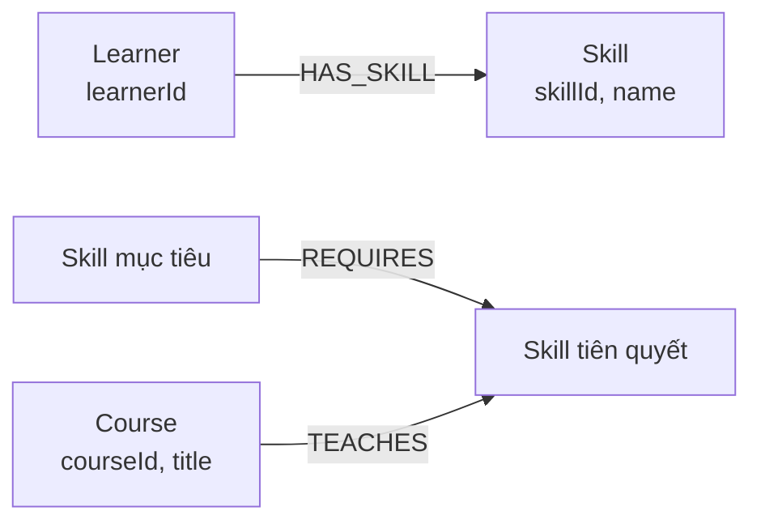
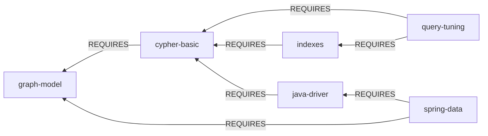

# Xác định bài toán, giới hạn phạm vi và câu hỏi nghiệp vụ cần trả lời

Một đồ án Neo4j dễ thất bại không phải vì lập trình viên chưa biết `MATCH` hay `MERGE`, mà vì nhóm **bắt đầu tạo node và relationship trước khi thống nhất bài toán cần giải quyết**. Sau nhiều ngày, graph có thể chứa hàng nghìn node và nhiều loại cạnh, nhưng không có câu hỏi nghiệp vụ nào mà người sử dụng thật sự muốn hỏi, không có tiêu chí đúng/sai cho kết quả và không có giới hạn khi nào đồ án được xem là hoàn thành.

Trong chương **Đồ án thực hành** của module **DATABASE_ENGINE_GRAPH_NEO4J**, bước đầu tiên là chuyển nhu cầu mơ hồ thành một **đề bài thực hiện được, đo được và kiểm thử được**. Phạm vi module là dùng Neo4j để mô hình hóa dữ liệu liên kết theo property graph, truy vấn node, relationship và đường đi bằng Cypher, quản lý index/constraint, tối ưu truy vấn, nhập dữ liệu, tích hợp Java Driver/Spring Data Neo4j và vận hành hệ thống đồ thị. Bài này không cố hoàn thành mọi thành phần triển khai ngay; nó tạo **hợp đồng nghiệp vụ và kỹ thuật** để những bước thiết kế, nhập liệu, viết API, kiểm thử và trình diễn về sau có cùng mục tiêu.

Đồ án xuyên suốt là **SkillPath — trợ lý khám phá kỹ năng tiên quyết và khóa học phù hợp**. Một học viên chọn kỹ năng muốn đạt được; hệ thống tìm những kỹ năng tiên quyết còn thiếu và những khóa học có thể giúp bù đắp. Ví dụ này đủ gần với dữ liệu liên kết để làm nổi bật sức mạnh của graph, nhưng đủ nhỏ để hoàn thành và kiểm chứng trong một đồ án học tập.

**Kết quả mong đợi của bước này** không phải một repository có thật nhiều code. Bạn cần tạo được:

1. Một **problem statement** rõ đối tượng, nỗi đau và giá trị kỳ vọng.
2. Một **project charter** xác định mục tiêu, bên liên quan, dữ liệu, giả định và giới hạn.
3. Danh mục **câu hỏi nghiệp vụ** có mã, đầu vào, đầu ra, quy tắc và ví dụ kết quả đúng.
4. Một ranh giới **MVP / ngoài MVP** đủ chặt để nhóm không trượt phạm vi.
5. Một mô hình graph sơ bộ và hợp đồng dữ liệu **chỉ đủ để trả lời các câu hỏi đã chọn**.
6. Bộ **acceptance criteria và test cases** khiến việc đánh giá đồ án có tính khách quan.
7. Danh sách rủi ro, điều kiện dừng và những quyết định cần xác minh trước khi code.

> **Ghi chú:** Mọi tên, mã định danh, số lượng dữ liệu, thời gian và tiêu chí hiệu năng trong bài là **kịch bản giả lập phục vụ học tập**, không phải yêu cầu của một doanh nghiệp cụ thể. Bạn phải thay các giả định bằng bằng chứng từ stakeholder khi triển khai sản phẩm thật.

## 1. Vì sao phải xác định bài toán trước khi chọn graph model?

Hãy so sánh hai cách bắt đầu dự án.

**Cách A — bắt đầu từ công nghệ:**

> “Chúng ta sẽ cài Neo4j, tạo các node User, Course, Skill, nối chúng bằng relationship, rồi làm chức năng tìm kiếm.”

Cách này thiếu thông tin để biết bao nhiêu label, relationship và property là đủ; các câu query chưa có mục tiêu. Sau đó nhóm dễ thêm tính năng gợi ý dựa trên học máy, phân tích cộng đồng, tối ưu đường đi, đồng bộ thời gian thực… chỉ vì graph “có thể làm được”.

**Cách B — bắt đầu từ câu hỏi nghiệp vụ:**

> “Khi một học viên đã biết một số kỹ năng và chọn kỹ năng mục tiêu, hệ thống phải liệt kê chính xác những kỹ năng tiên quyết chưa có trong phạm vi chương trình học và đưa ra các khóa học trực tiếp dạy những kỹ năng còn thiếu.”

Cách B cho phép xác định:

- Đầu vào cần **học viên**, **kỹ năng mục tiêu**, **danh mục kỹ năng** và **quan hệ tiên quyết**.
- Đầu ra gồm tập kỹ năng thiếu, lý do phụ thuộc và khóa học có thể bổ sung.
- Relationship quan trọng là `REQUIRES`, `HAS_SKILL`, `TEACHES`.
- Có thể kiểm tra kết quả bằng fixture nhỏ, kể cả vòng lặp tiên quyết và kỹ năng không có khóa học.
- Phạm vi không bao gồm chatbot, máy học, chấm điểm năng lực tự động hay quyết định lộ trình tối ưu theo thời gian.

Điểm xuất phát tốt nhất là một câu hỏi mà **không cần Neo4j vẫn hiểu được về mặt nghiệp vụ**. Sau đó mới quyết định Neo4j có đem lại giá trị đủ lớn so với các giải pháp khác hay không.

## 2. Nhận diện người sử dụng, bên liên quan và quyết định cần hỗ trợ

Một “stakeholder” không phải lúc nào cũng là người trực tiếp bấm vào ứng dụng. Họ có thể chịu trách nhiệm dữ liệu, chất lượng kết quả, quyền truy cập hoặc chi phí vận hành.

| Vai trò | Vấn đề của họ | Quyết định hoặc hành động được hỗ trợ |
| --- | --- | --- |
| **Học viên** | Không biết nên học gì trước để đạt kỹ năng mục tiêu | Xem kỹ năng còn thiếu và khóa học liên quan |
| **Người phụ trách nội dung** | Danh mục tiên quyết có thể thiếu/sai, vòng lặp hoặc khóa học lỗi thời | Duyệt và sửa graph kỹ năng |
| **Cố vấn học tập** | Tư vấn thủ công không nhất quán giữa học viên | Kiểm tra lời giải thích cho một gợi ý |
| **Product owner** | Muốn cải thiện hành trình tìm khóa học | Duyệt phạm vi MVP, KPI và tiêu chí nghiệm thu |
| **Kỹ sư dữ liệu** | Dữ liệu kỹ năng đến từ nhiều nguồn không thống nhất ID | Tạo mapping, kiểm tra và nhập dữ liệu có thể chạy lại |
| **Backend engineer** | Cần API trả kết quả đúng, nhanh và có phân quyền | Thiết kế query, transaction, error handling |
| **Vận hành/bảo mật** | Dữ liệu học viên và tài khoản Neo4j phải được bảo vệ | Giới hạn quyền, log, backup và quan sát lỗi |

### Câu hỏi phỏng vấn stakeholder

Trước khi thiết kế node, hỏi tối thiểu:

1. **Ai** đang gặp vấn đề và họ đang giải quyết bằng cách nào?
2. **Quyết định nào** phải được đưa ra từ kết quả truy vấn?
3. “Biết một kỹ năng” nghĩa là đã hoàn thành khóa, đã được kiểm tra hay tự khai báo?
4. Quan hệ “A yêu cầu B” có nghĩa A **phải có B trước** hay B là một gợi ý không bắt buộc?
5. Một kỹ năng có thể yêu cầu **nhiều** kỹ năng khác không? Logic là tất cả hay chỉ một trong số đó?
6. Có cho phép vòng phụ thuộc giữa các kỹ năng không?
7. Khóa học “dạy một kỹ năng” có bảo đảm học viên sẽ đạt kỹ năng sau khi học không?
8. Một khóa học có prerequisite riêng, thời lượng, giá hoặc điều kiện mở lớp không?
9. Hệ thống cần gợi ý **tập kỹ năng thiếu**, **khóa học** hay **thứ tự kế hoạch học**?
10. Phạm vi dữ liệu thuộc một chương trình/học viện hay nhiều tổ chức?
11. Khi dữ liệu chưa đầy đủ, UI phải báo “chưa đủ dữ liệu” hay giả định “không có yêu cầu”?
12. Ai phê duyệt kết quả và thế nào là “đúng” với từng trường hợp?

**Không tự trả lời thay stakeholder** những câu có ảnh hưởng đến ngữ nghĩa. Chẳng hạn, khi có hai khóa học đều dạy `indexes`, dữ liệu không đủ để khẳng định khóa nào “tốt nhất” nếu chưa có tiêu chí giá, thời gian, chất lượng hoặc mức độ phù hợp.

## 3. Problem statement: viết một đoạn đủ để kiểm chứng

Cấu trúc gợi ý:

> Đối với **[người dùng]**, khi **[bối cảnh]**, hiện nay **[khó khăn có thể quan sát]**. Chúng tôi xây dựng **[khả năng nhỏ nhất]** nhằm giúp **[quyết định cụ thể]**, với kết quả được đo bằng **[tiêu chí nghiệp vụ]**. MVP giới hạn **[phạm vi]** và chưa giải quyết **[ngoài phạm vi]**.

Áp dụng cho SkillPath:

> Đối với học viên đang chọn kỹ năng nâng cao, việc tự tìm các kiến thức tiên quyết trong một chương trình có nhiều liên hệ gây tốn công và dễ bỏ sót. SkillPath cho phép học viên chọn kỹ năng mục tiêu, xem **tập kỹ năng tiên quyết còn thiếu** dựa trên danh mục đã được duyệt, và xem **khóa học trực tiếp dạy các kỹ năng đó**. MVP phục vụ một danh mục kỹ năng và dữ liệu học viên thử nghiệm, không tự suy luận năng lực thật, không xếp lịch học hay tối ưu lộ trình theo thời lượng.

### Vì sao đoạn mô tả này tốt hơn “hệ thống gợi ý AI”?

- Có người dùng và thời điểm sử dụng cụ thể.
- Có đầu vào và hành động có thể trình diễn.
- Có một kết quả **giải thích được**: “thiếu `indexes` vì `query-tuning` phụ thuộc `indexes`”.
- Không cam kết điểm chất lượng không thể đo từ dữ liệu có sẵn.
- Có ranh giới để từ chối yêu cầu phát sinh trong quá trình làm đồ án.

Một problem statement tốt nên đọc được trong khoảng một phút và vẫn dẫn tới các test **pass/fail** rõ ràng.

## 4. Project charter mẫu của đồ án SkillPath

| Mục | Giá trị minh họa đã điền |
| --- | --- |
| **Tên đồ án** | SkillPath — khám phá kỹ năng tiên quyết |
| **Chủ sở hữu nghiệp vụ** | Product owner của nền tảng đào tạo |
| **Người dùng MVP** | Học viên đã có tài khoản và người quản trị danh mục |
| **Bài toán cốt lõi** | Xác định những kỹ năng tiên quyết chưa đạt khi có mục tiêu học |
| **Giá trị dự kiến** | Giảm thao tác tư vấn thủ công, giải thích rõ điều kiện học trước |
| **Phạm vi dữ liệu** | Một chương trình đào tạo; kỹ năng/khóa học được gán ID ổn định |
| **Nguồn dữ liệu** | Danh mục kỹ năng và khóa học đã duyệt; kết quả học viên được xác nhận |
| **Đầu vào chức năng** | Learner được xác thực, `targetSkillId` |
| **Đầu ra MVP** | Danh sách prerequisite, tập thiếu, khóa học dạy kỹ năng thiếu |
| **Đối tượng đồ thị** | `Learner`, `Skill`, `Course` |
| **Quan hệ cốt lõi** | `HAS_SKILL`, `REQUIRES`, `TEACHES` |
| **Điều kiện mô hình** | Quan hệ `REQUIRES` là bắt buộc và không có chu trình |
| **Giới hạn traversal cho bản demo** | Tối đa 5 bước, chỉ khi dữ liệu thỏa giả định |
| **Tích hợp** | Java Driver hoặc Spring Data Neo4j cho API đọc |
| **Tiêu chí nghiệm thu** | Câu hỏi BQ-01 đến BQ-04 có expected output/test cụ thể |
| **Bảo mật** | Không lấy `learnerId` tùy ý từ người gọi; dùng identity được ủy quyền |
| **Ngoài MVP** | ML recommendation, lịch học, học phí, xếp hạng chất lượng khóa học |
| **Rủi ro chính** | Dữ liệu thiếu hoặc có chu trình, mơ hồ “đã biết kỹ năng”, query path rộng |
| **Điều kiện bàn giao** | Demo end-to-end, test tự động, tài liệu mô hình và giới hạn |

**Project charter là một cam kết quản lý phạm vi**, không phải danh sách tất cả tính năng có thể làm với Neo4j. Nếu không đủ thời gian, giữ BQ-01/BQ-02 trước khi mở rộng sang bảng xếp hạng hay dashboard.

## 5. Có thật sự cần graph database?

Chọn Neo4j vì bài toán chứa **quan hệ và chuỗi phụ thuộc có ý nghĩa**, không phải chỉ vì công nghệ mới lạ.

### 5.1. Những câu hỏi cần traversals

- “`query-tuning` cần những kỹ năng nào, trực tiếp **và gián tiếp**?”
- “Học viên L-001 đã biết một phần các tiên quyết; phần thiếu nằm ở đâu trong graph?”
- “Khóa học nào gắn với các kỹ năng còn thiếu?”
- “Danh mục kỹ năng có vòng phụ thuộc hoặc node không thể đi tới từ mục tiêu không?”
- “Khi người quản trị sửa một cạnh `REQUIRES`, những mục tiêu nào bị ảnh hưởng?”

Đây là bài toán có các **đường đi nhiều bước**, mối quan hệ được sửa theo dữ liệu nghiệp vụ và cần truy vấn theo cấu trúc graph. Neo4j và Cypher có cách diễn đạt trực tiếp.

### 5.2. Khi bảng quan hệ hoặc công cụ đơn giản có thể đủ

Nếu MVP thực chất chỉ là danh sách khóa học và bộ lọc theo mức học phí, không cần đường đi hay liên hệ nhiều bước, một database quan hệ có chỉ mục phù hợp có thể đơn giản hơn.

Một ma trận quyết định:

| Tiêu chí | Tín hiệu graph phù hợp | Dấu hiệu nên cân nhắc giải pháp khác |
| --- | --- | --- |
| Mức quan trọng của relationship | Quan hệ là một phần trung tâm của domain | Quan hệ chỉ là vài khóa ngoại |
| Độ sâu truy vấn | Cần tìm dependency nhiều bước, graph traversal | Chỉ lookup một bảng hoặc một-hop |
| Mức thay đổi liên kết | Quan hệ liên tục thay đổi, nhiều loại liên kết | Schema ổn định, báo cáo chỉ dùng aggregate |
| Giải thích kết quả | Có thể chỉ ra node/cạnh dẫn tới kết luận | Chỉ cần bảng tổng hợp đơn giản |
| Dữ liệu nguồn | Có ID, entity và relationship đáng tin | Không có nguồn định nghĩa quan hệ |
| Vận hành | Đội ngũ chấp nhận quản lý Neo4j, Cypher và backup | Công nghệ tăng chi phí nhưng ít giá trị |

Đồ án nên ghi **giả thuyết công nghệ**: “Cypher giúp diễn đạt/truy vấn quan hệ tiên quyết nhiều bước đơn giản và đủ hiệu năng với dữ liệu mục tiêu”. Sau khi thực hiện proof of concept, nếu giả thuyết không đúng, có quyền thu hẹp hoặc thay đổi kiến trúc.

## 6. Giới hạn phạm vi: MVP, mở rộng và ngoài phạm vi

Một đồ án nhỏ cần chia nhóm yêu cầu rõ ràng. Có thể dùng phương pháp **MoSCoW**:

| Mức | Tính năng SkillPath | Quyết định |
| --- | --- | --- |
| **Must have** | Danh mục `Skill` có ID duy nhất và cạnh `REQUIRES` | Cần để trả câu hỏi gốc |
| **Must have** | Lưu `Learner -[:HAS_SKILL]-> Skill` từ dữ liệu đã xác nhận | Cần biết học viên đã có gì |
| **Must have** | BQ-01: liệt kê tiên quyết của mục tiêu | Mục tiêu graph tối thiểu |
| **Must have** | BQ-02: liệt kê tiên quyết học viên còn thiếu | Giá trị nghiệp vụ cốt lõi |
| **Must have** | BQ-03: khóa học dạy kỹ năng thiếu | Cho người dùng hành động tiếp |
| **Must have** | Kiểm tra graph không có chu trình trong phạm vi dữ liệu demo | Chặn kết quả không xác định |
| **Must have** | Test đúng/sai và phân quyền người học | Chất lượng và an toàn |
| **Should have** | BQ-04: báo dữ liệu kỹ năng thiếu khóa học | Giúp curator hoàn thiện danh mục |
| **Should have** | API DTO, logging không nhạy cảm, constraint và chỉ số thời gian | Chứng minh khả năng tích hợp/vận hành |
| **Could have** | Hiển thị đường giải thích bằng sơ đồ graph | Tăng tính dễ hiểu |
| **Could have** | Quản trị viên sửa quan hệ `REQUIRES` qua giao diện | Có thể làm sau nếu còn thời gian |
| **Won't have ở MVP** | GDS recommendation, machine learning, điểm năng lực tự suy đoán | Không có dữ liệu đánh giá đủ để cam kết |
| **Won't have ở MVP** | Đăng ký khóa học, thanh toán, chứng chỉ, lịch cá nhân | Thuộc hệ thống nghiệp vụ khác |
| **Won't have ở MVP** | Tối ưu thứ tự khóa theo chi phí/thời gian có ràng buộc | Là bài toán thuật toán riêng |
| **Won't have ở MVP** | Multi-tenant database-per-tenant hoặc cluster HA | Không cần cho bản trình diễn ban đầu |

### Đặt giới hạn định lượng

Ví dụ **giới hạn demo**:

- Một chương trình đào tạo, một namespace ID kỹ năng.
- Ba loại node và ba loại relationship bắt buộc.
- Tối đa năm bước `REQUIRES` **sau khi xác minh danh mục không có chuỗi dài hơn**; nếu có chuỗi dài hơn, phải cập nhật yêu cầu/query, không âm thầm cắt kết quả.
- Một học viên và một mục tiêu cho mỗi yêu cầu API.
- Các gợi ý khóa học chỉ dựa trên `TEACHES`, **không phải xếp hạng bằng AI**.
- Dữ liệu thử nghiệm giả lập, không nhập hồ sơ thật vào môi trường demo.
- Cơ chế kiểm tra kết quả đúng ưu tiên trước giao diện trực quan hoặc tích hợp nhiều dịch vụ.

**Giới hạn phạm vi không cho phép trả lời sai.** Nếu “tối đa năm bước” làm mất prerequisite cấp sáu đang tồn tại, hệ thống phải **từ chối dữ liệu không hợp lệ theo giả định** hoặc tăng giới hạn theo đặc tả đã duyệt; không được trả thiếu rồi coi như thành công.

## 7. Biến nhu cầu thành câu hỏi nghiệp vụ có mã định danh

Một câu hỏi nghiệp vụ tốt cần có **người hỏi, đầu vào, đầu ra, quy tắc ngữ nghĩa và ví dụ đối chiếu**. Tránh các câu mơ hồ như “Hệ thống tìm mọi quan hệ liên quan” hoặc “Tìm khóa học hay nhất”.

### 7.1. Danh mục câu hỏi cho SkillPath

| Mã | Câu hỏi cần trả lời | Input | Output | Ưu tiên |
| --- | --- | --- | --- | --- |
| **BQ-01** | Kỹ năng mục tiêu cần những prerequisite nào, trực tiếp hoặc gián tiếp? | `targetSkillId` | Danh sách `Skill` duy nhất có ID | Must |
| **BQ-02** | Học viên còn thiếu prerequisite nào của mục tiêu? | Identity học viên, `targetSkillId` | Tập kỹ năng thiếu, không trùng | Must |
| **BQ-03** | Khóa học nào trực tiếp dạy ít nhất một kỹ năng đang thiếu? | Cùng input BQ-02 | Danh sách khóa học và kỹ năng được bao phủ | Must |
| **BQ-04** | Kỹ năng đang thiếu nào **chưa có** khóa học dạy? | Cùng input BQ-02 | Danh sách lỗ hổng nội dung | Should |
| **DQ-01** | Danh mục có chu trình `REQUIRES` hoặc ID không tồn tại không? | Snapshot danh mục | Báo cáo lỗi dữ liệu | Must (validation) |
| **OPS-01** | Query có đáp ứng ngân sách hiệu năng trên dataset mục tiêu không? | Workload test, kích thước graph | p95, DB Hits, kế hoạch truy vấn | Must trước nghiệm thu |

BQ là câu hỏi để **người dùng ra quyết định**. DQ là câu hỏi chất lượng dữ liệu. OPS là mục tiêu vận hành. Không trộn tất cả thành “tính năng đề xuất thông minh”.

### 7.2. Viết ngữ nghĩa chính xác

Với BQ-01:

- `REQUIRES` có hướng từ kỹ năng **phức tạp** tới kỹ năng **phải biết trước**.
- Kết quả gồm tiên quyết **bắc cầu**, không chỉ quan hệ trực tiếp.
- Một prerequisite đạt được theo nhiều path **chỉ xuất hiện một lần** trong danh sách.
- Mục tiêu **không được tự xuất hiện** do chu trình; dữ liệu có chu trình phải bị chặn/đánh dấu lỗi.
- Mặc định không đưa target skill vào tập prerequisite.

Với BQ-02:

- “Đã biết” chỉ tính relationship `HAS_SKILL` được nguồn tin cậy xác nhận.
- Nếu thiếu `HAS_SKILL`, nghĩa là **chưa có bằng chứng đã đạt**, không nhất thiết học viên thực sự không biết.
- Nếu mục tiêu hoặc học viên không tồn tại, trả lỗi/không tìm thấy theo hợp đồng API, **không trả danh sách rỗng** như thể đã đủ điều kiện.
- Nếu học viên đã đạt mục tiêu, API có thể trả trạng thái “đã đạt” thay vì gợi ý học lại.

Với BQ-03:

- Một khóa học được đưa vào danh sách nếu có `TEACHES` tới **ít nhất một** kỹ năng đang thiếu.
- Chưa cam kết khóa học đó có thời khóa biểu phù hợp, có chỗ, đủ điều kiện đăng ký hoặc dạy hết mọi prerequisite.
- “Bao phủ nhiều kỹ năng thiếu hơn” có thể là thứ tự gợi ý **giải thích được**, không phải bảo đảm “tốt nhất”.
- BQ-03 trả **các ứng viên liên quan**, không tự tạo lịch học có thứ tự.

## 8. Câu hỏi nghiệp vụ khác với truy vấn Cypher cụ thể

Một câu hỏi có thể được triển khai bằng nhiều câu Cypher, nhưng người dùng không cần biết cách gọi `MATCH` để kiểm tra kết quả.

Ví dụ:

- **Business question:** “L-001 còn thiếu gì trước khi học `query-tuning`?”
- **Rule:** Lấy tất cả prerequisite của `query-tuning`, loại những kỹ năng L-001 đã được xác nhận `HAS_SKILL`.
- **Graph query:** `(goal)-[:REQUIRES*1..5]->(needed)` rồi kiểm tra không tồn tại `(learner)-[:HAS_SKILL]->(needed)`.
- **Expected result:** Chỉ còn `indexes`.
- **Acceptance:** Không trùng, không thiếu, không lộ kỹ năng/hồ sơ của học viên khác.

Nếu sau này đổi từ Cypher variable-length relationships sang quantified path patterns, **business question và acceptance vẫn giữ nguyên**. Đây là lợi ích của việc tách yêu cầu khỏi cách thực hiện.

## 9. Mô hình dữ liệu tối thiểu xuất phát từ câu hỏi

Đừng bắt đầu bằng 15 label chỉ vì nền tảng học tập “có thể” quản lý lớp, kỳ thi, chứng chỉ, khuyến mại, giảng viên và thanh toán. MVP có thể dùng ba node type:



**Quy ước hướng quan hệ bắt buộc:**

- `(Learner)-[:HAS_SKILL]->(Skill)`: học viên được xác nhận đã đạt kỹ năng.
- `(Skill advanced)-[:REQUIRES]->(Skill prerequisite)`: để đạt skill A cần biết skill B trước.
- `(Course)-[:TEACHES]->(Skill)`: nội dung khóa học nhằm dạy skill đó.

Nếu đổi chiều `REQUIRES` ở một chỗ, query prerequisite sẽ trả sai. Vì vậy direction phải nằm trong tài liệu và test.

### 9.1. Data dictionary cấp node

| Node | Key bắt buộc | Property tối thiểu | Thuộc tính không nằm trong MVP |
| --- | --- | --- | --- |
| `:Learner` | `learnerId` | Mã ẩn danh hoặc ID nội bộ theo hệ thống nguồn | Email, số điện thoại, điểm nhạy cảm |
| `:Skill` | `skillId` | `name`, tùy chọn `status` | Vector embedding, độ khó dự đoán |
| `:Course` | `courseId` | `title`, tùy chọn `status` | Học phí, lịch học, rating, thông tin thương mại |

**ID là khóa nghiệp vụ ổn định**, không dùng `id()` hoặc `elementId()` của Neo4j làm khóa trao đổi giữa hệ thống, import và restore.

### 9.2. Data dictionary cấp relationship

| Relationship | Source → Target | Cardinality | Quy tắc |
| --- | --- | --- | --- |
| `HAS_SKILL` | Learner → Skill | N–N | Chỉ tạo khi có bằng chứng/nguồn hợp lệ |
| `REQUIRES` | Skill → Skill | N–N | Không tự trỏ; graph tiên quyết không có chu trình |
| `TEACHES` | Course → Skill | N–N | Có nguồn nội dung xác nhận, không suy từ tên khóa học |

Một skill có thể có nhiều prerequisite; một prerequisite có thể được nhiều skill nâng cao yêu cầu. Một course có thể dạy nhiều skill; một skill có thể được nhiều course dạy.

### 9.3. Quy tắc graph quan trọng hơn sơ đồ đẹp

Mô hình phải ghi:

- Tính duy nhất của ID.
- Ai sở hữu và cập nhật mỗi loại node/cạnh.
- Có được tạo relationship tới node chưa tồn tại không? **MVP: không**.
- Học viên đã biết skill có thể bị thu hồi không? Ai có quyền thu hồi?
- Khi một skill bị vô hiệu, các cạnh liên quan được giữ để audit hay xóa?
- Cách kiểm tra graph `REQUIRES` không có chu trình.
- Quy tắc chọn database và tenant nếu dự án sau này mở rộng đa tổ chức.

Nếu các quyết định này chưa có, không nên coi graph model đã hoàn tất chỉ vì vẽ được ba hình chữ nhật.

## 10. Dữ liệu nguồn và hợp đồng chất lượng

Một graph có thể được thiết kế đúng về mặt kỹ thuật nhưng trả câu trả lời sai vì dữ liệu không được quản lý.

### 10.1. Nguồn dữ liệu giả định

| Dữ liệu | Nguồn chuẩn dự kiến | Độ tin cậy và cập nhật |
| --- | --- | --- |
| Danh mục `Skill` | Bộ dữ liệu đã được curator duyệt | Thay đổi theo đợt phát hành nội dung |
| `REQUIRES` | Curator chuyên môn | Phải rà soát chu trình trước khi nhập |
| Danh mục `Course` | Hệ thống nội dung | Có thể thay đổi trạng thái mở/đóng |
| `TEACHES` | Mapping nội dung khóa học | Không suy từ tiêu đề bằng cách dò từ khóa |
| `HAS_SKILL` | Hệ thống kết quả học hoặc fixture test | Chỉ ghi khi có bằng chứng theo quy tắc |

### 10.2. Hợp đồng nhập liệu

Mỗi bản ghi kỹ năng nên có ít nhất:

```json
{
  "skillId": "indexes",
  "name": "Chỉ mục Neo4j",
  "status": "ACTIVE"
}
```

Một cạnh tiên quyết có thể được biểu diễn trong nguồn:

```json
{
  "skillId": "query-tuning",
  "requiresSkillId": "indexes"
}
```

Trước khi nhập, kiểm tra:

1. `skillId` không null, không rỗng và đã chuẩn hóa.
2. Không có hai bản ghi cùng ID nhưng tên/ngữ nghĩa mâu thuẫn.
3. Hai đầu mút của relationship đều tồn tại và thuộc cùng chương trình.
4. Không có `REQUIRES` tự trỏ và không tạo chu trình.
5. Không dùng trạng thái khóa học đã đóng làm gợi ý nếu quy tắc yêu cầu chỉ khóa đang mở.
6. Dữ liệu `HAS_SKILL` thuộc đúng learner và được nguồn cho phép.
7. Có phiên bản/snapshot và báo cáo số bản ghi được nhập, bỏ qua, lỗi.
8. Chạy lại cùng batch không nhân đôi node hoặc relationship.

**Thiếu dữ liệu không phải bằng chứng không có tiên quyết.** Nếu một skill chưa được curator kiểm tra, API cần đưa ra trạng thái dữ liệu chưa được phê duyệt thay vì suy ra skill không có prerequisite.

### 10.3. Xử lý dữ liệu sai

| Sai lệch | Hành vi MVP nên chọn |
| --- | --- |
| Skill mục tiêu không tồn tại | Trả `404` hoặc lỗi “không tìm thấy” rõ ràng |
| Learner không tồn tại | Không trả “không thiếu gì”; báo không tìm thấy |
| Relationship trỏ skill chưa nhập | Đưa vào hàng lỗi; không tạo placeholder tùy ý |
| Duplicate skill ID | Từ chối hoặc merge theo chính sách nguồn rõ |
| Chu trình tiên quyết | Không phát hành snapshot; báo đường gây chu trình |
| Course đã đóng | Loại khỏi danh sách nếu thuộc quy tắc “chỉ đang hoạt động” |
| Skill chưa có khóa học | Trả trong BQ-04 để curator xử lý |
| `HAS_SKILL` chưa xác minh | Không coi là đã đạt; nếu cần thì lưu trạng thái riêng |

## 11. Fixture tối thiểu để thống nhất câu trả lời đúng

Một đồ án cần **bộ dữ liệu nhỏ biết chắc expected output** trước khi làm dữ liệu lớn. Fixture ở đây dùng đúng một learner, sáu skill và bốn course.

### 11.1. Mạng quan hệ kỹ năng



**Chiều mũi tên đi từ kỹ năng cần đạt tới kỹ năng tiên quyết.**

Ví dụ:

- `query-tuning` cần `indexes` và `cypher-basic` trực tiếp.
- `indexes` cần `cypher-basic`.
- `cypher-basic` cần `graph-model`.
- Vì vậy tập tiên quyết bắc cầu của `query-tuning` là **`indexes`, `cypher-basic`, `graph-model`**.
- Learner L-001 đã có `graph-model` và `cypher-basic`, nên chỉ còn thiếu **`indexes`**.

### 11.2. Kết quả nghiệp vụ kỳ vọng

| Câu hỏi | Đầu vào | Kết quả kỳ vọng |
| --- | --- | --- |
| BQ-01 | `targetSkillId=query-tuning` | `graph-model`, `cypher-basic`, `indexes` (mỗi ID một lần) |
| BQ-02 | `learnerId=L-001`, `targetSkillId=query-tuning` | Chỉ `indexes` |
| BQ-03 | Cùng input | Khóa `course-indexes` vì có `TEACHES→indexes` |
| BQ-04 | Cùng input | Tập rỗng vì `indexes` có khóa học dạy |
| DQ-01 | Graph fixture | Không có vòng `REQUIRES`, không có ID mồ côi |

Kết quả kỳ vọng được đặt **trước khi code Cypher**; nếu query trả hai `indexes` vì có nhiều đường đi, đó là lỗi kết quả, không phải một “feature” của graph.

## 12. Tạo fixture bằng Cypher có thể chạy lại

Các câu sau chỉ dành cho **database test riêng**. Không chạy lệnh dọn toàn bộ graph production. Với một database rỗng, có thể thực thi từng block theo thứ tự.

### 12.1. Ràng buộc ID

```cypher
CREATE CONSTRAINT skill_id_unique IF NOT EXISTS
FOR (s:Skill)
REQUIRE s.skillId IS UNIQUE;
```

```cypher
CREATE CONSTRAINT course_id_unique IF NOT EXISTS
FOR (c:Course)
REQUIRE c.courseId IS UNIQUE;
```

```cypher
CREATE CONSTRAINT learner_id_unique IF NOT EXISTS
FOR (l:Learner)
REQUIRE l.learnerId IS UNIQUE;
```

`@Id` trong Spring Data Neo4j hoặc việc truyền `skillId` ở Java **không thay thế** uniqueness constraint phía database. Lưu ý uniqueness constraint không bắt buộc mọi node cùng label phải có property; đầu vào nhập cần validate sự hiện diện của ID.

### 12.2. Tạo kỹ năng

```cypher
UNWIND [
  {id: 'graph-model',  name: 'Mô hình property graph'},
  {id: 'cypher-basic', name: 'Cypher cơ bản'},
  {id: 'indexes',      name: 'Index và constraint'},
  {id: 'query-tuning', name: 'Tối ưu truy vấn'},
  {id: 'java-driver',  name: 'Neo4j Java Driver'},
  {id: 'spring-data',  name: 'Spring Data Neo4j'}
] AS item
MERGE (s:Skill {skillId: item.id})
SET s.name = item.name;
```

### 12.3. Tạo quan hệ tiên quyết

```cypher
UNWIND [
  ['cypher-basic', 'graph-model'],
  ['indexes',      'cypher-basic'],
  ['query-tuning', 'indexes'],
  ['query-tuning', 'cypher-basic'],
  ['java-driver',  'cypher-basic'],
  ['spring-data',  'java-driver'],
  ['spring-data',  'graph-model']
] AS pair
MATCH (dependent:Skill {skillId: pair[0]})
MATCH (prerequisite:Skill {skillId: pair[1]})
MERGE (dependent)-[:REQUIRES]->(prerequisite);
```

Quy tắc `REQUIRES` ở đây là **“A yêu cầu B”**. Không đổi chiều trong query đọc về sau.

### 12.4. Học viên và kỹ năng đã đạt

```cypher
MERGE (l:Learner {learnerId: 'L-001'})
WITH l
UNWIND ['graph-model', 'cypher-basic'] AS knownId
MATCH (s:Skill {skillId: knownId})
MERGE (l)-[:HAS_SKILL]->(s);
```

Trong hệ thống thật, `HAS_SKILL` phải đến từ một nguồn được xác nhận; fixture chỉ mô phỏng điều đó.

### 12.5. Khóa học và nội dung dạy

```cypher
UNWIND [
  {id: 'course-graph',   title: 'Nhập môn graph'},
  {id: 'course-cypher',  title: 'Cypher căn bản'},
  {id: 'course-indexes', title: 'Index cho Neo4j'},
  {id: 'course-tuning',  title: 'Thực hành tối ưu Cypher'}
] AS item
MERGE (c:Course {courseId: item.id})
SET c.title = item.title;
```

```cypher
UNWIND [
  ['course-graph',   'graph-model'],
  ['course-cypher',  'cypher-basic'],
  ['course-indexes', 'indexes'],
  ['course-tuning',  'query-tuning']
] AS pair
MATCH (c:Course {courseId: pair[0]})
MATCH (s:Skill {skillId: pair[1]})
MERGE (c)-[:TEACHES]->(s);
```

Dùng `MERGE` trên ID ổn định và quan hệ cụ thể làm fixture thuận tiện chạy lại tuần tự. Nhưng **không coi `MERGE` tự giải quyết mọi race trong nhập song song**; triển khai thật vẫn cần kiểm tra concurrency và quy tắc idempotency.

### 12.6. Kiểm tra số lượng

```cypher
MATCH (s:Skill)
RETURN count(s) AS skillCount;
```

```cypher
MATCH (c:Course)
RETURN count(c) AS courseCount;
```

```cypher
MATCH ()-[r:REQUIRES]->()
RETURN count(r) AS requiresCount;
```

Kỳ vọng trên graph fixture mới: `skillCount=6`, `courseCount=4` và `requiresCount=7`. Các con số này là **test fixture**, không phải chỉ tiêu cần đạt cho đồ án thực.

## 13. BQ-01: kỹ năng mục tiêu cần những gì?

**Câu hỏi:** Với `targetSkillId=query-tuning`, liệt kê tất cả skill phải biết trước trong phạm vi tối đa năm cạnh, không trùng ID.

```cypher
MATCH (goal:Skill {skillId: $targetSkillId})
MATCH (goal)-[:REQUIRES*1..5]->(prereq:Skill)
RETURN DISTINCT prereq.skillId AS skillId,
       prereq.name AS name
ORDER BY skillId;
```

Tham số thử:

```json
{
  "targetSkillId": "query-tuning"
}
```

Đầu ra mong đợi theo thứ tự `skillId`:

| skillId | name |
| --- | --- |
| `cypher-basic` | Cypher cơ bản |
| `graph-model` | Mô hình property graph |
| `indexes` | Index và constraint |

### Diễn giải kết quả

- `*1..5` là **độ dài quan hệ từ 1 đến 5**, không phải “lấy 5 bản ghi”.
- `DISTINCT` bảo đảm một prerequisite đạt được qua nhiều path chỉ xuất hiện một lần.
- `ORDER BY` tạo thứ tự hiển thị có thể kiểm thử, không phải thứ tự học.
- Nếu một skill không có prerequisite, truy vấn trả **0 hàng**. Service phải phân biệt trường hợp skill có tồn tại với skill không tồn tại; không tự diễn giải hai tình huống như nhau.
- Nếu chuỗi prerequisite dài hơn năm bước, truy vấn có thể **bỏ sót dữ liệu**; giới hạn chỉ hợp lệ khi data contract bảo đảm depth phù hợp.

**Không kết luận `DISTINCT` làm traversal rẻ.** Neo4j có thể phải mở rộng nhiều path trước khi khử trùng node đích. Với dataset lớn, xem `EXPLAIN`/`PROFILE` và cân nhắc mô hình/thuật toán phù hợp.

## 14. BQ-02: học viên còn thiếu kỹ năng gì?

**Câu hỏi:** Với learner đã xác thực và mục tiêu `query-tuning`, trả prerequisite chưa có quan hệ `HAS_SKILL`.

```cypher
MATCH (l:Learner {learnerId: $learnerId})
MATCH (goal:Skill {skillId: $targetSkillId})
MATCH (goal)-[:REQUIRES*1..5]->(needed:Skill)
WHERE NOT EXISTS {
  MATCH (l)-[:HAS_SKILL]->(needed)
}
RETURN DISTINCT needed.skillId AS skillId,
       needed.name AS name
ORDER BY skillId;
```

Tham số fixture:

```json
{
  "learnerId": "L-001",
  "targetSkillId": "query-tuning"
}
```

Kỳ vọng:

| skillId | name |
| --- | --- |
| `indexes` | Index và constraint |

Câu `NOT EXISTS { MATCH ... }` hỏi **không có bằng chứng về quan hệ đã đạt** giữa learner và prerequisite đó. Query không đánh giá học viên thực sự thành thạo kỹ năng; nó chỉ dựa trên dữ liệu `HAS_SKILL` hiện có.

### Trường hợp trả rỗng

Kết quả rỗng có thể do:

1. Học viên đã có **mọi prerequisite**.
2. Skill mục tiêu **không có prerequisite**.
3. Skill hoặc learner **không tồn tại**.
4. Dữ liệu `REQUIRES` bị thiếu hoặc không vượt qua điều kiện depth.
5. Ứng dụng gọi nhầm database/tenant.

Vì vậy một API nghiêm túc phải **validate tồn tại và trạng thái dữ liệu** trước khi kết luận “không thiếu gì”. Đây là một acceptance criterion độc lập, không thể suy ra từ query trả rỗng.

## 15. BQ-03: khóa học nào trực tiếp bù kỹ năng thiếu?

Từ tập kỹ năng BQ-02, đi theo cạnh `(Course)-[:TEACHES]->(Skill)` để tìm các khóa học ứng viên:

```cypher
MATCH (l:Learner {learnerId: $learnerId})
MATCH (goal:Skill {skillId: $targetSkillId})
MATCH (goal)-[:REQUIRES*1..5]->(needed:Skill)
WHERE NOT EXISTS {
  MATCH (l)-[:HAS_SKILL]->(needed)
}
MATCH (course:Course)-[:TEACHES]->(needed)
WITH course, collect(DISTINCT needed.skillId) AS coveredSkillIds
RETURN course.courseId AS courseId,
       course.title AS title,
       coveredSkillIds,
       size(coveredSkillIds) AS coveredCount
ORDER BY coveredCount DESC, courseId;
```

Với fixture, trả một dòng:

| courseId | coveredSkillIds | coveredCount |
| --- | --- | ---: |
| `course-indexes` | `['indexes']` | 1 |

**Không diễn giải đây là “khóa học tốt nhất”.** Đây là khóa học **trực tiếp dạy kỹ năng còn thiếu** theo mapping dữ liệu. Chưa có thông tin khóa đang mở, lịch học, học phí, chất lượng, ngôn ngữ hoặc prerequisite của chính khóa học.

Nếu hai course cùng bao phủ một skill, BQ-03 có thể trả **cả hai**, sắp xếp theo coverage rồi ID để giữ kết quả ổn định. Khi muốn xếp hạng theo thời gian hoặc độ phù hợp, đó là yêu cầu mới cần được product owner phê duyệt, không tự thêm tiêu chí giả.

### Nếu không còn kỹ năng thiếu?

BQ-03 trả **danh sách rỗng**. Điều đó có nghĩa không có **khóa bù prerequisite cần học**, chứ không có nghĩa học viên đã hoàn thành kỹ năng mục tiêu. Product có thể bổ sung trạng thái “đủ prerequisite, hãy xem khóa học dạy target”, nhưng phải ghi thành **câu hỏi riêng** nếu đưa vào MVP.

## 16. BQ-04: phát hiện lỗ hổng danh mục nội dung

Một prerequisite có thể tồn tại nhưng **không có khóa học nào dạy**. Học viên cần được báo rõ để không nhận gợi ý rỗng sai ngữ nghĩa.

```cypher
MATCH (l:Learner {learnerId: $learnerId})
MATCH (goal:Skill {skillId: $targetSkillId})
MATCH (goal)-[:REQUIRES*1..5]->(needed:Skill)
WHERE NOT EXISTS {
  MATCH (l)-[:HAS_SKILL]->(needed)
}
AND NOT EXISTS {
  MATCH (:Course)-[:TEACHES]->(needed)
}
RETURN DISTINCT needed.skillId AS missingCourseForSkillId
ORDER BY missingCourseForSkillId;
```

Với fixture, BQ-04 trả **0 hàng** vì `indexes` đã có `course-indexes`. Khi kiểm thử case không có khóa học, nên thực hiện trên **fixture riêng** hoặc thay dữ liệu có kiểm soát trong transaction test, không xóa quan hệ trên database demo chung rồi quên phục hồi.

**Đọc đúng kết quả:** BQ-04 trả những kỹ năng **học viên còn thiếu và không có course mapping**; nó không phải danh sách mọi skill của hệ thống chưa có course.

## 17. Kiểm tra graph tiên quyết có hợp lệ không

Các query trên dựa vào một giả định mạnh: graph `REQUIRES` là **directed acyclic graph (DAG)**, không có vòng phụ thuộc.

### 17.1. Vì sao chu trình làm sai nghiệp vụ?

Nếu dữ liệu nói:

```text
A REQUIRES B
B REQUIRES C
C REQUIRES A
```

thì không tồn tại thứ tự “học trước” nhất quán theo quy tắc bắt buộc. Một bounded query có thể dừng sau năm bước, nhưng **giới hạn độ sâu không sửa được dữ liệu sai**.

### 17.2. Một kiểm tra chu trình đơn giản trên dataset nhỏ

```cypher
MATCH p = (s:Skill)-[:REQUIRES*1..5]->(s)
RETURN s.skillId AS skillId,
       [n IN nodes(p) | n.skillId] AS cycle
LIMIT 20;
```

Trên fixture ở trên, kỳ vọng **0 hàng**. Query này chỉ tìm các vòng trong phạm vi **tối đa năm cạnh**; **không chứng minh toàn graph không có vòng dài hơn**. Với dữ liệu thật, nên xây validation khi tạo cạnh, có chiến lược kiểm tra toàn bộ dữ liệu hoặc dùng thuật toán phù hợp nếu graph lớn.

### 17.3. Kiểm tra giới hạn độ sâu

Nếu BQ-01/BQ-02 chỉ duyệt tối đa năm bước, data contract phải kiểm tra liệu có đường tiên quyết dài **sáu bước** hoặc hơn hay không. Ví dụ test cục bộ:

```cypher
MATCH p = (s:Skill)-[:REQUIRES*6..6]->(p:Skill)
RETURN s.skillId AS skillId,
       p.skillId AS deepPrerequisite
LIMIT 10;
```

Nếu trả hàng, giới hạn MVP đã **không còn an toàn về ngữ nghĩa**. Trên dữ liệu lớn, chính phép duyệt để tìm đường sâu cũng có chi phí; cần đưa validation vào pipeline quản trị thay vì thực thi vô điều kiện trên mọi API request.

### 17.4. Các lỗi chất lượng dữ liệu khác

| Điều kiện | Ví dụ | Phản ứng mong đợi |
| --- | --- | --- |
| Tự trỏ | `A REQUIRES A` | Từ chối khi ghi |
| Chu trình | `A → B → C → A` | Không phát hành snapshot |
| Skill đích chưa có | Edge trỏ ID không tồn tại | Báo lỗi nhập, không tạo placeholder |
| Kỹ năng trùng ID | Hai node `skillId=indexes` | Ràng buộc unique và rà soát nguồn |
| Tên skill trùng nhưng ID khác | “Cypher Basics” / “Cypher cơ bản” | Curator quyết định đồng nhất hay khác |
| Relationship sai chiều | `graph-model REQUIRES cypher-basic` | Test dữ liệu xác nhận quy tắc |
| Course dạy skill đã nghỉ sử dụng | Mapping lỗi thời | Lọc theo status đã được quy định |
| Học viên được gán skill chưa xác minh | `HAS_SKILL` sai nguồn | Tách trạng thái chưa chứng thực |

**Đừng sửa tự động mọi quan hệ mà thuật toán nhận diện là bất thường.** Với dữ liệu chuyên môn, nhiều trường hợp cần curator giải quyết theo ngữ nghĩa.

## 18. Từ câu hỏi nghiệp vụ tới hợp đồng API

Đồ án không bắt buộc làm giao diện phức tạp; một **API trả JSON có hợp đồng rõ** đã đủ chứng minh end-to-end.

### 18.1. Một API gộp kết quả

```http
GET /api/v1/me/learning-gaps?targetSkillId=query-tuning
Authorization: Bearer <token>
```

`/me/` nhấn mạnh rằng backend lấy learner từ identity đã xác thực, **không tin một `learnerId` tùy ý do người dùng gửi**.

Response minh họa:

```json
{
  "learnerId": "L-001",
  "targetSkillId": "query-tuning",
  "prerequisiteSkillIds": [
    "cypher-basic",
    "graph-model",
    "indexes"
  ],
  "missingSkillIds": ["indexes"],
  "suggestedCourses": [
    {
      "courseId": "course-indexes",
      "coveredSkillIds": ["indexes"]
    }
  ],
  "skillsWithoutCourse": [],
  "dataStatus": "VERIFIED"
}
```

Cấu trúc này giúp UI biết chính xác ý nghĩa của từng danh sách. Không trả lại password, thông tin nội bộ về database hoặc property học viên không cần thiết.

### 18.2. Hợp đồng lỗi

| Điều kiện | Hành vi minh họa | Lý do |
| --- | --- | --- |
| Chưa xác thực | `401 Unauthorized` | Không biết identity học viên |
| Không được phép xem hồ sơ | `403 Forbidden` | Chặn đọc dữ liệu người khác |
| `targetSkillId` không tồn tại | `404 Not Found` | Phân biệt với “không thiếu kỹ năng” |
| ID không hợp lệ | `400 Bad Request` | Validation đầu vào |
| Danh mục có chu trình hoặc chưa kiểm định | Trả lỗi/trạng thái dữ liệu theo thiết kế, không khẳng định đủ điều kiện | Tránh gợi ý sai |
| Neo4j tạm thời không sẵn sàng | Lỗi dịch vụ phù hợp, có correlation ID | Không dựng kết quả giả |
| Learner đã đủ mọi prerequisite | `200` với `missingSkillIds=[]` và trạng thái rõ | Là kết quả nghiệp vụ hợp lệ |

Các HTTP status chỉ là **hợp đồng đề xuất** cho đồ án mẫu; một hệ thống thật phải thống nhất với chuẩn API của tổ chức.

### 18.3. Kiểu dữ liệu trả về

Nên trả các DTO với scalar IDs và mô tả cần thiết, thay vì serialize toàn bộ entity graph `Learner → Skill → Course`. Graph object có thể có vòng tham chiếu Java, tải dư relationship và làm payload khó kiểm soát.

Với Java Driver, có thể map `Record` sang DTO. Với Spring Data Neo4j, repository và `Neo4jClient` phù hợp tùy trường hợp, nhưng **không nhất thiết tải/lưu cả aggregate** chỉ để trả danh sách skill IDs.

## 19. Tiêu chí nghiệm thu có thể kiểm thử

Dùng dạng **Given – When – Then** thay vì chỉ nói “hệ thống chạy đúng”.

### AC-01 — Danh sách prerequisite

- **Given** đồ thị fixture với `query-tuning`.
- **When** hỏi BQ-01.
- **Then** nhận đúng ba skill `graph-model`, `cypher-basic`, `indexes`, mỗi ID đúng một lần.
- **And** không đưa `query-tuning` vào tập prerequisite.

### AC-02 — Phần thiếu của học viên

- **Given** L-001 có `graph-model` và `cypher-basic`.
- **When** hỏi BQ-02 cho `query-tuning`.
- **Then** chỉ nhận `indexes`.
- **And** không coi kỹ năng khác là đã có nếu thiếu bằng chứng `HAS_SKILL`.

### AC-03 — Khóa học phù hợp

- **Given** `course-indexes TEACHES indexes`.
- **When** hỏi BQ-03.
- **Then** thấy `course-indexes` và lý do `coveredSkillIds=['indexes']`.
- **And** không gọi kết quả là “tối ưu nhất” nếu chưa có tiêu chí so sánh.

### AC-04 — Dữ liệu thiếu và lỗi

- **Given** skill mục tiêu không tồn tại.
- **When** gọi API.
- **Then** trả lỗi rõ, không trả `200` với danh sách thiếu rỗng.
- **Given** graph có chu trình `REQUIRES`.
- **When** chạy validation import.
- **Then** dataset bị chặn hoặc đánh dấu không hợp lệ; không phát hành như dữ liệu đã duyệt.

### AC-05 — Phân quyền

- **Given** user A đã xác thực.
- **When** cố xem `HAS_SKILL` riêng tư của user B.
- **Then** bị từ chối theo chính sách.
- **And** một learner ID giả từ query string không làm backend chuyển identity.

### AC-06 — Chạy lại dữ liệu

- **Given** một fixture đã được nhập.
- **When** chạy lại toàn bộ thao tác import idempotent.
- **Then** số Skill, Course và những relationship theo khóa không tăng ngoài dự kiến.

Đây là **acceptance criteria của sản phẩm**. Bài test unit chỉ kiểm tra một hàm Java hoặc mock repository **không thay thế** integration test Neo4j cho Cypher và relationship thực tế.

## 20. Ma trận truy vết: từ yêu cầu tới dữ liệu và kiểm thử

Ma trận này giúp phát hiện yêu cầu không có dữ liệu hoặc không có test.

| Mã | Dữ liệu bắt buộc | Query/path chính | Test chứng minh | Đầu ra |
| --- | --- | --- | --- | --- |
| BQ-01 | `Skill`, `REQUIRES` | `goal -[:REQUIRES*1..5]-> prereq` | AC-01 + depth/cycle | Prerequisite IDs |
| BQ-02 | Thêm `Learner`, `HAS_SKILL` | BQ-01 + `NOT EXISTS HAS_SKILL` | AC-02, người không tồn tại | Missing IDs |
| BQ-03 | Thêm `Course`, `TEACHES` | `Course -[:TEACHES]-> missing` | AC-03, course trùng coverage | Course candidates |
| BQ-04 | Thêm dữ liệu mapping khóa học | Không tồn tại `TEACHES` tới skill thiếu | Case không có course | Content gaps |
| DQ-01 | Toàn bộ `REQUIRES` | Chu trình và mồ côi | AC-04 | Data validation report |
| OPS-01 | Graph đại diện và query thực | `EXPLAIN`/`PROFILE` | Performance budget | Log kế hoạch và metric |

Nếu một trường trong API **không liên kết tới câu hỏi, dữ liệu và test nào**, hãy hỏi liệu trường đó có thuộc MVP không. Ngược lại, nếu một câu hỏi không có đường truy vấn hoặc nguồn dữ liệu, nó chưa sẵn sàng cho sprint triển khai.

## 21. Yêu cầu phi chức năng: tránh hứa hiệu năng khi chưa có số liệu

Ngoài việc trả kết quả đúng, đồ án Neo4j cần có tiêu chuẩn vận hành ở mức vừa phải.

| Nhóm | Yêu cầu hoặc giả định cần chốt | Cách xác minh |
| --- | --- | --- |
| **Correctness** | Tập prerequisite, missing và course theo định nghĩa | Fixture, integration test, negative case |
| **Performance** | Ngân sách latency theo SLO do stakeholder duyệt | Test trên dataset/kết nối/cấu hình ghi rõ |
| **Cardinality** | Không duyệt toàn graph vô hạn; depth được kiểm chứng | `EXPLAIN`/`PROFILE`, graph có supernode |
| **Availability** | Có phản hồi lỗi khi Neo4j unavailable | Test ngắt kết nối có kiểm soát |
| **Security** | Không có quyền đọc hồ sơ learner khác | Authorization negative tests |
| **Data quality** | ID duy nhất, không chu trình, không orphan | Constraint, validation pipeline |
| **Import** | Có thể chạy lại không tạo trùng | Test chạy hai lần, đối chiếu counts |
| **Observability** | Có correlation ID, query duration và error category | Log/metrics trên môi trường test |
| **Recovery** | Có dữ liệu nguồn/backup và hướng dựng lại | Thử restore hoặc reload fixture |
| **Maintainability** | Cấu trúc model, query và quy tắc được viết thành tài liệu | Review và demo |

### Ngân sách hiệu năng ví dụ cần **được phê duyệt**

Để minh họa cách đặt mục tiêu, nhóm có thể đề xuất:

- Dataset benchmark: **1.000 kỹ năng**, **3.000 cạnh tiên quyết**, **500 khóa học**, **100 học viên**, có vài kỹ năng bậc cao.
- Workload: 10 yêu cầu đồng thời đọc BQ-02/BQ-03, dùng một máy test cố định và ghi thông số máy.
- Mục tiêu ban đầu: **p95 dưới 800 ms** cho endpoint, tính từ service tới response; tỷ lệ lỗi không vượt ngưỡng đã thống nhất.
- Mọi query phải có giới hạn traversal được chứng minh hợp lệ, không dùng `MATCH ...-[:REQUIRES*]->...` không giới hạn trên đường xử lý online.

**Đây là ví dụ cách viết SLO, không phải benchmark Neo4j hoặc SLA chung.** Khi chưa biết hardware, network, cách sinh dữ liệu và tỷ lệ cache hit, không thể khẳng định 800 ms sẽ đạt. Nhóm cần đo baseline, điều chỉnh budget và ghi lại điều kiện thực nghiệm.

### Đúng trước, nhanh sau

Một truy vấn “nhanh” nhưng bỏ sót prerequisite thứ sáu hoặc trả học viên khác là **thất bại**. Khi tối ưu:

1. Khóa expected output trên dữ liệu fixture.
2. Kiểm tra index/constraint phù hợp.
3. Đo plan và số hàng trung gian.
4. Giảm fan-out/query payload nhưng không đổi ngữ nghĩa.
5. So độ trễ trong cùng môi trường và tải tương đương.
6. Chạy lại test đúng/sai và phân quyền.

## 22. Quyết định kiến trúc đầu tiên: một database và phạm vi sở hữu

MVP chỉ có một chương trình và một tập learner giả lập, nên có thể dùng **một standard database** Neo4j. Đây là cách giữ phạm vi vừa đủ và phù hợp cả mô hình triển khai một database.

Không tự thêm:

- Cluster ba máy chỉ để chạy demo.
- Database riêng cho từng learner.
- GDS community detection hoặc link prediction mà câu hỏi nghiệp vụ chưa cần.
- Kafka CDC và search engine ngoài nếu fixture tĩnh đã đủ.
- SSO đa tổ chức, OAuth server tự viết, hệ thống billing và analytics riêng.

Tuy nhiên phải **ghi quyết định và giới hạn**:

| Quyết định MVP | Lý do | Điều kiện xem xét lại |
| --- | --- | --- |
| Một database | Giảm công việc vận hành | Nhiều chương trình/tenant với yêu cầu cách ly |
| Neo4j cho quan hệ tiên quyết | Câu hỏi có nhiều bước graph | Nếu workflow chỉ còn lookup đơn giản |
| Java Driver hoặc Spring Data Neo4j | Đáp ứng API Java theo module | Cần tùy biến query/result/transaction đặc biệt |
| Không dùng GDS giai đoạn 1 | Chưa có thuật toán GDS nào là must-have | Bài toán tối ưu hoặc phân tích toàn graph rõ ràng |
| Không ML recommendation | Chưa có nhãn và thước đo chất lượng | Có dữ liệu phù hợp và bộ đánh giá |
| Không ghi raw thông tin cá nhân | Fixture và dữ liệu learner tối thiểu | Khi mở sản phẩm thật cần review privacy |
| Fixture + import có version | Có thể dựng lại demo/test | Khi dữ liệu sống cần backup/recovery strategy |

**Một database** không có nghĩa bỏ qua security. Vẫn cần Neo4j credential riêng, quyền tối thiểu, TLS khi kết nối qua mạng không tin cậy và kiểm tra quyền người dùng ở tầng API.

## 23. Bộ kiểm thử biên cần nghĩ tới ngay từ giai đoạn yêu cầu

### 23.1. Các case nghiệp vụ

| Case | Dữ liệu đầu vào | Kết quả hợp lệ |
| --- | --- | --- |
| **Đường phụ thuộc nhiều bước** | `query-tuning→indexes→cypher-basic→graph-model` | Trả đủ ba prerequisite |
| **Nhiều path đến một skill** | `query-tuning` cần trực tiếp `cypher-basic` và gián tiếp qua `indexes` | `cypher-basic` chỉ xuất hiện một lần |
| **Học viên đủ prerequisite** | HAS_SKILL mọi prerequisite | `missingSkillIds=[]` |
| **Skill đích không có prerequisite** | Skill độc lập | Kết quả rỗng **nhưng skill tồn tại** |
| **Skill đích không tồn tại** | `targetSkillId=unknown` | Lỗi không tìm thấy, không trả rỗng như hợp lệ |
| **Học viên không tồn tại** | `learnerId=unknown` | Lỗi/không có hồ sơ |
| **Hai khóa cùng dạy skill** | Hai Course → `indexes` | Trả hai candidates, không tự chọn một |
| **Một khóa dạy hai skill thiếu** | Cùng course nối hai `TEACHES` | Một course với `coveredCount=2` |
| **Thiếu course mapping** | Không có Course → skill thiếu | BQ-04 báo gap |
| **Vòng phụ thuộc** | `A→B→C→A` | Dataset bị chặn/đánh dấu lỗi |
| **Depth > 5** | Chuỗi prerequisite dài sáu cạnh | Báo vi phạm giả định/đổi scope, không cắt lặng lẽ |
| **Cạnh sai chiều** | `prerequisite→advanced` | Validation/test phát hiện sai expected output |
| **Dữ liệu duplicate** | Import cùng item hai lần | Counts không tăng bất thường |
| **Truy cập trái phép** | A yêu cầu hồ sơ B | Từ chối theo chính sách |
| **Graph nhiều nhánh** | Một skill đòi hàng trăm skill khác | Không treo/timeout, có performance guardrails |

### 23.2. Dùng kiểu kiểm thử nào?

- **Unit test:** xác thực tham số, xử lý DTO, policy cấp quyền không phụ thuộc database.
- **Neo4j Harness hoặc Testcontainers:** kiểm tra Cypher, unique constraints, chiều relationship, dữ liệu thực.
- **API integration test:** xác nhận `/me` lấy identity từ authentication, không từ body.
- **Performance test:** dataset đại diện, cả trường hợp fan-out lớn, đo p95 và DB Hits.
- **Manual demo:** stakeholder tự chọn mục tiêu và nhìn thấy kỹ năng thiếu cùng lời giải thích.

Một unit test chỉ mock `Neo4jRepository` luôn trả `indexes` có thể vẫn pass khi Cypher thực tế viết ngược chiều cạnh; vì vậy **integration test với Neo4j thật là cần thiết** cho đồ án.

## 24. Từ scope đến kế hoạch thực hiện

Một kế hoạch có thể chia thành các chặng nhỏ, mỗi chặng có sản phẩm bàn giao được kiểm chứng.

| Chặng | Mục tiêu | Sản phẩm để review |
| --- | --- | --- |
| **0. Chốt đề bài** | Xác nhận problem statement, câu hỏi và ngoài phạm vi | Charter, danh mục BQ, acceptance |
| **1. Mô hình & dữ liệu** | Node/relationship, ID, constraint, dữ liệu fixture | Sơ đồ graph, data dictionary, Cypher tạo dữ liệu |
| **2. Chứng minh Cypher** | Chạy BQ-01/BQ-02 đúng output | Query và integration tests |
| **3. API & quyền** | Truy vấn theo learner được xác thực | Endpoint/DTO, lỗi và negative tests |
| **4. Khóa học & chất lượng** | BQ-03/BQ-04, kiểm tra dữ liệu lỗi | Course candidates, validation report |
| **5. Hiệu năng & vận hành** | Đo trên dataset đại diện, log, backup/rebuild | Plan, metrics, runbook |
| **6. Trình diễn & nghiệm thu** | Demo một hành trình end-to-end | Checklist pass/fail, tài liệu giới hạn |

Không nhất thiết dùng một số ngày cố định; thời gian phụ thuộc nguồn lực và dữ liệu. **Quy tắc ưu tiên:** nếu chặng 2 chưa chứng minh BQ-02 đúng thì chưa nên dành phần lớn thời gian làm biểu đồ đẹp hoặc recommendation “thông minh”.

### Điều kiện “Definition of Done”

Một BQ chỉ được coi hoàn thành khi:

- Có định nghĩa nghiệp vụ đã được duyệt.
- Có data contract tương ứng.
- Có Cypher/API chạy được với tham số.
- Có test dương, test âm và case biên.
- Có output có thể giải thích cho người dùng.
- Có giới hạn và cách xử lý lỗi được ghi lại.
- Không vi phạm quyền truy cập dữ liệu.
- Có bằng chứng hiệu năng theo mức yêu cầu đã chốt.

## 25. Ma trận rủi ro và cách giảm thiểu

| Rủi ro | Xác suất/tác động minh họa | Dấu hiệu phát hiện | Giảm thiểu |
| --- | --- | --- | --- |
| Ngữ nghĩa `REQUIRES` không thống nhất | Cao / Cao | Curator khác nhau khai báo chiều khác nhau | Data dictionary, ví dụ, review đầu vào |
| Danh mục có chu trình | Trung bình / Cao | Validation phát hiện cycle | Kiểm tra trước publish, không nhận edge sai |
| Nguồn `HAS_SKILL` không tin cậy | Cao / Cao | Gợi ý thiếu/quá mức | Quy tắc xác nhận, provenance, trạng thái chưa duyệt |
| Trùng hoặc thiếu khóa | Trung bình / Cao | Node không ghép đúng, import lỗi | ID ổn định, uniqueness constraint, validation |
| Query path mở rộng quá rộng | Trung bình / Cao | DB Hits/p95 tăng | Giới hạn depth có chứng cứ, index, test fan-out |
| Gợi ý course bị hiểu là tối ưu | Cao / Trung bình | Người dùng kỳ vọng một lịch học đầy đủ | Đặt tên `suggestedCourses`, giải thích rule |
| Yêu cầu phát sinh ngoài scope | Cao / Cao | Sprint đầy ML, thanh toán, dashboard | Charter, MoSCoW, change request |
| Lộ dữ liệu learner | Thấp–Trung bình / Rất cao | API đọc theo learnerId tự nhập | Auth context, negative tests, audit |
| Thiếu khả năng dựng lại demo | Trung bình / Trung bình | Máy khác không chạy được fixture | Script import idempotent, version/pin dependency |
| Không có thước đo thành công | Cao / Cao | Demo cảm tính, không có acceptance | BQ/AC/metrics và baseline trước code |

Các giá trị xác suất/tác động trong bảng **chỉ minh họa**. Trong dự án thật nên có owner, mức rủi ro, ngày kiểm tra và quyết định xử lý riêng.

## 26. Đo giá trị nghiệp vụ mà không tự thổi phồng

Đồ án có thể hoạt động đúng nhưng chưa chắc tạo ra hiệu quả kinh doanh. Cần tách **tính đúng kỹ thuật** khỏi **kết quả sử dụng**.

| Chỉ số | Mục đích | Cách đo ban đầu |
| --- | --- | --- |
| Tỷ lệ trả kết quả đúng trên bộ test đã duyệt | Chất lượng logic | Passed cases / tổng acceptance cases |
| Tỷ lệ skill có dữ liệu prerequisite được curator duyệt | Chất lượng danh mục | Số skill đã xác minh / tổng skill trong scope |
| Tỷ lệ missing skill có khóa học dạy | Độ phủ nội dung | Số skill thiếu có `TEACHES` / tổng skill thiếu |
| Thời gian để người dùng tìm được prerequisite | Giá trị trải nghiệm | So với quy trình thủ công trên nhóm thử nghiệm |
| Tỷ lệ gợi ý được cố vấn xác nhận hợp lý | Giá trị chuyên môn | Mẫu kết quả được curator review |
| p95 API và error rate | Khả năng vận hành | Test tải có điều kiện được ghi |
| Tỷ lệ query có phân quyền đúng | Mức an toàn | Negative security tests |

**Không tự tuyên bố “giảm 50% thời gian tư vấn” nếu chưa đo baseline và thử nghiệm thực tế**. Có thể đặt đó là giả thuyết cần kiểm chứng sau MVP.

Một bảng theo dõi nên phân biệt:

- **Baseline:** số đo trước khi có SkillPath.
- **Target:** mức mong muốn do stakeholder phê duyệt.
- **Observed:** số đo sau khi thử nghiệm.
- **Method:** cách thu thập và điều kiện thử.
- **Limitation:** cỡ mẫu, data quality, bias và điều chưa thể kết luận.

Đó là cách một đồ án kỹ thuật trả lời được câu hỏi “xây xong để làm gì?” một cách đáng tin.

## 27. Biểu mẫu một trang để áp dụng cho đồ án khác

Có thể dùng mẫu sau cho hệ thống sản phẩm, logistics, mạng thiết bị hoặc phát hiện bất thường — không bắt buộc giữ chủ đề đào tạo.

```text
TÊN ĐỒ ÁN:
OWNER / STAKEHOLDER:
NGƯỜI SỬ DỤNG CHÍNH:
PROBLEM STATEMENT (tối đa 5 câu):
QUYẾT ĐỊNH CẦN HỖ TRỢ:
DỮ LIỆU NGUỒN VÀ MỨC TIN CẬY:

BUSINESS QUESTIONS:
  BQ-01: Input / Output / Quy tắc / Expected example
  BQ-02: Input / Output / Quy tắc / Expected example
  BQ-03: Input / Output / Quy tắc / Expected example

GRAPH MODEL TỐI THIỂU:
  Node labels:
  Business IDs:
  Relationship types + directions:
  Constraints / invariants:

TRONG MVP:
NGOÀI MVP:
GIẢ ĐỊNH CẦN XÁC MINH:
RỦI RO DỮ LIỆU / QUYỀN / HIỆU NĂNG:

ACCEPTANCE:
  AC-01:
  AC-02:
  AC-03:

METRICS + PHƯƠNG PHÁP ĐO:
KẾ HOẠCH KIỂM THỬ:
ĐẦU RA BÀN GIAO:
ĐIỀU KIỆN TẠM DỪNG / THAY ĐỔI PHẠM VI:
```

### Một mẫu business question chặt chẽ

```text
ID:
Người hỏi / mục đích quyết định:
Câu hỏi bằng ngôn ngữ nghiệp vụ:
Input bắt buộc:
Nguồn dữ liệu:
Quan hệ cần xét:
Quy tắc bao gồm:
Quy tắc loại trừ:
Thứ tự / trùng lặp:
Khi không có kết quả:
Khi thiếu hoặc sai dữ liệu:
Khi không đủ quyền:
Expected output trên fixture:
Tiêu chí hiệu năng:
Bài test xác nhận:
```

Nếu không thể điền “Expected output trên fixture” cho một business question, rất có thể câu hỏi chưa đủ rõ để giao lập trình viên triển khai.

## 28. Những lỗi định nghĩa đề bài thường gặp

| Lỗi | Hậu quả | Cách sửa |
| --- | --- | --- |
| “Làm mạng xã hội bằng Neo4j” | Không biết truy vấn nào phải phục vụ | Chọn 2–3 quyết định người dùng thật cần |
| “Tạo càng nhiều loại node càng tốt” | Model phình, thiếu dữ liệu và test | Chỉ model thứ cần để trả BQ |
| “Tìm khóa học tốt nhất” | Không có tiêu chí tốt nhất | Định nghĩa coverage/price/time/quality riêng |
| “Có GDS là phải chạy thuật toán” | Chi phí và giải thích kết quả không cần thiết | Chỉ dùng thuật toán nếu BQ yêu cầu |
| “Trả về path là xong” | Path có thể nhiều, trùng đích và vô nghĩa với UI | Chọn node/path/scalar đúng mục tiêu |
| “Tất cả relationship đều vô hướng” | Sai ngữ nghĩa tiên quyết | Ghi rõ type + direction |
| “Không cần ID vì Neo4j có `elementId()`” | Khó import, hợp nhất, restore | Khóa nghiệp vụ ổn định và constraint |
| “Missing skill = người học không biết gì” | Diễn giải sai dữ liệu không đầy đủ | Phân biệt chưa có bằng chứng với chưa đạt |
| “`REQUIRES*1..5` sẽ không bao giờ bỏ sót” | Sai nếu chain dài hơn 5 | Validate depth hoặc thay phạm vi |
| “Query rỗng nghĩa là đủ điều kiện” | Che lỗi không có learner/goal | Validate tồn tại và trạng thái |
| “API cho caller truyền learnerId bất kỳ” | Rò rỉ hồ sơ | Lấy learner từ principal được ủy quyền |
| “Có index thì query nào cũng nhanh” | Path fan-out vẫn có thể lớn | Xem plan/cardinality, test node bậc cao |
| “MVP phải có đăng nhập, thanh toán, ML, dashboard” | Scope creep, không hoàn thành BQ chính | MoSCoW và change control |
| “Chỉ demo trên một graph thủ công” | Không tái tạo và không chứng minh correctness | Fixture, import idempotent, integration test |
| “Đo thành công bằng số dòng code” | Không chứng minh giá trị hoặc chất lượng | Acceptance, correctness, latency và KPI |
| “Một ví dụ đúng chứng minh mọi trường hợp đúng” | Sai với cycle, duplicate, missing course | Bảng test biên và negative tests |

## 29. Bài tập thực hành cho người học

**Bài 1 — Viết problem statement.** Chọn một lĩnh vực có quan hệ thực (chuỗi cung ứng, học tập, mạng hệ thống, bán hàng). Viết một đoạn nêu người dùng, vấn đề, quyết định hỗ trợ, lợi ích và ngoài phạm vi. Tránh dùng từ “AI thông minh” nếu chưa có định nghĩa đo được.

**Bài 2 — Phân tích graph-fit.** Với đề bài của bạn, viết ba câu hỏi đòi traversals nhiều bước và một câu hỏi chỉ cần lookup/aggregate. Giải thích lý do chọn Neo4j hoặc vì sao nên cân nhắc SQL.

**Bài 3 — Khóa phạm vi MVP.** Liệt kê Must/Should/Could/Won't cho SkillPath. Giả sử chỉ còn đủ thời gian cho hai business questions; bạn giữ câu nào trước và tại sao?

**Bài 4 — Viết data dictionary.** Thiết kế `Skill`, `Course`, `Learner` và ba relationship. Chỉ ra hướng `REQUIRES` bằng một câu ví dụ không mơ hồ. Chọn ID ổn định cho mỗi node.

**Bài 5 — Xác minh fixture.** Chạy các block Cypher tạo dữ liệu trong database test. Tự tính bằng tay BQ-01 và BQ-02 trước khi chạy query. Vì sao `cypher-basic` không được xuất hiện hai lần?

**Bài 6 — Case không có kết quả.** Viết hai test phân biệt “kỹ năng mục tiêu tồn tại nhưng không có prerequisite” và “mã kỹ năng mục tiêu không tồn tại”. Vì sao không thể cùng trả một response nghiệp vụ?

**Bài 7 — Chu trình và độ sâu.** Thêm vào một fixture **riêng** chuỗi `A→B→C→A`. Xác nhận validation báo lỗi. Sau đó tạo chuỗi sáu bước để chứng minh tại sao `*1..5` có thể trả thiếu.

**Bài 8 — Khóa học ứng viên.** Tạo thêm một course dạy `indexes` và một course dạy đồng thời hai skill còn thiếu của một learner khác. Chứng minh BQ-03 không nhân đôi course và `coveredCount` có ý nghĩa.

**Bài 9 — Authorization.** Thiết kế test cho trường hợp learner A cố xem `HAS_SKILL` của learner B. Nêu nguồn tin cậy của `learnerId` và tình huống nào phải trả 403.

**Bài 10 — Traceability.** Lập bảng cho ba BQ trong đồ án của bạn gồm input, node/relationship, query shape, output, positive/negative test và chủ sở hữu dữ liệu.

**Bài 11 — Performance budget.** Chọn một dataset benchmark và một SLO **đề xuất** (kèm thông số máy và số request đồng thời). Mô tả cách đo trước/sau index và cách kiểm tra kết quả không thay đổi.

**Bài 12 — Thuyết phục stakeholder.** Product owner đề nghị thêm “gợi ý AI cá nhân hóa theo phong cách học” khi chưa có dataset đánh giá. Hãy viết một change request: giá trị mong đợi, dữ liệu cần, ảnh hưởng đến MVP, cách đo và quyết định giữ lại hay hoãn.

### Checklist trước khi chuyển sang thiết kế chi tiết

- [ ] Đề bài có người dùng, vấn đề và quyết định cần hỗ trợ.
- [ ] Có owner nghiệp vụ và nguồn dữ liệu được xác định.
- [ ] Đã đánh giá liệu graph traversal có đem lại giá trị so với phương án đơn giản hơn.
- [ ] Có ít nhất ba câu hỏi nghiệp vụ với input/output và ngữ nghĩa cụ thể.
- [ ] Câu hỏi có mã, độ ưu tiên và acceptance criteria.
- [ ] MVP/ngoài MVP được viết ra và được người chịu trách nhiệm đồng ý.
- [ ] Data dictionary có business ID, relationship type và direction.
- [ ] Có điều kiện kiểm tra unique, missing ID và cycle.
- [ ] Truy vấn path có giả định độ sâu rõ, không giới hạn tùy tiện.
- [ ] Có fixture đủ nhỏ để tính expected output bằng tay.
- [ ] Có negative tests cho missing data và unauthorized access.
- [ ] Có nguồn dữ liệu và chính sách “đã biết kỹ năng” rõ ràng.
- [ ] Có bản đồ BQ → dữ liệu → query → test → kết quả.
- [ ] Có ngân sách hiệu năng **đề xuất** và cách đo, chưa tự tuyên bố benchmark.
- [ ] Có các cột rủi ro, owner và điều kiện thay đổi phạm vi.
- [ ] Mọi thành viên có thể nói trong một phút: **“Đồ án trả lời câu hỏi nào?”**

## 30. Tiêu chí đánh giá đầu ra bước xác định bài toán

Đối với bước đầu của đồ án, có thể dùng một rubric tham khảo 100 điểm:

| Tiêu chí | Điểm tối đa | Bằng chứng |
| --- | ---: | --- |
| Problem statement và mục tiêu có ý nghĩa | 15 | Người dùng, nỗi đau, hành động và giá trị |
| Graph-fit và lý do chọn Neo4j | 10 | Câu hỏi traversal, so sánh phương án khác |
| Danh mục BQ rõ ràng, đo được | 20 | Mã BQ, input/output, quy tắc, ví dụ |
| Phạm vi MVP và ngoài phạm vi | 15 | Must/Should/Won't, giới hạn được duyệt |
| Data dictionary và invariants sơ bộ | 15 | Labels, IDs, direction, uniqueness, cycle |
| Acceptance & negative tests | 15 | Fixture, expected outputs, lỗi và bảo mật |
| Rủi ro, khả năng tái tạo và phương án đo | 10 | Data provenance, performance assumptions, kế hoạch |
| **Tổng** | **100** | **Không yêu cầu đầy đủ code backend ở bước này** |

Rubric trên chỉ là **đề xuất học tập**; người hướng dẫn có thể điều chỉnh. Điểm số không thay thế việc làm rõ điều kiện pháp lý, bảo mật và yêu cầu thực tế của một dự án sản xuất.

## 31. Tài liệu tham khảo

- [Neo4j Cypher Manual — MATCH](https://neo4j.com/docs/cypher-manual/current/clauses/match/): dùng pattern để tìm node và relationship.
- [Neo4j Cypher Manual — Variable-length paths](https://neo4j.com/docs/cypher-manual/current/patterns/variable-length-paths/): truy vấn quan hệ nhiều bước, lượng kết quả và giới hạn.
- [Neo4j Cypher Manual — EXISTS subqueries](https://neo4j.com/docs/cypher-manual/current/subqueries/existential/): kiểm tra tồn tại hay không tồn tại mẫu graph.
- [Neo4j Cypher Manual — MERGE](https://neo4j.com/docs/cypher-manual/current/clauses/merge/): nhập dữ liệu theo khóa và các lưu ý về upsert.
- [Neo4j Cypher Manual — Create constraints](https://neo4j.com/docs/cypher-manual/current/schema/constraints/create-constraints/): uniqueness constraint và giới hạn khi property thiếu.
- [Neo4j Cypher Manual — Query tuning](https://neo4j.com/docs/cypher-manual/current/planning-and-tuning/query-tuning/): `EXPLAIN`/`PROFILE` và đánh giá traversal.
- [Neo4j Java Driver Manual](https://neo4j.com/docs/java-manual/current/): kết nối, transaction và xử lý kết quả Cypher trong Java.
- [Spring Data Neo4j Reference](https://docs.spring.io/spring-data/neo4j/reference/): mapping node/relationship, repository và `Neo4jClient`.

**Kết luận:** một đồ án Neo4j tốt bắt đầu từ **câu hỏi nghiệp vụ có thể kiểm tra bằng kết quả**, không bắt đầu từ số lượng label, plugin hay thuật toán. Với SkillPath, ranh giới MVP là tìm **kỹ năng tiên quyết, phần còn thiếu và khóa học trực tiếp liên quan** trong một graph đã được kiểm định; điều gì vượt ngoài ngữ nghĩa đó phải được ghi thành yêu cầu mới. Khi đã chốt problem statement, phạm vi, nguồn dữ liệu, graph invariants và acceptance criteria, các bước tiếp theo — thiết kế Cypher, tạo index/constraint, nhập dữ liệu, viết Java API, kiểm thử và triển khai — mới có tiêu chuẩn chung để đánh giá đúng hay sai.
