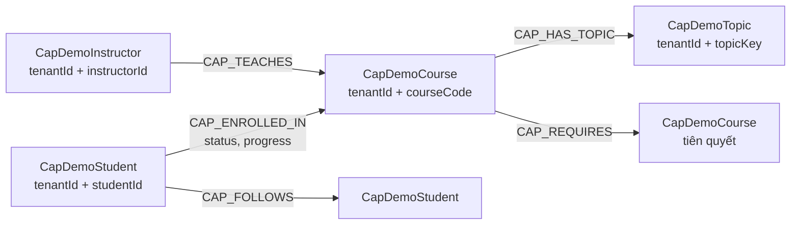
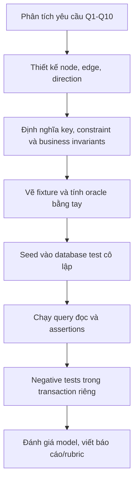

# Thiết kế mô hình đồ thị và bộ dữ liệu có trường hợp biên — đồ án thực hành Neo4j

Một hệ thống chỉ có vài node và relationship đơn giản thường không đủ để kiểm tra chất lượng thiết kế đồ thị. Truy vấn có thể chạy đúng trên dữ liệu “đẹp” nhưng trả sai khi hai tenant cùng sử dụng một mã, một người không có quan hệ, một thuộc tính bị thiếu, một khóa học có hai chuỗi tiên quyết hoặc một quan hệ mang trạng thái cần phân biệt `0` với `null`.

Đồ án này yêu cầu xây dựng **mô hình property graph và một bộ dữ liệu kiểm thử nhỏ nhưng có chủ đích** cho nền tảng học trực tuyến. Người học sẽ tự trả lời bốn câu hỏi: **Node nào cần tồn tại? Relationship biểu diễn nghiệp vụ gì? Những bất biến nào phải bảo vệ? Bộ dữ liệu nào đủ sức chứng minh các truy vấn hoạt động đúng ở trường hợp biên?**

Bài thuộc chương **Đồ án thực hành** của module `DATABASE_ENGINE_GRAPH_NEO4J`. Đây là bài vận dụng tổng hợp kiến thức Neo4j: node, relationship, label, property, Cypher, index/constraint, tối ưu truy vấn và cách chuẩn bị dữ liệu để sau này tích hợp qua Neo4j Java Driver hoặc Spring Data Neo4j.

> **Đầu ra chính:** sơ đồ mô hình, data dictionary, các ràng buộc và quy tắc nghiệp vụ, script Cypher tạo fixture, bộ truy vấn có đáp án kỳ vọng, kiểm thử âm và báo cáo giải thích vì sao mô hình xử lý được trường hợp biên. Không cần tạo ứng dụng web hoàn chỉnh để hoàn thành bài này.

## 1. Bối cảnh: nền tảng đào tạo đa tenant

Giả sử một sản phẩm giáo dục cung cấp khóa học về Cypher, Java Driver và Spring Data Neo4j cho nhiều tổ chức. Mỗi tổ chức là một **tenant**, được nhận diện bằng `tenantId`.

Các yêu cầu:

1. **Sinh viên** có thể đăng ký nhiều **khóa học**, mỗi lượt đăng ký có `status` và `progress`.
2. Một **giảng viên** có thể dạy nhiều khóa học; một khóa học có thể chưa được phân giảng viên.
3. Một khóa học có thể thuộc nhiều **chủ đề**; một chủ đề gắn với nhiều khóa học.
4. Khóa học nâng cao có thể **yêu cầu** một hoặc nhiều khóa học tiên quyết.
5. Sinh viên có thể **theo dõi** nhau; chu trình theo dõi được chấp nhận.
6. Hai tenant có thể cùng dùng `studentId = 'S01'` hoặc `courseCode = 'C101'` mà không đại diện cho cùng thực thể.
7. Các thao tác sửa dữ liệu phải tránh nối nhầm sinh viên/khóa học khác tenant.
8. Có thể tra cứu người học không có bất kỳ mối quan hệ nào và khóa học chưa có giảng viên.
9. Mô hình phân biệt property **không tồn tại**, **chuỗi rỗng** và **giá trị số 0**.
10. Chuỗi tiên quyết khóa học **không được chứa chu trình**, dù graph theo dõi sinh viên có thể có chu trình.

### 1.1. Những câu hỏi hệ thống cần trả lời

| Mã | Câu hỏi nghiệp vụ | Hướng truy vấn |
| --- | --- | --- |
| Q1 | Sinh viên đã đăng ký những khóa nào, trạng thái ra sao? | `Student → ENROLLED_IN → Course` |
| Q2 | Khóa học C104 cần những khóa tiên quyết trực tiếp và gián tiếp nào? | `Course → REQUIRES → Course` |
| Q3 | Có bao nhiêu đường tiên quyết khác nhau tới cùng khóa cơ bản? | Path và `count(path)` |
| Q4 | Khóa học nào chưa được phân giảng viên? | `NOT EXISTS`/`OPTIONAL MATCH` |
| Q5 | Sinh viên nào hoàn toàn cô lập? | Không có relationship thuộc bất kỳ type nào |
| Q6 | Tenant T1 có được nối sang dữ liệu T2 không? | So tenant ở hai đầu relationship |
| Q7 | Người dùng đã hoàn tất đủ tiên quyết trực tiếp để học khóa mới chưa? | Nested `EXISTS`/`NOT EXISTS` |
| Q8 | Có đăng ký trùng lặp giữa cùng sinh viên và khóa học không? | Nhóm theo node hai đầu, `count(r)` |
| Q9 | Thuộc tính progress bị thiếu khác progress = 0 ra sao? | `IS NULL` và so sánh số |
| Q10 | Các thống kê có giữ người học không có đăng ký không? | `OPTIONAL MATCH` và `count(r)` |

Các câu hỏi này quyết định cách thiết kế graph. **Không thiết kế node/relationship theo cảm tính rồi mới đặt câu hỏi sau.**

## 2. Ranh giới domain và quyết định mô hình hóa

### 2.1. Bốn loại node chính

| Label trong Neo4j | Khóa nghiệp vụ | Thuộc tính | Vai trò |
| --- | --- | --- | --- |
| `CapDemoStudent` | `(tenantId, studentId)` | `displayName`, `email?`, `experienceMonths?`, `active` | Người học |
| `CapDemoCourse` | `(tenantId, courseCode)` | `title`, `fee?`, `published` | Khóa học |
| `CapDemoInstructor` | `(tenantId, instructorId)` | `name`, `specialty?` | Người dạy |
| `CapDemoTopic` | `(tenantId, topicKey)` | `title` | Chủ đề |

Dấu `?` nghĩa là property **có thể vắng mặt**. Không tự động coi property không có là một chuỗi rỗng hay số 0.

Một sinh viên có thể mang thêm label `CapDemoPeerMentor`, nhưng vẫn chỉ là **một node `CapDemoStudent`**. Điều này minh họa tính chất **multi-label** của property graph. Giảng viên là loại thực thể khác trong đồ án; thực tế có thể lựa chọn mô hình Person chung và các vai trò, nhưng cần nêu rõ lý do và hệ quả tới khóa.

### 2.2. Năm loại relationship

| Type, chiều định nghĩa | Thuộc tính | Ngữ nghĩa |
| --- | --- | --- |
| `(:CapDemoStudent)-[:CAP_ENROLLED_IN]->(:CapDemoCourse)` | `enrollmentId`, `status`, `progress?`, `joinedAt?` | Một sinh viên đăng ký một khóa học |
| `(:CapDemoCourse)-[:CAP_REQUIRES]->(:CapDemoCourse)` | Không bắt buộc | Khóa bên trái yêu cầu hoàn thành khóa bên phải |
| `(:CapDemoInstructor)-[:CAP_TEACHES]->(:CapDemoCourse)` | Không bắt buộc | Giảng viên phụ trách khóa học |
| `(:CapDemoCourse)-[:CAP_HAS_TOPIC]->(:CapDemoTopic)` | Không bắt buộc | Khóa học thuộc chủ đề |
| `(:CapDemoStudent)-[:CAP_FOLLOWS]->(:CapDemoStudent)` | Không bắt buộc | Sinh viên trái theo dõi sinh viên phải |

**Chiều rất quan trọng.** `(C104)-[:CAP_REQUIRES]->(C102)` nghĩa là **C104 yêu cầu C102**, không phải C102 yêu cầu C104. Đặt hướng nhất quán giúp query tiên quyết trực tiếp và kiểm tra chu trình dễ hiểu.

### 2.3. Vì sao Enrollment là relationship có property?

Một lượt đăng ký nối một sinh viên và một khóa học, có thể mang `status` và `progress`:

```text
(Student S01)
     │
     └──[:CAP_ENROLLED_IN {
          enrollmentId: 'E01',
          status: 'COMPLETED',
          progress: 100
        }]──► (Course C101)
```

Mô hình bằng relationship property phù hợp khi một lượt đăng ký là **mối liên hệ trực tiếp** giữa hai node và có số lượng thuộc tính vừa phải.

Nhưng nếu cần **nhiều lần đăng ký lịch sử** cho cùng cặp sinh viên–khóa học, thanh toán, chứng chỉ, log sự kiện và vòng đời phức tạp, một node `Enrollment` có khóa riêng có thể tốt hơn:

```text
(Student) ─[:HAS_ENROLLMENT]→ (Enrollment {enrollmentId})
(Enrollment) ─[:FOR_COURSE]→ (Course)
```

Đồ án **chọn relationship property** và quy tắc nghiệp vụ: **mỗi cặp Student–Course chỉ có một đăng ký đang được quản lý**. Việc thay đổi trạng thái sẽ cập nhật relationship hiện có; lịch sử đầy đủ là một bài toán mở rộng.

### 2.4. Không lưu quan hệ graph thành danh sách chuỗi khi cần traversal

Một property như `prerequisiteIds: ['C102','C103']` có thể lưu được nhưng khó kiểm tra tồn tại, tìm đường, phát hiện chu trình và bảo đảm cùng tenant. Relationship `CAP_REQUIRES` giúp Cypher duyệt cấu trúc graph trực tiếp.

Tương tự, một khóa học có nhiều chủ đề nên sử dụng `CAP_HAS_TOPIC` thay vì nhét toàn bộ Topic object vào property MAP lồng. Neo4j không lưu MAP lồng thông thường làm một node property.

## 3. Sơ đồ graph khái niệm

### 3.1. Sơ đồ các loại thực thể



Sơ đồ chỉ mô tả **kiểu quan hệ**, chưa quyết định node cụ thể. Mọi node trong fixture có `tenantId`; không được tạo cạnh nối khác tenant.

### 3.2. Hai nhánh tiên quyết cùng dẫn tới một khóa cơ bản

Trong T1, dựng cấu trúc:

```text
C104 Spring Data Neo4j
  ├── REQUIRES ──► C102 Cypher
  │                   └── REQUIRES ──► C101 Neo4j cơ bản
  └── REQUIRES ──► C103 Java Driver
                      └── REQUIRES ──► C101 Neo4j cơ bản

C105 Thực hành Java độc lập
  └── Không có tiên quyết, không có giảng viên
```

C104 có **hai đường dài hai cạnh** tới C101, nhưng C101 vẫn chỉ là **một node duy nhất**. Vì vậy:

- `count(path)` tới C101 là **2**.
- `count(DISTINCT prerequisiteCourse)` cho tập tiên quyết gián tiếp cần phân biệt các khóa, không nhân đôi C101.
- Nếu người học muốn danh sách khóa tiên quyết độc nhất của C104, tập là **{C101, C102, C103}**, không phải bốn node theo đường đi.

### 3.3. Một chu trình hợp lệ khác với chu trình bị cấm

Mối quan hệ theo dõi:

```text
S01 An ──FOLLOWS──► S02 Bình
   │                    │
   └──FOLLOWS──► S03 Chi◄─┘
       ▲             │
       └──FOLLOWS────┘
```

Chu trình theo dõi `S01 → S02 → S03 → S01` là hợp lệ theo yêu cầu; đồ thị có chu trình **không tự động là lỗi**. Ngược lại, `CAP_REQUIRES` có chu trình sẽ làm điều kiện tiên quyết không thể hoàn thành theo cách thông thường. Quy tắc cấm chu trình **theo relationship type**, không phải cấm mọi chu trình trên toàn graph.

## 4. Những bất biến bắt buộc

Bất biến là điều phải đúng trước và sau mọi thao tác cập nhật.

| Mã | Bất biến | Cơ chế bảo vệ |
| --- | --- | --- |
| INV-01 | Student duy nhất theo `tenantId + studentId` | Composite uniqueness constraint |
| INV-02 | Course duy nhất theo `tenantId + courseCode` | Composite uniqueness constraint |
| INV-03 | Instructor, Topic có khóa tổ hợp tương tự | Uniqueness constraints |
| INV-04 | Mọi cạnh nghiệp vụ nối hai đầu có cùng `tenantId` | Service validation + integration test |
| INV-05 | `CAP_REQUIRES` không có self-loop/chu trình | Kiểm tra path trước khi ghi, kiểm soát concurrency |
| INV-06 | Một Student–Course có tối đa một đăng ký hoạt động theo mô hình này | Quy tắc khóa nghiệp vụ và strategy chống ghi đồng thời |
| INV-07 | `progress` nếu có nằm trong khoảng `0..100` | Validation service/Cypher guard |
| INV-08 | `status` thuộc enum đã định nghĩa | Validation khi nhập/ghi |
| INV-09 | Có thể tồn tại Student không có cạnh và Course chưa có Instructor | Query dùng `OPTIONAL MATCH`/`NOT EXISTS` |
| INV-10 | Xóa đăng ký không đồng nghĩa xóa node Student hoặc Course | Chỉ sửa/xóa relationship theo scope |

**Phân biệt constraint với validation:** uniqueness constraint trên node **không tự kiểm tra** cạnh cùng tenant, chu trình, enum status hay một cặp node có nhiều relationship song song. Đồ án phải viết test cho các quy tắc đó, không chỉ tạo index rồi coi đã bảo đảm toàn bộ nghiệp vụ.

### 4.1. Khóa tổ hợp để cách ly tenant

Hai node sau **đều hợp lệ**:

```text
(:CapDemoStudent {tenantId: 'T1', studentId: 'S01', displayName: 'An'})
(:CapDemoStudent {tenantId: 'T2', studentId: 'S01', displayName: 'Eva'})
```

Do đó, truy vấn `MATCH (s:CapDemoStudent {studentId: 'S01'})` trả **hai node**. Nếu API nhận `tenantId` từ ngữ cảnh xác thực nhưng chỉ dùng `studentId` để `MERGE`, nó có thể nối nhầm dữ liệu giữa các tổ chức.

Không nhận `tenantId` từ đầu vào client mà không xác thực quyền; service nên lấy tenant đã xác minh từ security context. Một hệ thống dùng database riêng cho từng tenant cũng là lựa chọn khác, nhưng bản đồ án này dùng **một database chứa nhiều tenant** để kiểm thử rủi ro lọc.

## 5. Tạo constraint cho khóa nghiệp vụ

Chạy trên **Neo4j database chuyên cho đồ án**, đã được chuẩn bị riêng. Không áp dụng lệnh DDL dưới đây vào production khi chưa có kế hoạch thay đổi schema.

```cypher
CREATE CONSTRAINT cap_demo_student_key IF NOT EXISTS
FOR (s:CapDemoStudent)
REQUIRE (s.tenantId, s.studentId) IS UNIQUE;
```

```cypher
CREATE CONSTRAINT cap_demo_course_key IF NOT EXISTS
FOR (c:CapDemoCourse)
REQUIRE (c.tenantId, c.courseCode) IS UNIQUE;
```

```cypher
CREATE CONSTRAINT cap_demo_instructor_key IF NOT EXISTS
FOR (i:CapDemoInstructor)
REQUIRE (i.tenantId, i.instructorId) IS UNIQUE;
```

```cypher
CREATE CONSTRAINT cap_demo_topic_key IF NOT EXISTS
FOR (t:CapDemoTopic)
REQUIRE (t.tenantId, t.topicKey) IS UNIQUE;
```

Composite uniqueness ở Neo4j bảo vệ những node có đầy đủ thuộc tính khóa khỏi trùng cặp. Nó **không tự bắt buộc mọi node đều có hai thuộc tính**; cần validation trên request/import hoặc dùng constraint phù hợp với edition/version để bảo đảm tồn tại.

### 5.1. Index và constraint phục vụ truy vấn nào?

Một query thường tìm node theo khóa tổ hợp:

```cypher
MATCH (s:CapDemoStudent {
  tenantId: $tenantId,
  studentId: $studentId
})
RETURN s.displayName AS name;
```

Constraint uniqueness tạo backing index để Neo4j có thể tìm cặp khóa hiệu quả. Việc có index không bảo đảm planner luôn chọn nó trong mọi tình huống; dùng `EXPLAIN` và `PROFILE` để hiểu plan trên workload thật.

Ví dụ tham số phải chứa hai giá trị:

```json
{
  "tenantId": "T1",
  "studentId": "S01"
}
```

Không chèn trực tiếp input chưa tin cậy vào chuỗi Cypher.

## 6. Bộ dữ liệu mẫu: cố ý nhỏ và có tính đối chứng

Fixture bao gồm **18 node và 28 relationship**:

| Loại node | T1 | T2 | Tổng |
| --- | ---: | ---: | ---: |
| CapDemoStudent | 5 | 1 | **6** |
| CapDemoCourse | 5 | 1 | **6** |
| CapDemoInstructor | 2 | 1 | **3** |
| CapDemoTopic | 2 | 1 | **3** |
| **Tổng node** | **14** | **4** | **18** |

| Relationship | T1 | T2 | Tổng |
| --- | ---: | ---: | ---: |
| `CAP_ENROLLED_IN` | 7 | 1 | **8** |
| `CAP_REQUIRES` | 4 | 0 | **4** |
| `CAP_TEACHES` | 4 | 1 | **5** |
| `CAP_HAS_TOPIC` | 6 | 1 | **7** |
| `CAP_FOLLOWS` | 4 | 0 | **4** |
| **Tổng relationship** | **25** | **3** | **28** |

Một node Bình có **hai label** `CapDemoStudent` và `CapDemoPeerMentor`, nhưng chỉ được tính **một lần** trong tổng node.

### 6.1. Danh sách node

| Tenant | Label | ID | Tên/tiêu đề | Trường hợp biên |
| --- | --- | --- | --- | --- |
| T1 | Student | S01 | An | Email hợp lệ; đăng ký ba khóa |
| T1 | Student + PeerMentor | S02 | Bình | `experienceMonths = 0`; multi-label |
| T1 | Student | S03 | Chi | Không có property `email` |
| T1 | Student | S04 | Dũng | `email = ''` |
| T1 | Student | S05 | Hạnh | **Node cô lập hoàn toàn** |
| T2 | Student | S01 | Eva | Trùng `studentId` với An nhưng khác tenant |
| T1 | Course | C101 | Neo4j cơ bản | `fee = 0`, không có tiên quyết |
| T1 | Course | C102 | Cypher | Yêu cầu C101 |
| T1 | Course | C103 | Java Driver | Yêu cầu C101 |
| T1 | Course | C104 | Spring Data Neo4j | Yêu cầu C102 và C103 |
| T1 | Course | C105 | Thực hành Java độc lập | Chưa có giảng viên; không có `fee` |
| T2 | Course | C101 | Graph Basics T2 | Trùng `courseCode` với T1/C101 |
| T1 | Instructor | I01 | Lan | Dạy C101 và C102 |
| T1 | Instructor | I02 | Minh | Dạy C103 và C104 |
| T2 | Instructor | I01 | Alex | Trùng `instructorId` với Lan |
| T1 | Topic | T01 | Graph | Dùng cho C101, C102, C104 |
| T1 | Topic | T02 | Java | Dùng cho C103, C104, C105 |
| T2 | Topic | T01 | Graph | Trùng `topicKey` với T1/T01 |

### 6.2. Danh sách cạnh tiên quyết

| Khóa học | CAP_REQUIRES | Giải thích |
| --- | --- | --- |
| T1/C102 | T1/C101 | Cypher yêu cầu Neo4j cơ bản |
| T1/C103 | T1/C101 | Java Driver yêu cầu Neo4j cơ bản |
| T1/C104 | T1/C102 | Spring Data Neo4j yêu cầu Cypher |
| T1/C104 | T1/C103 | Spring Data Neo4j yêu cầu Java Driver |

Không tạo quan hệ từ C101 trở về C104. Nếu tạo, sẽ phát sinh chu trình.

### 6.3. Các lượt đăng ký

| enrollmentId | Sinh viên | Khóa học | status | progress |
| --- | --- | --- | --- | ---: |
| E01 | T1/S01 | T1/C101 | COMPLETED | 100 |
| E02 | T1/S01 | T1/C102 | ACTIVE | 0 |
| E03 | T1/S01 | T1/C104 | WAITLISTED | *không có property* |
| E04 | T1/S02 | T1/C101 | ACTIVE | 0 |
| E05 | T1/S02 | T1/C103 | WITHDRAWN | 20 |
| E06 | T1/S03 | T1/C103 | ACTIVE | 65 |
| E07 | T1/S04 | T1/C105 | ACTIVE | 80 |
| E08 | T2/S01 | T2/C101 | ACTIVE | 15 |

Các trường hợp phải phân biệt:

- `E02.progress = 0` và `E04.progress = 0`: **đã có property với giá trị bằng 0**.
- `E03.progress`: **không tồn tại**, khi đọc bằng Cypher trả `null`.
- `E05.status = 'WITHDRAWN'`: vẫn là một relationship có lịch sử/trạng thái, không phải đã xóa.
- `E01.status = 'COMPLETED'`: minh họa dữ liệu đủ điều kiện tiên quyết cho khóa C102/C103.

Theo fixture: **COMPLETED = 1**, **ACTIVE = 5**, **WAITLISTED = 1**, **WITHDRAWN = 1**.

## 7. Cypher seed: tạo trọn bộ 18 node và 28 relationship

### 7.1. Điều kiện trước khi seed

1. Dùng **database/container kiểm thử mới**, không chạy trên production.
2. Tạo bốn constraints ở mục 5.
3. Chạy **một lần duy nhất** câu `CREATE` dưới đây. `CREATE` được chọn để làm lộ lỗi seed lặp; không chạy nhiều lần vào DB cũ.
4. Dùng câu kiểm kê ở mục 8 để so với bảng dự kiến.
5. Nếu muốn chạy lại, **tạo database/container fixture mới** hoặc reset database thử nghiệm theo quy trình riêng; không chạy lệnh xóa toàn bộ graph trên DB dùng chung.

### 7.2. Một câu CREATE duy nhất

```cypher
CREATE
  // Student trong T1
  (an:CapDemoStudent {
    tenantId: 'T1', studentId: 'S01',
    displayName: 'An',
    email: 'an@example.test',
    experienceMonths: 12,
    active: true
  }),
  (binh:CapDemoStudent:CapDemoPeerMentor {
    tenantId: 'T1', studentId: 'S02',
    displayName: 'Bình',
    email: 'binh@example.test',
    experienceMonths: 0,
    active: true
  }),
  (chi:CapDemoStudent {
    tenantId: 'T1', studentId: 'S03',
    displayName: 'Chi',
    active: true
  }),
  (dung:CapDemoStudent {
    tenantId: 'T1', studentId: 'S04',
    displayName: 'Dũng',
    email: '',
    active: true
  }),
  (hanh:CapDemoStudent {
    tenantId: 'T1', studentId: 'S05',
    displayName: 'Hạnh',
    email: 'hanh@example.test',
    active: false
  }),

  // T2 có cùng studentId = S01
  (eva:CapDemoStudent {
    tenantId: 'T2', studentId: 'S01',
    displayName: 'Eva',
    email: 'eva@example.test',
    active: true
  }),

  // Course trong T1
  (c101:CapDemoCourse {
    tenantId: 'T1', courseCode: 'C101',
    title: 'Neo4j cơ bản', fee: 0, published: true
  }),
  (c102:CapDemoCourse {
    tenantId: 'T1', courseCode: 'C102',
    title: 'Cypher', fee: 299000, published: true
  }),
  (c103:CapDemoCourse {
    tenantId: 'T1', courseCode: 'C103',
    title: 'Java Driver', fee: 399000, published: true
  }),
  (c104:CapDemoCourse {
    tenantId: 'T1', courseCode: 'C104',
    title: 'Spring Data Neo4j', fee: 499000,
    published: false
  }),
  (c105:CapDemoCourse {
    tenantId: 'T1', courseCode: 'C105',
    title: 'Thực hành Java độc lập',
    published: true
    // Cố ý thiếu property fee.
  }),

  // T2 có cùng courseCode = C101
  (c101t2:CapDemoCourse {
    tenantId: 'T2', courseCode: 'C101',
    title: 'Graph Basics T2',
    fee: 100000, published: true
  }),

  // Instructor
  (lan:CapDemoInstructor {
    tenantId: 'T1', instructorId: 'I01',
    name: 'Lan', specialty: 'Graph'
  }),
  (minh:CapDemoInstructor {
    tenantId: 'T1', instructorId: 'I02',
    name: 'Minh', specialty: 'Java'
  }),
  (alex:CapDemoInstructor {
    tenantId: 'T2', instructorId: 'I01',
    name: 'Alex', specialty: 'Graph'
  }),

  // Topic
  (graph:CapDemoTopic {
    tenantId: 'T1', topicKey: 'T01', title: 'Graph'
  }),
  (java:CapDemoTopic {
    tenantId: 'T1', topicKey: 'T02', title: 'Java'
  }),
  (graphT2:CapDemoTopic {
    tenantId: 'T2', topicKey: 'T01', title: 'Graph'
  }),

  // 8 ENROLLED_IN
  (an)-[:CAP_ENROLLED_IN {
    enrollmentId: 'E01', status: 'COMPLETED',
    progress: 100, joinedAt: date('2026-09-01')
  }]->(c101),
  (an)-[:CAP_ENROLLED_IN {
    enrollmentId: 'E02', status: 'ACTIVE', progress: 0
  }]->(c102),
  (an)-[:CAP_ENROLLED_IN {
    enrollmentId: 'E03', status: 'WAITLISTED'
  }]->(c104),
  (binh)-[:CAP_ENROLLED_IN {
    enrollmentId: 'E04', status: 'ACTIVE', progress: 0
  }]->(c101),
  (binh)-[:CAP_ENROLLED_IN {
    enrollmentId: 'E05', status: 'WITHDRAWN', progress: 20
  }]->(c103),
  (chi)-[:CAP_ENROLLED_IN {
    enrollmentId: 'E06', status: 'ACTIVE', progress: 65
  }]->(c103),
  (dung)-[:CAP_ENROLLED_IN {
    enrollmentId: 'E07', status: 'ACTIVE', progress: 80
  }]->(c105),
  (eva)-[:CAP_ENROLLED_IN {
    enrollmentId: 'E08', status: 'ACTIVE', progress: 15
  }]->(c101t2),

  // 4 REQUIRES: chiều từ khóa nâng cao sang khóa tiên quyết
  (c102)-[:CAP_REQUIRES]->(c101),
  (c103)-[:CAP_REQUIRES]->(c101),
  (c104)-[:CAP_REQUIRES]->(c102),
  (c104)-[:CAP_REQUIRES]->(c103),

  // 5 TEACHES
  (lan)-[:CAP_TEACHES]->(c101),
  (lan)-[:CAP_TEACHES]->(c102),
  (minh)-[:CAP_TEACHES]->(c103),
  (minh)-[:CAP_TEACHES]->(c104),
  (alex)-[:CAP_TEACHES]->(c101t2),

  // 7 HAS_TOPIC
  (c101)-[:CAP_HAS_TOPIC]->(graph),
  (c102)-[:CAP_HAS_TOPIC]->(graph),
  (c103)-[:CAP_HAS_TOPIC]->(java),
  (c104)-[:CAP_HAS_TOPIC]->(graph),
  (c104)-[:CAP_HAS_TOPIC]->(java),
  (c105)-[:CAP_HAS_TOPIC]->(java),
  (c101t2)-[:CAP_HAS_TOPIC]->(graphT2),

  // 4 FOLLOWS, có chu trình nhưng không có self-loop
  (an)-[:CAP_FOLLOWS]->(binh),
  (an)-[:CAP_FOLLOWS]->(chi),
  (binh)-[:CAP_FOLLOWS]->(chi),
  (chi)-[:CAP_FOLLOWS]->(an);
```

**Lưu ý cú pháp:** dấu `//` ở cuối nội dung map là comment riêng trên dòng tiếp theo; nếu client báo lỗi ở đoạn comment trong `CREATE` dài, chuyển comment **ra ngoài literal map** mà không đổi dữ liệu. Toàn bộ mẫu chỉ dùng Cypher cơ bản và các hàm ngày thông thường, không phụ thuộc APOC.

**Không đặt thêm cạnh vào fixture trước khi kiểm kê**. Các ví dụ ghi/xóa ở phần bài tập âm cần transaction riêng hoặc DB test đã clone vì chúng có thể thay đổi đáp án kỳ vọng.

## 8. Oracle: đếm và đối chiếu ngay sau khi seed

**Oracle** là tập kết quả đã tính từ danh sách node/cạnh **trước khi** thực thi truy vấn. Test chỉ có giá trị nếu kết quả thực tế được so với oracle độc lập, không lấy chính kết quả truy vấn làm expected.

### 8.1. Đếm từng loại node

```cypher
MATCH (s:CapDemoStudent)
RETURN count(s) AS students,
       count(s) = 6 AS passed;
```

```cypher
MATCH (c:CapDemoCourse)
RETURN count(c) AS courses,
       count(c) = 6 AS passed;
```

```cypher
MATCH (i:CapDemoInstructor)
RETURN count(i) AS instructors,
       count(i) = 3 AS passed;
```

```cypher
MATCH (t:CapDemoTopic)
RETURN count(t) AS topics,
       count(t) = 3 AS passed;
```

Tất cả `passed` phải là `true`. Có thể kiểm tra tổng số node theo nhãn của fixture:

```cypher
MATCH (n)
WHERE n:CapDemoStudent
   OR n:CapDemoCourse
   OR n:CapDemoInstructor
   OR n:CapDemoTopic
RETURN count(n) AS allFixtureNodes;
```

Kỳ vọng **18**, không phải 19. Bình mang thêm label `CapDemoPeerMentor` nhưng vẫn là **một node**.

### 8.2. Đếm từng relationship type

```cypher
MATCH ()-[r]->()
WHERE type(r) IN [
  'CAP_ENROLLED_IN',
  'CAP_REQUIRES',
  'CAP_TEACHES',
  'CAP_HAS_TOPIC',
  'CAP_FOLLOWS'
]
RETURN type(r) AS relationshipType,
       count(r) AS n
ORDER BY relationshipType;
```

Kết quả:

| relationshipType | n |
| --- | ---: |
| CAP_ENROLLED_IN | 8 |
| CAP_FOLLOWS | 4 |
| CAP_HAS_TOPIC | 7 |
| CAP_REQUIRES | 4 |
| CAP_TEACHES | 5 |

Tổng **28**. Khi chạy fixture trong database riêng, có thể dùng `MATCH ()-[r]->() RETURN count(r)` để xác nhận tổng, nhưng trên database có dữ liệu khác phải lọc theo type/label hoặc namespace rõ ràng.

### 8.3. Kiểm tra multi-label

```cypher
MATCH (s:CapDemoStudent:CapDemoPeerMentor)
RETURN s.tenantId AS tenantId,
       s.studentId AS studentId;
```

Kỳ vọng đúng một hàng: **T1/S02**. Không tạo một node PeerMentor khác cho Bình; như vậy sẽ phá vỡ mô hình “nhiều vai trò, một thực thể”.

## 9. Trường hợp biên 1: cùng mã ở hai tenant

Không đủ điều kiện tenant:

```cypher
MATCH (s:CapDemoStudent {studentId: 'S01'})
RETURN s.tenantId AS tenantId,
       s.displayName AS name
ORDER BY tenantId;
```

Kết quả:

| tenantId | name |
| --- | --- |
| T1 | An |
| T2 | Eva |

Truy vấn đúng theo tenant:

```cypher
MATCH (s:CapDemoStudent {
  tenantId: $tenantId,
  studentId: $studentId
})
RETURN s.displayName AS name;
```

Khi `$tenantId='T1'` và `$studentId='S01'`, chỉ trả **An**.

### 9.1. Audit tất cả các loại cạnh

Dùng query kiểm tra cạnh nối khác tenant:

```cypher
MATCH (a)-[r]->(b)
WHERE type(r) IN [
  'CAP_ENROLLED_IN',
  'CAP_REQUIRES',
  'CAP_TEACHES',
  'CAP_HAS_TOPIC',
  'CAP_FOLLOWS'
]
AND a.tenantId <> b.tenantId
RETURN count(r) AS crossTenantEdges;
```

Kỳ vọng **0**.

**Giới hạn:** nếu một đầu mút không có `tenantId`, phép so sánh với `null` không trả `true`, nên nó có thể bị bỏ qua. Test đầy đủ còn phải kiểm tra **sự tồn tại của tenantId** trên tất cả node fixture và không cho phép nhập node thiếu khóa.

### 9.2. Vì sao MERGE cũng có thể nối nhầm tenant?

Ví dụ không nên dùng:

```cypher
// SAI về phạm vi nghiệp vụ: không lọc tenantId.
MATCH (s:CapDemoStudent {studentId: $studentId})
MATCH (c:CapDemoCourse {courseCode: $courseCode})
MERGE (s)-[:CAP_ENROLLED_IN]->(c);
```

Với `S01/C101` ở cả T1 và T2, hai `MATCH` có thể tạo tổ hợp **bốn cặp endpoint**, bao gồm hai cặp xuyên tenant, rồi `MERGE` ghi những cạnh không mong muốn. **Không chạy ví dụ lỗi này trên fixture chuẩn.**

Cần truyền tenant từ ngữ cảnh xác thực và ràng hai đầu:

```cypher
MATCH (s:CapDemoStudent {
  tenantId: $tenantId,
  studentId: $studentId
})
MATCH (c:CapDemoCourse {
  tenantId: $tenantId,
  courseCode: $courseCode
})
MERGE (s)-[e:CAP_ENROLLED_IN]->(c)
ON CREATE SET e.status = 'ACTIVE',
              e.progress = 0;
```

Đây là **khung minh họa command**, chưa phải triển khai production đầy đủ: cần kiểm soát quyền, enum status, khóa đăng ký/đồng thời và ý nghĩa khi một relationship đã tồn tại.

## 10. Trường hợp biên 2: node cô lập và quan hệ tùy chọn

Hạnh là người học chưa đăng ký khóa, chưa theo dõi ai và chưa được ai theo dõi.

### 10.1. Tìm sinh viên không có bất kỳ relationship nào

```cypher
MATCH (s:CapDemoStudent {tenantId: 'T1'})
WHERE NOT EXISTS {
  MATCH (s)--()
}
RETURN s.studentId AS id, s.displayName AS name;
```

Kỳ vọng **T1/S05 – Hạnh**.

Nếu chỉ kiểm tra `NOT EXISTS { MATCH (s)-[:CAP_ENROLLED_IN]->() }`, kết quả là Hạnh (S05), còn có thể xuất hiện sinh viên không đăng ký nhưng vẫn tham gia theo dõi. **“Không đăng ký” không đồng nghĩa “cô lập trong graph”.**

### 10.2. Đếm số enrollment mà không làm mất sinh viên

```cypher
MATCH (s:CapDemoStudent)
OPTIONAL MATCH (s)-[e:CAP_ENROLLED_IN]->(:CapDemoCourse)
RETURN s.tenantId AS tenantId,
       s.studentId AS studentId,
       count(e) AS enrollments,
       count(*) AS rowsIncludingOptional
ORDER BY tenantId, studentId;
```

Kỳ vọng:

| tenantId | studentId | enrollments |
| --- | --- | ---: |
| T1 | S01 | **3** |
| T1 | S02 | **2** |
| T1 | S03 | **1** |
| T1 | S04 | **1** |
| T1 | S05 | **0** |
| T2 | S01 | **1** |

Với S05, `count(*)` trả **1** vì `OPTIONAL MATCH` giữ hàng có `e = null`; `count(e)` mới trả đúng **0**.

### 10.3. Tìm khóa học chưa được phân giảng viên

```cypher
MATCH (c:CapDemoCourse {tenantId: 'T1'})
WHERE NOT EXISTS {
  MATCH (:CapDemoInstructor)-[:CAP_TEACHES]->(c)
}
RETURN c.courseCode AS courseCode,
       c.title AS title;
```

Kỳ vọng duy nhất **C105**. Việc chưa có giảng viên không làm khóa học biến mất khỏi graph hoặc báo cáo.

## 11. Trường hợp biên 3: property thiếu, chuỗi rỗng và số 0

### 11.1. Email thiếu khác email rỗng

```cypher
MATCH (s:CapDemoStudent {tenantId: 'T1'})
WHERE s.email IS NULL
RETURN s.studentId AS id;
```

Kỳ vọng **S03**.

```cypher
MATCH (s:CapDemoStudent {tenantId: 'T1'})
WHERE s.email = ''
RETURN s.studentId AS id;
```

Kỳ vọng **S04**.

**Không viết `s.email = null`**: trong Cypher, so sánh với `null` không cho Boolean `true` như mong muốn. Khi yêu cầu business là email không được bỏ trống, validation phải xử lý cả property không có, chuỗi rỗng và chuỗi chỉ chứa khoảng trắng.

### 11.2. Giá trị 0 phải được giữ nguyên

```cypher
MATCH (s:CapDemoStudent {tenantId: 'T1'})
WHERE s.experienceMonths = 0
RETURN s.studentId AS id;
```

Kỳ vọng **S02**. S05 thiếu `experienceMonths` không được âm thầm xem là 0.

Khóa học có `fee = 0`:

```cypher
MATCH (c:CapDemoCourse {
  tenantId: 'T1', courseCode: 'C101'
})
RETURN c.fee AS fee;
```

Trả **0**. C105 thiếu `fee` trả `null`, khác với khóa học miễn phí đã xác định rõ học phí bằng 0.

### 11.3. Progress bị thiếu khác progress bằng 0

```cypher
MATCH (:CapDemoStudent)-[e:CAP_ENROLLED_IN]->(:CapDemoCourse)
RETURN e.enrollmentId AS enrollmentId,
       e.status AS status,
       e.progress AS progress
ORDER BY enrollmentId;
```

Kỳ vọng `E03.progress = null`, `E02.progress = 0` và `E04.progress = 0`.

Các phép kiểm tra:

```cypher
MATCH ()-[e:CAP_ENROLLED_IN]->()
RETURN count(e) AS enrollments,
       count(e.progress) AS withProgress,
       count(CASE WHEN e.progress = 0 THEN 1 END) AS zeroProgress,
       count(CASE WHEN e.progress IS NULL THEN 1 END) AS missingProgress;
```

Kỳ vọng:

| enrollments | withProgress | zeroProgress | missingProgress |
| ---: | ---: | ---: | ---: |
| **8** | **7** | **2** | **1** |

Nếu DTO Java dùng primitive `int` và biến thiếu thành 0, bài test sẽ **mất sự khác biệt ngữ nghĩa**. Có thể dùng `Integer` nullable hoặc enum trạng thái thể hiện “chưa bắt đầu/chưa xác định” theo nghiệp vụ.

## 12. Trường hợp biên 4: nhiều đường đến cùng một tiên quyết

### 12.1. Lấy tiên quyết trực tiếp của C104

```cypher
MATCH (c:CapDemoCourse {
  tenantId: 'T1', courseCode: 'C104'
})-[:CAP_REQUIRES]->(prereq:CapDemoCourse)
RETURN prereq.courseCode AS prerequisite
ORDER BY prerequisite;
```

Kết quả:

| prerequisite |
| --- |
| C102 |
| C103 |

### 12.2. Hai đường khác nhau đến C101

```cypher
MATCH path =
  (c104:CapDemoCourse {tenantId: 'T1', courseCode: 'C104'})
  -[:CAP_REQUIRES]->
  (:CapDemoCourse)
  -[:CAP_REQUIRES]->
  (c101:CapDemoCourse {tenantId: 'T1', courseCode: 'C101'})
RETURN count(path) AS ways;
```

Kỳ vọng **ways = 2**, tương ứng:

- `C104 → C102 → C101`.
- `C104 → C103 → C101`.

Nếu đếm **node đích** bằng `count(DISTINCT c101)` thì kết quả là **1**, không phải 2. Một khóa tiên quyết có thể xuất hiện trên nhiều đường nhưng vẫn là một thực thể.

### 12.3. Truy vấn toàn bộ tiên quyết, loại trùng

Với cú pháp quan hệ biến độ dài thông dụng của **Cypher 5**:

```cypher
MATCH (c:CapDemoCourse {
  tenantId: 'T1', courseCode: 'C104'
})-[:CAP_REQUIRES*1..4]->(p:CapDemoCourse)
RETURN DISTINCT p.courseCode AS prerequisite
ORDER BY prerequisite;
```

Kỳ vọng **C101, C102, C103** (3 khóa khác nhau). `*1..4` phù hợp với fixture nhỏ, nhưng **giới hạn bốn bước không chứng minh đúng cho mọi graph production**. Với Cypher 25, cần đối chiếu syntax quantified path patterns được hỗ trợ; không sao chép nguyên mọi cú pháp biến độ dài từ phiên bản cũ.

### 12.4. Khi nào đếm đường đi, khi nào đếm entity?

| Câu hỏi | Kết quả mong đợi ở C104 |
| --- | --- |
| Có bao nhiêu tiên quyết trực tiếp? | 2 |
| Có bao nhiêu khóa tiên quyết **khác nhau** (trực tiếp + gián tiếp)? | 3 |
| Có bao nhiêu đường dài đúng 2 bước từ C104 tới C101? | 2 |
| Có bao nhiêu node C101 phân biệt ở cuối các đường đó? | 1 |

Phân biệt câu hỏi trước khi chọn `count(*)`, `count(path)`, `count(DISTINCT node)` hay `collect(DISTINCT node)`.

## 13. Trường hợp biên 5: chu trình hợp lệ và chu trình bị cấm

### 13.1. FOLLOWS có chu trình là dữ liệu hợp lệ

```cypher
MATCH path =
  (an:CapDemoStudent {tenantId: 'T1', studentId: 'S01'})
  -[:CAP_FOLLOWS]->
  (:CapDemoStudent)
  -[:CAP_FOLLOWS]->
  (:CapDemoStudent)
  -[:CAP_FOLLOWS]->
  (an)
RETURN [n IN nodes(path) | n.studentId] AS route;
```

Kỳ vọng có ít nhất đường **S01 → S02 → S03 → S01**. Nếu ứng dụng cấm tự theo dõi, hãy kiểm thử riêng self-loop `(s)-[:CAP_FOLLOWS]->(s)`, không được nhầm self-loop với mọi chu trình dài hơn.

### 13.2. REQUIRES phải là đồ thị không chu trình

Nếu muốn tạo cạnh `C101-[:CAP_REQUIRES]->C104`, đồ thị sẽ có chu trình vì C104 đã có đường đến C101.

Kiểm tra thử **trước khi ghi** theo fixture:

```cypher
MATCH (course:CapDemoCourse {
        tenantId: 'T1', courseCode: 'C101'
      }),
      (newPrereq:CapDemoCourse {
        tenantId: 'T1', courseCode: 'C104'
      })
RETURN EXISTS {
  MATCH (newPrereq)
        -[:CAP_REQUIRES]->
        (:CapDemoCourse)
        -[:CAP_REQUIRES]->
        (course)
} AS wouldCreateCycle;
```

Kỳ vọng **wouldCreateCycle = true**. Không tạo cạnh khi cờ này true.

Trong hệ thật, cần kiểm tra **toàn bộ khả năng đi tới** chứ không giới hạn hai bước như fixture, đồng thời chặn **self prerequisite**. Nếu có nhiều request ghi quan hệ tiên quyết đồng thời, việc chỉ “kiểm tra rồi ghi” ở các transaction riêng **không bảo đảm bất biến**: cả hai request có thể đọc trạng thái cũ và tạo chu trình. Cần chiến lược transaction/locking hoặc tuần tự hóa các thay đổi trên phần graph liên quan.

### 13.3. Kiểm tra không có chu trình tiên quyết sau seed

Ví dụ chỉ cho **fixture**, giới hạn đường dài tối đa 5 cạnh:

```cypher
MATCH path =
  (c:CapDemoCourse)-[:CAP_REQUIRES*1..5]->(c)
RETURN count(path) AS prerequisiteCycles;
```

Kỳ vọng **0**. Không dùng giới hạn 5 để tuyên bố “toàn bộ graph production không có chu trình dài hơn”. Đối với Cypher 25, xem syntax path tương ứng và cân nhắc thuật toán kiểm tra DAG phù hợp.

## 14. Trường hợp biên 6: trạng thái quan hệ và điều kiện tiên quyết

### 14.1. Một relationship tồn tại không đồng nghĩa khóa học đã hoàn thành

```cypher
MATCH (s:CapDemoStudent {tenantId: 'T1', studentId: 'S01'})
      -[e:CAP_ENROLLED_IN]->
      (c:CapDemoCourse)
RETURN c.courseCode AS courseCode,
       e.status AS status,
       e.progress AS progress
ORDER BY courseCode;
```

Kỳ vọng:

| courseCode | status | progress |
| --- | --- | ---: |
| C101 | COMPLETED | 100 |
| C102 | ACTIVE | 0 |
| C104 | WAITLISTED | `null` |

Nếu truy vấn chỉ kiểm tra `CAP_ENROLLED_IN` tồn tại, nó sẽ **nhầm cả ACTIVE và WAITLISTED thành đã hoàn thành**. Quy tắc đủ điều kiện học phải xét đúng `status = 'COMPLETED'` hoặc chính sách được sản phẩm phê duyệt.

### 14.2. Kiểm tra đã hoàn thành mọi tiên quyết trực tiếp

Ví dụ kiểm tra sinh viên T1/S01 có đủ điều kiện tiên quyết **trực tiếp** để học T1/C102:

```cypher
MATCH (s:CapDemoStudent {
  tenantId: 'T1', studentId: 'S01'
})
MATCH (target:CapDemoCourse {
  tenantId: 'T1', courseCode: 'C102'
})
RETURN NOT EXISTS {
  MATCH (target)-[:CAP_REQUIRES]->(required:CapDemoCourse)
  WHERE NOT EXISTS {
    MATCH (s)-[:CAP_ENROLLED_IN {status: 'COMPLETED'}]->(required)
  }
} AS directPrerequisitesMet;
```

Kỳ vọng **true**: C102 yêu cầu C101 và An đã hoàn thành C101.

Đổi `target` thành C104 sẽ được **false**, vì An chưa hoàn thành cả C102 lẫn C103. Truy vấn này chỉ minh họa **điều kiện tiên quyết trực tiếp**, không tự áp dụng các quy tắc xuất bản, học phí, lịch sử hoặc hoàn tất chuỗi tiên quyết gián tiếp.

### 14.3. Một người có thể học khóa chưa công bố?

Fixture cố tình có `C104.published = false` và một đăng ký `WAITLISTED`. Đây là một câu hỏi chính sách sản phẩm:

- Nếu khóa chưa công bố chỉ cho đăng ký danh sách chờ, trạng thái WAITLISTED là hợp lệ.
- Nếu API tự ý biến WAITLISTED thành ACTIVE, cần kiểm tra `published` và các tiên quyết.
- Không xóa quan hệ đăng ký chỉ vì khóa thay đổi `published` nếu hệ thống cần giữ lịch sử.

Mô hình phải nêu rõ quy tắc; **không** để giá trị `published` được diễn giải ngầm trong mọi truy vấn.

## 15. Kiểm thử âm: dữ liệu xấu phải bị từ chối hoặc phát hiện

Fixture chuẩn chứa dữ liệu hợp lệ với nhiều trường hợp biên. **Không đưa cạnh vi phạm bất biến vào seed chính**. Kiểm thử âm nên chạy trong transaction **rollback** hoặc một database/container khác để bảo toàn các oracle.

| Mã test âm | Thao tác cố ý sai | Kết quả mong đợi |
| --- | --- | --- |
| NEG-01 | Tạo thêm Student `(T1,S01)` | Constraint uniqueness từ chối |
| NEG-02 | Ghi enrollment từ T1/S01 sang T2/C101 | Service/Cypher guard từ chối |
| NEG-03 | Thêm `C101 REQUIRES C104` | Phát hiện chu trình, không commit |
| NEG-04 | Thêm `C101 REQUIRES C101` | Từ chối self prerequisite |
| NEG-05 | Thêm enrollment thứ hai cho cùng cặp Student–Course | Quy tắc duy nhất của enrollment từ chối |
| NEG-06 | Ghi `progress = -1` hoặc `101` | Validation từ chối |
| NEG-07 | Ghi `status = 'UNKNOWN'` | Validation enum từ chối |
| NEG-08 | API đọc/ghi với tenant khác quyền | Từ chối, không lộ dữ liệu T2 |
| NEG-09 | Bỏ hẳn `tenantId` khi tạo node | Reject theo hợp đồng đầu vào |
| NEG-10 | Đọc path/aggregation không dùng DISTINCT khi nghiệp vụ cần entity duy nhất | Test số hàng thất bại |

### 15.1. Ví dụ constraint phải từ chối bản ghi trùng

Câu sau **cố ý sai** và sẽ thất bại nếu constraint ở mục 5 hoạt động:

```cypher
// NEGATIVE TEST: CHỈ chạy trong database/transaction thử lỗi riêng.
CREATE (:CapDemoStudent {
  tenantId: 'T1',
  studentId: 'S01',
  displayName: 'Trùng khóa'
});
```

Kỳ vọng lỗi uniqueness; không có node mới được commit.

Lưu ý: việc **T2/S01 cùng mã S01 với T1/S01** lại là hợp lệ, vì composite key có `tenantId` khác nhau.

### 15.2. Kiểm tra không có hai enrollment trên cùng cặp node

```cypher
MATCH (s:CapDemoStudent)
      -[e:CAP_ENROLLED_IN]->
      (c:CapDemoCourse)
WITH s, c, count(e) AS n
WHERE n > 1
RETURN s.tenantId AS tenantId,
       s.studentId AS studentId,
       c.courseCode AS courseCode,
       n;
```

Kỳ vọng **0 hàng**. Ở môi trường có nhiều transaction ghi đồng thời, chỉ dùng `MERGE` trên cạnh chưa chắc bảo đảm không có cạnh song song trong mọi lịch cạnh tranh. Nếu nghiệp vụ yêu cầu uniqueness cứng cho Enrollment, cân nhắc thiết kế node Enrollment có khóa duy nhất, constraint trên thuộc tính quan hệ được bản/edition hỗ trợ, hoặc chiến lược đồng thời thích hợp.

### 15.3. Tự kiểm tra việc giữ tenant cho mọi node fixture

```cypher
MATCH (n)
WHERE n:CapDemoStudent
   OR n:CapDemoCourse
   OR n:CapDemoInstructor
   OR n:CapDemoTopic
WITH n
WHERE n.tenantId IS NULL
RETURN count(n) AS missingTenant;
```

Kỳ vọng **0**. Kiểm tra này bổ sung cho audit `crossTenantEdges = 0` ở mục 9.

## 16. Xây dựng bộ test tự động và tránh test không ổn định

### 16.1. Cấu trúc test đề xuất

Một bộ integration test tối thiểu:

```text
CapstoneFixtureTest
  - shouldCreateExactlyEighteenNodes()
  - shouldCreateTwentyEightRelationships()
  - shouldKeepTenantBoundaries()
  - shouldCountEnrollmentsIncludingIsolatedStudent()
  - shouldDistinguishMissingEmptyAndZero()
  - shouldFindTwoPathsToC101()
  - shouldKeepPrerequisitesAcyclic()
  - shouldRejectDuplicateBusinessKey()
  - shouldRejectCrossTenantEnrollment()
  - shouldRejectPrerequisiteCycle()
```

Tên method chỉ là **gợi ý**, không phải những test đã được triển khai. Test thực sự phải có query, assertion và cleanup/rollback đúng. Nên sử dụng Neo4j instance tạm qua **Testcontainers** hoặc database test hoàn toàn riêng để cố định số lượng.

### 16.2. Ví dụ assertion bằng Neo4j Java Driver

Với một `Driver` đã được cấu hình kết nối đến **database test có seed**, có thể kiểm tra hai số đếm:

```java
import static org.junit.jupiter.api.Assertions.assertEquals;

import org.neo4j.driver.Driver;
import org.neo4j.driver.Session;
import org.neo4j.driver.SessionConfig;

public class CapstoneChecks {

    private final Driver driver;

    public CapstoneChecks(Driver driver) {
        this.driver = driver;
    }

    public void assertFixtureCounts() {
        try (Session session = driver.session(
                SessionConfig.forDatabase("neo4j"))) {

            long students = session.executeRead(tx ->
                tx.run("""
                    MATCH (s:CapDemoStudent)
                    RETURN count(s) AS n
                    """).single().get("n").asLong()
            );

            long enrollments = session.executeRead(tx ->
                tx.run("""
                    MATCH ()-[e:CAP_ENROLLED_IN]->()
                    RETURN count(e) AS n
                    """).single().get("n").asLong()
            );

            assertEquals(6L, students);
            assertEquals(8L, enrollments);
        }
    }
}
```

Đây là **lớp assertion minh họa**, chưa phải JUnit test có đầy đủ lifecycle. Trong dự án thực, cần khởi tạo/đóng `Driver` đúng cách, seed trước test, tách database/schema, tích hợp JUnit 5 và bảo đảm Docker/Neo4j version tương thích nếu dùng Testcontainers.

**Không thử kiểm tra số liệu bằng `Thread.sleep` chờ một khoảng ngẫu nhiên.** Các thao tác seed, commit và đọc nên theo transaction/bookmark nhất quán để tránh test flaky khi chạy cluster.

### 16.3. Kiểm thử Spring Data Neo4j

Khi ánh xạ node/cạnh sang Java:

- `@Node` cho `CapDemoStudent`, `CapDemoCourse`, `CapDemoInstructor`, `CapDemoTopic`.
- `@Id` phải phản ánh khóa nghiệp vụ; cặp `tenantId + studentId` không đơn giản là một annotation ID đơn lẻ. Có thể thiết kế property key tổng hợp hoặc mapping/constraint rõ ràng theo SDN version.
- `@Relationship` cho `CAP_ENROLLED_IN`, `CAP_REQUIRES`, `CAP_TEACHES`, `CAP_HAS_TOPIC`, `CAP_FOLLOWS`.
- `@RelationshipProperties` và `@TargetNode` cho enrollment có property.
- Không `save()` một entity chỉ được load một phần graph nếu hệ thống chưa hiểu tác động đồng bộ quan hệ; ưu tiên **Cypher ghi đúng phạm vi** cho update đơn giản.
- Test **mapping + persistence** riêng: query Cypher trả đúng không chứng minh SDN entity mapping không làm mất cạnh khi save.

Mục tiêu capstone này là thiết kế model/fixture; việc hoàn thiện repository và REST API có thể trở thành phần nâng cao, nhưng phải giữ đúng các bất biến ở mục 4.

### 16.4. Những nguyên nhân khiến test có lúc pass lúc fail

- Chạy `CREATE` hai lần nhưng vẫn assert số lượng cũ.
- Không phân biệt hai tenant khi dùng business ID.
- Dựa vào `elementId()`/ID nội bộ giữa các lần dựng lại graph.
- Dựa vào thứ tự tự nhiên của `MATCH` khi thiếu `ORDER BY`.
- Dùng `date()`/`datetime()` động trong fixture để test kết quả cố định.
- Chạy song song nhiều test trên một database không tách namespace.
- Negative test tạo cạnh xấu xong không rollback.
- Đưa query có nhiều path nhưng assert số node đích mà không `DISTINCT`.

## 17. Đánh giá tính đúng và hiệu năng là hai việc khác nhau

Fixture 18 node/28 cạnh **rất phù hợp** để kiểm tra tính đúng. Nó **không đủ** để chứng minh tốc độ khi graph có hàng triệu node hoặc khi một sinh viên kết nối tới hàng trăm nghìn khóa học.

| Loại đánh giá | Bộ dữ liệu | Đầu ra cần chứng minh |
| --- | --- | --- |
| Mô hình và tính đúng | Fixture nhỏ ở bài | Đúng label/type, chiều, số hàng, tập ID, bất biến |
| Quy tắc ghi | Fixture + negative cases | Không cross-tenant, không cycle, không duplicate |
| Java Driver/SDN | Neo4j test + fixture | Mapping đúng type/null, transaction đúng |
| Hiệu năng đọc | Graph lớn có phân bố giống thật | `EXPLAIN`/`PROFILE`, DB Hits, Rows, p95/p99 |
| Tải ghi/đồng thời | Dataset và concurrency đại diện | Lock wait, throughput, retry, consistency |
| Phục hồi | Backup/recovery trong sandbox | Dữ liệu, schema và ứng dụng hoạt động lại |

Một planner có thể chọn label scan trên graph 18 node vì chi phí thấp. **Đừng viết bài kiểm tra bắt buộc phải xuất hiện `NodeIndexSeek`** trên fixture nhỏ rồi coi đó là thước đo tối ưu chung.

### 17.1. Ví dụ EXPLAIN

```cypher
EXPLAIN
MATCH (s:CapDemoStudent {
  tenantId: 'T1', studentId: 'S01'
})-[:CAP_ENROLLED_IN]->(c:CapDemoCourse)
RETURN c.courseCode AS courseCode;
```

`EXPLAIN` không thực thi query. Khi dùng `PROFILE` trên **truy vấn đọc**, kết quả có thể cung cấp `Rows` và `DB Hits` để tìm chi phí mở rộng quan hệ. **PROFILE trên query ghi vẫn thực thi ghi**, nên không chạy thử `PROFILE CREATE/DELETE` trên production.

## 18. Bộ tài liệu phải nộp cho đồ án

Một gói nộp bài đầy đủ có sáu thành phần:

| Đầu ra | Nội dung cần có | Tiêu chí kiểm tra |
| --- | --- | --- |
| **01. Bản mô tả bài toán** | Personas, câu hỏi nghiệp vụ, assumption, giới hạn scope | Bài toán đủ cụ thể, không tự mâu thuẫn |
| **02. Graph schema và data dictionary** | Label, type, chiều, property, khóa nghiệp vụ, optional fields | Người khác đọc là hiểu cách tạo graph |
| **03. Bộ ràng buộc/bất biến** | Constraint Cypher và các rule phải kiểm tra ở service | Phân biệt được thứ DB cưỡng chế và thứ app phải kiểm soát |
| **04. Seed script** | 18 node và 28 cạnh, có data edge cases | Chạy trên DB trống cho đúng số lượng |
| **05. Bộ truy vấn/kiểm thử** | Q1–Q10, expected và negative tests | Assertion đo số hàng/tập giá trị, không chỉ screenshot |
| **06. Báo cáo quyết định** | Các đánh đổi, vấn đề phát hiện, cải tiến, hạn chế | Có lý do cho từng quyết định quan trọng |

Ngoài tài liệu, có thể gửi file `.cypher` riêng trong đồ án thật và một script chạy test. Tuy nhiên, bản hướng dẫn này đã cung cấp nội dung có thể copy vào editor Neo4j trên một database **thử nghiệm**.

### 18.1. Trình tự triển khai khuyến nghị



**Đừng đảo thứ tự**: nếu seed dữ liệu tùy ý trước khi xác định kết quả kỳ vọng, rất dễ viết test chỉ lặp lại đúng query cần kiểm tra, không thật sự phát hiện lỗi logic.

### 18.2. Rubric chấm điểm

| Hạng mục | Tỷ trọng | Điều thể hiện bài làm tốt |
| --- | ---: | --- |
| Mô hình graph và chiều quan hệ | **25%** | Đúng vai trò node/relationship, có lý do cho Enrollment, REQUIRES |
| Fixture và độ bao phủ trường hợp biên | **25%** | Có đủ 18 node/28 cạnh hoặc mô hình tương đương; dữ liệu không tự mâu thuẫn |
| Cypher và oracle | **25%** | Trả đúng tập/số hàng, phân biệt path/entity/null, có assertions |
| An toàn dữ liệu và kiểm thử âm | **15%** | Khóa tổ hợp, không nối tenant, không chu trình REQUIRES, không ghi hỏng fixture |
| Báo cáo, đánh đổi và khả năng tái lập | **10%** | Có hướng dẫn seed/reset, version assumptions, hạn chế và cải tiến |
| **Tổng** | **100%** | Mọi thành phần có bằng chứng kiểm tra |

Rubric này là **đề xuất học tập**, không phải tiêu chí bắt buộc của một hệ thống chấm tự động. Nếu người học chọn dữ liệu khác, phải nêu được **oracle tương đương**, đủ trường hợp biên và hợp đồng nghiệp vụ nhất quán.

## 19. Bài tập mở rộng và câu hỏi phản biện

### 19.1. Bài tập A — Thêm khóa học C106

Thêm C106 “Tối ưu Cypher” yêu cầu cả C102 và C103. Hỏi:

- C106 có bao nhiêu tiên quyết trực tiếp?
- Có bao nhiêu đường dài hai cạnh tới C101?
- Nếu một học viên mới chỉ hoàn thành C102, có được xem là đủ điều kiện không?
- Cần cập nhật oracle đếm node/relationship thế nào?

**Định hướng:** hai tiên quyết trực tiếp, hai đường hai bước qua C102/C103 đến C101. Chưa hoàn thành C103 nên không đủ điều kiện nếu rule yêu cầu **tất cả**.

### 19.2. Bài tập B — Đăng ký lặp theo lịch sử

Nếu một sinh viên có thể rút đăng ký rồi đăng ký lại cùng khóa học, mô hình một relationship trên mỗi cặp còn đủ không?

**Định hướng:** so sánh lưu trạng thái hiện tại trên cạnh, nhiều cạnh có `enrollmentId` khác nhau, và mô hình Enrollment node. Đưa ra chính sách rõ về lịch sử, uniqueness và query thống kê.

### 19.3. Bài tập C — Một sinh viên trở thành giảng viên

Nếu Bình cũng dạy một khóa học, có nên tạo một node Student và một node Instructor riêng không?

**Định hướng:** cân nhắc identity chung `Person` + nhiều labels/roles, ranh giới tenant, khóa và mapping trong Java. Không có một đáp án duy nhất cho mọi sản phẩm; cần tránh **duplicate identity** ngoài ý muốn và giải thích cách tra cứu.

### 19.4. Bài tập D — Quan hệ chỉ có chiều một bên

Nếu báo cáo muốn “những khóa học do giảng viên Lan dạy” nhưng viết:

```cypher
MATCH (c:CapDemoCourse)
      -[:CAP_TEACHES]->
      (i:CapDemoInstructor {name: 'Lan'})
RETURN c.courseCode;
```

truy vấn không thấy dữ liệu vì chiều bị đảo. Đáp án đúng:

```cypher
MATCH (i:CapDemoInstructor {
  tenantId: 'T1', instructorId: 'I01'
})-[:CAP_TEACHES]->(c:CapDemoCourse)
RETURN c.courseCode AS courseCode
ORDER BY courseCode;
```

Kỳ vọng **C101, C102**.

### 19.5. Bài tập E — Kiểm tra số hàng sau OPTIONAL MATCH

Giải thích vì sao query `count(*)` sau `OPTIONAL MATCH` có thể báo Hạnh có một “đăng ký”, dù không hề có cạnh.

**Đáp án:** `OPTIONAL MATCH` giữ lại một hàng có `e = null`. `count(*)` vẫn đếm hàng đó; phải `count(e)` để đếm quan hệ thật.

### 19.6. Bài tập F — Tạo checklist dữ liệu bẩn

Thiết kế thêm ít nhất năm negative cases:

- Tạo Student thiếu `tenantId`.
- Tạo Course trùng khóa T1/C101.
- Ghi `progress = 150`.
- Tạo REQUIRES self-loop C101→C101.
- Nối CAP_TEACHES từ giảng viên T1 sang Course T2.

**Yêu cầu:** với mỗi case phải nêu **ai từ chối** (constraint, Cypher guard, service, authorization), kỳ vọng rollback và cách chứng minh fixture **không bị thay đổi**.

## 20. Tài liệu tham khảo

- [Neo4j Cypher Manual — Patterns](https://neo4j.com/docs/cypher-manual/current/patterns/): node/relationship pattern, chiều đi và khả năng đi theo đường.
- [Neo4j Cypher Manual — CREATE](https://neo4j.com/docs/cypher-manual/current/clauses/create/): tạo node và relationship trong một graph.
- [Neo4j Cypher Manual — MERGE](https://neo4j.com/docs/cypher-manual/current/clauses/merge/): tìm/tạo theo pattern và lưu ý về uniqueness.
- [Neo4j Cypher Manual — Constraints](https://neo4j.com/docs/cypher-manual/current/constraints/): uniqueness và thiết kế ràng buộc.
- [Neo4j Cypher Manual — OPTIONAL MATCH](https://neo4j.com/docs/cypher-manual/current/clauses/optional-match/): giữ node thiếu relationship.
- [Neo4j Cypher Manual — Aggregating functions](https://neo4j.com/docs/cypher-manual/current/functions/aggregating/): `count()`, `DISTINCT`, tổng hợp trên nhiều đường.
- [Neo4j Cypher Manual — Working with null](https://neo4j.com/docs/cypher-manual/current/values-and-types/working-with-null/): thiếu property, `IS NULL` và ba giá trị logic.
- [Neo4j Java Driver Manual](https://neo4j.com/docs/java-manual/current/): tham số hóa Cypher, read transactions và đọc kiểu kết quả.
- [Spring Data Neo4j Reference](https://docs.spring.io/spring-data/neo4j/reference/): ánh xạ node/relationship và persistence graph.
- [Testcontainers Neo4j Module](https://java.testcontainers.org/modules/databases/neo4j/): cô lập database khi kiểm thử tích hợp Java.

**Ghi nhớ:** giá trị của một đồ án Neo4j không nằm ở việc vẽ được nhiều node, mà ở việc **mô hình phản ánh đúng ngữ nghĩa nghiệp vụ** và có **bộ dữ liệu đủ khó để kiểm chứng**. Với 18 node, 28 relationship, nhiều tenant, giá trị thiếu/rỗng/0, node cô lập, hai đường tiên quyết và quy tắc cấm chu trình theo type, người học có thể chứng minh thiết kế bằng Cypher và oracle rõ ràng trước khi xây API hoặc mở rộng lên dữ liệu lớn.
