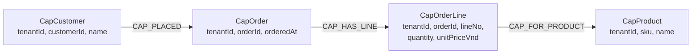
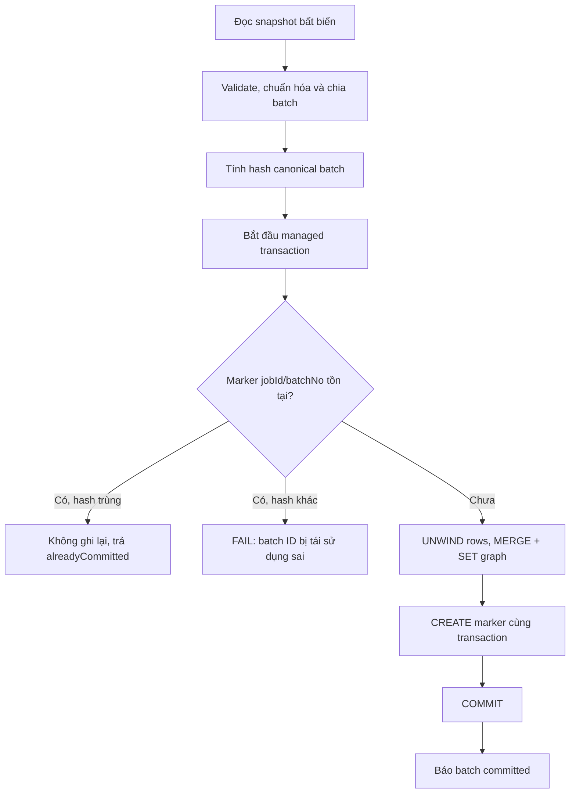

# Đồ án: Tạo ràng buộc, chỉ mục và quy trình nạp dữ liệu lũy đẳng trong Neo4j

## 1. Đề bài và mục tiêu đầu ra

Đây là bài **đồ án thực hành** của mô-đun `DATABASE_ENGINE_GRAPH_NEO4J`: sử dụng Neo4j để lưu **property graph**, mô hình hóa node và relationship, truy vấn bằng **Cypher**, quản lý khóa nghiệp vụ bằng constraint/index, nhập dữ liệu và kết nối ứng dụng qua **Neo4j Java Driver** hoặc **Spring Data Neo4j**.

Đề bài: xây dựng **đồ thị đơn hàng đa tenant** từ một nguồn CSV có thể được gửi lại nhiều lần. Hệ thống phải:

1. Tạo đúng node, relationship và thuộc tính từ dữ liệu nguồn.
2. Có **ràng buộc duy nhất** bảo vệ khóa nghiệp vụ, không nhầm tenant A và tenant B có cùng ID.
3. Có **chỉ mục** phục vụ một truy vấn đọc đã nêu rõ; chứng minh bằng `EXPLAIN`/`PROFILE` phù hợp.
4. Cho phép **nạp lại cùng snapshot** mà không sinh thêm node/relationship hoặc cộng tiền/số lượng lần nữa.
5. Phục hồi khi một transaction hoặc một batch thất bại, không coi các batch đã commit là bị rollback.
6. Có **đối soát dữ liệu đầu vào với graph** về số lượng, khóa, liên kết và tổng tiền.
7. Có bằng chứng kiểm thử và runbook vận hành: lỗi dữ liệu, mất kết nối, retry, độ trễ và phân quyền.

Đồ án không chỉ yêu cầu “chạy `MERGE` không báo lỗi”. Người học phải có **hợp đồng dữ liệu, bất biến, chính sách replay, bảng kết quả kỳ vọng, kiểm thử âm tính và giải thích các giới hạn của giải pháp**.

> **Phạm vi công nghệ:** Cú pháp constraint/index và Java Driver ví dụ theo Neo4j 5.x, Java 17+, Neo4j Java Driver 5.x. Cú pháp `CALL (row) { ... } IN TRANSACTIONS` dùng variable scope clause được hỗ trợ từ **Neo4j 5.23**; bản cũ và bản mới hơn cần đối chiếu tài liệu tương ứng. Không chạy thao tác tạo/xóa dữ liệu của đồ án trên database production.

## 2. Kết quả cần nộp và tiêu chí đạt

| Sản phẩm | Nội dung tối thiểu | Bằng chứng |
| --- | --- | --- |
| **Mô hình graph** | Node, relationship, hướng, khóa theo tenant | Mermaid hoặc sơ đồ + mô tả invariant |
| **Schema Cypher** | 5 unique constraints, tối thiểu 1 index có lý do | Kết quả `SHOW CONSTRAINTS`/`SHOW INDEXES` |
| **Nguồn thử nghiệm** | CSV 4 dòng, định dạng trường, quy tắc kiểm tra | Snapshot ID/hash và bản kê đầu vào |
| **Pipeline nhập** | `MERGE` lũy đẳng, transaction boundary rõ | Chạy lần đầu và chạy lại |
| **Phục hồi** | Batch marker/transaction hoặc quy trình replay toàn nguồn an toàn | Kịch bản lỗi giữa lô và nhập lại |
| **Đối soát** | Node/edge count, business key, tenant, tổng tiền | Query + số liệu trước/sau replay |
| **Vận hành** | Timeout, metric, log, cách xử lý lỗi và rollback | Runbook và checklist |

Một bài đạt yêu cầu phải giải thích **lũy đẳng trong phạm vi nào**. Dưới đây, hợp đồng cơ bản là **một snapshot nguồn bất biến, chỉ có một worker ghi cho mỗi job, cùng chính sách chuẩn hóa dữ liệu**. Nếu muốn hỗ trợ nhiều nguồn cập nhật cùng lúc hoặc thay đổi người mua/sản phẩm của một line, người học phải bổ sung chính sách xung đột hoặc versioning; `MERGE` đơn thuần không bảo đảm những điều đó.

## 3. Tình huống kinh doanh: đơn hàng nhiều tenant

Giả sử một nền tảng bán hàng phục vụ nhiều cửa hàng. Mỗi tenant có thể có khách hàng `C001`, sản phẩm `P001` và đơn hàng `O100` của riêng mình; do đó **chỉ ID đơn lẻ là không đủ** để định danh.

Đồ thị đề xuất:



Sử dụng các nhãn `Cap...` và relationship `CAP_...` để tách đồ án khỏi dữ liệu ứng dụng thật. Đây là **đặt tên cho dữ liệu demo**, không phải quy chuẩn bắt buộc của Neo4j.

| Node | Khóa nghiệp vụ | Thuộc tính quan trọng |
| --- | --- | --- |
| `CapCustomer` | `(tenantId, customerId)` | `name` |
| `CapProduct` | `(tenantId, sku)` | `name` |
| `CapOrder` | `(tenantId, orderId)` | `orderedAt` kiểu `DATE` |
| `CapOrderLine` | `(tenantId, orderId, lineNo)` | `quantity`, `unitPriceVnd` |
| `CapImportBatch` | `(jobId, batchNo)` | `payloadHash`, `rowCount`, `committedAt` |

**Bất biến nghiệp vụ:**

1. Một `CapOrder` thuộc **đúng một** `CapCustomer` trong cùng tenant.
2. Một `CapOrderLine` thuộc **đúng một** `CapOrder` và tham chiếu **đúng một** `CapProduct` trong cùng tenant.
3. `lineNo` chỉ duy nhất **trong một đơn hàng**, không duy nhất toàn database.
4. `quantity` là số nguyên **lớn hơn 0**; `unitPriceVnd` là số nguyên **không âm**. Không dùng `double` cho giá tiền.
5. Tổng tiền một đơn hàng là `SUM(quantity * unitPriceVnd)` theo **giá được chụp tại thời điểm đặt**, không lấy giá hiện tại của `CapProduct`.
6. `tenantId` được lấy từ ngữ cảnh đã được backend xác thực khi xử lý API thật, không tin một tham số tenant tùy ý của người dùng.

Ràng buộc unique không tự cưỡng chế “đúng một cạnh” hoặc “không có cạnh xuyên tenant”. Các invariant quan hệ phải được kiểm tra và bảo vệ qua logic ghi, test hoặc mô hình bổ sung.

## 4. CSV đầu vào và kết quả mẫu có thể kiểm chứng

### 4.1. File nguồn

Đặt tên tệp: `capstone_order_lines.csv`. Nội dung UTF-8 có header:

```csv
tenantId,customerId,customerName,orderId,orderedAt,sku,productName,lineNo,quantity,unitPriceVnd
T1,C001,An,O100,2026-11-20,P001,Bút,1,2,15000
T1,C001,An,O100,2026-11-20,P002,Vở,2,1,30000
T1,C002,Bình,O101,2026-11-21,P002,Vở,1,3,30000
T2,C001,An chi nhánh hai,O900,2026-11-22,P001,Bút loại B,1,4,20000
```

Đây là file **minh họa do đồ án cung cấp**, không phải dữ liệu khách hàng thực. Nếu ứng dụng tự tạo file này từ API/ETL, phải đảm bảo escaping CSV chuẩn và lưu phiên bản snapshot ổn định.

### 4.2. Hợp đồng ánh xạ trường

| CSV | Dạng đầu vào | Property Neo4j | Quy tắc |
| --- | --- | --- | --- |
| `tenantId` | Chuỗi không rỗng | Khóa trên mọi node | Trim và kiểm tra tenant hợp lệ |
| `customerId` | Chuỗi không rỗng | `CapCustomer.customerId` | Duy nhất trong tenant |
| `customerName` | Chuỗi | `CapCustomer.name` | Không thay đổi ngoài chính sách snapshot |
| `orderId` | Chuỗi không rỗng | `CapOrder.orderId` | Duy nhất trong tenant |
| `orderedAt` | ISO `YYYY-MM-DD` | `CapOrder.orderedAt` kiểu date | Ngày hợp lệ, bất biến trong snapshot |
| `sku` | Chuỗi không rỗng | `CapProduct.sku` | Duy nhất trong tenant |
| `productName` | Chuỗi | `CapProduct.name` | Không xung đột trong snapshot |
| `lineNo` | Số nguyên dương | `CapOrderLine.lineNo` | Duy nhất trong `(tenantId,orderId)` |
| `quantity` | Số nguyên dương | `CapOrderLine.quantity` | **Gán giá trị**, không cộng khi replay |
| `unitPriceVnd` | Số nguyên không âm | `CapOrderLine.unitPriceVnd` | Giá chụp tại thời điểm đơn, không lấy từ sản phẩm |

Tất cả khóa phải có **quy tắc chuẩn hóa nhất quán**: trim, Unicode normalization nếu cần, phân biệt chữ hoa/chữ thường và tiền tố tenant theo yêu cầu kinh doanh. Ví dụ `P001` và `p001` có là cùng một SKU hay không phải quyết định **trước** khi nhập, không để phụ thuộc vào hành vi mặc định tình cờ của Cypher.

### 4.3. Kỳ vọng trên một database thực hành sạch

Với đúng 4 dòng CSV ở trên và **chưa tồn tại dữ liệu mang nhãn `Cap...`**, kết quả cần là:

| Thành phần | Số lượng | Cách tính |
| --- | ---: | --- |
| `CapCustomer` | **3** | T1:C001, T1:C002, T2:C001 |
| `CapProduct` | **3** | T1:P001, T1:P002, T2:P001 |
| `CapOrder` | **3** | T1:O100, T1:O101, T2:O900 |
| `CapOrderLine` | **4** | Mỗi dòng tạo một khóa line |
| **Tổng node nghiệp vụ** | **13** | 3 + 3 + 3 + 4 |
| `CAP_PLACED` | **3** | Một customer mỗi order |
| `CAP_HAS_LINE` | **4** | Một order mỗi line |
| `CAP_FOR_PRODUCT` | **4** | Một product mỗi line |
| **Tổng relationship nghiệp vụ** | **11** | 3 + 4 + 4 |

Tổng tiền theo đơn:

| Tenant | Order | Công thức | Tổng VND |
| --- | --- | --- | ---: |
| T1 | O100 | `2×15.000 + 1×30.000` | **60.000** |
| T1 | O101 | `3×30.000` | **90.000** |
| T2 | O900 | `4×20.000` | **80.000** |
| **Tất cả** | | | **230.000** |

Khi dùng phương án Java Driver với `CapImportBatch`, có thể có thêm marker node; **không tính marker vào 13 node nghiệp vụ**. Nếu đã nạp dữ liệu từ trước, hoặc sửa CSV, không được đòi hỏi các số liệu này còn đúng.

## 5. Thiết kế lũy đẳng và ranh giới “chính xác một lần”

### 5.1. Lũy đẳng ở đây nghĩa là gì?

Với cùng snapshot nguồn `S` và cùng thuật toán import `F`, một pipeline lũy đẳng về **trạng thái nghiệp vụ** hướng tới:

\[
F(F(G,S),S)=F(G,S)
\]

Trong đó `G` là trạng thái graph ban đầu. Phương trình nói rằng chạy lại **cùng bản nguồn** không làm thay đổi trạng thái nghiệp vụ thêm lần nữa.

Điều đó **khác** với:

- Job chỉ được chạy một lần trong lịch sử.
- Truy vấn không dùng CPU/kết nối khi chạy lại.
- Không bao giờ có retry ở client hoặc driver.
- Mọi side effect ngoài Neo4j tự động cũng lũy đẳng.
- Luôn có một lần duy nhất thực thi Cypher hoặc gửi gói Bolt.

### 5.2. MERGE theo business key, SET bằng phép gán

**Đúng với replay của cùng snapshot:**

```cypher
MERGE (p:CapProduct {tenantId: $tenantId, sku: $sku})
SET p.name = $productName;
```

**Sai nếu muốn replay an toàn:**

```cypher
CREATE (p:CapProduct {tenantId: $tenantId, sku: $sku});
```

`CREATE` lần sau có thể tạo node trùng hoặc vi phạm constraint.

**Sai nếu tính trạng thái từ delta mỗi lần nhập lại:**

```cypher
MATCH (l:CapOrderLine {
  tenantId: $tenantId,
  orderId: $orderId,
  lineNo: $lineNo
})
SET l.quantity = l.quantity + $quantity;
```

Vì thế, đồ án dùng `SET l.quantity = $quantity`, không dùng phép cộng. Nếu nghiệp vụ thực sự là **sự kiện tăng/giảm**, cần ledger/event ID và cơ chế ghi một lần theo ID sự kiện, không biến delta thành snapshot một cách tùy tiện.

### 5.3. MERGE không tự giải quyết mọi quan hệ xung đột

Nếu `O100` ban đầu được liên kết với `C001`, sau đó một nguồn cũ hoặc xung đột lại cho rằng `O100` thuộc `C002`, câu:

```cypher
MERGE (customer)-[:CAP_PLACED]->(order);
```

có thể tạo thêm một relationship từ customer mới mà **không xóa** relationship cũ. Kết quả vi phạm invariant “một order đúng một customer”.

Vì vậy đồ án chọn chính sách:

- Trong **cùng snapshot**, `(tenantId,orderId)` phải luôn có cùng `customerId` và `orderedAt`.
- `(tenantId,orderId,lineNo)` phải luôn trỏ tới cùng `sku`.
- Dữ liệu nguồn xung đột thì **fail/quarantine**, không “sửa bằng cách thêm cạnh”.
- Việc **đổi chủ đơn hàng** hoặc **đổi sản phẩm của line** là một nghiệp vụ cập nhật riêng, phải xử lý cạnh cũ và cạnh mới **trong transaction** với kiểm tra quyền/version.

Không sử dụng `MERGE` để khẳng định Neo4j sẽ tự duy trì tất cả invariant dạng “mỗi node có đúng một relationship”.

## 6. Bước 1 — Tạo constraint trên khóa nghiệp vụ

Neo4j **unique constraints** giúp database từ chối việc tạo hai node cùng khóa trong cùng nhãn. Dùng khóa **ghép tenant** để không lẫn dữ liệu giữa các cửa hàng.

Chạy các lệnh sau **một lần trong database thực hành**, bằng tài khoản có quyền quản lý schema:

```cypher
CREATE CONSTRAINT cap_customer_business_key IF NOT EXISTS
FOR (c:CapCustomer)
REQUIRE (c.tenantId, c.customerId) IS UNIQUE;
```

```cypher
CREATE CONSTRAINT cap_product_business_key IF NOT EXISTS
FOR (p:CapProduct)
REQUIRE (p.tenantId, p.sku) IS UNIQUE;
```

```cypher
CREATE CONSTRAINT cap_order_business_key IF NOT EXISTS
FOR (o:CapOrder)
REQUIRE (o.tenantId, o.orderId) IS UNIQUE;
```

```cypher
CREATE CONSTRAINT cap_order_line_business_key IF NOT EXISTS
FOR (l:CapOrderLine)
REQUIRE (l.tenantId, l.orderId, l.lineNo) IS UNIQUE;
```

```cypher
CREATE CONSTRAINT cap_import_batch_business_key IF NOT EXISTS
FOR (b:CapImportBatch)
REQUIRE (b.jobId, b.batchNo) IS UNIQUE;
```

### 6.1. Giới hạn của unique constraint

- Unique constraint đảm bảo **không có hai bản ghi cùng tổ hợp giá trị khóa hiện diện đầy đủ**, nhưng **không mặc nhiên bắt buộc mọi property của khóa phải tồn tại** như node-key/property-existence constraint. Nếu thiếu khóa, `MERGE` có thể lỗi hoặc dữ liệu khác có thể vi phạm hợp đồng.
- Vì vậy **kiểm tra null, chuỗi rỗng, kiểu dữ liệu** ở preflight trước import.
- Tạo constraint trên dữ liệu đã có bản ghi trùng có thể **thất bại**; không dùng `IF NOT EXISTS` để che điều đó.
- `IF NOT EXISTS` tránh tạo lại cùng schema item trong nhiều trường hợp, nhưng **không chứng minh** rằng constraint có **định nghĩa, tên và loại** đúng với hợp đồng. Phải kiểm tra catalog sau DDL.
- Trong hệ thống thực, role ứng dụng nhập dữ liệu **không cần** quyền tự tạo index/constraint. DDL nên thuộc migration/job triển khai riêng có kiểm toán.

Kiểm tra:

```cypher
SHOW CONSTRAINTS
YIELD name, type, labelsOrTypes, properties
WHERE name STARTS WITH 'cap_'
RETURN name, type, labelsOrTypes, properties
ORDER BY name;
```

Trên Neo4j 5 có quyền phù hợp, kết quả phải chứa năm unique constraints đã nêu. Tên cột có thể khác theo phiên bản; dùng tài liệu/DDL catalog phù hợp nếu bản đang dùng không hỗ trợ cú pháp mẫu.

## 7. Bước 2 — Thêm index dựa trên truy vấn thật

Unique constraint trên khóa `(tenantId,orderId)` đã cung cấp cơ chế truy cập cho truy vấn tìm đơn hàng theo khóa. **Không tạo thêm một index cùng trường chỉ để “cho đủ bài”.** Hãy xuất phát từ truy vấn đọc cụ thể: liệt kê đơn hàng của một tenant trong khoảng ngày.

### 7.1. Truy vấn đích

```cypher
MATCH (o:CapOrder {tenantId: $tenantId})
WHERE o.orderedAt >= date($fromDate)
  AND o.orderedAt < date($toDateExclusive)
RETURN o.orderId AS orderId, o.orderedAt AS orderedAt
ORDER BY orderedAt ASC, orderId ASC
LIMIT $pageSize;
```

Ví dụ tham số:

```json
{
  "tenantId": "T1",
  "fromDate": "2026-11-20",
  "toDateExclusive": "2026-11-22",
  "pageSize": 20
}
```

Truy vấn có bộ lọc tenant và khoảng ngày, vì vậy xem xét composite **range index**:

```cypher
CREATE RANGE INDEX cap_order_tenant_date IF NOT EXISTS
FOR (o:CapOrder)
ON (o.tenantId, o.orderedAt);
```

**Giải thích:** index này hỗ trợ chiến lược truy cập theo tenant và `orderedAt`. Planner có thể chọn dùng hoặc không tùy cardinality, statistics và phiên bản. Không thể hứa rằng một index sẽ làm mất tất cả `Sort` trong mọi kế hoạch; truy vấn có tie-breaker `orderId` và chỉ index hai property.

### 7.2. Chứng minh thay vì đoán

```cypher
EXPLAIN
MATCH (o:CapOrder {tenantId: $tenantId})
WHERE o.orderedAt >= date($fromDate)
  AND o.orderedAt < date($toDateExclusive)
RETURN o.orderId AS orderId, o.orderedAt AS orderedAt
ORDER BY orderedAt ASC, orderId ASC
LIMIT $pageSize;
```

Sau khi nạp dữ liệu:

```cypher
SHOW INDEXES
YIELD name, type, state, labelsOrTypes, properties
WHERE name = 'cap_order_tenant_date'
RETURN name, type, state, labelsOrTypes, properties;
```

Trong test, khi được phép thực thi:

```cypher
PROFILE
MATCH (o:CapOrder {tenantId: $tenantId})
WHERE o.orderedAt >= date($fromDate)
  AND o.orderedAt < date($toDateExclusive)
RETURN o.orderId AS orderId, o.orderedAt AS orderedAt
ORDER BY orderedAt ASC, orderId ASC
LIMIT $pageSize;
```

Đọc các operator index seek/scan, rows, DB Hits và sort. **Bộ dữ liệu 3 đơn hàng quá nhỏ để benchmark hiệu năng**; dùng dữ liệu lớn đại diện để so sánh trước/sau. `PROFILE` **thực thi** query, nên chỉ dùng với truy vấn đọc an toàn trong ví dụ này.

**Yêu cầu báo cáo:** ghi lý do chọn index, dạng truy vấn, kế hoạch sử dụng index nếu có, giới hạn của phép thử và ảnh hưởng đến chi phí ghi dữ liệu.

## 8. Bước 3 — Kiểm tra nguồn trước khi import

### 8.1. Preflight bắt buộc

Một pipeline thực tế **không được âm thầm bỏ dòng xấu** chỉ để câu Cypher chạy hết. Trước khi gọi database, bộ kiểm tra nguồn cần xác nhận:

1. File có đúng **10 cột**, tên header và kiểu dữ liệu theo mục 4.
2. File được đọc hoàn chỉnh từ một **snapshot bất biến**, có checksum SHA-256 và timestamp/version manifest.
3. Không có `tenantId`/ID bắt buộc rỗng sau chuẩn hóa, không có giá trị `null` cho khóa của `MERGE`.
4. `orderedAt` là ngày ISO hợp lệ; `lineNo`, `quantity`, `unitPriceVnd` là số nguyên theo giới hạn quy định.
5. Không có khóa `(tenantId,orderId,lineNo)` trùng **trong cùng snapshot**; nếu source cho phép duplicate y hệt, phải ghi rõ quy tắc loại trùng trước khi hash và nhập.
6. Các dòng cùng `(tenantId,orderId)` có **cùng customerId, orderedAt**.
7. Các dòng cùng `(tenantId,sku)` có tên sản phẩm nhất quán theo chính sách source.
8. Mỗi line tham chiếu tenant của order, customer và product **giống nhau**.
9. Các số lượng/tiền không gây tràn kiểu của JVM hoặc Neo4j; chọn `long`/integer và giới hạn miền giá trị.
10. Xác minh quyền truy cập nguồn và xử lý dữ liệu nhạy cảm khi lưu log/quarantine.

**Không dùng `WHERE valid...` để bỏ dòng sai rồi báo job thành công.** Có thể từ chối **toàn snapshot**, hoặc đưa dòng lỗi vào một hàng đợi quarantine và đối soát số dòng rõ ràng. Đồ án chọn **fail-fast ở preflight** để có kỳ vọng số lượng chính xác.

### 8.2. Manifest nguồn và khóa job

Ví dụ manifest (giá trị hash mang tính mô tả, không phải kết quả tính SHA thật của file mẫu):

```yaml
jobId: "cap-demo-snapshot-v1"
sourceFile: "capstone_order_lines.csv"
sourceSha256: "<sha256-thuc-te-cua-file>"
mappingVersion: "1"
expectedRows: 4
batchSize: 2
sourceImmutable: true
```

Trong job thật:

- `sourceSha256` phải được **tính từ bytes thực tế** của file rồi lưu vào hệ quản lý job; không sao chép chuỗi minh họa.
- `jobId` phải định danh **một snapshot và một phiên bản mapping**. Không tái sử dụng cùng `jobId` cho nội dung khác.
- Phân chia batch phải **xác định**: thứ tự dòng ổn định, kích thước batch, chỉ số batch và hash trên canonical rows.
- Nếu file được đọc từ URL có thể thay đổi nội dung, phải **đóng băng/copy** nguồn trước khi chạy. Không dựa vào URL không đổi để chứng minh nội dung không đổi.
- Khi source được thay ở version mới, **không replay snapshot cũ lên dữ liệu mới** mà không có chính sách version và kiểm soát xung đột.

### 8.3. Định danh không thể thiếu khi quản trị lỗi

Ba loại ID khác nhau:

| ID | Ví dụ | Trách nhiệm |
| --- | --- | --- |
| **Business key** | `T1/O100/line2` | Một node `CapOrderLine` duy nhất |
| **Job ID** | `cap-demo-snapshot-v1` | Một snapshot + một phiên bản mapping |
| **Batch key** | `(jobId, batchNo)` | Nhận diện transaction/batch đã commit |

Không dùng ID kỹ thuật `id(node)` hoặc `elementId(node)` làm khóa nghiệp vụ lâu dài. Dùng property theo hợp đồng nguồn và unique constraint.

### 8.4. Preflight khi database đã có dữ liệu

Với graph không còn sạch, **kiểm tra nhất quán của CSV thôi chưa đủ**. Một order cũ có thể đã liên kết với customer khác, hoặc một line cũ đã trỏ tới SKU khác. Unique constraints trên node **không tự ngăn** những cạnh xung đột này. Trước khi áp dụng snapshot, có thể chạy các truy vấn chỉ đọc trên `$rows` đã được parse/validate:

```cypher
UNWIND $rows AS row
MATCH (o:CapOrder {
  tenantId: row.tenantId,
  orderId: row.orderId
})
MATCH (oldCustomer:CapCustomer)-[:CAP_PLACED]->(o)
WHERE oldCustomer.tenantId <> row.tenantId
   OR oldCustomer.customerId <> row.customerId
RETURN DISTINCT row.tenantId AS tenantId,
       row.orderId AS orderId,
       oldCustomer.customerId AS previousCustomerId,
       row.customerId AS incomingCustomerId;
```

```cypher
UNWIND $rows AS row
MATCH (l:CapOrderLine {
  tenantId: row.tenantId,
  orderId: row.orderId,
  lineNo: row.lineNo
})
MATCH (l)-[:CAP_FOR_PRODUCT]->(oldProduct:CapProduct)
WHERE oldProduct.tenantId <> row.tenantId
   OR oldProduct.sku <> row.sku
RETURN DISTINCT row.tenantId AS tenantId,
       row.orderId AS orderId,
       row.lineNo AS lineNo,
       oldProduct.sku AS previousSku,
       row.sku AS incomingSku;
```

Cả hai phải trả **0 dòng** cho replay hợp lệ theo hợp đồng bài. Tương tự, cần so `CapOrder.orderedAt` với ngày trong snapshot và các thuộc tính bất biến khác. **Nếu có xung đột, dừng và điều tra**, không thêm cạnh rồi tiếp tục.

Đây là **preflight kiểm tra trên trạng thái hiện có**, không phải khóa ngăn graph thay đổi sau khi kiểm tra. Vì thế giả định **single-writer/không có tác nhân cạnh tranh** vẫn có hiệu lực; hệ multi-writer cần concurrency control và revalidation trong transaction.

## 9. Bước 4 — Nạp dữ liệu bằng LOAD CSV và MERGE

Đây là **lựa chọn A**: nhập CSV trong Neo4j, mỗi dòng xử lý cùng một mô hình. Dùng nó để học và đo lũy đẳng. **Lựa chọn B** ở mục 11 minh họa orchestration bằng Java Driver với marker giao dịch.

### 9.1. Đưa file tới đúng nơi đọc

Với Neo4j **self-managed** có bật cơ chế local file import, `file:///capstone_order_lines.csv` thường tham chiếu file ở thư mục import của **máy chủ/container Neo4j**, không phải thư mục hiện tại của laptop chạy Browser. Hạn chế URI/file import phụ thuộc cấu hình phiên bản và chính sách bảo mật.

Với Neo4j **Aura/managed**, container remote hoặc môi trường không cho local file, hãy dùng phương thức nhập được nhà cung cấp hỗ trợ (chẳng hạn URL HTTPS được cho phép hoặc **Java Driver** gửi các row đã parse). Không tự giả định `file:///...` có thể đọc local filesystem của client.

### 9.2. Cypher nạp theo lô từ CSV

Sau preflight và khi **chỉ có một writer** cho snapshot:

```cypher
LOAD CSV WITH HEADERS
FROM 'file:///capstone_order_lines.csv' AS row
CALL (row) {
  MERGE (c:CapCustomer {
    tenantId: row.tenantId,
    customerId: row.customerId
  })
  SET c.name = row.customerName

  MERGE (o:CapOrder {
    tenantId: row.tenantId,
    orderId: row.orderId
  })
  SET o.orderedAt = date(row.orderedAt)

  MERGE (p:CapProduct {
    tenantId: row.tenantId,
    sku: row.sku
  })
  SET p.name = row.productName

  MERGE (l:CapOrderLine {
    tenantId: row.tenantId,
    orderId: row.orderId,
    lineNo: toInteger(row.lineNo)
  })
  SET l.quantity = toInteger(row.quantity),
      l.unitPriceVnd = toInteger(row.unitPriceVnd)

  MERGE (c)-[:CAP_PLACED]->(o)
  MERGE (o)-[:CAP_HAS_LINE]->(l)
  MERGE (l)-[:CAP_FOR_PRODUCT]->(p)
} IN TRANSACTIONS OF 2 ROWS;
```

**Quan trọng về transaction:**

- Cú pháp `CALL (row) { ... }` với variable scope clause yêu cầu **Neo4j 5.23+** trong họ 5.x. Một số bản cũ dùng `CALL { WITH row ... }` theo tài liệu phiên bản đó.
- `CALL ... IN TRANSACTIONS` cần chạy trong **implicit transaction/autocommit** phù hợp client; **không** chạy bên trong explicit transaction hoặc `executeWrite` managed transaction của Java Driver.
- `OF 2 ROWS` tạo batch nhỏ phục vụ demo; production phải định cỡ theo thời gian, memory, lock và throughput.
- Nếu batch 1 commit còn batch 2 thất bại, **batch 1 vẫn tồn tại**. Đây là partial commit giữa các batch, không phải Neo4j phá nguyên tử của một transaction.
- Nếu preflight không chặn dòng lỗi, `toInteger` có thể tạo `null` cho dữ liệu không phải số; kết quả import có thể sai hoặc lỗi. **Preflight là điều kiện bắt buộc**, không dựa vào các phép đổi kiểu như validator hoàn chỉnh.
- `MERGE` trên relationship giữa các **node đã được bind** giúp nhập lại trong luồng tuần tự. Nó **không** tự cung cấp uniqueness toàn cục cho loại relationship khi nhiều writer tạo cạnh đồng thời.

### 9.3. Đối soát ngay sau import

Chạy lại **đúng câu import** một lần nữa với **cùng file bất biến**, rồi đối chiếu kết quả ở mục 12. Khi mọi bất biến nguồn được giữ, số node/relationship và tổng tiền **không tăng**.

**Tránh thí nghiệm bằng cách tăng số lượng:**

```cypher
// KHÔNG dùng cho replay snapshot:
// SET l.quantity = l.quantity + toInteger(row.quantity)
```

Ở đây `SET` bằng **phép gán** nên lần replay tiếp theo giữ nguyên số lượng theo snapshot.

## 10. Vì sao LOAD CSV không tự là hệ checkpoint đầy đủ?

`CALL ... IN TRANSACTIONS` chia lô trên Neo4j server, nhưng nó **không tự cung cấp** một cơ chế marker bất biến do ứng dụng quản lý để trả lời:

- Batch số 3 đã commit hay chỉ nhận request rồi client bị ngắt kết nối?
- File nguồn có thay đổi sau khi batch 1 chạy không?
- Lần retry này có đúng **cùng nội dung** batch cũ không?
- Khi job bị restart, có thể bỏ qua batch nào và tiếp tục batch nào?
- Nếu một row bị reject, số row đã chấp nhận/đưa vào quarantine là bao nhiêu?

Với snapshot nhỏ và phép ghi lũy đẳng, lựa chọn dễ hiểu là **chạy lại toàn CSV từ đầu** rồi đối soát. Nó có thể tốn thêm tài nguyên nhưng bảo toàn trạng thái khi nguồn bất biến và không có writer cạnh tranh. Với job lớn, cần **marker/checkpoint giao dịch** rõ ràng.

| Cơ chế | Nguyên tắc | Ưu/nhược |
| --- | --- | --- |
| Replay toàn file | Chạy lại các `MERGE`/`SET` lũy đẳng | Đơn giản, có thể tốn nhiều thời gian |
| Checkpoint file ngoài DB | Ghi batch xong rồi cập nhật tiến độ ngoài Neo4j | Có cửa sổ lỗi giữa **commit DB** và **ghi checkpoint** |
| Marker cùng transaction | Ghi dữ liệu và `CapImportBatch` **cùng commit** | Xử lý được commit outcome không rõ khi replay cùng khóa/hash |

Đồ án khuyến nghị triển khai và giải thích **ít nhất** phương án replay toàn file; nhóm nâng cao xây thêm marker đồng transaction với Java Driver.

## 11. Bước 5 — Java Driver: dữ liệu và marker trong một transaction

### 11.1. Luồng thiết kế



**Bất biến marker:** mỗi `(jobId,batchNo)` có tối đa một node `CapImportBatch` nhờ constraint, chứa `payloadHash` và `rowCount`. Hash của batch phải được tính từ **cùng bộ dữ liệu chuẩn hóa, cùng thứ tự**, không lấy từ một nguồn có thể biến đổi.

**Phạm vi concurrency:** ví dụ dưới đây giả định **một writer cho mỗi job**. Nếu hai process đồng thời thấy marker chưa tồn tại, cả hai có thể cố ghi dữ liệu; unique constraint sẽ giúp ngăn **hai marker cùng khóa**, nhưng một process có thể nhận lỗi conflict và phải retry/re-read marker một cách có kiểm soát. Không gọi phương án này là *exactly-once execution* dưới mọi race.

### 11.2. Cấu trúc tham số batch

Trong Java, sau khi parse CSV thành các Map đã **validate**, mỗi row có khóa:

```json
{
  "tenantId": "T1",
  "customerId": "C001",
  "customerName": "An",
  "orderId": "O100",
  "orderedAt": "2026-11-20",
  "sku": "P001",
  "productName": "Bút",
  "lineNo": 1,
  "quantity": 2,
  "unitPriceVnd": 15000
}
```

`lineNo`, `quantity` và `unitPriceVnd` là **kiểu số nguyên Java** (ví dụ `Long`) sau validation; `orderedAt` là chuỗi ngày ISO hợp lệ. Không truyền số tiền qua `Double`. Ví dụ dùng một `List<Map<String,Object>>` đã được kiểm tra kiểu; việc parse/validate từ CSV là **một bước riêng**.

### 11.3. Cypher UPSERT nhận parameter rows

```cypher
UNWIND $rows AS row
MERGE (c:CapCustomer {
  tenantId: row.tenantId,
  customerId: row.customerId
})
SET c.name = row.customerName

MERGE (o:CapOrder {
  tenantId: row.tenantId,
  orderId: row.orderId
})
SET o.orderedAt = date(row.orderedAt)

MERGE (p:CapProduct {
  tenantId: row.tenantId,
  sku: row.sku
})
SET p.name = row.productName

MERGE (l:CapOrderLine {
  tenantId: row.tenantId,
  orderId: row.orderId,
  lineNo: row.lineNo
})
SET l.quantity = row.quantity,
    l.unitPriceVnd = row.unitPriceVnd

MERGE (c)-[:CAP_PLACED]->(o)
MERGE (o)-[:CAP_HAS_LINE]->(l)
MERGE (l)-[:CAP_FOR_PRODUCT]->(p);
```

**Khác với `LOAD CSV`:** dữ liệu đã được chuẩn hóa thành parameter kiểu đúng, không cần `toInteger` trong Cypher. Java Driver sẽ thực thi **toàn `UNWIND` và marker** trong một managed transaction; không lồng thêm `CALL ... IN TRANSACTIONS`.

### 11.4. Ví dụ Java Driver 5.x

Mã sau thể hiện cơ chế trọng tâm: **băm nội dung batch**, phát hiện marker cũ, ghi dữ liệu và tạo marker trong cùng transaction. Mỗi file Java chỉ nên có một public top-level class; ở đây record `Outcome` được định nghĩa **lồng trong class**.

```java
import java.nio.ByteBuffer;
import java.nio.charset.StandardCharsets;
import java.security.MessageDigest;
import java.security.NoSuchAlgorithmException;
import java.util.HexFormat;
import java.util.List;
import java.util.Map;
import org.neo4j.driver.Driver;
import org.neo4j.driver.Record;
import org.neo4j.driver.Session;
import org.neo4j.driver.SessionConfig;

public final class CapstoneBatchWriter {
    public record Outcome(
        boolean alreadyCommitted,
        long rowCount,
        String payloadHash
    ) {}

    private static final List<String> FIELDS = List.of(
        "tenantId", "customerId", "customerName",
        "orderId", "orderedAt", "sku", "productName",
        "lineNo", "quantity", "unitPriceVnd"
    );

    private static final String UPSERT = """
        UNWIND $rows AS row
        MERGE (c:CapCustomer {
          tenantId: row.tenantId,
          customerId: row.customerId
        })
        SET c.name = row.customerName
        MERGE (o:CapOrder {
          tenantId: row.tenantId,
          orderId: row.orderId
        })
        SET o.orderedAt = date(row.orderedAt)
        MERGE (p:CapProduct {
          tenantId: row.tenantId,
          sku: row.sku
        })
        SET p.name = row.productName
        MERGE (l:CapOrderLine {
          tenantId: row.tenantId,
          orderId: row.orderId,
          lineNo: row.lineNo
        })
        SET l.quantity = row.quantity,
            l.unitPriceVnd = row.unitPriceVnd
        MERGE (c)-[:CAP_PLACED]->(o)
        MERGE (o)-[:CAP_HAS_LINE]->(l)
        MERGE (l)-[:CAP_FOR_PRODUCT]->(p)
        """;

    private final Driver driver;
    private final String database;

    public CapstoneBatchWriter(Driver driver, String database) {
        this.driver = driver;
        this.database = database;
    }

    public Outcome writeBatch(
        String jobId,
        long batchNo,
        List<Map<String, Object>> validatedRows
    ) {
        if (jobId == null || jobId.isBlank()
            || batchNo < 0
            || validatedRows == null || validatedRows.isEmpty()) {
            throw new IllegalArgumentException("Invalid batch identity");
        }

        // Đầu vào đã được validate: đúng tên, kiểu, giá trị và thứ tự.
        // Chỉ có String/Long bất biến trong mỗi Map.
        List<Map<String, Object>> rows = validatedRows.stream()
            .map(Map::copyOf)
            .toList();
        String hash = hashRows(rows);
        Map<String, Object> key = Map.of(
            "jobId", jobId,
            "batchNo", batchNo
        );

        try (Session session =
                 driver.session(SessionConfig.forDatabase(database))) {
            return session.executeWrite(tx -> {
                List<Record> found = tx.run("""
                    MATCH (b:CapImportBatch {
                      jobId: $jobId, batchNo: $batchNo
                    })
                    RETURN b.payloadHash AS hash,
                           b.rowCount AS rowCount
                    """, key).list();

                if (!found.isEmpty()) {
                    Record marker = found.get(0);
                    String committedHash = marker.get("hash").asString();
                    long committedRows = marker.get("rowCount").asLong();
                    if (!hash.equals(committedHash)
                        || committedRows != rows.size()) {
                        throw new IllegalStateException(
                            "Batch ID reused with different payload"
                        );
                    }
                    return new Outcome(true, committedRows, hash);
                }

                tx.run(UPSERT, Map.of("rows", rows)).consume();
                tx.run("""
                    CREATE (b:CapImportBatch {
                      jobId: $jobId,
                      batchNo: $batchNo,
                      payloadHash: $hash,
                      rowCount: $count,
                      committedAt: datetime()
                    })
                    """, Map.of(
                        "jobId", jobId,
                        "batchNo", batchNo,
                        "hash", hash,
                        "count", (long) rows.size()
                    )).consume();

                return new Outcome(false, rows.size(), hash);
            });
        }
    }

    private static String hashRows(
        List<Map<String, Object>> rows
    ) {
        final MessageDigest sha;
        try {
            sha = MessageDigest.getInstance("SHA-256");
        } catch (NoSuchAlgorithmException e) {
            throw new IllegalStateException("SHA-256 unavailable", e);
        }

        for (Map<String, Object> row : rows) {
            for (String field : FIELDS) {
                Object value = row.get(field);
                if (value == null) {
                    throw new IllegalArgumentException(
                        "Missing batch field: " + field
                    );
                }
                byte[] bytes = String.valueOf(value)
                    .getBytes(StandardCharsets.UTF_8);
                sha.update(ByteBuffer.allocate(4)
                    .putInt(bytes.length).array());
                sha.update(bytes);
            }
        }
        return HexFormat.of().formatHex(sha.digest());
    }
}
```

**Giới hạn cần nêu rõ của đoạn mã:**

- `validatedRows` **phải thực sự được kiểm tra** trước khi gọi: types, date, positive integers, keys, duplicate/conflict và policy tenant. Hàm `hashRows` không tự thay thế bước validation. Kiểu dữ liệu phải chuẩn hóa thống nhất trước băm; chuỗi `"1"` và số `1` có thể cùng dạng chữ nếu không có type validation.
- Dữ liệu hash bao gồm **đúng thứ tự dòng và danh sách field cố định**, không băm toàn bộ Map với thứ tự key phụ thuộc implementation. Danh sách này phải được **version hóa cùng mapping contract**.
- `Map.copyOf` tạo bản sao map nhưng không sao chép sâu các đối tượng mutable; hợp đồng chỉ cho phép các giá trị **String/Long bất biến**.
- Đoạn code không tải CSV, không tự quản lý **job manifest**, không phân phối batch, không xử lý quá hạn deadline HTTP; đây là thành phần writer của pipeline.
- `session.executeWrite` có thể chạy callback nhiều lần với lỗi transient; callback **không chứa email, file write hoặc side effect bên ngoài**. Nếu transaction được commit mà driver mất phản hồi, cùng job/batch có thể được gọi lại để **đọc marker**.
- Nếu hai writer cùng job chạy đồng thời, **unique constraint trên marker** có thể làm một transaction thất bại. Đồ án giả định single-writer; muốn mở rộng cần queue/lease hoặc một cơ chế khóa và retry/re-read marker sau conflict, có kiểm thử cạnh tranh.
- Marker cho biết **transaction import tương ứng đã commit**, không chứng minh graph chưa bị tác nhân khác sửa sau đó. Phải đối soát kết quả ở bước sau.

### 11.5. Tại sao marker phải cùng transaction?

**Phương án sai:** ghi graph và commit, sau đó ghi marker vào file ngoài database. Nếu ứng dụng crash giữa hai bước, checkpoint báo chưa xong dù dữ liệu đã commit. Phát lại không idempotent sẽ sai.

**Phương án trong ví dụ:** `UPSERT` và `CREATE CapImportBatch` nằm trong **một transaction Neo4j**:

| Tình huống | Graph batch | Marker | Lần replay |
| --- | --- | --- | --- |
| Transaction rollback trước commit | Không commit | Không có | Ghi lại batch |
| Transaction commit và client nhận phản hồi | Đã commit | Có | Skip nếu hash khớp |
| Commit thành công nhưng phản hồi mất | Có thể đã commit | Có nếu đã commit | Kiểm tra marker và skip |
| Commit chưa thành công rồi mất kết nối | Không commit | Không có | Ghi lại batch |
| Marker có nhưng hash khác | Dữ liệu không được tự ghi lại | Marker cũ | Fail/quarantine, điều tra |

**Không tạo marker ở transaction khác** với data, vì đó làm mất bất biến nguyên tử giữa hai thành phần.

## 12. Bước 6 — Đối soát graph sau import

### 12.1. Đếm node theo loại

```cypher
MATCH (c:CapCustomer)
RETURN count(c) AS customers;
```

```cypher
MATCH (p:CapProduct)
RETURN count(p) AS products;
```

```cypher
MATCH (o:CapOrder)
RETURN count(o) AS orders;
```

```cypher
MATCH (l:CapOrderLine)
RETURN count(l) AS orderLines;
```

Trong database test sạch: kết quả là **3, 3, 3, 4**. Với marker Java, đếm `CapImportBatch` riêng, không cộng vào nghiệp vụ.

### 12.2. Đếm relationship theo hướng

```cypher
MATCH (:CapCustomer)-[r:CAP_PLACED]->(:CapOrder)
RETURN count(r) AS placed;
```

```cypher
MATCH (:CapOrder)-[r:CAP_HAS_LINE]->(:CapOrderLine)
RETURN count(r) AS hasLine;
```

```cypher
MATCH (:CapOrderLine)-[r:CAP_FOR_PRODUCT]->(:CapProduct)
RETURN count(r) AS forProduct;
```

Kỳ vọng: **3, 4, 4**. Nếu chạy lại **cùng snapshot**, các số này không tăng. Số lượng đúng vẫn chưa bảo đảm mọi cạnh nối đúng đầu mút: cần query invariant.

### 12.3. Tổng tiền từng đơn hàng

```cypher
MATCH (o:CapOrder)-[:CAP_HAS_LINE]->(l:CapOrderLine)
RETURN o.tenantId AS tenantId,
       o.orderId AS orderId,
       sum(l.quantity * l.unitPriceVnd) AS totalVnd
ORDER BY tenantId, orderId;
```

Trên dữ liệu mẫu:

```text
T1 | O100 | 60000
T1 | O101 | 90000
T2 | O900 | 80000
```

**Tổng tất cả = 230000 VND**. Nếu chạy lần hai ra 460000 VND thì rất có thể đã dùng phép cộng hoặc tạo duplicate relationship/line. Muốn bảo vệ dữ liệu tài chính thực, cần thêm kiểm tra giới hạn numeric overflow và reconciliation theo nguồn độc lập.

### 12.4. Kiểm tra mọi line có đúng một order

```cypher
MATCH (l:CapOrderLine)
OPTIONAL MATCH (o:CapOrder)-[:CAP_HAS_LINE]->(l)
WITH l, count(o) AS orderCount
WHERE orderCount <> 1
RETURN l.tenantId AS tenantId,
       l.orderId AS orderId,
       l.lineNo AS lineNo,
       orderCount;
```

Trên graph mẫu hợp lệ query phải trả **0 dòng**. Lưu ý `count(o)` tính số lần matched node; nếu có **hai relationship song song cùng order**, nó vẫn đếm hai match và phát hiện vi phạm.

### 12.5. Kiểm tra order có đúng một customer

```cypher
MATCH (o:CapOrder)
OPTIONAL MATCH (c:CapCustomer)-[:CAP_PLACED]->(o)
WITH o, count(c) AS customerCount
WHERE customerCount <> 1
RETURN o.tenantId AS tenantId,
       o.orderId AS orderId,
       customerCount;
```

Kỳ vọng **0 dòng**. Query này phát hiện thiếu liên kết và nhiều liên kết đến order; nó không tự xác minh giá trị `customerId` trùng với snapshot, vì vậy cần đối soát expected pair.

### 12.6. Kiểm tra line có đúng một product

```cypher
MATCH (l:CapOrderLine)
OPTIONAL MATCH (l)-[:CAP_FOR_PRODUCT]->(p:CapProduct)
WITH l, count(p) AS productCount
WHERE productCount <> 1
RETURN l.tenantId AS tenantId,
       l.orderId AS orderId,
       l.lineNo AS lineNo,
       productCount;
```

Kỳ vọng **0 dòng**.

### 12.7. Phát hiện cạnh xuyên tenant

```cypher
MATCH (c:CapCustomer)-[:CAP_PLACED]->(o:CapOrder)
WHERE c.tenantId <> o.tenantId
RETURN c.tenantId AS customerTenant,
       o.tenantId AS orderTenant,
       o.orderId AS orderId;
```

```cypher
MATCH (o:CapOrder)-[:CAP_HAS_LINE]->(l:CapOrderLine)
WHERE o.tenantId <> l.tenantId
   OR o.orderId <> l.orderId
RETURN o.tenantId AS orderTenant,
       l.tenantId AS lineTenant,
       o.orderId AS orderId,
       l.lineNo AS lineNo;
```

```cypher
MATCH (l:CapOrderLine)-[:CAP_FOR_PRODUCT]->(p:CapProduct)
WHERE l.tenantId <> p.tenantId
RETURN l.tenantId AS lineTenant,
       p.tenantId AS productTenant,
       l.orderId AS orderId,
       l.lineNo AS lineNo;
```

Mỗi query phải trả **0 dòng**. Nếu một relationship đã bị xóa nhầm hoặc có cạnh sai hướng, các query này chỉ kiểm tra loại cạnh được nêu; vì vậy kết hợp với **count, đúng một cạnh, đối chiếu khóa và dữ liệu nguồn**.

### 12.8. Kiểm tra không có duplicate edge theo cặp đầu mút

```cypher
MATCH (c:CapCustomer)-[r:CAP_PLACED]->(o:CapOrder)
WITH c, o, count(r) AS edgeCount
WHERE edgeCount > 1
RETURN c.tenantId AS tenantId,
       c.customerId AS customerId,
       o.orderId AS orderId,
       edgeCount;
```

Đối với các quan hệ `CAP_HAS_LINE` và `CAP_FOR_PRODUCT`, áp dụng mẫu tương tự. Với mô hình nghiệp vụ **cho phép nhiều relationship song song**, không thể dùng cặp đầu mút làm khóa edge; cần relationship ID hoặc node trung gian có business key. Trong đồ án này, một line chỉ gắn một product nên parallel edge là dữ liệu lỗi.

### 12.9. Đối chiếu khóa nghiệp vụ với nguồn

Số liệu tổng có thể đúng dù có một line sai `sku` và một line khác bù trừ. Vì vậy cần xuất một bản danh sách có thứ tự:

```cypher
MATCH (c:CapCustomer)-[:CAP_PLACED]->
      (o:CapOrder)-[:CAP_HAS_LINE]->
      (l:CapOrderLine)-[:CAP_FOR_PRODUCT]->
      (p:CapProduct)
RETURN o.tenantId AS tenantId,
       c.customerId AS customerId,
       o.orderId AS orderId,
       toString(o.orderedAt) AS orderedAt,
       l.lineNo AS lineNo,
       p.sku AS sku,
       l.quantity AS quantity,
       l.unitPriceVnd AS unitPriceVnd
ORDER BY tenantId, orderId, lineNo;
```

Với dataset mẫu, kết quả phải có **đúng bốn dòng** và mỗi bộ thuộc tính `tenant/order/line/customer/sku/quantity/price` khớp CSV đã canonicalize. Nếu CSV lớn, có thể đối chiếu theo batch hash hoặc xuất digest có quy tắc sắp xếp/encoding xác định; **đừng chỉ băm thứ tự trả về ngẫu nhiên** của Cypher.

## 13. Bước 7 — Kiểm thử nạp lại và phục hồi

### 13.1. Kịch bản test bắt buộc

| Test | Thao tác | Kết quả kỳ vọng |
| --- | --- | --- |
| T1 — Import ban đầu | Nạp 4 dòng trên database test sạch | 13 node nghiệp vụ, 11 edge, tổng 230000 VND |
| T2 — Replay giống hệt | Nạp lại **cùng file** hoặc cùng batch/hash | Số node/edge/tổng tiền **không đổi** |
| T3 — Mất kết nối sau một batch | Ngắt sau khi lô trước có thể đã commit | Replay an toàn; không nhân đôi trạng thái |
| T4 — Dòng lỗi số lượng | `quantity = abc` hoặc `0` | Preflight fail/quarantine, không âm thầm nhập |
| T5 — Khóa rỗng | `tenantId` hoặc `orderId` rỗng | Không tạo node có khóa thiếu |
| T6 — Duplicate business key trong snapshot | Cùng `(tenant,order,lineNo)` xuất hiện hai lần | Fail hoặc de-duplicate theo policy minh bạch |
| T7 — Order đổi customer bất thường | Cùng orderId khác customerId | Fail trước import, không tạo thêm `CAP_PLACED` |
| T8 — Hai tenant dùng cùng ID | T1:C001 và T2:C001 | Hai node **khác** nhau, không có edge xuyên tenant |
| T9 — Replay hash khác với batch key cũ | Gửi cùng `jobId/batchNo` nhưng payload mới | Writer từ chối, không ghi đè |
| T10 — 2 writer chạy cùng batch | Race trên marker | Không có hai marker; lỗi conflict được xử lý đúng, không coi success sai |
| T11 — Index/query plan | Query theo tenant+date | Truy vấn đúng, index phù hợp tồn tại, plan được ghi nhận |
| T12 — Thời gian/khối lượng | Nạp dataset đại diện lớn | Theo dõi throughput, transaction timeout, pool và memory |

### 13.2. Thử lại sau commit outcome không rõ

Giả lập:

```text
Batch 0: đã COMMIT, client nhận ACK
Batch 1: gửi COMMIT rồi mất kết nối (outcome chưa rõ)
Batch 2: chưa bắt đầu
```

Không được tự kết luận batch 1 “chưa commit” chỉ vì client nhận exception. Khi khởi động lại:

1. Giữ **cùng `jobId`, `batchNo` và canonical rows/hash**.
2. Query marker `CapImportBatch` theo `(jobId,batchNo)`.
3. Nếu marker có và hash khớp, **skip**; nếu chưa có, chạy lại transaction.
4. Nếu hash không khớp, **dừng** và yêu cầu xử lý xung đột.
5. Sau tất cả, chạy đối soát node/edge/property và marker count.

Việc client “đã gửi commit” khác với commit có thật. **Marker và dữ liệu được ghi trong cùng transaction** là cơ sở để kiểm tra outcome ở database; nó không bảo vệ khỏi một writer khác sửa graph sau đó.

### 13.3. Thử lỗi để thấy partial commit

Trong phương án `LOAD CSV ... IN TRANSACTIONS OF 2 ROWS`:

- Lô 0 chứa hai dòng đầu, có thể commit thành công.
- Lô 1 chứa hai dòng tiếp theo; nếu gặp lỗi được cố ý cài vào **môi trường test**, lô 0 đã commit không tự rollback.
- Sửa nguồn phải tạo **snapshot/version mới** nếu thay nội dung; không trộn các row cũ và mới dưới cùng manifest mà không kiểm soát.
- Để replay theo snapshot cũ, trước hết phải đảm bảo nguồn cũ vẫn bất biến và lý do thất bại (ví dụ cấu hình hoặc network) đã được khắc phục.

Nếu muốn minh họa lỗi sau khi lô đầu commit, có thể tạo bản CSV test chứa một dòng cuối có `lineNo` không chuyển được thành số; **không dùng dữ liệu sai trong ví dụ chính**, và nhớ xóa/đặt lại database test trước khi so số liệu 13/11.

## 14. Phân biệt nhập lại, cập nhật mới và xóa dữ liệu

Một pipeline import snapshot có thể mang ba ý nghĩa:

| Thao tác | Ý nghĩa | Cách xử lý |
| --- | --- | --- |
| **Replay snapshot S** | Chạy lại cùng sự thật đã biết | `MERGE`/`SET` và batch marker/hash |
| **Import snapshot S2 mới** | Nguồn đã đổi thuộc tính hoặc thêm record | Chính sách version, kiểm tra xung đột, hợp đồng thay đổi |
| **Delete/absence** | Một bản ghi không còn trong snapshot mới | Phải định nghĩa tombstone/diff; không tự xóa vì không thấy trong batch |

`MERGE` **không tự xóa** node/cạnh đã có nhưng không xuất hiện trong snapshot lần mới. Với dữ liệu nghiệp vụ thật:

- Nếu nguồn là **full snapshot**, xác định phạm vi đủ để diff trước khi xóa; tránh xóa dữ liệu của tenant khác.
- Nếu nguồn là **incremental feed**, dùng version/event ID và xử lý upsert/delete event có kiểm soát.
- Khi một order chuyển customer hoặc line chuyển product, phải cập nhật cạnh cũ/new trong một transaction nhất quán.
- Không chạy replay snapshot cũ sau khi dữ liệu mới hơn đã commit nếu không có cơ chế chống ghi đè lùi thời gian.

Đồ án này **không yêu cầu xóa** khi nguồn vắng dòng; đó là phạm vi mở rộng cần phê duyệt riêng.

## 15. Tích hợp với Spring Boot và Spring Data Neo4j

Trong ứng dụng Java hiện đại, có thể dùng:

- **Spring Data Neo4j** để ánh xạ các entity đã có khóa nghiệp vụ và triển khai repository/`Neo4jClient` phục vụ API.
- **Neo4j Java Driver** để thực hiện pipeline batch/transaction như mục 11 với các tham số `UNWIND`.
- **Migration/schema job** có quyền DDL riêng để tạo constraint và index.

Ví dụ cấu hình kết nối **không chứa mật khẩu thật**:

```yaml
spring:
  neo4j:
    uri: ${NEO4J_URI}
    authentication:
      username: ${NEO4J_USERNAME}
      password: ${NEO4J_PASSWORD}
    pool:
      max-connection-pool-size: 20
      connection-acquisition-timeout: 5s

  data:
    neo4j:
      database: ${NEO4J_DATABASE}
```

Các mốc pool chỉ để minh họa; không dùng cùng một tài khoản quản trị database cho mọi request API. Với production, ưu tiên `neo4j+s://` hoặc `bolt+s://` theo topology và chính sách TLS, xác minh chứng chỉ/hostname. Không hạ cấp kết nối sang chế độ bỏ xác minh khi gặp lỗi cấu hình.

### 15.1. Không nhầm transaction của Java Driver với @Transactional của SDN

Ví dụ mã mục 11 dùng `session.executeWrite(...)` và transaction do driver quản lý. Nếu gọi từ một phương thức SDN `@Transactional`, **đừng tự giả định** driver transaction đó tham gia cùng transaction Spring hiện tại. Để giữ nhất quán:

1. Hoặc triển khai pipeline qua một **thành phần dùng Driver** với ranh giới transaction riêng rõ ràng.
2. Hoặc dùng `Neo4jClient`/SDN cùng transaction manager do Spring quản lý và **xây lại marker logic** trong ranh giới đó.

Không tách việc tạo marker và import thành hai transaction rồi gọi chung là “exactly once”.

### 15.2. Số batch và mức đồng thời

Với file rất lớn, batch size cần đo:

| Chỉ số | Khi tăng batch quá lớn |
| --- | --- |
| Transaction duration | Có thể tăng, gần timeout |
| Transaction memory/heap | Nhiều record/relationship phải xử lý cùng lúc |
| Lock wait | Có thể kéo dài thời gian giữ khóa |
| Pool in-use | Connection có thể bị giữ lâu hơn |
| Retry cost | Một lần rollback làm mất nhiều công việc của lô |
| Throughput | Có điểm tối ưu; không luôn tăng theo batch size |

Một ứng dụng 8 replica, mỗi replica pool 20 kết nối, có thể tạo rất nhiều writer nếu không điều tiết. **Unique constraints bảo vệ node key nhưng không thay thế chiến lược concurrency** cho relationship và transaction marker. Đồ án yêu cầu single-writer cho mỗi job để có ranh giới ban đầu rõ ràng.

## 16. Quan sát và runbook xử lý lỗi

### 16.1. Telemetry tối thiểu

| Lớp | Số đo | Mục tiêu |
| --- | --- | --- |
| Source/manifest | `jobId`, snapshot hash, expectedRows, mappingVersion | Xác định nguồn bất biến |
| Pipeline | Rows validated/rejected, batch pending/committed, last checkpoint | Tiến độ và quarantine |
| Java Driver | Retry, pool wait, connection failure, transaction duration | Phân biệt lỗi client và DB |
| Neo4j server | Active/blocked transactions, lock wait, rollback, memory, page cache | Xác định nghẽn database |
| Cypher | DB Hits/Rows, index usage, duration | Tối ưu query và `MERGE` |
| Business reconcile | Node/edge/property mismatches, incorrect totals | Không để “job xanh nhưng dữ liệu sai” |

Không dùng `customerId`, order ID hoặc dữ liệu cá nhân làm nhãn metric có cardinality cao. Log nên có **jobId/batchNo/operation/errorCode** theo chính sách retention, nhưng không in password, token, private key hay toàn bộ CSV chứa PII.

### 16.2. Runbook cơ bản

1. **Lỗi ở preflight:** từ chối snapshot, lưu lý do trong quarantine; không ghi một phần tùy tiện.
2. **Constraint violation:** kiểm tra trùng business key, race writer hoặc dữ liệu hiện có; không xóa constraint để chạy tiếp.
3. **Timeout/lock contention:** giảm batch size hoặc writer concurrency, xem `SHOW TRANSACTIONS`/query plan, kiểm tra node nóng.
4. **Pool acquisition timeout:** kiểm tra active/pending, session đóng đúng, transaction duration; không tăng pool ngay.
5. **Commit outcome chưa rõ:** đọc marker/đối soát cùng `jobId/batchNo`, replay có kiểm soát.
6. **Marker hash mismatch:** dừng, điều tra nguồn/mapping; không ghi đè marker của job cũ.
7. **Sai dữ liệu sau job:** chặn chuyển sang bước tiếp theo, so nguồn và graph; dùng transaction sửa/restore có kế hoạch.
8. **Mất TLS/routing:** kiểm tra CA/SAN/DNS/advertised addresses; không tắt xác minh danh tính server.

### 16.3. SHOW TRANSACTIONS và SHOW SETTINGS

Với quyền vận hành phù hợp:

```cypher
SHOW TRANSACTIONS
YIELD database, transactionId, status,
      elapsedTime, waitTime
RETURN database, transactionId, status,
       elapsedTime, waitTime
ORDER BY elapsedTime DESC;
```

```cypher
SHOW SETTINGS
YIELD name, value, isDynamic
WHERE name IN [
  'db.transaction.timeout',
  'db.lock.acquisition.timeout',
  'db.transaction.concurrent.maximum'
]
RETURN name, value, isDynamic
ORDER BY name;
```

Trong một số phiên bản, edition hoặc **Aura**, các lệnh/setting có thể không khả dụng hoặc bị giới hạn quyền. Không cấp tài khoản app quyền quản trị chỉ để lấy số liệu; dùng dashboard/metrics do hạ tầng cung cấp khi phù hợp.

## 17. Tiến độ thực hiện đồ án theo từng buổi

### Buổi 1 — Thiết kế và schema

- Vẽ mô hình graph ở mục 3.
- Trình bày lý do dùng khóa ghép tenant, không dùng ID kỹ thuật.
- Tạo 5 constraint và index tenant+date.
- Chụp bằng chứng `SHOW CONSTRAINTS`/`SHOW INDEXES`.

**Checkpoint:** schema đúng, người học mô tả được những invariant **không thể** chỉ dùng unique constraint để cưỡng chế.

### Buổi 2 — Import đầu tiên và đối soát

- Đọc CSV 4 dòng, validate và freeze snapshot.
- Nhập bằng `LOAD CSV ... MERGE` hoặc Java Driver.
- Chạy query đếm node/edge, tính tổng tiền và kiểm tra tenant.
- Chạy lại **đúng snapshot** và so trước/sau.

**Checkpoint:** 13 node nghiệp vụ, 11 relationship, 230000 VND; replay không thay đổi kết quả.

### Buổi 3 — Chia batch và phục hồi

- Chia thành các batch **2 dòng** có thứ tự ổn định.
- Thử dừng giữa batch; đối soát những lô đã commit.
- Nếu làm phần nâng cao, triển khai `CapImportBatch` marker atomic + hash.
- Kiểm thử marker mismatch và commit outcome không rõ.

**Checkpoint:** không nhân đôi node/edge/quantity/total và có cách giải thích trạng thái từng batch.

### Buổi 4 — Hiệu năng, bảo mật và báo cáo

- Chạy query theo tenant+date, xem `EXPLAIN`/`PROFILE`.
- Trên dữ liệu lớn hơn, so tốc độ import giữa các batch size.
- Thử khóa rỗng, số lượng sai, order/customer conflict, cross-tenant edge.
- Tổng kết hạn chế: single-writer, source immutable, không có delete, eventual change.

**Checkpoint:** có runbook, bảng kết quả và phần thảo luận kỹ thuật, không chỉ ảnh “Query completed”.

## 18. Mẫu báo cáo kết quả cho người đánh giá

Nhóm nên nộp **một bảng có dữ liệu thực đo**:

| Thử nghiệm | Lần 1 | Lần 2 / phục hồi | Đạt? |
| --- | --- | --- | --- |
| Count `CapCustomer` | 3 | 3 | ... |
| Count `CapProduct` | 3 | 3 | ... |
| Count `CapOrder` | 3 | 3 | ... |
| Count `CapOrderLine` | 4 | 4 | ... |
| Count `CAP_PLACED` | 3 | 3 | ... |
| Count `CAP_HAS_LINE` | 4 | 4 | ... |
| Count `CAP_FOR_PRODUCT` | 4 | 4 | ... |
| Tổng VND | 230000 | 230000 | ... |
| Cross-tenant edges | 0 | 0 | ... |
| Node với relationship count sai | 0 | 0 | ... |
| Batch marker/hash | ... | ... | ... |
| Duration/p95 import hoặc query | ... | ... | ... |

Các số ở hai cột đầu là **expected cho file demo**, trừ dòng metric và marker phụ thuộc cách triển khai. Khi làm trên dataset khác phải ghi **expected tương ứng**, không ép mọi hệ về con số 13/11.

### 18.1. Các lỗi có thể làm demo “đẹp” nhưng sai

- Chạy import lặp trên dataset có **chưa gán quantity/price**; kiểm tra count đúng nhưng số tiền sai.
- Dùng `MERGE` trên **toàn bộ property** thay vì khóa nghiệp vụ, khiến thay đổi tên tạo node khác hoặc không match.
- Trộn T1 và T2 vì khóa chỉ có `customerId`/`sku`.
- Quên kiểm tra các relationship song song: node count đúng nhưng edge count/tổng tiền tăng.
- Dùng `CREATE` cho marker trong transaction **sau** transaction data, làm checkpoint không nguyên tử.
- Truy vấn `PROFILE` của một dataset 4 dòng rồi khẳng định có cải thiện p99 production.
- Không có preflight, âm thầm bỏ dòng hoặc `toInteger` ra null.
- Băm Map không ổn định/canonical order, khiến cùng batch có hash khác hoặc batch khác hash giống do dữ liệu chưa được validate.
- Nói “exactly once” trong khi nhiều worker đồng thời có thể tranh marker và cạnh.

## 19. Thang đánh giá gợi ý (100 điểm)

| Hạng mục | Điểm | Điều kiện |
| --- | ---: | --- |
| Mô hình graph và bất biến | **15** | Đúng node/relationship, tenant boundary, khóa line |
| Constraints/index và kiểm tra catalog | **20** | 5 unique constraints, index theo query và kế hoạch Cypher |
| Hợp đồng CSV + preflight | **15** | Đúng kiểu dữ liệu, nguồn bất biến, validation và xung đột |
| Import lũy đẳng | **20** | `MERGE` theo khóa, SET bằng gán, replay không đổi số liệu |
| Recovery/batch checkpoint | **10** | Giải thích partial commit; marker atomic hoặc replay rõ ràng |
| Đối soát và kiểm thử âm tính | **15** | Count, total, edge/tenant invariants, lỗi/commit không rõ |
| Vận hành/báo cáo | **5** | Chỉ số, bảo mật log, runbook và trình bày bằng chứng |
| **Tổng** | **100** | |

Mức nâng cao không nhất thiết đòi dựng toàn bộ microservice. Một bài có Cypher, Java Driver wrapper nhỏ, bộ kiểm thử và báo cáo đầy đủ **có giá trị hơn** một project UI lớn nhưng không thể chứng minh replay an toàn.

## 20. Bài tập mở rộng

### Mở rộng A — Cập nhật snapshot mới không ghi đè lùi

Snapshot v2 thay `productName` và thêm đơn hàng. Thiết kế `sourceVersion`/`updatedAt` cùng quy tắc **last-write-wins được phê duyệt** hoặc optimistic version check. Chứng minh replay v1 sau v2 **không xóa sửa đổi mới**.

### Mở rộng B — Xóa có kiểm soát

Thiết kế sự kiện `OrderLineDeleted` với `eventId` unique, quyền theo tenant, transaction xóa cạnh/line và audit. Chứng minh replay sự kiện xóa không gây tác động lặp và snapshot thiếu dòng **không tự bị hiểu là lệnh xóa**.

### Mở rộng C — Nhiều worker không sinh cạnh song song

Thêm queue partition theo tenant/order hoặc một giao thức cấp lease cho `jobId`. Kiểm tra race giữa hai worker, unique marker conflict, re-read marker và tính đúng của `CAP_PLACED`/`CAP_HAS_LINE`/`CAP_FOR_PRODUCT`. Không tăng concurrency rồi chỉ dựa vào `MERGE` để giả định uniqueness relationship.

### Mở rộng D — Neo4jClient/SDN API và DTO

Xây endpoint `GET /tenants/{tenantId}/orders/{orderId}` trả DTO đơn hàng, các dòng sản phẩm và tổng tiền. Không serialize trực tiếp entity graph có quan hệ vòng. Kiểm tra role/tenant từ identity và page size của danh sách.

### Mở rộng E — Import dữ liệu lớn

Sinh dữ liệu thử đại diện, đo batch size 100/500/1000, `p95 transaction duration`, memory, pool pending, lock wait và throughput. Chọn ngưỡng dựa trên số liệu, không vì một lô càng lớn thì càng ít lần gọi nên mặc định tốt hơn.

## 21. Checklist nộp bài và vận hành

- [ ] Graph và source CSV đúng hợp đồng 4 loại node, 3 loại relationship.
- [ ] Khóa node và line bao gồm tenant, không nhầm ID giống nhau ở hai tenant.
- [ ] 5 unique constraints được tạo bằng tài khoản schema/migration; kiểm tra catalog.
- [ ] Index được thiết kế từ truy vấn theo tenant+date; `EXPLAIN`/`PROFILE` được giải thích có giới hạn.
- [ ] File CSV đầu vào có header/kiểu chuẩn, được freeze và hash cùng mapping version.
- [ ] Preflight chặn null key, giá trị số sai, duplicate key, conflicting customer/product.
- [ ] `MERGE` chỉ dùng business key; `SET` bằng gán đối với snapshot.
- [ ] Relationships được `MERGE` giữa node đã bind, đúng chiều và đúng tenant.
- [ ] Có chính sách single-writer theo job hoặc cơ chế concurrency rõ ràng.
- [ ] Kết quả lần đầu: 13 node nghiệp vụ, 11 relationship, 230000 VND.
- [ ] Replay lần hai không làm tăng node/edge/quantity/total.
- [ ] Nếu chia batch, nêu rõ transaction boundary và những lô có thể đã commit.
- [ ] Marker/hash, nếu triển khai, nằm trong cùng transaction với dữ liệu.
- [ ] Hash được tính từ canonical rows, thứ tự cố định, schema/version đã xác minh.
- [ ] Đối soát cả số liệu tổng, ID, đầu mút, cạnh song song và dữ liệu cross-tenant.
- [ ] Các lỗi timeout, lock contention, pool, commit outcome không rõ có runbook.
- [ ] Log không chứa password, token, PII hoặc CSV không được masking.
- [ ] Mật khẩu lấy từ secret manager/biến môi trường, production có TLS được xác minh.
- [ ] Không dùng dữ liệu demo để kết luận benchmark trên graph lớn.
- [ ] Báo cáo nêu rõ những gì **chưa** hỗ trợ: multi-writer, delete, snapshot mới, lỗi dữ liệu phức tạp.
- [ ] Có kết quả test âm tính và ảnh/bảng chứng minh số liệu trước–sau replay.

## Kết luận

Đồ án **“Tạo ràng buộc, chỉ mục và quy trình nạp dữ liệu lũy đẳng”** kết hợp các kỹ năng cốt lõi của Neo4j thành một hệ thống nhỏ có thể **kiểm chứng**. Unique constraints bảo vệ khóa nghiệp vụ theo tenant; range index phục vụ truy vấn ngày; `MERGE` và phép `SET` dạng gán cho phép nạp lại snapshot bất biến trong luồng ghi được kiểm soát; batch marker cùng transaction xử lý những lần commit mà client không biết chắc kết quả. Tuy nhiên, **lũy đẳng không chỉ là chọn `MERGE`**: nó còn phụ thuộc validation nguồn, thứ tự và hash batch, xung đột quan hệ, concurrency, transaction boundary và đối soát số liệu. Một đồ án hoàn thành phải chứng minh rằng **chạy lại không nhân đôi**, **lỗi có thể phục hồi** và **dữ liệu sau import vẫn đúng với hợp đồng nghiệp vụ**.

### Tài liệu tham khảo

- [Neo4j Cypher Manual — Constraints](https://neo4j.com/docs/cypher-manual/current/constraints/)
- [Neo4j Cypher Manual — Indexes](https://neo4j.com/docs/cypher-manual/current/indexes/)
- [Neo4j Cypher Manual — MERGE](https://neo4j.com/docs/cypher-manual/current/clauses/merge/)
- [Neo4j Cypher Manual — LOAD CSV](https://neo4j.com/docs/cypher-manual/current/clauses/load-csv/)
- [Neo4j Cypher Manual — CALL subqueries in transactions](https://neo4j.com/docs/cypher-manual/current/subqueries/subqueries-in-transactions/)
- [Neo4j Cypher Manual — Execution plans](https://neo4j.com/docs/cypher-manual/current/planning-and-tuning/execution-plans/)
- [Neo4j Java Driver Manual — Transactions](https://neo4j.com/docs/java-manual/current/transactions/)
- [Neo4j Java Driver Manual — Query the database](https://neo4j.com/docs/java-manual/current/query-simple/)
- [Neo4j Operations Manual — Security](https://neo4j.com/docs/operations-manual/current/security/)
- [Spring Data Neo4j Reference](https://docs.spring.io/spring-data/neo4j/reference/)
