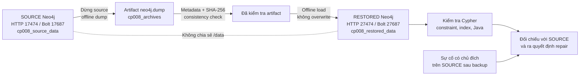
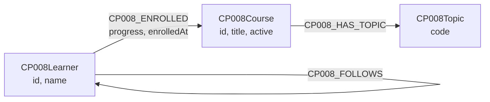

# Thực hành sao lưu, phục hồi và một tình huống sự cố

## 1. Đề bài đồ án và kết quả cần bàn giao

Đây là đồ án cuối chương **Đồ án thực hành**, kết hợp các kỹ năng đã học về Neo4j: mô hình hóa **property graph**, node, relationship, index, constraint, truy vấn Cypher, Java Driver, vận hành database, sao lưu và xử lý sự cố. Bài áp dụng cho module `DATABASE_ENGINE_GRAPH_NEO4J` — sử dụng Neo4j để mô hình hóa dữ liệu liên kết, truy vấn quan hệ/đường đi, tối ưu và tích hợp với ứng dụng Java/Spring Data Neo4j.

**Bối cảnh nghiệp vụ:** Một nền tảng học tập lưu người học, khóa học, chủ đề và quan hệ **đăng ký khóa học** trong Neo4j. Sau một đợt bảo trì, nhóm vận hành phát hiện quan hệ đăng ký của một người học đã bị xóa nhầm. Trước đó hệ thống có một bản sao lưu hợp lệ. Trong khoảng thời gian giữa **backup** và **incident**, hệ thống còn ghi nhận một đăng ký mới hợp lệ.

**Nhiệm vụ:** Tạo dữ liệu mẫu, sao lưu Neo4j ở chế độ offline, mô phỏng sự cố **chỉ trên môi trường lab**, phục hồi bản sao vào **volume/database độc lập**, đối chiếu dữ liệu theo khóa và relationship cụ thể, lựa chọn cách sửa dữ liệu nguồn mà **không làm mất đăng ký hợp lệ phát sinh sau bản sao lưu**, và viết báo cáo phục hồi.

Không được coi `neo4j-admin database load` trả thành công là đồ án đã hoàn tất. **Thành công phải được chứng minh bằng các truy vấn kiểm chứng và smoke test ứng dụng**.

### 1.1. Những gì người học phải chứng minh

1. Source và restore có **hai volume `/data` riêng biệt**, endpoint và thông tin xác thực riêng.
2. Tạo được bản `neo4j.dump` từ database **đã dừng**, kiểm tra metadata và checksum.
3. Phục hồi từ artifact vào đích **chưa có database**, không dùng tùy chọn ghi đè.
4. Xác minh số node, relationship, **khóa nghiệp vụ**, thuộc tính relationship, index và constraint.
5. Chứng minh source sau sự cố khác bản backup, kể cả khi **tổng số relationship trùng nhau**.
6. Dựng cách sửa **một quan hệ bị xóa** trong lab mà vẫn giữ các giao dịch hợp lệ sau backup.
7. Ghi được recovery point, RPO/RTO thực tế của buổi diễn tập và các bước rollback/khôi phục tiếp.
8. Có báo cáo rõ **PASS / FAIL / NOT TESTED**, không tự khai đã thử trên hệ thống thật.

### 1.2. Phạm vi và giả định

- Môi trường: **Docker Engine + Docker Compose V2**, một Neo4j source và một Neo4j restored chạy **standalone**.
- Image ví dụ: `neo4j:2026.10.2` và `neo4j/neo4j-admin:2026.10.2`. Đây là một cặp image được tài liệu Neo4j Docker hiện hành sử dụng làm mẫu. Ở dự án thật cần chọn tag đã kiểm thử, không nâng cấp database bằng `latest`.
- Cơ chế sao lưu: `neo4j-admin database dump` và `neo4j-admin database load` **offline**; phù hợp để học với Neo4j Community/Enterprise. **Online backup** thuộc phạm vi Enterprise, được thảo luận riêng.
- Tài khoản, tên volume, dữ liệu và cổng đều chỉ dành cho **phòng lab**. Không cần quyền admin production.
- Chưa thực thi Docker, Cypher hay Java thực tế trong tài liệu này; các lệnh là chỉ dẫn để người học chạy và tự điền số liệu đo.

> **Cảnh báo an toàn:** Bài có một câu `DELETE` **cố ý mô phỏng xóa nhầm**. Chỉ chạy khi đang kết nối đúng database thực hành, đã lưu baseline và tạo dump hợp lệ. Không sao chép câu lệnh vào production. Không dùng `--overwrite-destination`, `docker compose down -v`, `docker volume prune` hoặc xóa toàn bộ `/data` để “giải quyết” sự cố.

## 2. Kiến trúc diễn tập: sao lưu có thể kiểm chứng và đích khôi phục độc lập



| Thành phần | Dữ liệu/đường dẫn của lab | Vai trò |
|---|---|---|
| Source | `cp008_source_data` mount `/data` | Database trước và sau incident |
| Archive | `cp008_archives` mount `/backups` trong admin helper | Lưu `neo4j.dump`, **không** dùng làm store |
| Restored | `cp008_restored_data` mount `/data` | Bản phục hồi độc lập để đối chiếu |
| Source endpoint | `bolt://127.0.0.1:17687` | App/test đọc source |
| Restored endpoint | `bolt://127.0.0.1:27687` | App/test đọc bản khôi phục |
| Source Browser | `http://127.0.0.1:17474` | Tạo fixture, giả lập incident |
| Restored Browser | `http://127.0.0.1:27474` | Kiểm chứng bản dump |

Hai container ở cùng một Docker host **không phải sự cô lập thảm họa thật**: mất host hoặc quyền Docker admin bị lạm dụng vẫn ảnh hưởng cả hai. Phòng lab dùng volume và mạng tách biệt để tránh **ghi nhầm database**; với doanh nghiệp phải dùng host/VPC/cluster, backup repository và nguyên tắc quyền riêng biệt.

### 2.1. Timeline kỳ vọng

```text
T0: SOURCE có 4 learner, 4 course, 4 topic;
    6 enrollment, 2 follows, 4 topic links.
T1: Dừng SOURCE, tạo file neo4j.dump.
T2: SOURCE khởi động lại.
T3: Giao dịch hợp lệ mới: u04 đăng ký c02.
T4: Sự cố: xóa nhầm enrollment u01 -> c02.
T5: Phát hiện sai lệch bằng truy vấn nghiệp vụ.
T6: LOAD bản dump T1 vào RESTORED độc lập.
T7: Kiểm tra và đề xuất selective repair.
T8: Chỉ trong lab và khi được duyệt, khôi phục cạnh mất
    mà vẫn giữ đăng ký mới T3.
```

**Điểm kiểm chứng quan trọng:** ở T1 có **6** quan hệ đăng ký; sau T3 (+1) và T4 (-1) source cũng có **6** quan hệ đăng ký. Vì vậy **`count(r) = 6` không đủ để phát hiện lỗi**. Phải kiểm chứng **cặp người–khóa học** và các thuộc tính của quan hệ.

## 3. Chuẩn bị môi trường, quyền và điều kiện dừng

### 3.1. Preflight an toàn

Trước khi tạo container:

- Xác nhận Docker/Compose hoạt động và máy đủ RAM, CPU, dung lượng chứa **hai database và ít nhất một dump**.
- Chọn thư mục lab riêng, ví dụ `cp008-lab/`. Các đường dẫn minh họa dưới đây đều thuộc thư mục này.
- Kiểm tra `cp008_source_data`, `cp008_restored_data`, `cp008_archives` **chưa thuộc dữ liệu thật hoặc bài lab khác**. Nếu bất kỳ volume nào đã tồn tại và không rõ chủ sở hữu: **dừng và đổi tên**.
- Chuẩn bị hai secret khác nhau cho source/restored; mật khẩu không được commit lên Git, chụp màn hình công khai hoặc đưa vào log.
- Không dùng source/restored cùng `/data`, không nối ứng dụng thử nghiệm tới queue, webhook, email hay dịch vụ production.
- Đảm bảo người thử nghiệm có quyền chạy Docker **trên host lab**, không đòi quyền hệ thống production.

Môi trường dùng lệnh shell kiểu Linux/macOS. Trên Windows có thể chạy trong WSL2 hoặc điều chỉnh cú pháp cho PowerShell. Các lệnh nhiều dòng có dấu `\` nối dòng **không** được dán nguyên vào PowerShell 5.1.

### 3.2. Tạo volume độc lập

Chỉ sau khi đã kiểm tra tên volume không chứa dữ liệu:

```bash
docker volume ls
docker ps --format "table {{.Names}}\t{{.Status}}\t{{.Ports}}"

# Nếu các tên chưa tồn tại và bạn sở hữu toàn bộ lab:
docker volume create cp008_source_data
docker volume create cp008_restored_data
docker volume create cp008_archives
```

**Lưu ý:** `docker volume create` trả thành công cả khi tên volume đã tồn tại. Do đó **không coi exit code 0 là bằng chứng volume vừa được tạo và đang trống**; phải kiểm tra `docker volume inspect` và inventory trên host.

### 3.3. Docker Compose hai service với hai secret

Chuẩn bị cấu trúc cục bộ:

```text
cp008-lab/
├── compose.yaml
└── secrets/
    ├── source-auth.txt
    └── restored-auth.txt
```

Mỗi file secret có một dòng dạng `neo4j/<mat-khau-manh-rieng>`, được tạo qua kênh quản lý secret thích hợp. Không đưa mật khẩu thật vào ví dụ hoặc mã nguồn. File phải được loại khỏi version control.

Nội dung `compose.yaml`:

```yaml
services:
  source:
    image: neo4j:2026.10.2
    profiles: ["source"]
    restart: "no"
    stop_grace_period: 90s
    ports:
      - "127.0.0.1:17474:7474"
      - "127.0.0.1:17687:7687"
    environment:
      NEO4J_AUTH_FILE: /run/secrets/cp008_source_auth
      NEO4J_server_memory_heap_initial__size: "512M"
      NEO4J_server_memory_heap_max__size: "512M"
      NEO4J_server_memory_pagecache_size: "512M"
    secrets:
      - cp008_source_auth
    volumes:
      - source_data:/data
    networks:
      - source_net

  restored:
    image: neo4j:2026.10.2
    profiles: ["restored"]
    restart: "no"
    stop_grace_period: 90s
    ports:
      - "127.0.0.1:27474:7474"
      - "127.0.0.1:27687:7687"
    environment:
      NEO4J_AUTH_FILE: /run/secrets/cp008_restored_auth
      NEO4J_server_memory_heap_initial__size: "512M"
      NEO4J_server_memory_heap_max__size: "512M"
      NEO4J_server_memory_pagecache_size: "512M"
    secrets:
      - cp008_restored_auth
    volumes:
      - restored_data:/data
    networks:
      - restored_net

secrets:
  cp008_source_auth:
    file: ./secrets/source-auth.txt
  cp008_restored_auth:
    file: ./secrets/restored-auth.txt

volumes:
  source_data:
    external: true
    name: cp008_source_data
  restored_data:
    external: true
    name: cp008_restored_data

networks:
  source_net:
  restored_net:
```

Hai network giúp tách đường giao tiếp giữa service trong Compose, nhưng host vẫn có thể quản lý cả hai container. Cổng publish bị ràng buộc vào `127.0.0.1`, thích hợp cho bài lab, **không** phải cấu hình công khai production.

Các giá trị heap/page cache nhỏ để chạy mẫu ít dữ liệu; không dùng làm cấu hình sẵn sàng cho graph thật. `NEO4J_AUTH_FILE` thiết lập tài khoản khởi tạo **lúc system database chưa tồn tại**. Đổi file secret rồi restart **không tự xoay mật khẩu đã có** trong system database.

### 3.4. Chỉ khởi động SOURCE lúc đầu

```bash
docker compose config --quiet
docker compose --profile source up -d source
docker compose --profile source ps
docker compose --profile source logs --tail 100 source
```

Đợi source sẵn sàng rồi đăng nhập `http://127.0.0.1:17474`; URI Bolt tương ứng là `bolt://127.0.0.1:17687`. **Chưa chạy `restored`** vì cần nạp dump vào một database đích chưa được mount.

## 4. Mô hình graph và dữ liệu fixture

Một nền tảng học tập cần trả lời:

- Người học An đang đăng ký các khóa học nào, tiến độ ra sao?
- Ai đang theo dõi ai?
- Khóa học thuộc chủ đề nào?
- Một giao dịch ghi có làm mất quan hệ đăng ký quan trọng không?



Các nhãn và relationship có tiền tố `CP008` để tránh đụng dữ liệu ngoài đồ án.

### 4.1. Uniqueness constraints và range index

Chạy trên **source**, database `neo4j`:

```cypher
CREATE CONSTRAINT cp008_learner_id IF NOT EXISTS
FOR (u:CP008Learner)
REQUIRE u.id IS UNIQUE;
```

```cypher
CREATE CONSTRAINT cp008_course_id IF NOT EXISTS
FOR (c:CP008Course)
REQUIRE c.id IS UNIQUE;
```

```cypher
CREATE CONSTRAINT cp008_topic_code IF NOT EXISTS
FOR (t:CP008Topic)
REQUIRE t.code IS UNIQUE;
```

```cypher
CREATE RANGE INDEX cp008_course_title IF NOT EXISTS
FOR (c:CP008Course)
ON (c.title);
```

Ba constraint tạo cơ sở cho lookup theo khóa; index `title` dùng trong bài để kiểm tra schema sau restore. Với fixture nhỏ, việc có index **không đảm bảo query nhanh hơn**; khi đánh giá thật cần `EXPLAIN`/`PROFILE`.

### 4.2. Bốn người học

```cypher
UNWIND [
  {id: 'u01', name: 'An'},
  {id: 'u02', name: 'Bình'},
  {id: 'u03', name: 'Chi'},
  {id: 'u04', name: 'Dũng'}
] AS row
MERGE (u:CP008Learner {id: row.id})
SET u.name = row.name;
```

### 4.3. Bốn khóa học và bốn chủ đề

```cypher
UNWIND [
  {id: 'c01', title: 'Cypher căn bản'},
  {id: 'c02', title: 'Java Driver'},
  {id: 'c03', title: 'Spring Data Neo4j'},
  {id: 'c04', title: 'Tối ưu truy vấn'}
] AS row
MERGE (c:CP008Course {id: row.id})
SET c.title = row.title,
    c.active = true;
```

```cypher
UNWIND ['cypher', 'java', 'spring', 'performance'] AS code
MERGE (:CP008Topic {code: code});
```

```cypher
UNWIND [
  {course: 'c01', topic: 'cypher'},
  {course: 'c02', topic: 'java'},
  {course: 'c03', topic: 'spring'},
  {course: 'c04', topic: 'performance'}
] AS row
MATCH (c:CP008Course {id: row.course})
MATCH (t:CP008Topic {code: row.topic})
MERGE (c)-[:CP008_HAS_TOPIC]->(t);
```

### 4.4. Sáu quan hệ đăng ký có thuộc tính

Mỗi cặp learner–course có tối đa một quan hệ `CP008_ENROLLED` trong fixture. `progress` là số phần trăm học tập, không phải số lần click; `enrolledAt` được đặt cố định để kiểm chứng sau restore.

```cypher
UNWIND [
  {u: 'u01', c: 'c01', progress: 80},
  {u: 'u01', c: 'c02', progress: 30},
  {u: 'u02', c: 'c01', progress: 100},
  {u: 'u02', c: 'c03', progress: 20},
  {u: 'u03', c: 'c03', progress: 50},
  {u: 'u04', c: 'c04', progress: 10}
] AS row
MATCH (u:CP008Learner {id: row.u})
MATCH (c:CP008Course {id: row.c})
MERGE (u)-[e:CP008_ENROLLED]->(c)
SET e.progress = row.progress,
    e.enrolledAt = datetime('2026-11-10T09:00:00Z');
```

### 4.5. Hai quan hệ theo dõi

```cypher
UNWIND [
  {source: 'u01', target: 'u02'},
  {source: 'u02', target: 'u03'}
] AS row
MATCH (a:CP008Learner {id: row.source})
MATCH (b:CP008Learner {id: row.target})
MERGE (a)-[:CP008_FOLLOWS]->(b);
```

Tổng cộng tại thời điểm baseline: **12 node** (`4 learner + 4 course + 4 topic`), **12 relationship** (`6 enrolled + 2 follows + 4 has-topic`), **3 uniqueness constraints** và **1 range index bổ sung**. Trong database đã có nội dung khác, chỉ đếm các nhãn/loại `CP008` của đồ án.

## 5. Baseline: ghi lại bằng chứng trước khi backup

Một file dump không chứng minh dữ liệu đúng nếu không có **giá trị tham chiếu**. Trước khi dừng source, chạy các câu sau và lưu kết quả vào báo cáo thực hành.

### 5.1. Đếm phần tử theo từng nhóm

```cypher
MATCH (u:CP008Learner)
WITH count(u) AS learners
MATCH (c:CP008Course)
WITH learners, count(c) AS courses
MATCH (t:CP008Topic)
WITH learners, courses, count(t) AS topics
MATCH (:CP008Learner)-[e:CP008_ENROLLED]->(:CP008Course)
WITH learners, courses, topics, count(e) AS enrollments
MATCH (:CP008Learner)-[f:CP008_FOLLOWS]->(:CP008Learner)
WITH learners, courses, topics, enrollments, count(f) AS follows
MATCH (:CP008Course)-[h:CP008_HAS_TOPIC]->(:CP008Topic)
RETURN learners, courses, topics,
       enrollments, follows, count(h) AS topicLinks;
```

| learners | courses | topics | enrollments | follows | topicLinks |
|---:|---:|---:|---:|---:|---:|
| 4 | 4 | 4 | 6 | 2 | 4 |

Nếu query không ra bảng này, **dừng trước bước dump**, kiểm tra fixture và loại mọi dữ liệu `CP008` từ bài chạy trước. Không sửa baseline cho khớp dữ liệu sai.

### 5.2. Chụp bằng chứng quan hệ nghiệp vụ cụ thể

```cypher
MATCH (u:CP008Learner {id: 'u01'})
      -[e:CP008_ENROLLED]->(c:CP008Course)
RETURN u.id AS learner, c.id AS course,
       e.progress AS progress, e.enrolledAt AS enrolledAt
ORDER BY course;
```

Kỳ vọng:

| learner | course | progress |
|---|---|---:|
| `u01` | `c01` | 80 |
| `u01` | `c02` | 30 |

Với mỗi quan hệ, `enrolledAt` phải bằng `2026-11-10T09:00:00Z`. Đó là **golden result** cho một phép đối chiếu sau restore.

Kiểm tra quan hệ của `u04` tới `c02` (chưa phát sinh):

```cypher
MATCH (:CP008Learner {id: 'u04'})
      -[e:CP008_ENROLLED]->
      (:CP008Course {id: 'c02'})
RETURN count(e) AS enrollmentCount;
```

Kỳ vọng `0`.

### 5.3. Kiểm tra schema

```cypher
SHOW CONSTRAINTS
YIELD name, type, labelsOrTypes, properties
WHERE name STARTS WITH 'cp008_'
RETURN name, type, labelsOrTypes, properties
ORDER BY name;
```

```cypher
SHOW INDEXES
YIELD name, type, state, labelsOrTypes, properties
WHERE name STARTS WITH 'cp008_'
RETURN name, type, state, labelsOrTypes, properties
ORDER BY name;
```

Kỳ vọng ba constraint tên `cp008_learner_id`, `cp008_course_id`, `cp008_topic_code` và index `cp008_course_title`. Neo4j cũng tạo index để hỗ trợ uniqueness constraint; các index đó có thể xuất hiện cùng tên với constraint. Chờ chúng `ONLINE` trước khi làm benchmark hoặc xác nhận schema đã sẵn sàng.

## 6. Tạo bản sao lưu offline bằng neo4j-admin

Với **Neo4j Community Edition**, `neo4j-admin database dump` và `database load` yêu cầu DBMS offline; với Enterprise có những khác biệt theo môi trường nhưng trong đồ án vẫn chọn **dừng hẳn source** để tránh thao tác trên store đang được mount.

### 6.1. Chặn ghi và dừng SOURCE

Xác nhận mọi transaction tạo fixture đã hoàn tất; ngừng ứng dụng/job dùng source, rồi:

```bash
docker compose --profile source stop source
docker compose --profile source ps
```

Kiểm tra source đã dừng. **Không** chạy helper dump khi có một Neo4j khác vẫn dùng cùng volume `cp008_source_data`. Không dừng database ngoài lab theo tên container gần giống.

### 6.2. Dump vào volume archive riêng

```bash
docker run --rm \
  --mount type=volume,src=cp008_source_data,dst=/data \
  --mount type=volume,src=cp008_archives,dst=/backups \
  neo4j/neo4j-admin:2026.10.2 \
  neo4j-admin database dump neo4j --to-path=/backups
```

Kỳ vọng tạo file `neo4j.dump` trong volume `cp008_archives`. Sử dụng image helper **cùng phiên bản** source và lưu exit code, thời gian bắt đầu/kết thúc. Nếu gặp lỗi permission, volume đầy hoặc database còn mounted, **dừng và phân tích**; không đổi quyền mọi file thành `777` hoặc thêm cờ overwrite.

### 6.3. Kiểm tra metadata của dump trước khi sử dụng

```bash
docker run --rm \
  --mount type=volume,src=cp008_archives,dst=/backups,readonly \
  neo4j/neo4j-admin:2026.10.2 \
  neo4j-admin database load neo4j --from-path=/backups --info
```

`--info` chỉ in metadata archive, **không load database**. Nếu sai định dạng, không tìm thấy file hoặc version không tương thích, không tiếp tục diễn tập.

### 6.4. Kiểm tra checksum SHA-256

Ví dụ dùng shell của admin image nếu có `sha256sum`:

```bash
docker run --rm \
  --entrypoint /bin/sh \
  --mount type=volume,src=cp008_archives,dst=/backups,readonly \
  neo4j/neo4j-admin:2026.10.2 \
  -c 'sha256sum /backups/neo4j.dump'
```

Ghi giá trị hash **thực sự nhận được** vào danh mục backup ở nơi quản lý khác volume này. Một checksum tính lại trên cùng file **sau khi bị sửa** không chứng minh tính nguyên bản; nên lưu hash ở nguồn tin cậy/metadata có ký xác nhận. Hash giúp phát hiện thay đổi byte, **không** chứng minh dữ liệu graph đúng về nghiệp vụ.

Có thể kiểm tra thêm tính nhất quán của artifact bằng Neo4j admin (có thể tốn thời gian/tài nguyên):

```bash
docker run --rm \
  --mount type=volume,src=cp008_archives,dst=/backups,readonly \
  neo4j/neo4j-admin:2026.10.2 \
  neo4j-admin database check neo4j \
    --from-path=/backups/neo4j.dump \
    --temp-path=/tmp
```

Đọc exit code và báo cáo kiểm tra nếu có; không xem `database check` là thay thế cho truy vấn nghiệp vụ sau restore. Trong môi trường tải lớn, cần ước lượng đủ dung lượng tạm, CPU/RAM và đường dẫn báo cáo. Không chạy consistency check trên một store database đang được sử dụng.

### 6.5. Danh mục artifact (do người học tự điền)

| Trường | Giá trị cần ghi |
|---|---|
| Source database | `neo4j` trong `cp008_source_data` |
| Image/version | `neo4j:2026.10.2` và admin tương ứng |
| Artifact | `neo4j.dump` ở `cp008_archives` |
| Kích thước file | Giá trị thực tế, không bịa số |
| SHA-256 | Giá trị thực tế từ lệnh hash |
| Thời điểm hoàn tất dump | Timestamp UTC ghi nhận bởi người thực hành |
| Trạng thái database khi dump | Source đã dừng |
| Dữ liệu baseline | 12 node, 12 relationship; bộ khóa/thuộc tính ở mục 5 |
| Người thực hiện và nơi giữ bằng chứng | Điền theo buổi lab |

**Phạm vi file dump:** `neo4j.dump` của database `neo4j` không tự mang theo user/role trong database `system`, secret kết nối, cấu hình TLS, plugin hoặc hạ tầng application. Do đó bản phục hồi tốt cần kiểm chứng thêm cấu hình đích và quyền sử dụng của ứng dụng.

## 7. Mô phỏng sự cố sau bản backup — chỉ trên SOURCE lab

Sau khi dump hoàn tất, khởi động source **với cùng volume**:

```bash
docker compose --profile source start source
docker compose --profile source logs --tail 80 source
```

Chờ server online, kết nối đúng **`http://127.0.0.1:17474`** hoặc Bolt `17687`. Trước khi chạy câu ghi, xác nhận lần cuối database đang chọn là `neo4j` của lab. Nếu dùng connection string khác hoặc nhìn thấy dữ liệu không phải tiền tố `CP008`, **dừng**.

### 7.1. Giao dịch hợp lệ sau thời điểm backup

Người học `u04` đăng ký khóa `c02`. Đây là dữ liệu nghiệp vụ **cần giữ** sau khi xử lý incident:

```cypher
MATCH (u:CP008Learner {id: 'u04'})
MATCH (c:CP008Course {id: 'c02'})
MERGE (u)-[e:CP008_ENROLLED]->(c)
ON CREATE SET e.progress = 5,
              e.enrolledAt = datetime('2026-11-20T09:00:00Z')
RETURN u.id AS learner, c.id AS course,
       e.progress AS progress;
```

Kỳ vọng một dòng `u04, c02, 5`; trên source lúc này có **7** enrollment relationship. Nếu cặp này đã tồn tại do lab cũ, `MERGE` không tạo mới; phải kiểm tra và reset **đúng fixture lab** trước khi diễn tập để timeline còn ý nghĩa.

### 7.2. Sự cố: xóa nhầm quan hệ của An

**Đây là bước phá dữ liệu có chủ đích trên SOURCE LAB. Không chạy trên production.**

Trước khi thực thi, query đọc phải chỉ ra đúng **một** relationship:

```cypher
MATCH (u:CP008Learner {id: 'u01'})
      -[e:CP008_ENROLLED]->
      (c:CP008Course {id: 'c02'})
RETURN count(e) AS targetEdges;
```

Kỳ vọng `targetEdges = 1`. Nếu khác 1, dừng. Khi đã chắc chắn đúng source lab và đúng relationship, mô phỏng một lỗi thao tác:

```cypher
// CHI CHAY TREN DATABASE LAB: mo phong xoa nham 1 relationship
MATCH (u:CP008Learner {id: 'u01'})
      -[e:CP008_ENROLLED]->
      (c:CP008Course {id: 'c02'})
DELETE e;
```

Vì query ghim chính xác `u01`, `c02` và loại relationship, phạm vi ảnh hưởng dự kiến chỉ là một cạnh. Đây **không** phải một biện pháp sửa lỗi; nó là đầu vào cho bài tập incident response.

### 7.3. Tái hiện triệu chứng và phát hiện bằng bất biến

Trên source sau sự cố:

```cypher
MATCH (u:CP008Learner {id: 'u01'})
OPTIONAL MATCH (u)-[e:CP008_ENROLLED]->
               (c:CP008Course)
RETURN u.id AS learner,
       collect(c.id) AS enrolledCourseIds
ORDER BY learner;
```

Kỳ vọng chỉ còn `['c01']`. Người học An **mất khóa `c02`** dù trước backup có đăng ký, tiến độ `30` và timestamp của quan hệ đó.

Kiểm tra cả thay đổi hợp lệ:

```cypher
MATCH (:CP008Learner {id: 'u04'})
      -[e:CP008_ENROLLED]->
      (:CP008Course {id: 'c02'})
RETURN count(e) AS newEnrollmentCount,
       max(e.progress) AS latestProgress;
```

Kỳ vọng `newEnrollmentCount=1`, `latestProgress=5`.

Kiểm tra lại số lượng quan hệ đăng ký:

```cypher
MATCH (:CP008Learner)-[e:CP008_ENROLLED]->
      (:CP008Course)
RETURN count(e) AS enrollmentCount;
```

**Kỳ vọng `6` — giống đúng baseline dù graph đã sai!** Một quan hệ cũ bị xóa, một quan hệ mới được thêm. Đây là lý do các bài kiểm tra khôi phục chỉ dựa trên `count(*)` không thể bảo đảm đúng dữ liệu nghiệp vụ.

### 7.4. Phân loại incident trước khi hành động

| Câu hỏi | Kết quả dự kiến của lab | Hành động |
|---|---|---|
| Neo4j còn online? | Có | Không coi đây là sự cố toàn bộ server |
| Cypher và index có hoạt động? | Có | Không cần dựng lại database chỉ để query chạy |
| Dữ liệu nào mất? | `u01 -[:CP008_ENROLLED]-> c02` | Xác định chính xác định danh và thuộc tính |
| Có ghi mới sau backup không? | Có: `u04 → c02` | Không được rollback toàn store mà không đối soát |
| Có artifact sạch trước incident? | Có: `neo4j.dump` | Khôi phục riêng để điều tra |
| Có thể sửa phạm vi hẹp? | Có trong lab | Chỉ sau khi xác minh chứng cứ và được duyệt |

Trong hệ thống thật, việc đầu tiên còn gồm **dừng tác nhân gây lỗi, bảo toàn evidence, hạn chế quyền, khoanh vùng khoảng thời gian ảnh hưởng**, kiểm tra lịch sử thay đổi và chọn kịch bản khôi phục phù hợp. Không chỉnh sửa dữ liệu source ngay lập tức trước khi thu đủ bằng chứng.

## 8. Phục hồi bản dump vào môi trường RESTORED tách biệt

### 8.1. Điều kiện trước khi load

1. Volume `cp008_restored_data` **mới/trống** và chưa bị một DBMS nào mount để ghi.
2. Service `restored` **chưa khởi động**.
3. Volume `cp008_archives` có một artifact `neo4j.dump` đã kiểm tra `--info` và hash.
4. Helper image tương thích với source.
5. Không dùng tùy chọn `--overwrite-destination`; nếu đích không trống, **dừng** và xử lý ownership, không ghi đè.

### 8.2. Nạp dump với neo4j-admin

```bash
docker run --rm \
  --mount type=volume,src=cp008_restored_data,dst=/data \
  --mount type=volume,src=cp008_archives,dst=/backups,readonly \
  neo4j/neo4j-admin:2026.10.2 \
  neo4j-admin database load neo4j --from-path=/backups
```

Đây là thao tác **offline** trên volume đích. Không mount `cp008_source_data` ở `/data` trong lệnh này. Không dùng `--overwrite-destination` để vượt một lỗi chưa hiểu.

Nếu load dừng giữa chừng, volume đích có thể chứa dữ liệu không hoàn chỉnh. Không thử lại mù quáng; nên dùng **một volume đích mới đã được phê duyệt** hoặc kiểm tra dọn đúng volume lab, sau đó chạy lại có log.

### 8.3. Khởi động RESTORED

```bash
docker compose --profile restored up -d restored
docker compose --profile restored ps
docker compose --profile restored logs --tail 100 restored
```

Kết nối tới **`http://127.0.0.1:27474`** hoặc Bolt **`bolt://127.0.0.1:27687`**, dùng **restored secret**. Bản dump chỉ chứa database `neo4j`, không tự đem theo toàn bộ role/user của `system`, nên xác thực đích phải được cấu hình riêng.

Kiểm tra database online:

```cypher
SHOW DATABASES
YIELD name, currentStatus
WHERE name = 'neo4j'
RETURN name, currentStatus;
```

Kỳ vọng database ở trạng thái online. Với các database **không phải default** trên Neo4j Enterprise, có thể cần thao tác đăng ký bằng `CREATE DATABASE` trên `system` sau khi nạp; bài này dùng database mặc định `neo4j` để giữ lab đơn giản.

## 9. Acceptance test: chứng minh bản khôi phục đúng từng quan hệ

Thực thi **tất cả query sau trên RESTORED**, không phải source. Việc server lên `running` hoặc `RETURN 1` thành công chỉ là health check; chưa đủ chứng minh dữ liệu và schema.

### 9.1. Kiểm tra số node và số relationship

Chạy lại truy vấn mục 5.1. Kỳ vọng:

| Thuộc tính | Giá trị ở RESTORED |
|---|---:|
| `CP008Learner` | 4 |
| `CP008Course` | 4 |
| `CP008Topic` | 4 |
| `CP008_ENROLLED` | 6 |
| `CP008_FOLLOWS` | 2 |
| `CP008_HAS_TOPIC` | 4 |

Nếu khác, dừng nghiệm thu và kiểm tra dump, load, database name hoặc volume. Nếu giống, **tiếp tục** đối chiếu theo khóa: đếm đúng không đồng nghĩa dữ liệu đúng.

### 9.2. Kiểm chứng quan hệ bị xóa trên source đã trở lại trong restore

```cypher
MATCH (:CP008Learner {id: 'u01'})
      -[e:CP008_ENROLLED]->
      (:CP008Course {id: 'c02'})
RETURN count(e) AS links,
       max(e.progress) AS progress,
       max(e.enrolledAt) AS enrolledAt;
```

Kỳ vọng `links=1`, `progress=30`, `enrolledAt=2026-11-10T09:00:00Z`. Nếu `links=0`, bản restore không chứa đối tượng cần đối soát; có thể đã chọn nhầm artifact hoặc baseline không đúng.

### 9.3. Kiểm chứng đăng ký phát sinh sau dump không nằm trong restore

```cypher
MATCH (:CP008Learner {id: 'u04'})
      -[e:CP008_ENROLLED]->
      (:CP008Course {id: 'c02'})
RETURN count(e) AS afterBackupEnrollments;
```

Kỳ vọng `0` vì hành vi của `u04` diễn ra **sau mốc backup**. Nếu nhận `1`, hãy kiểm tra sai endpoint/volume hoặc đã tạo dump muộn hơn timeline dự kiến.

### 9.4. Kiểm tra graph traversal qua nhiều relationship

```cypher
MATCH (:CP008Learner {id: 'u01'})
      -[:CP008_FOLLOWS]->
      (peer:CP008Learner)
      -[:CP008_ENROLLED]->
      (course:CP008Course)
      -[:CP008_HAS_TOPIC]->
      (topic:CP008Topic)
RETURN peer.id AS peer, course.id AS course,
       topic.code AS topic
ORDER BY peer, course;
```

Kỳ vọng hai dòng: `u02/c01/cypher` và `u02/c03/spring`. Đây là bằng chứng rằng **hướng relationship**, các node liên quan và mẫu đường đi còn hoạt động, không chỉ node đơn.

### 9.5. Kiểm tra constraint/index

Chạy lại hai lệnh `SHOW CONSTRAINTS` và `SHOW INDEXES` của mục 5.3. Kỳ vọng đủ:

- `cp008_learner_id`.
- `cp008_course_id`.
- `cp008_topic_code`.
- `cp008_course_title` ở trạng thái `ONLINE`, cùng các index hỗ trợ constraint.

Nếu index đang ở trạng thái đang tạo, đợi hoàn tất trước phép đo hiệu năng. Không bỏ qua index lỗi chỉ vì dữ liệu đã xuất hiện; với dữ liệu lớn, thiếu index có thể làm API chậm nghiêm trọng.

### 9.6. Một query kiểm tra bất biến tổng hợp

```cypher
MATCH (an:CP008Learner {id: 'u01'})
MATCH (dung:CP008Learner {id: 'u04'})
MATCH (java:CP008Course {id: 'c02'})
OPTIONAL MATCH (an)-[restoredEdge:CP008_ENROLLED]->(java)
WITH dung, java,
     count(restoredEdge) AS anEdges,
     max(restoredEdge.progress) AS anProgress
OPTIONAL MATCH (dung)-[postBackupEdge:CP008_ENROLLED]->(java)
WITH anEdges, anProgress,
     count(postBackupEdge) AS postBackupEdges
RETURN anEdges = 1
       AND anProgress = 30
       AND postBackupEdges = 0 AS restorePassed;
```

Kỳ vọng `restorePassed=true`. Hai điều kiện dùng **cặp định danh** và **giá trị thuộc tính** thay vì chỉ dựa tổng số quan hệ. Khi chạy trên source sau sự cố, query trả `false`, đúng theo mục đích mô phỏng.

## 10. Smoke test bằng Neo4j Java Driver

Kiểm tra ứng dụng có thể đọc database RESTORED bằng cấu hình riêng. Ví dụ Java 17+ / Neo4j Java Driver đồng bộ:

```java
import java.util.Map;
import org.neo4j.driver.AuthTokens;
import org.neo4j.driver.Driver;
import org.neo4j.driver.GraphDatabase;
import org.neo4j.driver.SessionConfig;

public final class CapstoneRestoreSmoke {
    public record Evidence(long links, long progress) {}

    public static void main(String[] args) {
        String password = System.getenv("CP008_RESTORE_PASSWORD");
        if (password == null || password.isBlank()) {
            throw new IllegalStateException("Missing restore credential");
        }

        // Chỉ đích khôi phục; KHÔNG trỏ tới source/production.
        try (Driver driver = GraphDatabase.driver(
                "bolt://127.0.0.1:27687",
                AuthTokens.basic("neo4j", password))) {
            driver.verifyConnectivity();

            try (var session = driver.session(
                    SessionConfig.forDatabase("neo4j"))) {
                Evidence result = session.executeRead(tx -> {
                    var row = tx.run("""
                        MATCH (:CP008Learner {id: $learner})
                              -[e:CP008_ENROLLED]->
                              (:CP008Course {id: $course})
                        RETURN count(e) AS links,
                               max(e.progress) AS progress
                        """, Map.of("learner", "u01", "course", "c02"))
                        .single();
                    long links = row.get("links").asLong();
                    long progress = row.get("progress").isNull()
                        ? -1L : row.get("progress").asLong();
                    return new Evidence(links, progress);
                });

                if (result.links() != 1L || result.progress() != 30L) {
                    throw new IllegalStateException(
                        "Restore invariant failed: " + result
                    );
                }
                System.out.println("RESTORE SMOKE PASS");
            }
        }
    }
}
```

Ứng dụng đọc **qua transaction** và ánh xạ dữ liệu thành DTO đơn giản trước khi đóng session. Không trả `Result` chưa tiêu thụ ra ngoài `executeRead` hoặc session. `Driver` ở sản phẩm thật nên được tái sử dụng trong vòng đời ứng dụng; bài demo tạo và đóng riêng để tránh kết nối nhầm sau diễn tập.

Nếu sử dụng **Spring Data Neo4j**, tạo profile `restore-test` có `spring.neo4j.uri=bolt://127.0.0.1:27687` và secret của RESTORED, chỉ chạy repository/query **đọc**. Tắt scheduler, ingestion, event consumer, webhook và migration tự động trong lab. Với role có RBAC, sử dụng tài khoản chỉ đọc thay vì admin; `@Transactional(readOnly=true)` không tự thu hồi quyền ghi của principal.

**Smoke test PASS** chứng minh luồng đọc cụ thể trên Java hoạt động; không tự động chứng minh các truy vấn khác, toàn bộ plugin/APOC, procedure, user/role, index lớn hay hệ thống kết nối ngoài đã phục hồi.

## 11. Ra quyết định: full restore hay chỉ sửa một quan hệ?

Giờ chúng ta có ba trạng thái:

| Trạng thái | `u01 → c02` | `u04 → c02` | Số ENROLLED |
|---|---|---|---:|
| SOURCE tại mốc backup T1 | Có, progress 30 | Không | 6 |
| SOURCE sau incident T4 | **Mất** | **Có**, progress 5 | 6 |
| RESTORED từ dump T1 | **Có**, progress 30 | Không | 6 |
| SOURCE sau selective repair (mục 11.2) | **Có**, progress 30 | **Có**, progress 5 | 7 |

**Không nên thay source bằng toàn bộ bản RESTORED ngay trong tình huống này:** bạn sẽ khôi phục được `u01 → c02` nhưng đồng thời **làm mất giao dịch hợp lệ `u04 → c02`** phát sinh sau backup. Đây là đánh đổi RPO, không phải chỉ là vấn đề kỹ thuật chạy `load`.

### 11.1. Quy trình ra quyết định trong incident thật

1. **Ngăn tác nhân tiếp tục gây lỗi** (job sai, script sai, credential bị lạm dụng), bảo toàn audit evidence.
2. Xác định phạm vi dữ liệu bị tác động bằng khóa nghiệp vụ, khoảng thời gian, transaction/event log và mức tin cậy của nguồn.
3. Tạo bản phục hồi **tách biệt** từ recovery point phù hợp; không overwrite hệ thống đang phục vụ.
4. So sánh **tập thay đổi từ backup tới incident** với các giao dịch hợp lệ sau backup.
5. Nếu hỏng rộng và không thể tin cậy trong việc khôi phục từng mục, lựa chọn full recovery với RPO đã được phê duyệt và kế hoạch replay/reconciliation hợp lệ.
6. Nếu chỉ thiếu một đối tượng xác định, xem xét **selective repair** dưới change approval, có transaction, logging, validation và rollback.
7. Chỉ chuyển traffic/khôi phục SLA sau khi các acceptance test đạt; không tự xem dữ liệu restore là trạng thái mới nhất.

Neo4j không tự đưa ra một lệnh `merge-from-restored-database` để “chỉ khôi phục phần sai” theo nghiệp vụ. Các thay đổi từ bản restore phải được **đối soát và áp dụng có chủ đích**, tránh copy toàn bộ graph gây trùng và làm mất transaction mới.

### 11.2. Selective repair — chỉ chạy trên SOURCE LAB sau khi có chứng cứ

**Điều kiện bắt buộc:** đã xác minh bằng RESTORED rằng `u01 → c02` từng tồn tại, có `progress=30` và `enrolledAt` cố định, còn source hiện thiếu duy nhất quan hệ đó. Thao tác dưới đây **sửa source**, không chạy trên RESTORED:

```cypher
// CHI CHAY TREN SOURCE LAB SAU KHI DOI CHIEU
MATCH (u:CP008Learner {id: 'u01'})
MATCH (c:CP008Course {id: 'c02'})
MERGE (u)-[e:CP008_ENROLLED]->(c)
ON CREATE SET e.progress = 30,
              e.enrolledAt = datetime('2026-11-10T09:00:00Z')
RETURN u.id AS learner, c.id AS course,
       e.progress AS progress, e.enrolledAt AS enrolledAt;
```

`MERGE` giúp bài thực hành idempotent khi chạy lại trên một graph không có cạnh trùng. Trong hệ thống ghi đồng thời, **`MERGE` không tự bảo đảm không có cạnh song song** trong mọi race condition; cần transaction/lock, constraint phù hợp với thiết kế và kiểm thử concurrency trước khi dùng làm khôi phục production.

Sau đó, kiểm tra trên SOURCE:

```cypher
MATCH (u:CP008Learner)
WHERE u.id IN ['u01', 'u04']
MATCH (c:CP008Course {id: 'c02'})
OPTIONAL MATCH (u)-[e:CP008_ENROLLED]->(c)
RETURN u.id AS learner,
       count(e) AS links,
       max(e.progress) AS progress
ORDER BY learner;
```

Kỳ vọng:

| learner | links | progress |
|---|---:|---:|
| `u01` | 1 | 30 |
| `u04` | 1 | 5 |

Tổng `CP008_ENROLLED` trên source giờ là **7**; RESTORED vẫn là **6** và **không** được tự cập nhật theo source. Sự khác biệt có chủ đích này chứng minh mục tiêu **khôi phục đúng phần bị mất mà bảo toàn dữ liệu hợp lệ sau backup**.

Trong sự cố thật, phải kiểm tra đồng thời event nghiệp vụ, version/optimistic locking, quyền ghi, replay/backfill và audit trail; không đoán tiến độ hay timestamp đã mất nếu không có bản sao đáng tin cậy.

## 12. RPO, RTO và bằng chứng nghiệm thu

### 12.1. Hai chỉ số khác nhau

| Khái niệm | Đo cái gì? | Lưu ý |
|---|---|---|
| **Recovery Point Objective (RPO)** | Lượng thời gian/biến động dữ liệu có thể chấp nhận mất | Dump ở T1 không chứa giao dịch mới T3 |
| **Recovery Time Objective (RTO)** | Thời gian tối đa đến khi hệ thống phục vụ trở lại mức chấp nhận được | Gồm tìm artifact, chuẩn bị, load, khởi động, xác minh và chuyển traffic |
| **Recovery point đạt được** | Mốc dữ liệu thực tế bản restore chứa | Cần định danh bằng metadata/timestamp/transaction evidence |
| **Restore duration** | Thời gian thao tác nạp store, start DB | Chỉ là **một phần** của RTO toàn dịch vụ |
| **Data correctness** | Trạng thái graph khớp chính sách/bất biến | Không được đo bằng thời gian restore hoặc số node đơn thuần |

Nếu bản backup tạo lúc 09:00 và incident lúc 09:17, một **ví dụ lý thuyết** có gap 17 phút; đó không phải một con số đo được của đồ án. **RPO không phải thời gian tải file**, và khôi phục đúng RPO mục tiêu có thể vẫn không đạt nếu mất một giao dịch nghiệp vụ cực kỳ quan trọng.

### 12.2. Timeline cần ghi khi diễn tập

```text
T_detect     Phát hiện mất quan hệ, mở incident ticket
T_identify   Xác định phạm vi và recovery point hợp lệ
T_artifact   Xác minh file dump/checksum/metadata
T_load_start Bắt đầu nạp vào volume restore
T_load_end   Nạp xong, chuẩn bị khởi động
T_db_ready   Database restored online
T_verify    Cypher + Java smoke test PASS
T_decide    Đề xuất selective repair / full recovery
T_resolved  Hoàn tất sửa source, nghiệm thu nghiệp vụ
```

Tùy mục tiêu, tính `restore-only duration = T_db_ready - T_load_start`, còn **incident recovery time** tính từ `T_detect` tới `T_resolved`. Dùng đồng hồ có múi giờ/timestamp nhất quán; không chỉ ghi “mất vài phút” mà không có bằng chứng.

### 12.3. Mẫu báo cáo nghiệm thu

| Hạng mục | Kỳ vọng | Trạng thái do người học điền |
|---|---|---|
| Source và restored volume độc lập | `cp008_source_data ≠ cp008_restored_data` | PASS / FAIL / NOT TESTED |
| Source sau incident có lỗi | `u01→c02` không còn, `u04→c02` tồn tại | PASS / FAIL / NOT TESTED |
| Backup artifact | `neo4j.dump` đọc được, hash đã lưu | PASS / FAIL / NOT TESTED |
| Consistency check | Không báo inconsistency, nếu chạy | PASS / FAIL / NOT TESTED |
| Restore endpoint | Bolt `27687`, database `neo4j` online | PASS / FAIL / NOT TESTED |
| Nodes/edges | 4/4/4 node, 6/2/4 relationship | PASS / FAIL / NOT TESTED |
| Quan hệ bị mất có trong restore | `u01→c02`, progress 30 | PASS / FAIL / NOT TESTED |
| Giao dịch sau dump không có trong restore | `u04→c02` vắng mặt | PASS / FAIL / NOT TESTED |
| Constraint/index | 3 constraint + index title ONLINE | PASS / FAIL / NOT TESTED |
| Traversal và Java Driver | Query nhiều hop và smoke test đạt | PASS / FAIL / NOT TESTED |
| Selective repair trên source lab | Giữ cả `u01→c02` và `u04→c02` | PASS / FAIL / NOT TESTED |
| RPO/RTO | Có mốc thực và giải thích sai lệch | PASS / FAIL / NOT TESTED |
| Quyền và bảo mật | Không dùng secret/connector production | PASS / FAIL / NOT TESTED |

Nếu một mục **bắt buộc** chưa đạt, báo cáo `PARTIAL` hoặc `FAILED` kèm lý do; không tuyên bố “backup verified” chỉ vì `neo4j-admin` exit code 0. Bằng chứng gồm log đã lọc dữ liệu nhạy cảm, hash, phiên bản, query/result, timeline và tên người kiểm thử.

## 13. Mở rộng: online backup và sự cố trong Neo4j Enterprise/cluster

Đồ án dùng **offline dump/load**, nhưng trong hệ thống cần uptime cao, dừng nguồn để dump mỗi lần có thể không đáp ứng RPO/RTO. Neo4j Enterprise có cơ chế **online backup**:

| Đặc điểm | Offline dump/load | Enterprise online backup/restore |
|---|---|---|
| Nguồn có phải dừng không? | Lab dùng DBMS offline | Backup khi database đang phục vụ, theo cấu hình |
| Artifact | `<database>.dump` | `.backup` full/differential theo phiên bản |
| Cần quản lý chuỗi không? | Một dump độc lập | Differential cần chain hợp lệ |
| Khôi phục | `database load` | `database restore` cho backup chain |
| Metadata/role | Dump user DB không tự chứa `system` roles | Phụ thuộc tùy chọn, scope và phiên bản |
| Phù hợp | Lab, migration, offline snapshot | Backup định kỳ cho hệ thống quan trọng |

Ví dụ **cú pháp khái niệm** trên Enterprise, không chạy vào database thật:

```bash
# Tham khảo manual cho đúng release và cấu hình backup connector.
neo4j-admin database backup neo4j \
  --to-path=/approved/backups \
  --type=FULL

# Restore chỉ trên một server đích offline, đã chuẩn bị độc lập.
neo4j-admin database restore \
  --from-path=/approved/backups \
  restoredlab
```

Ví dụ Enterprise trên chỉ để so sánh **mô hình lệnh**; trong triển khai thật còn phải cấu hình server/port backup, quyền, nguồn phục vụ, metadata và tên artifact. Differential backup **không phải dump có thể nạp độc lập**; muốn phục hồi phải cung cấp đủ chain và khả năng replay log theo thời điểm. Không dùng `database load` lên một differential tùy ý.

**Với cluster:** khôi phục database còn liên quan trạng thái cluster và việc đăng ký database trên `system`. Không copy store hay dùng `--overwrite-destination` trên một member vẫn thuộc cụm rồi xem đó là restore an toàn. Tham khảo quy trình seed/restore chuyên dụng cho Neo4j cluster, topology và edition đang chạy.

Ngoài dữ liệu graph, kế hoạch khôi phục thực tế phải bảo toàn hoặc thiết lập lại: `system` user/role, database privileges, TLS certificates, plugins/APOC, cấu hình, secrets, external indexes/cache, event offsets, và thông tin dùng bởi Java Driver/Spring Data Neo4j.

## 14. Xử lý các lỗi có thể gặp trong lúc diễn tập

| Triệu chứng | Giả thuyết | Cách xử lý an toàn |
|---|---|---|
| `database dump` báo store đang được dùng | Source chưa dừng hoặc một tiến trình khác mount volume | Dừng đúng service lab, xác nhận mount, không chạy ép |
| Admin helper không ghi `/backups` | UID/GID, permission hoặc filesystem readonly | Kiểm tra ownership/ACL, sửa **chỉ volume lab**, không `chmod 777` |
| Không có `neo4j.dump` | Sai tên database, mount, đường dẫn hoặc dump lỗi | Kiểm tra log và `--info`, không tạo artifact giả |
| Checksum thay đổi | File khác/đã hỏng hoặc manifest không khớp | Cách ly artifact, dùng bản đáng tin khác |
| Database check thất bại | Artifact/store có thể lỗi, thiếu tài nguyên tạm | Xem report, không tiếp tục nghiệm thu mù |
| `database load` báo destination tồn tại | Restored volume không trống, DBMS đã chạy | Dừng, xác định owner; **không thêm overwrite** |
| Load xong nhưng không có node | Trỏ nhầm database/volume hoặc image lỗi | So `SHOW DATABASES`, endpoint, dump và log |
| Java nối `17687` và thấy dữ liệu khác | Đang đọc source thay vì restored | Đổi về `27687`, test riêng hai trạng thái |
| Quan hệ `u01→c02` không có trong restore | Dump tạo sau incident hoặc dữ liệu baseline sai | Kiểm tra recovery point, không bịa progress |
| Quan hệ `u04→c02` có trong restore | Sai artifact/mốc hoặc query nhầm source | Dừng nghiệm thu, xác minh nguồn của kết quả |
| Tổng relationship đúng nhưng sai khóa | Giao dịch mới che sự mất mát | So từng khóa/thuộc tính và audit log |
| Có auth nhưng query `MATCH` bị từ chối | User/role trong `system` khác, RBAC | Kiểm tra role của đích, không dùng admin vĩnh viễn |
| Dump/restore quá lâu | Dung lượng/I/O/temp/heap thiếu | Đo disk/CPU/RAM, lên kế hoạch capacity |
| Phục hồi đúng dữ liệu nhưng ứng dụng sai | Config, plugin, external event/cache, migration | Chạy smoke/integration tests và kiểm tra tích hợp |

### 14.1. Không “chữa” bằng cách xóa bằng chứng

Nếu source đang có sự cố thật, việc xóa database, dọn transaction log, overwrite volume hoặc chạy lại migration không kiểm soát có thể làm mất dấu vết điều tra. Trong lab, mọi sửa đổi phải được đánh dấu **mô phỏng**; trong doanh nghiệp, giữ nguyên snapshot/log và theo quy trình phê duyệt, phân quyền, audit.

## 15. Quan sát, bảo mật và giới hạn của phương án

### 15.1. Metric cần thu

- Thời lượng dump/load, tốc độ đọc/ghi storage, dung lượng artifact và dung lượng tạm.
- Trạng thái khởi động database, khôi phục transaction log, index population.
- Số node/relationship theo loại, tỷ lệ bất biến nghiệp vụ đạt, kết quả smoke test.
- `p95`/`p99` truy vấn nghiệp vụ sau restore, pool wait và lỗi Java Driver.
- Thời gian phát hiện sự cố, thời gian chọn backup, thời gian khôi phục và nghiệm thu.
- Số transaction sau backup cần bảo toàn hoặc replay/reconcile.

Đây là các chỉ số **đề xuất thiết kế giám sát**, không phải metric có sẵn mặc định với đúng tên đó trong mọi phiên bản. Kết hợp logs Neo4j, dashboard hạ tầng, tracing ứng dụng và báo cáo kiểm tra.

### 15.2. Dữ liệu backup nhạy cảm

Backup graph có thể lộ cả **thuộc tính và cấu trúc quan hệ**. Một bản sao đã ẩn tên người nhưng giữ nguyên đồ thị xã hội vẫn có thể tái nhận diện được. Vì vậy:

- Chỉ dùng **dữ liệu giả** như fixture `CP008` trong bài học.
- Dùng tài khoản, network và secrets **riêng** cho RESTORED; mặc định không bật outbound connectors/job/webhook/CDC/SMTP ở lab.
- Hạn chế người có quyền đọc `.dump`; áp dụng encryption, retention, mã hóa khi truyền và kiểm toán truy cập nếu dùng backup thật.
- Không chia sẻ dump hoặc log có mật khẩu, token, dữ liệu cá nhân qua kênh không được phê duyệt.
- Kiểm tra cả quyền DBMS/schema/RBAC, không mặc định nạp `neo4j.dump` là đã khôi phục mọi user/role.

### 15.3. Những điều capstone không tự chứng minh

- Lab trên một host không chứng minh RTO/RPO của database production lớn hàng TB.
- Dùng dump offline không chứng minh online backup hoặc differential chain hoạt động.
- Một lần Cypher query đúng không bảo đảm toàn bộ workload/routing/cluster khỏe.
- Khôi phục một cạnh bằng `MERGE` không chứng minh cơ chế sửa dữ liệu ở quy mô lớn và đồng thời là an toàn.
- Bản khôi phục từ T1 không thể tự xuất hiện transaction T3; cần reconciliation hoặc replay.

## 16. Nhiệm vụ mở rộng và câu hỏi bảo vệ đồ án

1. **Phân tích sự cố:** Vì sao source T4 và restore T1 đều có 6 cạnh `CP008_ENROLLED` nhưng dữ liệu khác? Chỉ ra hai cặp khóa khác biệt.
2. **Thiết kế acceptance:** Viết một câu Cypher kiểm tra đủ `u01→c02`, `progress=30`, `u04→c02` vắng mặt ở restore và không dùng tổng count làm tiêu chí duy nhất.
3. **Recovery point:** Phân biệt RPO mục tiêu, thời điểm backup thật và thời điểm người học phát hiện sự cố.
4. **Selective repair:** Nếu source bị xóa 1.000 cạnh chứ không phải một, bạn sẽ chọn full restore, batch repair hay replay từ event log? Liệt kê dữ liệu cần có trước khi quyết định.
5. **Cần giữ giao dịch sau backup:** Vì sao thay toàn bộ source bằng dump T1 có thể làm người học `u04` mất khóa vừa đăng ký?
6. **Index và constraint:** Sau restore, vì sao cần kiểm tra `ONLINE` và uniqueness constraint, thay vì chỉ chạy `MATCH`?
7. **Sai endpoint:** Đề xuất một cách để smoke test phát hiện app đang trỏ source `17687` thay vì restored `27687`.
8. **Backup artifact:** Checksum, `--info`, `database check` và query nghiệp vụ kiểm tra những loại rủi ro **khác nhau** thế nào?
9. **Cluster:** Khi Neo4j Enterprise có nhiều member, tại sao không thể chỉ copy một volume store lên thành viên đang chạy?
10. **RTO:** Lập biểu đồ T_detect → T_resolved với thời gian đo thực; tách thời gian tải artifact, load, start, verify, repair.
11. **Bảo mật:** Nếu restore chứa dữ liệu khách hàng thật, cần thay đổi gì về isolation, masking, RBAC, retention và connector outbound?
12. **Java/SDN:** Viết thêm một integration test read-only đối chiếu danh sách khóa học của `u01` qua Java Driver hoặc `Neo4jClient` với golden result.
13. **Kiểm thử lỗi:** Dùng **bản sao phụ** của dump trong vùng lab để mô phỏng artifact hỏng; không sửa file dump gốc. Mô tả dấu hiệu `--info`, hash hoặc `database check` phát hiện.
14. **Tính đúng đắn:** Sau selective repair, vì sao source có 7 enrollment còn restore có 6 và **cả hai** kết quả đều đúng theo recovery point tương ứng?

### 16.1. Thang đánh giá đề xuất (100 điểm)

| Nhóm | Điểm tối đa | Bằng chứng |
|---|---:|---|
| Thiết kế cách ly và an toàn thao tác | 15 | Volume, port, secret, quy tắc không overwrite |
| Fixture và golden baseline | 15 | Counts, ID/relationship/property, schema |
| Backup artifact và tính toàn vẹn | 15 | Dump, `--info`, hash, kiểm tra bổ sung |
| Khôi phục độc lập và acceptance | 20 | Cypher, index/constraint, Java smoke |
| Phân tích incident và phương án bảo toàn ghi mới | 20 | Phát hiện đúng sai lệch, selective repair có kiểm soát |
| Báo cáo RPO/RTO, bảo mật và hậu kiểm | 15 | Timeline, quyết định, hành động ngăn tái diễn |

Một kết quả đạt điểm cao phải trình bày **tại sao phương án được chọn an toàn**, không chỉ liệt kê lệnh đã chạy. Báo cáo không có bằng chứng từ restored hoặc làm mất `u04→c02` không đạt các tiêu chí cốt lõi.

## 17. Dọn lab và giữ lại bằng chứng đúng cách

Sau khi diễn tập, **chỉ dừng hai service lab**, giữ các volume để có thể kiểm tra lại:

```bash
docker compose --profile source --profile restored down
```

Vì Compose khai báo `external: true`, lệnh `down` thông thường không xóa các volume `cp008_source_data` và `cp008_restored_data`. Xác nhận trước khi quyết định dọn dữ liệu:

```bash
docker volume inspect cp008_source_data
docker volume inspect cp008_restored_data
docker volume inspect cp008_archives
```

Nếu muốn **chỉ xóa fixture trên RESTORED** để thực hành Cypher cleanup, cần khởi động đúng RESTORED, kết nối đúng database test và xác nhận quyền; **không thực hiện với SOURCE** nếu muốn giữ bằng chứng incident. Ví dụ:

```cypher
MATCH (u:CP008Learner)
DETACH DELETE u;
```

```cypher
MATCH (c:CP008Course)
DETACH DELETE c;
```

```cypher
MATCH (t:CP008Topic)
DETACH DELETE t;
```

```cypher
DROP INDEX cp008_course_title IF EXISTS;
```

```cypher
DROP CONSTRAINT cp008_learner_id IF EXISTS;
```

```cypher
DROP CONSTRAINT cp008_course_id IF EXISTS;
```

```cypher
DROP CONSTRAINT cp008_topic_code IF EXISTS;
```

**An toàn hơn:** giữ nguyên source, restored và artifact sau buổi học cho người hướng dẫn kiểm tra. Chỉ xóa **đúng ba volume lab** theo quy trình phê duyệt, sau khi kiểm tra không service nào còn sử dụng và bản backup cần giữ đã được lưu ở nơi được phép. **Không dùng** `docker volume prune`, `docker system prune --volumes` hoặc `down -v` như cách dọn chung.

## 18. Tài liệu tham khảo

- [Neo4j Operations Manual — Dump and load in Docker](https://neo4j.com/docs/operations-manual/current/docker/dump-load/): `neo4j/neo4j-admin` sidecar, thao tác offline trên volume.
- [Neo4j Operations Manual — Back up an offline database](https://neo4j.com/docs/operations-manual/current/backup-restore/offline-backup/): `neo4j-admin database dump`, `--to-path` và phạm vi metadata.
- [Neo4j Operations Manual — Restore a database dump](https://neo4j.com/docs/operations-manual/current/backup-restore/restore-dump/): `neo4j-admin database load`, `--info`, điều kiện offline và `--overwrite-destination`.
- [Neo4j Operations Manual — Check database consistency](https://neo4j.com/docs/operations-manual/current/backup-restore/consistency-checker/): `neo4j-admin database check` và `--from-path` với dump.
- [Neo4j Operations Manual — Online backup](https://neo4j.com/docs/operations-manual/current/backup-restore/online-backup/): full/differential backup Enterprise.
- [Neo4j Operations Manual — Restore a database backup](https://neo4j.com/docs/operations-manual/current/backup-restore/restore-backup/): restore backup chain, transaction log và lưu ý cluster.
- [Neo4j Operations Manual — Docker Compose and secrets](https://neo4j.com/docs/operations-manual/current/docker/docker-compose-standalone/): tách xác thực qua `NEO4J_AUTH_FILE`.
- [Neo4j Cypher Manual — MATCH](https://neo4j.com/docs/cypher-manual/current/clauses/match/): duyệt đường quan hệ và điều kiện theo khóa.
- [Neo4j Cypher Manual — MERGE](https://neo4j.com/docs/cypher-manual/current/clauses/merge/): cập nhật node/cạnh có định danh và idempotency có điều kiện.
- [Neo4j Java Driver Manual](https://neo4j.com/docs/java-manual/current/): `verifyConnectivity`, `executeRead`, session lifecycle và Cypher parameters.
