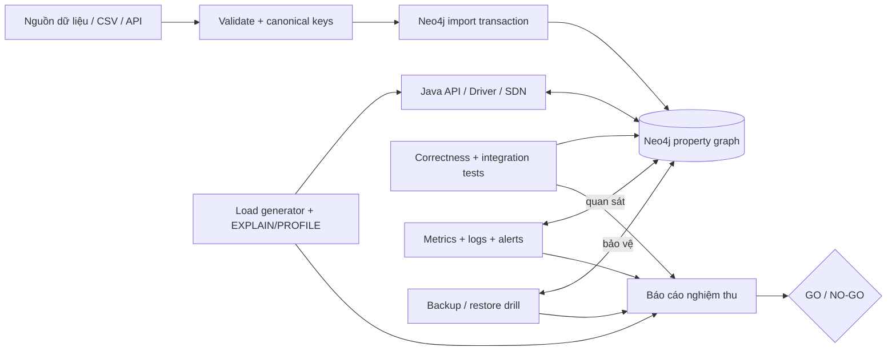
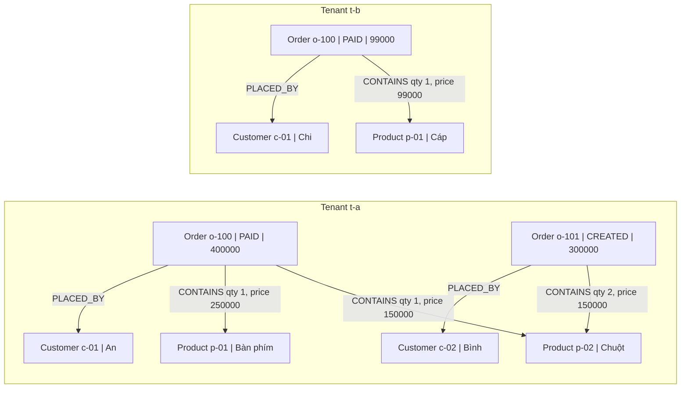
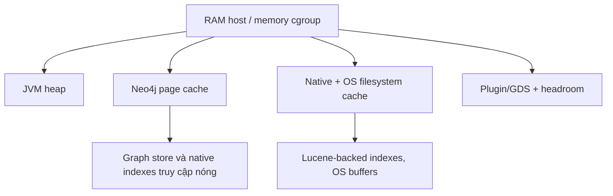
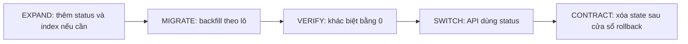

# Đánh giá mô hình Neo4j theo tính đúng, độ trễ, dung lượng và khả năng vận hành

## 1. Đồ án không hoàn thành chỉ vì truy vấn Cypher chạy được

Trong một dự án Neo4j, việc mô hình hóa được node, relationship và viết ra vài câu `MATCH` là **điểm khởi đầu**, chưa phải tiêu chí đưa graph vào sử dụng. Một graph có thể trả kết quả nhanh nhưng nối đơn hàng sang khách hàng sai tenant; cũng có thể đúng dữ liệu nhưng tải truy vấn làm cạn heap, hoặc được tối ưu tốt nhưng không có quy trình backup, quan sát và phục hồi khi có sự cố.

Bài thuộc chương **Đồ án thực hành** của module `DATABASE_ENGINE_GRAPH_NEO4J`. Sau khi học về property graph, Cypher, index, constraint, nhập dữ liệu, Java Driver, Spring Data Neo4j và vận hành, bạn sẽ xây dựng **bộ tiêu chí đánh giá một mô hình dữ liệu đồ thị** theo bốn trục:

1. **Tính đúng (correctness):** thực thể, thuộc tính, quan hệ, ràng buộc và kết quả nghiệp vụ đúng.
2. **Độ trễ (latency):** truy vấn quan trọng đạt P95/P99 và thông lượng mục tiêu trên workload có thể lặp.
3. **Dung lượng (capacity):** ước lượng hợp lý kích thước graph, index, transaction logs, RAM và tăng trưởng.
4. **Khả năng vận hành (operability):** có metric, alert, bảo mật, backup/restore, quy trình triển khai và xử lý lỗi.

Điểm cốt lõi của đồ án: **không lấy điểm trung bình để che một lỗi nghiêm trọng**. Ví dụ, một truy vấn trả sai chủ sở hữu đơn hàng phải bị chặn dù P99 chỉ 3 ms. Ngược lại, đồ án có dữ liệu đúng vẫn cần chứng minh rằng người vận hành có thể nhận biết, kiểm soát và khôi phục dịch vụ.

### Mục tiêu học tập

Sau bài này, bạn có thể:

- Tạo một đồ thị mẫu có business key, property và relationship nhất quán.
- Xây bộ **oracle** và phép kiểm tra có thể chạy lại sau nhập dữ liệu hoặc migration.
- Lập kế hoạch benchmark có baseline, workload, query plan, percentile và điều kiện đo rõ ràng.
- Suy ra ngân sách lưu trữ/bộ nhớ từ **số đo mẫu**, tránh dùng định mức byte/node tùy tiện.
- Thiết kế vận hành tối thiểu cho hệ thống Neo4j tự quản lý hoặc ứng dụng kết nối Aura.
- Chấm kết quả bằng **rubric có bằng chứng**, cổng GO/NO-GO và báo cáo rủi ro còn lại.

> **Phạm vi phiên bản:** Ví dụ dùng cú pháp thông dụng của Neo4j 5.x, Java Driver 5.x/6.x và khái niệm tương thích với Spring Data Neo4j hiện đại. Lệnh quản trị, edition, store format, GDS, CDC và cơ chế backup khác nhau theo bản phát hành/hình thức triển khai. Các số đo P99, footprint và ngưỡng vận hành trong bài là **giả định dùng để học cách đánh giá**, không phải benchmark hay mức cam kết của Neo4j.

## 2. Sản phẩm cuối cùng cần nộp là gì?

Đồ án giả định bạn thiết kế một graph hỗ trợ ba chức năng:

- Tra cứu thông tin một **đơn hàng** và khách hàng đã đặt.
- Xem **lịch sử mua hàng** cùng các sản phẩm/line items.
- Tính **tổng tiền và số đơn theo tenant**, có thể kiểm chứng bằng dữ liệu nguồn.

Hệ thống có **ứng dụng Java/Spring**, kết nối Neo4j qua Bolt và hiển thị kết quả trên API. Dự án không bắt buộc triển khai giao diện đồ họa; trọng tâm là **mô hình và bằng chứng đánh giá**.



### 2.1. Danh mục hiện vật nghiệm thu

| Nhóm | Hiện vật tối thiểu | Mục đích |
| --- | --- | --- |
| Mô hình | Sơ đồ node/relationship, từ điển thuộc tính, khóa | Người khác hiểu và kiểm tra đúng ngữ nghĩa |
| Dữ liệu | Script nạp fixture và bảng kết quả dự kiến | Tái hiện chính xác trên DB test |
| Correctness | Cypher kiểm tra khóa, relation, tenant, tổng tiền | Chứng minh không sai dữ liệu |
| Schema | Danh mục constraint/index và trạng thái | Ngăn trùng, hỗ trợ lookup |
| Performance | Query corpus, baseline, kết quả nhiều lượt test | Chứng minh P95/P99 và throughput |
| Capacity | Số N/R/property, số đo store/index, dự báo tăng trưởng | Cấp đủ disk/RAM và headroom |
| Operations | Dashboard, cảnh báo, backup/restore/runbook | Kiểm soát sự cố và thay đổi |
| Decision | Scorecard, hard gates, người phê duyệt, rủi ro | Quyết định có thể kiểm tra lại |

**Không coi một screenshot đẹp hay một file `.cypher` dài là kết quả nghiệm thu.** Người đánh giá cần chạy được phép đo, tái tạo số liệu và biết vì sao mô hình vượt hoặc không vượt cổng chấp nhận.

## 3. Miền nghiệp vụ đồ án: graph đơn hàng nhiều tenant

Để mọi ví dụ nhất quán, chúng ta dùng ba loại thực thể:

```text
(:EvalCustomer {
  tenantId, customerId, name, active
})

(:EvalOrder {
  tenantId, orderId, state, totalCents
})

(:EvalProduct {
  tenantId, sku, title, priceCents
})

(EvalOrder)-[:PLACED_BY]->(EvalCustomer)
(EvalOrder)-[:CONTAINS {
  quantity, unitPriceCents
}]->(EvalProduct)
```

Quy ước **có chủ đích**:

- `PLACED_BY` có hướng từ đơn hàng tới khách hàng đã đặt.
- `CONTAINS` có hướng từ đơn hàng tới sản phẩm và biểu diễn **một dòng hàng cho mỗi cặp order–product** trong ví dụ.
- `unitPriceCents` là **giá chốt tại lúc đặt hàng**, khác với `EvalProduct.priceCents` có thể thay đổi theo catalog.
- `totalCents` là tổng tiền lưu trên đơn để đọc nhanh, nhưng phải khớp phép tính từ line items theo quy tắc giá đã định.
- `tenantId` là thành phần của khóa nghiệp vụ, không được thiếu trong phép nối thực thể.

Nếu một đơn thực tế cho phép cùng SKU xuất hiện trên **nhiều line khác nhau** (khuyến mãi, lô hàng, cấu hình), cần chuyển sang node `OrderLine` hoặc relationship có `lineId` duy nhất và ràng buộc phù hợp. **`MERGE (order)-[:CONTAINS]->(product)` không được coi là mô hình tổng quát cho mọi hóa đơn**.

### 3.1. Sơ đồ graph



**Các khóa `o-100` và `p-01` được dùng lại ở tenant khác**. Đây là tình huống cố ý để kiểm tra việc importer, repository và query có xử lý đúng khóa composite hay không.

### 3.2. Oracle — kết quả đúng phải biết trước

| Phạm vi | Customer | Order | Product | `PLACED_BY` | `CONTAINS` | Tổng order amount |
| --- | ---: | ---: | ---: | ---: | ---: | ---: |
| Tenant `t-a` | 2 | 2 | 2 | 2 | 3 | 700000 cents |
| Tenant `t-b` | 1 | 1 | 1 | 1 | 1 | 99000 cents |
| **Tổng** | **3** | **3** | **3** | **3** | **4** | **799000 cents** |

Tổng graph có **9 node và 7 relationship** thuộc mô hình này trên database lab sạch. Số lượng nhỏ giúp kiểm tra correctness; **không dùng quy mô 9 node để suy ra hiệu năng production**.

## 4. Tạo môi trường test và schema ban đầu

### 4.1. Cô lập dữ liệu

Chỉ thực hành trên database Neo4j dành riêng cho lab hoặc Testcontainers. Không chạy những truy vấn xóa dữ liệu/khôi phục trên production để minh họa.

- Khóa version Neo4j và Driver cho một lần đánh giá.
- Ghi edition, cấu hình, loại deployment và database name.
- Tách credentials đọc/ghi của ứng dụng và tài khoản quản trị.
- Chuẩn bị một **bản fixture có thể nạp lại từ đầu**.
- Nếu dùng cluster, xác định rõ database allocations, routing và trạng thái index.

### 4.2. Constraint cho ba khóa composite

```cypher
CREATE CONSTRAINT eval_customer_unique IF NOT EXISTS
FOR (c:EvalCustomer)
REQUIRE (c.tenantId, c.customerId) IS UNIQUE;

CREATE CONSTRAINT eval_order_unique IF NOT EXISTS
FOR (o:EvalOrder)
REQUIRE (o.tenantId, o.orderId) IS UNIQUE;

CREATE CONSTRAINT eval_product_unique IF NOT EXISTS
FOR (p:EvalProduct)
REQUIRE (p.tenantId, p.sku) IS UNIQUE;
```

Các constraint này bảo vệ tính duy nhất đối với những giá trị khóa có mặt và tạo index hỗ trợ tương ứng. **Unique constraint không tự buộc mọi node phải có đầy đủ các property khóa.** Muốn đảm bảo property existence/type theo edition và bản phát hành, sử dụng constraint phù hợp hoặc validation trong pipeline nhập dữ liệu và test.

Kiểm tra trạng thái:

```cypher
SHOW CONSTRAINTS
YIELD name, type, labelsOrTypes, properties
RETURN name, type, labelsOrTypes, properties
ORDER BY name;
```

```cypher
SHOW INDEXES
YIELD name, type, state, labelsOrTypes, properties
RETURN name, type, state, labelsOrTypes, properties
ORDER BY name;
```

Không thêm một range index có cùng định nghĩa với backing index của unique constraint chỉ để «tăng tốc» cho cùng một lookup. Mọi index phải có query/điều kiện tra cứu cần nó và được đo về chi phí ghi/dung lượng.

## 5. Nạp fixture bằng Cypher có thể chạy lại

### 5.1. Khách hàng

```cypher
UNWIND [
  {tenant:'t-a', id:'c-01', name:'An'},
  {tenant:'t-a', id:'c-02', name:'Bình'},
  {tenant:'t-b', id:'c-01', name:'Chi'}
] AS row
MERGE (c:EvalCustomer {
  tenantId:row.tenant,
  customerId:row.id
})
SET c.name = row.name,
    c.active = true;
```

### 5.2. Sản phẩm

```cypher
UNWIND [
  {tenant:'t-a', sku:'p-01', title:'Bàn phím', price:250000},
  {tenant:'t-a', sku:'p-02', title:'Chuột', price:150000},
  {tenant:'t-b', sku:'p-01', title:'Cáp', price:99000}
] AS row
MERGE (p:EvalProduct {
  tenantId:row.tenant,
  sku:row.sku
})
SET p.title = row.title,
    p.priceCents = row.price;
```

### 5.3. Đơn hàng

```cypher
UNWIND [
  {tenant:'t-a', id:'o-100', state:'PAID', total:400000},
  {tenant:'t-a', id:'o-101', state:'CREATED', total:300000},
  {tenant:'t-b', id:'o-100', state:'PAID', total:99000}
] AS row
MERGE (o:EvalOrder {
  tenantId:row.tenant,
  orderId:row.id
})
SET o.state = row.state,
    o.totalCents = row.total;
```

### 5.4. Ai đặt đơn hàng?

```cypher
UNWIND [
  {tenant:'t-a', order:'o-100', customer:'c-01'},
  {tenant:'t-a', order:'o-101', customer:'c-02'},
  {tenant:'t-b', order:'o-100', customer:'c-01'}
] AS row
MATCH (o:EvalOrder {
  tenantId:row.tenant,
  orderId:row.order
})
MATCH (c:EvalCustomer {
  tenantId:row.tenant,
  customerId:row.customer
})
MERGE (o)-[:PLACED_BY]->(c);
```

### 5.5. Các dòng hàng

```cypher
UNWIND [
  {tenant:'t-a', order:'o-100', sku:'p-01', qty:1, price:250000},
  {tenant:'t-a', order:'o-100', sku:'p-02', qty:1, price:150000},
  {tenant:'t-a', order:'o-101', sku:'p-02', qty:2, price:150000},
  {tenant:'t-b', order:'o-100', sku:'p-01', qty:1, price:99000}
] AS row
MATCH (o:EvalOrder {
  tenantId:row.tenant,
  orderId:row.order
})
MATCH (p:EvalProduct {
  tenantId:row.tenant,
  sku:row.sku
})
MERGE (o)-[line:CONTAINS]->(p)
SET line.quantity = row.qty,
    line.unitPriceCents = row.price;
```

**Tính lặp lại:** chạy lại năm bước trên fixture không thêm node/cạnh theo cùng khóa và cùng cặp đầu mút trong điều kiện nhập tuần tự. Không suy ra `MERGE` một mình là bảo đảm uniqueness toàn cục khi nhiều writer đồng thời tạo cùng relationship; môi trường thật cần giao thức khóa/constraint và business key theo phiên bản.

## 6. Trục 1 — Đánh giá tính đúng ở cấp thực thể

### 6.1. Đếm theo tenant, không chỉ tổng

```cypher
MATCH (c:EvalCustomer)
RETURN c.tenantId AS tenantId, count(c) AS customers
ORDER BY tenantId;
```

```cypher
MATCH (o:EvalOrder)
RETURN o.tenantId AS tenantId,
       count(o) AS orders,
       sum(o.totalCents) AS totalCents
ORDER BY tenantId;
```

```cypher
MATCH (p:EvalProduct)
RETURN p.tenantId AS tenantId, count(p) AS products
ORDER BY tenantId;
```

Đối chiếu với **bảng oracle mục 3**. Nếu tổng ba order đúng nhưng một order bị nhầm tenant, truy vấn tổng theo toàn database có thể không phát hiện. Vì vậy, đặt **tenantId trong group key**, cùng các chiều phân đoạn theo ngày/trạng thái khi làm với dữ liệu lớn.

### 6.2. Tìm khóa thiếu hoặc giá trị vô lý

```cypher
MATCH (o:EvalOrder)
WHERE o.tenantId IS NULL
   OR o.orderId IS NULL
   OR o.totalCents IS NULL
   OR o.totalCents < 0
RETURN o.tenantId AS tenantId,
       o.orderId AS orderId,
       o.totalCents AS totalCents;
```

**Kỳ vọng:** 0 dòng. Với dữ liệu nguồn không đồng nhất kiểu, phép so sánh `o.totalCents < 0` có thể không phát hiện mọi chuỗi/số sai kiểu. Phải bổ sung kiểm tra **kiểu property** theo version hỗ trợ (hoặc validation ở Java/import staging) trước khi so sánh số học.

### 6.3. Kiểm tra business key trùng

```cypher
MATCH (o:EvalOrder)
WITH o.tenantId AS tenantId,
     o.orderId AS orderId,
     count(*) AS occurrences
WHERE occurrences > 1
RETURN tenantId, orderId, occurrences;
```

Trên lab có constraint hợp lệ, truy vấn phải trả 0 dòng. Vẫn cần kiểm tra trường hợp `tenantId`/`orderId` **không có**, vì uniqueness và existence là hai chính sách khác nhau.

### 6.4. So sánh nguồn và đích bằng business key

Khi chuyển dữ liệu từ hệ thống nguồn sang graph Neo4j:

1. Chuẩn hóa khóa nguồn `(tenantId, orderId)` theo hợp đồng đã được duyệt.
2. Tìm **missing keys**: có ở nguồn nhưng không có ở đích.
3. Tìm **unexpected keys**: xuất hiện thêm ở đích.
4. Với khóa trùng nhau, so sánh property có ý nghĩa nghiệp vụ và kiểu dữ liệu.
5. So sánh tiếp **relationship đầu mút** bằng business key, không dùng `id(n)` hoặc `elementId(n)` làm khóa bền vững qua migration.

Nếu source và target đang nhận ghi đồng thời, phải có **writer freeze, snapshot nhất quán hoặc watermark/CDC đáng tin**. So sánh tại hai thời điểm khác nhau dễ tạo sai khác giả. Neo4j mặc định có read committed; nhiều câu `MATCH` trong cùng Session không tự tạo một snapshot bất biến chung cho toàn phép đo.

## 7. Trục 1 — Kiểm tra topology và tính toàn vẹn của quan hệ

### 7.1. Mỗi order phải gắn đúng một customer cùng tenant

```cypher
MATCH (o:EvalOrder)
OPTIONAL MATCH (o)-[r:PLACED_BY]->(destination)
WITH o,
     count(r) AS outgoingEdges,
     sum(CASE
           WHEN destination:EvalCustomer
            AND destination.tenantId = o.tenantId
           THEN 1 ELSE 0 END) AS validEdges
WHERE outgoingEdges <> 1 OR validEdges <> 1
RETURN o.tenantId AS tenantId,
       o.orderId AS orderId,
       outgoingEdges,
       validEdges
ORDER BY tenantId, orderId;
```

**Kỳ vọng:** 0 dòng. `OPTIONAL MATCH` bảo đảm order không có cạnh vẫn được xét. Truy vấn kiểm tra **mọi outgoing `PLACED_BY`**, nên cũng phát hiện hai cạnh song song từ một order.

### 7.2. Phát hiện cạnh đảo hướng

```cypher
MATCH (c:EvalCustomer)-[r:PLACED_BY]->(o:EvalOrder)
RETURN c.tenantId AS customerTenant,
       c.customerId AS customerId,
       o.orderId AS orderId
LIMIT 100;
```

**Kỳ vọng:** 0 dòng. Neo4j relationship luôn có hai node đầu mút vật lý; một «cạnh thiếu đầu mút» khi nhập dữ liệu thường có nghĩa importer **không tạo được cạnh** hoặc **nối sai node**, chứ không phải database lưu một relationship hợp lệ vô chủ.

### 7.3. Xác nhận `CONTAINS` không nối sản phẩm sang tenant khác

```cypher
MATCH (o:EvalOrder)-[line:CONTAINS]->(destination)
WHERE NOT destination:EvalProduct
   OR destination.tenantId IS NULL
   OR destination.tenantId <> o.tenantId
RETURN o.tenantId AS orderTenant,
       o.orderId AS orderId,
       labels(destination) AS destinationLabels,
       destination.tenantId AS destinationTenant;
```

**Kỳ vọng:** 0 dòng. Nếu importer nối order `t-a/o-100` sang product `t-b/p-01` do chỉ match theo `sku`, đây là **lỗi dữ liệu nghiêm trọng** mặc dù relationship vẫn hợp lệ về mặt cấu trúc Neo4j.

### 7.4. Không để hai dòng hàng trùng cặp order–product

Trong mô hình đơn giản của bài, mỗi cặp order–product chỉ được có **một** cạnh `CONTAINS`. Kiểm tra:

```cypher
MATCH (o:EvalOrder)-[line:CONTAINS]->(p:EvalProduct)
WITH o, p, count(line) AS multiplicity
WHERE multiplicity > 1
RETURN o.tenantId AS tenantId,
       o.orderId AS orderId,
       p.sku AS sku,
       multiplicity;
```

**Kỳ vọng:** 0 dòng. Nếu hệ thống thật cho phép nhiều dòng cùng SKU, phải dùng `lineId` và mô hình line-item phù hợp thay vì coi mọi cạnh song song là sai.

### 7.5. Kiểm tra tổng tiền từ line items

```cypher
MATCH (o:EvalOrder)
OPTIONAL MATCH (o)-[line:CONTAINS]->(product)
WITH o,
     count(line) AS lineCount,
     coalesce(sum(CASE
       WHEN line IS NULL THEN 0
       ELSE line.quantity * line.unitPriceCents END), 0)
       AS calculatedCents
WHERE lineCount = 0 OR calculatedCents <> o.totalCents
RETURN o.tenantId AS tenantId,
       o.orderId AS orderId,
       o.totalCents AS storedCents,
       calculatedCents,
       lineCount;
```

**Kỳ vọng:** 0 dòng. Truy vấn này giả định `quantity` và `unitPriceCents` là số nguyên hợp lệ. Cần **kiểm tra chúng riêng** để tránh `sum()` bỏ qua giá trị null và tạo kết luận sai:

```cypher
MATCH (o:EvalOrder)-[line:CONTAINS]->(p)
WHERE NOT p:EvalProduct
   OR line.quantity IS NULL
   OR line.unitPriceCents IS NULL
   OR line.quantity <= 0
   OR line.unitPriceCents < 0
RETURN o.tenantId AS tenantId,
       o.orderId AS orderId,
       line.quantity AS quantity,
       line.unitPriceCents AS unitPriceCents;
```

Việc tính tiền bằng **số nguyên cents** giúp tránh nhiều vấn đề làm tròn từ float. Nếu bài toán thật có thuế, giảm giá, phí vận chuyển, tiền tệ hoặc tỷ giá, công thức invariant phải nêu rõ các khoản đó thay vì giả định `sum(quantity × unitPrice)` luôn bằng total.

## 8. Trục 1 — Kiểm tra kết quả truy vấn nghiệp vụ

Các câu query này nên được kiểm chứng bằng **assertion trên giá trị mong đợi**, không chỉ «không ném exception».

### 8.1. Tra cứu một đơn theo khóa composite

```cypher
MATCH (o:EvalOrder {
  tenantId:$tenantId,
  orderId:$orderId
})
      -[:PLACED_BY]->
      (c:EvalCustomer)
RETURN o.orderId AS orderId,
       o.state AS state,
       o.totalCents AS totalCents,
       c.customerId AS customerId,
       c.name AS customerName;
```

Tham số `$tenantId = 't-a'` và `$orderId = 'o-100'` phải trả khách hàng `c-01/An`, tiền `400000`. Cùng `orderId` nhưng `$tenantId = 't-b'` phải trả `c-01/Chi`, tiền `99000`.

### 8.2. Lịch sử mua hàng

```cypher
MATCH (c:EvalCustomer {
  tenantId:$tenantId,
  customerId:$customerId
})
      <-[:PLACED_BY]-
      (o:EvalOrder)
RETURN o.orderId AS orderId,
       o.state AS state,
       o.totalCents AS totalCents
ORDER BY orderId
LIMIT $limit;
```

**Kỳ vọng:** trên fixture, `t-a/c-01` có một order `o-100`. `LIMIT` giúp hạn chế số record trả về nhưng không bảo đảm mọi câu query có sort/filter đắt được tối ưu chỉ nhờ một giới hạn cuối cùng.

### 8.3. Chi tiết sản phẩm theo đơn

```cypher
MATCH (o:EvalOrder {
  tenantId:$tenantId,
  orderId:$orderId
})
      -[line:CONTAINS]->
      (p:EvalProduct)
RETURN p.sku AS sku,
       p.title AS title,
       line.quantity AS quantity,
       line.unitPriceCents AS unitPriceCents
ORDER BY sku;
```

Với `t-a/o-100` phải trả hai dòng: `p-01` số lượng 1, giá 250000 và `p-02` số lượng 1, giá 150000. Đây là phép thử **quan hệ và property trên relationship**, chứ không chỉ trên node.

### 8.4. Bất biến cần thêm trong bài toán thật

- Trạng thái order có tập giá trị hợp lệ và transition được quy định.
- Một order không thể thuộc hai khách hàng, trừ khi domain cho phép.
- Tenant isolation được kiểm tra cả ở **API authorization** và Cypher.
- Chính sách xóa customer/product khi đã có order phải rõ; `DETACH DELETE` không phải mặc định an toàn.
- Các transaction tạo order cùng lines/cạnh phải **atomic**.
- Retry ở Java Driver không được tạo lặp order hay thanh toán; cần idempotency key và constraint thích hợp.

## 9. Tính đúng dưới transaction và ghi đồng thời

Đồ án có thể đúng trên một lần import nhưng sai khi có hai request đồng thời.

### 9.1. Atomicity

Một lần tạo đơn thực tế phải tạo order, `PLACED_BY` và các `CONTAINS` trong **một transaction**. Nếu validation dòng hàng thứ ba thất bại, các node/cạnh của transaction chưa commit **không được tồn tại**.

Kiểm thử:

1. Ghi một order mới và một line trong explicit/managed transaction.
2. Chủ động ném exception trước commit.
3. Mở **Session khác** sau khi transaction thất bại và kiểm tra không có order/cạnh đó.
4. Lặp lại kịch bản thành công, kiểm tra tất cả cùng tồn tại.

### 9.2. Tránh lost update

Nếu cần counter đặt hàng trên customer, hai request không nên:

```text
READ oldCount = 10
CALCULATE newCount = 11 in Java
SET customer.orderCount = 11
```

vì hai request cùng đọc 10 có thể cùng ghi 11. Một cập nhật trực tiếp theo property:

```cypher
MATCH (c:EvalCustomer {
  tenantId:$tenantId,
  customerId:$customerId
})
SET c.orderCount = coalesce(c.orderCount, 0) + 1;
```

cần được kiểm thử theo đúng version, query shape và contention. Việc đọc–tính–ghi phức tạp hoặc bất biến nhiều node có thể cần khóa/giao thức concurrency bổ sung; **read committed không đồng nghĩa serializable**.

### 9.3. Retry và idempotency

Managed transaction `session.executeWrite(...)` có thể retry callback khi gặp lỗi được phân loại đủ điều kiện. Callback **không** nên gửi email hoặc gọi cổng thanh toán không có idempotency, vì side effect bên ngoài database không được rollback theo transaction Neo4j.

Một `orderId` ổn định trong phạm vi tenant, unique constraint và việc so sánh payload khi request lặp là nền tảng cho API idempotent. Kết quả mong muốn của test: gọi lại **cùng business request** không tạo order trùng; dùng cùng ID với dữ liệu khác phải có xử lý conflict.

## 10. Trục 2 — Định nghĩa workload trước khi đo độ trễ

Độ trễ không chỉ là thuộc tính của «Neo4j» nói chung: nó phụ thuộc **truy vấn, dữ liệu, hạ tầng, index, tải đồng thời, page cache và network**.

### 10.1. Một workload minh họa

| Tác vụ | Tỷ trọng request | Kiểu tải | Phép kiểm tra kết quả |
| --- | ---: | --- | --- |
| Tra order theo `tenantId/orderId` | 45% | Point lookup | Trả đúng customer và total |
| Lịch sử order theo customer | 30% | Relationship traversal | Không lẫn tenant, có phân trang |
| Chi tiết lines theo order | 15% | Traversal + edge properties | Đủ product/quantity/price |
| Tạo order/lines mới | 10% | Transaction ghi | Atomic, idempotent, không tạo trùng |

Tỷ trọng là **giả định cho bài tập**, không phải workload chuẩn thương mại điện tử. Khi làm đồ án thật, dùng **logs/traffic mẫu** để xác định hỗn hợp truy vấn, độ chọn lọc, phân bố parameter và giờ cao điểm.

### 10.2. Những yếu tố phải giữ tương đương

- Cùng số node, relationship, phân bố degree/supernode và loại property.
- Cùng schema/constraint/index có liên quan; index đã `ONLINE`.
- Cùng query text, parameter distribution và kích thước result.
- Cùng CPU/RAM/page cache, storage IOPS và network ở mức có thể.
- Cùng số client, concurrency, request rate, warm-up và thời lượng test.
- Không đặt job backup/import/index build ở một phía mà không có ở phía kia.

**So P99 từ hai tập tải không tương đương có thể đưa kết luận sai.** Nếu hạ tầng nguồn/đích khác nhau có chủ đích, phải ghi rõ thay đổi đó và diễn giải kết quả là **so sánh hệ thống end-to-end**, không gán toàn bộ chênh lệch cho bản Neo4j.

## 11. `EXPLAIN` và `PROFILE` để xác minh thiết kế index

### 11.1. Chỉ xem kế hoạch, chưa thực thi

```cypher
EXPLAIN
MATCH (o:EvalOrder {
  tenantId:$tenantId,
  orderId:$orderId
})
RETURN o.state AS state,
       o.totalCents AS totalCents;
```

Với composite uniqueness constraint, point lookup có điểm bắt đầu chọn lọc. Trong kế hoạch, xem operator như **NodeIndexSeek/UniqueIndexSeek** tùy runtime/version, số dòng ước lượng và filter.

### 11.2. Đo thực thi trên môi trường an toàn

```cypher
PROFILE
MATCH (o:EvalOrder {
  tenantId:$tenantId,
  orderId:$orderId
})
RETURN o.state AS state,
       o.totalCents AS totalCents;
```

Các tín hiệu:

| Tín hiệu | Cách đọc |
| --- | --- |
| `Rows` | Dữ liệu trung gian có nở bất thường không? |
| `DB Hits` | Mức truy cập store/index theo operator |
| Index seek hay scan | Đã dùng chỉ mục phù hợp chưa? |
| Expand/traversal | Có tạo nhiều hàng trung gian không? |
| Memory/time | Có sort, aggregation hoặc materialization lớn không? |
| Result size | Client có đang kéo quá nhiều record? |

`PROFILE` **thực thi query**. Đừng `PROFILE DELETE` hay migration ghi trên production chỉ để «xem plan». Dùng `EXPLAIN` để xem kế hoạch không thực thi, hoặc chạy test có rollback trên dữ liệu lab.

### 11.3. Truy vấn chi tiết đơn hàng

```cypher
PROFILE
MATCH (o:EvalOrder {
  tenantId:$tenantId,
  orderId:$orderId
})
      -[line:CONTAINS]->
      (p:EvalProduct)
RETURN p.sku AS sku,
       line.quantity AS quantity
ORDER BY sku;
```

Đặt điểm bắt đầu tại order qua business key rồi mới mở rộng một hop là hợp lý cho dataset này. Đồ thị có order chứa hàng triệu line hoặc một supernode lớn vẫn cần giới hạn tải, đo cardinality và có thể cần mô hình/phân trang khác.

## 12. Percentile, throughput và điều kiện pass/fail

### 12.1. Không dùng latency trung bình làm chỉ số duy nhất

Giả sử 1.000 request có 950 request dưới 40 ms nhưng 50 request mất gần 2 giây. Trung bình có thể che một lượng request chậm đáng kể, đặc biệt ở tình huống GC, lock contention hoặc page cache miss.

- **P50:** trung vị; trải nghiệm phổ biến.
- **P95:** 95% quan sát không vượt ngưỡng percentile đó theo quy ước tính.
- **P99:** nhấn mạnh phần đuôi chậm quan trọng với SLO.
- **Throughput:** số request/transaction thành công trên đơn vị thời gian.
- **Error rate:** tỷ lệ lỗi, kể cả timeout, retry exhaustion và lỗi dữ liệu.

Mỗi percentile phải gắn với **tập sample, cửa sổ đo, query class, tải và điều kiện cache**. Không báo `P99 = 20 ms` nếu chỉ có mười lần gọi.

### 12.2. Bảng kết quả minh họa

| Endpoint | Mốc đánh giá giả định | Lần đo sau tối ưu (giả định) | Kết luận |
| --- | ---: | ---: | --- |
| Order lookup P95 | ≤ 50 ms | 42 ms | Đạt |
| Customer history P99 | ≤ 180 ms | 160 ms | Đạt |
| Order lines P99 | ≤ 220 ms | 275 ms | **Không đạt** |
| Write success rate | ≥ 99,9% | 99,95% | Đạt theo metric |
| Data correctness | 0 lỗi nghiêm trọng | 0 | Đạt theo các test đã chạy |

Các giá trị là **dữ liệu giả lập** để diễn giải cách chấm. Khi một endpoint `Order lines` vượt P99, kết luận tổng thể chưa được GO chỉ vì ba hàng khác đạt.

### 12.3. Phương pháp chạy benchmark

1. Tạo dataset đủ lớn và có phân bố tương đương production.
2. Chờ index cần thiết `ONLINE`; lưu phiên bản Neo4j, Driver và cấu hình.
3. Warm-up JIT/page cache, lưu riêng kết quả cold-start khi cần.
4. Chạy steady-state với cùng concurrency/rate trong thời gian đủ dài.
5. Chạy burst để quan sát pool acquisition, CPU throttling, lock và I/O.
6. Lặp nhiều lượt; báo median/độ biến thiên của kết quả test, không chọn lượt nhanh nhất.
7. Với workload ghi, dùng **dataset/ID tách biệt**, reset có kiểm soát và đối soát sau test.
8. Giữ **báo cáo lỗi**, không xóa timeout khỏi mẫu rồi chỉ công bố percentile của request thành công.

Nếu query chậm do cold cache, vấn đề là **warm-up và working set**, không nhất thiết chỉ do planner. Nếu query chậm vì nhiều path, tăng connection pool thường chỉ tăng áp lực lên database.

## 13. Java Driver: đo được đúng use case mà ứng dụng gọi

Một API thường mất thời gian ở nhiều tầng:

```text
Client → HTTP gateway → Java service
       → Driver pool acquisition
       → Bolt network → Cypher execution
       → Result fetch/serialization → HTTP response
```

**Không dùng `PROFILE` đơn độc để kết luận API end-to-end đạt SLO.** Nó không đo toàn bộ thời gian chờ connection, mạng, mapping JSON và retry.

### 13.1. Ví dụ repository projection

```java
import java.util.Map;
import java.util.Optional;
import org.neo4j.driver.Driver;
import org.neo4j.driver.SessionConfig;

public final class OrderQueryRepository {
    private final Driver driver;

    public OrderQueryRepository(Driver driver) {
        this.driver = driver;
    }

    public record OrderSummary(
        String orderId,
        String state,
        long totalCents,
        String customerId
    ) {}

    public Optional<OrderSummary> findByBusinessKey(
            String tenantId, String orderId) {
        try (var session = driver.session(
                SessionConfig.forDatabase("neo4j"))) {
            return session.executeRead(tx -> {
                var result = tx.run("""
                    MATCH (o:EvalOrder {
                      tenantId:$tenantId,
                      orderId:$orderId
                    })
                          -[:PLACED_BY]->
                          (c:EvalCustomer)
                    RETURN o.orderId AS orderId,
                           o.state AS state,
                           o.totalCents AS totalCents,
                           c.customerId AS customerId
                    """, Map.of(
                        "tenantId", tenantId,
                        "orderId", orderId
                    ));

                if (!result.hasNext()) {
                    return Optional.empty();
                }
                var row = result.next();
                return Optional.of(new OrderSummary(
                    row.get("orderId").asString(),
                    row.get("state").asString(),
                    row.get("totalCents").asLong(),
                    row.get("customerId").asString()
                ));
            });
        }
    }
}
```

Giải thích:

- `Driver` nên được quản lý như tài nguyên dùng chung, không tạo cho mỗi request.
- `Session` ngắn hạn, **không chia sẻ giữa thread**.
- `executeRead` quản lý read transaction theo API Driver, có thể retry callback khi lỗi đủ điều kiện.
- Mọi input được truyền bằng **parameter**, không ghép chuỗi Cypher tùy tiện.
- Trả **DTO/record**, không trả entity nội bộ của Driver ra HTTP.
- Trong production, cần xử lý thêm **dữ liệu sai bất biến**: query trả nhiều row khi business yêu cầu đúng một customer không nên bị im lặng lấy hàng đầu tiên.
- API phải kiểm tra **quyền tenant của actor** trước khi thực hiện tra cứu; một predicate `tenantId` do client tự truyền không thay thế authorization.

### 13.2. Bài kiểm tra tích hợp cần có

Với JUnit 5 + Neo4j Testcontainers:

1. Đọc `t-a/o-100` trả `An` và `400000`.
2. Đọc `t-b/o-100` trả `Chi` và `99000`.
3. ID chưa tồn tại trả `Optional.empty()`.
4. Fixture bị tạo quan hệ sai tenant phải bị phát hiện bởi **data quality test**.
5. Transaction tạo order thất bại giữa chừng phải rollback cả node và cạnh.
6. Gọi lại request tạo order theo cùng idempotency key không tạo duplicate.
7. Nhiều luồng đồng thời không làm thất bại bất biến hoặc treo Session.

Nếu ứng dụng dùng **Spring Data Neo4j**, thực hiện phép thử tương đương cho mapping và ranh giới `@Transactional`. Đừng chỉ unit mock repository rồi xem đó là bằng chứng đúng Cypher/constraint/transaction trong Neo4j.

## 14. Trục 3 — Đánh giá dung lượng dựa trên số đo

Không có một con số byte/node hoặc byte/relationship cố định cho mọi Neo4j. Footprint phụ thuộc:

- Phiên bản, edition và **store format**.
- Số node, relationship, phân bố degree/supernode.
- Số lượng, kiểu và kích thước property trên **cả node lẫn cạnh**.
- Index schema và index data: range, lookup, text, full-text, vector...
- Transaction logs, checkpoint, retention và write rate.
- Dữ liệu bị xóa/tái sử dụng trong store, backup và thao tác nâng cấp.

### 14.1. Kiểm kê kích thước logic của graph

```cypher
MATCH (n:EvalOrder)
RETURN count(n) AS orders,
       avg(size(keys(n))) AS avgProperties,
       max(size(keys(n))) AS maxProperties;
```

```cypher
MATCH ()-[r:CONTAINS]->()
RETURN count(r) AS orderLines,
       avg(size(keys(r))) AS avgPropertiesOnLine;
```

```cypher
MATCH (o:EvalOrder)
OPTIONAL MATCH (o)-[r:CONTAINS]->()
RETURN o.tenantId AS tenantId,
       count(r) AS lineCount
ORDER BY lineCount DESC
LIMIT 20;
```

Các truy vấn đo toàn graph có thể đắt trên dữ liệu lớn; chạy trên bản thử hoặc mẫu được chọn có kiểm soát. Một top-20 theo degree có thể phải đếm/sắp xếp nhiều node trước khi trả kết quả, không mặc nhiên rẻ vì có `LIMIT`.

### 14.2. Số lượng property-value không phải số byte

Nếu có:

\[
N=1.000.000,\quad R=4.000.000,\quad
p_N=5,\quad p_R=2
\]

thì tổng số property-value ước lượng:

\[
P \approx Np_N+Rp_R
 = 1.000.000\times5+4.000.000\times2
 = 13.000.000
\]

Con số **13 triệu** không phải 13 MB. Một Boolean, số nguyên, chuỗi tiếng Việt dài, mảng hoặc embedding vector khác nhau rất lớn về kích thước, cách lưu và index overhead.

### 14.3. Đo mẫu rồi ngoại suy

Giả sử **bản test đại diện** sau khi đã tạo đủ index và đo riêng data/index cho kết quả:

| Chỉ số | Mẫu đo giả định | Mục tiêu |
| --- | ---: | ---: |
| Node | 100.000 | 1.000.000 |
| Relationship | 400.000 | 4.000.000 |
| Data store files | 0,60 GiB | Ngoại suy |
| Index files | 0,18 GiB | Ngoại suy |
| Store format/property/index schema | Giống target | Giả định không đổi |

Tỷ lệ `k = 10`. Ngoại suy thô:

\[
D_{\mathrm{data+index}}
\approx (0{,}60+0{,}18)\times10
=7{,}8\ \mathrm{GiB}
\]

Giả định dự phòng 30% cho data/index:

\[
D_{\mathrm{planned}}
=7{,}8\times1{,}30
=10{,}14\ \mathrm{GiB}
\]

Nếu thêm **3 GiB transaction logs** và **6 GiB vùng tạm vận hành**, ngân sách tối thiểu **cho các hạng mục vừa nêu** là:

\[
10{,}14+3+6=19{,}14\ \mathrm{GiB}
\]

**Tất cả kích thước trong ví dụ là số giả định để tập tính**, chưa gồm OS/DBMS, nhiều database, backup/dump, các bản sao cluster hay biến động schema. Không sử dụng `19,14 GiB` để cấp volume production thật.

### 14.4. Vì sao hệ số tuyến tính dễ sai?

- R/N thay đổi khi mỗi order có nhiều dòng hàng hơn.
- Danh mục sản phẩm thêm mô tả dài hoặc embedding.
- Có index mới phục vụ truy vấn khác.
- Một vài customer trở thành supernode với rất nhiều order.
- Write rate tăng làm transaction logs lớn dù số node tăng ít.
- Bản mới dùng store format/index provider khác.
- Database đã trải qua nhiều lần cập nhật/xóa, không giống dataset nạp một lần.

Vì vậy cần **ít nhất ba kịch bản thấp/cơ sở/cao**, đo lại trên hai kích thước mẫu và ghi khoảng sai số.

## 15. Trục 3 — Chọn RAM, CPU và I/O theo working set

### 15.1. Không đồng nhất RAM với dung lượng database

Neo4j sử dụng **JVM heap**, **Neo4j page cache**, memory ngoài heap/OS filesystem cache và các vùng khác. GDS hay vector/full-text search có thể làm tăng nhu cầu bộ nhớ ngoài phép tính đơn giản từ node count.



Ví dụ chia ngân sách minh họa trong **memory limit 32 GiB**:

| Thành phần | Ngân sách giả định |
| --- | ---: |
| Heap max | 8 GiB |
| Page cache | 12 GiB |
| Native/OS/file cache và các phụ tải khác | 8 GiB |
| Headroom chưa cam kết | 4 GiB |
| **Tổng** | **32 GiB** |

Ví dụ cấu hình:

```properties
server.memory.heap.initial_size=8g
server.memory.heap.max_size=8g
server.memory.pagecache.size=12g
```

Đây **không phải** cấu hình khuyên dùng chung. Với container, tổng bộ nhớ chịu cgroup không được vượt `limits.memory`; không tăng heap để chữa `OOMKilled` mà quên page cache/native/file cache. Neo4j tự quản lý có công cụ gợi ý ban đầu:

```bash
neo4j-admin server memory-recommendation --memory=32g
```

Kết quả chỉ là **heuristic**, phải điều chỉnh sau load test. Với Aura, nhiều thông số được dịch vụ quản lý, nên đánh giá theo tier/giới hạn tài nguyên và metric mà dịch vụ cung cấp.

### 15.2. CPU và I/O

Hai hệ thống cùng 1 TiB storage có thể khác nhau rất nhiều về hiệu năng do:

- Random read khi traversal gặp page cache miss.
- Checkpoint/transaction logs tranh chấp I/O với truy vấn online.
- Index rebuild/import tạo áp lực ghi.
- CPU throttling trong container làm tăng thời gian giữ connection.
- GC hoặc lock contention kéo dài P99.

Một bản đánh giá capacity phải lưu cả **CPU saturation, disk latency, IOPS/throughput, free space, page cache faults/hit ratio và thời gian checkpoint**. Tổng GiB disk chưa đủ để kết luận hạ tầng phù hợp.

### 15.3. Dung lượng cho cluster và backup

Nếu một database được lưu trên ba member và mỗi member cần khoảng 20 GiB dữ liệu vận hành, hạ tầng có thể cần gần **60 GiB cho ba bản sao đó**, chưa tính backup, OS và các database khác. Mỗi server có phân bổ database/role khác nhau; lập bảng **database × server × vai trò** thay vì chỉ nhân số node với số server.

Backup và vùng restore là **ngân sách riêng**. HA replica phục vụ availability, không phải điểm phục hồi lịch sử khi một lệnh xóa nhầm đã commit.

## 16. Trục 4 — Khả năng vận hành: nhìn thấy lỗi trước khi người dùng báo

Một đồ án chỉ có `docker run neo4j` và endpoint hoạt động sẽ khó được vận hành dài hạn. Cần chứng minh:

1. **Quan sát:** người trực nhìn thấy tình trạng database, truy vấn, transaction, tài nguyên và kết nối.
2. **Cảnh báo:** biết khi nào phải can thiệp trước khi disk đầy, mất khả năng ghi hoặc P99 vượt ngưỡng.
3. **Phục hồi:** có backup nhất quán, thử restore và phương án khôi phục quyền/kết nối ứng dụng.
4. **Thay đổi:** có kế hoạch release, migration, rollback/forward-fix.
5. **Bảo mật:** chỉ actor được phép đọc dữ liệu tenant, không lộ credentials.

### 16.1. Dashboard tối thiểu

| Nhóm metric | Quan sát gì? | Dấu hiệu cần điều tra |
| --- | --- | --- |
| Database availability | DB online, role/routing, restart | Mất quyền ghi hoặc nhiều lần restart |
| Latency | API/transaction P95/P99 theo use case | Hồi quy sau release, spike khi cao điểm |
| Errors | Timeout, transient retry, query/schema error | Retry storm, lỗi ứng dụng, deadlock |
| Driver | Pool acquisition, active/waiting nếu có instrumentation | Connection chờ tăng, request backlog |
| JVM | Heap occupancy, GC pause, OOM | Query/transaction quá lớn, memory pressure |
| Page cache | Hit ratio, faults, warm-up | Working set vượt RAM hoặc query scan lớn |
| Storage | Free space, I/O latency, log growth | Volume tiến tới đầy, checkpoint chậm |
| Schema | Index state, constraint presence | Index còn POPULATING, query phải scan |
| Backup | Thời điểm bản usable cuối, job failure | RPO bị vi phạm, không có recovery point |
| Security | Auth failure, quyền bất thường, audit change | Sai cấu hình hoặc truy cập không phép |

**Không chọn alert threshold tùy ý dựa trên một con số trong sách.** Ngưỡng cần dựa trên SLO và xu hướng thực. Page cache hit ratio cao không đủ chứng minh query nhanh, vì query vẫn có thể sinh quá nhiều rows.

### 16.2. Ghi log có khả năng truy nguyên

Lưu:

- Request ID, correlation ID, operation name.
- Tenant/business key ở mức an toàn theo chính sách dữ liệu.
- Neo4j server/Driver version, database name, release version.
- Nhóm lỗi, thời gian và trạng thái transaction/retry.
- Thời điểm backup/restore, migration và schema change.

**Không log mật khẩu, access token, số thẻ, property PII hoặc toàn bộ nội dung Cypher có tham số nhạy cảm** chỉ để tăng khả năng debug.

## 17. Backup, restore và mục tiêu RPO/RTO

### 17.1. Backup không phải replica

Với Neo4j Enterprise tự quản lý, có thể dùng cơ chế **online database backup** được hỗ trợ theo phiên bản. Với môi trường offline, `neo4j-admin database dump/load` giúp lưu/khôi phục archive, nhưng không thay thế online backup khi yêu cầu database không được dừng. Snapshot storage cần bảo đảm tính nhất quán và thử khôi phục. Với Aura, dùng khả năng backup/restore mà dịch vụ và plan cung cấp.

**Cluster replica không thay thế backup lịch sử**: xóa nhầm đã commit có thể được nhân bản sang mọi bản sao. Trong một đồ án nghiêm túc, không chỉ đánh dấu «có 3 replicas» là đã đạt khả năng khôi phục.

### 17.2. Diễn tập restore

Quy trình kiểm thử phục hồi trên **môi trường cách ly**:

1. Chọn bản backup/dump và ghi metadata: version, database, timestamp, chain.
2. Cấp đủ storage/RAM và credentials; không dùng lại database production để thử.
3. Restore/load theo công cụ đúng edition/version.
4. Kiểm tra consistency và database online.
5. Chạy lại các phép kiểm tra **9 node/7 relationship** nếu đang phục hồi fixture, hoặc reconciliation theo mốc dữ liệu của bản thật.
6. Kiểm tra index/constraint, users/roles/grants, TLS và kết nối Driver/SDN.
7. Chạy smoke test đọc/ghi có kiểm soát.
8. Ghi thời gian kết thúc; so sánh với mục tiêu **RTO**, và điểm dữ liệu phục hồi với **RPO**.

Không coi exit code backup thành công là bằng chứng rằng restore sẽ thành công. Nếu bản backup không bao gồm cấu hình, secrets, plugin hoặc metadata RBAC cần thiết, cần có phương án khôi phục riêng.

### 17.3. Bảng mục tiêu minh họa

| Mục tiêu | Ví dụ yêu cầu nghiệp vụ | Bằng chứng cần có |
| --- | --- | --- |
| RPO | Tối đa 15 phút mất dữ liệu | Mốc backup usable và thử restore tới mốc phù hợp |
| RTO | Dịch vụ trở lại trong 60 phút | Kết quả diễn tập end-to-end trên quy mô tương đương |
| Backup retention | Giữ đủ ngày theo chính sách | Danh mục artifact và quyền truy cập |
| DR failure domain | Có bản ở vùng độc lập | Vị trí/immutable policy được kiểm chứng |
| Schema & security | Ứng dụng kết nối và có quyền đúng | Restore smoke test dưới account thật |

Các con số 15/60 phút là giả định, không phải tính năng được Neo4j tự bảo đảm. Nếu phục hồi một database terabyte, replay log, rebuild index và cutover có thể kéo dài hơn; chỉ **diễn tập thật** mới xác minh RTO.

## 18. Bảo mật và tenant isolation là tiêu chí cứng

Một graph dùng chung database cho nhiều tenant cần có:

- **Authentication** và **authorization** trong ứng dụng.
- Ràng buộc `tenantId` trong mỗi query và quan hệ truy xuất.
- Quyền Neo4j theo người dùng/role ở mức hỗ trợ của edition và thiết kế.
- Hạn chế query trả quá nhiều dữ liệu hoặc lộ internal IDs.
- Secrets/TLS và cấu hình network.
- Quy tắc xóa/sửa dữ liệu nhạy cảm, retention và audit.

### 18.1. Kiểm tra truy vấn thiếu tenant

Truy vấn nguy hiểm:

```cypher
MATCH (o:EvalOrder {orderId:$orderId})
RETURN o;
```

Vì `o-100` có mặt ở hai tenant, query có thể trả thông tin của cả hai. Biến thể đúng trong mô hình bài:

```cypher
MATCH (o:EvalOrder {
  tenantId:$authorizedTenantId,
  orderId:$orderId
})
RETURN o.orderId AS orderId,
       o.state AS state,
       o.totalCents AS totalCents;
```

Giá trị `$authorizedTenantId` phải được lấy từ **ngữ cảnh xác thực đã kiểm chứng**, không tin chuỗi tenant do client tùy ý cung cấp. Query filtering là một lớp phòng vệ, **không thay thế kiểm soát quyền ở tầng ứng dụng**.

### 18.2. Đừng coi một constraint giải quyết mọi vấn đề an ninh

Unique constraint đảm bảo không trùng khóa hợp lệ, nhưng không:

- Ngăn actor không có quyền đọc tenant khác.
- Bảo vệ truy vấn truyền vào chứa payload lớn.
- Thay thế TLS/secret management.
- Định nghĩa quyền xóa relationship hoặc cập nhật amount.
- Ngăn một query traversal không có giới hạn gây từ chối dịch vụ.

Vì thế **security gate** phải đứng ngang hàng correctness khi nghiệm thu production.

## 19. Kiểm thử sự cố và an toàn triển khai

### 19.1. Các tình huống phải diễn tập

| Tình huống | Kỳ vọng vận hành |
| --- | --- |
| Neo4j tạm thời không kết nối được | API báo lỗi có kiểm soát, không giữ request vô hạn |
| Pool connection cạn | Có timeout/backpressure, không tạo retry storm |
| Import batch lỗi nửa chừng | Transaction rollback, checkpoint có thể resume |
| Hai request tạo cùng order | Không có hai business keys trùng, xử lý idempotency |
| Index bị thiếu hoặc chưa ONLINE | Có gate dừng release/query phụ thuộc |
| Page cache lạnh sau restart | Theo dõi warm-up và tail latency |
| Disk gần đầy | Cảnh báo trước ngưỡng, không xóa log thủ công |
| Một cluster member lỗi (nếu có HA) | Kiểm tra database availability/quorum, routing và phục hồi |
| Backup job thất bại | Báo động về backup freshness/RPO |
| Ứng dụng mới ghi dữ liệu không tương thích | Dừng rollout, phân tích forward-fix hoặc restore |

Các phép thử phá hoại (tắt database, mất volume, tạo deadlock có chủ đích, phục hồi đè) **chỉ thực hiện trên staging/lab** có quyền và phương án phục hồi, không thực hành trên production.

### 19.2. Expand → migrate → switch → contract

Khi đổi thuộc tính `EvalOrder.state` sang `status`:



Trong giai đoạn chuyển tiếp, service cũ vẫn có thể cần `state`. Đưa image ứng dụng về bản cũ **không khôi phục** property đã bị xóa; một lần upgrade đổi store format cũng có thể không cho phép chạy binary cũ. Kế hoạch rollback phải phân biệt **rollback ứng dụng/cấu hình** với **forward-fix hoặc restore dữ liệu**.

### 19.3. Cổng triển khai

Trước khi mở toàn bộ traffic:

1. Correctness tests không có lỗi cứng.
2. Index/constraint/schema đúng và sẵn sàng.
3. Truy vấn/endpoint quan trọng đạt P95/P99, throughput và error budget.
4. Bộ nhớ, disk, connection và logs còn headroom đã được duyệt.
5. Backup/restore được kiểm chứng, rollback plan rõ ràng.
6. Có monitoring, alert và người chịu trách nhiệm trong thời gian quan sát.

## 20. Rubric chấm điểm đồ án

Rubric dưới đây là **một thang đánh giá gợi ý** dành cho giảng viên hoặc hội đồng nội bộ, không phải thang chuẩn của Neo4j.

| Trục | Điểm tối đa | Bằng chứng bắt buộc |
| --- | ---: | --- |
| **Tính đúng** | **40** | Schema, fixture, oracle, tenant/key, relationship, invariant, transaction |
| **Độ trễ** | **25** | Query plans, workload, P95/P99, throughput, errors, nhiều lượt benchmark |
| **Dung lượng** | **15** | N/R/property, số đo store/index, growth/headroom, RAM/disk budget |
| **Vận hành** | **20** | Alert, backup/restore drill, bảo mật, runbook, failure test |
| **Tổng** | **100** | Scorecard kèm evidence |

### 20.1. Các mức điểm con

**Tính đúng — 40 điểm**

- 10: mô hình khóa/label/type, hướng và multiplicity được mô tả rõ.
- 10: constraint và validation được kiểm tra.
- 10: query nghiệp vụ và invariant cho ra đúng kết quả.
- 10: atomicity, idempotency, tenant isolation và test đồng thời.

**Độ trễ — 25 điểm**

- 5: workload, dataset, parameter distribution có thể tái hiện.
- 5: `EXPLAIN`/`PROFILE` và index được phân tích.
- 10: P95/P99, throughput/error được đo qua nhiều lượt đủ dữ liệu.
- 5: giải thích bottleneck, regression và trade-off của tối ưu.

**Dung lượng — 15 điểm**

- 5: kiểm kê N/R/property/index và đặc điểm tăng trưởng.
- 5: đo thử và ngoại suy có sai số/headroom.
- 5: RAM/page cache, disk/logs, backup/cluster được cân đối.

**Vận hành — 20 điểm**

- 5: có dashboard và cảnh báo có chủ sở hữu.
- 5: backup và diễn tập restore theo RPO/RTO.
- 5: bảo mật, config/secrets, runbook triển khai/rollback.
- 5: kiểm thử failure modes, khả năng khôi phục và post-release monitoring.

### 20.2. Cổng loại trực tiếp

Cho dù tổng điểm rất cao, một đồ án **không được GO cho production** nếu:

- Có dữ liệu cross-tenant hoặc khả năng đọc dữ liệu trái quyền.
- Mất node/cạnh/giao dịch quan trọng, tính tiền sai hoặc không đảm bảo atomicity.
- Constraint/business key quan trọng bị vi phạm.
- Một endpoint trọng yếu vượt ngưỡng SLO bắt buộc chưa có xử lý.
- Không có phương án phục hồi đáng tin cho thay đổi khó đảo ngược.
- Không thể chứng minh việc kết nối, điều hành hoặc khôi phục trong tình huống lỗi quan trọng.

Mọi gate phải được xác định **trước khi chấm**, với owner và mức nghiêm trọng rõ. Không đặt threshold sau khi nhìn thấy kết quả để «đạt bằng mọi giá».

## 21. Mẫu scorecard có thể tái sử dụng

```yaml
evaluation:
  projectId: neo4j-order-graph-capstone
  runId: evaluation-001
  environment: staging
  neo4jVersion: "record-actual-version"
  dataset:
    modelVersion: v1
    sourceCutoff: "record-verified-watermark"
    customerCount: 3
    orderCount: 3
    productCount: 3
    placedByCount: 3
    containsCount: 4
  correctness:
    missingBusinessKeys: 0
    duplicateBusinessKeys: 0
    crossTenantEdges: 0
    invalidOrderTotals: 0
    atomicityTest: PASS
  latency:
    workloadId: mixed-order-workload-v1
    sampleCount: "record-actual-count"
    orderLookupP95Ms: "record-observed-value"
    orderLinesP99Ms: "record-observed-value"
    throughputOpsPerSec: "record-observed-value"
    errors: "record-observed-value"
  capacity:
    storeGiB: "record-measurement"
    indexesGiB: "record-measurement"
    logPeakGiB: "record-measurement"
    projectedGrowthScenario: "record-scenario"
  operability:
    alertsConfigured: true
    restoreDrill: PASS
    rollbackPlan: APPROVED
    securityReview: PASS
  gate:
    correctnessHardStop: false
    performanceHardStop: false
    recoveryHardStop: false
    decision: REVIEW_REQUIRED
```

Đây là **mẫu phi cấu hình**, không phải YAML mà Neo4j sẽ tự xử lý. Các chuỗi `record-*` là chỉ dẫn cần thay bằng **số liệu thực khi làm đồ án**, không phải bằng chứng kết quả đã đo.

### 21.1. Ví dụ tính điểm

Giả sử hội đồng chấm:

| Trục | Điểm |
| --- | ---: |
| Tính đúng | 38/40 |
| Độ trễ | 18/25 |
| Dung lượng | 12/15 |
| Vận hành | 17/20 |
| **Tổng** | **85/100** |

Nếu trong thử nghiệm thực tế `Order lines P99` vẫn vượt **SLO bắt buộc**, kết luận có thể là:

**«85/100, chưa đạt cổng triển khai production; cần tối ưu/đo lại endpoint Order lines trước khi GO».**

Điểm số là công cụ phản hồi chất lượng thiết kế, **không ghi đè hard gate**. Nếu bài chỉ nhằm đánh giá học tập chứ không triển khai, có thể ghi rõ **«đạt học phần, chưa sẵn sàng production»** thay vì đánh đồng hai kết luận.

## 22. Đọc số liệu và chọn phương án cải tiến

### 22.1. Ma trận phát hiện → hành động

| Phát hiện | Nguyên nhân cần điều tra | Hành động ưu tiên |
| --- | --- | --- |
| Customer/Order count sai | Nhập thiếu/trùng, sai tenant, filter | Reconcile theo business key, sửa pipeline |
| Tổng tiền lệch | Quantity/price sai, line thiếu, rounding | Test invariant, xử lý nghiệp vụ |
| Lookup chậm | Thiếu index, scan, cache lạnh | `EXPLAIN`/`PROFILE`, index phù hợp |
| Traversal chậm | Fan-out lớn, nhiều path, N+1 | Thu hẹp anchor, giới hạn hop/results |
| P99 cao nhưng P50 ổn | Lock, GC, I/O spike, queue/pool | Metric tương quan theo thời gian |
| Disk tăng nhanh | Nhiều relationship/index, logs, retention | Đo store/index/log riêng, dự báo lại |
| OOMKilled | Tổng heap/page cache/native vượt cgroup | Cân lại ngân sách và workload |
| Index chưa ONLINE | Đang population hoặc lỗi build | Chờ/điều tra index state trước release |
| API lỗi sau restore | RBAC, TLS, plugin, routing | Restore smoke test đầy đủ |
| Cluster còn replica nhưng mất dữ liệu do xóa nhầm | Logic xóa đã nhân bản | Backup lịch sử, runbook restore |

Không luôn phản ứng bằng cách **tăng CPU/RAM**: với query traversal có độ phình cấp số nhân, tăng tài nguyên mà giữ nguyên query có thể chỉ trì hoãn sự cố.

### 22.2. Thứ tự tối ưu hợp lý

1. Sửa **tính đúng** và quyền truy cập trước.
2. Dùng query plan để tìm điểm truy cập/quan hệ gây nhiều Rows và DB Hits.
3. Đánh giá index dựa trên truy vấn thực; tránh thêm index không kiểm soát.
4. Giới hạn result size, pagination, batch size và giao dịch dài.
5. Điều chỉnh Java Driver pool/timeout/retry sau khi hiểu server capacity.
6. Điều chỉnh heap/page cache, storage và topology dựa trên metric.
7. Chạy lại toàn bộ correctness + performance + operability gates.

Một tối ưu tạo cached read model có thể tăng tốc lookup nhưng làm tăng dung lượng/chi phí đồng bộ. Báo cáo phải nêu **trade-off** ở cả bốn trục, không chỉ số millisecond giảm.

## 23. Bài tập thực hành có đáp án gợi ý

### Bài 1 — Đếm đúng oracle

Từ fixture mục 5, hãy cho biết số node, relationship, tổng tiền của hai tenant và số `CONTAINS` của `t-a/o-100`.

**Đáp án:** 9 node, 7 relationship; `t-a` có tổng tiền 700000 cents, `t-b` là 99000 cents; `t-a/o-100` có 2 `CONTAINS`.

### Bài 2 — Sửa truy vấn sai tenant

Một repository dùng `MATCH (o:EvalOrder {orderId:$id}) RETURN o`. Cần thêm điều kiện gì và kiểm tra quyền ở đâu?

**Đáp án:** Dùng cả `tenantId` và `orderId` trong lookup; `tenantId` phải đến từ ngữ cảnh actor đã xác thực, cùng authorization trong application/service layer.

### Bài 3 — Vì sao giá hiện tại không dùng tính lại đơn cũ?

Sản phẩm `p-01` tăng từ 250000 lên 280000 cents. Có nên dùng `p.priceCents` mới để kiểm tra `totalCents` của order `o-100`?

**Đáp án:** Không. Cần dùng `line.unitPriceCents` là giá lúc đặt hàng. Nếu dùng giá catalog hiện tại, tổng tiền order lịch sử sẽ bị sai khi giá sản phẩm thay đổi.

### Bài 4 — Tổng node đúng nhưng quan hệ sai

Database nguồn và đích đều có ba order, ba customer và ba `PLACED_BY`. Tuy vậy order `t-a/o-101` trỏ nhầm customer `t-a/c-01`. Tại sao vẫn phải NO-GO?

**Đáp án:** Count không phản ánh đúng đầu mút. Phải đối soát tuple theo `(tenantId, orderId, customerId)` và bất biến nghiệp vụ. Sai chủ sở hữu là lỗi correctness.

### Bài 5 — Độ trễ và cổng nghiệm thu

Order lookup P95 được yêu cầu không quá 50 ms, kết quả 42 ms. Order lines P99 phải không quá 220 ms, kết quả 275 ms. Có thể GO vì trung bình tổng tốt không?

**Đáp án:** Không. Endpoint Order lines không đạt gate. Cần phân tích query plan, fan-out, cache, storage và đo lại; không dùng điểm trung bình che lỗi ở endpoint trọng yếu.

### Bài 6 — Ước lượng dung lượng

Mẫu 100.000 node/400.000 cạnh có 0,60 GiB store và 0,18 GiB index. Mục tiêu lớn gấp 10 lần cùng đặc tính, dự phòng 30%, cộng 3 GiB logs và 6 GiB vùng tạm. Kết quả?

**Đáp án:** `(0,60+0,18)×10×1,30+3+6 = 19,14 GiB`, **chưa gồm backup/OS/nhiều replica** và chỉ đúng theo giả định ngoại suy.

### Bài 7 — Tại sao không dùng trực tiếp 32 GiB page cache?

Pod có memory limit 32 GiB. Đội vận hành cấu hình page cache 32 GiB, heap 8 GiB. Vấn đề?

**Đáp án:** Tổng vùng cấp phát vượt giới hạn ngay về ngân sách, chưa kể native/OS/file cache. Phải chia RAM hợp lý, đo working set và chừa headroom.

### Bài 8 — Retry tạo đơn

Trong `executeWrite`, callback tạo order rồi gọi API tính phí không có idempotency, sau đó gặp transient error và bị retry. Rủi ro?

**Đáp án:** API bên ngoài có thể chạy nhiều lần dù transaction Neo4j đã rollback ở lần thất bại. Cần idempotency/outbox và tách side effect khỏi callback retryable.

### Bài 9 — Backup và HA

Một cluster có ba bản sao dữ liệu và không có backup độc lập. Sau khi admin xóa nhầm một đơn hàng và commit, đội vận hành có thể lấy lại từ replica không?

**Đáp án:** Không có bảo đảm. Việc xóa đã commit có thể được nhân bản; cần điểm phục hồi lịch sử, audit/event source hoặc cách tái dựng được thiết kế trước.

### Bài 10 — Điểm số hay hard gate?

Đồ án đạt 92/100 nhưng test phát hiện API trả đơn của tenant `t-b` cho actor chỉ được xem `t-a`. Kết luận?

**Đáp án:** Không đạt cổng triển khai. Đó là lỗi cách ly tenant nghiêm trọng, phải sửa và kiểm thử lại dù điểm tổng cao.

### Bài 11 — Chọn bằng chứng hiệu năng

Hai đội dùng cùng Cypher: một bên đo trên 9 node, bên kia đo trên 10 triệu node. P99 không giống nhau. Có thể kết luận máy thứ hai cấu hình sai không?

**Đáp án:** Chưa. Phải so dataset, phân bố degree/property/index, query parameters, concurrency, warm-up, cache và tài nguyên trước khi so sánh hay quy nguyên nhân.

### Bài 12 — Quyết định quay lui

Migration đã xóa `EvalOrder.state` và app mới ghi `status` được 30 phút. Đội vận hành muốn redeploy app cũ rồi xem như hoàn nguyên toàn bộ. Nhận xét.

**Đáp án:** Không an toàn nếu app cũ cần `state`. Redeploy binary không tái tạo property hoặc dữ liệu đã ghi; phải chọn forward-fix hoặc restore với đánh giá RPO/các giao dịch mới, theo runbook được duyệt.

## 24. Checklist nghiệm thu cuối cùng

### Mô hình và tính đúng

- [ ] Có tài liệu đầy đủ node label, relationship type, chiều và business key.
- [ ] Tenant boundaries và quyền truy cập được giải thích, kiểm thử.
- [ ] Constraint và index được kiểm tra bằng `SHOW CONSTRAINTS`/`SHOW INDEXES`.
- [ ] Node/relationship counts khớp oracle và dữ liệu nguồn.
- [ ] Không có khóa trùng, thiếu khóa hoặc property sai kiểu quan trọng.
- [ ] Mỗi order có đúng một customer và đúng tenant.
- [ ] Line items có quantity/price hợp lệ; tổng tiền khớp.
- [ ] Transaction atomicity, concurrency và retry/idempotency có test.

### Độ trễ

- [ ] Có query corpus và workload distribution được mô tả.
- [ ] Có baseline và môi trường đo tương đương.
- [ ] Index cần thiết đã ONLINE; `EXPLAIN`/`PROFILE` được lưu.
- [ ] P50/P95/P99, throughput, errors và sample count rõ ràng.
- [ ] Chạy warm-up/steady-state/burst, có nhiều lượt test.
- [ ] API end-to-end được đo, không chỉ server-side Cypher.

### Dung lượng

- [ ] Có N/R/property/index và phân bố dữ liệu đại diện.
- [ ] Có số đo store/index theo đúng version/store format.
- [ ] Ngoại suy có scenario và headroom, ghi giả định/sai số.
- [ ] Transaction logs, import temp và backup được tính riêng.
- [ ] Heap/page cache/native/OS, CPU và I/O được cân đối theo working set.
- [ ] Với cluster, capacity tính theo từng database allocation.

### Khả năng vận hành và quyết định

- [ ] Có dashboard, alert, log/audit và chủ sở hữu cảnh báo.
- [ ] Có backup usable, restore drill và RPO/RTO.
- [ ] Có network/TLS, secrets, least privilege và tenant authorization.
- [ ] Có runbook deployment/migration và rollback hoặc forward-fix.
- [ ] Có test quá tải, timeout, database restart/failure theo môi trường.
- [ ] Có scorecard 4 trục, hard gates và người phê duyệt.
- [ ] Có liên kết bằng chứng thực: test output, metrics và artifact/version.
- [ ] Những rủi ro chưa xử lý được ghi rõ; không tự suy ra GO khi thiếu dữ liệu.

## 25. Tổng kết

Đánh giá một đồ án Neo4j phải nhìn mô hình dưới **bốn lăng kính đồng thời**. **Tính đúng** chứng minh node, relationship, property, constraint và dữ liệu đa tenant giữ đúng ý nghĩa nghiệp vụ. **Độ trễ** chứng minh truy vấn Cypher và API Java đáp ứng P95/P99, throughput và error budget trên workload đại diện. **Dung lượng** chứng minh ngân sách store/index, transaction logs, heap/page cache và tăng trưởng dựa trên số đo, không phải định mức tùy tiện. **Khả năng vận hành** chứng minh hệ thống có metric, bảo mật, backup/restore và runbook thay đổi đáng tin.

Một graph chỉ có sơ đồ đẹp không đủ, nhưng một graph rất nhanh mà sai dữ liệu còn nguy hiểm hơn. Bằng **fixture có oracle, phép kiểm tra bất biến, benchmark có thể tái hiện, capacity scenario và scorecard đi kèm hard gates**, người học có thể đánh giá mô hình Neo4j bằng bằng chứng thay vì cảm giác. Đây là bước chuyển từ một bài tập Cypher sang một hệ thống property graph đủ cơ sở để xem xét triển khai thực tế.

### Tài liệu tham khảo

- [Neo4j Cypher Manual – Graph patterns](https://neo4j.com/docs/cypher-manual/current/patterns/)
- [Neo4j Cypher Manual – Constraints](https://neo4j.com/docs/cypher-manual/current/constraints/)
- [Neo4j Cypher Manual – Indexes](https://neo4j.com/docs/cypher-manual/current/indexes/)
- [Neo4j Cypher Manual – Query tuning](https://neo4j.com/docs/cypher-manual/current/planning-and-tuning/)
- [Neo4j Java Driver Manual – Query the database](https://neo4j.com/docs/java-manual/current/query-simple/)
- [Neo4j Java Driver Manual – Transactions](https://neo4j.com/docs/java-manual/current/transactions/)
- [Neo4j Operations Manual – Memory configuration](https://neo4j.com/docs/operations-manual/current/performance/memory-configuration/)
- [Neo4j Operations Manual – Backup and restore](https://neo4j.com/docs/operations-manual/current/backup-restore/)
- [Neo4j Operations Manual – Essential metrics](https://neo4j.com/docs/operations-manual/current/monitoring/metrics/essential/)
- [Spring Data Neo4j Reference](https://docs.spring.io/spring-data/neo4j/reference/)
