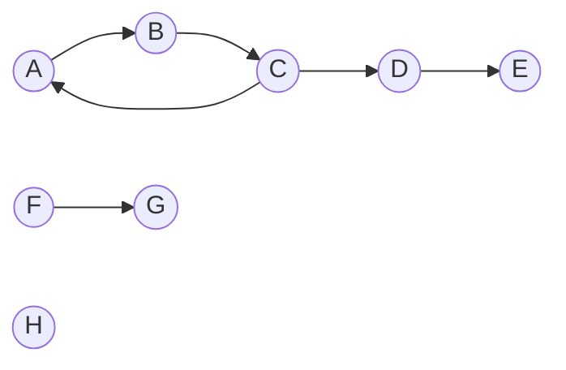

# Nhận diện đường đi, chu trình, thành phần liên thông và nút có bậc cao trong Neo4j

Trong **property graph** của Neo4j, node biểu diễn thực thể, relationship biểu diễn liên kết có hướng giữa các thực thể, còn property lưu thuộc tính của chúng. Khi đã xác định được node và relationship, bốn câu hỏi thường xuất hiện là:

- **Đường đi (path):** Có thể đi từ thực thể A đến E qua những liên kết nào, mất bao nhiêu bước?
- **Chu trình (cycle):** Có tuyến liên kết nào quay lại điểm xuất phát, chẳng hạn vòng chuyển tiền hoặc phụ thuộc lẫn nhau?
- **Thành phần liên thông (connected component):** Những node nào thuộc cùng một nhóm có thể kết nối với nhau?
- **Nút có bậc cao (high-degree node):** Node nào có nhiều liên kết trực tiếp và có thể đóng vai trò đầu mối?

Các khái niệm này hỗ trợ phân tích mạng xã hội, chuỗi cung ứng, tuyến vận tải, hệ thống phụ thuộc và phát hiện bất thường. Trong Neo4j, **Cypher** phù hợp để dò những mẫu đường đi cụ thể; với bài toán nhóm liên thông trên đồ thị lớn, có thể dùng thêm thư viện **Neo4j Graph Data Science (GDS)**.

## 1. Đồ thị mẫu dùng xuyên suốt

Xét tám node `A` đến `H` và bảy relationship có hướng `:LINK`:



Ở đây, `A → B → C → A` tạo thành một chu trình; `C` nối vùng chu trình sang `D` và `E`; `F → G` là nhóm riêng; `H` không có liên kết.

Có thể tạo đồ thị để thực hành trong một cơ sở dữ liệu thử nghiệm. Dùng nhãn riêng `:GraphElementsDemo` để các truy vấn chỉ tác động tới dữ liệu ví dụ:

```cypher
MERGE (a:GraphElementsDemo {id: 'A'})
MERGE (b:GraphElementsDemo {id: 'B'})
MERGE (c:GraphElementsDemo {id: 'C'})
MERGE (d:GraphElementsDemo {id: 'D'})
MERGE (e:GraphElementsDemo {id: 'E'})
MERGE (f:GraphElementsDemo {id: 'F'})
MERGE (g:GraphElementsDemo {id: 'G'})
MERGE (h:GraphElementsDemo {id: 'H'})
MERGE (a)-[:LINK]->(b)
MERGE (b)-[:LINK]->(c)
MERGE (c)-[:LINK]->(a)
MERGE (c)-[:LINK]->(d)
MERGE (d)-[:LINK]->(e)
MERGE (f)-[:LINK]->(g);
```

`MERGE` tìm mẫu đã có rồi mới tạo khi chưa thấy. Trong hệ thống thực tế, thuộc tính định danh như `id` nên có **uniqueness constraint** để tránh dữ liệu trùng khi ghi đồng thời:

```cypher
CREATE CONSTRAINT graph_elements_demo_id IF NOT EXISTS
FOR (n:GraphElementsDemo)
REQUIRE n.id IS UNIQUE;
```

> Nếu dữ liệu thử đã có những node trùng `id`, cần xử lý trùng lặp trước khi tạo constraint. Constraint chỉ là bước chuẩn bị tùy chọn, không bắt buộc để hiểu các truy vấn bên dưới.

## 2. Nhận diện đường đi (path)

Đường đi là chuỗi node và relationship nối từ điểm đầu đến điểm cuối. Với một đường đi `p`:

- `nodes(p)` trả về danh sách node theo thứ tự đi qua.
- `relationships(p)` trả về các relationship theo thứ tự.
- `length(p)` trả về **số relationship**, không phải số node. Một đường đi dài bốn bước thường gồm năm node.

### 2.1. Truy vấn đường đi có hướng

Cần tìm những đường đi từ `A` đến `E` có **1–5 relationship**, luôn đi theo chiều mũi tên:

```cypher
MATCH p =
  (a:GraphElementsDemo {id: 'A'})-[:LINK*1..5]->
  (e:GraphElementsDemo {id: 'E'})
RETURN [n IN nodes(p) | n.id] AS nodeIds,
       length(p) AS hops;
```

Với đồ thị mẫu, kết quả là `['A', 'B', 'C', 'D', 'E']` và `hops = 4`.

Trong cú pháp quan hệ có độ dài biến thiên của Cypher 5, `*1..5` nghĩa là từ một đến năm bước; `->` yêu cầu đúng chiều lưu trữ, còn `-` ở cả hai đầu cho phép duyệt theo hai chiều. Với Neo4j 5.9 trở lên, có thể biểu diễn tương tự bằng **quantified relationship**:

```cypher
MATCH p =
  (a:GraphElementsDemo {id: 'A'})-[:LINK]->{1,5}
  (e:GraphElementsDemo {id: 'E'})
RETURN [n IN nodes(p) | n.id] AS nodeIds,
       length(p) AS hops;
```

Điều cần phân biệt: một mẫu đường đi có thể đi qua cùng một **node** nhiều lần. Trong chế độ khớp đường đi mặc định của Cypher 5, một **relationship** không được sử dụng lặp lại trong cùng một mẫu `MATCH`. Vì thế, nếu bài toán yêu cầu *simple path* (không lặp node), phải bổ sung điều kiện hoặc dùng cú pháp phù hợp với phiên bản Cypher đang chạy; không nên mặc định mọi đường đi tìm được đều là simple path.

### 2.2. Chiều quan hệ làm thay đổi kết quả

Nếu xem `:LINK` như liên kết hai chiều:

```cypher
MATCH p =
  (a:GraphElementsDemo {id: 'A'})-[:LINK*1..4]-
  (e:GraphElementsDemo {id: 'E'})
RETURN [n IN nodes(p) | n.id] AS nodeIds,
       length(p) AS hops
ORDER BY hops;
```

Ta có thể đi `A — C — D — E` chỉ trong **3 bước**, nhờ đi ngược relationship `C → A` ở đoạn đầu. Đường đi đó **không hợp lệ** nếu nghiệp vụ bắt buộc tuân thủ hướng `→`. Ví dụ, một lệnh chuyển tiền từ C sang A không tự động cho phép suy ra có thể chuyển từ A sang C.

### 2.3. Đường đi ngắn nhất

Khi chỉ cần số bước ít nhất giữa hai node, dùng cơ chế tìm đường đi ngắn nhất thay vì liệt kê toàn bộ các đường đi:

```cypher
MATCH (a:GraphElementsDemo {id: 'A'}),
      (e:GraphElementsDemo {id: 'E'})
MATCH p = shortestPath((a)-[:LINK*]->(e))
RETURN [n IN nodes(p) | n.id] AS shortestRoute,
       length(p) AS hops;
```

Kết quả theo **hướng** là `A → B → C → D → E`, dài **4 bước**. Nếu đổi `->` thành `-`, đường ngắn nhất theo **liên kết hai chiều** là `A — C — D — E`, dài **3 bước**.

`shortestPath()` tìm đường ngắn theo **số relationship** khi mọi bước có cùng trọng số; nó không tự hiểu thời gian, chi phí, khoảng cách hay mức độ rủi ro được lưu trong property. Với bài toán đường đi có trọng số, cân nhắc thuật toán như **Dijkstra** trong GDS sau khi xây dựng property trọng số phù hợp. Cypher các phiên bản mới cũng hỗ trợ cú pháp chọn đường đi ngắn bằng `SHORTEST`; cần đối chiếu phiên bản đang sử dụng.

## 3. Nhận diện chu trình (cycle)

Một chu trình bắt đầu và kết thúc tại cùng một node. Với **chu trình đơn** (*simple cycle*), các node ở giữa không lặp lại. Cần phân biệt:

- **Self-loop:** một relationship đi từ node về chính node đó, như `A → A`.
- **Chu trình hai bước:** `A → B → A` khi tồn tại hai relationship có hướng tương ứng.
- **Chu trình từ ba bước:** ví dụ `A → B → C → A`, có thể biểu diễn phụ thuộc vòng trong ứng dụng.

### 3.1. Tìm chu trình cụ thể

Trong đồ thị mẫu, truy vấn chu trình dài đúng ba bước bắt đầu và kết thúc ở `A`:

```cypher
MATCH p =
  (a:GraphElementsDemo {id: 'A'})-[:LINK*3]->(a)
RETURN [n IN nodes(p) | n.id] AS cycle,
       length(p) AS hops;
```

Kết quả: `['A', 'B', 'C', 'A']` với `hops = 3`.

Để kiểm tra **self-loop**, không cần mở rộng độ dài:

```cypher
MATCH (n:GraphElementsDemo)-[r:LINK]->(n)
RETURN n.id AS nodeId, r;
```

Truy vấn này không trả về dòng nào trên dữ liệu mẫu.

### 3.2. Chỉ nhận chu trình đơn

Nếu dò nhiều chu trình và muốn loại đường đi có node trung gian bị lặp, có thể kiểm tra mỗi node trước node cuối xuất hiện đúng một lần:

```cypher
MATCH p =
  (start:GraphElementsDemo)-[:LINK*2..6]->(start)
WITH p, nodes(p) AS ns
WHERE all(i IN range(0, size(ns) - 2)
          WHERE single(j IN range(0, size(ns) - 2)
                       WHERE ns[i] = ns[j]))
RETURN [n IN ns | n.id] AS simpleCycle,
       length(p) AS hops
LIMIT 20;
```

`ns` gồm cả node bắt đầu xuất hiện lần nữa ở cuối; biểu thức `range(0, size(ns) - 2)` chỉ xét những vị trí **trước** node cuối. `single(...)` kiểm tra mỗi node trong phần này xuất hiện đúng một lần. Giới hạn `2..6` giúp thu hẹp không gian tìm kiếm.

Một chu trình có thể được trả về nhiều lần dưới các điểm xuất phát khác nhau, ví dụ `A-B-C-A`, `B-C-A-B` và `C-A-B-C`. Đây là **cùng một chu trình theo phép quay**, dù là ba danh sách khác nhau. Nếu cần thống kê số chu trình duy nhất, phải chuẩn hóa cách biểu diễn (chẳng hạn chọn một node xuất phát chuẩn) trước khi đếm. Với đồ thị vô hướng, còn cần xử lý các biểu diễn đảo chiều.

**Ứng dụng:** phát hiện các dịch vụ phụ thuộc vòng, các bước phê duyệt quay lại đầu quy trình, vòng giao dịch đáng kiểm tra hoặc luồng xử lý có nguy cơ không kết thúc. Bản thân một chu trình **không chứng minh** gian lận hay lỗi; nó là tín hiệu để áp dụng quy tắc nghiệp vụ.

## 4. Xác định thành phần liên thông

**Thành phần liên thông** là tập node lớn nhất thỏa điều kiện kết nối đang xét. Với đồ thị có hướng, phải nói rõ cách định nghĩa:

| Khái niệm | Quy tắc kết nối | Đồ thị mẫu |
|---|---|---|
| **Liên thông yếu** (*Weakly Connected Component – WCC*) | Bỏ qua chiều các relationship khi xác định khả năng kết nối | `{A,B,C,D,E}`, `{F,G}`, `{H}` |
| **Liên thông mạnh** (*Strongly Connected Component – SCC*) | Với mọi cặp node trong nhóm, đều có đường đi **có hướng** từ node này đến node kia | `{A,B,C}`, `{D}`, `{E}`, `{F}`, `{G}`, `{H}` |

Ví dụ, `D` và `E` cùng một thành phần liên thông yếu vì có `D → E`, nhưng không thuộc cùng một thành phần liên thông mạnh vì không có đường đi ngược từ `E` về `D`. Node cô lập `H` vẫn là một thành phần kích thước một.

### 4.1. Tìm các node có thể tới từ một node bằng Cypher

Với đồ thị mẫu nhỏ, có thể tìm tất cả node thuộc cùng thành phần liên thông **yếu** với `A` bằng cách cho phép duyệt cả hai chiều và đặt giới hạn bốn bước:

```cypher
MATCH (seed:GraphElementsDemo {id: 'A'})
MATCH p = (seed)-[:LINK*0..4]-(reachable:GraphElementsDemo)
RETURN collect(DISTINCT reachable.id) AS connectedNodes;
```

Kết quả gồm `{A,B,C,D,E}`; thứ tự phần tử trong `collect` không được bảo đảm nếu chưa sắp xếp. `*0..4` bao gồm chính node `A` do cho phép đường đi có độ dài bằng không.

Đây là **truy vấn duyệt từ một node** trong đồ thị nhỏ, **không phải thuật toán phân hoạch toàn đồ thị**: nếu thành phần có đường đi ngắn nhất dài hơn bốn bước, giới hạn này sẽ bỏ sót node. Bỏ giới hạn độ dài trong đồ thị lớn có thể làm số lượng đường đi cần xét tăng rất mạnh.

### 4.2. Tìm toàn bộ thành phần liên thông yếu bằng GDS

Nếu cài và cấu hình **Neo4j Graph Data Science**, hãy chiếu nhãn và loại relationship cần phân tích vào một **named graph trong bộ nhớ** rồi gọi WCC:

```cypher
CALL gds.graph.project(
  'graphElementsDemoWcc',
  'GraphElementsDemo',
  {LINK: {orientation: 'UNDIRECTED'}}
)
YIELD graphName, nodeCount, relationshipCount
RETURN graphName, nodeCount, relationshipCount;
```

```cypher
CALL gds.wcc.stream('graphElementsDemoWcc')
YIELD nodeId, componentId
WITH componentId, gds.util.asNode(nodeId).id AS memberId
RETURN componentId,
       collect(memberId) AS members,
       count(*) AS componentSize
ORDER BY componentSize DESC;
```

Kết quả có **ba nhóm** kích thước lần lượt **5, 2 và 1**. Giá trị số của `componentId` là định danh nội bộ, có thể thay đổi giữa các lần chạy; hãy so sánh **tập thành viên**, không dựa vào số ID cụ thể.

`orientation: 'UNDIRECTED'` biểu diễn quan hệ theo hai chiều trong đồ thị chiếu. WCC bản thân là thuật toán bỏ qua chiều, nhưng khai báo này giúp thể hiện rõ chủ đích mô hình. `gds.wcc.stream` chỉ trả kết quả để đọc, **không ghi** thuộc tính component vào node thật.

### 4.3. Tìm thành phần liên thông mạnh bằng GDS

Để xét chiều quan hệ, tạo đồ thị chiếu thứ hai giữ hướng gốc:

```cypher
CALL gds.graph.project(
  'graphElementsDemoScc',
  'GraphElementsDemo',
  'LINK'
)
YIELD graphName, nodeCount, relationshipCount
RETURN graphName, nodeCount, relationshipCount;
```

```cypher
CALL gds.scc.stream('graphElementsDemoScc')
YIELD nodeId, componentId
WITH componentId, gds.util.asNode(nodeId).id AS memberId
RETURN componentId, collect(memberId) AS members,
       count(*) AS componentSize
ORDER BY componentSize DESC;
```

Kết quả có **sáu thành phần**: nhóm ba node `{A,B,C}` và năm nhóm một node `{D}`, `{E}`, `{F}`, `{G}`, `{H}`. Chỉ trong nhóm `{A,B,C}` mới có đường đi có hướng qua lại giữa tất cả các node.

Khi đã dùng xong graph trong bộ nhớ, có thể giải phóng tài nguyên GDS:

```cypher
CALL gds.graph.drop('graphElementsDemoWcc')
YIELD graphName RETURN graphName;
```

```cypher
CALL gds.graph.drop('graphElementsDemoScc')
YIELD graphName RETURN graphName;
```

Các lệnh `gds.*` yêu cầu thư viện GDS tương thích và quyền chạy procedure. Chúng không thuộc bộ cú pháp Cypher cơ bản trong một cài đặt Neo4j không có GDS.

## 5. Nhận diện nút có bậc cao (high-degree node)

**Bậc** (*degree*) đo số liên kết trực tiếp của node; khác với số đường đi hay tổng số node có thể tiếp cận. Trong đồ thị có hướng, cần tách:

- **Out-degree:** số relationship đi **ra** khỏi node.
- **In-degree:** số relationship đi **vào** node.
- **Total degree:** tổng số liên kết vào và ra, nếu tính theo số relationship có hướng.

Cần xác định **loại relationship** đang đo. Bậc theo `:FOLLOWS` có ý nghĩa khác với bậc theo `:PURCHASED`; không nên gộp mọi loại khi nghiệp vụ chỉ quan tâm một loại.

### 5.1. Đếm bậc vào, bậc ra bằng Cypher

Dùng `COUNT { ... }` để đếm hai mẫu độc lập, tránh nhân bản số dòng khi một node có nhiều quan hệ vào lẫn ra:

```cypher
MATCH (n:GraphElementsDemo)
RETURN n.id AS nodeId,
       COUNT { (n)-[:LINK]->() } AS outDegree,
       COUNT { (n)<-[:LINK]-() } AS inDegree,
       COUNT { (n)-[:LINK]->() }
         + COUNT { (n)<-[:LINK]-() } AS totalDegree
ORDER BY totalDegree DESC, nodeId;
```

Dữ liệu mẫu cho kết quả:

| Node | Out-degree | In-degree | Total degree |
|---|---:|---:|---:|
| C | 2 | 1 | **3** |
| A | 1 | 1 | 2 |
| B | 1 | 1 | 2 |
| D | 1 | 1 | 2 |
| E | 0 | 1 | 1 |
| F | 1 | 0 | 1 |
| G | 0 | 1 | 1 |
| H | 0 | 0 | 0 |

Vì thế **C là node có bậc cao nhất** trong đồ thị mẫu. Nó vừa tham gia chu trình `A-B-C-A` vừa nối sang `D-E`, nên có thể là một điểm cần ưu tiên kiểm tra khi đánh giá tác động của việc đứt liên kết.

Có thể đặt ngưỡng nghiệp vụ, ví dụ tìm node có ít nhất ba relationship `:LINK`:

```cypher
MATCH (n:GraphElementsDemo)
WITH n,
     COUNT { (n)-[:LINK]->() }
       + COUNT { (n)<-[:LINK]-() } AS degree
WHERE degree >= 3
RETURN n.id AS nodeId, degree
ORDER BY degree DESC;
```

Kết quả chỉ có `C`.

### 5.2. Đếm relationship phân biệt và lưu ý self-loop

Nếu chỉ muốn biết **bao nhiêu relationship vật lý khác nhau** gắn vào node:

```cypher
MATCH (n:GraphElementsDemo)
OPTIONAL MATCH (n)-[r:LINK]-()
RETURN n.id AS nodeId,
       count(DISTINCT r) AS distinctIncidentRelationships
ORDER BY distinctIncidentRelationships DESC, nodeId;
```

Ở đồ thị mẫu không có self-loop, kết quả tương ứng với total degree ở trên. Nếu có self-loop `A → A`, một relationship đó đóng góp **1** vào số *relationship phân biệt*, nhưng đóng góp **1 vào in-degree và 1 vào out-degree** (tổng **2**) theo quy ước bậc có hướng. Nên ghi rõ quy ước đo trước khi so sánh các node.

### 5.3. Bậc cao không đồng nghĩa quan trọng nhất

Degree là phép đo **lân cận một bước**. Một node có ít relationship vẫn có thể nằm trên nhiều đường đi quan trọng giữa các cụm. Khi câu hỏi là "nút nào nằm trên nhiều đường đi ngắn nhất?" hãy xem **betweenness centrality**; khi câu hỏi là "nút nào nhận liên kết từ những nút có ảnh hưởng?" có thể xem **PageRank**. Degree là phép sàng lọc nhanh, không thay thế phân tích trung tâm theo mục đích.

## 6. Chọn kỹ thuật theo câu hỏi và quy mô

| Câu hỏi | Kỹ thuật khởi đầu | Giới hạn cần nhớ |
|---|---|---|
| Có đường đi từ A tới E trong tối đa 5 bước? | `MATCH p = ...-[:LINK*1..5]->...` | Chiều và độ dài quyết định kết quả |
| Đường đi ít bước nhất giữa hai node? | `shortestPath()` hoặc cú pháp `SHORTEST` phù hợp phiên bản | Ít bước khác với ít chi phí có trọng số |
| Có vòng phụ thuộc trong tối đa 6 bước? | Mẫu bắt đầu/kết thúc cùng node; lọc chu trình đơn | Tránh đếm trùng theo phép quay/đảo chiều |
| Node nào cùng vùng kết nối nếu bỏ qua chiều? | WCC trong GDS | `componentId` không ổn định giữa lần chạy |
| Nhóm nào có thể đi **có hướng** tới nhau? | SCC trong GDS | Phải giữ hướng quan hệ trong graph chiếu |
| Node nào có nhiều quan hệ trực tiếp? | `COUNT { ... }` theo hướng và loại quan hệ | Nêu rõ cách đếm self-loop và đa cạnh |

Để truy vấn hiệu quả hơn trên dữ liệu thật:

1. **Định vị node đầu/cuối bằng nhãn và thuộc tính được lập chỉ mục.** Ví dụ, constraint duy nhất trên `GraphElementsDemo.id` hỗ trợ tìm điểm bắt đầu chính xác.
2. **Giới hạn độ dài và lọc loại relationship.** Liệt kê mọi đường đi trong mạng có nhiều nhánh có thể tạo ra rất nhiều kết quả; `LIMIT` chỉ giới hạn số kết quả trả về, không bảo đảm loại bỏ toàn bộ chi phí mở rộng trước đó.
3. **Tôn trọng hướng nghiệp vụ.** Dùng `->` cho dòng tiền, phụ thuộc, phân quyền hoặc quy trình có hướng; chỉ dùng `-` khi việc bỏ qua hướng thực sự hợp lý.
4. **Dùng `EXPLAIN`/`PROFILE` khi tối ưu.** Kiểm tra cardinality, phép mở rộng đường đi và số lần truy cập dữ liệu trước khi chạy trên đồ thị lớn.
5. **Tách truy vấn khám phá nhỏ khỏi thuật toán toàn đồ thị.** Cypher thuận tiện cho mẫu cục bộ; GDS phù hợp khi phải phân nhóm WCC/SCC trên nhiều node và relationship. Với GDS, kiểm tra dung lượng bộ nhớ cho graph chiếu và quyền thực thi.
6. **Tham số hóa đầu vào ứng dụng.** Khi gọi từ Java Driver hoặc Spring Data Neo4j, truyền `$startId`, `$endId` dưới dạng tham số, tránh ghép chuỗi giá trị người dùng vào câu Cypher.

Ví dụ truy vấn tham số hóa:

```cypher
MATCH (a:GraphElementsDemo {id: $startId}),
      (b:GraphElementsDemo {id: $endId})
MATCH p = shortestPath((a)-[:LINK*]->(b))
RETURN [n IN nodes(p) | n.id] AS nodeIds,
       length(p) AS hops;
```

## 7. Bài tập tự kiểm tra

Với đồ thị mẫu ở đầu bài, tự trả lời trước khi xem đáp án:

1. Có đường đi **có hướng** từ `E` về `A` không?
2. Có bao nhiêu thành phần liên thông yếu nếu bổ sung relationship `G → H`?
3. Nếu thêm relationship `E → C`, tập `{C,D,E}` có tạo thành chu trình mới không? Điều đó ảnh hưởng thế nào đến SCC?
4. Khi thêm relationship `H → H`, in-degree, out-degree và số relationship phân biệt gắn với `H` lần lượt là bao nhiêu?

**Đáp án:** (1) Không, vì `E` không có relationship đi ra. (2) Vẫn có **2** thành phần yếu: `{A,B,C,D,E}` và `{F,G,H}`. (3) Có chu trình `C → D → E → C`; cùng với chu trình `A → B → C → A`, các node `{A,B,C,D,E}` trở thành **một SCC**. (4) In-degree **1**, out-degree **1**, relationship phân biệt **1**.

## Tài liệu tham khảo

- [Neo4j Cypher Manual – Variable-length paths](https://neo4j.com/docs/cypher-manual/current/patterns/variable-length-paths/)
- [Neo4j Cypher Manual – Shortest paths](https://neo4j.com/docs/cypher-manual/5/patterns/reference/shortest-paths/)
- [Neo4j Cypher Manual – COUNT subqueries](https://neo4j.com/docs/cypher-manual/current/subqueries/count/)
- [Neo4j GDS – Weakly Connected Components](https://neo4j.com/docs/graph-data-science/current/algorithms/wcc/)
- [Neo4j GDS – Strongly Connected Components](https://neo4j.com/docs/graph-data-science/current/algorithms/strongly-connected-components/)
- [Neo4j GDS – Native graph projection](https://neo4j.com/docs/graph-data-science/current/management-ops/graph-creation/graph-project/)
