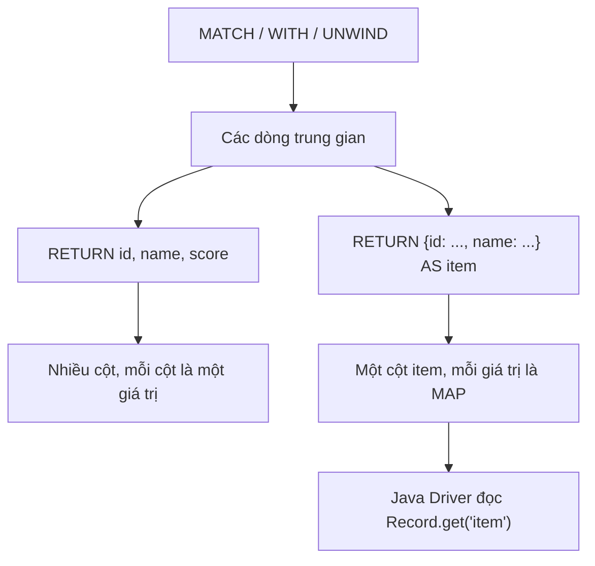
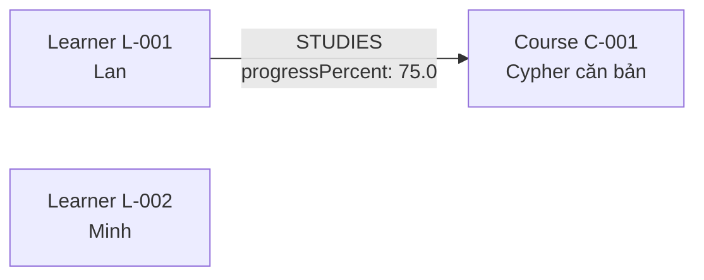

# Danh sách, bản đồ và cấu trúc giá trị trả về từ truy vấn Cypher

Trong **Neo4j**, dữ liệu liên kết được mô hình hóa bằng node, relationship và các thuộc tính của chúng. Khi truy vấn một property graph bằng **Cypher**, kết quả không nhất thiết chỉ là một node hoặc một giá trị đơn lẻ: chúng có thể là **danh sách (list)**, **bản đồ key–value (map)**, nhiều cột trên mỗi dòng hoặc cấu trúc lồng nhau phù hợp với API.

Bài này thuộc chương **Kiểu dữ liệu** của module `DATABASE_ENGINE_GRAPH_NEO4J`. Mục tiêu là hiểu cách tạo và xử lý `LIST`, `MAP`, xác định kiểu giá trị được phép lưu thành property, tổ chức các dòng và cột do `RETURN` sinh ra, rồi chuyển kết quả sang ứng dụng sử dụng Java Driver hoặc Spring Data Neo4j.

## 1. Phân biệt giá trị, property và kết quả truy vấn

Một biểu thức Cypher có thể trả về chuỗi, số, boolean, `null`, node, relationship, path, list hay map. Tuy nhiên, **giá trị hợp lệ trong biểu thức** và **giá trị được phép lưu trực tiếp vào property** là hai tập không giống nhau.

| Giá trị | Ví dụ trong Cypher | Có thể làm một property? |
| --- | --- | --- |
| Chuỗi, số, boolean | `'Lan'`, `28`, `true` | Có |
| Ngày giờ, duration, point | `date('2026-11-25')`, `duration('PT1H')` | Có |
| List giá trị property cùng kiểu thích hợp | `['Java', 'Cypher']`, `[1, 2, 3]` | Có |
| List chứa `null`, list lồng nhau hoặc map | `[1, null]`, `[[1], [2]]`, `[{x: 1}]` | Không lưu trực tiếp thành một property |
| Map | `{name: 'Lan', age: 28}` | Không lưu nguyên map vào một property |
| Node, relationship, path | `n`, `r`, `p` lấy từ `MATCH` | Không |
| `null` | `null` | Không; gán null cho property sẽ xóa property |

Ví dụ các biểu thức đều hợp lệ trong truy vấn:

```cypher
RETURN
  ['Neo4j', 'Java'] AS technologies,
  {name: 'Lan', active: true} AS profile,
  [{id: 1}, {id: 2}] AS items,
  [42, 'hello', null] AS mixedValues;
```

Nhưng chỉ `technologies` trong bốn giá trị trên là một ví dụ list phù hợp để lưu nguyên vào property; map và list chứa map hoặc `null` dùng tốt **trong kết quả truy vấn** mà không thể được lưu trực tiếp như một property.

Quy tắc này giúp lựa chọn mô hình: kỹ năng dạng danh sách chuỗi có thể là property của người học; còn khóa học có nhiều trường hoặc quan hệ với người học nên là node được kết nối bằng relationship.

## 2. LIST: tạo danh sách và đọc phần tử

`LIST` là một chuỗi phần tử có **thứ tự**; chỉ số phần tử bắt đầu từ `0`. Danh sách trong biểu thức Cypher có thể gồm nhiều kiểu khác nhau và thậm chí chứa list hoặc map lồng nhau.

### 2.1. List literal, list rỗng và list nhiều kiểu

```cypher
RETURN
  [10, 20, 30] AS scores,
  ['graph', 'database', 'cypher'] AS tags,
  [] AS emptyList,
  [1, 'one', true, null] AS mixedList,
  [[1, 2], [3, 4]] AS nestedList;
```

`mixedList` và `nestedList` hợp lệ để tính toán hoặc trả về từ truy vấn, nhưng không thuộc dạng list có thể lưu trực tiếp vào một property.

### 2.2. Truy cập theo chỉ số và cắt đoạn

```cypher
WITH ['Neo4j', 'Java', 'Spring', 'Docker'] AS tools
RETURN
  tools[0] AS firstTool,
  tools[2] AS thirdTool,
  tools[-1] AS lastTool,
  tools[1..3] AS middleTools,
  tools[..2] AS firstTwo,
  tools[2..] AS fromThird;
```

Kết quả minh họa:

| Biểu thức | Kết quả |
| --- | --- |
| `tools[0]` | `'Neo4j'` |
| `tools[2]` | `'Spring'` |
| `tools[-1]` | `'Docker'` |
| `tools[1..3]` | `['Java', 'Spring']` |
| `tools[..2]` | `['Neo4j', 'Java']` |
| `tools[2..]` | `['Spring', 'Docker']` |

Khi cắt đoạn bằng `[start..end]`, **vị trí end không được lấy**. Chỉ số âm tính từ cuối danh sách. Truy cập phần tử nằm ngoài phạm vi có thể tạo `null`, vì vậy cần kiểm tra khi giá trị đầu vào không có độ dài cố định.

### 2.3. Các hàm danh sách thông dụng

```cypher
WITH [5, 10, 15] AS numbers
RETURN
  size(numbers) AS numberOfItems,
  head(numbers) AS firstNumber,
  last(numbers) AS lastNumber,
  tail(numbers) AS withoutFirst,
  reverse(numbers) AS reversed;
```

| Hàm | Ý nghĩa |
| --- | --- |
| `size(list)` | Đếm số phần tử |
| `head(list)` | Lấy phần tử đầu; list rỗng cho `null` |
| `last(list)` | Lấy phần tử cuối; list rỗng cho `null` |
| `tail(list)` | Trả về list bỏ phần tử đầu |
| `reverse(list)` | Đảo thứ tự phần tử |
| `range(start, end)` | Sinh dãy số nguyên, tính cả hai đầu |
| `range(start, end, step)` | Sinh dãy với bước nhảy cụ thể |

Ví dụ:

```cypher
RETURN
  range(1, 5) AS oneToFive,
  range(0, 8, 2) AS evenNumbers,
  head([]) AS noFirstItem;
```

Ở đây, `oneToFive` là `[1, 2, 3, 4, 5]`, `evenNumbers` là `[0, 2, 4, 6, 8]`, `noFirstItem` là `null`.

## 3. Biến đổi và lọc LIST trong biểu thức Cypher

### 3.1. List comprehension: lọc và ánh xạ

Cú pháp list comprehension:

```text
[variable IN list WHERE condition | expression]
```

`WHERE` lọc phần tử; phần `| expression` xác định giá trị đầu ra của mỗi phần tử được giữ.

```cypher
WITH [1, 2, 3, 4, 5, 6] AS numbers
RETURN
  [n IN numbers WHERE n % 2 = 0] AS evenNumbers,
  [n IN numbers | n * n] AS squares,
  [n IN numbers WHERE n > 3 | n * 10] AS mappedAndFiltered;
```

Kết quả:

- `evenNumbers` → `[2, 4, 6]`.
- `squares` → `[1, 4, 9, 16, 25, 36]`.
- `mappedAndFiltered` → `[40, 50, 60]`.

Ví dụ thực tế: chỉ lấy tag bắt đầu bằng `'neo'`, sau đó chuẩn hóa về chữ thường.

```cypher
WITH ['Neo4j', 'Java', 'neo4j-driver', 'Spring'] AS tags
RETURN
  [tag IN tags
   WHERE toLower(tag) STARTS WITH 'neo'
   | toLower(tag)] AS neoTags;
```

### 3.2. Kiểm tra phần tử với IN

```cypher
WITH ['Java', 'Cypher', 'Spring'] AS skills
RETURN
  'Cypher' IN skills AS knowsCypher,
  'Python' IN skills AS knowsPython;
```

`IN` phù hợp để kiểm tra một giá trị có thuộc danh sách hay không. Khi list chứa `null`, một kết quả không tìm thấy giá trị có thể là `null` thay vì `false`:

```cypher
RETURN
  5 IN [5, null] AS definitelyPresent,
  5 IN [2, null] AS cannotConfirmAbsent,
  5 IN [2, 3] AS definitelyAbsent;
```

Hai giá trị đầu lần lượt là `true` và `null`; giá trị thứ ba là `false`. Nếu dùng list để kiểm tra điều kiện nghiệp vụ, cần làm sạch dữ liệu thiếu và hiểu logic ba giá trị.

### 3.3. any, all, none và single

Các vị từ danh sách giúp biểu diễn điều kiện mà không cần tạo nhiều dòng:

```cypher
WITH [4, 6, 8] AS numbers
RETURN
  any(n IN numbers WHERE n > 7) AS hasLargeNumber,
  all(n IN numbers WHERE n % 2 = 0) AS allEven,
  none(n IN numbers WHERE n < 0) AS noNegative,
  single(n IN numbers WHERE n = 6) AS exactlyOneSix;
```

`any` kiểm tra có ít nhất một phần tử thỏa điều kiện, `all` yêu cầu mọi phần tử thỏa, `none` yêu cầu không phần tử nào thỏa, và `single` yêu cầu đúng một phần tử thỏa. Khi điều kiện có `null`, kết quả của các vị từ có thể chịu ảnh hưởng của logic ba giá trị.

### 3.4. reduce: gộp các phần tử thành một giá trị

`reduce()` duyệt list và tích lũy kết quả:

```cypher
WITH [10, 20, 30] AS prices
RETURN reduce(total = 0, price IN prices | total + price) AS totalPrice;
```

Kết quả là `60`. `reduce()` thích hợp với các phép gộp theo thứ tự cần biểu thức riêng; khi dữ liệu nằm ở nhiều dòng và chỉ cần tính tổng, hàm tổng hợp `sum()` thường tự nhiên hơn.

## 4. UNWIND: chuyển danh sách thành các dòng kết quả

`UNWIND` tạo **một dòng cho mỗi phần tử** của list. Đây là cầu nối giữa giá trị list và mô hình xử lý theo dòng của Cypher.

```cypher
UNWIND ['Cypher', 'Java', 'Spring'] AS skill
RETURN skill;
```

Truy vấn tạo ba dòng, mỗi dòng có một cột tên `skill`.

Ví dụ xử lý danh sách map đầu vào:

```cypher
WITH [
  {code: 'P-01', quantity: 2},
  {code: 'P-02', quantity: 5},
  {code: 'P-03', quantity: 1}
] AS products
UNWIND products AS product
RETURN
  product.code AS productCode,
  product.quantity AS quantity
ORDER BY productCode;
```

Kết quả có ba dòng, mỗi dòng hai cột. Đây là mẫu phổ biến khi nhập nhiều bản ghi từ một tham số `$rows`.

**Phân biệt list rỗng với list chứa null:**

```cypher
UNWIND [] AS element
RETURN element;
```

Truy vấn trên trả về **0 dòng**. Ngược lại:

```cypher
UNWIND [null] AS element
RETURN element;
```

Truy vấn này tạo **1 dòng**, với `element` là `null`. Nếu `UNWIND` nằm giữa pipeline, list rỗng có thể làm các bước tiếp theo không còn dòng nào để xử lý.

Không giả định `UNWIND` bảo toàn thứ tự phần tử khi quyết định thứ tự kết quả: hãy dùng `ORDER BY` trong truy vấn khi thứ tự là yêu cầu của API.

## 5. MAP: cấu trúc key–value trong Cypher

`MAP` gồm các cặp key–value. Giá trị trong map có thể là các kiểu Cypher khác nhau, gồm list hoặc map lồng nhau.

### 5.1. Map literal

```cypher
WITH {
  learnerId: 'L-001',
  name: 'Lan',
  active: true,
  scores: [8, 9, 10],
  contact: {
    city: 'Đà Nẵng',
    email: 'lan@example.test'
  }
} AS learner
RETURN
  learner.name AS name,
  learner.scores[1] AS secondScore,
  learner.contact.city AS city,
  keys(learner) AS propertyNames;
```

Ở đây:

- `learner.name` đọc giá trị tại key `name`.
- `learner.scores[1]` lấy phần tử thứ hai của list bên trong map.
- `learner.contact.city` đi qua map lồng nhau để đọc thành phố.
- `keys(learner)` trả về list tên key hiện có; **không dựa vào thứ tự key** để xử lý nghiệp vụ.

Map có thể chứa `null` như một giá trị trung gian:

```cypher
WITH {nickname: null, age: 28} AS person
RETURN
  person.nickname IS NULL AS missingNicknameValue,
  'nickname' IN keys(person) AS nicknameKeyExists,
  person.unknown IS NULL AS absentKeyIsNull;
```

Kết quả `nicknameKeyExists` là `true` vì key tồn tại trong map, dù giá trị của nó là `null`; còn `unknown` không có trong map.

### 5.2. Chọn MAP hay LIST?

| Tình huống | Cấu trúc phù hợp | Ví dụ |
| --- | --- | --- |
| Nhiều kỹ năng, thứ tự có ý nghĩa | List | `['Cypher', 'Java']` |
| Hồ sơ có nhiều trường có tên | Map | `{name: 'Lan', active: true}` |
| Nhiều sản phẩm cùng cấu trúc | List của map | `[{code: 'P1'}, {code: 'P2'}]` |
| Một khóa học có nhiều người học liên kết | Node + relationship | `(l)-[:ENROLLED_IN]->(c)` |
| Một property lưu các tag chuỗi | Property list | `tags: ['graph', 'db']` |

List của map rất hữu ích để tạo kết quả API hoặc làm tham số cho batch processing. Tuy nhiên, **list của map không được lưu nguyên vẹn thành một property**. Khi các mục có danh tính, thuộc tính và quan hệ riêng, hãy tạo node/relationship thay vì nhét toàn bộ cấu trúc vào một property.

### 5.3. properties(n) lấy map các property đã lưu

Tạo một node minh họa:

```cypher
MERGE (l:ListMapDemoLearner {learnerId: 'L-001'})
SET l.name = 'Lan',
    l.active = true,
    l.skills = ['Neo4j', 'Java']
RETURN properties(l) AS learnerProperties;
```

`properties(l)` trả về map các property đã lưu của node. Map này có thể được trả về cho ứng dụng hoặc dùng làm đầu vào cho các phép xử lý tiếp theo:

```cypher
MATCH (l:ListMapDemoLearner {learnerId: 'L-001'})
RETURN
  keys(l) AS storedPropertyKeys,
  properties(l) AS storedProperties,
  labels(l) AS nodeLabels;
```

Lưu ý `properties(l)` chỉ chứa **property**, không tự thêm labels của node, relationship lân cận hoặc đường đi. Nếu cần, phải lấy những thông tin đó qua biểu thức riêng.

## 6. Map projection: chọn trường cho dữ liệu trả về

`Map projection` là cú pháp tạo map từ một biến map hoặc node. Nó hữu ích để trả đúng các trường mà API cần.

Ví dụ dữ liệu node ở phần trước:

```cypher
MATCH (l:ListMapDemoLearner {learnerId: 'L-001'})
RETURN l{
  .learnerId,
  .name,
  .skills
} AS learner;
```

Kết quả có một cột `learner`, bên trong là map có ba trường `learnerId`, `name` và `skills`. Đây là cú pháp khác với `RETURN l`, vốn trả về **toàn bộ đối tượng node**.

### 6.1. Thêm trường tính toán

```cypher
MATCH (l:ListMapDemoLearner {learnerId: 'L-001'})
RETURN l{
  .learnerId,
  .name,
  .skills,
  skillCount: size(l.skills),
  displayStatus: CASE
    WHEN l.active = true THEN 'Đang hoạt động'
    ELSE 'Không hoạt động hoặc chưa rõ'
  END
} AS learnerSummary;
```

Các trường `skillCount` và `displayStatus` là dữ liệu tạo ra ở thời điểm truy vấn. Chúng **không tự được lưu** thành property của node.

### 6.2. Lấy tất cả property với ký hiệu .*

```cypher
MATCH (l:ListMapDemoLearner {learnerId: 'L-001'})
RETURN l{
  .*,
  skillCount: size(l.skills)
} AS learnerDetails;
```

`.*` đưa tất cả property đang lưu của node vào map, sau đó thêm `skillCount`. Khi xây dựng API công khai, nên liệt kê trường cần trả về thay vì mặc định dùng `.*` nếu node có thể chứa dữ liệu nội bộ hay nhạy cảm.

### 6.3. Map projection khi biến bằng null

Nếu biến dùng cho map projection có giá trị `null`, kết quả projection đó cũng là `null`. Điều này quan trọng khi kết hợp `OPTIONAL MATCH`: cần phân biệt “không có node liên quan” với “có node nhưng thiếu một property”.

```cypher
WITH null AS missingLearner
RETURN missingLearner{.name} AS projectedLearner;
```

`projectedLearner` là `null`. Trong trường hợp muốn API luôn nhận cấu trúc có trường cụ thể, có thể dùng `CASE` hoặc `coalesce()` theo hợp đồng dữ liệu.

## 7. Khi nào dùng MAP để cập nhật property?

Map có thể được dùng để **truyền nhiều giá trị property** trong một lần cập nhật, nhưng map đó không trở thành một property lồng nhau.

```cypher
MATCH (l:ListMapDemoLearner {learnerId: 'L-001'})
SET l += {
  city: 'Đà Nẵng',
  active: true
}
RETURN properties(l) AS updatedProperties;
```

`SET l += {...}` cập nhật/thêm từng property `city` và `active`. Cần phân biệt:

```cypher
// Ví dụ SAI: không thể lưu MAP làm giá trị của một property.
MATCH (l:ListMapDemoLearner {learnerId: 'L-001'})
SET l.contact = {city: 'Đà Nẵng', email: 'lan@example.test'};
```

Một cách hợp lệ nếu dữ liệu không cần thực thể riêng:

```cypher
MATCH (l:ListMapDemoLearner {learnerId: 'L-001'})
SET l.contactCity = 'Đà Nẵng',
    l.contactEmail = 'lan@example.test'
RETURN l.contactCity, l.contactEmail;
```

Hoặc tạo node `Contact` liên kết khi thông tin liên hệ có cấu trúc, vòng đời hoặc quan hệ riêng:

```cypher
MATCH (l:ListMapDemoLearner {learnerId: 'L-001'})
MERGE (contact:ListMapDemoContact {contactId: 'CONTACT-001'})
SET contact.city = 'Đà Nẵng',
    contact.email = 'lan@example.test'
MERGE (l)-[:HAS_CONTACT]->(contact)
RETURN l.name, contact.city;
```

Lưu ý thêm:

- `SET n += map` bổ sung/cập nhật các key có trong map, giữ các key khác.
- `SET n = map` thay thế **toàn bộ tập property** của n bằng nội dung map; các key cũ không có trong map bị xóa.
- Trong cập nhật bằng map, giá trị `null` ở một key sẽ xóa property tương ứng.
- Các giá trị map phải là giá trị property hợp lệ: không đưa map lồng nhau, list của map hoặc list chứa `null` vào một property.

Đối với API dạng PATCH, hãy xác định rõ “trường không gửi”, “gửi null để xóa” và “gửi giá trị để cập nhật” trước khi tạo map chuyển vào Cypher.

## 8. RETURN: hiểu cấu trúc dòng và cột của kết quả

Cypher xử lý kết quả như một **bảng các dòng (rows) và cột (columns)**. Mỗi cột là tên alias hoặc biểu thức trong `RETURN`; giá trị tại ô có thể là số, chuỗi, list, map, node, relationship hoặc path.

```cypher
UNWIND [
  {id: 'L-001', name: 'Lan', score: 9},
  {id: 'L-002', name: 'Minh', score: 8}
] AS learner
RETURN
  learner.id AS learnerId,
  learner.name AS learnerName,
  learner.score AS score
ORDER BY learnerId;
```

Kết quả có **hai dòng và ba cột**:

| learnerId | learnerName | score |
| --- | --- | --- |
| L-001 | Lan | 9 |
| L-002 | Minh | 8 |

Nếu thay bằng:

```cypher
UNWIND [
  {id: 'L-001', name: 'Lan', score: 9},
  {id: 'L-002', name: 'Minh', score: 8}
] AS learner
RETURN {
  learnerId: learner.id,
  learnerName: learner.name,
  score: learner.score
} AS item
ORDER BY item.learnerId;
```

Thì vẫn có **hai dòng**, nhưng **chỉ một cột `item`**; mỗi ô của cột là một map.

Có thể hình dung:



**Hai tầng cấu trúc khác nhau cần phân biệt:**

1. **Record/dòng kết quả**: có các cột được đặt tên trong `RETURN`.
2. **Giá trị của từng cột**: có thể là map, list hoặc đối tượng đồ thị; nếu là map/list thì bản thân nó còn chứa cấu trúc bên trong.

Khi ứng dụng nhận nhiều dòng, driver cung cấp danh sách record; không phải Cypher tự bọc toàn bộ kết quả vào một list chỉ vì truy vấn có nhiều dòng.

## 9. collect: gộp nhiều dòng thành một LIST

`collect(expression)` là hàm tổng hợp tạo list các giá trị từ nhiều dòng. Nó thường được dùng để trả danh sách con trong một object API.

Ví dụ gộp tên kỹ năng:

```cypher
UNWIND [
  {learnerId: 'L-001', skill: 'Cypher'},
  {learnerId: 'L-001', skill: 'Java'},
  {learnerId: 'L-002', skill: 'Spring'}
] AS row
WITH row.learnerId AS learnerId, row.skill AS skill
ORDER BY learnerId, skill
RETURN learnerId, collect(skill) AS skills
ORDER BY learnerId;
```

Kết quả:

| learnerId | skills |
| --- | --- |
| L-001 | `['Cypher', 'Java']` |
| L-002 | `['Spring']` |

`learnerId` là khóa nhóm vì nó xuất hiện bên ngoài hàm tổng hợp; `collect(skill)` gom các giá trị trong từng nhóm.

### 9.1. DISTINCT, thứ tự và null

```cypher
UNWIND ['Cypher', 'Java', 'Cypher', null] AS skill
RETURN
  collect(skill) AS allKnownSkills,
  collect(DISTINCT skill) AS distinctKnownSkills;
```

`collect()` **bỏ qua các giá trị `null`**. `DISTINCT` loại các giá trị lặp; không được giả định thứ tự của `collect(DISTINCT ...)` nếu không có kiểm soát thứ tự rõ ràng.

Khi thứ tự list có ý nghĩa, sắp xếp dữ liệu trước bước gom:

```cypher
UNWIND [
  {learnerId: 'L-001', rank: 2, skill: 'Java'},
  {learnerId: 'L-001', rank: 1, skill: 'Cypher'}
] AS row
WITH row.learnerId AS learnerId, row
ORDER BY row.rank
RETURN learnerId, collect(row.skill) AS orderedSkills;
```

`ORDER BY` của `WITH` thiết lập thứ tự dòng đầu vào cho `collect()` ở mệnh đề tiếp theo. Chỉ `ORDER BY` ở cuối truy vấn sẽ sắp xếp **các dòng kết quả**, không nhất thiết sắp xếp các phần tử đã có trong mỗi list.

### 9.2. collect map để làm list object cho API

```cypher
UNWIND [
  {id: 'C-001', title: 'Cypher căn bản', hours: 12},
  {id: 'C-002', title: 'Java Driver', hours: 8}
] AS course
WITH course
ORDER BY course.title
RETURN collect({
  courseId: course.id,
  title: course.title,
  durationHours: course.hours
}) AS courses;
```

Truy vấn này trả về **một dòng, một cột `courses`**, trong đó `courses` là list hai map. Đây là cấu trúc rất tiện cho API. Nó là giá trị **kết quả truy vấn**, không phải một property được lưu nguyên trên node.

## 10. Kết hợp đồ thị và cấu trúc trả về lồng nhau

Khi làm việc với property graph, một người học có thể có nhiều khóa học, mỗi quan hệ chứa ngày đăng ký hoặc tiến độ. Cần tổ chức kết quả sao cho mỗi người học chỉ xuất hiện một lần nhưng vẫn giữ đầy đủ thông tin các khóa học.

### 10.1. Chuẩn bị đồ thị minh họa

Có thể chạy các lệnh dưới đây nhiều lần; `MERGE` dùng để tìm hoặc tạo node theo định danh đã nêu, sau đó cập nhật property của dữ liệu thực hành.

```cypher
MERGE (lan:ListMapDemoLearner {learnerId: 'L-001'})
SET lan.name = 'Lan',
    lan.skills = ['Cypher', 'Java']
MERGE (minh:ListMapDemoLearner {learnerId: 'L-002'})
SET minh.name = 'Minh',
    minh.skills = ['Spring']
MERGE (course:ListMapDemoCourse {courseId: 'C-001'})
SET course.title = 'Cypher căn bản'
MERGE (lan)-[enrollment:STUDIES]->(course)
SET enrollment.progressPercent = 75.0;
```

Mô hình dữ liệu:



Người học Minh chưa có quan hệ `STUDIES` đến khóa học nào. Khi tạo API trả cả hai người học, cần dùng `OPTIONAL MATCH`.

### 10.2. Một người học, một map, danh sách khóa học bên trong

```cypher
MATCH (l:ListMapDemoLearner)
OPTIONAL MATCH (l)-[r:STUDIES]->(c:ListMapDemoCourse)
WITH l, r, c
ORDER BY c.title
WITH l,
     collect(
       CASE
         WHEN c IS NULL THEN null
         ELSE {
           courseId: c.courseId,
           title: c.title,
           progressPercent: r.progressPercent
         }
       END
     ) AS courses
RETURN l{
  .learnerId,
  .name,
  courses: courses
} AS learner
ORDER BY learner.learnerId;
```

Kết quả có hai dòng, mỗi dòng một cột `learner` có dạng map. Diễn đạt kết quả ở dạng JSON để dễ hình dung:

```json
[
  {
    "learner": {
      "learnerId": "L-001",
      "name": "Lan",
      "courses": [
        {
          "courseId": "C-001",
          "title": "Cypher căn bản",
          "progressPercent": 75.0
        }
      ]
    }
  },
  {
    "learner": {
      "learnerId": "L-002",
      "name": "Minh",
      "courses": []
    }
  }
]
```

Đây là **mô tả cấu trúc tương đương trong JSON** của các record kết quả, không khẳng định Neo4j Browser hay mọi client tự xuất chính xác định dạng JSON này.

Giải thích:

1. `MATCH` lấy cả hai người học.
2. `OPTIONAL MATCH` giữ Minh dù không có quan hệ `STUDIES`; lúc đó `r` và `c` nhận `null`.
3. `CASE` tạo map mô tả khóa học khi có `c`, tạo `null` khi không có.
4. `collect()` bỏ qua `null`; do đó Minh có list `courses: []` thay vì một list chứa map rỗng.
5. Map projection `l{...}` tạo đúng cấu trúc một người học cùng các khóa học.

Khi quan hệ có thể mang nhiều property, đưa chúng vào map như `progressPercent: r.progressPercent`. Dùng relationship để lưu tiến độ đăng ký là phù hợp với mô hình dữ liệu liên kết; không cần lưu cả danh sách khóa học phức tạp vào một property.

**Lưu ý về dữ liệu thực tế:** nếu đã có nhiều node cùng một `learnerId` do nhập dữ liệu trước đó, `MERGE` không tự đảm bảo duy nhất trên toàn đồ thị khi thiếu ràng buộc. Hãy cân nhắc unique constraint trên khóa nghiệp vụ trong phần thiết kế schema.

## 11. Trả node, relationship và path: khác với map projection

Trong Cypher, `RETURN n` trả đối tượng node; `RETURN r` trả relationship; `RETURN path` trả path. Các giá trị đó là thực thể đồ thị, không phải map thông thường.

```cypher
MATCH path = (l:ListMapDemoLearner)-[r:STUDIES]->(c:ListMapDemoCourse)
RETURN
  l AS learnerNode,
  r AS enrollmentRelationship,
  c AS courseNode,
  path AS enrollmentPath,
  nodes(path) AS pathNodes,
  relationships(path) AS pathRelationships;
```

Ở đây:

- `learnerNode`, `courseNode`: giá trị `NODE`.
- `enrollmentRelationship`: giá trị `RELATIONSHIP`.
- `enrollmentPath`: giá trị `PATH`.
- `pathNodes`: `LIST` các node.
- `pathRelationships`: `LIST` các relationship.

Những list chứa node/relationship phù hợp cho kết quả truy vấn và thao tác đồ thị, nhưng không thể được lưu trực tiếp làm property list.

Nếu một API chỉ cần định danh, tên và tiến độ, có thể chọn map với các trường cần thiết:

```cypher
MATCH (l:ListMapDemoLearner)-[r:STUDIES]->(c:ListMapDemoCourse)
RETURN {
  learnerId: l.learnerId,
  learnerName: l.name,
  courseId: c.courseId,
  progressPercent: r.progressPercent
} AS enrollment;
```

Cách này tạo hợp đồng dữ liệu dễ hiểu hơn cho client không cần biết cấu trúc nội tại của Neo4j.

## 12. Xử lý kết quả bằng Java Driver và Spring Data Neo4j

### 12.1. Record và Value trong Java Driver

Java Driver đọc kết quả thành các **`Record`**. Mỗi record có các cột trùng alias của `RETURN`; mỗi cột chứa một **`Value`** để đọc theo kiểu phù hợp.

Với truy vấn:

```cypher
MATCH (l:ListMapDemoLearner)
RETURN l{
  .learnerId,
  .name,
  .skills
} AS learner
ORDER BY learner.learnerId;
```

Mã Java minh họa sử dụng Neo4j Java Driver:

```java
import java.util.List;
import java.util.Map;
import org.neo4j.driver.Driver;
import org.neo4j.driver.Session;

public class LearnerQuery {
    public static List<Map<String, Object>> loadLearners(Driver driver) {
        String cypher = """
            MATCH (l:ListMapDemoLearner)
            RETURN l{.learnerId, .name, .skills} AS learner
            ORDER BY learner.learnerId
            """;

        try (Session session = driver.session()) {
            return session.executeRead(tx ->
                tx.run(cypher).list(record ->
                    record.get("learner").asMap()
                )
            );
        }
    }
}
```

`record.get("learner")` lấy cột `learner` theo tên, `asMap()` đọc map thành `Map<String, Object>`. Nếu trả nhiều cột, đọc từng cột theo alias:

```java
String learnerId = record.get("learnerId").asString();
long score = record.get("score").asLong();
List<String> skills = record.get("skills").asList(v -> v.asString());
```

Đoạn code thứ hai là ví dụ đọc cột và chỉ đúng khi truy vấn thực tế có các alias `learnerId`, `score`, `skills` với kiểu tương ứng. Khi giá trị có thể `null`, kiểm tra `record.get("column").isNull()` trước khi gọi bộ chuyển đổi kiểu.

**Chú ý:** hàm `asMap()` chuyển các giá trị sang đối tượng Java tương ứng. Nếu kết quả chứa node, path, ngày giờ hoặc point, tầng JSON/DTO của ứng dụng có thể cần ánh xạ chuyên biệt; không nên giả định mọi kiểu Neo4j đều được serialize giống JSON nguyên thủy.

### 12.2. Với Spring Data Neo4j

Spring Data Neo4j có thể ánh xạ node và relationship vào entity Java, nhưng truy vấn tổng hợp trả list/map tùy ý thường cần projection hoặc DTO phù hợp với cấu trúc kết quả. Ví dụ, một API yêu cầu:

```json
{
  "learnerId": "L-001",
  "name": "Lan",
  "courses": [
    {"courseId": "C-001", "title": "Cypher căn bản"}
  ]
}
```

Có thể chọn truy vấn trả từng cột cần thiết, hoặc xây DTO kết quả theo hợp đồng API. Cách ánh xạ cụ thể phụ thuộc phiên bản Spring Data Neo4j, kiểu projection và hình thức truy vấn tùy biến; cần kiểm tra mapping trong ứng dụng.

Khi API trả cả node và relationship, cần cân nhắc việc để thư viện JSON serialize trực tiếp entity có quan hệ hai chiều. Thiết kế DTO/list/map trả về rõ ràng thường giúp kiểm soát trường dữ liệu và tránh cấu trúc lồng nhau ngoài ý muốn.

## 13. Tham số list/map và nhập dữ liệu hàng loạt

Một tham số Cypher có thể là list chứa map. Điều này cho phép ứng dụng truyền nhiều bản ghi trong một câu truy vấn rồi dùng `UNWIND` để xử lý.

```cypher
UNWIND $learners AS input
WITH input
WHERE input.learnerId IS NOT NULL
MERGE (l:ListMapDemoLearner {learnerId: input.learnerId})
SET l.name = input.name
RETURN l.learnerId, l.name;
```

Ví dụ cấu trúc tham số `$learners` phía ứng dụng:

```json
[
  {"learnerId": "L-003", "name": "Ngọc"},
  {"learnerId": "L-004", "name": "Khoa"}
]
```

List của map này là **đầu vào truy vấn**, không phải một property được lưu trên node. Sau `UNWIND`, mỗi map được xử lý thành một dòng và từng trường được ghi vào các property riêng.

Kiểm soát chất lượng dữ liệu trước khi ghi:

- Không truyền `null` làm giá trị khóa trong `MERGE`.
- Chuẩn hóa kiểu của số, ngày và boolean từ ứng dụng hoặc bằng hàm chuyển đổi phù hợp.
- Nếu `input.name` là `null`, `SET l.name = input.name` sẽ xóa property `name`; xác định trước ý nghĩa của thao tác cập nhật.
- Nếu dùng `SET l += input`, chỉ cho phép các key mong muốn và các giá trị property hợp lệ. Không gán nguyên map có nested object vào một property.
- Đặt giới hạn batch hợp lý dựa trên kích thước dữ liệu, transaction và tài nguyên Neo4j.

Hợp đồng API nên mô tả rõ loại dữ liệu của từng trường; việc Cypher chấp nhận map đa dạng không thay thế được xác thực dữ liệu.

## 14. Các lỗi thường gặp

| Tình huống | Vì sao xảy ra? | Cách xử lý |
| --- | --- | --- |
| Gán `n.profile = {name: 'Lan'}` | Không thể lưu map nguyên vẹn thành property | Dùng các property đơn hoặc tạo node riêng |
| Gán `n.items = [{id: 1}, {id: 2}]` | Property list không chứa map | Dùng node/relationship hoặc chỉ giữ list trong truy vấn |
| Gán `n.numbers = [1, null, 3]` | Property list không hỗ trợ phần tử `null` | Lọc phần tử thiếu trước khi ghi |
| `UNWIND []` làm phần sau không tạo kết quả | List rỗng tạo 0 dòng | Kiểm tra đầu vào và bố trí pipeline phù hợp |
| List kết quả sau `collect` có thứ tự bất ngờ | Chưa sắp xếp trước khi tổng hợp | Dùng `ORDER BY` ở `WITH` ngay trước bước gom |
| List tạo bởi `collect` ít phần tử hơn số dòng | `collect` bỏ qua `null` | Đếm và xử lý trường hợp thiếu một cách rõ ràng |
| `RETURN n` rồi mong nhận map JSON đơn giản | Giá trị trả về là node đồ thị | Dùng `n{.field}` hoặc map literal |
| Tìm khóa học bằng `MATCH` làm mất người chưa đăng ký | `MATCH` chỉ giữ dòng có pattern khớp | Dùng `OPTIONAL MATCH` nếu cần giữ người học |
| `RETURN { ... } AS item` nhưng đọc `record.get("name")` | Record chỉ có cột `item` | Đọc `record.get("item")` rồi lấy map bên trong |
| `SET n = map` làm mất property cũ | `=` thay thế toàn bộ tập property | Dùng `+=` nếu chỉ muốn cập nhật một phần |
| Map projection của biến `null` cho `null` | Biến gốc không có giá trị | Dùng `CASE` hoặc xử lý ở API |
| Gộp map lồng nhau vào property | Nhầm kiểu kết quả truy vấn với kiểu lưu trữ | Tách trường hoặc mô hình hóa các thực thể liên quan |

## 15. Bài tập thực hành có đáp án

### Bài 1 — Danh sách và chỉ số

Cho `tools = ['Neo4j', 'Java', 'Spring', 'Docker']`. Hãy trả về phần tử cuối, hai phần tử đầu và số phần tử.

**Đáp án:**

```cypher
WITH ['Neo4j', 'Java', 'Spring', 'Docker'] AS tools
RETURN
  last(tools) AS lastTool,
  tools[..2] AS firstTwo,
  size(tools) AS countTools;
```

Kết quả lần lượt là `'Docker'`, `['Neo4j', 'Java']` và `4`.

### Bài 2 — Biến đổi một danh sách số

Từ `[1, 2, 3, 4, 5]`, chỉ lấy các số lẻ và nhân đôi.

**Đáp án:**

```cypher
WITH [1, 2, 3, 4, 5] AS numbers
RETURN [n IN numbers WHERE n % 2 = 1 | n * 2] AS doubledOdds;
```

Kết quả: `[2, 6, 10]`.

### Bài 3 — Danh sách map thành nhiều dòng

Từ list các map sản phẩm dưới đây, trả về mã và giá của mỗi sản phẩm, sắp xếp giá giảm dần.

**Đáp án:**

```cypher
WITH [
  {code: 'SP-001', priceVnd: 120000},
  {code: 'SP-002', priceVnd: 95000},
  {code: 'SP-003', priceVnd: 150000}
] AS products
UNWIND products AS p
RETURN p.code AS code, p.priceVnd AS priceVnd
ORDER BY priceVnd DESC;
```

Kết quả có ba dòng, `SP-003` đứng đầu.

### Bài 4 — Map projection

Trả về map của node `ListMapDemoLearner` gồm `learnerId`, `name` và trường `skillsCount` tính từ list `skills`, với giả định `skills` là property list.

**Đáp án:**

```cypher
MATCH (l:ListMapDemoLearner)
RETURN l{
  .learnerId,
  .name,
  skillsCount: size(l.skills)
} AS learnerSummary;
```

Mỗi record có một cột `learnerSummary` kiểu map.

### Bài 5 — Trả về list các map

Cho ba dòng dữ liệu gồm tên người học và điểm; hãy gộp tất cả thành một list map trong một dòng.

**Đáp án:**

```cypher
UNWIND [
  {name: 'Lan', score: 9},
  {name: 'Minh', score: 8},
  {name: 'Ngọc', score: 10}
] AS row
WITH row
ORDER BY row.name
RETURN collect({
  name: row.name,
  score: row.score
}) AS learners;
```

Kết quả là một dòng với cột `learners` chứa ba map.

### Bài 6 — Phân biệt record và map

Truy vấn:

```cypher
RETURN {id: 'L-001', name: 'Lan'} AS learner;
```

Hỏi: có bao nhiêu dòng, bao nhiêu cột và giá trị cột thuộc kiểu nào?

**Đáp án:** một dòng, một cột tên `learner`; giá trị cột là `MAP` có hai key `id` và `name`. Trong Java Driver phải đọc `record.get("learner")`, rồi mới truy cập dữ liệu bên trong map.

## 16. Checklist khi thiết kế cấu trúc kết quả Neo4j

Trước khi hoàn thiện truy vấn và tích hợp ứng dụng:

1. Xác định dữ liệu cần lưu là property đơn, property list hay quan hệ giữa node.
2. Nhớ list trong biểu thức có thể chứa map, node và `null`, nhưng property list thì chịu ràng buộc chặt hơn.
3. Xác định `RETURN` cần nhiều cột hay một map duy nhất.
4. Sử dụng map projection để chọn chính xác các trường cần cho client.
5. Dùng `UNWIND` khi cần biến list đầu vào thành nhiều dòng; kiểm tra tác động của list rỗng.
6. Dùng `collect()` khi muốn biến nhiều dòng thành list; kiểm soát thứ tự và việc bỏ qua `null`.
7. Khi dữ liệu có quan hệ tùy chọn, cân nhắc `OPTIONAL MATCH` cùng `CASE` để giữ parent và trả list rỗng hợp lý.
8. Kiểm tra alias của `RETURN` khớp với tên cột mà Java Driver/DTO đọc.
9. Tránh đưa map hoặc list lồng nhau vào property và tránh vô tình xóa key với `SET n = map`.
10. Xác thực tham số map/list, kiểu các trường, khóa nghiệp vụ và các giá trị `null` trước khi ghi.

---

**Ghi nhớ:** `LIST` dùng để biểu diễn tập giá trị có thứ tự; `MAP` đặt tên cho các trường; `UNWIND` trải list thành nhiều dòng; `collect()` gom dòng thành list; và `RETURN` quyết định cấu trúc record/cột đầu ra. Trong Neo4j, các cấu trúc phong phú như list của map rất hữu ích cho truy vấn và API, nhưng khi lưu property phải tuân theo tập kiểu property được hỗ trợ. Thiết kế đúng cấu trúc giá trị trả về giúp truy vấn Cypher rõ ràng, dễ tối ưu và dễ tích hợp với Java Driver hoặc Spring Data Neo4j.
