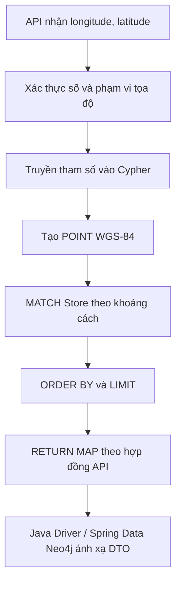

# Tọa độ không gian, hệ quy chiếu và giá trị điểm trong Neo4j Cypher

Trong mô hình **property graph**, một node không chỉ lưu tên, mã định danh hay ngày tạo mà còn có thể lưu **vị trí địa lý** của cửa hàng, kho hàng, trạm giao nhận hoặc địa điểm diễn ra sự kiện. Neo4j hỗ trợ kiểu giá trị không gian **`POINT`** và các hàm Cypher để tạo tọa độ, tính khoảng cách và lọc những vị trí gần nhau.

Bài học thuộc chương **Kiểu dữ liệu** của module `DATABASE_ENGINE_GRAPH_NEO4J`. Trọng tâm là hiểu **tọa độ**, **hệ quy chiếu (coordinate reference system, CRS)**, các dạng điểm 2D/3D, cách lưu điểm trên node hoặc relationship, truy vấn không gian, lập index và trao đổi dữ liệu với Java Driver hoặc Spring Data Neo4j.

Sau bài này, người học có thể:

- Chọn giữa tọa độ địa lý **WGS-84** và tọa độ phẳng **Cartesian** theo ngữ nghĩa dữ liệu.
- Tạo, lưu, đọc và kiểm tra giá trị `POINT` bằng Cypher.
- Tính khoảng cách đúng đơn vị, lọc bán kính và lọc hộp giới hạn.
- Hiểu điểm khác nhau giữa dữ liệu GeoJSON, cặp kinh độ/vĩ độ và một đối tượng point trong Neo4j.
- Thiết kế truy vấn không gian có khả năng tận dụng **point index**, đồng thời tránh lỗi khi tích hợp Java.

## 1. Tọa độ không gian là gì?

**Điểm (point)** mô tả một vị trí trong một không gian xác định. Các con số trong điểm chỉ có ý nghĩa khi biết **hệ quy chiếu** và quy ước đơn vị.

Ví dụ:

- `longitude = 106.7009`, `latitude = 10.7769` biểu diễn một vị trí địa lý bằng **kinh độ/vĩ độ**.
- `x = 100.0`, `y = 250.0` có thể biểu diễn vị trí trên sơ đồ kho, nhưng không cho biết đó là mét, centimet hay một hệ tọa độ nào nếu nghiệp vụ chưa định nghĩa.
- `longitude`, `latitude` kèm `height` biểu diễn vị trí địa lý có chiều cao.
- `x`, `y`, `z` biểu diễn vị trí trong hệ tọa độ phẳng ba chiều.

Neo4j lưu giá trị điểm cùng thông tin hệ quy chiếu, giúp các phép toán không gian biết cách diễn giải tọa độ. Không nên lưu hai số đơn lẻ rồi giả định mọi phép tính khoảng cách có thể xử lý chúng như một vị trí địa lý.

### 1.1. Ba khái niệm không được đánh đồng

| Khái niệm | Ví dụ | Vai trò |
| --- | --- | --- |
| Tọa độ | `106.7009` và `10.7769` | Giá trị số mô tả vị trí |
| Hệ quy chiếu | `wgs-84`, `cartesian` | Xác định ý nghĩa của trục tọa độ và cách diễn giải |
| Đơn vị đo khoảng cách | Mét, đơn vị tọa độ của sơ đồ | Giúp giải thích kết quả khoảng cách |

Đối với dữ liệu kinh độ/vĩ độ toàn cầu, đơn vị đầu vào là **độ**, còn kết quả `point.distance()` cho các điểm địa lý tương thích được trả về bằng **mét**. Với tọa độ Cartesian, kết quả khoảng cách có cùng đơn vị với tọa độ đầu vào.

## 2. Các hệ quy chiếu POINT mà Neo4j hỗ trợ

Neo4j có những hệ quy chiếu điểm quen thuộc dưới đây:

| CRS | SRID | Số chiều | Trục/thuộc tính điển hình | Trường hợp sử dụng |
| --- | ---: | --- | --- | --- |
| `wgs-84` | `4326` | 2D | `longitude`, `latitude` | Vị trí trên bề mặt Trái Đất |
| `wgs-84-3d` | `4979` | 3D | `longitude`, `latitude`, `height` | Vị trí địa lý kèm độ cao |
| `cartesian` | `7203` | 2D | `x`, `y` | Mặt bằng, bản vẽ hoặc tọa độ phẳng |
| `cartesian-3d` | `9157` | 3D | `x`, `y`, `z` | Không gian phẳng 3D, ví dụ kho nhiều tầng |

**CRS** cho biết các trục tọa độ được hiểu theo hệ nào. **SRID** (*Spatial Reference Identifier*) là mã số nhận diện hệ quy chiếu tương ứng.

Ở đây, **Cartesian** là hệ tọa độ phẳng theo các đơn vị ứng dụng lựa chọn. Neo4j không tự hiểu `x = 100` có nghĩa là 100 mét hay 100 centimet. Hệ quy chiếu Cartesian có sẵn không tự thực hiện phép chiếu bản đồ từ kinh độ/vĩ độ.

### 2.1. WGS-84 là gì?

WGS-84 (*World Geodetic System 1984*) là hệ quy chiếu địa lý thường được sử dụng với GPS và bản đồ toàn cầu:

- **Latitude (vĩ độ)**: mô tả vị trí theo hướng bắc–nam, tính bằng độ.
- **Longitude (kinh độ)**: mô tả vị trí theo hướng đông–tây, tính bằng độ.
- **Height (độ cao)**: thuộc phiên bản 3D, cần xác định ý nghĩa độ cao trong dữ liệu nguồn.

Trong phạm vi địa lý thông thường, vĩ độ nằm từ −90° đến +90°, còn kinh độ được biểu diễn quanh khoảng −180° đến +180°. Khi nhập dữ liệu, hãy chuẩn hóa và kiểm tra miền tọa độ theo quy ước của hệ thống; đặc biệt cần kiểm tra dữ liệu bị đảo thứ tự kinh độ/vĩ độ.

### 2.2. Tọa độ Cartesian là gì?

Với sơ đồ kho, có thể đặt gốc tọa độ tại một góc nhà kho, trục `x` chạy ngang và `y` chạy dọc. Khi đó:

```text
             y
             ↑
             |
    A        |       B
             |
-------------O----------------→ x
```

Một điểm `(10, 20)` chỉ có ý nghĩa khi đã thống nhất hướng trục, vị trí gốc và đơn vị đo. Nếu `x`, `y` đo bằng mét, khoảng cách Cartesian cũng được hiểu bằng mét; nếu đo bằng pixel, khoảng cách sẽ tính theo pixel.

**Điểm cần nhớ:** không thể chỉ đổi tên `x` thành `longitude` hoặc gắn CRS khác vào cùng hai số để biến một hệ tọa độ thành hệ khác. Chuyển đổi CRS thực sự đòi hỏi phép biến đổi tọa độ được xác định rõ.

## 3. Tạo POINT trong Cypher

Hàm `point()` tạo một giá trị `POINT` từ map mô tả tọa độ. Các key trong map xác định loại tọa độ cần tạo.

### 3.1. Điểm địa lý WGS-84 2D

```cypher
RETURN point({
  longitude: 106.7009,
  latitude: 10.7769
}) AS hcmPoint;
```

Khi dùng `longitude` và `latitude` mà không chỉ định CRS khác, Cypher tạo điểm địa lý WGS-84 hai chiều. **Kinh độ đi với key `longitude`, vĩ độ đi với `latitude`**; không hoán đổi hai giá trị.

Có thể nêu hệ quy chiếu tường minh:

```cypher
RETURN point({
  longitude: 106.7009,
  latitude: 10.7769,
  crs: 'wgs-84'
}) AS explicitWgs84;
```

### 3.2. Điểm địa lý WGS-84 3D

Khi cần biểu diễn thêm chiều cao:

```cypher
RETURN point({
  longitude: 106.7009,
  latitude: 10.7769,
  height: 12.5
}) AS pointWithHeight;
```

Giá trị này thuộc hệ `wgs-84-3d` với SRID `4979`. Hãy xác định dữ liệu `height` được đo theo mốc và hệ độ cao nào. Nguồn GPS, bản đồ địa hình và hệ quản lý tòa nhà có thể dùng quy ước độ cao khác nhau.

### 3.3. Điểm Cartesian 2D và 3D

```cypher
RETURN
  point({x: 10.0, y: 25.0}) AS warehousePoint2d,
  point({x: 10.0, y: 25.0, z: 4.5}) AS warehousePoint3d;
```

Với điểm Cartesian, `x`, `y`, `z` không tự đại diện cho kinh độ, vĩ độ hay độ cao so với mực nước biển. Chúng chỉ là các tọa độ của hệ phẳng mà nghiệp vụ quy định.

### 3.4. Tạo điểm bằng SRID

Có thể sử dụng SRID tường minh khi cần khóa rõ hệ quy chiếu:

```cypher
RETURN
  point({
    longitude: 106.7009,
    latitude: 10.7769,
    srid: 4326
  }) AS geoPoint,
  point({
    x: 10.0,
    y: 25.0,
    srid: 7203
  }) AS localPoint;
```

Trong cùng một lời gọi `point()`, các key và hệ quy chiếu phải tương thích. Không dùng `x`/`y` với SRID WGS-84 như một cách chuyển đổi tọa độ.

## 4. Kiểm tra thông tin của một giá trị POINT

Một giá trị điểm cho phép đọc tọa độ và thông tin hệ quy chiếu bằng biểu thức truy cập trường.

### 4.1. Đọc kinh độ, vĩ độ, CRS và SRID

```cypher
WITH point({
  longitude: 106.7009,
  latitude: 10.7769
}) AS location
RETURN
  location.longitude AS longitude,
  location.latitude AS latitude,
  location.crs AS coordinateSystem,
  location.srid AS referenceId;
```

Với điểm hai chiều này, `coordinateSystem` tương ứng `'wgs-84'` và `referenceId` là `4326`.

### 4.2. Đọc các trường của điểm Cartesian

```cypher
WITH point({x: 3.0, y: 4.0}) AS location
RETURN
  location.x AS x,
  location.y AS y,
  location.crs AS coordinateSystem,
  location.srid AS referenceId;
```

Với các điểm 3D, đọc thêm `location.z` cho Cartesian hoặc `location.height` cho WGS-84 3D khi có dữ liệu tương ứng.

**Không áp dụng mù quáng cùng bộ trường cho mọi CRS.** Khi dữ liệu đầu vào có thể chứa nhiều hệ quy chiếu, kiểm tra `crs`/`srid` trước khi chọn các tọa độ cần xuất ra.

### 4.3. POINT khác MAP chứa tọa độ

```cypher
WITH {
  longitude: 106.7009,
  latitude: 10.7769
} AS coordinates
RETURN
  coordinates AS coordinateMap,
  point(coordinates) AS spatialPoint;
```

Hai giá trị đầu ra khác kiểu:

- `coordinateMap` là **`MAP`** dùng trong biểu thức hoặc tham số.
- `spatialPoint` là **`POINT`**, có CRS xác định và có thể lưu trực tiếp làm property.

Nếu lưu nguyên `coordinateMap` vào một property của node, Neo4j sẽ không chấp nhận vì một property không chứa trực tiếp map lồng nhau. Cần chuyển thành `POINT` hoặc tách các thuộc tính riêng.

## 5. Lưu POINT làm property của node hoặc relationship

Kiểu `POINT` là kiểu property hợp lệ trong Neo4j. Có thể lưu trực tiếp vị trí của một địa điểm:

```cypher
MERGE (s:SpatialDemoStore {storeId: 'STORE-001'})
SET
  s.name = 'Cửa hàng trung tâm',
  s.location = point({
    longitude: 106.7009,
    latitude: 10.7769
  })
RETURN
  s.storeId,
  s.name,
  s.location;
```

`MERGE` tìm hoặc tạo node theo `storeId`; ví dụ này có thể chạy lại để cập nhật dữ liệu demo. Với hệ thống thực, muốn đảm bảo định danh duy nhất khi có nhiều transaction đồng thời, cần thiết kế **unique constraint** phù hợp trên khóa nghiệp vụ.

### 5.1. Lưu tọa độ trên relationship

Giả sử đồ thị có người dùng và sự kiện, relationship `CHECKED_IN_AT` biểu diễn lần check-in; vị trí check-in có thể là property của chính mối quan hệ:

```cypher
MERGE (u:SpatialDemoUser {userId: 'USER-001'})
MERGE (e:SpatialDemoEvent {eventId: 'EVENT-001'})
MERGE (u)-[r:CHECKED_IN_AT]->(e)
SET
  r.location = point({
    longitude: 106.7012,
    latitude: 10.7771
  }),
  r.checkedInAt = datetime('2026-11-25T09:30:00+07:00')
RETURN
  u.userId,
  e.eventId,
  r.location,
  r.checkedInAt;
```

Ở đây **relationship** lưu thông tin của hành động check-in. Nó phù hợp khi dữ liệu là thuộc tính của sự kiện liên kết giữa hai thực thể, thay vì chỉ là thuộc tính cố định của người dùng.

### 5.2. Khi nào lưu POINT, khi nào tách node địa điểm?

| Nhu cầu | Mô hình thường phù hợp | Giải thích |
| --- | --- | --- |
| Chỉ cần tọa độ hiện tại của cửa hàng | `Store.location: POINT` | Một property đủ để lọc theo không gian |
| Địa điểm có tên, địa chỉ, nhiều metadata | Node `Place` và relationship | Địa điểm có danh tính và thuộc tính riêng |
| Nhiều cửa hàng cùng thuộc một địa điểm | Node `Place` dùng chung | Tránh lặp dữ liệu không cần thiết |
| Theo dõi lịch sử di chuyển | Các node/relationship vị trí theo thời gian | Một property `location` hiện tại không lưu được lịch sử |
| Ghi vị trí tại thời điểm phát sinh liên kết | Property `POINT` trên relationship | Tọa độ gắn với chính hành động liên kết |

Chọn mô hình theo quan hệ dữ liệu và nhu cầu truy vấn, không chỉ theo cách biểu diễn tọa độ.

## 6. Tính khoảng cách bằng point.distance()

Hàm `point.distance(a, b)` tính khoảng cách giữa **hai điểm có hệ quy chiếu tương thích**.

### 6.1. Khoảng cách giữa hai điểm địa lý

```cypher
WITH
  point({longitude: 106.7009, latitude: 10.7769}) AS a,
  point({longitude: 106.7060, latitude: 10.7810}) AS b
RETURN
  point.distance(a, b) AS distanceMeters,
  round(point.distance(a, b)) AS roundedMeters;
```

Với điểm **WGS-84**, kết quả là khoảng cách không gian tính bằng **mét**, phù hợp để tính gần/xa trên bề mặt Trái Đất theo phép tính địa lý mà Neo4j hỗ trợ. Không hiểu kết quả này là thời gian di chuyển hay chiều dài tuyến đường thực tế.

**Ví dụ:** hai cửa hàng cách nhau 1,2 km theo khoảng cách địa lý có thể cần đi 2,5 km theo đường phố do cầu, sông hoặc hướng đường một chiều. Các phép tính shortest path trong graph cũng không tự đồng nghĩa với khoảng cách đường bộ, trừ khi đồ thị có biểu diễn mạng đường và trọng số phù hợp.

### 6.2. Khoảng cách Cartesian

```cypher
WITH
  point({x: 0.0, y: 0.0}) AS a,
  point({x: 3.0, y: 4.0}) AS b
RETURN point.distance(a, b) AS distanceInCoordinateUnits;
```

Kết quả là `5.0` theo công thức Euclid:

\[
d = \sqrt{(x_2-x_1)^2 + (y_2-y_1)^2}
\]

Nếu sơ đồ dùng mét, kết quả là 5 mét; nếu tọa độ dùng centimet thì kết quả là 5 centimet. Neo4j không tự suy ra quy ước đơn vị từ tên trục `x`, `y`.

### 6.3. Với điểm 3D

Có thể tính khoảng cách cho các điểm 3D tương thích:

```cypher
WITH
  point({x: 0.0, y: 0.0, z: 0.0}) AS a,
  point({x: 3.0, y: 4.0, z: 12.0}) AS b
RETURN point.distance(a, b) AS distance3d;
```

Với Cartesian 3D, kết quả là `13.0` đơn vị tọa độ. Ở dữ liệu địa lý ba chiều, cần hiểu rõ thành phần chiều cao, CRS và ý nghĩa khoảng cách trước khi dùng nó cho nghiệp vụ.

### 6.4. Không trộn các CRS trong phép đo

Sai lầm phổ biến là cố tính khoảng cách giữa một `POINT` WGS-84 và một `POINT` Cartesian:

```cypher
WITH
  point({longitude: 106.7009, latitude: 10.7769}) AS geo,
  point({x: 106.7009, y: 10.7769}) AS planar
RETURN geo.crs AS geoCrs, planar.crs AS planarCrs;
```

Hai điểm tuy chứa các con số trông giống nhau nhưng **khác hệ quy chiếu**. Không được coi khoảng cách của chúng là kết quả có nghĩa; hãy chuyển đổi tọa độ bằng một cơ chế CRS chuyên dụng và xác định rõ hệ đích trước khi tính.

Khi dữ liệu chứa nhiều CRS, nên chuẩn hóa chúng khi nhập. Việc ghi các điểm không nhất quán trên cùng property có thể khiến truy vấn khoảng cách trả kết quả thiếu hoặc gây khó khăn trong xử lý ứng dụng.

## 7. Truy vấn các địa điểm trong bán kính

Giả sử có các cửa hàng trong đồ thị:

```cypher
UNWIND [
  {
    storeId: 'STORE-001',
    name: 'Cửa hàng trung tâm',
    longitude: 106.7009,
    latitude: 10.7769
  },
  {
    storeId: 'STORE-002',
    name: 'Cửa hàng phía đông',
    longitude: 106.7130,
    latitude: 10.7810
  },
  {
    storeId: 'STORE-003',
    name: 'Cửa hàng phía nam',
    longitude: 106.6970,
    latitude: 10.7630
  }
] AS row
MERGE (s:SpatialDemoStore {storeId: row.storeId})
SET
  s.name = row.name,
  s.location = point({
    longitude: row.longitude,
    latitude: row.latitude
  })
RETURN s.storeId, s.name, s.location;
```

Đoạn này có thể chạy lại để cập nhật các node mang cùng `storeId`.

### 7.1. Tìm trong bán kính 2 km

```cypher
WITH point({
  longitude: 106.7009,
  latitude: 10.7769
}) AS center
MATCH (s:SpatialDemoStore)
WHERE s.location IS NOT NULL
  AND point.distance(s.location, center) <= 2000.0
RETURN
  s.storeId,
  s.name,
  point.distance(s.location, center) AS distanceMeters
ORDER BY distanceMeters, s.storeId;
```

Giải thích:

1. `center` là vị trí tham chiếu, sử dụng WGS-84 2D.
2. `WHERE s.location IS NOT NULL` loại node không lưu vị trí.
3. `point.distance(... ) <= 2000.0` lọc điểm không quá 2.000 mét tính theo hàm khoảng cách.
4. `ORDER BY` sắp xếp địa điểm gần hơn trước; `s.storeId` giúp sắp xếp ổn định khi khoảng cách bằng nhau.

Nếu property `location` chứa điểm Cartesian, 3D hoặc dữ liệu sai kiểu, phải xử lý đồng nhất CRS trước khi áp dụng truy vấn này.

### 7.2. Dùng tham số thay vì hardcode vị trí

Một API thường truyền tọa độ và bán kính từ người dùng:

```cypher
WITH point({
  longitude: $longitude,
  latitude: $latitude
}) AS center
MATCH (s:SpatialDemoStore)
WHERE point.distance(s.location, center) <= $radiusMeters
RETURN
  s.storeId,
  s.name,
  point.distance(s.location, center) AS distanceMeters
ORDER BY distanceMeters
LIMIT 20;
```

**Hợp đồng tham số:**

| Tham số | Ví dụ | Kiểu / ràng buộc |
| --- | --- | --- |
| `$longitude` | `106.7009` | Số, kinh độ hợp lệ |
| `$latitude` | `10.7769` | Số, vĩ độ hợp lệ |
| `$radiusMeters` | `2000.0` | Số không âm, đơn vị mét |

Ứng dụng phải kiểm tra đầu vào: không cho phép tọa độ thiếu, định dạng sai hay bán kính âm; nếu cần giới hạn tải hệ thống, đặt mức bán kính và `LIMIT` hợp lý. Không ghép tham số người dùng bằng thao tác nối chuỗi Cypher.

### 7.3. Khoảng cách là kết quả tính toán, không tự tạo đường đi

`point.distance()` không dùng mạng lưới relationship giữa các node để tính shortest path. Nếu cần tuyến đường theo giao thông, mô hình graph phải chứa các đỉnh/đoạn đường và trọng số; thuật toán tìm đường mới có thể dựa trên dữ liệu đó.

## 8. Truy vấn trong hộp giới hạn với point.withinBBox()

Hộp giới hạn (*bounding box*) được mô tả bởi hai điểm cùng CRS:

- Góc dưới/trái: giá trị nhỏ hơn theo các trục tọa độ tương ứng.
- Góc trên/phải: giá trị lớn hơn theo các trục tọa độ tương ứng.

Hàm `point.withinBBox(point, lowerLeft, upperRight)` kiểm tra xem một điểm có nằm trong hộp đã cho hay không.

```cypher
WITH
  point({longitude: 106.6900, latitude: 10.7600}) AS lowerLeft,
  point({longitude: 106.7200, latitude: 10.7900}) AS upperRight
MATCH (s:SpatialDemoStore)
WHERE point.withinBBox(s.location, lowerLeft, upperRight)
RETURN s.storeId, s.name, s.location
ORDER BY s.storeId;
```

Trường hợp phù hợp:

- Tìm các cửa hàng nằm trong vùng đang hiển thị trên bản đồ.
- Giới hạn đối tượng theo một khu vực hình chữ nhật trước khi tính toán chi tiết.
- Lọc các vị trí thuộc một vùng tọa độ phẳng trong sơ đồ kho.

**Hộp giới hạn không phải hình tròn bán kính.** Một điểm ở góc hộp có thể cách tâm xa hơn một điểm trong hình tròn nội tiếp. Khi nghiệp vụ yêu cầu “trong phạm vi 2 km”, điều kiện khoảng cách vẫn cần được sử dụng.

Ở các vùng gần kinh tuyến ±180°, khu vực đi qua đường đổi ngày có thể cần xử lý đặc biệt khi biểu diễn kinh độ và hộp giới hạn; không nên mặc định mọi cặp góc đều diễn đạt đúng một khu vực phức tạp. Tương tự, nếu cần lọc theo đa giác địa giới hành chính, một bounding box đơn giản có thể lấy cả những điểm ngoài đa giác.

## 9. Point index và tối ưu truy vấn không gian

Khi số node lớn, lọc khoảng cách bằng cách duyệt toàn bộ node có thể tốn chi phí. Neo4j hỗ trợ **point index** để tăng tốc một số điều kiện truy vấn trên property kiểu `POINT`.

### 9.1. Tạo point index

Ví dụ trong các phiên bản Neo4j hỗ trợ cú pháp index này:

```cypher
CREATE POINT INDEX spatial_store_location_idx IF NOT EXISTS
FOR (s:SpatialDemoStore)
ON (s.location);
```

Index giúp bộ tối ưu truy vấn có thêm phương án truy cập các điểm. Việc index có được sử dụng hay không phụ thuộc loại predicate, số lượng bản ghi, thống kê và phiên bản Neo4j.

### 9.2. Điều kiện tương thích với lọc không gian

Các truy vấn sau là ứng viên điển hình để tối ưu với index trên `location`:

```cypher
WITH point({longitude: 106.7009, latitude: 10.7769}) AS center
MATCH (s:SpatialDemoStore)
WHERE point.distance(s.location, center) < 1500.0
RETURN s.storeId, s.name;
```

```cypher
WITH
  point({longitude: 106.6900, latitude: 10.7600}) AS lowerLeft,
  point({longitude: 106.7200, latitude: 10.7900}) AS upperRight
MATCH (s:SpatialDemoStore)
WHERE point.withinBBox(s.location, lowerLeft, upperRight)
RETURN s.storeId;
```

Không thể khẳng định “truy vấn có point index thì luôn nhanh” khi chưa xem kế hoạch và dữ liệu thực.

### 9.3. Kiểm tra kế hoạch bằng EXPLAIN và PROFILE

```cypher
EXPLAIN
WITH point({longitude: 106.7009, latitude: 10.7769}) AS center
MATCH (s:SpatialDemoStore)
WHERE point.distance(s.location, center) <= 2000.0
RETURN s.storeId;
```

- `EXPLAIN` hiển thị kế hoạch mà không thực thi việc lấy kết quả.
- `PROFILE` thực thi truy vấn và hiển thị thông tin vận hành, phù hợp để đo trên bộ dữ liệu đại diện.
- Kiểm tra các operator liên quan point index hoặc các phép scan được chọn trên phiên bản thực tế.

Nếu truy vấn chỉ có `ORDER BY point.distance(...) LIMIT 10` mà không có điều kiện không gian phù hợp, **không được mặc định** point index tự cung cấp phép tìm 10 láng giềng gần nhất. Có thể cần thu hẹp tập ứng viên bằng bộ lọc không gian rồi sắp xếp, hoặc thiết kế giải pháp tối ưu theo khả năng của phiên bản đang dùng.

### 9.4. Đừng phá vỡ predicate khi chưa cần thiết

Nếu cần lọc địa điểm trong bán kính, ưu tiên biểu thức trực tiếp trên property:

```cypher
WHERE point.distance(s.location, center) <= $radiusMeters
```

Tránh biến đổi dữ liệu thành chuỗi hoặc tự trích `longitude` và `latitude` rồi tính khoảng cách với các biểu thức số học thủ công khi Neo4j đã có hàm không gian thích hợp. Điều đó có thể làm mất ngữ nghĩa địa lý và cơ hội dùng point index.

## 10. Nhập tọa độ từ CSV, JSON và GeoJSON

### 10.1. Chuỗi CSV cần chuyển sang số

Giả sử CSV có các cột `storeId`, `longitude`, `latitude`. Giá trị đọc từ CSV thường là chuỗi và cần được chuyển sang số.

Mẫu truy vấn:

```cypher
LOAD CSV WITH HEADERS FROM $csvUrl AS row
WITH
  row,
  toFloatOrNull(row.longitude) AS lon,
  toFloatOrNull(row.latitude) AS lat
WHERE row.storeId IS NOT NULL
  AND lon IS NOT NULL
  AND lat IS NOT NULL
  AND lat >= -90.0 AND lat <= 90.0
  AND lon >= -180.0 AND lon <= 180.0
MERGE (s:SpatialDemoStore {storeId: row.storeId})
SET s.location = point({longitude: lon, latitude: lat})
RETURN count(s) AS processedRows;
```

**Lưu ý về ví dụ:**

- `$csvUrl` phải là nguồn dữ liệu mà cấu hình Neo4j cho phép `LOAD CSV` truy cập.
- `toFloatOrNull()` giúp nhận biết đầu vào không chuyển được; kiểm tra miền tọa độ trước khi tạo điểm.
- `count(s)` đếm số dòng được xử lý qua truy vấn; nếu CSV có `storeId` trùng, con số đó không đồng nghĩa số node duy nhất mới được tạo.
- Bộ lọc trong ví dụ cố tình loại giá trị kinh độ ngoài khoảng chuẩn và vĩ độ ngoài khoảng hợp lệ; dự án phải quy định cách ghi nhận các dòng bị bỏ qua.
- Một pipeline lớn nên có chiến lược batch, logging và index/constraint cho định danh theo thiết kế hệ thống.

### 10.2. JSON với các trường có tên

Đầu vào API dễ kiểm tra khi tọa độ có tên:

```json
{
  "storeId": "STORE-004",
  "location": {
    "longitude": 106.705,
    "latitude": 10.779
  }
}
```

Ứng dụng có thể đưa các số này vào tham số:

```cypher
MERGE (s:SpatialDemoStore {storeId: $storeId})
SET s.location = point({
  longitude: $longitude,
  latitude: $latitude
})
RETURN s.storeId, s.location;
```

Đây là cách chuyển JSON/map đầu vào thành **property POINT**. Không gán nguyên nested map vào `s.location` nếu muốn dùng các hàm không gian.

### 10.3. GeoJSON và thứ tự kinh độ/vĩ độ

GeoJSON thường biểu diễn một điểm theo cấu trúc:

```json
{
  "type": "Point",
  "coordinates": [106.7009, 10.7769]
}
```

Trong ví dụ GeoJSON chuẩn, mảng `coordinates` có thứ tự **[kinh độ, vĩ độ]**, tức `[longitude, latitude]`. Đây là một nguồn lỗi rất phổ biến vì nhiều thư viện bản đồ hoặc form nhập dữ liệu trình bày vĩ độ trước.

Nếu ứng dụng truyền mảng tọa độ dưới dạng tham số `$coordinates`, có thể xây dựng point tường minh:

```cypher
WITH $coordinates AS coordinates
WHERE size(coordinates) >= 2
RETURN point({
  longitude: coordinates[0],
  latitude: coordinates[1]
}) AS location;
```

Ví dụ giả định phần tử mảng đã là số hợp lệ; cần kiểm tra độ dài, kiểu số và phạm vi tại tầng ứng dụng hoặc trước lúc ghi. Nếu GeoJSON có thành phần tọa độ thứ ba, **không tự suy đoán** ngữ nghĩa độ cao khi hệ thống chưa có quy ước rõ.

### 10.4. Tọa độ nguồn ở CRS khác

Có những hệ dữ liệu dùng tọa độ phẳng đã qua phép chiếu, chẳng hạn số đo của một bản đồ kỹ thuật. Không được đưa trực tiếp các giá trị đó vào:

```cypher
// SAI về ngữ nghĩa nếu x/y ban đầu là tọa độ phẳng khác CRS:
RETURN point({longitude: $x, latitude: $y});
```

Muốn chuyển tọa độ phẳng sang kinh độ/vĩ độ, cần biết **CRS nguồn, CRS đích và phép biến đổi phù hợp**. Việc chuyển đổi có thể được thực hiện trong bước ETL hoặc ở tầng ứng dụng bằng thư viện địa không gian chuyên dụng. Thêm key `crs` hoặc thay tên trục không tự biến đổi các giá trị số.

## 11. Tích hợp Java Driver với giá trị POINT

Neo4j Java Driver hỗ trợ truyền tham số không gian và đọc kết quả thành kiểu point của driver.

### 11.1. Truyền POINT qua tham số

Có thể sử dụng `org.neo4j.driver.Values.point(srid, x, y)`, trong đó với WGS-84, `x` là kinh độ và `y` là vĩ độ:

```java
import java.util.Map;
import org.neo4j.driver.Driver;
import org.neo4j.driver.Session;
import org.neo4j.driver.Values;

public class SpatialStoreRepository {
    public static void saveStore(Driver driver) {
        String cypher = """
            MERGE (s:SpatialDemoStore {storeId: $storeId})
            SET s.location = $location
            RETURN s.storeId
            """;

        try (Session session = driver.session()) {
            session.executeWrite(tx -> {
                tx.run(cypher, Map.of(
                    "storeId", "STORE-005",
                    "location", Values.point(4326, 106.7009, 10.7769)
                )).consume();
                return null;
            });
        }
    }
}
```

Đoạn này minh họa cơ chế truyền tham số. Cách nhận và bind giá trị point cũng có thể được tổ chức dưới dạng tham số kinh độ/vĩ độ nếu ứng dụng muốn dựng point bên trong Cypher.

### 11.2. Đọc POINT từ record

```java
import org.neo4j.driver.Record;
import org.neo4j.driver.types.Point;

// Giả định record đến từ:
// MATCH (s:SpatialDemoStore) RETURN s.location AS location
if (!record.get("location").isNull()) {
    Point location = record.get("location").asPoint();
    int srid = location.srid();
    double x = location.x();
    double y = location.y();

    // Với SRID 4326, x biểu diễn longitude, y biểu diễn latitude.
}
```

Cần kiểm tra `srid` trước khi đổi `x`/`y` thành tên `longitude`/`latitude` ở DTO. Khi đọc giá trị 3D, cần xử lý số chiều và thành phần `z` tương ứng; không nên giả định mọi điểm trả về đều có ba tọa độ.

Nếu API trả JSON, ứng dụng cần quyết định cấu trúc trả về, ví dụ:

```json
{
  "longitude": 106.7009,
  "latitude": 10.7769,
  "srid": 4326
}
```

JSON trên là **cấu trúc DTO đề xuất** để chuyển dữ liệu cho client, không phải định dạng mà Java Driver tự bắt buộc trả về.

## 12. Spring Data Neo4j và mô hình thuộc tính vị trí

Khi dùng Spring Data Neo4j, entity có thể biểu diễn điểm bằng kiểu dữ liệu không gian được framework hỗ trợ hoặc thông qua các converter thích hợp, tùy phiên bản và cấu hình.

Cách lựa chọn thực tế:

1. Xác định trường domain là **vị trí địa lý**, **tọa độ phẳng** hay cấu trúc nghiệp vụ chứa nhiều dữ liệu.
2. Kiểm tra kiểu Java và converter được phiên bản Spring Data Neo4j đang dùng hỗ trợ.
3. Ghi nhận CRS/SRID rõ ràng khi map giữa entity, driver và DTO.
4. Đảm bảo các repository method và custom query sử dụng cùng tên property như `location`.
5. Kiểm tra dữ liệu thực tế được lưu trong Neo4j bằng truy vấn `RETURN s.location, s.location.crs, s.location.srid`.

Ví dụ custom Cypher query để tìm theo bán kính:

```cypher
WITH point({
  longitude: $longitude,
  latitude: $latitude
}) AS center
MATCH (s:SpatialDemoStore)
WHERE point.distance(s.location, center) <= $radiusMeters
RETURN
  s.storeId AS storeId,
  s.name AS name,
  point.distance(s.location, center) AS distanceMeters
ORDER BY distanceMeters;
```

Truy vấn trả ba cột đơn giản để ứng dụng ánh xạ sang DTO. Cách thiết lập projection, converter và repository cụ thể cần phù hợp phiên bản Spring Data Neo4j của dự án.

## 13. POINT trong kết quả truy vấn và cấu trúc API

Cypher có thể trả nguyên giá trị `POINT`, hoặc tạo map chứa tọa độ cần thiết.

### 13.1. Trả POINT nguyên dạng

```cypher
MATCH (s:SpatialDemoStore)
WHERE s.location IS NOT NULL
RETURN s.storeId AS storeId, s.location AS location
ORDER BY storeId;
```

Ở đây `location` là cột chứa giá trị không gian, không phải chuỗi hoặc map có sẵn trường `longitude`, `latitude` theo chuẩn JSON của ứng dụng.

### 13.2. Trả map theo hợp đồng API

```cypher
MATCH (s:SpatialDemoStore)
WHERE s.location IS NOT NULL
  AND s.location.srid = 4326
RETURN {
  storeId: s.storeId,
  name: s.name,
  location: {
    longitude: s.location.longitude,
    latitude: s.location.latitude,
    srid: s.location.srid
  }
} AS store;
```

Kết quả `store` là **MAP trong truy vấn**, có thể chứa map lồng nhau. Cấu trúc này phù hợp cho API nếu client cần các trường cụ thể. Nó **không đồng nghĩa** với việc Neo4j lưu nguyên map lồng nhau đó như một property.

Một node có thể lưu `POINT` và vẫn được truy vấn bằng các relationship để lấy sản phẩm, người phụ trách hoặc khu vực quản lý. Kết hợp **mô hình quan hệ** và **truy vấn không gian** là ưu điểm quan trọng của property graph.

## 14. Bài toán thực tế: tìm cửa hàng gần người dùng

Giả sử ứng dụng cần lấy các cửa hàng trong vòng 3 km tính từ tọa độ người dùng và trả về tên, khoảng cách làm tròn cùng vị trí.

```cypher
WITH point({
  longitude: $userLongitude,
  latitude: $userLatitude
}) AS userPoint
MATCH (s:SpatialDemoStore)
WHERE s.location IS NOT NULL
  AND point.distance(s.location, userPoint) <= 3000.0
RETURN {
  storeId: s.storeId,
  name: s.name,
  longitude: s.location.longitude,
  latitude: s.location.latitude,
  distanceMeters: round(point.distance(s.location, userPoint))
} AS nearbyStore
ORDER BY nearbyStore.distanceMeters, nearbyStore.storeId
LIMIT 20;
```

Luồng dữ liệu tổng quát:



Các vấn đề cần thống nhất với sản phẩm:

- **Độ chính xác vị trí:** GPS có thể sai số; bán kính 3 km là yêu cầu lọc theo tọa độ chứ không có nghĩa vị trí được đo chính xác tuyệt đối.
- **Đơn vị đo:** khoảng cách địa lý là mét; giao diện có thể đổi sang km nhưng không được nhầm với thời gian đi đường.
- **Quy tắc sắp xếp:** khi nhiều cửa hàng có khoảng cách gần bằng nhau, dùng khóa phụ để kết quả ổn định.
- **Hiệu năng:** có thể dùng point index và giới hạn tập kết quả; đo bằng `PROFILE` trên dữ liệu đại diện.
- **Kiểm soát dữ liệu:** không lưu tọa độ thiếu, đảo kinh độ/vĩ độ hoặc các CRS không đồng nhất trong cùng tập dữ liệu mà không có quy ước.

## 15. Lỗi thường gặp và cách sửa

| Lỗi hoặc triệu chứng | Nguyên nhân | Cách xử lý |
| --- | --- | --- |
| Điểm xuất hiện sai khu vực trên bản đồ | Đảo `latitude` và `longitude` | Dùng key tường minh và kiểm tra GeoJSON theo thứ tự kinh độ/vĩ độ |
| Lưu `{lat: ..., lon: ...}` làm một property | `MAP` không phải giá trị property hợp lệ | Chuyển sang `POINT` hoặc lưu hai trường đơn |
| `point.distance()` không cho kết quả có nghĩa | Điểm không tương thích CRS hoặc dữ liệu thiếu | Chuẩn hóa CRS, kiểm tra `null` và loại point sai |
| Khoảng cách Cartesian bị gọi là “mét” | Đơn vị tọa độ phẳng chưa được định nghĩa | Ghi rõ đơn vị trong hợp đồng dữ liệu |
| Dùng khoảng cách địa lý để ước lượng chiều dài đường phố | Phép đo trực tiếp khác tuyến giao thông | Sử dụng mạng đường và trọng số đường phù hợp |
| Điểm Cartesian được coi như WGS-84 | Trục và hệ quy chiếu khác ý nghĩa | Chuyển đổi CRS chuyên dụng trước khi nhập |
| Truy vấn hộp giới hạn được dùng như truy vấn hình tròn | Hình chữ nhật và hình tròn khác nhau | Dùng `point.distance()` để lọc bán kính |
| `CREATE` lại dữ liệu demo tạo bản ghi trùng | `CREATE` luôn tạo node | Dùng `MERGE` theo khóa và cân nhắc constraint |
| Java ánh xạ `x` thành latitude | Sai thứ tự trục | Với SRID 4326, `x` là longitude, `y` là latitude |
| Point index đã tạo nhưng truy vấn vẫn chậm | Kế hoạch, điều kiện hoặc tập dữ liệu không phù hợp | Kiểm tra `EXPLAIN`/`PROFILE` và predicate |
| JSON tọa độ đầu vào là chuỗi `'106.7'` | Chưa xác thực kiểu số | Chuyển đổi và kiểm tra phạm vi trước khi tạo điểm |
| Chỉ thay `srid` mà giữ nguyên số tọa độ | Đổi metadata không phải phép biến đổi hình học | Thực hiện phép biến đổi CRS đúng |
| Sắp xếp theo `distance` rồi nhận kết quả không ổn định khi bằng nhau | Thiếu khóa phụ | Sắp xếp thêm định danh, ví dụ `storeId` |
| Lưu point 3D nhưng ứng dụng chỉ hỗ trợ 2D | Không thống nhất số chiều và SRID | Chuẩn hóa schema hoặc hỗ trợ xử lý 3D |

## 16. Bài tập thực hành có lời giải

### Bài 1 — Xác định hệ quy chiếu

Cho hai biểu thức:

```cypher
RETURN
  point({longitude: 106.7009, latitude: 10.7769}) AS p1,
  point({x: 106.7009, y: 10.7769}) AS p2;
```

Hai điểm có giống nhau không, mặc dù cùng chứa hai con số?

**Đáp án:** Không. `p1` là WGS-84 2D (SRID 4326); `p2` là Cartesian 2D (SRID 7203). CRS khác nhau khiến cùng hai số mang ý nghĩa khác nhau.

### Bài 2 — Tạo điểm WGS-84 3D

Tạo điểm địa lý với kinh độ `106.7009`, vĩ độ `10.7769` và độ cao `15`.

**Đáp án:**

```cypher
RETURN point({
  longitude: 106.7009,
  latitude: 10.7769,
  height: 15.0
}) AS location3d;
```

Đây là giá trị WGS-84 3D, cần xác định rõ quy ước độ cao của nguồn dữ liệu.

### Bài 3 — Tính khoảng cách trên mặt bằng

Tính khoảng cách Cartesian giữa `(2, 3)` và `(8, 11)`.

**Đáp án:**

```cypher
RETURN point.distance(
  point({x: 2.0, y: 3.0}),
  point({x: 8.0, y: 11.0})
) AS distance;
```

Kết quả là `10.0` đơn vị tọa độ, vì `sqrt(6² + 8²) = 10`.

### Bài 4 — Tìm node cách tâm dưới 1 km

Cho `SpatialDemoStore.location` là property WGS-84 2D. Tìm các cửa hàng trong vòng 1.000 mét quanh tâm (106.7009, 10.7769).

**Đáp án:**

```cypher
WITH point({
  longitude: 106.7009,
  latitude: 10.7769
}) AS center
MATCH (s:SpatialDemoStore)
WHERE point.distance(s.location, center) <= 1000.0
RETURN
  s.storeId,
  point.distance(s.location, center) AS distanceMeters
ORDER BY distanceMeters, s.storeId;
```

### Bài 5 — So sánh truy vấn theo bán kính và bbox

Vì sao một cửa hàng trong hộp giới hạn vẫn có thể nằm ngoài bán kính yêu cầu?

**Đáp án:** bbox là vùng hình chữ nhật, còn bán kính xác định vùng hình tròn; những vị trí gần góc hình chữ nhật có thể xa tâm hơn bán kính. Nếu cần đúng giới hạn bán kính, áp dụng điều kiện `point.distance()`.

### Bài 6 — Đọc điểm trong Java Driver

Giả sử `record.get("location").asPoint()` trả về point có SRID 4326, `x = 106.7009` và `y = 10.7769`. Hai giá trị `x` và `y` tương ứng trường nào trong JSON API?

**Đáp án:** `x` tương ứng `longitude` (kinh độ), `y` tương ứng `latitude` (vĩ độ). Ứng dụng nên kiểm tra SRID trước khi thực hiện phép ánh xạ đó.

### Bài 7 — Thiết kế lịch sử vị trí

Một thiết bị IoT gửi tọa độ mỗi phút. Nên cập nhật liên tục duy nhất property `device.location` hay tạo cấu trúc dữ liệu khác?

**Đáp án:** Nếu chỉ cần vị trí hiện tại, một property `POINT` có thể đủ. Nếu cần xem lịch sử hành trình và thời điểm ghi nhận, nên lưu các quan sát theo thời gian (ví dụ node `LocationObservation` có `position: POINT`, `observedAt: DATETIME` và relationship với `Device`). Cách mô hình hóa còn phụ thuộc dung lượng, lưu trữ và kiểu truy vấn.

## 17. Checklist khi triển khai dữ liệu không gian

1. Nguồn tọa độ thuộc WGS-84, Cartesian hay một CRS khác?
2. Tọa độ đầu vào có đúng thứ tự kinh độ/vĩ độ không?
3. Đơn vị và gốc tọa độ đã được quy định cho hệ Cartesian chưa?
4. Dữ liệu là 2D hay 3D? Chiều cao dùng quy ước nào?
5. Property `location` đã lưu dưới dạng `POINT` và có CRS thống nhất chưa?
6. Tham số API/CSV/GeoJSON đã được kiểm tra kiểu số và phạm vi trước khi ghi chưa?
7. Điều kiện `point.distance()` có dùng đúng đơn vị, ví dụ mét cho WGS-84 không?
8. Truy vấn cần hình tròn bán kính hay hộp giới hạn?
9. Có cần point index và đã xem `EXPLAIN`/`PROFILE` cho truy vấn quan trọng chưa?
10. DTO/Java Driver/Spring Data Neo4j có nhận biết SRID và kiểu point chưa?
11. Vị trí là thuộc tính của node, của relationship hay một thực thể có lịch sử riêng?
12. Hệ thống có cần tính khoảng cách địa lý, tuyến đường trên mạng giao thông hay cả hai?

---

**Ghi nhớ:** `POINT` kết hợp **tọa độ** với **CRS** để xác định vị trí. Với Neo4j, `wgs-84` phù hợp cho kinh độ/vĩ độ, còn `cartesian` phù hợp cho tọa độ phẳng theo quy ước nghiệp vụ. `point()` tạo giá trị không gian, `point.distance()` tính khoảng cách và `point.withinBBox()` lọc vùng chữ nhật; point index có thể hỗ trợ truy vấn trên tập dữ liệu lớn. Khi kết hợp Cypher với Java Driver hoặc Spring Data Neo4j, cần giữ nhất quán thứ tự trục, đơn vị, SRID và ngữ nghĩa địa điểm trong mô hình property graph.
