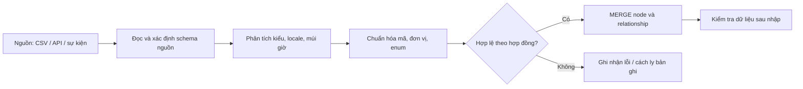

# Quy ước kiểu dữ liệu, đơn vị đo và chuẩn hóa giá trị đầu vào trong Neo4j

Khi xây dựng **property graph** bằng Neo4j, một giá trị không chỉ cần “lưu được” mà còn phải giữ đúng **ý nghĩa, kiểu dữ liệu, đơn vị đo và quy tắc so sánh**. Hai node cùng nhãn có thể được tạo từ những hệ thống khác nhau: một nguồn gửi nhiệt độ theo °C, nguồn khác theo °F; một nguồn gửi thời gian có múi giờ, nguồn khác gửi chuỗi ngày giờ địa phương; mã định danh `"00123"` có thể bị biến thành số `123`. Nếu đưa trực tiếp các giá trị này vào graph, truy vấn Cypher về quan hệ, bộ lọc, khoảng cách và đường đi có thể trả kết quả sai dù cú pháp hoàn toàn hợp lệ.

Bài này xây dựng quy ước dữ liệu đầu vào cho Neo4j, từ cách chọn kiểu property và đơn vị chuẩn đến kiểm tra, chuyển đổi, nhập bằng Cypher, tích hợp Java Driver/Spring Data Neo4j và giám sát chất lượng dữ liệu.

## 1. Kết quả cần đạt

Sau bài học, bạn có thể:

1. Phân biệt kiểu dữ liệu của **property**, **giá trị trung gian trong Cypher** và cấu trúc **node/relationship**.
2. Đặt quy ước nhất quán cho tên property, miền giá trị, đơn vị đo, độ chính xác, thời gian, định danh và giá trị thiếu.
3. Chuẩn hóa dữ liệu không đồng nhất trước khi `MERGE` node/relationship và ngăn lỗi kiểu dữ liệu âm thầm lan vào graph.
4. Viết luồng nhập dữ liệu minh họa bằng Cypher và truyền tham số an toàn bằng Neo4j Java Driver.
5. Dùng truy vấn kiểm tra, constraint và index để duy trì tính nhất quán khi graph tăng trưởng.

## 2. Vì sao quy ước dữ liệu đặc biệt quan trọng với property graph?

Giả sử graph lưu quan hệ `(:Device)-[:RECORDED]->(:Reading)`. Các property sau có vẻ tương tự nhau:

| Nguồn | Property đầu vào | Giá trị | Cách hiểu thực tế |
|---|---|---|---|
| A | `temperature` | `25` | 25 °C, số nguyên |
| B | `temperature` | `"77"` | 77 °F, chuỗi |
| C | `temperature` | `"25,0"` | 25 °C, dấu phẩy thập phân |
| D | `recordedAt` | `"2026-11-25 09:00"` | Giờ địa phương, chưa biết múi giờ |
| E | `recordedAt` | `"2026-11-25T09:00:00+07:00"` | Thời điểm xác định được theo offset |

Nếu dùng `WHERE r.temperature > 30`, dữ liệu chuỗi và dữ liệu số sẽ không tự trở thành cùng một phép so sánh có ý nghĩa. Nếu coi mọi `77` là °C, cảnh báo nhiệt độ sẽ bị sai. Nếu không biết múi giờ của nguồn D, không thể suy ra chính xác thời điểm đo. Graph càng có nhiều quan hệ liên kết, dữ liệu sai tại một node càng ảnh hưởng nhiều truy vấn.

**Nguyên tắc cốt lõi:** xác định hợp đồng dữ liệu cho từng property *trước* khi nhập; chọn một biểu diễn chuẩn, chuyển đổi ở ranh giới hệ thống và kiểm tra trước khi ghi.

## 3. Phân biệt kiểu giá trị Cypher và kiểu property có thể lưu

Cypher có thể thao tác với nhiều kiểu giá trị. Tuy nhiên, không phải giá trị trung gian nào cũng được lưu trực tiếp thành một property.

| Nhóm | Kiểu/giá trị thường gặp | Quy ước sử dụng |
|---|---|---|
| Văn bản | `STRING` | Tên hiển thị, mã định danh, mã đơn vị, enum đã chuẩn hóa |
| Số nguyên | `INTEGER` | Số lượng, số đếm, đơn vị tiền nhỏ nhất, timestamp nguyên nếu có hợp đồng rõ ràng |
| Số thực | `FLOAT` | Đo lường có sai số chấp nhận được, tỷ lệ, tọa độ số |
| Luận lý | `BOOLEAN` | Trạng thái thực sự chỉ có đúng/sai |
| Ngày, giờ | `DATE`, `LOCAL TIME`, `ZONED TIME`, `LOCAL DATETIME`, `ZONED DATETIME` | Chọn theo ý nghĩa thời gian và khả năng xác định múi giờ |
| Khoảng thời gian | `DURATION` | Khoảng thời gian theo ngữ nghĩa lịch/thời gian |
| Không gian | `POINT` | Tọa độ địa lý hoặc hệ tọa độ phẳng với CRS đã xác định |
| Danh sách | Các list có phần tử phù hợp kiểu property | Tập giá trị đơn giản, đồng nhất; tránh list hỗn hợp/nested |
| Cấu trúc trung gian | `MAP`, node, relationship, path | Dùng trong truy vấn, tham số hoặc mô hình graph; không lưu nguyên một map/node/path làm property |

Ví dụ phân biệt:

```cypher
WITH {
  readingId: 'r-001',
  temperatureC: 25.0,
  observedAt: datetime('2026-11-25T09:00:00+07:00')
} AS payload
CREATE (r:Reading {
  readingId: payload.readingId,
  temperatureC: payload.temperatureC,
  observedAt: payload.observedAt
})
RETURN r;
```

`payload` là một **map dùng trong Cypher**; các giá trị thành phần được lưu riêng trên node. Không dùng `SET r.payload = payload` để cố lưu map nguyên khối như một property. Nếu dữ liệu gồm nhiều đối tượng có quan hệ cần truy vấn, hãy mô hình hóa bằng node và relationship.

Một số lưu ý quan trọng:

- `INTEGER` của Neo4j là số nguyên có dấu 64 bit; cần kiểm tra tràn số trước khi chuyển từ chuỗi hoặc kiểu số có độ chính xác lớn.
- `FLOAT` là số dấu phẩy động độ chính xác kép; phép tính có thể có sai số nhị phân. Không dùng nó làm nguồn chân lý cho số tiền phải chính xác đến đơn vị nhỏ nhất.
- Một property không có giá trị không đồng nghĩa với chuỗi rỗng, `0` hoặc `false`. Trong Neo4j, đặt property bằng `null` sẽ làm property đó không tồn tại.
- Property dạng danh sách phải tuân thủ giới hạn lưu trữ của Neo4j, đặc biệt về kiểu phần tử; không thiết kế property là danh sách map hoặc danh sách lồng nhau. Với tập đối tượng giàu ngữ nghĩa, dùng node và relationship.
- Neo4j có schema linh hoạt: cùng một tên property trên các node không tự bảo đảm cùng kiểu hoặc cùng đơn vị. Ứng dụng/luồng nhập phải thực thi hợp đồng dữ liệu, bổ sung constraint khi phù hợp.

## 4. Thiết kế “hợp đồng property” trước khi nhập

Với mỗi nhãn node và loại relationship, ghi rõ:

| Thành phần hợp đồng | Câu hỏi cần trả lời | Ví dụ với `Reading` |
|---|---|---|
| Tên | Tên property có diễn đạt đầy đủ ý nghĩa không? | `temperatureC` thay vì `temp` |
| Kiểu | Kiểu lưu trong Neo4j là gì? | `FLOAT` |
| Đơn vị/miền | Chuẩn hóa về đơn vị và miền nào? | Độ C; không thấp hơn −273,15 °C |
| Bắt buộc | Khi thiếu giá trị có được tạo node không? | `readingId` và `observedAt` bắt buộc |
| Định danh | Khóa có duy nhất và ổn định không? | `readingId` do hệ thống nguồn cung cấp |
| Độ chính xác | Làm tròn ở đâu, sai số cho phép bao nhiêu? | Chỉ làm tròn khi hiển thị nếu nghiệp vụ không yêu cầu khác |
| Thời gian | Lưu thời điểm hay giờ địa phương? | `observedAt` có offset/múi giờ |
| Nguồn gốc | Có cần truy hồi đầu vào không? | `sourceSystem`, `sourceRecordId`, phiên bản quy tắc |
| Dữ liệu lỗi | Từ chối, đưa vào hàng đợi kiểm tra hay dùng giá trị mặc định? | Từ chối bản ghi thiếu thời điểm |

Một mô hình mẫu:

```text
(:Device {deviceId: STRING, model: STRING})
    -[:RECORDED]->
(:Reading {
  readingId: STRING,
  observedAt: ZONED DATETIME,
  temperatureC: FLOAT,
  humidityPct: FLOAT,
  active: BOOLEAN,
  sourceSystem: STRING
})
```

Sơ đồ trên là **mô tả hợp đồng**, không phải câu lệnh tạo schema hay cú pháp khai báo property type. Khi áp dụng thật, phân biệt rõ ràng kiểu dữ liệu mong muốn với constraint có thể được phiên bản/edition Neo4j hiện tại hỗ trợ.

### 4.1. Quy tắc đặt tên

- Dùng tên dễ hiểu và nhất quán, ví dụ `camelCase` cho property, `PascalCase` cho nhãn node, chữ hoa cho loại relationship như `RECORDED`.
- Gắn đơn vị vào tên trường đo khi trường luôn có **một đơn vị cố định**: `distanceM`, `durationMs`, `temperatureC`, `humidityPct`, `weightKg`.
- Với đại lượng có nhiều đơn vị hợp lệ theo nghiệp vụ, lưu cả **giá trị và mã đơn vị** có kiểm soát; tránh đặt chung vào chuỗi `"12 kg"`.
- Không đổi chữ hoa/thường của mã định danh theo thói quen. Chỉ chuẩn hóa `"abc"` và `"ABC"` thành cùng mã khi nghiệp vụ khẳng định chúng tương đương.
- Không đổi tên hoặc thay ý nghĩa của property đã tồn tại mà không có kế hoạch chuyển đổi dữ liệu và cập nhật truy vấn.

### 4.2. Chuẩn hóa mã định danh

Mã `"000123"` phải tiếp tục là `STRING` nếu các số 0 đầu có ý nghĩa. Mã thiết bị, SKU, số điện thoại, mã bưu chính và mã hồ sơ thường là **định danh**, không phải đại lượng toán học. Quy ước cần nêu rõ các quy tắc về khoảng trắng thừa, chữ hoa/chữ thường, Unicode và phạm vi duy nhất.

Nếu mã chỉ duy nhất **trong một hệ thống nguồn**, cân nhắc khóa ghép về mặt ngữ nghĩa (ví dụ `sourceSystem` + `sourceRecordId`), hoặc tạo một mã chuẩn có namespace; không `MERGE` hai node khác nguồn chỉ vì trùng mã cục bộ.

## 5. Chuẩn hóa đơn vị đo và độ chính xác

Neo4j lưu giá trị; hệ thống của bạn phải quy định ý nghĩa đơn vị. Một bảng quy ước mẫu:

| Đại lượng | Property chuẩn | Kiểu gợi ý | Quy tắc |
|---|---|---|---|
| Quãng đường | `distanceM` | `FLOAT` | Mét; km × 1.000 |
| Khối lượng | `weightKg` | `FLOAT` | Kilôgam; g ÷ 1.000 |
| Độ trễ xử lý | `latencyMs` | `INTEGER` | Mili giây; kiểm tra cách làm tròn khi nguồn là giây thập phân |
| Nhiệt độ | `temperatureC` | `FLOAT` | °C; từ °F: (°F − 32) × 5/9 |
| Độ ẩm tương đối | `humidityPct` | `FLOAT` | Miền 0–100, không lẫn với tỷ lệ 0–1 |
| Tỷ lệ thành công | `successRatio` | `FLOAT` | Miền 0–1; 75% thành 0,75 |
| Số lượng | `quantity` | `INTEGER` | Giá trị đếm nguyên, miền không âm nếu nghiệp vụ yêu cầu |
| Số tiền | `amountMinor` + `currency` | `INTEGER` + `STRING` | Đơn vị tiền nhỏ nhất theo từng loại tiền; không mặc định mọi tiền tệ có hai chữ số thập phân |
| Vị trí địa lý | `location` | `POINT` | Ghi rõ CRS, thường WGS 84 cho kinh độ/vĩ độ |

Ví dụ chuyển đổi:

```text
77 °F  →  (77 − 32) × 5/9 = 25 °C
2,5 km →  2 500 m
750 ms →  0,75 s
54%    →  humidityPct = 54; nếu lưu tỷ lệ thì humidityRatio = 0,54
```

**Không nhầm “chuẩn hóa” với “làm tròn”.** Chuẩn hóa đơn vị thực hiện trước, còn quy tắc làm tròn phụ thuộc nghiệp vụ. Ví dụ quãng đường địa lý có thể dùng số thực và dung sai; số tiền hóa đơn nên dùng số nguyên đơn vị nhỏ nhất sau khi đã xác nhận số chữ số thập phân của tiền tệ.

Với số tiền lớn hoặc yêu cầu tính toán thập phân chính xác:

1. Phân tích đầu vào bằng kiểu thập phân chính xác, như `BigDecimal` trong Java, với quy ước dấu thập phân xác định.
2. Xác định `currency` và số chữ số thập phân hợp lệ của loại tiền đó.
3. Chuyển thành số nguyên đơn vị nhỏ nhất và kiểm tra vừa miền `INTEGER` 64 bit trước khi ghi Neo4j.
4. Chỉ chuyển sang dạng hiển thị ở API/UI; không tính tổng thanh toán bằng `FLOAT` khi cần chính xác tuyệt đối.

## 6. Chuẩn hóa ngày giờ, khoảng thời gian và múi giờ

Các khái niệm thời gian khác nhau cần kiểu khác nhau:

| Ý nghĩa | Kiểu nên cân nhắc | Ví dụ |
|---|---|---|
| Ngày sinh, ngày áp dụng | `DATE` | `date('2026-11-25')` |
| Thời điểm sự kiện có thể so sánh toàn cục | `ZONED DATETIME` | `datetime('2026-11-25T09:00:00+07:00')` |
| Giờ mở cửa theo đồng hồ, chưa gắn ngày/múi giờ | `LOCAL TIME` | `localtime('08:30:00')` |
| Giờ lịch hẹn địa phương cần gắn ngữ cảnh múi giờ riêng | `LOCAL DATETIME` | `localdatetime('2026-11-25T09:00:00')` |
| Khoảng thời gian | `DURATION` hoặc số lượng kèm đơn vị | `duration('PT90S')` hoặc `latencyMs = 90000` |

Quy ước đề xuất cho sự kiện được ghi nhận từ nhiều hệ thống:

- Bắt buộc nguồn cung cấp **offset hoặc múi giờ đáng tin cậy** nếu đó là một thời điểm thực tế. Chuỗi `"2026-11-25 09:00"` không đủ để suy ra thời điểm tuyệt đối.
- Có thể chuẩn hóa thời điểm về UTC ở lớp nhập liệu để đơn giản hóa trao đổi. Nếu cần lịch theo vùng địa lý, giữ thêm tên múi giờ IANA ban đầu, ví dụ `"Asia/Ho_Chi_Minh"`, và quy tắc giờ mùa hè nếu liên quan.
- Dùng `DATE` cho ngày thuần túy; không giả định nửa đêm UTC là đại diện cho mọi ngày địa phương.
- Không trộn epoch **giây** và epoch **mili giây**. Nếu buộc lưu epoch, tên property phải thể hiện đơn vị, ví dụ `createdAtEpochMs`; ưu tiên kiểu temporal khi cần truy vấn theo thời gian.
- Phân biệt `DURATION` theo lịch (tháng/ngày) với độ trễ cố định đo bằng mili giây: không thể quy mọi “một tháng” thành số giây cố định.

```cypher
WITH
  datetime('2026-11-25T09:00:00+07:00') AS localEvent,
  datetime('2026-11-25T02:00:00Z') AS utcEvent
RETURN localEvent.epochMillis = utcEvent.epochMillis AS sameInstant;
```

Hai chuỗi trên chỉ cùng một thời điểm. Khi lưu lịch sử giao dịch hay sự kiện, điều này quan trọng hơn việc chuỗi hiển thị trông giống nhau hay không.

## 7. Chuẩn hóa văn bản, boolean, enum và giá trị thiếu

### 7.1. Văn bản và mã phân loại

Với trường dùng để tìm kiếm, đối sánh hoặc `MERGE`:

- Loại bỏ khoảng trắng đầu/cuối khi hợp đồng cho phép; không tự ý xóa khoảng trắng bên trong tên hoặc mã.
- Xác định có phân biệt chữ hoa/chữ thường không; chỉ chuyển `toLower`/`toUpper` khi đã có chính sách.
- Chuẩn hóa Unicode nhất quán (chẳng hạn NFC) ở lớp nhập khi dữ liệu đến từ nhiều nguồn; không bỏ dấu tiếng Việt của tên hiển thị để làm mã khóa duy nhất.
- Ánh xạ alias về mã enum chuẩn, ví dụ `"active"`, `"ACTIVE"` thành `"ACTIVE"`, và từ chối enum không nằm trong danh mục.
- Giữ cả nhãn hiển thị và mã định danh khi cần: `statusCode` phù hợp truy vấn ổn định hơn `statusLabel` được dịch theo ngôn ngữ.

### 7.2. Boolean không phải chuỗi

Các nguồn có thể biểu diễn đúng/sai bằng `"true"/"false"`, `"yes"/"no"`, `"1"/"0"` hoặc giá trị ngôn ngữ khác. Hãy xác định một bảng ánh xạ rõ ràng rồi ghi `BOOLEAN`. Không mặc định mọi giá trị khác `"true"` đều là `false`; một giá trị không nhận diện được phải được xem là **không hợp lệ**.

```cypher
WITH toLower(trim(' YES ')) AS rawActive
RETURN CASE
  WHEN rawActive IN ['true', '1', 'yes', 'y'] THEN true
  WHEN rawActive IN ['false', '0', 'no', 'n'] THEN false
  ELSE null
END AS active;
```

### 7.3. Thiếu, rỗng, không biết và không áp dụng

| Trường hợp | Quy ước khả thi | Lưu ý |
|---|---|---|
| Không có thông tin | Không tạo property | `r.temperatureC IS NULL` kiểm tra cả trường hợp thiếu |
| Chuỗi rỗng do nhập liệu | Kiểm tra và quyết định từ chối/chuyển thành thiếu | Không dùng `""` thay cho số không |
| Giá trị số bằng 0 | Lưu `0` nếu là đo lường hợp lệ | `0` khác “không đo được” |
| Boolean `false` | Lưu `false` | Không đổi thành thiếu |
| “Không áp dụng” có ý nghĩa nghiệp vụ | Mô hình hóa trạng thái/loại rõ ràng | Không dùng số giả như `-9999` nếu không có hợp đồng riêng |

Đặc biệt, khi thực hiện:

```cypher
MATCH (r:Reading {readingId: 'r-001'})
SET r.temperatureC = null;
```

property `temperatureC` sẽ bị xóa khỏi node. Vì vậy, các cập nhật từng phần phải phân biệt “không gửi trường này” với “cố ý xóa trường này”; không truyền toàn bộ bản ghi thô chưa kiểm tra vào lệnh `SET`.

## 8. Quy trình chuẩn hóa dữ liệu đầu vào

Một luồng nhập an toàn có thể tổ chức như sau:



Các bước thực hiện:

1. **Xác định nguồn và phiên bản schema.** Biết nguồn nào gửi độ F, nguồn nào gửi độ C; biết timestamp có offset hay phải lấy múi giờ từ hợp đồng nguồn.
2. **Phân tích cú pháp.** Chuyển chuỗi thành số, boolean, ngày giờ theo *locale đã khai báo*. Hai chuỗi `"1,234"` và `"1.234"` có thể mang ý nghĩa khác nhau theo locale; không đoán bằng cách thay dấu hàng loạt.
3. **Chuẩn hóa.** Đổi sang đơn vị, enum, kiểu và quy ước tên chuẩn; kiểm tra tràn số, độ chính xác và các giá trị không hữu hạn theo hợp đồng.
4. **Xác thực.** Kiểm tra khóa bắt buộc, tính duy nhất, miền hợp lệ, ngưỡng nghiệp vụ, tương quan giữa các trường và tham chiếu node liên quan.
5. **Ghi graph có kiểm soát.** Dùng parameter, constraint và khóa ổn định để nhập lặp không tạo bản ghi trùng ngoài ý muốn.
6. **Quan sát và sửa lỗi.** Lưu số bản ghi nhận/từ chối, lý do, nguồn, thời gian xử lý và phiên bản quy tắc; xử lý lại bản ghi lỗi khi sửa xong dữ liệu nguồn.

Không áp dụng giá trị mặc định im lặng cho trường định danh, số tiền, thời điểm hoặc số đo quan trọng. Giá trị mặc định chỉ hợp lệ khi được quy định rõ trong nghiệp vụ và có thể truy vết.

## 9. Ví dụ đầy đủ: nhập số đo cảm biến bằng Cypher

**Đề bài:** Một cảm biến gửi các bản ghi gồm `readingId`, `deviceId`, thời điểm đo, nhiệt độ có thể là °C/°F, độ ẩm tính theo phần trăm và cờ hoạt động ở dạng chuỗi. Trong graph, tất cả bản ghi phải lưu `temperatureC` (°C), `humidityPct` (0–100), `active` (BOOLEAN) và `observedAt` (temporal có offset).

Ở ví dụ này, giả định `observedAt` và định danh đã được kiểm tra cú pháp hợp lệ ở lớp nhập liệu. Đầu vào:

| readingId | deviceId | observedAt | rawTemperature | unit | rawHumidity | rawActive |
|---|---|---|---:|---|---:|---|
| r-001 | sensor-01 | 2026-11-25T09:00:00+07:00 | "77" | F | "55" | YES |
| r-002 | sensor-01 | 2026-11-25T09:05:00+07:00 | "30" | C | "54" | no |

Tạo ràng buộc khóa để bảo vệ tính duy nhất:

```cypher
CREATE CONSTRAINT device_id_unique IF NOT EXISTS
FOR (d:Device) REQUIRE d.deviceId IS UNIQUE;

CREATE CONSTRAINT reading_id_unique IF NOT EXISTS
FOR (r:Reading) REQUIRE r.readingId IS UNIQUE;
```

Sau đó chuẩn hóa và ghi:

```cypher
WITH [
  {
    readingId: 'r-001',
    deviceId: 'sensor-01',
    observedAt: '2026-11-25T09:00:00+07:00',
    rawTemperature: '77',
    unit: 'F',
    rawHumidity: '55',
    rawActive: 'YES'
  },
  {
    readingId: 'r-002',
    deviceId: 'sensor-01',
    observedAt: '2026-11-25T09:05:00+07:00',
    rawTemperature: '30',
    unit: 'C',
    rawHumidity: '54',
    rawActive: 'no'
  }
] AS rows
UNWIND rows AS row
WITH row,
     toFloatOrNull(trim(row.rawTemperature)) AS rawTemp,
     toFloatOrNull(trim(row.rawHumidity)) AS humidityPct,
     toUpper(trim(row.unit)) AS normalizedUnit,
     toLower(trim(row.rawActive)) AS normalizedActive
WITH row, humidityPct, normalizedActive,
     CASE normalizedUnit
       WHEN 'C' THEN rawTemp
       WHEN 'F' THEN (rawTemp - 32.0) * 5.0 / 9.0
       ELSE null
     END AS temperatureC
WITH row, humidityPct, temperatureC,
     CASE
       WHEN normalizedActive IN ['true', '1', 'yes', 'y'] THEN true
       WHEN normalizedActive IN ['false', '0', 'no', 'n'] THEN false
       ELSE null
     END AS active
WHERE row.readingId IS NOT NULL AND trim(row.readingId) <> ''
  AND row.deviceId IS NOT NULL AND trim(row.deviceId) <> ''
  AND temperatureC IS NOT NULL AND temperatureC >= -273.15
  AND humidityPct IS NOT NULL AND humidityPct >= 0 AND humidityPct <= 100
  AND active IS NOT NULL
MERGE (d:Device {deviceId: row.deviceId})
MERGE (r:Reading {readingId: row.readingId})
SET r.temperatureC = temperatureC,
    r.humidityPct = humidityPct,
    r.active = active,
    r.observedAt = datetime(row.observedAt)
MERGE (d)-[:RECORDED]->(r)
RETURN d.deviceId AS deviceId,
       r.readingId AS readingId,
       r.temperatureC AS temperatureC,
       r.humidityPct AS humidityPct,
       r.active AS active
ORDER BY readingId;
```

Kết quả dự kiến:

| deviceId | readingId | temperatureC | humidityPct | active |
|---|---|---:|---:|---|
| sensor-01 | r-001 | 25,0 | 55,0 | `true` |
| sensor-01 | r-002 | 30,0 | 54,0 | `false` |

Ở bước `WHERE`, số đo không chuyển được, đơn vị lạ hoặc cờ hoạt động không hợp lệ sẽ **không đi vào graph**. Tuy nhiên, câu lệnh này không tự ghi log các bản ghi bị loại; trong hệ thống thực, phải ghi nhận chúng ở luồng nhập hoặc khu vực cách ly dữ liệu. Timestamp không hợp lệ có thể làm `datetime(...)` báo lỗi và khiến transaction thất bại, vì vậy cần kiểm tra trước khi chạy câu lệnh ghi. Cũng phải kiểm tra việc một `readingId` có được gán cho đúng một `deviceId` hay không.

Số thực có thể chứa sai số biểu diễn rất nhỏ. Nếu nghiệp vụ cần biểu diễn hai chữ số sau dấu thập phân, hãy định nghĩa quy tắc làm tròn có chủ đích thay vì mặc định mọi phép đổi đơn vị sẽ cho kết quả chính xác tuyệt đối.

Trong ứng dụng thực, thay danh sách tạo sẵn trong `WITH` bằng tham số `$rows` do Java Driver truyền vào; không ghép chuỗi dữ liệu người dùng trực tiếp vào văn bản Cypher.

## 10. Truy vấn sau chuẩn hóa trở nên đơn giản hơn

Khi mọi bản ghi dùng cùng kiểu và đơn vị, truy vấn ngưỡng nhiệt độ theo thời điểm không cần đoán nguồn đã dùng °C hay °F:

```cypher
MATCH (d:Device)-[:RECORDED]->(r:Reading)
WHERE r.observedAt >= datetime('2026-11-25T00:00:00+07:00')
  AND r.observedAt < datetime('2026-11-26T00:00:00+07:00')
  AND r.temperatureC > 29.0
RETURN d.deviceId, r.readingId, r.observedAt, r.temperatureC
ORDER BY r.observedAt;
```

Có thể tạo range index cho truy vấn thường xuyên lọc theo thời điểm:

```cypher
CREATE RANGE INDEX reading_observed_at IF NOT EXISTS
FOR (r:Reading) ON (r.observedAt);
```

Index giúp bộ lập kế hoạch có thêm phương án truy cập, nhưng không tự sửa giá trị sai kiểu hoặc sai đơn vị. Dùng `EXPLAIN` và `PROFILE` với truy vấn thật để đánh giá kế hoạch truy cập; hiệu quả còn phụ thuộc độ chọn lọc, kích thước dữ liệu và cách duyệt relationship.

Truy vấn kiểm tra một số vi phạm hợp đồng đã tồn tại:

```cypher
MATCH (r:Reading)
WHERE r.temperatureC IS NULL
   OR r.humidityPct IS NULL
   OR r.humidityPct < 0
   OR r.humidityPct > 100
   OR r.observedAt IS NULL
RETURN r.readingId, r.temperatureC, r.humidityPct, r.observedAt
LIMIT 100;
```

Constraint duy nhất bảo vệ giá trị khóa trùng khi khóa **có mặt**; nó không thay thế kiểm tra trường bắt buộc. Các loại constraint về tồn tại property hoặc kiểu property có khả năng phụ thuộc phiên bản và edition Neo4j đang sử dụng, nên kiểm tra tài liệu của bản triển khai trước khi thêm chúng vào schema.

## 11. Dữ liệu vị trí: hệ tọa độ và đơn vị khoảng cách

Kinh độ và vĩ độ không phải hai con số tùy ý. Cần xác định:

- **Hệ tọa độ (CRS)**: ví dụ WGS 84 cho tọa độ địa lý; hệ tọa độ Cartesian cho bản đồ mặt phẳng.
- **Thứ tự trục**: tránh truyền nhầm `latitude` thành `longitude`. Vĩ độ nằm trong khoảng −90 đến 90; kinh độ nằm trong khoảng −180 đến 180.
- **Đơn vị khoảng cách**: `point.distance` trả khoảng cách tính bằng mét với các point địa lý hỗ trợ, còn hệ tọa độ phẳng tuân theo đơn vị của hệ tọa độ đó.
- **Kiểm tra cùng hệ quy chiếu** trước phép đo khoảng cách; không tự so sánh tọa độ thuộc những CRS khác nhau.

```cypher
WITH
  point({latitude: 10.7769, longitude: 106.7009}) AS a,
  point({latitude: 10.7750, longitude: 106.6990}) AS b
RETURN point.distance(a, b) AS distanceMeters;
```

Nếu vị trí là thực thể có metadata và quan hệ riêng, mô hình hóa `(:Place {location: point(...)})`, sau đó liên kết bằng relationship thay vì chỉ lưu kinh/vĩ độ dưới dạng chuỗi `"10.77,106.70"`.

## 12. Áp dụng trong Java Driver và Spring Data Neo4j

### 12.1. Chuẩn hóa trước khi gọi Java Driver

Trong Java, chuyển số tiền chính xác hoặc đại lượng nghiệp vụ quan trọng bằng kiểu thích hợp trước khi truyền tham số. Ví dụ số tiền theo đơn vị nhỏ nhất của USD:

```java
import java.math.BigDecimal;

BigDecimal amountUsd = new BigDecimal("123.45"); // Chuỗi chuẩn: dấu chấm thập phân
long amountMinor = amountUsd.movePointRight(2).longValueExact(); // 12345
String currency = "USD";
```

`longValueExact()` phát hiện giá trị không phải số nguyên sau quy đổi hoặc vượt miền `long`. Với loại tiền khác, hệ số quy đổi phải dựa trên chính sách của loại tiền đó, không cố định `2`.

Sau khi parse, validate và chuẩn hóa đầu vào, truyền tham số theo kiểu native. Ví dụ minh họa với Neo4j Java Driver 5:

```java
import java.time.OffsetDateTime;
import java.util.Map;
import org.neo4j.driver.AuthTokens;
import org.neo4j.driver.Driver;
import org.neo4j.driver.GraphDatabase;
import org.neo4j.driver.Session;

try (Driver driver = GraphDatabase.driver(
         "neo4j://localhost:7687", AuthTokens.basic("neo4j", "password"));
     Session session = driver.session()) {

    Map<String, Object> params = Map.of(
        "deviceId", "sensor-01",
        "readingId", "r-003",
        "temperatureC", 25.0,
        "humidityPct", 55.0,
        "active", true,
        "observedAt", OffsetDateTime.parse("2026-11-25T09:10:00+07:00")
    );

    session.executeWrite(tx -> {
        tx.run("""
            MERGE (d:Device {deviceId: $deviceId})
            MERGE (r:Reading {readingId: $readingId})
            SET r.temperatureC = $temperatureC,
                r.humidityPct = $humidityPct,
                r.active = $active,
                r.observedAt = $observedAt
            MERGE (d)-[:RECORDED]->(r)
            """, params).consume();
        return null;
    });
}
```

Mã ví dụ giả định cấu hình kết nối và thông tin xác thực được cung cấp an toàn từ môi trường triển khai. Không lưu mật khẩu thực trong mã nguồn. Ở production, nên tái sử dụng `Driver` dài hạn theo vòng đời ứng dụng thay vì khởi tạo driver cho mỗi bản ghi; dùng transaction và xử lý ngoại lệ phù hợp.

Giá trị `OffsetDateTime` mang thông tin offset; truyền thẳng kiểu thời gian đã parse giúp giảm lỗi do tạo chuỗi Cypher thủ công. Nếu đầu vào chỉ có `LocalDateTime`, cần xác định vùng giờ nguồn một cách rõ ràng trước khi chuyển thành thời điểm.

### 12.2. Biểu diễn kiểu trong Spring Data Neo4j

Một entity có thể biểu diễn hợp đồng property bằng kiểu Java:

```java
import java.time.OffsetDateTime;
import org.springframework.data.neo4j.core.schema.Id;
import org.springframework.data.neo4j.core.schema.Node;
import org.springframework.data.neo4j.core.schema.Property;

@Node("Reading")
public class Reading {
    @Id
    private String readingId;

    @Property("temperatureC")
    private Double temperatureC;

    @Property("humidityPct")
    private Double humidityPct;

    private Boolean active;
    private OffsetDateTime observedAt;

    // Constructor, getters/setters theo quy ước của ứng dụng.
}
```

`Double`/`Boolean` cho phép biểu diễn dữ liệu thiếu ở tầng Java; `double`/`boolean` chỉ nên dùng khi hợp đồng bảo đảm giá trị bắt buộc và đã được kiểm tra. Annotation không thay thế chuẩn hóa đầu vào, xác thực DTO, unique constraint hoặc kiểm tra dữ liệu tồn tại trong graph.

Trong ứng dụng Spring, nên chuẩn hóa ở tầng nhận dữ liệu/mapper hoặc service trước khi gọi repository, giữ một quy tắc thống nhất giữa import CSV, API và xử lý sự kiện.

## 13. Những lỗi thường gặp và cách khắc phục

| Sai lầm | Hậu quả | Cách sửa |
|---|---|---|
| Lưu `"25"` cùng với `25.0` vào cùng property | Lọc/sắp xếp/aggregation không còn nhất quán | Parse và ép kiểu theo hợp đồng trước khi ghi |
| Lưu `25` °C và `77` °F cùng tên `temperature` | Thống kê và cảnh báo sai | Đổi về `temperatureC` hoặc lưu rõ giá trị + đơn vị |
| Lưu mọi ngày giờ thành chuỗi tự do | Khó so sánh thời điểm, sai múi giờ | Dùng temporal type và ISO 8601 có offset khi cần |
| Dùng `FLOAT` cho tiền chính xác | Sai số khi tính cộng/trừ và đối soát | Dùng số nguyên đơn vị nhỏ nhất hoặc mô hình thập phân phù hợp |
| Chuyển `"000123"` thành `123` | Mất định danh gốc, ghép nhầm node | Lưu định danh dạng chuỗi |
| Lấy `false` hoặc `0` để thay dữ liệu thiếu | Sai ý nghĩa thống kê | Phân biệt giá trị hợp lệ và thông tin chưa có |
| `MERGE` theo tên hiển thị | Tạo trùng hoặc ghép nhầm thực thể | Dùng khóa ổn định và constraint duy nhất |
| Nhận `"1,234"` và tự đoán locale | Lệch hàng nghìn lần | Khai báo định dạng số theo nguồn và từ chối mơ hồ |
| Lưu point không xác định CRS | Khoảng cách sai, so sánh sai hệ tọa độ | Chọn CRS và kiểm tra tọa độ trước khi nhập |
| Truyền map/nested list vào property | Không phù hợp mô hình property | Tách thành property đơn giản hoặc node/relationship |

## 14. Checklist triển khai và bài tập

Trước khi cho một nguồn dữ liệu mới ghi vào graph, hãy kiểm tra:

- [ ] Mỗi property có tên, kiểu, miền hợp lệ, đơn vị chuẩn và quy tắc thiếu dữ liệu.
- [ ] Mã định danh giữ đúng ký tự có ý nghĩa; khóa duy nhất được xác định theo phạm vi nghiệp vụ.
- [ ] Đầu vào số có locale đã biết; số tiền và đại lượng chính xác được chuyển đổi không mất thông tin.
- [ ] Thời điểm có offset/múi giờ đáng tin cậy; không lẫn epoch giây và mili giây.
- [ ] Quy tắc chuyển đổi đơn vị, boolean, enum và Unicode được áp dụng thống nhất ở mọi điểm nhập.
- [ ] Bản ghi không hợp lệ có nơi ghi nhận và cơ chế xử lý lại; không âm thầm thành giá trị mặc định.
- [ ] Node/relationship được ghi bằng tham số, có constraint phù hợp và có chiến lược nhập lặp.
- [ ] Có truy vấn kiểm tra sau nhập và theo dõi tỷ lệ dữ liệu bị từ chối.

**Bài tập 1 — Thiết kế hợp đồng.** Tạo hợp đồng cho node `(:Order)` có `orderId`, `placedAt`, `totalAmount`, `currency` và `deliveryDistance`. Chọn kiểu Neo4j, đơn vị chuẩn, miền hợp lệ, trường bắt buộc và khóa duy nhất. Giải thích cách lưu tiền tệ không có hai chữ số thập phân.

**Bài tập 2 — Chẩn đoán dữ liệu lỗi.** Một nguồn nhập `temperature = "86"` với `unit = "F"`; nguồn khác nhập `temperature = "30"` với `unit = "C"`. Viết phép chuyển đổi về `temperatureC`, chọn ngưỡng cảnh báo 29 °C và giải thích vì sao lọc trên chuỗi thô là sai.

**Bài tập 3 — Tính đúng thời điểm.** So sánh `2026-11-25T09:00:00+07:00` với `2026-11-25T02:00:00Z`. Viết truy vấn Cypher chứng minh chúng cùng thời điểm; nêu cách xử lý nếu nguồn chỉ gửi `2026-11-25 09:00` mà không khai báo múi giờ.

**Bài tập 4 — Kiểm tra chất lượng.** Mở rộng truy vấn ở mục 9 để ghi nhận danh sách các bản ghi không hợp lệ trước khi `MERGE`. Nêu cách xử lý khi hai bản ghi có cùng `readingId` nhưng khác `deviceId`; bảo đảm không nối nhầm một phép đo với hai thiết bị.

**Ghi nhớ:** trong Neo4j, ý nghĩa của một property được hình thành bởi *kiểu dữ liệu + đơn vị + miền giá trị + quy tắc chuẩn hóa + nguồn gốc*. Khi các quy ước này ổn định, Cypher và các đường đi trong graph mới phản ánh đúng quan hệ nghiệp vụ.
