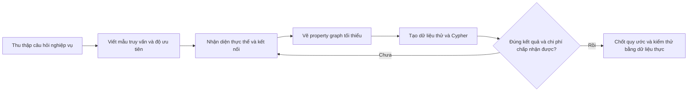
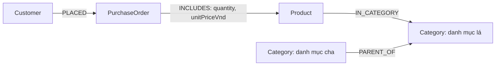

# Đi từ câu hỏi nghiệp vụ và mẫu truy vấn đến mô hình đồ thị

## 1. Mục tiêu của bài học

Khi thiết kế cơ sở dữ liệu đồ thị bằng **Neo4j**, câu hỏi đầu tiên không nên là “hệ thống có những bảng nào?” mà là **“người dùng cần tìm thông tin gì, bắt đầu từ đâu và phải đi qua những quan hệ nào để tìm được câu trả lời?”**. Cách tiếp cận *query-first* (thiết kế từ câu hỏi và mẫu truy vấn) giúp tạo property graph phục vụ trực tiếp những đường đi được truy cập thường xuyên, đồng thời tránh biến graph thành bản sao máy móc của mô hình quan hệ.

Sau bài này, bạn có thể:

- Chuyển yêu cầu nghiệp vụ thành danh sách **truy vấn cụ thể**, bao gồm điểm bắt đầu, quan hệ cần duyệt, điều kiện lọc, dữ liệu trả về và tần suất sử dụng.
- Phân biệt khi nào một khái niệm nên là **node**, **relationship**, **property** hoặc một node trung gian thể hiện thực thể/sự kiện có vòng đời riêng.
- Chọn hướng quan hệ, nhãn, loại quan hệ và định danh đủ rõ để viết **Cypher** và đảm bảo dữ liệu nhất quán.
- Dựng mô hình thử, chạy truy vấn đại diện, đọc `EXPLAIN`/`PROFILE` và điều chỉnh khi xuất hiện mở rộng đường đi quá lớn.
- Xác định các quyết định còn phải kiểm chứng bằng dữ liệu thực: cardinality, độ sâu đường đi, tần suất ghi/đọc và mức tăng trưởng.

Phạm vi bài tập trung vào **thiết kế mô hình** trong Neo4j. Các ví dụ về constraint, index và Cypher đóng vai trò kiểm tra mô hình; việc triển khai Java Driver, Spring Data Neo4j và vận hành được tiếp tục ở những chủ đề riêng của module.

## 2. Vì sao phải bắt đầu từ câu hỏi nghiệp vụ?

Neo4j lưu dữ liệu theo **property graph**: node biểu diễn thực thể, relationship biểu diễn liên kết có hướng giữa hai node, và cả node lẫn relationship đều có thể mang thuộc tính. Khi truy vấn, Cypher có thể duyệt các kết nối đã được lưu trực tiếp thay vì phải tự ghép nhiều bảng liên kết trong ứng dụng.

Tuy nhiên, cùng một nghiệp vụ có thể có nhiều cách mô hình hóa hợp lệ. Chẳng hạn, trong hệ thống bán hàng:

- Nếu chỉ cần biết khách hàng **đã mua sản phẩm nào**, có thể hình dung quan hệ trực tiếp `(:Customer)-[:BOUGHT]->(:Product)`.
- Nếu phải biết **đơn hàng nào**, trạng thái thanh toán, thời điểm mua, số lượng và đơn giá tại thời điểm mua, đơn hàng là thực thể quan trọng và đường đi phù hợp hơn là `Customer → PurchaseOrder → Product`.
- Nếu cần quản lý hoàn tiền, chia giao hàng hoặc chiết khấu theo từng dòng, một **OrderLine** có định danh riêng có thể cần thiết.

Ba cách này không tương đương về ý nghĩa, khả năng cập nhật và chi phí truy vấn. Vì vậy, sơ đồ graph là **kết quả của việc làm rõ câu hỏi**, không phải điểm xuất phát.

Một quy trình thực tế là:



> **Nguyên tắc:** Tối ưu cho những đường đi quan trọng và có bằng chứng về tần suất, đồng thời giữ nguyên ý nghĩa nghiệp vụ. Không nên thêm mọi cạnh có thể suy ra chỉ vì việc duyệt cạnh trực tiếp có vẻ tiện lợi.

## 3. Tình huống xuyên suốt: gợi ý sản phẩm trong hệ thống bán hàng

Một cửa hàng muốn dùng Neo4j để trả lời các câu hỏi sau:

1. **Q1 – Lịch sử mua:** Khách hàng `KH01` đã đặt những đơn nào, theo thời gian mới nhất trước?
2. **Q2 – Sản phẩm bán chạy:** Trong danh mục “Điện tử” và toàn bộ danh mục con, sản phẩm nào bán nhiều nhất kể từ một thời điểm?
3. **Q3 – Gợi ý:** Những khách hàng mua cùng sản phẩm với `KH01` còn mua sản phẩm gì mà `KH01` chưa từng mua?
4. **Q4 – Phân cấp danh mục:** Một sản phẩm thuộc đường phân cấp danh mục nào dưới “Điện tử”?

Đây là những câu hỏi có hình dạng truy vấn khác nhau. Q1 là tra cứu theo định danh và duyệt một bước; Q2 đi từ cây danh mục sang sản phẩm rồi sang đơn hàng để tổng hợp; Q3 đi qua nhiều thực thể và loại trừ các sản phẩm đã mua; Q4 cần tìm một **đường đi nhiều bước**.

### 3.1. Lập “hợp đồng truy vấn” trước khi vẽ mô hình

| Mẫu truy vấn | Điểm neo nên tìm trước | Đường đi dự kiến | Điều kiện và kết quả | Đặc tính cần đo |
|---|---|---|---|---|
| Q1 – Đơn của một khách | `Customer.customerId` | Customer → PurchaseOrder | Trạng thái, thời gian; trả đơn mới nhất | Số đơn/khách, phân trang |
| Q2 – Bán chạy theo danh mục | `Category.categoryId` | Category → danh mục con → Product ← PurchaseOrder | Khoảng thời gian, trạng thái thanh toán; tổng số lượng | Độ sâu cây, số sản phẩm, số đơn |
| Q3 – Sản phẩm gợi ý | `Customer.customerId` | Customer → Order → Product ← Order ← Customer → Order → Product | Chỉ đơn đã thanh toán; loại sản phẩm đã mua; xếp hạng | Số khách cùng mua, độ phổ biến của sản phẩm |
| Q4 – Đường phân cấp | `Product.sku` và danh mục gốc | Product → Category ← chuỗi Category | Trả chuỗi tên danh mục từ gốc đến lá | Độ sâu, nhánh nhiều cha, chu trình |

Khi phỏng vấn người phụ trách nghiệp vụ, cần hỏi thêm: “Đã mua” nghĩa là đơn **đã thanh toán**, **đã giao** hay mọi đơn? Danh mục có được nhiều cha không? Đơn có thể chứa cùng SKU trên nhiều dòng không? Những lựa chọn này quyết định cấu trúc dữ liệu và tính đúng đắn của truy vấn.

### 3.2. Bổ sung yêu cầu phi chức năng

Một bảng câu hỏi hoàn chỉnh nên ghi nhận **tần suất**, **quy mô** và **mục tiêu phản hồi**. Ví dụ dưới đây chỉ là giả định để luyện thiết kế, không phải số liệu đo của hệ thống thật:

| Thông số giả định | Giá trị để thử | Tác động tới quyết định |
|---|---|---|
| Q1 được gọi nhiều nhất | 500 lượt/phút | Cần điểm neo theo `customerId` và giới hạn số dòng |
| Q3 nằm trên trang sản phẩm | P95 mục tiêu dưới 200 ms | Cần đo độ mở rộng ở sản phẩm rất phổ biến |
| Mỗi đơn có 1–20 SKU | Tối đa 20 cạnh `INCLUDES`/đơn trong mẫu | Quan hệ mang số lượng và giá có thể đủ cho phiên bản đầu |
| Cây danh mục sâu tối đa 4 cấp | Giới hạn duyệt 4 cạnh | Có thể dùng `*0..4` thay vì truy vấn độ dài không giới hạn |
| Một sản phẩm có thể thuộc nhiều danh mục | Quan hệ nhiều-nhiều | Phải tránh đếm trùng khi tính sản lượng qua cây |

Không thể bảo đảm mục tiêu P95 chỉ bằng hình vẽ. Cần đo thực tế trên dữ liệu có phân bố gần giống sản xuất và cập nhật mô hình khi dữ liệu thay đổi.

## 4. Đi từ danh từ và động từ nghiệp vụ đến property graph

### 4.1. Chọn node, relationship và property

| Khái niệm | Biểu diễn đề xuất | Lý do |
|---|---|---|
| Khách hàng | `(:Customer {customerId, name})` | Có định danh riêng, được truy vấn trực tiếp |
| Đơn hàng | `(:PurchaseOrder {orderId, placedAt, status})` | Có trạng thái, vòng đời, liên kết với khách và các mặt hàng |
| Sản phẩm | `(:Product {sku, name})` | Được dùng lại giữa nhiều đơn và danh mục |
| Danh mục | `(:Category {categoryId, name})` | Có phân cấp và được tìm theo định danh |
| Khách đặt đơn | `(:Customer)-[:PLACED]->(:PurchaseOrder)` | Biểu thị quan hệ có nghĩa rõ ràng, một khách có nhiều đơn |
| Đơn chứa sản phẩm | `(:PurchaseOrder)-[:INCLUDES {quantity, unitPriceVnd}]->(:Product)` | Số lượng và đơn giá là dữ liệu của **lần mua**, không phải giá hiện tại của sản phẩm |
| Sản phẩm thuộc danh mục | `(:Product)-[:IN_CATEGORY]->(:Category)` | Một sản phẩm có thể thuộc nhiều danh mục |
| Danh mục cha–con | `(:Category)-[:PARENT_OF]->(:Category)` | Cấu trúc phân cấp có thể duyệt nhiều mức |
| Tên khách hàng, trạng thái đơn | Property | Chưa cần định danh và đường đi độc lập trong phạm vi câu hỏi hiện tại |

**Phép thử để quyết định có cần node:** Khái niệm đó có định danh riêng, được nhiều đối tượng tham chiếu, có trạng thái/vòng đời, phải truy vấn trực tiếp, hoặc mang các quan hệ khác không? Nếu có, node thường là lựa chọn tốt. Property phù hợp cho giá trị đơn giản không cần được duyệt như một thực thể riêng.

**Phép thử để quyết định có cần node trung gian:** Một liên kết có thể xuất hiện nhiều lần giữa cùng hai đối tượng nhưng mỗi lần phải có định danh, trạng thái và các quan hệ riêng không? Nếu có, nên xét node trung gian. Ở ví dụ này, `INCLUDES` đại diện **một dòng sản phẩm được gộp theo SKU trong mỗi đơn**. Nếu một đơn có thể có hai dòng cùng SKU với khuyến mại, lô hàng hoặc lịch hoàn tiền khác nhau, mô hình nên chuyển sang `PurchaseOrder → OrderLine → Product`.

### 4.2. Quy ước hướng và tên quan hệ



Tên quan hệ là **động từ/cụm từ thể hiện nghĩa nghiệp vụ**; nhãn node là **danh từ**. Dùng một chiều quy ước nhất quán (`PARENT_OF` từ cha sang con), sau đó Cypher vẫn có thể duyệt ngược bằng mũi tên `<-` khi câu hỏi yêu cầu. Tránh các quan hệ chung chung như `RELATED_TO` và các tên thay đổi theo dữ liệu như `PURCHASED_2026`: chúng làm mơ hồ ý nghĩa và khiến truy vấn khó bảo trì.

Neo4j có thể lưu nhiều relationship giữa cùng hai node. Điều đó hữu ích khi mỗi cạnh có ý nghĩa riêng, nhưng cũng khiến tổng hợp bị đếm trùng nếu vô tình tạo lại cùng giao dịch. Định danh và chiến lược ghi cần được xác định ngay khi thiết kế.

### 4.3. Phân biệt dữ liệu hiện tại và dữ liệu tại thời điểm xảy ra sự kiện

Giá niêm yết của `Product` có thể thay đổi. Giá đã trả trong đơn hàng phải nằm ở `INCLUDES.unitPriceVnd` hoặc ở `OrderLine`, vì đây là **snapshot** tại thời điểm mua. Tương tự, trạng thái đơn thuộc về `PurchaseOrder`, không nên suy ra từ trạng thái hiện tại của khách hàng hoặc sản phẩm.

Để tránh sai số tiền tệ trong ví dụ dùng VND, giá được lưu bằng **số nguyên đồng**; hệ thống hỗ trợ nhiều tiền tệ có thể cần thêm mã tiền tệ và quy tắc làm tròn. Khi nghiệp vụ phát sinh hoàn tiền, giao nhiều đợt hoặc nhiều mức thuế, nên xem lại lựa chọn node trung gian thay vì nhồi quá nhiều thuộc tính vào một cạnh.

## 5. Hiện thực mô hình tối thiểu bằng Neo4j và Cypher

Các câu lệnh dưới đây dùng cú pháp Cypher trên Neo4j 5.x. Có thể chạy tuần tự trong Neo4j Browser hoặc môi trường thử nghiệm. Chúng tạo dữ liệu minh họa, không nhằm giả lập đầy đủ các ràng buộc của hệ thống bán hàng thực.

### 5.1. Tạo constraint cho các điểm neo

```cypher
CREATE CONSTRAINT customer_id_unique IF NOT EXISTS
FOR (c:Customer) REQUIRE c.customerId IS UNIQUE;

CREATE CONSTRAINT order_id_unique IF NOT EXISTS
FOR (o:PurchaseOrder) REQUIRE o.orderId IS UNIQUE;

CREATE CONSTRAINT product_sku_unique IF NOT EXISTS
FOR (p:Product) REQUIRE p.sku IS UNIQUE;

CREATE CONSTRAINT category_id_unique IF NOT EXISTS
FOR (c:Category) REQUIRE c.categoryId IS UNIQUE;
```

Các unique constraint bảo vệ định danh và tạo khả năng tìm node theo khóa nhanh. Chúng không tự đảm bảo một đơn chỉ có một khách, một danh mục không có chu trình, hay một đơn không có hai cạnh `INCLUDES` giống nhau: những bất biến đó cần được kiểm soát ở logic ghi dữ liệu, kiểm tra hoặc thiết kế bổ sung.

Với truy vấn thường lọc đơn theo trạng thái và thời điểm, có thể **thử nghiệm** thêm index sau khi kiểm tra `PROFILE`:

```cypher
CREATE INDEX order_status_time_idx IF NOT EXISTS
FOR (o:PurchaseOrder) ON (o.status, o.placedAt);
```

Index không tự động làm mọi truy vấn nhanh hơn. Nếu truy vấn bắt đầu từ một khách cụ thể rồi duyệt vài đơn, điểm neo `customerId` có thể quan trọng hơn index thời gian toàn cục.

### 5.2. Tạo bộ dữ liệu nhỏ, có thể chạy lại

```cypher
MERGE (kh1:Customer {customerId: 'KH01'}) SET kh1.name = 'An'
MERGE (kh2:Customer {customerId: 'KH02'}) SET kh2.name = 'Bình'

MERGE (d1:PurchaseOrder {orderId: 'DH01'})
SET d1.status = 'PAID', d1.placedAt = datetime('2026-11-20T09:00:00+07:00')
MERGE (d2:PurchaseOrder {orderId: 'DH02'})
SET d2.status = 'PAID', d2.placedAt = datetime('2026-11-21T10:00:00+07:00')

MERGE (phim:Product {sku: 'P-KEY'}) SET phim.name = 'Bàn phím'
MERGE (chuot:Product {sku: 'P-MOUSE'}) SET chuot.name = 'Chuột'
MERGE (ssd:Product {sku: 'P-SSD'}) SET ssd.name = 'Ổ SSD'

MERGE (dienTu:Category {categoryId: 'CAT-ELECTRONICS'})
SET dienTu.name = 'Điện tử'
MERGE (ngoaiVi:Category {categoryId: 'CAT-PERIPHERAL'})
SET ngoaiVi.name = 'Thiết bị ngoại vi'
MERGE (luuTru:Category {categoryId: 'CAT-STORAGE'})
SET luuTru.name = 'Lưu trữ'

MERGE (kh1)-[:PLACED]->(d1)
MERGE (kh2)-[:PLACED]->(d2)

MERGE (d1)-[dong11:INCLUDES]->(phim)
SET dong11.quantity = 1, dong11.unitPriceVnd = 800000
MERGE (d1)-[dong12:INCLUDES]->(ssd)
SET dong12.quantity = 1, dong12.unitPriceVnd = 1500000
MERGE (d2)-[dong21:INCLUDES]->(phim)
SET dong21.quantity = 1, dong21.unitPriceVnd = 800000
MERGE (d2)-[dong22:INCLUDES]->(chuot)
SET dong22.quantity = 2, dong22.unitPriceVnd = 400000

MERGE (dienTu)-[:PARENT_OF]->(ngoaiVi)
MERGE (dienTu)-[:PARENT_OF]->(luuTru)
MERGE (phim)-[:IN_CATEGORY]->(ngoaiVi)
MERGE (chuot)-[:IN_CATEGORY]->(ngoaiVi)
MERGE (ssd)-[:IN_CATEGORY]->(luuTru);
```

`MERGE` ở đây được dùng để dễ chạy lại bộ dữ liệu minh họa. Trong ứng dụng nhiều luồng ghi, cần transaction và constraint phù hợp để kiểm soát tạo trùng; không nên coi `MERGE` đơn lẻ là bảo đảm mọi bất biến nghiệp vụ, đặc biệt với các cạnh không có khóa riêng.

## 6. Viết Cypher từ từng mẫu truy vấn

### Q1. Lịch sử đơn hàng từ một khách hàng

Câu hỏi đã xác định điểm neo duy nhất là `customerId`, vì vậy truy vấn bắt đầu ở `Customer`, duyệt cạnh `PLACED`, lọc và sắp xếp đơn:

```cypher
MATCH (c:Customer {customerId: $customerId})-[:PLACED]->(o:PurchaseOrder)
WHERE o.status = 'PAID'
RETURN o.orderId AS orderId, o.placedAt AS placedAt
ORDER BY placedAt DESC
LIMIT $limit;
```

Thử với `$customerId = 'KH01'`, `$limit = 10` sẽ trả `DH01`. Nếu cần phân trang ổn định khi nhiều đơn có cùng thời điểm, bổ sung khóa phụ `orderId` vào `ORDER BY` và dùng chiến lược cursor thích hợp. Đối với dữ liệu lớn, `LIMIT` chỉ giới hạn số kết quả; việc duyệt và sắp xếp vẫn phải được đo.

### Q2. Sản phẩm bán chạy trong cả cây danh mục

Từ danh mục gốc, đi xuống tối đa bốn cạnh `PARENT_OF`, lấy sản phẩm thuộc các danh mục tìm được rồi tìm các dòng sản phẩm trong đơn đã thanh toán:

```cypher
MATCH (root:Category {categoryId: $rootCategoryId})
      -[:PARENT_OF*0..4]->(cat:Category)<-[:IN_CATEGORY]-(p:Product)
WITH DISTINCT p
MATCH (o:PurchaseOrder)-[item:INCLUDES]->(p)
WHERE o.status = 'PAID'
  AND o.placedAt >= datetime($fromTime)
RETURN p.sku AS sku, sum(item.quantity) AS unitsSold
ORDER BY unitsSold DESC, sku
LIMIT $limit;
```

Ví dụ tham số: `$rootCategoryId = 'CAT-ELECTRONICS'`, `$fromTime = '2026-11-01T00:00:00+07:00'`, `$limit = 10`. Kết quả dự kiến là `P-KEY: 2`, `P-MOUSE: 2`, `P-SSD: 1` (hai sản phẩm đầu đồng hạng, được sắp theo `sku`).

Các quyết định quan trọng ở truy vấn này:

- `*0..4` gồm cả danh mục gốc (độ dài 0) và giới hạn độ sâu tối đa bốn cạnh. Giới hạn này phải phù hợp quy tắc phân cấp thực tế, không được đặt tùy tiện nếu cây có thể sâu hơn.
- `WITH DISTINCT p` tránh tính nhiều lần một sản phẩm khi sản phẩm thuộc nhiều nhánh hoặc có nhiều đường phân cấp dẫn đến cùng danh mục.
- `item.quantity` là số lượng mua thực tế; `count(item)` chỉ đếm **dòng đơn**, không đếm đơn vị bán ra.
- Mẫu này giả định chỉ các đơn `PAID` được tính. Nếu nghiệp vụ tính đơn `SHIPPED` hoặc trừ hàng hoàn, phải sửa điều kiện và nguồn dữ liệu.

### Q3. Gợi ý từ những khách hàng từng mua cùng sản phẩm

Mẫu đường đi của bài toán là:

```text
KH01 → đơn đã thanh toán → sản phẩm chung
                              ↑
                        đơn của người khác ← khách khác
                                             ↓
                                       đơn của họ → sản phẩm gợi ý
```

Truy vấn Cypher bắt đầu từ khách hiện tại; tìm những người từng mua ít nhất một sản phẩm giống họ; sau đó đếm số người có mua sản phẩm ứng viên:

```cypher
MATCH (me:Customer {customerId: $customerId})
      -[:PLACED]->(myOrder:PurchaseOrder)-[:INCLUDES]->(shared:Product)
WHERE myOrder.status = 'PAID'
MATCH (shared)<-[:INCLUDES]-(theirOrder:PurchaseOrder)
      <-[:PLACED]-(other:Customer)
WHERE theirOrder.status = 'PAID' AND other <> me
WITH DISTINCT me, other
MATCH (other)-[:PLACED]->(otherOrder:PurchaseOrder)
      -[:INCLUDES]->(candidate:Product)
WHERE otherOrder.status = 'PAID'
  AND NOT EXISTS {
    MATCH (me)-[:PLACED]->(oldOrder:PurchaseOrder)
          -[:INCLUDES]->(candidate)
    WHERE oldOrder.status = 'PAID'
  }
RETURN candidate.sku AS sku,
       count(DISTINCT other) AS similarBuyers
ORDER BY similarBuyers DESC, sku
LIMIT $limit;
```

Với `$customerId = 'KH01'`, `$limit = 10`, dữ liệu thử cho kết quả `P-MOUSE` với `similarBuyers = 1`. `DISTINCT` loại trường hợp một người mua nhiều lần sản phẩm chung hoặc sản phẩm ứng viên mà vẫn chỉ được tính là **một khách hàng**.

Đây là ví dụ minh họa thuật toán “người mua cùng sản phẩm cũng mua”. Trong dữ liệu thực, sản phẩm cực kỳ phổ biến có thể khiến số người cần duyệt tăng rất nhanh, làm truy vấn tốn tài nguyên dù đã có index cho khách hàng bắt đầu. Có thể bổ sung giới hạn thời gian, ngưỡng đồng mua, lựa chọn ứng viên theo nhóm phù hợp hoặc tạo bảng/đồ thị gợi ý đã tính trước, dựa trên kết quả đo.

### Q4. Tìm đường đi từ danh mục gốc đến sản phẩm

```cypher
MATCH (p:Product {sku: $sku})-[:IN_CATEGORY]->(leaf:Category)
MATCH path = (root:Category {categoryId: $rootCategoryId})
             -[:PARENT_OF*0..4]->(leaf)
RETURN [node IN nodes(path) | node.name] AS categoryPath
ORDER BY size(categoryPath);
```

Với `$sku = 'P-SSD'` và `$rootCategoryId = 'CAT-ELECTRONICS'`, một kết quả là `['Điện tử', 'Lưu trữ']`. Nếu sản phẩm có nhiều danh mục hoặc một danh mục có nhiều đường đi từ gốc, truy vấn có thể trả **nhiều dòng**, và đó có thể là kết quả nghiệp vụ hợp lệ. Nếu nghiệp vụ chỉ cho phép một cha, cần định nghĩa và bảo vệ quy tắc đó khi ghi dữ liệu.

## 7. Kiểm chứng mô hình bằng dữ liệu và kế hoạch thực thi

Việc truy vấn trả đúng ba dòng trên dữ liệu nhỏ mới chứng minh **đúng một số tình huống mẫu**. Tiếp theo phải kiểm tra tính đúng và chi phí khi dữ liệu lớn hơn.

### 7.1. Kiểm tra dữ liệu và bất biến

| Câu hỏi kiểm tra | Điều cần xác minh |
|---|---|
| Có node trùng định danh không? | Unique constraint có hiệu lực đối với khách, đơn, sản phẩm, danh mục |
| Một đơn thuộc về mấy khách? | Theo nghiệp vụ thông thường là **đúng một** khách đặt; cần kiểm soát ở luồng ghi |
| Một đơn có nhiều dòng cho cùng SKU không? | Nếu có, mô hình cạnh `INCLUDES` gộp theo SKU phải được thay đổi hoặc có quy tắc gộp rõ ràng |
| Danh mục có chu trình không? | `PARENT_OF` cần là cấu trúc phân cấp hợp lệ theo quy tắc đã chọn |
| Có nhiều đường đến cùng sản phẩm không? | Q2 phải có `DISTINCT` đúng vị trí trước khi cộng số lượng |
| Có đơn hủy/hoàn tiền không? | Điều kiện trạng thái và cách tính số lượng phải khớp định nghĩa “đã bán” |

Có thể dùng truy vấn chẩn đoán, ví dụ phát hiện đơn có nhiều khách đặt:

```cypher
MATCH (c:Customer)-[:PLACED]->(o:PurchaseOrder)
WITH o, count(DISTINCT c) AS customerCount
WHERE customerCount > 1
RETURN o.orderId AS orderId, customerCount;
```

Truy vấn trên chỉ phát hiện đơn có **nhiều hơn một** khách; nó không phát hiện đơn không có khách. Để kiểm tra đầy đủ, phải xác định thêm cách kiểm tra các node mồ côi.

### 7.2. Dùng `EXPLAIN` và `PROFILE` đúng chỗ

```cypher
EXPLAIN
MATCH (c:Customer {customerId: 'KH01'})-[:PLACED]->(o:PurchaseOrder)
RETURN o.orderId;
```

`EXPLAIN` xem kế hoạch thực thi dự kiến mà không thực thi truy vấn; `PROFILE` thực thi truy vấn và hiển thị số liệu thực tế. Khi xem kế hoạch, tập trung vào:

1. **Điểm bắt đầu:** có tận dụng index/constraint trên `customerId`, `sku`, `categoryId` không? Có quét nhãn lớn ngoài dự kiến không?
2. **Cardinality:** mỗi bước mở rộng tạo ra bao nhiêu dòng? Có bước nào nhân số kết quả lên nhiều lần không?
3. **Độ sâu và độ rộng đường đi:** `*0..4` có phù hợp cấu trúc danh mục không? Sản phẩm bán chạy có tạo nhiều nhánh liên kết khiến Q3 nở quá lớn không?
4. **Chi phí xử lý:** xem DB hits, bộ nhớ, sắp xếp và phép tổng hợp; đo lại với phân bố dữ liệu thật thay vì chỉ vài node mẫu.

Index giúp tìm **điểm neo**, nhưng không thay thế việc kiểm soát số lượng relationship được duyệt. `LIMIT 10` cuối truy vấn cũng không nhất thiết chặn chi phí tạo ứng viên trước đó. Khi chi phí cao, hãy sửa mẫu truy vấn hoặc mô hình dựa trên bước gây tăng dữ liệu trong `PROFILE`.

### 7.3. Các lỗi thiết kế thường gặp

| Biểu hiện | Hậu quả | Cách tiếp cận tốt hơn |
|---|---|---|
| Chuyển từng bảng SQL thành node và bảng nối thành node riêng | Nhiều bước duyệt không có giá trị nghiệp vụ | Giữ node trung gian khi có định danh, dữ liệu và vòng đời thực sự cần thiết |
| Dùng property chứa chuỗi SKU phân cách dấu phẩy | Khó lọc, khó cập nhật và không duyệt được liên kết | Tạo `INCLUDES` tới từng `Product` |
| Dùng cạnh trực tiếp `Customer → Product` làm nguồn sự thật cho việc mua | Mất ngữ cảnh đơn hàng, thời điểm và trạng thái | Lưu sự kiện mua thông qua `PurchaseOrder`; chỉ thêm cạnh suy diễn khi có chiến lược đồng bộ |
| Mặc định mọi relationship là hai chiều | Dễ tạo cặp cạnh trùng và đếm trùng | Lưu một hướng có nghĩa; duyệt theo hướng cần thiết trong Cypher |
| Duyệt mọi đường đi không giới hạn | Bùng nổ số đường đi, chậm hoặc hết bộ nhớ | Neo truy vấn, giới hạn độ sâu theo nghiệp vụ và giới hạn tập ứng viên |
| Cộng số lượng ngay sau khi duyệt nhiều nhánh danh mục | Một dòng đơn bị tính nhiều lần | Khử trùng sản phẩm trước khi nối đến đơn hàng |
| Chỉ dùng `MERGE` và cho rằng mọi thứ đã duy nhất | Có thể phát sinh liên kết không hợp lệ trong ghi đồng thời | Kết hợp khóa, transaction, bất biến nghiệp vụ và kiểm tra dữ liệu |

## 8. Khi nào cần điều chỉnh mô hình ban đầu?

Một mô hình phục vụ tốt Q1 nhưng chưa chắc tốt Q3. Những thay đổi nên dựa trên câu hỏi mới hoặc bằng chứng đo:

**Trường hợp A – Dòng hàng trở thành thực thể độc lập.** Khi từng dòng phải quản lý lô hàng, hoàn tiền, thuế, giảm giá, trạng thái giao và định danh riêng, chuyển thành:

```text
(:PurchaseOrder)-[:HAS_LINE]->(:OrderLine {lineId, quantity, unitPriceVnd})
(:OrderLine)-[:FOR_PRODUCT]->(:Product)
```

Q2 khi đó cộng `OrderLine.quantity`; Q3 đi qua `OrderLine`. Việc chuyển đổi phải cập nhật tất cả truy vấn, kiểm thử và quy trình nhập dữ liệu.

**Trường hợp B – Gợi ý quá chậm do các sản phẩm phổ biến.** Nếu Q3 thường duyệt qua hàng trăm nghìn người đã mua cùng một mặt hàng, cân nhắc chặn ứng viên theo thời gian, tính trước điểm tương đồng giữa khách/sản phẩm, hoặc dùng giải pháp phân tích đồ thị phù hợp. Các cạnh suy diễn như `(:Product)-[:FREQUENTLY_BOUGHT_WITH]->(:Product)` cần quy tắc làm mới, đánh dấu thời điểm tính và cơ chế tránh sai lệch với đơn hàng nguồn.

**Trường hợp C – Nhu cầu báo cáo tổng hợp rất lớn.** Nếu chủ yếu cần báo cáo doanh thu theo ngày, vùng và số lượng, hệ quản trị quan hệ hoặc kho dữ liệu có thể là lựa chọn bổ trợ tốt hơn cho phần tổng hợp. Dùng graph nơi các kết nối và đường đi tạo giá trị rõ ràng; không buộc mọi phép phân tích phải chạy trực tiếp trên một mô hình graph giao dịch.

**Trường hợp D – Phân cấp danh mục đổi cấu trúc.** Chuyển một danh mục con sang cha khác có thể thay đổi nhiều kết quả truy vấn. Hãy quy định rõ danh mục là cây hay DAG, có cần lịch sử phân cấp hay không, và cách kiểm tra chu trình trước khi cập nhật. Với yêu cầu “danh mục tại thời điểm mua”, đường dẫn danh mục hiện tại có thể không đủ; cần snapshot hoặc mô hình thời gian phù hợp.

Trong ứng dụng Java, truyền tham số vào Cypher thay vì ghép chuỗi truy vấn từ dữ liệu người dùng. Khi dùng Spring Data Neo4j, thiết kế entity/relationship theo mô hình đã kiểm chứng bằng đường đi và mẫu truy vấn; không để cấu trúc class Java tự động quyết định mọi liên kết của graph.

## 9. Quy trình áp dụng cho dự án mới

Có thể dùng checklist sau để phối hợp giữa người phụ trách nghiệp vụ, người thiết kế graph và nhóm ứng dụng:

1. **Thu thập 5–10 câu hỏi ưu tiên.** Viết thành câu có chủ thể, điều kiện và kết quả cụ thể; thống nhất định nghĩa các thuật ngữ như “đã mua”, “đang hoạt động”.
2. **Gắn hình dạng đường đi.** Với mỗi câu, đánh dấu node neo, thứ tự relationship, hướng, độ dài, phép lọc, sắp xếp và phép tổng hợp.
3. **Liệt kê bất biến và cardinality.** Ghi rõ quan hệ 1–1, 1–n, n–n; có thể lặp cạnh, có thể nhiều cha, có cần lịch sử hay không.
4. **Vẽ graph tối thiểu.** Chọn label, relationship type, khóa và property. Giữ nhất quán cách đặt tên và hướng.
5. **Tạo bộ dữ liệu có tình huống biên.** Không chỉ dùng “mỗi thứ một node”: thêm khách mua nhiều lần, sản phẩm thuộc hai danh mục, đơn hủy, danh mục sâu và sản phẩm cực kỳ phổ biến.
6. **Viết truy vấn có tham số và đối chiếu kết quả.** Kiểm tra từng mẫu với kỳ vọng nghiệp vụ, đặc biệt phép cộng và khử trùng.
7. **Đo trên dữ liệu đại diện.** Dùng `EXPLAIN`/`PROFILE`, xem số dòng giữa các bước và thời gian phản hồi; ưu tiên sửa những mẫu truy vấn thường dùng nhất.
8. **Chốt hợp đồng truy vấn.** Ghi lại đầu vào/đầu ra, giả định, index/constraint, giới hạn độ sâu và quy tắc cập nhật khi mô hình thay đổi.

### Bài tập tự kiểm tra

**Bài tập 1.** Cửa hàng cho phép một đơn có hai dòng cùng SKU vì áp dụng hai chương trình giảm giá khác nhau. Hãy giải thích vì sao `INCLUDES {quantity, unitPriceVnd}` không còn là lựa chọn dễ quản lý và viết lại mẫu đường đi có `OrderLine`.

**Bài tập 2.** Một sản phẩm thuộc đồng thời hai nhánh dưới “Điện tử”. Truy vấn Q2 sẽ sai thế nào nếu bỏ `WITH DISTINCT p`? Hãy dùng một bộ dữ liệu nhỏ để chứng minh số lượng bán bị nhân đôi.

**Bài tập 3.** Q3 đáp ứng tốt với 10 nghìn đơn nhưng chậm khi số đơn tăng. Hãy nêu ba số liệu cần xem trong `PROFILE` và đề xuất ít nhất hai cách giảm số ứng viên mà vẫn giữ nghĩa “những người đã mua cùng sản phẩm”.

**Bài tập 4.** Bộ phận tài chính yêu cầu báo cáo “doanh thu thuần theo danh mục tại thời điểm mua”. Những trường dữ liệu và quy tắc thời gian nào đang thiếu trong graph minh họa? Cần hỏi thêm điều gì về hoàn tiền, giảm giá và thay đổi danh mục?

**Tiêu chí hoàn thành:** Bạn có thể lấy một câu hỏi nghiệp vụ chưa từng gặp, vẽ được đường đi Cypher hợp lý, giải thích vì sao mỗi thành phần là node/relationship/property, chỉ ra một rủi ro về đếm trùng hoặc bùng nổ cardinality và đề xuất cách đo để xác nhận thiết kế. Khi đó mô hình đồ thị đã được dẫn dắt bởi nhu cầu truy vấn cụ thể, thay vì chỉ bởi danh sách thực thể.
