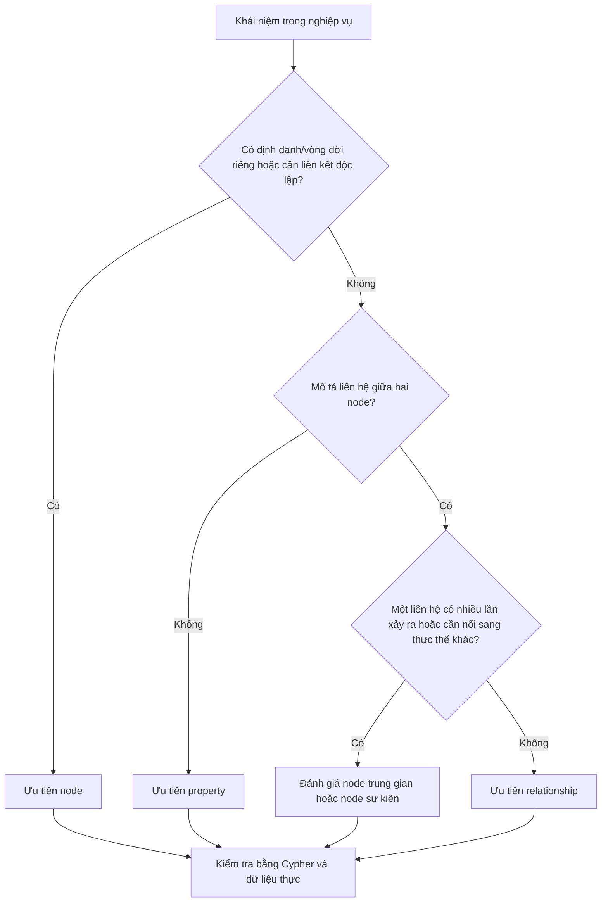
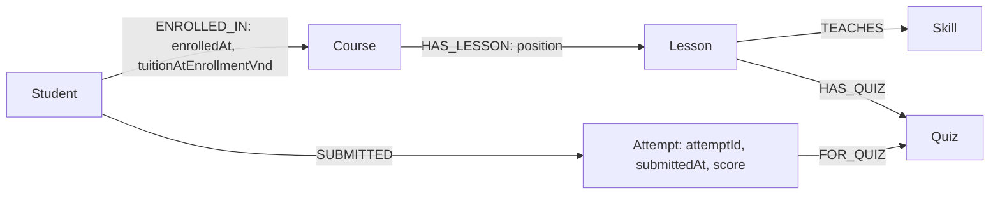

# Chọn thực thể làm nút, quan hệ hay thuộc tính

## 1. Mục tiêu bài học

Trong **Neo4j**, không phải mọi danh từ trong yêu cầu nghiệp vụ đều cần trở thành node. Một khái niệm có thể được lưu dưới dạng **node** (nút), **relationship** (quan hệ) hoặc **property** (thuộc tính). Chọn đúng cách biểu diễn giúp truy vấn Cypher diễn đạt đúng ý nghĩa, ghi dữ liệu nhất quán và tránh những đường đi không cần thiết.

Bài này thuộc phần **Thiết kế mô hình** của module `DATABASE_ENGINE_GRAPH_NEO4J`, tập trung vào quyết định biểu diễn dữ liệu trong **property graph**. Đây là bước nền tảng trước khi thiết kế index, constraint, tối ưu đường đi hoặc ánh xạ mô hình qua Java Driver và Spring Data Neo4j.

Sau bài học, bạn có thể:

- Phân biệt trách nhiệm của node, relationship và property theo **định danh, ý nghĩa, vòng đời và mẫu truy vấn**.
- Biến yêu cầu nghiệp vụ thành mô hình đồ thị cụ thể, không máy móc chuyển từng bảng quan hệ thành node.
- Nhận diện thời điểm một relationship mang thuộc tính là đủ và thời điểm phải chuyển thành **node trung gian/sự kiện**.
- Quyết định nơi đặt thuộc tính theo **ngữ cảnh sở hữu**, đặc biệt với giá trị thay đổi theo thời gian.
- Dùng Cypher để dựng, truy vấn và kiểm tra mô hình; nhận ra rủi ro về trùng lặp và cardinality.

## 2. Ba thành phần cốt lõi của property graph

| Thành phần | Biểu diễn minh họa | Dùng khi nào? | Câu hỏi kiểm tra |
|---|---|---|---|
| **Node** | `(:Student {studentId: 'HV01'})` | Một đối tượng/sự kiện có danh tính, được tham chiếu hoặc cần các liên kết của riêng nó | “Ta có cần tìm, cập nhật hoặc nối đối tượng này độc lập không?” |
| **Relationship** | `(:Student)-[:ENROLLED_IN]->(:Course)` | Một sự liên hệ có nghĩa giữa hai node; luôn có kiểu và hướng lưu trữ | “Dữ liệu này mô tả cách hai đối tượng liên quan với nhau phải không?” |
| **Property** | `course.title`, `enrollment.enrolledAt` | Giá trị mô tả một node hoặc một relationship; không cần duyệt thành đối tượng riêng | “Giá trị này thuộc về ai/điều gì, và có cần định danh riêng không?” |

Một node có thể có nhiều **label**; một relationship có một **type** và nối chính xác hai node. Node và relationship đều có thể mang thuộc tính. Trong Cypher, biểu thức có hướng `->` hoặc `<-` cho biết hướng duyệt; hướng được lưu không có nghĩa truy vấn chỉ được đi một chiều.

Neo4j lưu property dưới dạng giá trị phù hợp với hệ kiểu thuộc tính, ví dụ chuỗi, số, boolean, giá trị thời gian, không gian và các mảng được hỗ trợ. **Không lưu trực tiếp một object/map lồng nhau như một property** rồi kỳ vọng có thể duyệt các phần tử của nó như graph. Nếu cấu trúc con có danh tính hoặc quan hệ riêng, hãy cân nhắc tách thành node.

Ví dụ cơ bản:

```cypher
(:Student {studentId: 'HV01', name: 'An'})
  -[:ENROLLED_IN {enrolledAt: datetime('2026-10-01T09:00:00+07:00')}]->
(:Course {courseId: 'N4J-101', title: 'Neo4j cơ bản'})
```

Đây là **ký pháp minh họa một mẫu đồ thị**, không phải câu lệnh Cypher độc lập để chạy. `Student` và `Course` là node; `ENROLLED_IN` là relationship; tên người học, tên khóa học và ngày đăng ký là property nằm ở đối tượng phù hợp.

## 3. Quy trình ra quyết định: từ khái niệm đến hình dạng đồ thị

Với mỗi khái niệm trong yêu cầu nghiệp vụ, hãy kiểm tra năm khía cạnh:

1. **Định danh:** Có mã/khóa nhận diện một lần xuất hiện riêng biệt không? Hai đối tượng có thể trùng tên nhưng vẫn khác nhau không?
2. **Truy vấn và kết nối:** Cần bắt đầu truy vấn từ đối tượng đó, tìm đường đi tới nó hoặc nối nó với nhiều loại đối tượng khác không?
3. **Ngữ cảnh sở hữu:** Dữ liệu mô tả bản thân một đối tượng hay mô tả **sự liên hệ** giữa hai đối tượng? Chẳng hạn, thứ tự bài học thuộc về việc bài học nằm trong một khóa học, không nhất thiết thuộc về bản thân bài học.
4. **Số lần xuất hiện:** Cùng một cặp đối tượng có thể liên hệ nhiều lần với ý nghĩa độc lập (nhiều lần đăng ký, nhiều lượt làm bài) không? Có cần giữ lịch sử từng lần?
5. **Vòng đời và cập nhật:** Khái niệm đó có trạng thái, quyền truy cập, sự kiện phát sinh, chứng từ hoặc các kết nối riêng trong tương lai không?



Sơ đồ trên là **khung tư duy**, không phải luật tuyệt đối. Một khái niệm có định danh vẫn có thể được biểu diễn đơn giản nếu hệ thống không cần duyệt nó; ngược lại, một giá trị ban đầu chỉ là property có thể trở thành node khi xuất hiện yêu cầu truy vấn quan hệ. Tiêu chí quyết định cuối cùng là **ý nghĩa nghiệp vụ + mẫu truy vấn + yêu cầu nhất quán dữ liệu**.

### 3.1. Dấu hiệu nên dùng node

- Có khóa nghiệp vụ riêng, chẳng hạn `studentId`, `courseId`, `quizId`, `attemptId`.
- Được dùng chung bởi nhiều đối tượng, ví dụ một `Skill` được dạy ở nhiều bài học.
- Cần duyệt nhiều cạnh liên quan, ví dụ từ `Course` sang `Lesson`, `Instructor`, `Skill`.
- Có lịch sử hoặc trạng thái riêng cho **mỗi lần xảy ra**, ví dụ một lượt nộp bài kiểm tra.
- Cần tham chiếu, phân quyền hoặc xử lý riêng mà không phụ thuộc hoàn toàn vào hai đầu mút.

### 3.2. Dấu hiệu nên dùng relationship

- Cần diễn đạt một **động từ nghiệp vụ**: `ENROLLED_IN`, `HAS_LESSON`, `TEACHES`, `SUBMITTED`.
- Hai đầu mút đã có danh tính và truy vấn cần duyệt trực tiếp giữa chúng.
- Thuộc tính của liên hệ có thể nằm trên cạnh, ví dụ `enrolledAt`, `position`.
- Mỗi cặp đầu mút thường chỉ có một liên hệ cùng nghĩa trong ngữ cảnh đang xét; không cần mô hình hóa mỗi lần liên hệ như một thực thể riêng.

Relationship có property **không tự động** cần chuyển thành node chỉ vì nó có hai hay mười thuộc tính. Điều quan trọng hơn là vòng đời, định danh và các kết nối riêng của lần quan hệ đó.

### 3.3. Dấu hiệu nên dùng property

- Là giá trị vô hướng/thuộc tính mô tả trực tiếp node hoặc relationship: `name`, `email`, `createdAt`, `status`, `position`.
- Không cần chứa các liên kết riêng hay được truy vấn như một đối tượng độc lập.
- Khi thay đổi, giá trị đó thuộc về một đối tượng hoặc một lần liên hệ xác định.

Một `email` có thể được tìm bằng index và unique constraint mà **không cần** tạo node `Email`. Việc phải tìm kiếm theo thuộc tính không phải lý do đủ để biến mọi giá trị thành node.

## 4. Tình huống xuyên suốt: nền tảng học trực tuyến

Giả sử một hệ thống đào tạo cần phục vụ các câu hỏi:

- **Q1:** Học viên `HV01` đang đăng ký những khóa học nào, và mức học phí được ghi nhận **tại lúc đăng ký** là bao nhiêu?
- **Q2:** Trong khóa `N4J-101`, các bài học hiển thị theo thứ tự nào?
- **Q3:** Học viên `HV01` đã nộp bài kiểm tra `QUIZ-01` bao nhiêu lần, điểm từng lần là bao nhiêu?
- **Q4:** Những kỹ năng nào được giảng dạy trong các khóa mà học viên `HV01` theo học?

### 4.1. Phân loại từng khái niệm

| Khái niệm / dữ liệu | Lựa chọn | Lý do nghiệp vụ |
|---|---|---|
| Học viên | `(:Student {studentId, name})` | Có định danh và tham gia nhiều đăng ký, nhiều lượt kiểm tra |
| Khóa học | `(:Course {courseId, title, currentTuitionVnd})` | Được nhiều người đăng ký, chứa nhiều bài học |
| Bài học | `(:Lesson {lessonId, title})` | Có nội dung riêng và có thể được tái sử dụng trong nhiều khóa |
| Kỹ năng | `(:Skill {skillCode, name})` | Cần tìm các khóa/bài học cùng dạy một kỹ năng |
| Bài kiểm tra | `(:Quiz {quizId, title})` | Có định danh và được nhiều lượt nộp tham chiếu |
| Học viên đăng ký khóa | `(:Student)-[:ENROLLED_IN]->(:Course)` | Thể hiện liên kết giữa hai thực thể đã tồn tại |
| Ngày đăng ký, học phí lúc đăng ký | Property trên `ENROLLED_IN` | Thuộc về **lần đăng ký**, không phải học phí hiện tại của khóa |
| Khóa chứa bài học | `(:Course)-[:HAS_LESSON]->(:Lesson)` | Cần duyệt danh sách bài của từng khóa |
| Thứ tự bài học | `HAS_LESSON.position` | Một bài học tái sử dụng trong hai khóa có thể ở hai vị trí khác nhau |
| Bài học dạy kỹ năng | `(:Lesson)-[:TEACHES]->(:Skill)` | Truy vấn được đường đi bài học → kỹ năng và ngược lại |
| Bài học có bài kiểm tra | `(:Lesson)-[:HAS_QUIZ]->(:Quiz)` | Cho phép đi từ bài học tới bài kiểm tra |
| Mỗi lượt nộp kiểm tra | `(:Attempt {attemptId, submittedAt, score})` | Một học viên có thể nộp nhiều lần cùng một quiz; mỗi lần có lịch sử riêng |
| Lượt nộp thuộc ai, cho quiz nào | `Student-[:SUBMITTED]->Attempt-[:FOR_QUIZ]->Quiz` | Kết nối một sự kiện độc lập với người và bài kiểm tra |



Nhìn vào hình có thể thấy hai quyết định trái ngược nhưng nhất quán:

- `ENROLLED_IN` là relationship vì ví dụ **giả định mỗi học viên chỉ có một lần đăng ký hiện hành vào một khóa** và chưa quản lý thanh toán/chứng chỉ dưới từng đăng ký.
- `Attempt` là node vì một học viên **có thể làm cùng quiz nhiều lần**, mỗi lần cần định danh, điểm, thời điểm và có thể có kết quả từng câu trong tương lai.

Nếu giả định về đăng ký thay đổi, mô hình cũng phải thay đổi. Phần 7 sẽ phân tích tình huống này.

## 5. Đặt property đúng nơi sở hữu

Chọn được ba loại thành phần vẫn chưa đủ: đặt thuộc tính **sai ngữ cảnh** có thể làm mất lịch sử hoặc cập nhật sai dữ liệu.

### 5.1. Thuộc tính của node và thuộc tính của quan hệ

Giả sử một khóa đang có giá niêm yết `1.500.000 VND`. Học viên An đăng ký khi giá `1.200.000 VND` do chương trình ưu đãi. Sau đó giá niêm yết đổi thành `1.800.000 VND`.

```text
(:Course {currentTuitionVnd: 1800000})
(:Student)-[:ENROLLED_IN {tuitionAtEnrollmentVnd: 1200000}]->(:Course)
```

`currentTuitionVnd` mô tả **trạng thái hiện tại của khóa**; `tuitionAtEnrollmentVnd` mô tả **giá được ghi nhận tại lần đăng ký**. Nếu chỉ lưu giá hiện tại ở `Course`, lịch sử học phí sẽ bị mất khi giá thay đổi. Đặt thuộc tính `position` ở `Lesson` cũng mắc lỗi tương tự nếu bài học nằm ở vị trí khác nhau giữa các khóa.

### 5.2. Thuộc tính đơn giản hay node dùng chung?

Ví dụ: môn học có `language = 'vi'` thì mã ngôn ngữ thường phù hợp làm property vì chỉ dùng để lọc và hiển thị. Nhưng nếu nghiệp vụ cần duyệt “kỹ năng A là điều kiện tiên quyết của kỹ năng B”, tìm các bài học dạy cùng kỹ năng, hoặc gom nhóm theo kỹ năng có danh tính riêng, dùng:

```cypher
(lesson:Lesson)-[:TEACHES]->(skill:Skill)
(prerequisite:Skill)-[:PREREQUISITE_FOR]->(skill)
```

Hai dòng trên là **mẫu cấu trúc**, không phải lệnh thực thi. Một mảng `lesson.skillCodes` có thể đủ để lưu vài mã phục vụ hiển thị, nhưng sẽ khó biểu diễn quan hệ tiên quyết, tên kỹ năng chuẩn hóa và các truy vấn đường đi. Nếu đồng thời lưu mảng mã và cạnh `TEACHES`, phải định nghĩa nguồn dữ liệu chuẩn để tránh lệch nhau.

### 5.3. Giá trị rỗng, dữ liệu lặp và giá trị có cấu trúc

- Trong Neo4j, gán một property thành `null` sẽ làm **xóa property đó**; phân biệt giá trị chưa có với chuỗi rỗng hoặc số 0 theo quy tắc nghiệp vụ.
- Không dùng chuỗi `'HV01,HV02,HV03'` làm danh sách người đăng ký trong property của `Course`: khó bảo toàn khóa, lọc và duyệt quan hệ.
- Tránh dồn một danh sách object như `{quizId, score, time}` vào property của `Student` nếu cần truy vấn từng lượt nộp. Dùng `Attempt` để mỗi lần nộp có định danh và đường đi rõ ràng.
- Thuộc tính có thể được lập index khi truy vấn cần điểm neo. Không cần biến giá trị thành node chỉ để sử dụng index.

## 6. Tạo dữ liệu và truy vấn Cypher theo mô hình

Các ví dụ sau dùng cú pháp **Cypher trên Neo4j 5.x**. Chạy khối tạo constraint trước, sau đó khối dữ liệu mẫu, rồi đến các truy vấn có tham số. Những câu lệnh có `MERGE` nhằm dễ chạy lại dữ liệu học tập; ứng dụng thực cần transaction và quy tắc ghi nhất quán.

### 6.1. Khóa định danh cho những node cần định danh

```cypher
CREATE CONSTRAINT student_id_unique IF NOT EXISTS
FOR (s:Student) REQUIRE s.studentId IS UNIQUE;

CREATE CONSTRAINT course_id_unique IF NOT EXISTS
FOR (c:Course) REQUIRE c.courseId IS UNIQUE;

CREATE CONSTRAINT lesson_id_unique IF NOT EXISTS
FOR (l:Lesson) REQUIRE l.lessonId IS UNIQUE;

CREATE CONSTRAINT skill_code_unique IF NOT EXISTS
FOR (s:Skill) REQUIRE s.skillCode IS UNIQUE;

CREATE CONSTRAINT quiz_id_unique IF NOT EXISTS
FOR (q:Quiz) REQUIRE q.quizId IS UNIQUE;

CREATE CONSTRAINT attempt_id_unique IF NOT EXISTS
FOR (a:Attempt) REQUIRE a.attemptId IS UNIQUE;
```

Unique constraint bảo vệ các khóa của node và tạo cơ sở cho tìm kiếm bằng định danh. Chúng **không tự bảo vệ** quy tắc “mỗi học viên chỉ có một cạnh `ENROLLED_IN` tới một khóa”, “mỗi lần nộp thuộc một học viên” hoặc “không có hai bài học cùng vị trí trong một khóa”. Những bất biến này cần quy trình ghi/kiểm tra riêng.

### 6.2. Bộ dữ liệu mẫu

```cypher
MERGE (student:Student {studentId: 'HV01'})
SET student.name = 'An'
MERGE (course:Course {courseId: 'N4J-101'})
SET course.title = 'Neo4j cơ bản', course.currentTuitionVnd = 1800000
MERGE (lesson1:Lesson {lessonId: 'LESSON-MODEL'})
SET lesson1.title = 'Mô hình property graph'
MERGE (lesson2:Lesson {lessonId: 'LESSON-CYPHER'})
SET lesson2.title = 'Truy vấn Cypher'
MERGE (skill:Skill {skillCode: 'GRAPH-MODELING'})
SET skill.name = 'Thiết kế đồ thị'
MERGE (quiz:Quiz {quizId: 'QUIZ-01'})
SET quiz.title = 'Kiểm tra mô hình'

MERGE (student)-[enroll:ENROLLED_IN]->(course)
SET enroll.enrolledAt = datetime('2026-10-01T09:00:00+07:00'),
    enroll.tuitionAtEnrollmentVnd = 1200000,
    enroll.status = 'ACTIVE'

MERGE (course)-[has1:HAS_LESSON]->(lesson1)
SET has1.position = 1
MERGE (course)-[has2:HAS_LESSON]->(lesson2)
SET has2.position = 2
MERGE (lesson1)-[:TEACHES]->(skill)
MERGE (lesson1)-[:HAS_QUIZ]->(quiz)

MERGE (attempt1:Attempt {attemptId: 'ATT-001'})
SET attempt1.submittedAt = datetime('2026-10-03T10:00:00+07:00'),
    attempt1.score = 60
MERGE (attempt2:Attempt {attemptId: 'ATT-002'})
SET attempt2.submittedAt = datetime('2026-10-04T10:00:00+07:00'),
    attempt2.score = 90
MERGE (student)-[:SUBMITTED]->(attempt1)
MERGE (student)-[:SUBMITTED]->(attempt2)
MERGE (attempt1)-[:FOR_QUIZ]->(quiz)
MERGE (attempt2)-[:FOR_QUIZ]->(quiz);
```

Hai `Attempt` có điểm và thời điểm khác nhau, nhưng đều gắn tới **cùng một Student và Quiz**. Nếu gộp `score` lên cạnh `Student-[:TOOK]->Quiz` duy nhất, dữ liệu của lần trước có nguy cơ bị ghi đè hoặc phải dùng một danh sách khó truy vấn.

### 6.3. Q1 – Giá học phí tại thời điểm đăng ký

```cypher
MATCH (s:Student {studentId: $studentId})-[e:ENROLLED_IN]->(c:Course)
WHERE e.status = 'ACTIVE'
RETURN c.courseId AS courseId,
       c.title AS title,
       c.currentTuitionVnd AS currentTuitionVnd,
       e.tuitionAtEnrollmentVnd AS tuitionAtEnrollmentVnd,
       e.enrolledAt AS enrolledAt,
       e.status AS enrollmentStatus
ORDER BY courseId;
```

Với `$studentId = 'HV01'`, dữ liệu mẫu cho thấy `currentTuitionVnd = 1800000` nhưng `tuitionAtEnrollmentVnd = 1200000`. Nếu đặt cả hai giá trị trên `Course`, truy vấn sẽ không biết riêng học viên này đã đăng ký theo giá nào.

### 6.4. Q2 – Thứ tự bài học theo từng khóa

```cypher
MATCH (c:Course {courseId: $courseId})-[has:HAS_LESSON]->(l:Lesson)
RETURN l.lessonId AS lessonId, l.title AS title, has.position AS position
ORDER BY position, lessonId;
```

Với `$courseId = 'N4J-101'`, kết quả theo thứ tự: `LESSON-MODEL` ở vị trí 1 và `LESSON-CYPHER` ở vị trí 2. Nếu bài `LESSON-MODEL` được dùng ở khóa khác với vị trí 4, chỉ cần property `position` trên một relationship khác; không phải sửa node bài học chung.

### 6.5. Q3 – Lịch sử các lần nộp của một học viên

```cypher
MATCH (s:Student {studentId: $studentId})-[:SUBMITTED]->(a:Attempt)
      -[:FOR_QUIZ]->(q:Quiz {quizId: $quizId})
RETURN a.attemptId AS attemptId,
       a.submittedAt AS submittedAt,
       a.score AS score
ORDER BY submittedAt ASC, attemptId;
```

Với `$studentId = 'HV01'`, `$quizId = 'QUIZ-01'`, kết quả là `ATT-001` (60 điểm) rồi `ATT-002` (90 điểm). Đây là ví dụ điển hình khi một lần xảy ra có **định danh riêng và cần truy vấn lịch sử**, vì thế node `Attempt` phù hợp hơn một property `student.lastScore`.

### 6.6. Q4 – Truy vấn qua kỹ năng được chia sẻ

```cypher
MATCH (s:Student {studentId: $studentId})-[:ENROLLED_IN]->(c:Course)
      -[:HAS_LESSON]->(l:Lesson)-[:TEACHES]->(skill:Skill)
RETURN DISTINCT skill.skillCode AS skillCode, skill.name AS skillName
ORDER BY skillCode;
```

Ví dụ `HV01` trả `GRAPH-MODELING`. Nếu nhiều bài học cùng dạy một kỹ năng, `DISTINCT` giúp tránh lặp trong danh sách kết quả. Kỹ năng là node giúp hỏi tiếp “những khóa khác nào cũng dạy kỹ năng này?” hoặc “kỹ năng nào là điều kiện tiên quyết?” bằng đường đi Cypher.

## 7. Trường hợp khó: khi nào phải đổi relationship thành node?

Giả định **một người chỉ đăng ký một lần vào một khóa** giúp mô hình `ENROLLED_IN` gọn. Nhưng giả sử nghiệp vụ mở rộng:

- Học viên đăng ký, hủy rồi **đăng ký lại** một khóa; hai đợt phải có lịch sử độc lập.
- Mỗi đợt có `enrollmentId`, thanh toán nhiều lần, mã ưu đãi, hoàn tiền, hóa đơn.
- Chứng chỉ được cấp theo **một đợt đăng ký cụ thể**, không phải chỉ theo cặp học viên và khóa học.

Khi đó nên cân nhắc node `Enrollment`:

```text
(:Student)-[:HAS_ENROLLMENT]->(:Enrollment {
  enrollmentId: 'ENR-1001',
  enrolledAt: ..., status: 'COMPLETED',
  tuitionAtEnrollmentVnd: 1200000
})-[:FOR_COURSE]->(:Course)

(:Enrollment)-[:HAS_PAYMENT]->(:Payment)
(:Enrollment)-[:EARNED]->(:Certificate)
```

Trong cấu trúc này, `Enrollment` là một **thực thể nghiệp vụ có định danh và vòng đời**. Relationship trực tiếp `ENROLLED_IN` không còn đủ làm nguồn dữ liệu chuẩn cho lịch sử; nếu vẫn giữ thêm cạnh tổng hợp để đọc nhanh, phải có quy tắc đồng bộ rõ ràng.

Một nguyên tắc thực dụng:

| Câu hỏi | Relationship có property | Node trung gian |
|---|---|---|
| Chỉ nối hai node và có vài giá trị bổ sung? | Thường phù hợp | Thường chưa cần |
| Mỗi lần liên hệ có ID riêng và có thể lặp nhiều lần? | Có thể lưu nhiều cạnh nhưng khó quản lý vòng đời từng lần | Thường phù hợp hơn |
| Cần nối thanh toán, chứng chỉ, yêu cầu hỗ trợ vào **chính lần liên hệ**? | Relationship không thể làm đầu mút của relationship khác | Phù hợp |
| Cần kiểm soát trạng thái và truy vấn trực tiếp theo ID lần liên hệ? | Phức tạp hơn tùy mô hình | Rõ ràng hơn |

**Không phải cứ relationship có nhiều property là đổi sang node.** Điểm phân biệt quan trọng nhất là liệu “lần liên hệ” có trở thành đối tượng có danh tính và quan hệ riêng hay không.

## 8. Những quyết định dễ nhầm khác

### 8.1. Địa chỉ là property hay node?

Nếu địa chỉ chỉ để hiển thị trong hồ sơ học viên, một nhóm property như `city`, `district`, `street` có thể đủ. Nếu cần tìm các học viên cùng địa điểm, liên kết địa điểm với cơ sở đào tạo, tra cứu vùng hoặc quản lý một danh mục vị trí chuẩn, có thể cần `(:Student)-[:LIVES_IN]->(:Location)`.

Không tự động coi một chuỗi địa chỉ giống nhau là một địa điểm giống nhau: địa chỉ có thể thiếu số nhà, thay đổi cách viết hoặc biểu diễn nhiều đơn vị trong một tòa nhà.

### 8.2. Vai trò `Student` và `Instructor` có phải hai người khác nhau?

Một người có thể vừa là học viên vừa là giảng viên. Nếu hệ thống định danh **cùng một người**, có thể dùng một node `(:Person:Student:Instructor {personId})` với nhiều label hoặc mô hình `Person` liên kết tới những vai trò có vòng đời riêng. Tránh tạo hai node người độc lập chỉ vì có hai vai trò, nếu điều đó khiến dữ liệu hồ sơ và quan hệ bị tách rời ngoài ý muốn.

### 8.3. Danh sách kỹ năng là property hay cạnh?

`skillCodes: ['GRAPH', 'CYPHER']` thuận tiện khi chỉ cần hiển thị/lọc các mã đơn giản. Nhưng nếu `Skill` có tên chuẩn, mức độ, quan hệ tiên quyết và liên kết với hàng trăm bài học, `(:Lesson)-[:TEACHES]->(:Skill)` biểu diễn đúng hơn các câu hỏi đường đi.

### 8.4. Giá trị tính toán có nên lưu trữ?

Số lượt làm quiz hoặc điểm cao nhất có thể tính từ các `Attempt`. Lưu thêm `Student.bestScore` hay `Quiz.attemptCount` có thể hữu ích với truy vấn rất thường xuyên, nhưng đây là **dữ liệu dẫn xuất**: cần quy trình cập nhật khi dữ liệu nguồn thay đổi. Trước khi lưu trùng, đo truy vấn thật và xác định yêu cầu độ mới của dữ liệu.

### 8.5. Có nên tách một node vì nó có nhiều property?

Một node có 20 property chưa chắc là sai, cũng như relationship có 10 property chưa chắc cần node trung gian. Chỉ nên tách khi có **nhóm thuộc tính với vòng đời, quyền truy cập, tần suất cập nhật hoặc các quan hệ riêng**; không tách theo số lượng trường một cách cơ học.

## 9. Kiểm chứng thiết kế và tránh mô hình sai

### 9.1. Kiểm tra bất biến mà constraint định danh không tự bảo đảm

Ví dụ phát hiện một học viên có nhiều cạnh `ENROLLED_IN` tới cùng một khóa trong mô hình chỉ cho phép một lần đăng ký:

```cypher
MATCH (s:Student)-[e:ENROLLED_IN]->(c:Course)
WITH s, c, count(e) AS relationshipCount
WHERE relationshipCount > 1
RETURN s.studentId AS studentId,
       c.courseId AS courseId,
       relationshipCount;
```

Ví dụ phát hiện vị trí bài học bị dùng nhiều lần trong cùng một khóa:

```cypher
MATCH (c:Course)-[rel:HAS_LESSON]->(:Lesson)
WITH c, rel.position AS position, count(rel) AS occurrences
WHERE position IS NOT NULL AND occurrences > 1
RETURN c.courseId AS courseId, position, occurrences;
```

Các truy vấn này là **kiểm tra phát hiện**, không tự ngăn việc ghi trùng. Cần thiết kế thao tác ghi trong transaction; khi nhiều request đồng thời, áp dụng khóa/định danh và cơ chế đồng bộ phù hợp để giữ bất biến nghiệp vụ.

### 9.2. Hiệu năng: ít node không đồng nghĩa truy vấn nhanh

Hai mô hình đều có thể trả đúng kết quả nhưng khác nhau về chi phí duyệt. Ví dụ, lưu toàn bộ người tham gia trong `Course.studentIds` giúp tránh node/cạnh nhưng phải quét và xử lý mảng khi cần tìm khóa học chung, trong khi cạnh `ENROLLED_IN` giúp biểu diễn quan hệ và duyệt từ điểm neo đã có constraint.

Ngược lại, biến mỗi chuỗi như `name`, `email`, `language` thành một node riêng làm tăng số node/cạnh và độ dài đường đi mà chưa chắc hỗ trợ câu hỏi nghiệp vụ nào.

Dùng `EXPLAIN` để xem kế hoạch dự kiến và `PROFILE` để quan sát thực thi trên dữ liệu đại diện:

```cypher
EXPLAIN
MATCH (s:Student {studentId: 'HV01'})-[:ENROLLED_IN]->(c:Course)
RETURN c.courseId;
```

Khi đánh giá, quan sát điểm neo có được tìm bằng index/constraint không, số dòng tăng qua mỗi bước duyệt, số lần truy cập dữ liệu (DB hits), bộ nhớ, thời gian và số quan hệ tập trung trên một node. Các node có **bậc rất cao** như kỹ năng phổ biến có thể làm một truy vấn mở rộng ra nhiều nhánh; khi đó tối ưu mẫu truy vấn và giới hạn tập ứng viên có thể quan trọng hơn việc đổi mọi cạnh thành node trung gian.

### 9.3. Các lỗi mô hình thường gặp

| Cách làm dễ sai | Hệ quả | Quyết định nên cân nhắc |
|---|---|---|
| Mọi danh từ đều trở thành node | Đồ thị rối, nhiều bước duyệt vô ích | Giữ giá trị mô tả đơn giản làm property |
| Sao chép bảng nối SQL thành node mặc định | Tạo node trung gian không mang ý nghĩa nghiệp vụ | Dùng relationship khi liên hệ không có vòng đời riêng |
| Lưu ngày đăng ký lên `Student` | Một học viên nhiều khóa không thể có ngày riêng cho mỗi lần | Đặt `enrolledAt` trên `ENROLLED_IN` hoặc `Enrollment` |
| Lưu thứ tự bài học lên `Lesson` | Bài dùng lại ở nhiều khóa bị xung đột thứ tự | Đặt `position` trên `HAS_LESSON` |
| Lưu `lastQuizScore` và bỏ lượt nộp cũ | Mất lịch sử các lần kiểm tra | Tạo `Attempt` với ID riêng |
| Lưu `course.studentIds` như chuỗi phân cách dấu phẩy | Khó tìm quan hệ và kiểm soát dữ liệu trùng | Dùng cạnh `ENROLLED_IN` |
| Tạo hai cạnh ngược chiều để thể hiện cùng một liên hệ | Dễ đồng bộ sai, đếm trùng | Chọn một hướng lưu có nghĩa và duyệt ngược khi cần |
| Dùng tên làm khóa định danh duy nhất | Đổi tên gây nhầm lẫn, trùng tên là phổ biến | Dùng ID ổn định, tên là property |
| Lưu cùng một sự thật ở nhiều node/cạnh không có quy tắc | Các bản sao lệch nhau | Chọn nguồn dữ liệu chuẩn và quy trình cập nhật rõ ràng |

## 10. Bài tập thực hành

### Bài tập 1 – Phân loại khái niệm

Một khóa học có giảng viên, ngôn ngữ hiển thị, nhiều bài giảng, danh sách kỹ năng và thời điểm bắt đầu học của từng học viên. Với mỗi khái niệm, hãy chọn node/relationship/property và giải thích bằng **ngữ cảnh sở hữu, định danh và đường đi cần truy vấn**.

*Gợi ý:* Thời điểm bắt đầu của học viên A trong khóa X có thuộc về bản thân A hoặc khóa X không?

### Bài tập 2 – Phát hiện mô hình không giữ được lịch sử

Mô hình ban đầu có cạnh `(:Student)-[:TAKES {score}]->(:Quiz)` và ứng dụng luôn ghi đè `score` khi làm lại bài. Hãy chỉ ra thông tin nào bị mất, vẽ mô hình thay thế bằng `Attempt` và viết Cypher lấy điểm cao nhất của một học viên cho một bài kiểm tra.

### Bài tập 3 – Chuyển relationship thành node có vòng đời

Trung tâm đào tạo cho phép đăng ký lại sau khi hết hạn; mỗi đăng ký có nhiều giao dịch thanh toán và một chứng chỉ riêng. Hãy thiết kế `Enrollment` và mô tả cách kiểm tra rằng mỗi `Payment` thuộc đúng một `Enrollment`.

### Bài tập 4 – So sánh hai quyết định thiết kế

Đề xuất hai phương án cho khái niệm `Skill`: (a) mảng mã kỹ năng ở `Lesson`; (b) node `Skill` và quan hệ `TEACHES`. Hãy cho ví dụ một câu hỏi nghiệp vụ khiến phương án (b) có lợi thế rõ ràng; sau đó giải thích khi nào phương án (a) vẫn đủ dùng.

### Bài tập 5 – Đo hiệu năng

Giả sử một kỹ năng được liên kết tới 200.000 bài học. Viết một mẫu truy vấn đi từ `Skill` tới các khóa học liên quan và nêu ít nhất ba số liệu cần xem trong `PROFILE`. Giải thích vì sao **chỉ thêm index vào `skillCode`** không nhất thiết giải quyết được chi phí mở rộng quá nhiều quan hệ.

## 11. Checklist trước khi chốt mô hình

1. Mỗi node quan trọng có **định danh ổn định** và vai trò rõ ràng trong truy vấn chưa?
2. Mỗi relationship có **tên thể hiện nghĩa nghiệp vụ**, hướng thống nhất và điều kiện số lần xuất hiện đã xác định chưa?
3. Mỗi property có được đặt đúng **node hoặc lần quan hệ sở hữu** nó không?
4. Có giá trị thay đổi theo thời gian cần snapshot, hay sự kiện lặp lại cần node độc lập không?
5. Có dữ liệu bị lưu trùng ở nhiều nơi mà chưa xác định nguồn dữ liệu chuẩn không?
6. Các truy vấn Cypher quan trọng có lấy được kết quả đúng, kể cả khi có nhiều lần tham gia, nhiều đường đi và dữ liệu trùng không?
7. Index/constraint và kiểm tra bất biến đã bao phủ những định danh và liên kết quan trọng chưa?
8. Đã đo `EXPLAIN`/`PROFILE` với dữ liệu có quy mô và phân bố đủ đại diện chưa?

**Tiêu chí hoàn thành:** Trước một yêu cầu mới, bạn có thể giải thích tại sao một dữ liệu là node, relationship hay property; nhận ra khi nào relationship cần được nâng thành node sự kiện; đặt thuộc tính đúng đối tượng sở hữu; và viết truy vấn Cypher xác nhận quyết định ấy. Một mô hình Neo4j tốt được lựa chọn theo **nghĩa của dữ liệu và cách người dùng thực sự truy vấn**, chứ không theo số lượng danh từ, cột hay bảng trong tài liệu đầu vào.
