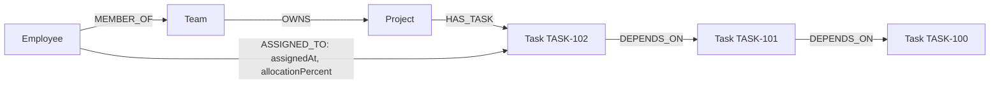

# Đặt tên nhãn, loại quan hệ và thuộc tính nhất quán

## 1. Mục tiêu bài học

Trong **Neo4j**, tên của nhãn (*node label*), loại quan hệ (*relationship type*) và thuộc tính (*property key*) là một phần của hợp đồng dữ liệu giữa ứng dụng, câu truy vấn **Cypher** và người vận hành. Một graph có cấu trúc hợp lý vẫn dễ gây lỗi nếu cùng một khái niệm xuất hiện dưới các tên `Task`, `TASK` và `task`, hoặc quan hệ “giao việc” lúc dùng `ASSIGNED_TO`, lúc dùng `HAS_ASSIGNEE` mà không có quy ước về hướng.

Bài này thuộc chương **Thiết kế mô hình** của module `DATABASE_ENGINE_GRAPH_NEO4J`. Trọng tâm là xây dựng quy ước đặt tên có thể áp dụng vào property graph, câu truy vấn quan hệ/đường đi bằng Cypher, constraint, index, mã Java/Spring Data Neo4j và quy trình phát triển lâu dài. Đây là **quy ước đề xuất cho nhóm phát triển**, không phải cú pháp đặt tên duy nhất mà Neo4j bắt buộc.

Sau bài học, bạn có thể:

- Phân biệt các loại tên của schema đồ thị và thống nhất một phong cách dễ nhận biết.
- Đặt tên label, relationship type và property theo đúng **nghĩa nghiệp vụ, hướng quan hệ, phạm vi và đơn vị đo**.
- Viết Cypher nhất quán, tránh lỗi do chữ hoa/chữ thường và các tên đồng nghĩa không được quản lý.
- Thiết lập quy tắc đặt tên cho khóa định danh, constraint, index và ánh xạ mã ứng dụng.
- Kiểm tra schema thực tế, phát hiện tên lệch chuẩn và lập kế hoạch đổi tên có kiểm soát.

## 2. Vì sao tên nhất quán là vấn đề kỹ thuật?

Neo4j là property graph: node có label, relationship có type và cả node lẫn relationship có property. Cypher sử dụng chính các tên này để mô tả mẫu đường đi:

```cypher
MATCH (employee:Employee)-[:ASSIGNED_TO]->(task:Task)
WHERE task.status = 'IN_PROGRESS'
RETURN employee.fullName AS employeeName, task.title AS taskTitle;
```

Trong ví dụ, `Employee` và `Task` là **label**; `ASSIGNED_TO` là **relationship type**; `status`, `fullName`, `title` là **property key**. `employee`, `task`, `employeeName`, `taskTitle` là biến và bí danh trong truy vấn, không phải thành phần cố định của graph.

Các tên schema phân biệt chữ hoa/chữ thường. `:Task` và `:task` không biểu diễn cùng một label; `[:ASSIGNED_TO]` và `[:AssignedTo]` là các type khác nhau; `task.dueAt` và `task.due_at` là hai key khác nhau. Truy vấn sai tên có thể không trả kết quả hoặc trả `null` cho thuộc tính, ngay cả khi dữ liệu nghiệp vụ thực sự tồn tại. Tùy phiên bản/cấu hình, công cụ truy vấn có thể đưa cảnh báo về tên chưa tồn tại, nhưng không nên dựa vào cảnh báo đó để bảo vệ hợp đồng dữ liệu.

Tác động thực tế của việc đặt tên thiếu nhất quán:

1. **Tính đúng đắn:** bộ lọc hoặc đường đi bỏ sót node/cạnh nếu mỗi luồng nhập dùng tên khác nhau.
2. **Khả năng hiểu:** một người không biết `OWNS` có hướng từ ai tới ai; `LINK` hay `RELATED_TO` không giải thích được quan hệ.
3. **Hiệu năng:** index/constraint được tạo cho label và key cụ thể, không áp dụng tự động cho biến thể tên khác.
4. **Tích hợp:** mã Java, ánh xạ Spring Data Neo4j, quy trình import và báo cáo phải cùng hiểu một hợp đồng schema.
5. **Thay đổi:** đổi tên một field dùng rộng rãi có thể ảnh hưởng nhiều truy vấn, job nhập dữ liệu và giao diện.

## 3. Một bộ quy ước đặt tên dễ áp dụng

| Đối tượng | Quy ước khuyến nghị | Ví dụ tốt | Ví dụ cần tránh |
|---|---|---|---|
| Node label | Danh từ **số ít**, `PascalCase` | `Employee`, `Project`, `Task` | `employees`, `TASK`, `TaskNode` |
| Relationship type | Động từ/cụm từ thể hiện quan hệ, `UPPER_SNAKE_CASE` | `MEMBER_OF`, `HAS_TASK`, `DEPENDS_ON` | `RELATED`, `link`, `ProjectTaskRel` |
| Property key | `lowerCamelCase`; rõ nghĩa trong phạm vi đối tượng | `employeeId`, `fullName`, `dueAt` | `Employee_Name`, `due_at`, `date1` |
| Biến Cypher | `lowerCamelCase`, ngắn nhưng rõ | `employee`, `assignedTask` | `X1`, `EmployeeNode` |
| Tham số Cypher | `lowerCamelCase`, gần tên property | `$employeeId`, `$fromDate` | `$ID`, `$ARG_1` |
| Bí danh kết quả | `lowerCamelCase`, thống nhất với API | `employeeName`, `taskId` | `EMP_NAME`, `col1` |
| Tên constraint/index | Chữ thường, `snake_case`, gợi đối tượng và mục đích | `employee_id_unique`, `task_status_due_at_idx` | `index1`, `newConstraint` |

Đây là một **bộ quy ước mẫu**. Nếu tổ chức đã dùng `camelCase` cho relationship type trên toàn bộ graph, tính nhất quán và khả năng chuyển đổi có kiểm soát quan trọng hơn việc buộc đổi tất cả sang một kiểu mới. Dù chọn cách nào, hãy công bố một quy tắc duy nhất cho mỗi loại tên và dùng trong schema mới.

### 3.1. Label: gọi đúng danh tính của node

`(:Task)` là một công việc cụ thể; `(:Project)` là một dự án; `(:Employee)` là một người lao động được hệ thống quản lý. Tên label nên là **danh từ miền nghiệp vụ**, tránh chi tiết triển khai như `TaskEntity`, `TaskTable` hoặc `GraphTaskNode` trừ khi từ đó có ý nghĩa thực sự trong miền.

Neo4j cho phép một node có **nhiều label**, chẳng hạn `(:Person:Employee)`. Chỉ dùng nhiều label khi chúng thể hiện những phân loại có ý nghĩa rõ: `Person` là người, `Employee` là vai trò trong tổ chức. Không dùng label chỉ để nhắc lại thuộc tính thường xuyên thay đổi, ví dụ `:ACTIVE` cho mỗi trạng thái công việc, nếu nghiệp vụ chỉ cần property `status`.

Tên số ít giúp diễn đạt mẫu một node rõ hơn: `MATCH (task:Task)` đọc là “một task thuộc nhóm Task”; `:Tasks` thường khiến người đọc lẫn nhãn với một tập hợp. Quy tắc số ít là khuyến nghị về khả năng đọc, không phải hạn chế của Neo4j.

### 3.2. Relationship type: đặt tên như một mệnh đề có hướng

Khi đọc một mũi tên, hãy ghép thành câu hoàn chỉnh:

```text
(Employee)-[:MEMBER_OF]->(Team)      Employee là thành viên của Team
(Team)-[:OWNS]->(Project)            Team sở hữu Project
(Project)-[:HAS_TASK]->(Task)        Project có Task
(Employee)-[:ASSIGNED_TO]->(Task)   Employee được phân công vào Task
(Task A)-[:DEPENDS_ON]->(Task B)    Task A phụ thuộc vào Task B
```

Chọn **một chiều lưu trữ** thể hiện sự thật nghiệp vụ rồi ghi nhận nó trong hợp đồng schema. Khi cần hỏi ngược, Cypher có thể dùng `<-`:

```cypher
MATCH (task:Task)<-[:ASSIGNED_TO]-(employee:Employee)
RETURN task.taskId AS taskId, employee.employeeId AS employeeId;
```

Không cần tạo thêm `(:Task)-[:HAS_ASSIGNEE]->(:Employee)` chỉ để truy vấn chiều ngược. Lưu hai cạnh cùng diễn tả một sự thật thường làm tăng rủi ro cập nhật lệch và đếm trùng.

**Đặc biệt cẩn thận với quan hệ giữa các node cùng label.** `(:Task)-[:DEPENDS_ON]->(:Task)` có hướng từ **công việc bị chặn** sang **công việc phải hoàn tất trước**. Nếu đảo mũi tên, ý nghĩa phụ thuộc sẽ đảo theo. Cũng cần phân biệt `PARENT_OF` với `CHILD_OF`, `FOLLOWS` với `FOLLOWED_BY` và giữ đúng một quy ước.

Nên tránh đặt thời điểm hay trạng thái vào tên type như `ASSIGNED_2026` hoặc `ASSIGNED_ACTIVE`; dùng một type ổn định cùng property như `assignedAt`, `status` khi bản chất quan hệ không đổi. Chỉ tạo type riêng khi có **nghĩa nghiệp vụ khác nhau**, ví dụ `REVIEWED` khác `APPROVED` nếu hai hành động thực sự khác biệt.

### 3.3. Property: mô tả rõ đối tượng, kiểu dữ liệu và đơn vị

Một property tốt tự giải thích nó thuộc về điều gì:

- `employeeId`, `projectId`, `taskId`: khóa nghiệp vụ rõ loại đối tượng; tránh `id` mơ hồ khi xử lý nhiều node cùng lúc.
- `fullName`, `title`, `description`: tên người, tiêu đề và mô tả; không dùng cùng `name` cho nhiều ý nghĩa rồi phải đoán theo ngữ cảnh.
- `createdAt`, `updatedAt`, `assignedAt`: thời điểm xảy ra sự kiện; dùng hậu tố `At` nhất quán với giá trị thời gian.
- `dueAt` hoặc `dueDate`: chọn **một tên gắn với một kiểu** (ví dụ `dueAt` là thời điểm có múi giờ, `dueDate` là ngày lịch) thay vì sử dụng lẫn nhau.
- `estimatedMinutes`, `durationSeconds`, `costVnd`, `allocationPercent`: đơn vị đo nằm ngay trong tên giúp tránh sai lệch khi trao đổi dữ liệu.
- `isArchived`, `isBlocked`: cờ boolean có nghĩa rõ; đối với trạng thái nhiều giá trị nên dùng `status` với tập giá trị quy định.

Đặt thuộc tính đúng **nơi sở hữu thông tin**. `Employee.fullName` mô tả nhân viên. Ngược lại, `ASSIGNED_TO.assignedAt` và `ASSIGNED_TO.allocationPercent` mô tả **lần phân công một nhân viên vào một công việc**. Nếu đặt `allocationPercent` trên `Employee`, sẽ không diễn đạt được người đó phân bổ 40% cho việc A và 60% cho việc B.

Chọn `status` với các giá trị thống nhất, ví dụ `TODO`, `IN_PROGRESS`, `DONE`. Tập **giá trị** này cũng là một hợp đồng dữ liệu: `InProgress`, `IN_PROGRESS` và `doing` không tự được Neo4j hiểu là cùng trạng thái. Khi cập nhật trạng thái hoặc thêm loại mới, các bộ lọc ứng dụng phải được điều chỉnh.

### 3.4. Tên kỹ thuật và tên hiển thị

Tên hiển thị cho người dùng có thể là tiếng Việt, nhưng tên schema dùng trong mã nên ổn định, dễ nhập và ít phụ thuộc công cụ. Ví dụ:

```cypher
CREATE (:Project {projectId: 'PRJ-01', name: 'Nâng cấp nền tảng'});
```

`Project`, `projectId`, `name` là tên kỹ thuật; `'Nâng cấp nền tảng'` là **giá trị hiển thị**. Neo4j hỗ trợ định danh được escape bằng dấu backtick cho các tên chứa khoảng trắng/ký tự đặc biệt, nhưng đặt tên kiểu ``:`Dự án` `` hoặc ``.`Ngày bắt đầu` `` trong schema sẽ gây bất tiện khi viết Cypher, tích hợp và bảo trì. Ưu tiên bộ tên kỹ thuật ASCII nhất quán, còn nội dung đa ngôn ngữ nằm ở giá trị property hoặc lớp hiển thị.

## 4. Tình huống xuyên suốt: quản lý dự án và phụ thuộc công việc

Giả sử một nền tảng quản lý công việc muốn trả lời bốn câu hỏi:

1. **Q1:** Nhân viên `EMP-001` đang được phân công công việc nào và hạn hoàn thành ra sao?
2. **Q2:** Công việc `TASK-102` bị chặn bởi những công việc nào, trực tiếp hoặc qua các bước phụ thuộc?
3. **Q3:** Đội `TEAM-PLATFORM` sở hữu các dự án và công việc nào?
4. **Q4:** Mỗi người dành bao nhiêu phần trăm thời gian phân bổ cho công việc `TASK-101`?

Mô hình tối thiểu:



Sơ đồ thể hiện **hướng và từ vựng đặt tên**, không thể hiện hết các cạnh của bộ dữ liệu thử ở phần sau. Trong bộ dữ liệu, dự án cũng chứa `TASK-100` và `TASK-101`, và nhân viên có thể được phân công nhiều việc.

| Khái niệm | Biểu diễn thống nhất | Những tên không dùng song song |
|---|---|---|
| Nhân viên | `(:Employee {employeeId, fullName, workEmail})` | `:Staff`, `:employee` nếu cùng định nghĩa |
| Đội | `(:Team {teamId, name})` | `:Teams`, `:Group` nếu không có nghĩa phân biệt |
| Dự án | `(:Project {projectId, name})` | `:Projects`, `:Initiative` nếu chỉ là tên thay thế |
| Công việc | `(:Task {taskId, title, status, dueDate})` | `:Ticket`, `:WorkItem` nếu đang chỉ cùng đối tượng |
| Nhân viên thuộc đội | `Employee-[:MEMBER_OF]->Team` | `IN_TEAM`, `BELONGS` để chỉ cùng quan hệ |
| Đội sở hữu dự án | `Team-[:OWNS]->Project` | `PROJECT_OWNER` không rõ hướng |
| Dự án có công việc | `Project-[:HAS_TASK]->Task` | `LINKED_TO` quá chung |
| Nhân viên được giao việc | `Employee-[:ASSIGNED_TO {assignedAt, allocationPercent}]->Task` | `ASSIGN`, `HAS_ASSIGNEE` cho cùng lần phân công |
| Công việc A chờ B | `A-[:DEPENDS_ON]->B` | `BLOCKS` trên cùng hướng vì nghĩa ngược |

**Hợp đồng hướng quan hệ:** `DEPENDS_ON` luôn đi từ công việc cần đầu vào tới công việc tiên quyết. Để tìm việc đang **bị** một công việc X chặn, truy vấn hướng ngược `(:Task)-[:DEPENDS_ON]->(X)`.

Trong bộ dữ liệu mẫu, giả định mỗi cặp `(Employee, Task)` chỉ có **một phân công hiện hành**. Nếu cần lưu nhiều đợt giao việc, phê duyệt hoặc lịch sử thay đổi người phụ trách, phải xem lại mô hình, có thể tạo node `Assignment` với định danh và vòng đời riêng. Tên gọi nhất quán không thay thế quyết định mô hình hóa đúng.

## 5. Tạo dữ liệu mẫu theo quy ước Neo4j

Các ví dụ dùng Cypher cho Neo4j 5.x. Chạy lần lượt hai khối sau trên **cơ sở dữ liệu thử**. Dữ liệu giả định độc lập với hệ thống sản xuất.

### 5.1. Ràng buộc và index có tên rõ ràng

```cypher
CREATE CONSTRAINT employee_id_unique IF NOT EXISTS
FOR (e:Employee) REQUIRE e.employeeId IS UNIQUE;

CREATE CONSTRAINT team_id_unique IF NOT EXISTS
FOR (t:Team) REQUIRE t.teamId IS UNIQUE;

CREATE CONSTRAINT project_id_unique IF NOT EXISTS
FOR (p:Project) REQUIRE p.projectId IS UNIQUE;

CREATE CONSTRAINT task_id_unique IF NOT EXISTS
FOR (t:Task) REQUIRE t.taskId IS UNIQUE;

CREATE RANGE INDEX task_status_due_date_idx IF NOT EXISTS
FOR (t:Task) ON (t.status, t.dueDate);
```

Tên `task_status_due_date_idx` nói rõ loại đối tượng, các property và mục đích của index. Unique constraint trên `taskId` giúp chống trùng định danh **khi property có giá trị**; riêng unique constraint không bắt buộc mọi node `Task` đều có `taskId`. Muốn bảo đảm sự hiện diện của property, cần chọn constraint/cơ chế kiểm soát phù hợp với phiên bản, edition và quy tắc nghiệp vụ.

Composite index trên `(status, dueDate)` có thể hữu ích cho các truy vấn phù hợp mẫu lọc/sắp xếp; việc có index không bảo đảm mọi truy vấn dùng đến nó. Hãy kiểm chứng bằng `EXPLAIN` hoặc `PROFILE` trên dữ liệu đại diện.

### 5.2. Dữ liệu thể hiện tên và hướng nhất quán

```cypher
MERGE (lan:Employee {employeeId: 'EMP-001'})
SET lan.fullName = 'Lan', lan.workEmail = 'lan@example.invalid'
MERGE (minh:Employee {employeeId: 'EMP-002'})
SET minh.fullName = 'Minh', minh.workEmail = 'minh@example.invalid'

MERGE (team:Team {teamId: 'TEAM-PLATFORM'})
SET team.name = 'Nền tảng'
MERGE (project:Project {projectId: 'PRJ-API'})
SET project.name = 'Nâng cấp API'

MERGE (task100:Task {taskId: 'TASK-100'})
SET task100.title = 'Chốt hợp đồng API',
    task100.status = 'DONE', task100.dueDate = date('2026-12-01')
MERGE (task101:Task {taskId: 'TASK-101'})
SET task101.title = 'Cài đặt endpoint',
    task101.status = 'IN_PROGRESS', task101.dueDate = date('2026-12-05')
MERGE (task102:Task {taskId: 'TASK-102'})
SET task102.title = 'Kiểm thử tích hợp',
    task102.status = 'TODO', task102.dueDate = date('2026-12-10')

MERGE (lan)-[membership1:MEMBER_OF]->(team)
SET membership1.joinedAt = date('2025-05-01')
MERGE (minh)-[membership2:MEMBER_OF]->(team)
SET membership2.joinedAt = date('2026-04-15')
MERGE (team)-[:OWNS]->(project)
MERGE (project)-[:HAS_TASK]->(task100)
MERGE (project)-[:HAS_TASK]->(task101)
MERGE (project)-[:HAS_TASK]->(task102)

MERGE (lan)-[assignment1:ASSIGNED_TO]->(task101)
SET assignment1.assignedAt = datetime('2026-11-20T09:00:00+07:00'),
    assignment1.allocationPercent = 60
MERGE (lan)-[assignment2:ASSIGNED_TO]->(task102)
SET assignment2.assignedAt = datetime('2026-11-21T09:00:00+07:00'),
    assignment2.allocationPercent = 40
MERGE (minh)-[assignment3:ASSIGNED_TO]->(task100)
SET assignment3.assignedAt = datetime('2026-11-18T09:00:00+07:00'),
    assignment3.allocationPercent = 50

MERGE (task101)-[:DEPENDS_ON]->(task100)
MERGE (task102)-[:DEPENDS_ON]->(task101);
```

`MERGE` giúp chạy lại dữ liệu ví dụ theo đúng điểm neo đã có. Nó không tự bảo đảm mọi bất biến của quan hệ khi có nhiều luồng ghi đồng thời. Hệ thống thực phải quản lý transaction, kiểm soát cạnh trùng và định nghĩa rõ khi nào sửa hoặc tạo một phân công mới.

## 6. Viết Cypher đọc được như tài liệu nghiệp vụ

### Q1. Công việc được giao cho một nhân viên

```cypher
MATCH (employee:Employee {employeeId: $employeeId})
      -[assignment:ASSIGNED_TO]->(task:Task)
WHERE task.status <> 'DONE'
RETURN task.taskId AS taskId,
       task.title AS taskTitle,
       task.status AS status,
       task.dueDate AS dueDate,
       assignment.allocationPercent AS allocationPercent
ORDER BY dueDate ASC, taskId;
```

Với `$employeeId = 'EMP-001'`, dữ liệu mẫu trả `TASK-101` rồi `TASK-102`. Các tên `employee`, `assignment`, `task` phản ánh vai trò trong truy vấn; `taskId`, `taskTitle`, `dueDate` phản ánh hợp đồng kết quả cho ứng dụng.

### Q2. Duyệt quan hệ phụ thuộc theo hướng chuẩn

```cypher
MATCH (task:Task {taskId: $taskId})
      -[:DEPENDS_ON*1..5]->(prerequisite:Task)
RETURN DISTINCT prerequisite.taskId AS prerequisiteId,
       prerequisite.title AS prerequisiteTitle,
       prerequisite.status AS status
ORDER BY prerequisiteId;
```

Với `$taskId = 'TASK-102'`, trả `TASK-101` và `TASK-100`: việc `TASK-102` phụ thuộc trực tiếp vào `TASK-101`, còn `TASK-101` phụ thuộc vào `TASK-100`. Cú pháp `*1..5` giới hạn số bước duyệt tối đa là 5 cho ví dụ; giới hạn thực tế phải dựa trên yêu cầu nghiệp vụ và hình dạng đồ thị.

Muốn tìm các công việc **phụ thuộc vào** `TASK-101`, dùng hướng ngược:

```cypher
MATCH (dependent:Task)-[:DEPENDS_ON]->
      (task:Task {taskId: $taskId})
RETURN dependent.taskId AS dependentId;
```

Hai câu truy vấn giữ nguyên một relationship type và cùng hợp đồng hướng; không thêm loại `BLOCKS` chỉ để tiện truy vấn ngược.

### Q3. Các công việc thuộc những dự án mà một đội sở hữu

```cypher
MATCH (team:Team {teamId: $teamId})-[:OWNS]->(project:Project)
      -[:HAS_TASK]->(task:Task)
RETURN project.projectId AS projectId,
       task.taskId AS taskId,
       task.title AS taskTitle,
       task.status AS status
ORDER BY projectId, taskId;
```

Với `$teamId = 'TEAM-PLATFORM'`, kết quả liệt kê ba task `TASK-100`, `TASK-101`, `TASK-102`. Đường đi dễ đọc như câu: “Team **owns** Project; Project **has task** Task”.

### Q4. Thuộc tính của lần phân công nằm trên cạnh

```cypher
MATCH (employee:Employee)-[assignment:ASSIGNED_TO]->
      (task:Task {taskId: $taskId})
RETURN employee.employeeId AS employeeId,
       employee.fullName AS employeeName,
       assignment.assignedAt AS assignedAt,
       assignment.allocationPercent AS allocationPercent
ORDER BY employeeId;
```

Với `$taskId = 'TASK-101'`, trả người `EMP-001`, phân bổ 60%. `allocationPercent` là đặc tính của **liên hệ Employee–Task**, không phải thuộc tính chung cho mọi công việc của nhân viên.

### 6.1. Quy ước tên trong truy vấn dài

Khi một truy vấn có nhiều node cùng label, đặt biến theo vai trò thay vì `t1`, `t2`:

```cypher
MATCH (dependentTask:Task)-[:DEPENDS_ON]->(prerequisiteTask:Task)
WHERE dependentTask.status = 'TODO'
RETURN dependentTask.taskId AS dependentId,
       prerequisiteTask.taskId AS prerequisiteId;
```

Tên biến là lựa chọn cục bộ của câu Cypher; có thể dùng `t` trong truy vấn rất ngắn, nhưng `dependentTask` và `prerequisiteTask` tránh nhầm chiều trong truy vấn dài. Tương tự, tên tham số `$taskId` nên khớp ý nghĩa property `task.taskId`.

## 7. Nhận diện các tên gây hiểu sai hoặc làm lệch schema

| Kiểu sai lệch | Ví dụ | Rủi ro | Cách chỉnh quy ước |
|---|---|---|---|
| Khác chữ hoa/chữ thường | `:Task`, `:task`, `:TASK` | Ba label khác nhau, truy vấn bỏ sót node | Chọn duy nhất `:Task` |
| Tên quan hệ đồng nghĩa | `ASSIGN_TO`, `ASSIGNED_TO`, `HAS_ASSIGNEE` | Cùng nghiệp vụ nhưng truy vấn phải hỗ trợ nhiều type | Chọn `Employee-[:ASSIGNED_TO]->Task` |
| Quan hệ quá chung | `RELATED_TO`, `HAS`, `LINK` | Không hiểu nghĩa và hướng từ mẫu Cypher | Đặt type theo động từ nghiệp vụ |
| Hướng không được ghi rõ | `(:Task)-[:DEPENDS_ON]->(:Task)` nhưng mỗi nhóm lưu một chiều | Tìm công việc chặn/bị chặn sai | Viết câu mô tả chuẩn cho mũi tên |
| Key cùng nghĩa nhiều kiểu | `dueDate`, `due_date`, `deadline` | Dữ liệu bị phân mảnh, truy vấn trả null | Một key và một định nghĩa kiểu/ngữ nghĩa |
| Key cùng tên nhưng khác nghĩa | `date` là ngày tạo ở chỗ này, hạn ở chỗ khác | Tích hợp hiểu sai | `createdAt`, `dueDate` |
| Kiểu dữ liệu không khớp tên | `durationSeconds` lưu phút | Sai số khi tính toán | Tên, đơn vị và kiểu thống nhất |
| Trạng thái không được chuẩn hóa | `done`, `DONE`, `Finished` | Bộ lọc bỏ sót hoặc phân nhóm sai | Quy định tập giá trị `TODO`, `IN_PROGRESS`, `DONE` |
| Số nhiều/số ít lẫn nhau | `:Projects` và `:Project` | Tạo hai nhóm node cho một thực thể | Label danh từ số ít `:Project` |

### 7.1. Phân biệt lỗi tên với dữ liệu thực sự vắng mặt

Giả sử có node `(:Task {taskId: 'TASK-101', dueDate: date('2026-12-05')})`. Hai truy vấn sau không tương đương:

```cypher
// Theo hợp đồng schema
MATCH (task:Task {taskId: 'TASK-101'})
RETURN task.dueDate AS dueDate;
```

```cypher
// Sai key: due_date là property khác
MATCH (task:Task {taskId: 'TASK-101'})
RETURN task.due_date AS dueDate;
```

Truy vấn thứ hai có thể trả `null` cho `dueDate` dù dữ liệu hạn hoàn thành đang có ở key `dueDate`. Tương tự, `MATCH (task:task)` sẽ không tự khớp node mang label `Task`.

### 7.2. Đừng thay tên miền bằng tên giao diện

“Công việc”, “ticket”, “thẻ”, “đầu việc” có thể là bốn từ trên giao diện nhưng chỉ là một đối tượng miền `Task`. Ngược lại, `Issue` và `Task` có thể là hai thực thể khác nếu nghiệp vụ phân biệt rõ sự cố và công việc xử lý. Hãy duy trì **bảng từ vựng miền**: mỗi khái niệm có một tên chuẩn, định nghĩa, ví dụ và các từ đồng nghĩa không dùng trong schema.

## 8. Kiểm tra schema thực tế và phát hiện tên lệch

Trong Neo4j, những tên đã xuất hiện trong dữ liệu có thể được liệt kê bằng các thủ tục hệ thống. Chạy trên database được cấp quyền tương ứng:

```cypher
CALL db.labels() YIELD label
RETURN label ORDER BY label;
```

```cypher
CALL db.relationshipTypes() YIELD relationshipType
RETURN relationshipType ORDER BY relationshipType;
```

```cypher
CALL db.propertyKeys() YIELD propertyKey
RETURN propertyKey ORDER BY propertyKey;
```

Đối với constraint và index, dùng các lệnh quản trị schema:

```cypher
SHOW CONSTRAINTS;
```

```cypher
SHOW INDEXES;
```

**Lưu ý:** danh sách tên có thể bao gồm tên còn tồn tại trong token/schema mà không bảo đảm mỗi tên đều đang gắn với dữ liệu hiện hành. Nếu thấy `Task` lẫn `task`, tiếp tục kiểm tra số lượng node và đối chiếu định nghĩa nghiệp vụ, đừng vội đổi tên hàng loạt.

Ví dụ đếm node gắn các biến thể label nghi ngờ:

```cypher
MATCH (node)
WHERE any(labelName IN labels(node)
          WHERE labelName IN ['Task', 'task', 'TASK'])
RETURN labels(node) AS nodeLabels, count(*) AS nodeCount
ORDER BY nodeCount DESC;
```

Kiểm tra property cũ `due_date` còn trên node `Task`:

```cypher
MATCH (task:Task)
WHERE task.due_date IS NOT NULL
RETURN count(task) AS legacyPropertyCount;
```

Hai truy vấn trên giúp định vị tên lệch. Chúng không đủ để xác định tất cả bản ghi cần di trú nếu dữ liệu có nhiều label, node trùng hoặc tên cũ mang nghĩa khác; cần đối chiếu hợp đồng nghiệp vụ trước khi thay đổi.

### 8.1. Kiểm tra điểm neo bằng EXPLAIN/PROFILE

```cypher
EXPLAIN
MATCH (task:Task {taskId: 'TASK-101'})
RETURN task.title;
```

`EXPLAIN` cho thấy kế hoạch dự kiến; `PROFILE` thực thi câu truy vấn và cho biết chỉ số thực tế. Nếu constraint/index được tạo trên `:Task(taskId)` nhưng ứng dụng truy vấn `:task(taskId)` thì chúng là hai schema khác nhau. Kiểm tra đúng label, key và kế hoạch tìm điểm neo trước khi kết luận dữ liệu không tồn tại hoặc index không hiệu quả.

## 9. Đổi tên schema an toàn khi quy ước thay đổi

Đổi tên không chỉ là sửa một từ trong tài liệu. Nó có thể liên quan tới dữ liệu Neo4j, constraint/index, câu Cypher của API, quy trình import, mapping entity, job báo cáo và các bản sao dữ liệu. Hãy xem đổi tên như một **migration có phiên bản**.

Quy trình thường gồm:

1. **Kiểm kê:** tìm tất cả label/type/key cũ trong dữ liệu và các thành phần đọc/ghi; phân biệt biến thể do lỗi với khái niệm thực sự khác nhau.
2. **Công bố ánh xạ:** ví dụ `:task` → `:Task`, `due_date` → `dueDate`, `:ASSIGN_TO` → `:ASSIGNED_TO`; nêu rõ nguồn dữ liệu chuẩn và cách xử lý khi cả tên cũ/lẫn mới tồn tại.
3. **Đánh giá và lưu phương án khôi phục:** backup phù hợp, môi trường thử nghiệm, số lượng node/cạnh ảnh hưởng, query đọc/ghi sẽ cần cập nhật.
4. **Chuyển đổi và xác minh trong phạm vi transaction/batch phù hợp:** kiểm tra số lượng, định danh, thuộc tính, cạnh và các tình huống trùng; không phá dữ liệu cũ khi còn ứng dụng đang sử dụng.
5. **Cập nhật phần mềm và schema:** sửa Cypher, import, Java mapping, constraint/index, dashboard; kiểm tra tương thích phiên bản triển khai.
6. **Thu hồi tên cũ có kiểm soát:** chỉ sau khi các luồng ghi/đọc mới đã ổn định và đã xác minh không còn phụ thuộc.

Ví dụ về **ý tưởng migration**; chỉ chạy sau khi đã kiểm kê, sao lưu và kiểm thử trong môi trường thích hợp:

```cypher
// Chuẩn hóa nhãn cũ trên các node được xác định là Task
MATCH (task:task)
SET task:Task
REMOVE task:task;
```

```cypher
// Chỉ chuyển key cũ ở bản ghi chưa có key mới
MATCH (task:Task)
WHERE task.due_date IS NOT NULL AND task.dueDate IS NULL
SET task.dueDate = task.due_date
REMOVE task.due_date;
```

**Quan trọng:** nếu cả `due_date` và `dueDate` đã có nhưng khác giá trị, không ghi đè theo quy tắc đơn giản trên. Phải đối chiếu bản ghi xung đột và quy định giá trị nào là chuẩn.

Trong các phiên bản Neo4j 5.x thông dụng, muốn chuyển một relationship type cũ sang type mới phải **tạo relationship mới và bỏ relationship cũ**, vì type không được đổi bằng thao tác sửa property. Ví dụ minh họa cách chuyển một nhóm cạnh đã xác minh:

```cypher
MATCH (employee:Employee)-[oldRel:ASSIGN_TO]->(task:Task)
CREATE (employee)-[newRel:ASSIGNED_TO]->(task)
SET newRel = properties(oldRel)
DELETE oldRel;
```

Đây là mẫu **minh họa**, chưa đủ làm migration sản xuất: nếu cạnh `ASSIGNED_TO` tương đương đã tồn tại, `CREATE` có thể tạo trùng; việc tạo lại cạnh cũng thay đổi định danh nội bộ của relationship. Cần kiểm tra trước bản ghi đã chuyển, đảm bảo toàn bộ thuộc tính được giữ, xử lý transaction/batch và cập nhật các thành phần có liên quan.

## 10. Giữ tên nhất quán từ dữ liệu đến Java

Ứng dụng dùng **Neo4j Java Driver** nên truyền giá trị qua tham số Cypher và dùng các tên label/type/key đã thống nhất trong hằng số hoặc truy vấn được quản lý tập trung. Không ghép thẳng dữ liệu do người dùng nhập thành một tên label/type tùy ý. Với những phiên bản Cypher có hỗ trợ tên schema động, vẫn cần kiểm soát tập tên hợp lệ và đánh giá tác động kế hoạch truy vấn.

Trong **Spring Data Neo4j**, nhãn node và loại relationship có thể được khai báo rõ trong annotation. Mẫu rút gọn sau minh họa cách đặt tên khớp graph:

```java
@Node("Task")
class TaskEntity {
    @Id
    private String taskId;

    private String title;
    private String status;
    private LocalDate dueDate;

    @Relationship(type = "DEPENDS_ON", direction = Relationship.Direction.OUTGOING)
    private Set<TaskEntity> prerequisites;
}
```

Đoạn Java tập trung vào **quy ước ánh xạ tên**, chưa phải entity hoàn chỉnh để biên dịch: dự án cần khai báo import, constructor, accessor và cấu hình persistence thích hợp. Ở đây `@Node("Task")` khớp label `Task`, `dueDate` khớp key `dueDate`, `DEPENDS_ON` khớp type và hướng của quan hệ.

Nếu Java dùng tên field khác vì quy ước nội bộ, hãy ánh xạ property một cách rõ ràng thay vì để hai phía tự suy ra khác nhau. Khi đổi `Task` thành tên khác hoặc chuyển `dueDate` thành `dueAt`, cần xem đây là thay đổi hợp đồng dữ liệu, có kiểm thử migration và các truy vấn liên quan.

## 11. Checklist cho nhóm thiết kế và code review

Trước khi hợp nhất một thay đổi schema Neo4j, hãy tự kiểm tra:

1. **Label:** mỗi loại thực thể có một tên số ít `PascalCase`, được định nghĩa trong bảng từ vựng miền chưa?
2. **Relationship type:** tên có thể đọc thành câu có hướng không? Mũi tên đã được ghi rõ, nhất là với quan hệ cùng label như `Task-[:DEPENDS_ON]->Task` chưa?
3. **Property:** key dùng `lowerCamelCase`, có ý nghĩa và kiểu dữ liệu xác định? Thuộc tính thời gian, tiền tệ và đại lượng có đơn vị rõ không?
4. **Định danh:** các node quan trọng dùng khóa nghiệp vụ ổn định (`taskId`, `employeeId`), constraint và chiến lược chống trùng phù hợp chưa?
5. **Giá trị liệt kê:** `status`, `priority`, `role` có tập giá trị thống nhất trong cả luồng nhập và API chưa?
6. **Cypher:** tên biến, bí danh và tham số dễ hiểu; mọi truy vấn đi theo một hợp đồng hướng quan hệ chưa?
7. **Tích hợp:** schema, job import, Java Driver, Spring Data Neo4j, API và báo cáo có dùng cùng tên chưa?
8. **Thay đổi:** nếu có rename, đã kiểm kê dữ liệu cũ, xung đột, migration, khả năng khôi phục và truy vấn kiểm chứng chưa?

## 12. Bài tập thực hành

### Bài tập 1 — Đặt tên theo quy ước

Một hệ thống quản lý sách có “độc giả”, “sách”, “tác giả” và “lượt mượn”. Hãy đề xuất label, relationship type, hướng cạnh và property cho các câu hỏi: “Ai đã mượn sách nào?”, “Ai viết sách này?”, “Lượt mượn nào đã quá hạn?”. Giải thích khi nào “lượt mượn” cần node riêng với định danh và vòng đời thay vì chỉ là cạnh mang thời gian.

### Bài tập 2 — Sửa câu Cypher không nhất quán

Đồ thị chuẩn có `(:Employee)-[:ASSIGNED_TO]->(:Task {taskId, dueDate})`. Một nhóm viết:

```cypher
MATCH (t:task)-[:HAS_ASSIGNEE]->(e:Employee)
WHERE t.due_date < date()
RETURN t.id, e.name;
```

Hãy chỉ ra tất cả các điểm không khớp hợp đồng và viết lại truy vấn để tìm **công việc quá hạn và nhân viên được giao**. Ghi rõ bạn giả định thuộc tính tên hiển thị của `Employee` là `fullName` và định danh của `Task` là `taskId`.

### Bài tập 3 — Ngữ nghĩa hướng quan hệ

Cho đường đi `TASK-102 -[:DEPENDS_ON]-> TASK-101 -[:DEPENDS_ON]-> TASK-100`. Viết hai Cypher khác nhau: một truy vấn tìm mọi điều kiện tiên quyết của `TASK-102`; một truy vấn tìm mọi công việc bị ảnh hưởng nếu `TASK-101` trì hoãn. Giải thích hướng mũi tên trong mỗi trường hợp.

### Bài tập 4 — Xử lý drift sau khi import

Sau ba đợt nhập dữ liệu, cơ sở dữ liệu xuất hiện `:Task`, `:Tasks`, `:task` và hai property `dueDate`, `deadline`. Hãy trình bày cách dùng thủ tục liệt kê schema và truy vấn kiểm đếm để xác định phạm vi, cách quyết định hai key có thực sự đồng nghĩa không, và kế hoạch migration không làm mất dữ liệu khi cả hai key cùng xuất hiện.

### Bài tập 5 — Rà soát mapping ứng dụng

Ứng dụng Java đặt field `expectedHours` nhưng graph dùng `estimatedMinutes`. Hãy phân biệt **lỗi tên** với **lỗi đơn vị đo**, đề xuất cách ánh xạ/đổi đơn vị có kiểm chứng và mô tả test cần có để không nhân/chia sai thời lượng.

**Tiêu chí hoàn thành:** Bạn có thể tự định nghĩa một bộ quy ước tên cho graph, diễn đạt mỗi relationship thành câu có hướng, đặt property đúng nghĩa và đơn vị, viết Cypher nhất quán và phát hiện biến thể tên gây sai kết quả. Đặt tên tốt giúp mô hình Neo4j vừa **đọc được như ngôn ngữ nghiệp vụ**, vừa giữ được hợp đồng ổn định giữa dữ liệu, truy vấn và ứng dụng.
