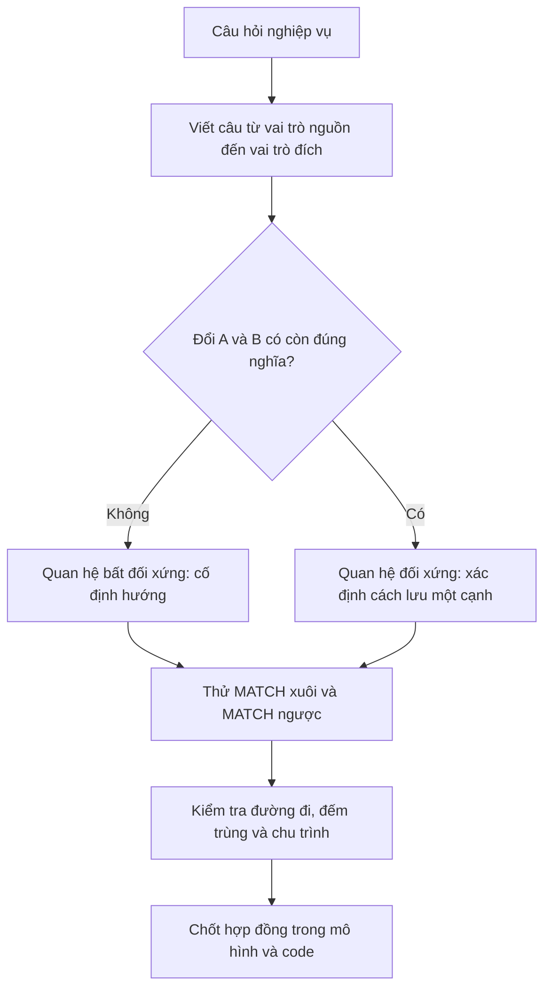
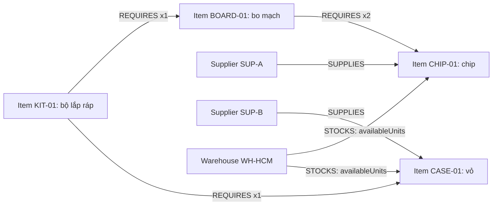

# Thiết kế hướng quan hệ theo ngữ nghĩa nghiệp vụ

## 1. Mục tiêu bài học

Trong **Neo4j**, mỗi relationship nối từ một node **nguồn** (*start node*) đến một node **đích** (*end node*). Hai node có thể được truy vấn theo cả hai chiều, nhưng **hướng được lưu** phải diễn đạt một sự thật nghiệp vụ rõ ràng. Nếu đảo hướng của `REQUIRES` trong hệ thống sản xuất, ta có thể kết luận ngược rằng linh kiện cần bộ sản phẩm, thay vì bộ sản phẩm cần linh kiện. Lỗi này nguy hiểm vì câu Cypher vẫn có thể chạy thành công nhưng trả về ý nghĩa sai.

Bài học thuộc chương **Thiết kế mô hình** của `DATABASE_ENGINE_GRAPH_NEO4J`, trong phạm vi sử dụng property graph và Cypher để mô hình hóa dữ liệu liên kết, quan hệ và đường đi. Sau bài này, bạn có thể:

- Viết được **câu định nghĩa có hướng** cho mỗi relationship type: “A làm gì với B?”.
- Phân biệt hướng **lưu trữ** của cạnh với hướng **duyệt** trong `MATCH`.
- Chọn hướng cho quan hệ bất đối xứng, quan hệ đối xứng, quan hệ hai bên cùng tham gia và quan hệ giữa các node cùng label.
- Thiết kế đường đi nhiều bước, tránh suy luận nhầm quan hệ trực tiếp với quan hệ gián tiếp.
- Kiểm tra hướng bằng dữ liệu ví dụ, Cypher, bất biến nghiệp vụ và `EXPLAIN`/`PROFILE` khi cần.

Trọng tâm là **ngữ nghĩa của mô hình**, không phải một giả định rằng hướng mũi tên tự nó quyết định tốc độ. Index, constraint, Java Driver, Spring Data Neo4j và vận hành cần tuân theo hợp đồng hướng đã thiết kế, nhưng không thay thế việc làm rõ nghiệp vụ.

## 2. Hướng trong Neo4j nghĩa là gì?

Giả sử một kho quản lý một linh kiện:

```cypher
(warehouse:Warehouse)-[:STOCKS]->(part:Item)
```

Đây là **mẫu đồ thị minh họa**, chưa phải câu lệnh Cypher độc lập. Hướng được lưu là `Warehouse → Item`; đọc thành “kho đang tồn trữ mặt hàng”. Một câu khác:

```cypher
(part:Item)<-[:STOCKS]-(warehouse:Warehouse)
```

vẫn biểu diễn **cùng hướng relationship**. Mũi tên `<-` chỉ cho biết biến ở bên phải là nguồn, biến bên trái là đích.

Ba dạng truy vấn cơ bản:

| Mẫu Cypher | Ý nghĩa khi `STOCKS` được lưu `Warehouse → Item` |
|---|---|
| `(w:Warehouse)-[:STOCKS]->(i:Item)` | Đi từ kho tới mặt hàng được kho tồn trữ |
| `(i:Item)<-[:STOCKS]-(w:Warehouse)` | Đi từ mặt hàng ngược về những kho tồn trữ nó |
| `(w:Warehouse)-[:STOCKS]-(i:Item)` | Không ràng buộc hướng của relationship được khớp |

Neo4j lưu relationship có hướng, nhưng bộ máy truy vấn **có thể duyệt cả chiều xuôi lẫn ngược**. Vì vậy, không cần tạo thêm cạnh `(:Item)-[:STORED_IN]->(:Warehouse)` chỉ để truy vấn từ sản phẩm sang kho. Cạnh ngược thứ hai chỉ hợp lý khi nó mang một **sự thật nghiệp vụ độc lập** và có quy tắc vòng đời riêng; nếu cùng biểu diễn một dữ kiện, nó làm tăng nguy cơ hai bản ghi lệch nhau.

> **Quy tắc cốt lõi:** Chọn một hướng diễn đạt nghiệp vụ rõ ràng, lưu theo đúng hướng đó, và dùng `<-` khi câu hỏi cần duyệt ngược. Không lấy việc màn hình đang hiển thị “từ đâu đến đâu” làm lý do đảo nghĩa của cạnh.

### 2.1. Chữ trên cạnh và chiều mũi tên phải đi cùng nhau

`SUPPLIES` là động từ chỉ hành động của nhà cung cấp đối với mặt hàng:

```text
(Supplier)-[:SUPPLIES]->(Item)
```

Nếu đổi thành `Item-[:SUPPLIES]->Supplier` mà vẫn giữ type `SUPPLIES`, câu “Mặt hàng cung cấp nhà cung cấp” sẽ vô nghĩa. Một tên khác như `SUPPLIED_BY` có thể đúng với hướng ngược, nhưng nên **chọn một quy ước làm nguồn dữ liệu chuẩn** thay vì ghi cả hai chỉ để tránh viết mũi tên `<-`.

### 2.2. Hướng của quan hệ khác với điểm xuất phát truy vấn

Một nghiệp vụ có thể thường hỏi: “Linh kiện `P-CHIP` có ở kho nào?” Truy vấn **bắt đầu từ** `Item` vì có khóa `sku` chọn lọc, rồi duyệt **ngược** cạnh `STOCKS` về `Warehouse`:

```cypher
MATCH (item:Item {sku: $sku})<-[:STOCKS]-(warehouse:Warehouse)
RETURN warehouse.warehouseId AS warehouseId;
```

Hướng lưu không cần đổi theo điểm neo truy vấn. Việc tìm từ node nào trước, cách dùng index và chi phí duyệt phải đánh giá bằng mẫu truy vấn cùng dữ liệu thực tế.

## 3. Phương pháp chọn hướng từ câu hỏi nghiệp vụ

Với một mối quan hệ đang thiết kế, hãy thực hiện các bước sau:

1. **Viết sự thật thành câu chủ ngữ – động từ – tân ngữ.** Ví dụ: “Một mặt hàng lắp ráp **cần** linh kiện khác”.
2. **Xác định danh tính của từng vai trò.** “Sản phẩm cha” và “linh kiện cần” đều có thể mang label `Item`; tên biến phải làm rõ hai vai trò.
3. **Đặt relationship type theo động từ có hướng.** `REQUIRES` đi từ mặt hàng cần cấu phần tới mặt hàng được yêu cầu.
4. **Ghi ví dụ có và không có quan hệ.** `KIT-01` cần `BOARD-01`; chưa có dữ kiện rằng `BOARD-01` cần `KIT-01`.
5. **Định nghĩa truy vấn xuôi và ngược.** Xuôi: “Bộ kit cần những gì?”. Ngược: “Những bộ kit nào bị ảnh hưởng nếu thiếu chip?”.
6. **Xác nhận tính chất logic.** Quan hệ có đối xứng không? Có bắc cầu không? Có cho phép vòng lặp hay tự liên kết không? Những điều này quyết định Cypher và kiểm tra ghi dữ liệu.
7. **Thống nhất hợp đồng với bên ghi và đọc.** Luồng nhập, Cypher trong ứng dụng và mapping Java phải dùng cùng một hướng.



Sơ đồ trên là quy trình tư duy. Câu hỏi “đổi hai đầu có còn đúng nghĩa?” cần được trả lời theo **nghiệp vụ**, không chỉ theo cảm giác đối xứng của một hình vẽ.

## 4. Phân loại quan hệ trước khi quyết định hướng

### 4.1. Quan hệ bất đối xứng: đảo chiều sẽ đổi nghĩa

| Quan hệ | Hướng chuẩn | Cách đọc | Câu hỏi truy vấn ngược |
|---|---|---|---|
| Cung ứng | `Supplier-[:SUPPLIES]->Item` | Nhà cung cấp cung ứng mặt hàng | Mặt hàng có những nhà cung cấp nào? |
| Tồn kho | `Warehouse-[:STOCKS]->Item` | Kho chứa lượng tồn của mặt hàng | Mặt hàng được giữ ở kho nào? |
| Cấu phần | `AssemblyItem-[:REQUIRES]->ComponentItem` | Sản phẩm cần cấu phần | Cấu phần này được dùng ở sản phẩm nào? |
| Phân cấp | `Category-[:PARENT_OF]->Category` | Danh mục cha chứa danh mục con | Một danh mục có những cha nào? |
| Phụ thuộc | `Task-[:DEPENDS_ON]->Task` | Công việc trái phụ thuộc việc phải xong trước | Việc nào bị công việc này chặn? |
| Theo dõi | `Account-[:FOLLOWS]->Account` | Tài khoản trái theo dõi tài khoản phải | Ai đang theo dõi tài khoản này? |

`DEPENDS_ON`, `REQUIRES`, `FOLLOWS` thường là quan hệ **bất đối xứng**: A phụ thuộc B không có nghĩa B phụ thuộc A. Câu truy vấn có thể duyệt ngược, nhưng sự thật được lưu vẫn giữ nguyên.

### 4.2. Quan hệ đối xứng: nghĩa có thể hai chiều, cạnh vẫn có hướng kỹ thuật

Ví dụ hai nhân viên cùng là người liên hệ trong một mạng cộng tác, quan hệ `COLLABORATES_WITH` được nghiệp vụ định nghĩa **đối xứng**: nếu A hợp tác với B thì B hợp tác với A.

Neo4j vẫn lưu **một relationship có hướng**. Có thể đặt một quy tắc lưu ổn định, ví dụ node có `employeeId` nhỏ hơn theo thứ tự từ điển là nguồn:

```text
EMP-001 -[:COLLABORATES_WITH]-> EMP-002
```

Khi truy vấn hàng xóm hợp tác, dùng mẫu không chỉ định chiều:

```cypher
MATCH (employee:Employee {employeeId: $employeeId})
      -[:COLLABORATES_WITH]-(colleague:Employee)
RETURN DISTINCT colleague.employeeId AS colleagueId;
```

**Không cần lưu cặp cạnh ngược nhau** để diễn đạt một quan hệ đối xứng duy nhất, nếu hệ thống đã thống nhất cách lưu một cạnh và luôn truy vấn phù hợp. Đối với truy vấn quét toàn graph không có điểm neo, một cạnh không hướng có thể được tìm theo cả hai cách gán biến đầu–cuối; dùng quy tắc chuẩn hóa và khử trùng phù hợp khi đếm cặp.

Lưu ý: quy tắc chọn chiều bằng ID chỉ là **quy ước ứng dụng**. Constraint định danh node không tự ngăn hai luồng đồng thời ghi hai cạnh đối xứng khác chiều; hệ thống phải bảo vệ invariant “mỗi cặp chỉ một cạnh” khi ghi.

### 4.3. Quan hệ có thể xuất hiện ở cả hai hướng như hai sự kiện riêng

Theo dõi tài khoản là ví dụ khác với hợp tác đối xứng:

```text
(:Account {accountId: 'A'})-[:FOLLOWS]->(:Account {accountId: 'B'})
(:Account {accountId: 'B'})-[:FOLLOWS]->(:Account {accountId: 'A'})
```

Đây là **hai hành động độc lập**. A theo dõi B không kéo theo B theo dõi A; nếu cả hai có thật, lưu cả hai cạnh cùng type nhưng ngược chiều là hợp lý. Không dùng mẫu không hướng `-[:FOLLOWS]-` để suy luận rằng người kia cũng đã thực hiện hành động theo dõi.

### 4.4. Quan hệ bắc cầu và quan hệ không bắc cầu

Nếu `KIT → REQUIRES → BOARD` và `BOARD → REQUIRES → CHIP`, thì `KIT` **gián tiếp cần** `CHIP`. Có thể duyệt nhiều bước để khám phá phụ thuộc, nhưng **không nên mặc định tạo** thêm cạnh trực tiếp `KIT → REQUIRES → CHIP`. Cạnh trực tiếp thường mang nghĩa “được liệt kê là cấu phần trực tiếp”, còn kết quả nhiều bước là sự thật **suy ra**.

Ngược lại, “A hợp tác với B” và “B hợp tác với C” **không suy ra** A hợp tác với C. Không vì một mô hình có đường đi `A–B–C` mà khẳng định quan hệ kinh doanh giữa A và C là đúng. Cần phân biệt *khả năng đến được* (*reachability*) với *ý nghĩa của từng cạnh*.

## 5. Tình huống xuyên suốt: cấu phần sản phẩm, nguồn cung và kho

Một nhà sản xuất đồ điện tử sử dụng Neo4j để quản lý bộ lắp ráp (`Item`), linh kiện, nhà cung cấp và kho. Các câu hỏi quan trọng:

- **Q1:** Bộ `KIT-01` cần những cấu phần **trực tiếp** nào và số lượng từng loại?
- **Q2:** Để lắp một bộ `KIT-01`, cần bao nhiêu **linh kiện ở cuối chuỗi cấu phần**?
- **Q3:** Nhà cung cấp nào cung ứng các linh kiện cần cho `KIT-01`?
- **Q4:** Linh kiện `CHIP-01` có sẵn ở kho nào, với tồn khả dụng bao nhiêu?
- **Q5:** Nếu `CHIP-01` thiếu hàng, những bộ phận và bộ sản phẩm nào **bị ảnh hưởng**?

Mô hình đề xuất dùng ba loại node `Item`, `Supplier`, `Warehouse` và ba loại quan hệ `REQUIRES`, `SUPPLIES`, `STOCKS`:



`Item` có `sku`, `name`, `kind` (`ASSEMBLY` hoặc `COMPONENT`). `REQUIRES.unitsPerParent` là số lượng cấu phần mà **một** đơn vị node nguồn yêu cầu. `STOCKS.availableUnits` mô tả tồn kho **của mặt hàng tại đúng một kho**; property này không thuộc riêng node `Item` vì cùng mặt hàng có thể có số lượng tồn khác nhau ở từng kho.

### 5.1. Hợp đồng hướng quan hệ

| Type | Nguồn → đích | Định nghĩa nghiệp vụ | Có thể tự tạo cạnh ngược không? |
|---|---|---|---|
| `REQUIRES` | `Item` lắp ráp → `Item` cần dùng | Một đơn vị nguồn cần `unitsPerParent` đơn vị đích | Không; sẽ đảo nghĩa cấu phần |
| `SUPPLIES` | `Supplier` → `Item` | Nhà cung cấp có thể cung ứng mặt hàng | Không cần; truy vấn từ Item duyệt ngược |
| `STOCKS` | `Warehouse` → `Item` | Kho đang quản lý tồn của mặt hàng | Không cần; truy vấn từ Item duyệt ngược |

Ba quan hệ đều có hướng nghiệp vụ rõ, nhưng câu hỏi Q3–Q5 **thường đi từ phía đích**. Hướng lưu không cần đảo để đáp ứng điều đó.

### 5.2. Các giả định phải được nêu trước khi truy vấn

Để ví dụ có nghĩa rõ, tạm giả định:

1. `Item.sku`, `Supplier.supplierId` và `Warehouse.warehouseId` là các khóa ổn định.
2. Một cặp `(Item nguồn, Item đích)` có **một** quan hệ `REQUIRES` với số lượng dương; không lặp cạnh cho cùng một cấu phần ở cùng một công thức.
3. Mạng `REQUIRES` là **DAG** (đồ thị có hướng không chu trình): một mặt hàng không được trực tiếp hay gián tiếp cần chính nó.
4. Những `Item` không có cạnh `REQUIRES` đi ra là **linh kiện lá** khi tính nhu cầu sản xuất; dữ liệu phải đủ để phân biệt linh kiện lá thực sự với bản ghi còn thiếu cấu phần.
5. Số lượng trên mỗi cạnh là số đơn vị cần **cho một đơn vị nguồn**, không phải số lượng đã mua hay tồn kho.
6. Tồn kho của cùng một mặt hàng ở các kho được lưu riêng trên từng cạnh `STOCKS`.

Những giả định này là thành phần của hợp đồng mô hình. Nếu nghiệp vụ có nhiều phiên bản BOM, sản phẩm thay thế, phế phẩm hoặc công thức theo thời điểm, cần bổ sung mô hình phù hợp trước khi dùng truy vấn tính định mức như dữ liệu tài chính/sản xuất chính thức.

## 6. Dựng dữ liệu thử bằng Cypher

Các ví dụ bên dưới dùng **Neo4j 5.x**. Chạy trên cơ sở dữ liệu thử; lệnh constraint và lệnh tạo dữ liệu có mục đích khác nhau. Những relationship được ghi theo đúng hướng ở bảng hợp đồng.

### 6.1. Định danh và điểm neo

```cypher
CREATE CONSTRAINT item_sku_unique IF NOT EXISTS
FOR (item:Item) REQUIRE item.sku IS UNIQUE;

CREATE CONSTRAINT supplier_id_unique IF NOT EXISTS
FOR (supplier:Supplier) REQUIRE supplier.supplierId IS UNIQUE;

CREATE CONSTRAINT warehouse_id_unique IF NOT EXISTS
FOR (warehouse:Warehouse) REQUIRE warehouse.warehouseId IS UNIQUE;
```

Unique constraint hỗ trợ tra cứu và ngăn hai node cùng label có cùng giá trị khóa đã khai báo. Nó **không tự đảm bảo** một `Item` luôn có `sku`, không tự cấm chu trình `REQUIRES`, và không tự buộc `unitsPerParent > 0`. Các bất biến bổ sung cần được kiểm soát khi ghi dữ liệu và kiểm tra định kỳ.

### 6.2. Bộ dữ liệu mẫu có thể chạy lại

```cypher
MERGE (kit:Item {sku: 'KIT-01'})
SET kit.name = 'Bộ thiết bị', kit.kind = 'ASSEMBLY'
MERGE (board:Item {sku: 'BOARD-01'})
SET board.name = 'Bo mạch', board.kind = 'ASSEMBLY'
MERGE (chip:Item {sku: 'CHIP-01'})
SET chip.name = 'Chip điều khiển', chip.kind = 'COMPONENT'
MERGE (case:Item {sku: 'CASE-01'})
SET case.name = 'Vỏ thiết bị', case.kind = 'COMPONENT'

MERGE (supplierA:Supplier {supplierId: 'SUP-A'})
SET supplierA.name = 'Nhà cung cấp A'
MERGE (supplierB:Supplier {supplierId: 'SUP-B'})
SET supplierB.name = 'Nhà cung cấp B'
MERGE (warehouse:Warehouse {warehouseId: 'WH-HCM'})
SET warehouse.name = 'Kho TP.HCM'

MERGE (kit)-[kitToBoard:REQUIRES]->(board)
SET kitToBoard.unitsPerParent = 1
MERGE (kit)-[kitToCase:REQUIRES]->(case)
SET kitToCase.unitsPerParent = 1
MERGE (board)-[boardToChip:REQUIRES]->(chip)
SET boardToChip.unitsPerParent = 2

MERGE (supplierA)-[:SUPPLIES]->(chip)
MERGE (supplierB)-[:SUPPLIES]->(case)

MERGE (warehouse)-[stockChip:STOCKS]->(chip)
SET stockChip.availableUnits = 120
MERGE (warehouse)-[stockCase:STOCKS]->(case)
SET stockCase.availableUnits = 35;
```

`MERGE` dựa trên các node đã neo và mẫu cạnh cụ thể giúp tránh tạo thêm cùng mẫu ở những lần chạy tuần tự, nhưng **không thay thế** việc kiểm soát ghi đồng thời, unique constraint và transaction. Nếu dữ liệu đã có hai cạnh cùng nghĩa hoặc có hai phiên bản BOM, cần xử lý bằng quy tắc dữ liệu rõ ràng trước khi chạy lại tập lệnh.

## 7. Truy vấn xuôi, ngược và đường đi nhiều bước

### Q1. Từ bộ lắp ráp đến những cấu phần trực tiếp

```cypher
MATCH (parent:Item {sku: $assemblySku})
      -[requirement:REQUIRES]->(component:Item)
RETURN component.sku AS componentSku,
       component.name AS componentName,
       requirement.unitsPerParent AS unitsPerParent
ORDER BY componentSku;
```

Với `$assemblySku = 'KIT-01'`, kết quả là `BOARD-01` (1) và `CASE-01` (1). Truy vấn có **một bước** nên chưa trả `CHIP-01`, vì chip chỉ là cấu phần **gián tiếp** của bộ kit.

### Q2a. Những cấu phần được cần trực tiếp hoặc gián tiếp

```cypher
MATCH path = (root:Item {sku: $assemblySku})
             -[:REQUIRES*1..5]->(required:Item)
WITH required, min(length(path)) AS shortestDepth
RETURN required.sku AS requiredSku, shortestDepth
ORDER BY shortestDepth, requiredSku;
```

Với bộ dữ liệu mẫu, có `BOARD-01` và `CASE-01` ở độ sâu 1; `CHIP-01` ở độ sâu 2. `*1..5` yêu cầu **ít nhất một** cạnh, tối đa năm cạnh. `min(length(path))` cho biết đường phụ thuộc ngắn nhất trong giới hạn đó, không phải lượng linh kiện cần dùng.

Giới hạn độ sâu là một giả định nghiệp vụ/hiệu năng: nếu BOM sâu hơn năm cấp, truy vấn này **bỏ sót** một số cấu phần. Nếu có chu trình hoặc nút có bậc rất cao, số đường đi có thể tăng mạnh dù phần kết quả cuối chỉ còn vài SKU.

### Q2b. Tổng số linh kiện lá cho một bộ thành phẩm

Để tính định mức ở **cuối chuỗi**, phải nhân số lượng trên từng cạnh của một đường đi; nếu cùng linh kiện lá xuất hiện qua nhiều nhánh BOM khác nhau, cộng nhu cầu từ các nhánh:

```cypher
MATCH path = (root:Item {sku: $assemblySku})
             -[:REQUIRES*1..5]->(leaf:Item)
WHERE NOT EXISTS {
  MATCH (leaf)-[:REQUIRES]->(:Item)
}
WITH leaf,
     reduce(units = 1, requirement IN relationships(path) |
            units * requirement.unitsPerParent) AS unitsOnPath
RETURN leaf.sku AS leafSku,
       sum(unitsOnPath) AS unitsPerAssembly
ORDER BY leafSku;
```

Với `$assemblySku = 'KIT-01'`, kết quả dự kiến: `CASE-01` cần 1 đơn vị và `CHIP-01` cần 2 đơn vị. Đường `KIT-01 → BOARD-01 → CHIP-01` có hệ số (1 \times 2 = 2\).

Điều kiện để công thức trên có nghĩa: dữ liệu `REQUIRES` tạo DAG, mỗi cạnh có `unitsPerParent` là số dương hợp lệ, **mọi** đường đi đến linh kiện lá nằm trong giới hạn năm bước, và không lưu các cạnh suy diễn trùng với cấu phần trực tiếp. Nếu có vòng lặp, phế phẩm, định mức làm tròn, đơn vị đo hỗn hợp hoặc các phiên bản BOM theo thời gian, phải thiết kế và kiểm thử cách tính khác phù hợp. Đây là bài tập mô hình hóa, **không phải** bộ tính MRP hoàn chỉnh.

### Q3. Đi từ thành phẩm tới nhà cung cấp bằng cách duyệt ngược `SUPPLIES`

```cypher
MATCH (root:Item {sku: $assemblySku})
      -[:REQUIRES*1..5]->(leaf:Item)
WHERE NOT EXISTS {
  MATCH (leaf)-[:REQUIRES]->(:Item)
}
MATCH (supplier:Supplier)-[:SUPPLIES]->(leaf)
RETURN DISTINCT leaf.sku AS leafSku,
       supplier.supplierId AS supplierId,
       supplier.name AS supplierName
ORDER BY leafSku, supplierId;
```

Với `KIT-01`, có `SUP-A` cung ứng `CHIP-01` và `SUP-B` cung ứng `CASE-01`. Dù truy vấn đi từ thành phẩm đến nhà cung cấp, cạnh vẫn được lưu `Supplier-[:SUPPLIES]->Item`. Sử dụng `DISTINCT` để tránh lặp bản ghi nếu nhiều đường phụ thuộc dẫn tới cùng một linh kiện.

Truy vấn này cho biết nhà cung cấp **được khai báo có thể cung ứng** linh kiện; nó không khẳng định tồn kho của nhà cung cấp, đơn đặt hàng đang giao hay khả năng giao đủ số lượng. Những khái niệm đó cần dữ liệu/quan hệ riêng.

### Q4. Đi ngược cạnh `STOCKS` từ linh kiện đến kho

```cypher
MATCH (item:Item {sku: $sku})
      <-[stock:STOCKS]-(warehouse:Warehouse)
RETURN warehouse.warehouseId AS warehouseId,
       warehouse.name AS warehouseName,
       stock.availableUnits AS availableUnits
ORDER BY warehouseId;
```

Với `$sku = 'CHIP-01'`, kết quả có `WH-HCM`, số lượng khả dụng 120. Không có cạnh đảo chiều `Item-[:STOCKS]->Warehouse`, nhưng vẫn trả lời được câu hỏi từ phía mặt hàng.

### Q5. Truy vấn tác động ngược từ một linh kiện

Khi `CHIP-01` thiếu, những node **ở phía trước** chuỗi phụ thuộc là đối tượng bị tác động:

```cypher
MATCH (affected:Item)-[:REQUIRES*1..5]->
      (component:Item {sku: $sku})
RETURN DISTINCT affected.sku AS affectedSku,
       affected.name AS affectedName
ORDER BY affectedSku;
```

Với `$sku = 'CHIP-01'`, truy vấn trả `BOARD-01` và `KIT-01`: cả bo mạch và bộ kit đều cần chip theo một đường đi. Cạnh vẫn mang hướng **từ sản phẩm cần sang sản phẩm được cần**, nhưng câu hỏi tìm **node nguồn** nên ta đọc mẫu từ phía đích.

## 8. Hướng quan hệ quyết định cách kiểm soát dữ liệu

### 8.1. Nhận diện cạnh ghi ngược sai hợp đồng

Một cạnh `(:Item {sku:'CHIP-01'})-[:REQUIRES]->(:Item {sku:'BOARD-01'})` sẽ diễn đạt “chip cần bo mạch”. Nếu thực tế nghiệp vụ ngược lại, đây là **lỗi dữ liệu**, không phải một cách biểu diễn thay thế tương đương.

Để rà soát những cạnh có nguồn là linh kiện lá trong mô hình ví dụ:

```cypher
MATCH (source:Item)-[requirement:REQUIRES]->(target:Item)
WHERE source.kind = 'COMPONENT'
RETURN source.sku AS unexpectedSourceSku,
       target.sku AS targetSku,
       requirement.unitsPerParent AS quantity;
```

Truy vấn trên chỉ đúng như kiểm tra **khi doanh nghiệp quy định `COMPONENT` không bao giờ có cấu phần con**. Nếu một linh kiện được phép gồm nhiều linh kiện khác, cần đổi quy tắc kiểm tra; không nên dùng tên `kind` để phán đoán khi định nghĩa chưa rõ.

### 8.2. Phát hiện chu trình trong quan hệ phụ thuộc

Đối với BOM, chu trình như `A → B → C → A` làm mất ý nghĩa “cấu phần cuối” và có thể khiến các truy vấn mở rộng trở nên rất đắt:

```cypher
MATCH path = (start:Item)-[:REQUIRES*1..10]->(finish:Item)
WHERE start = finish
RETURN start.sku AS cycleItemSku,
       [item IN nodes(path) | item.sku] AS exampleCycle
LIMIT 20;
```

Đây là truy vấn **chẩn đoán có giới hạn độ sâu**, có thể không phát hiện chu trình dài hơn mười cạnh. Muốn bảo vệ invariant **không có chu trình**, luồng ghi phải kiểm tra khả năng đi ngược từ đích về nguồn trước khi thêm cạnh và dùng cơ chế transaction/đồng bộ phù hợp để tránh hai giao dịch đồng thời tạo chu trình.

### 8.3. Phát hiện cạnh cấu phần trùng và số lượng không hợp lệ

```cypher
MATCH (parent:Item)-[requirement:REQUIRES]->(component:Item)
WITH parent, component,
     count(requirement) AS relationshipCount
WHERE relationshipCount > 1
RETURN parent.sku AS parentSku,
       component.sku AS componentSku,
       relationshipCount;
```

```cypher
MATCH (parent:Item)-[requirement:REQUIRES]->(component:Item)
WHERE requirement.unitsPerParent IS NULL
   OR requirement.unitsPerParent <= 0
RETURN parent.sku AS parentSku,
       component.sku AS componentSku,
       requirement.unitsPerParent AS invalidUnits;
```

Các câu trên **phát hiện** vi phạm, không tự ngăn ghi sai. Trong Neo4j, có thể tồn tại nhiều relationship cùng type giữa cùng cặp node; unique constraint của các node không tự đảm bảo “một cạnh cho mỗi cặp”. Khi ghi dữ liệu thực tế, cần chọn rõ khóa/phiên bản BOM và cách khóa giao dịch hoặc tạo node liên kết có định danh nếu vòng đời của từng dòng cấu phần trở nên phức tạp.

### 8.4. Kiểm tra đúng nghĩa trước khi xóa hoặc sửa cạnh

Không sửa hướng của một quan hệ trực tiếp bằng cách **đảo toàn bộ cạnh** mà chưa kiểm chứng. Một dataset có `(:Account)-[:FOLLOWS]->(:Account)` có thể hợp lệ theo cả hai hướng giữa cùng một cặp; đảo một cạnh sẽ đổi **ai theo dõi ai**. Với `REQUIRES`, đảo cạnh có thể tạo chu trình hoặc thay đổi định mức sản xuất. Migration phải phân biệt cạnh lưu nhầm hướng với cạnh mang ý nghĩa đúng theo schema cũ.

## 9. Chọn tên, hướng và property như một hợp đồng thống nhất

Một relationship không chỉ có mũi tên. Định nghĩa đầy đủ nên gồm:

| Trường trong hợp đồng | Nội dung cần chốt | Ví dụ `REQUIRES` |
|---|---|---|
| Type | Tên duy nhất và từ vựng chuẩn | `REQUIRES` |
| Source label/role | Node bắt đầu và vai trò | `Item` đang được lắp ráp |
| Target label/role | Node đích và vai trò | `Item` được yêu cầu |
| Câu định nghĩa | Nghĩa khi đọc xuôi | “Một đơn vị Item nguồn cần n đơn vị Item đích” |
| Property trên cạnh | Tên, đơn vị, miền giá trị | `unitsPerParent`, số dương |
| Cardinality | Một nguồn/đích có thể nối mấy node | Một Item có nhiều cấu phần; một cấu phần dùng ở nhiều Item |
| Tính chất logic | Đối xứng, bắc cầu, vòng lặp | Bất đối xứng; đường phụ thuộc có thể dài; **không chu trình** |
| Kiểm soát ghi | Khóa, tính duy nhất, transaction | Mỗi cặp source–target có một cạnh trong một phiên bản BOM |
| Mẫu truy vấn | Đi xuôi/đi ngược | Xuôi lấy cấu phần, ngược tìm thành phẩm bị ảnh hưởng |

Nếu chọn `PARENT_OF` từ cha sang con thì mọi dữ liệu nhập phải làm theo chiều đó, kể cả khi ứng dụng thường bắt đầu từ con. Nếu chọn `FOLLOWS` thì phải phân biệt hai hành động ngược chiều. Nếu chọn `COLLABORATES_WITH` là quan hệ đối xứng thì cần quy tắc lưu một cạnh và truy vấn không hướng. Đây là ba **ngữ nghĩa khác nhau**, nên không có một cách xử lý “mọi cạnh đều hai chiều” áp dụng chung.

## 10. Mẫu Cypher, index và tích hợp ứng dụng

### 10.1. Kiểm tra kế hoạch cho truy vấn xuôi và ngược

```cypher
EXPLAIN
MATCH (item:Item {sku: 'CHIP-01'})<-[:STOCKS]-(warehouse:Warehouse)
RETURN warehouse.warehouseId;
```

Đổi `EXPLAIN` thành `PROFILE` để thực thi và xem chỉ số thật. Hãy kiểm tra **điểm neo** `Item.sku`, số dòng sau bước mở rộng, DB hits và độ lệch phân bố quan hệ (một mặt hàng có ở bao nhiêu kho). Không suy luận rằng duyệt ngược luôn chậm hơn duyệt xuôi; chi phí phụ thuộc dữ liệu, index, cardinality và kế hoạch thực thi.

### 10.2. Truyền tham số, tránh nhầm hướng trong Java/Spring Data Neo4j

Khi dùng **Neo4j Java Driver**, truyền giá trị như `$sku`, `$assemblySku` bằng tham số thay vì ghép chuỗi đầu vào vào Cypher. Hãy quản lý type và hướng trong một nguồn thống nhất để các câu truy vấn không vô tình dùng `SUPPLIES` theo hai nghĩa.

Với **Spring Data Neo4j**, nếu node `Item` có tập `requiredComponents`, mapping quan hệ phải dùng **type `REQUIRES` với hướng outgoing** từ mặt hàng cần tới cấu phần. Khi truy vấn các mặt hàng **đang cần** linh kiện hiện tại, mapping/truy vấn phía cấu phần sẽ cần incoming hoặc Cypher có mũi tên `<-` tương ứng. Hai phép đọc khác nhau nhưng cùng dựa trên một hợp đồng hướng.

Đừng đồng nhất chiều trong class Java với nghĩa doanh nghiệp chỉ vì một entity chứa một collection của entity khác. Quan hệ `REQUIRES` có thể có property `unitsPerParent`; mapping cần giữ cả thuộc tính trên cạnh, thay vì chỉ nối hai node và làm mất định mức.

### 10.3. Khi nào thêm một chiều quan hệ suy diễn?

Với truy vấn thường xuyên kiểu “linh kiện nào ảnh hưởng hàng nghìn thành phẩm”, đội phát triển có thể tính trước một cấu trúc suy diễn hoặc quan hệ tóm tắt. Tuy nhiên, cạnh như `Item-[:IMPACTS]->Item` có **ngữ nghĩa khác** với `REQUIRES` trực tiếp và phải có quy tắc đồng bộ, phạm vi độ sâu, thời điểm cập nhật và phân biệt nguồn sự thật. Không tự thêm `REQUIRES` ngược chiều hoặc “nối tắt” vào cùng type để tối ưu thiếu kiểm chứng.

## 11. Những sai lầm thường gặp

| Cách làm | Vấn đề | Cách xử lý |
|---|---|---|
| Lưu `Supplier-[:SUPPLIES]->Item` rồi thêm `Item-[:SUPPLIES]->Supplier` | Cạnh thứ hai sai động từ và làm lẫn hướng | Chỉ lưu Supplier → Item, truy vấn ngược bằng `<-` |
| Xem `A-[:DEPENDS_ON]->B` như B phụ thuộc A | Đảo nghĩa nghiệp vụ dù Cypher vẫn chạy | Viết câu định nghĩa và test cặp A/B cụ thể |
| Dùng `-[:FOLLOWS]-` để suy ra theo dõi lẫn nhau | Quan hệ theo dõi không đối xứng | Kiểm tra riêng hai cạnh A → B và B → A |
| Lưu cả hai hướng cho quan hệ đối xứng mà không có quy tắc | Dễ nhân đôi cặp cộng tác, lệch cập nhật | Một cạnh với chiều chuẩn hóa và truy vấn không hướng |
| Coi mọi đường đi là quan hệ trực tiếp | Có thể cộng trùng định mức hoặc hiểu sai chuỗi phụ thuộc | Tách truy vấn 1 bước khỏi truy vấn nhiều bước |
| Dùng `*` hoặc độ sâu rất lớn không xét phân bố | Có thể bùng nổ số đường đi | Giới hạn theo nghiệp vụ, đo `PROFILE`, kiểm soát chu trình |
| Đặt `availableUnits` lên `Item` thay vì `STOCKS` | Không biểu diễn được lượng tồn riêng từng kho | Đặt property ở đúng quan hệ Warehouse–Item |
| Tin rằng unique constraint node tự cấm chu trình/cạnh trùng | Lưu được graph sai invariant | Kiểm tra logic ở transaction và truy vấn chẩn đoán |
| Cố tối ưu bằng cách đảo toàn bộ hướng quan hệ | Thay đổi ý nghĩa dữ liệu và truy vấn phụ thuộc | Giữ hướng nghiệp vụ, đánh giá kế hoạch thực thi |

## 12. Bài tập thực hành

### Bài tập 1 — Chọn hướng cho ba nghiệp vụ khác nhau

Cho các yêu cầu: (a) sinh viên theo học khóa học, (b) một người theo dõi người khác, (c) hai nhà nghiên cứu hợp tác bình đẳng. Hãy đề xuất type, hướng lưu, tính đối xứng và Cypher tìm tất cả kết nối của một node. Giải thích vì sao phương án lưu cạnh ngược khác nhau ở từng trường hợp.

### Bài tập 2 — Tìm lỗi đảo chiều

Một nhóm nhập dữ liệu `(:Item {sku:'CHIP-01'})-[:REQUIRES]->(:Item {sku:'BOARD-01'})`, nhưng định mức nói **bo mạch cần hai chip**. Hãy xác định hướng sai, cách kiểm tra xem đã tồn tại cạnh đúng chưa và kế hoạch sửa có kiểm soát mà không tạo trùng hay mất số lượng.

### Bài tập 3 — Hai cách duyệt cho một quan hệ

Với `Supplier-[:SUPPLIES]->Item`, viết một Cypher từ `$supplierId` tìm các SKU được cung ứng và một Cypher từ `$sku` tìm các nhà cung cấp. Không tạo thêm type `SUPPLIED_BY`; giải thích cách dùng mũi tên ở hai truy vấn.

### Bài tập 4 — Nhận biết cấu phần gián tiếp và hệ số số lượng

Định mức mới: `KIT-01` cần 2 `BOARD-01`, mỗi `BOARD-01` cần 3 `CHIP-01`; ngoài ra `KIT-01` trực tiếp cần thêm 1 `CHIP-01`. Hãy tính tổng chip cần cho một kit và sửa đoạn Cypher ở Q2b để kiểm tra kết quả. Thảo luận lý do không được đơn giản `DISTINCT leaf` trước khi cộng hệ số của các đường đi.

### Bài tập 5 — Kiểm soát chu trình và hiệu năng

Giả sử một luồng nhập định thêm `CHIP-01-[:REQUIRES]->KIT-01`. Hãy minh họa chu trình sẽ hình thành, viết truy vấn phát hiện một đường đi từ `KIT-01` đến `CHIP-01` trước khi thêm cạnh, rồi nêu các bước cần đồng bộ trong transaction khi nhiều luồng có thể chỉnh định mức cùng lúc. Cuối cùng, nêu ba chỉ số trong `PROFILE` cần theo dõi khi truy vấn nhiều bước quá chậm.

## 13. Checklist thiết kế hướng quan hệ

1. Mỗi relationship type có câu mô tả **nguồn → động từ → đích** mà người nghiệp vụ xác nhận chưa?
2. Các role của node đã rõ, đặc biệt khi hai đầu đều cùng label (`Item → Item`, `Task → Task`)?
3. Quan hệ có **đối xứng, bất đối xứng hay hai hành động độc lập**? Có cần hai cạnh ngược chiều thật sự không?
4. Truy vấn cần đi ngược đã dùng `<-` hoặc mẫu không hướng có chủ đích, thay vì lưu thêm một bản sao cạnh?
5. Quan hệ có bắc cầu không; câu hỏi đang cần **liên kết trực tiếp hay đường đi nhiều bước**?
6. Có bất biến về **số lượng, chu trình, trùng cạnh, cardinality và phiên bản dữ liệu** được kiểm tra không?
7. Property trên cạnh có thuộc đúng **lần liên hệ** và dùng đơn vị rõ ràng không?
8. Luồng nhập, Cypher, Java Driver và Spring Data Neo4j có dùng chung hướng, type và tên thuộc tính?
9. Các truy vấn quan trọng đã được thử trên dữ liệu có tình huống ngược chiều, nhiều nhánh và trường hợp biên chưa?

**Tiêu chí hoàn thành:** Bạn có thể đọc một mối liên kết thành câu nghiệp vụ đúng, chọn hướng lưu không mơ hồ, viết hai truy vấn Cypher xuôi/ngược tương ứng, phân biệt quan hệ đối xứng với hai sự kiện riêng và nhận diện rủi ro chu trình hay đếm trùng trên đường đi nhiều bước. Hướng quan hệ là một phần của **ý nghĩa dữ liệu**, cần ổn định xuyên suốt thiết kế, nhập liệu và truy vấn Neo4j.
