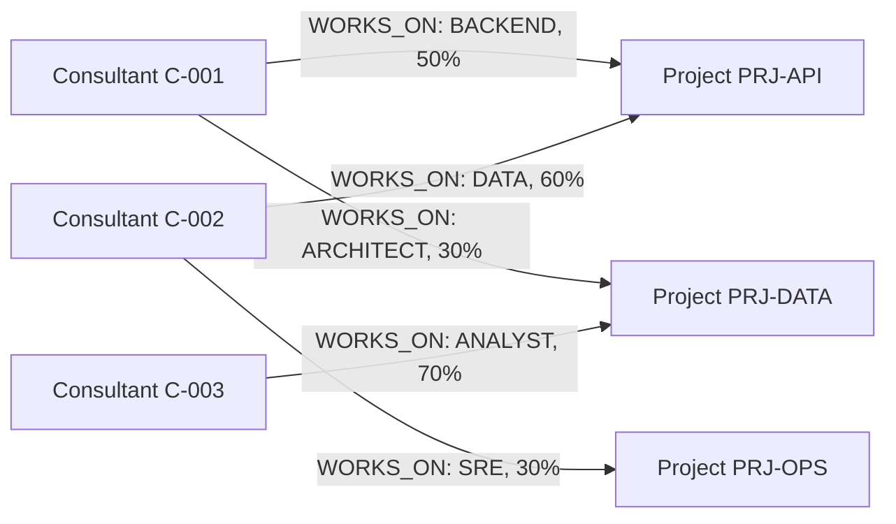
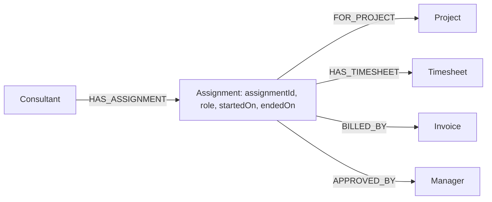

# Mô hình hóa quan hệ nhiều–nhiều và quan hệ có thuộc tính

## 1. Mục tiêu và phạm vi

Trong **Neo4j**, quan hệ **nhiều–nhiều** (*many-to-many*, N:N) là tình huống một node thuộc nhóm A có thể liên kết với nhiều node nhóm B, đồng thời một node B cũng có thể liên kết với nhiều node A. Property graph biểu diễn sự liên kết bằng **relationship trực tiếp** giữa hai node; relationship còn có thể mang thuộc tính mô tả **chính lần liên kết đó**. Vì thế, không nhất thiết phải mô phỏng một bảng nối SQL thành node trung gian trong mọi trường hợp.

Ví dụ: một chuyên gia tham gia nhiều dự án, một dự án có nhiều chuyên gia. Trong mỗi lần phân công, **vai trò**, **tỷ lệ thời gian phân bổ** và **đơn giá thỏa thuận** thuộc về liên hệ *chuyên gia–dự án*, không thuộc riêng một chuyên gia hay một dự án.

Sau bài học, bạn có thể:

- Nhận diện đúng cardinality N:N và phân biệt với quan hệ 1:N, 1:1.
- Chọn relationship trực tiếp có thuộc tính hay node trung gian có vòng đời độc lập.
- Đặt tên type, hướng và property để truy vấn Cypher đúng ý nghĩa nghiệp vụ.
- Tạo dữ liệu, tìm kiếm và tổng hợp trên quan hệ có thuộc tính bằng Cypher.
- Xử lý các tình huống dễ sai: cạnh trùng, nhiều lần tham gia, lịch sử hiệu lực, `MERGE` và ghi đồng thời.
- Đề xuất constraint, index và cách kiểm tra mô hình trên dữ liệu thật.

Bài nằm trong chương **Thiết kế mô hình** của module `DATABASE_ENGINE_GRAPH_NEO4J`, nơi Neo4j được dùng để mô hình hóa dữ liệu liên kết bằng property graph và truy vấn đường đi bằng Cypher. Phần thực hành tập trung vào quyết định mô hình; tối ưu truy vấn chuyên sâu, nhập dữ liệu hàng loạt, Java Driver, Spring Data Neo4j và vận hành là những chủ đề mở rộng của module.

## 2. Hiểu chính xác quan hệ nhiều–nhiều

### 2.1. Cardinality mô tả quy tắc nghiệp vụ

| Loại quan hệ | Cách đọc | Ví dụ giả định |
|---|---|---|
| 1:1 | Mỗi A liên hệ tối đa một B và ngược lại | Một người có một hồ sơ chính |
| 1:N | Một A liên hệ nhiều B, mỗi B thuộc tối đa một A | Một dự án có nhiều mốc bàn giao, mỗi mốc thuộc một dự án |
| N:N | Một A liên hệ nhiều B, một B liên hệ nhiều A | Một chuyên gia làm nhiều dự án; một dự án có nhiều chuyên gia |

Các mức 1, N cần làm rõ thêm **tối thiểu** (0 hay 1) và **tối đa** (1 hay nhiều). Ví dụ: một dự án mới có thể chưa được gán chuyên gia, còn chuyên gia đang nghỉ có thể chưa tham gia dự án nào. Do đó, quy tắc phù hợp ở đây là `Consultant 0..N ↔ 0..N Project`.

Neo4j không tự suy ra hay bắt buộc cardinality dựa trên mũi tên trong mẫu Cypher. Cú pháp `(:Consultant)-[:WORKS_ON]->(:Project)` chỉ mô tả **loại kết nối và hướng lưu**, không có nghĩa mỗi chuyên gia chỉ được có một cạnh. Những giới hạn như “một chuyên gia chỉ có một phân công hiện hành vào cùng dự án” phải được thiết kế và thực thi ở luồng ghi dữ liệu.

### 2.2. Khác biệt giữa bảng nối và relationship

Trong mô hình quan hệ, một bảng nối thường thể hiện N:N:

```text
CONSULTANT (consultant_id, full_name)
PROJECT    (project_id, title)
WORK_ASSIGNMENT (
    consultant_id, project_id, role,
    allocation_percent, agreed_rate_vnd_per_hour, started_on
)
```

Trong property graph, khi mỗi cặp chuyên gia–dự án chỉ có **một bản phân công trong phạm vi mô hình đang xét**, ta có thể biểu diễn trực tiếp:

```text
(:Consultant {consultantId: 'C-001', fullName: 'An'})
  -[:WORKS_ON {
      role: 'BACKEND',
      allocationPercent: 50,
      agreedRateVndPerHour: 500000,
      startedOn: date('2026-10-01'),
      status: 'ACTIVE'
  }]->
(:Project {projectId: 'PRJ-API', title: 'Nâng cấp API'})
```

Đoạn trên là **hình dung cấu trúc**, không phải câu lệnh Cypher độc lập để chạy. Hai đầu mút có định danh riêng; quan hệ `WORKS_ON` mô tả lần phân công và mang các property của lần phân công.



Đồ thị thể hiện rõ tính N:N: `C-001` nối tới hai dự án, còn `PRJ-API` có cả `C-001` và `C-002`. Mọi cạnh đều cùng type `WORKS_ON`; khác nhau ở hai đầu mút và các property của **từng** cạnh.

## 3. Xác định các câu hỏi nghiệp vụ trước khi chọn mô hình

Giả sử hệ thống phân bổ nhân sự cần trả lời:

1. **Q1 – Nhân sự theo dự án:** Dự án `PRJ-API` đang có những chuyên gia nào? Vai trò và phần trăm phân bổ của từng người?
2. **Q2 – Dự án theo chuyên gia:** Chuyên gia `C-001` đang tham gia những dự án nào, bắt đầu từ ngày nào?
3. **Q3 – Điểm chung:** Hai chuyên gia `C-001` và `C-002` đang cùng tham gia dự án nào?
4. **Q4 – Tổng hợp:** Một dự án đang được phân bổ tổng cộng bao nhiêu phần trăm năng lực làm việc và chi phí nhân lực ước tính theo mỗi giờ năng lực?
5. **Q5 – Kiểm tra ràng buộc:** Có chuyên gia nào có tổng tỷ lệ phân bổ trên các dự án đang hoạt động vượt 100% hay không?

Những câu hỏi này gợi ý mô hình tối thiểu:

| Thành phần | Biểu diễn | Lý do |
|---|---|---|
| Chuyên gia | `(:Consultant {consultantId, fullName})` | Có danh tính, tham gia nhiều dự án và được tra cứu độc lập |
| Dự án | `(:Project {projectId, title})` | Có danh tính, được nhiều chuyên gia tham gia |
| Phân công | `(:Consultant)-[:WORKS_ON]->(:Project)` | Quan hệ N:N trực tiếp; truy vấn thường bắt đầu từ một trong hai đầu mút |
| Vai trò trong dự án | `WORKS_ON.role` | Một người có thể làm `BACKEND` ở dự án này và `ARCHITECT` ở dự án khác |
| Tỷ lệ phân bổ | `WORKS_ON.allocationPercent` | Phụ thuộc từng cặp người–dự án |
| Đơn giá thỏa thuận | `WORKS_ON.agreedRateVndPerHour` | Là giá chốt cho lần phân công, không nhất thiết bằng đơn giá hiện hành của chuyên gia |
| Ngày bắt đầu | `WORKS_ON.startedOn` | Mốc thời gian của lần phân công |
| Trạng thái | `WORKS_ON.status` | Phân công có thể `ACTIVE` hoặc `ENDED`; cần quy tắc trạng thái rõ ràng |

**Giả định quan trọng:** Trong dữ liệu thử, mỗi cặp `(Consultant, Project)` chỉ có **một phân công** và một tập thuộc tính hiện hành. Không có lịch sử đăng ký lại, nhiều hợp đồng song song hay thanh toán gắn riêng vào một đợt. Phần 8 sẽ thay đổi mô hình khi những giả định này không còn đúng.

## 4. Đặt property ở đâu cho đúng?

### 4.1. Thuộc tính của hai đầu mút và của liên hệ

| Dữ liệu | Nơi lưu hợp lý | Vì sao? |
|---|---|---|
| Tên chuyên gia | `Consultant.fullName` | Không đổi theo dự án tham gia |
| Tên dự án | `Project.title` | Không đổi theo người tham gia |
| Chức danh nhân sự nội bộ | `Consultant.jobTitle` | Mô tả vị trí trong tổ chức, không phải vai trò ở từng dự án |
| Vai trò thực hiện trong dự án | `WORKS_ON.role` | Một người đảm nhiệm vai trò khác nhau trên từng dự án |
| Tỷ lệ công suất dành cho dự án | `WORKS_ON.allocationPercent` | Thay đổi theo cặp người–dự án |
| Ngày bắt đầu phân công | `WORKS_ON.startedOn` | Mốc của sự liên hệ cụ thể |
| Đơn giá mới nhất của chuyên gia | `Consultant.currentRateVndPerHour` nếu nghiệp vụ cần | Không được tự động dùng thay đơn giá đã thỏa thuận ở các phân công cũ |
| Đơn giá cam kết cho phân công | `WORKS_ON.agreedRateVndPerHour` | Snapshot của thỏa thuận giữa hai bên |

Nếu đặt `allocationPercent` trên `Consultant`, chuyên gia An sẽ không thể đồng thời có 50% ở `PRJ-API` và 30% ở `PRJ-DATA`. Nếu đặt `agreedRateVndPerHour` trên `Project`, dự án sẽ không thể có các thỏa thuận đơn giá riêng cho từng người.

### 4.2. Nên ghi rõ đơn vị và kiểu dữ liệu

`allocationPercent` có thể được lưu là số nguyên từ 0 đến 100 theo quy tắc của ứng dụng. `agreedRateVndPerHour` dùng **số nguyên VND/giờ** để tránh dùng số thực cho giá trị tiền gốc. `startedOn` là ngày (`date`) nếu không cần giờ/phút; còn mốc thời gian chính xác nên dùng `datetime` với thông tin múi giờ phù hợp.

Giá trị `status = 'ACTIVE'` khác `status = 'ENDED'`. Neo4j không tự kiểm tra tập giá trị nghiệp vụ; cần thống nhất và kiểm soát ở khâu ghi. Việc property vắng mặt hoặc `null` cũng phải được định nghĩa rõ: chưa biết ngày kết thúc khác với ngày kết thúc trống do lỗi nhập.

### 4.3. Hướng relationship là hợp đồng đọc được

```text
Consultant -[:WORKS_ON]-> Project
    “Chuyên gia tham gia dự án”
```

Hướng đi từ `Consultant` sang `Project` làm câu mẫu dễ hiểu. Muốn tìm chuyên gia từ dự án, Cypher có thể duyệt ngược: `(consultant:Consultant)-[:WORKS_ON]->(project:Project)` hoặc `(project)<-[:WORKS_ON]-(consultant)`. Không cần lưu thêm cạnh ngược `PROJECT_HAS_CONSULTANT` chỉ để tiện tra cứu.

## 5. Khởi tạo mô hình thử với Neo4j 5.x

Các ví dụ Cypher sau có thể thực hiện tuần tự trong Neo4j Browser hoặc một môi trường thử nghiệm. Tách rõ phần DDL (constraint/index) với phần dữ liệu. Dữ liệu minh họa là giả định học thuật, không phải dữ liệu của một tổ chức thật.

### 5.1. Tạo khóa định danh của hai loại node

```cypher
CREATE CONSTRAINT consultant_id_unique IF NOT EXISTS
FOR (c:Consultant) REQUIRE c.consultantId IS UNIQUE;

CREATE CONSTRAINT project_id_unique IF NOT EXISTS
FOR (p:Project) REQUIRE p.projectId IS UNIQUE;
```

Unique constraint giúp tránh hai node cùng label có **cùng giá trị định danh đã khai báo** và phục vụ truy vấn từ điểm neo. Lưu ý: unique constraint trên property không tự buộc mọi node phải có property đó; yêu cầu bắt buộc có ID cần được bảo vệ thêm theo khả năng edition và quy tắc ghi dữ liệu.

Có thể thử nghiệm relationship property index khi có truy vấn **điểm neo theo property của cạnh**, chẳng hạn thường tìm toàn bộ người giữ một vai trò cụ thể:

```cypher
CREATE RANGE INDEX works_on_role_idx IF NOT EXISTS
FOR ()-[assignment:WORKS_ON]-() ON (assignment.role);
```

Index trên `role` **không bảo đảm** sẽ cải thiện truy vấn xuất phát từ `Project.projectId`; truy vấn đó có thể tìm dự án trước rồi duyệt các cạnh nối tới nó. Hiệu quả phụ thuộc độ chọn lọc, phân bố dữ liệu và kế hoạch thực thi. Kiểm tra bằng `EXPLAIN`/`PROFILE` trước khi bổ sung nhiều index.

### 5.2. Tạo node và relationship có thuộc tính

```cypher
MERGE (an:Consultant {consultantId: 'C-001'})
SET an.fullName = 'An'
MERGE (binh:Consultant {consultantId: 'C-002'})
SET binh.fullName = 'Bình'
MERGE (chi:Consultant {consultantId: 'C-003'})
SET chi.fullName = 'Chi'

MERGE (api:Project {projectId: 'PRJ-API'})
SET api.title = 'Nâng cấp API'
MERGE (data:Project {projectId: 'PRJ-DATA'})
SET data.title = 'Nền tảng dữ liệu'
MERGE (ops:Project {projectId: 'PRJ-OPS'})
SET ops.title = 'Quan sát vận hành'

MERGE (an)-[a1:WORKS_ON]->(api)
SET a1.role = 'BACKEND',
    a1.allocationPercent = 50,
    a1.agreedRateVndPerHour = 500000,
    a1.startedOn = date('2026-10-01'),
    a1.status = 'ACTIVE'

MERGE (an)-[a2:WORKS_ON]->(data)
SET a2.role = 'ARCHITECT',
    a2.allocationPercent = 30,
    a2.agreedRateVndPerHour = 600000,
    a2.startedOn = date('2026-10-10'),
    a2.status = 'ACTIVE'

MERGE (binh)-[b1:WORKS_ON]->(api)
SET b1.role = 'DATA',
    b1.allocationPercent = 60,
    b1.agreedRateVndPerHour = 450000,
    b1.startedOn = date('2026-10-05'),
    b1.status = 'ACTIVE'

MERGE (binh)-[b2:WORKS_ON]->(ops)
SET b2.role = 'SRE',
    b2.allocationPercent = 30,
    b2.agreedRateVndPerHour = 450000,
    b2.startedOn = date('2026-10-15'),
    b2.status = 'ACTIVE'

MERGE (chi)-[c1:WORKS_ON]->(data)
SET c1.role = 'ANALYST',
    c1.allocationPercent = 70,
    c1.agreedRateVndPerHour = 400000,
    c1.startedOn = date('2026-10-20'),
    c1.status = 'ACTIVE';
```

`MERGE` dựa vào **mẫu quan hệ giữa hai node đã có** để khớp hoặc tạo cạnh. Cách này phù hợp dữ liệu thử có đúng một cạnh `WORKS_ON` cho mỗi cặp. Không nên nhét `role`, `status` hoặc giá trị thay đổi thường xuyên vào phần nhận diện của `MERGE`, vì khi giá trị thay đổi, lệnh có thể tạo thêm cạnh thay vì cập nhật cạnh hiện có:

```cypher
// Dễ tạo cạnh thứ hai nếu role đã thay đổi: tránh dùng để cập nhật một phân công
MATCH (c:Consultant {consultantId: $consultantId})
MATCH (p:Project {projectId: $projectId})
MERGE (c)-[:WORKS_ON {role: $role}]->(p);
```

Với mô hình **một cạnh trên một cặp**, hãy dùng hai đầu mút và relationship type làm mẫu khớp; sau đó đặt các property bằng `SET` hoặc `ON CREATE SET` theo đúng quy tắc lưu lịch sử:

```cypher
MATCH (c:Consultant {consultantId: $consultantId})
MATCH (p:Project {projectId: $projectId})
MERGE (c)-[assignment:WORKS_ON]->(p)
ON CREATE SET assignment.startedOn = date($startedOn),
              assignment.status = 'ACTIVE'
SET assignment.role = $role,
    assignment.allocationPercent = $allocationPercent;
```

Khối cập nhật có tham số này mang tính minh họa; cần xác thực tỷ lệ, quyền ghi và trạng thái. **`MERGE` không tự tạo unique constraint theo cặp đầu mút**. Dưới ghi đồng thời hoặc khi đã có cạnh trùng, logic ghi cần transaction, chiến lược đồng bộ và kiểm tra bổ sung; nếu một cặp có nhiều cạnh trùng, `MERGE` có thể khớp nhiều hàng.

## 6. Đọc và tổng hợp qua các cạnh nhiều–nhiều

### Q1. Những chuyên gia đang tham gia một dự án

```cypher
MATCH (c:Consultant)-[assignment:WORKS_ON]->
      (p:Project {projectId: $projectId})
WHERE assignment.status = 'ACTIVE'
RETURN c.consultantId AS consultantId,
       c.fullName AS fullName,
       assignment.role AS role,
       assignment.allocationPercent AS allocationPercent
ORDER BY allocationPercent DESC, consultantId;
```

Với `$projectId = 'PRJ-API'`, kết quả là `C-002 / DATA / 60` và `C-001 / BACKEND / 50`. Mẫu `(c)-[:WORKS_ON]->(p)` là quan hệ N:N trực tiếp, dù truy vấn này chỉ chọn một dự án cụ thể.

### Q2. Các dự án đang tham gia của một chuyên gia

```cypher
MATCH (c:Consultant {consultantId: $consultantId})
      -[assignment:WORKS_ON]->(p:Project)
WHERE assignment.status = 'ACTIVE'
RETURN p.projectId AS projectId,
       p.title AS projectTitle,
       assignment.role AS role,
       assignment.startedOn AS startedOn
ORDER BY startedOn, projectId;
```

Với `$consultantId = 'C-001'`, kết quả gồm `PRJ-API` bắt đầu `2026-10-01` và `PRJ-DATA` bắt đầu `2026-10-10`. Khi đổi chiều câu hỏi, ta **duyệt cùng một tập cạnh**, không cần tạo dữ liệu ngược chiều.

### Q3. Tìm dự án chung của hai chuyên gia

```cypher
MATCH (first:Consultant {consultantId: $firstConsultantId})
      -[firstAssignment:WORKS_ON]->(p:Project)
      <-[secondAssignment:WORKS_ON]-
      (second:Consultant {consultantId: $secondConsultantId})
WHERE firstAssignment.status = 'ACTIVE'
  AND secondAssignment.status = 'ACTIVE'
RETURN DISTINCT p.projectId AS projectId, p.title AS projectTitle
ORDER BY projectId;
```

Với `$firstConsultantId = 'C-001'` và `$secondConsultantId = 'C-002'`, câu hỏi trả `PRJ-API`. `DISTINCT` giúp không nhân đôi một dự án khi dữ liệu đã chứa các đường khớp dư thừa; tuy nhiên `DISTINCT` **không sửa được nguyên nhân cạnh trùng** trong cơ sở dữ liệu.

### Q4. Tổng tỷ lệ và chi phí năng lực ước tính

```cypher
MATCH (c:Consultant)-[assignment:WORKS_ON]->
      (p:Project {projectId: $projectId})
WHERE assignment.status = 'ACTIVE'
RETURN p.projectId AS projectId,
       count(DISTINCT c) AS consultantCount,
       sum(assignment.allocationPercent) AS totalAllocationPercent,
       sum(
         assignment.allocationPercent *
         assignment.agreedRateVndPerHour / 100.0
       ) AS estimatedCapacityCostVndPerHour;
```

Với `PRJ-API`: **2 chuyên gia**, tổng phân bổ **110% năng lực của một người toàn thời gian** (50% + 60%), và chi phí năng lực ước tính theo giờ là **520.000 VND/giờ** (`0,5 × 500.000 + 0,6 × 450.000`). `110%` ở đây là tổng năng lực quy đổi của **hai người**, không phải cảnh báo một cá nhân vượt 100%.

Phép tính ở ví dụ dùng số thực để minh họa ước lượng năng lực, **không phải công thức thanh toán thực tế**. Hệ thống chấm công và lập hóa đơn cần dữ liệu số giờ thực tế, quy tắc tiền tệ/làm tròn và có thể cần node sự kiện độc lập. Nếu dữ liệu có cạnh phân công trùng, `sum()` sẽ bị cộng thừa dù `count(DISTINCT c)` vẫn trả đúng số người.

### Q5. Phát hiện chuyên gia bị phân bổ vượt 100%

```cypher
MATCH (c:Consultant)-[assignment:WORKS_ON]->(:Project)
WHERE assignment.status = 'ACTIVE'
WITH c, sum(assignment.allocationPercent) AS totalAllocationPercent
WHERE totalAllocationPercent > 100
RETURN c.consultantId AS consultantId,
       c.fullName AS fullName,
       totalAllocationPercent
ORDER BY totalAllocationPercent DESC;
```

Bộ dữ liệu thử không có bản ghi vi phạm: An = 80%, Bình = 90%, Chi = 70%. Kiểm tra này hợp lệ với giả định tỷ lệ tính trên **cùng một khoảng thời gian hiện hành**. Nếu có lịch sử nhiều thời đoạn, không được cộng mọi cạnh trong quá khứ vào phân bổ hiện tại.

### Q6. Lọc theo property nằm trên relationship

```cypher
MATCH (c:Consultant)-[assignment:WORKS_ON]->(p:Project)
WHERE assignment.status = 'ACTIVE'
  AND assignment.role = $role
RETURN c.consultantId AS consultantId,
       p.projectId AS projectId,
       assignment.allocationPercent AS allocationPercent
ORDER BY consultantId, projectId;
```

Với `$role = 'BACKEND'`, dữ liệu mẫu trả `C-001 / PRJ-API / 50`. `role` là **vai trò trong một dự án cụ thể**; đặt thuộc tính này trên node `Consultant` sẽ làm câu hỏi sai khi một người giữ nhiều vai trò ở các dự án khác nhau.

## 7. Tránh cạnh trùng và tránh đếm trùng

### 7.1. Bản chất khác nhau của node và relationship trùng

- **Node trùng**: hai node `Consultant` có cùng `consultantId`; unique constraint theo `Consultant.consultantId` có thể ngăn trường hợp này khi được áp dụng đúng.
- **Cạnh trùng**: có hai relationship `WORKS_ON` cùng nối `C-001` với `PRJ-API`, dù các property có thể giống hoặc khác nhau.
- **Nhiều cạnh hợp lệ**: nếu nghiệp vụ cho phép hai hợp đồng hoặc hai đợt phân công riêng biệt, hai lần liên hệ có thể đều hợp lệ; khi đó không được xóa cạnh chỉ vì trùng hai đầu mút.

Với giả định **một phân công trên mỗi cặp**, có thể phát hiện cạnh trùng như sau:

```cypher
MATCH (c:Consultant)-[assignment:WORKS_ON]->(p:Project)
WITH c, p, count(assignment) AS assignmentCount
WHERE assignmentCount > 1
RETURN c.consultantId AS consultantId,
       p.projectId AS projectId,
       assignmentCount
ORDER BY assignmentCount DESC;
```

Truy vấn này chỉ **phát hiện** sự vi phạm theo giả định hiện tại, không tự ngăn hoặc giải quyết xung đột. Không dùng `DELETE` hàng loạt nếu chưa xác minh dữ liệu có thể đại diện các lần tham gia khác nhau.

### 7.2. Lỗi đếm trùng khi truy vấn nhiều đường đi

Một dự án có nhiều chuyên gia và nhiều kỹ năng cần thiết. Nếu ghép cả hai loại cạnh vào một truy vấn:

```cypher
MATCH (c:Consultant)-[:WORKS_ON]->(p:Project)
      -[:REQUIRES]->(skill:Skill)
RETURN p.projectId AS projectId,
       count(c) AS consultantRows;
```

Ví dụ dự án có 3 chuyên gia và 4 kỹ năng, mẫu này có thể tạo **12 hàng** (3 × 4) và khiến `count(c)` trả 12. Nếu cần số chuyên gia **duy nhất**, dùng `count(DISTINCT c)`; nếu cần tổng các property của cạnh `WORKS_ON`, nên **tổng hợp số liệu từ riêng loại cạnh đó trước** khi nối sang kỹ năng:

```cypher
MATCH (c:Consultant)-[assignment:WORKS_ON]->(p:Project)
WHERE assignment.status = 'ACTIVE'
WITH p, count(DISTINCT c) AS consultantCount,
     sum(assignment.allocationPercent) AS allocatedPercent
RETURN p.projectId AS projectId,
       consultantCount, allocatedPercent;
```

Điểm quan trọng là hiểu **cardinality của các mẫu đường đi**. `DISTINCT` ở kết quả có thể loại hàng lặp, nhưng đặt sai vị trí vẫn cho phép phép cộng thực hiện trên dữ liệu đã bị nhân bản.

### 7.3. Relationship property index không tạo tính duy nhất theo cặp

Index `WORKS_ON(role)` giúp một số truy vấn lọc theo `role`, nhưng **không** bảo đảm một người chỉ có một phân công với một dự án. Constraint cho riêng property của relationship cũng không tự diễn đạt quy tắc duy nhất dựa trên **cả định danh hai node đầu mút**. Bất biến theo cặp phải được giải quyết bằng thiết kế ghi có kiểm soát, quy tắc ứng dụng hoặc việc tách thành node phân công có khóa riêng khi cần.

## 8. Khi nào relationship có property không còn đủ?

Relationship có thể mang nhiều property, nhưng relationship **không thể là đầu mút của một relationship khác** trong property graph. Đây là khác biệt quan trọng khi lần phân công trở thành một thực thể có các liên kết riêng.

Giả sử nghiệp vụ phát triển:

- Một chuyên gia có thể vào dự án, rời đi rồi **quay lại**, mỗi giai đoạn có mã phân công riêng.
- Mỗi giai đoạn cần nhiều `Timesheet`, `Invoice`, `Approval` hoặc phụ lục hợp đồng.
- Đơn giá thay đổi theo phụ lục; lịch sử thỏa thuận không được ghi đè.
- Một giai đoạn có trạng thái, người phê duyệt và vòng đời riêng; API phải tra cứu trực tiếp theo `assignmentId`.

Khi đó sử dụng node **Assignment** hoặc **Engagement**:



Mẫu Cypher cho hai đợt phân công riêng biệt:

```cypher
MATCH (c:Consultant {consultantId: 'C-001'})
MATCH (p:Project {projectId: 'PRJ-API'})
MERGE (a1:Assignment {assignmentId: 'ASG-001'})
SET a1.role = 'BACKEND',
    a1.startedOn = date('2026-01-10'),
    a1.endedOn = date('2026-04-30')
MERGE (c)-[:HAS_ASSIGNMENT]->(a1)
MERGE (a1)-[:FOR_PROJECT]->(p)
MERGE (a2:Assignment {assignmentId: 'ASG-002'})
SET a2.role = 'ARCHITECT',
    a2.startedOn = date('2026-10-01')
MERGE (c)-[:HAS_ASSIGNMENT]->(a2)
MERGE (a2)-[:FOR_PROJECT]->(p);
```

Đây là **ví dụ của một mô hình thay thế**: nếu thử trên cùng database với bộ dữ liệu phần 5, ta đang tạo thêm `Assignment` bên cạnh `WORKS_ON`. Trong sản phẩm thực, phải chọn **một nguồn dữ liệu chuẩn** và chuyển đổi truy vấn/cạnh cũ có kiểm soát; không xem hai biểu diễn này là hai phân công độc lập để cộng số liệu.

Nếu dùng node `Assignment`, nên tạo thêm unique constraint trên `assignmentId` trước khi nhập dữ liệu thật. Đồng thời phải kiểm tra mỗi `Assignment` liên kết đúng một `Consultant` và một `Project` theo quy tắc nghiệp vụ. Constraint định danh riêng không tự bảo đảm số lượng quan hệ đầu mút.

### 8.1. Bảng quyết định nhanh

| Câu hỏi | Relationship có property | Node Assignment |
|---|---|---|
| Chỉ cần biết ai đang làm dự án nào và vai trò hiện hành? | Gọn, duyệt trực tiếp | Có thêm một bước duyệt |
| Cặp chuyên gia–dự án có nhiều lần tham gia độc lập? | Có thể tạo nhiều cạnh, nhưng nhận diện và lịch sử phức tạp hơn | Mỗi lần có `assignmentId` rõ ràng |
| Cần nối hóa đơn, bảng chấm công vào một lần phân công? | Không nối cạnh trực tiếp vào relationship được | Có node làm điểm nối |
| Mỗi đợt có trạng thái, phê duyệt và quyền truy cập riêng? | Có thể khó quản lý theo từng đợt | Phù hợp với vòng đời độc lập |
| Đường đi đọc phổ biến là Consultant → Project? | Một bước | Hai bước; có thể cân nhắc dữ liệu dẫn xuất khi đã đo |

**Quy tắc thực dụng:** không chuyển relationship thành node chỉ vì có nhiều property. Hãy chuyển khi **bản thân lần liên hệ** có định danh, vòng đời hoặc các quan hệ riêng cần quản lý.

## 9. Quan hệ nhiều–nhiều có điều kiện theo thời gian

Property `startedOn`, `endedOn` có thể mô tả một **khoảng hiệu lực duy nhất** trên mỗi cạnh:

```cypher
MATCH (c:Consultant)-[assignment:WORKS_ON]->(p:Project)
WHERE assignment.startedOn <= date($asOfDate)
  AND (
    assignment.endedOn IS NULL OR
    assignment.endedOn >= date($asOfDate)
  )
RETURN c.consultantId AS consultantId,
       p.projectId AS projectId,
       assignment.role AS role;
```

Ví dụ giả định ngày kết thúc được tính **bao gồm cả ngày đó**; nếu yêu cầu nghiệp vụ dùng khoảng `[start, end)` thì điều kiện phải là `< end`. Nên chốt trước tính **bao gồm hay không bao gồm** đầu/cuối, múi giờ và việc một chuyên gia có được chồng lấn các giai đoạn hay không.

Một cạnh `WORKS_ON` với hai mốc thời gian không tự lưu đầy đủ nhiều giai đoạn **rời đi rồi quay lại**. Nếu mỗi giai đoạn có ID, biến động đơn giá hoặc cần bảng chấm công, sử dụng `Assignment` như phần 8. Tránh ghi đè `startedOn` của lịch sử chỉ để cập nhật lần tham gia mới.

Trong các truy vấn “đang hoạt động”, có thể dùng `status = 'ACTIVE'`, điều kiện khoảng thời gian hoặc kết hợp cả hai. Hãy định nghĩa rõ `ACTIVE` là trạng thái do ứng dụng quản lý hay kết quả suy ra từ thời gian; nếu lưu cả hai mà không đồng bộ, câu truy vấn khác nhau có thể trả kết quả khác nhau.

## 10. Mở rộng: nhiều–nhiều giữa dự án và kỹ năng

N:N không chỉ xảy ra giữa người và dự án. Một dự án có thể cần nhiều kỹ năng, một kỹ năng được nhiều dự án yêu cầu. Nếu `Skill` có mã riêng và cần kết nối với các thực thể khác, dùng node:

```text
(Project)-[:REQUIRES {minimumLevel: 3}]->(Skill)
(Consultant)-[:HAS_SKILL {proficiencyLevel: 4, assessedOn: ...}]->(Skill)
```

Ở đây `minimumLevel` thuộc **yêu cầu của dự án đối với một kỹ năng**, còn `proficiencyLevel` thuộc **mức năng lực được đánh giá của một chuyên gia với kỹ năng**. Cả hai có thể khác nhau trên từng cạnh; đưa mức này vào node `Skill` sẽ sai vì một kỹ năng có thể được dự án A yêu cầu ở mức 3, dự án B ở mức 5.

Khi cả hai mẫu `REQUIRES` và `HAS_SKILL` cùng xuất hiện trong truy vấn, cần chú ý kết quả nhiều đường đi. Ví dụ, một dự án có 3 kỹ năng và 2 chuyên gia, mỗi người biết 2 kỹ năng, có thể tạo nhiều hàng cho cùng cặp người–dự án. Phép tổng hợp phải đặt đúng sau khi đã xác định đơn vị cần đếm: **người, kỹ năng, phân công hay cặp người–kỹ năng**.

## 11. Hiệu năng và cách đánh giá thiết kế

### 11.1. Bắt đầu từ điểm neo, sau đó đo mở rộng quan hệ

```cypher
EXPLAIN
MATCH (c:Consultant)-[assignment:WORKS_ON]->
      (p:Project {projectId: 'PRJ-API'})
WHERE assignment.status = 'ACTIVE'
RETURN c.fullName, assignment.role;
```

`EXPLAIN` cho kế hoạch dự kiến mà không chạy truy vấn; `PROFILE` thực thi truy vấn và cho số liệu thực tế. Hãy xem:

1. Truy vấn có tìm được `Project` theo `projectId` nhờ constraint/index không?
2. Từ dự án, có bao nhiêu cạnh `WORKS_ON` được duyệt? Có node **bậc rất cao** nào khiến mở rộng quá lớn không?
3. Mỗi bước tạo bao nhiêu hàng? Có bị nhân hàng khi ghép thêm nhiều nhánh N:N không?
4. Các phép `DISTINCT`, tổng hợp, sắp xếp có tốn DB hits và bộ nhớ lớn không?
5. Thời gian phản hồi (ví dụ P95) với phân bố dữ liệu gần thực tế có đạt yêu cầu không?

Việc tạo một node `Assignment` trung gian có thể giúp biểu diễn nghiệp vụ đúng hơn khi có vòng đời riêng, nhưng không tự động làm truy vấn nhanh hơn: đường đi thường dài thêm. Ngược lại, relationship trực tiếp cũng không bảo đảm truy vấn rẻ nếu điểm neo nối với hàng triệu cạnh. Tối ưu dựa trên **đường đi thường dùng và số liệu đo**, không chỉ trên số lượng node.

### 11.2. Ghi nhiều cạnh bằng Java Driver hoặc nhập dữ liệu

Trong ứng dụng Java, truyền `consultantId`, `projectId`, `role` và các giá trị thuộc tính bằng **tham số Cypher**, không ghép trực tiếp nội dung người dùng vào chuỗi truy vấn. Khi nhập hàng loạt, nên xác minh hai đầu mút tồn tại trước, chuẩn hóa định danh và cách xử lý bản ghi trùng. `MATCH` không tìm được đầu mút có thể khiến một dòng import **không sinh relationship**; vì vậy cần thống kê số dòng đầu vào, số dòng tạo thành công và số dòng lỗi.

Với Spring Data Neo4j, relationship có property thường cần đối tượng ánh xạ riêng để chứa property và node đích; đối tượng ánh xạ này **không nhất thiết** là node Neo4j. Ví dụ thiết kế domain có thể dùng `@RelationshipProperties` cho thông tin phân công và `@TargetNode` cho `Project`. Chỉ dùng `@Node` cho `Assignment` khi nghiệp vụ đã thực sự chọn mô hình node trung gian ở phần 8.

## 12. Các lỗi thiết kế thường gặp

| Lỗi | Hệ quả | Hướng xử lý |
|---|---|---|
| Biến mọi bảng nối SQL thành node | Tạo thêm bước duyệt dù lần liên hệ không có danh tính riêng | Dùng relationship có property khi chỉ mô tả liên kết |
| Đặt `role` hoặc `allocationPercent` lên `Consultant` | Không thể biểu diễn giá trị khác nhau theo từng dự án | Chuyển property sang `WORKS_ON` |
| Tạo hai type ngược nhau cho cùng sự thật | Đồng bộ khó, dễ đếm trùng | Lưu một hướng có nghĩa; Cypher duyệt ngược khi cần |
| `MERGE` với property thay đổi như `role` | Đổi vai trò có thể tạo thêm relationship | Dùng đầu mút + type làm định danh logic theo giả định một cạnh/cặp |
| Coi unique constraint trên node là ràng buộc một cạnh/cặp | Cạnh trùng vẫn có thể tồn tại | Kiểm tra và kiểm soát ghi theo cặp |
| Giữ một cạnh rồi ghi đè khi tái tham gia | Mất lịch sử các đợt phân công | Dùng node `Assignment` hoặc chiến lược sự kiện riêng |
| Tính tổng sau khi nối nhiều nhánh N:N | Số lượng và tổng tiền bị nhân lên | Tổng hợp đúng đơn vị, đúng vị trí trong query |
| Đưa tất cả hóa đơn/bảng công thành property của `WORKS_ON` | Không truy vấn được từng chứng từ và quan hệ riêng | Dùng node `Assignment`, `Invoice`, `Timesheet` |
| Dùng index như giải pháp cho mọi vấn đề | Không khắc phục được mở rộng bậc cao hoặc sai cardinality | Phân tích `PROFILE`, tập ứng viên và mẫu đường đi |

## 13. Bài tập thực hành

### Bài 1. Thiết kế quan hệ sinh viên–lớp học

Một sinh viên có thể đăng ký nhiều lớp; một lớp có nhiều sinh viên. Mỗi lần đăng ký có ngày đăng ký, trạng thái và điểm cuối kỳ. Hãy thiết kế node, relationship và property, rồi giải thích **khi nào** cần `Enrollment` có định danh riêng vì sinh viên có thể học lại cùng lớp nhiều đợt.

### Bài 2. Viết truy vấn từ hai hướng

Với mô hình `Consultant-[:WORKS_ON]->Project`, viết Cypher trả về: (a) mọi dự án hoạt động của `C-002`; (b) mọi chuyên gia của `PRJ-DATA`, kèm `role`, `allocationPercent` và ngày bắt đầu. Phân biệt property trên node và property trên relationship trong kết quả.

### Bài 3. Chứng minh lỗi đếm trùng

Một dự án có 2 chuyên gia, 3 kỹ năng yêu cầu và các cạnh `WORKS_ON`, `REQUIRES`. Viết một truy vấn làm sai số chuyên gia vì ghép hai nhánh, rồi viết truy vấn sửa dùng `count(DISTINCT ...)` hoặc tổng hợp ở subquery phù hợp. Giải thích tại sao `sum(allocationPercent)` không thể sửa chỉ bằng `DISTINCT` trên node.

### Bài 4. Phát hiện cạnh trùng và cập nhật an toàn

Giả sử có hai `WORKS_ON` từ `C-001` sang `PRJ-API` vì hai request ghi đồng thời. Hãy viết Cypher phát hiện cặp vi phạm và đề xuất các bước điều tra trước khi hợp nhất. Vì sao thêm `role` vào `MERGE` có thể khiến tình hình xấu hơn khi đổi vai trò?

### Bài 5. Lịch sử có nhiều giai đoạn

Một chuyên gia vào dự án từ tháng 1 đến tháng 3, rời đi rồi quay lại tháng 8. Mỗi giai đoạn có hóa đơn và bảng công riêng. Hãy so sánh mô hình lưu hai cạnh `WORKS_ON` với mô hình node `Assignment`, nêu điểm mạnh/yếu về định danh, truy vấn lịch sử và tính nhất quán.

### Bài 6. Thiết kế kiểm thử hiệu năng

Một dự án lớn có 100.000 chuyên gia và mỗi chuyên gia tham gia 20 dự án. Nêu các bước tạo dữ liệu thử với phân bố tương đương, câu truy vấn `PROFILE` cần đo, các số liệu quan sát và rủi ro dùng `LIMIT` ở cuối truy vấn tổng hợp. Đề xuất ít nhất hai hướng tối ưu dựa vào đặc điểm truy vấn, không chỉ thêm index tùy ý.

## 14. Checklist trước khi chốt mô hình

1. Đã viết rõ cardinality tối thiểu/tối đa giữa hai loại node chưa?
2. Có nhất quán hướng, type relationship và ý nghĩa nghiệp vụ của từng cạnh chưa?
3. Các property của **lần liên hệ** đã được đặt trên relationship thay vì một đầu mút chưa?
4. Giả định “một cạnh cho mỗi cặp” có đúng với lịch sử, hợp đồng và các lần tham gia thực tế chưa?
5. Đã có khóa định danh node, quy tắc ghi đồng thời và kiểm tra cạnh trùng chưa?
6. Các truy vấn tổng hợp có bị nhân hàng do nhiều nhánh N:N hoặc nhiều đường đi không?
7. Khi có hóa đơn, bảng công, phê duyệt, có cần node sự kiện/Assignment có ID riêng không?
8. Các mốc thời gian, trạng thái, đơn vị tiền và tỷ lệ có định nghĩa và quy tắc cập nhật rõ không?
9. Đã kiểm tra `EXPLAIN`/`PROFILE` trên dữ liệu đủ lớn và phân bố gần thực tế chưa?

**Tiêu chí hoàn thành:** Bạn có thể vẽ được quan hệ N:N bằng relationship trực tiếp, giải thích vì sao thuộc tính nằm trên cạnh, viết Cypher từ cả hai đầu mút, nhận diện nguy cơ cạnh trùng và đếm trùng, rồi biết khi nào phải thay cạnh bằng node sự kiện có định danh/vòng đời riêng. Đó là nền tảng để mô hình Neo4j vừa **đúng nghiệp vụ**, vừa hỗ trợ truy vấn đường đi và duy trì dữ liệu nhất quán.
