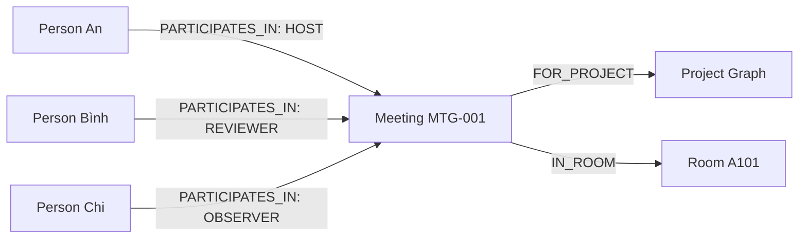
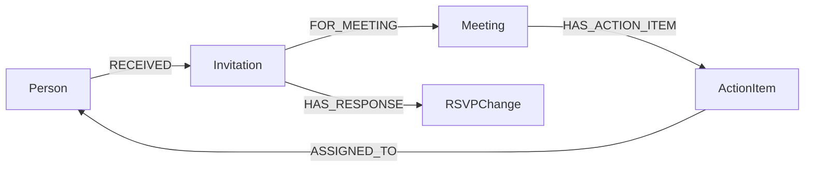

# Nút trung gian cho sự kiện hoặc quan hệ có nhiều bên tham gia

## 1. Mục tiêu bài học

Trong **Neo4j**, mỗi relationship kết nối **hai node**. Nhưng nghiệp vụ thường có những tình huống không thể diễn đạt đầy đủ bằng một cặp node: một cuộc họp có nhiều người, một phòng và một dự án; một hợp đồng liên quan đến người mua, người bán và bên bảo lãnh; một chuyến giao hàng liên quan đến đơn hàng, tài xế, phương tiện và kho. Mỗi lần xảy ra còn có thể mang **định danh, trạng thái, thời gian và lịch sử riêng**.

Một cách thiết kế phổ biến là dùng **node trung gian** để biểu diễn *sự kiện* hoặc *mối liên hệ nhiều bên* rồi nối nó với từng chủ thể bằng các relationship có tên rõ nghĩa. Cách này còn được gọi là **reification**: biến một mối liên hệ hay một lần xảy ra thành một thực thể có thể truy vấn và liên kết độc lập.

Bài thuộc chương **Thiết kế mô hình** của module `DATABASE_ENGINE_GRAPH_NEO4J`. Nội dung dựa trên mô hình **property graph**, dùng Cypher để duyệt quan hệ, tìm đường đi và kiểm tra sự nhất quán; có nhắc đến định danh, constraint, index và hiệu năng khi các quyết định này ảnh hưởng tới thiết kế. Java Driver, Spring Data Neo4j, nhập dữ liệu và vận hành được đề cập ở mức tích hợp với mô hình.

Sau bài học, bạn có thể:

- Giải thích vì sao một relationship Neo4j không thể trực tiếp kết nối ba hay nhiều node.
- Nhận ra khi nào một liên kết hai bên có property là đủ, khi nào cần node trung gian đại diện cho **một lần xảy ra**.
- Biểu diễn vai trò của từng bên tham gia, dữ liệu gắn với từng người và dữ liệu thuộc bản thân sự kiện.
- Viết Cypher tạo dữ liệu, tra cứu người tham gia, truy vấn lịch sử và kiểm tra xung đột thời gian.
- Phân tích các bất biến như định danh sự kiện, số bên tham gia, quan hệ trùng, chồng lịch và thay đổi lịch sử.
- Nhìn ra đánh đổi giữa ý nghĩa nghiệp vụ và chi phí duyệt khi thêm một node trung gian.

## 2. Vấn đề cốt lõi: relationship là liên kết hai đầu mút

Property graph có ba thành phần chính: **node** (thực thể), **relationship** (kết nối có hướng giữa hai node) và **property** (giá trị mô tả node hoặc relationship). Chẳng hạn:

```cypher
(:Person)-[:MEMBER_OF]->(:Team)
```

Mẫu trên biểu diễn một người thuộc một đội. Nếu mỗi người chỉ cần gắn với một đội tại một thời điểm, có thể đặt thêm `joinedAt` hoặc `role` trên relationship. Tuy nhiên, một relationship **không thể có ba đầu mút** để cùng lúc nối `Person`, `Meeting` và `Room`, và relationship cũng **không thể là đầu mút của relationship khác**.

Xét một cuộc họp có ba người An, Bình, Chi, diễn ra tại phòng A101 để rà soát dự án Graph. Những kết nối từng cặp không tự khẳng định cả ba người đã tham gia **cùng một buổi**:

```text
An --- Bình
 |     |
Chi --- Phòng A101 --- Dự án Graph
```

Nếu ngày mai An và Bình họp lần nữa trong cùng phòng, các cạnh kiểu `MET_WITH` hoặc `USES_ROOM` không tự cho biết cạnh nào thuộc **buổi họp thứ nhất** và cạnh nào thuộc **buổi thứ hai**. Đặt ngày giờ lên nhiều cạnh riêng lẻ có thể khiến cùng một sự kiện bị nhân bản và khó cập nhật nhất quán.

Thay vào đó, tạo `(:Meeting {meetingId, startAt, endAt, status})` và nối từng vai trò tới **chính node buổi họp**:



`Meeting` tạo ra **ngữ cảnh chung** cho mọi người, phòng và dự án. Mỗi buổi họp có định danh riêng nên hai lần họp với cùng thành phần vẫn là **hai sự kiện khác nhau**.

> **Nguyên tắc:** Node trung gian hữu ích khi sự kiện/mối liên hệ nhiều bên cần được nhận diện, tra cứu, thay đổi trạng thái hoặc nối với các đối tượng khác. Không cần tạo node trung gian cho mọi relationship chỉ vì nó có vài thuộc tính.

## 3. Phân biệt ba cách biểu diễn thường gặp

| Cách biểu diễn | Dạng graph | Phù hợp khi | Hạn chế cần cân nhắc |
|---|---|---|---|
| Relationship trực tiếp có property | `Person-[:MEMBER_OF {joinedAt}]->Team` | Một liên hệ giữa hai thực thể, chưa có vòng đời/định danh riêng | Khó liên kết đối tượng thứ ba với **chính lần liên hệ** |
| Node sự kiện | `Person-[:PARTICIPATES_IN]->Meeting-[:IN_ROOM]->Room` | Một lần xảy ra có ID, thời gian, trạng thái và nhiều bên | Đường đi dài hơn; cần ràng buộc số lượng/loại bên tham gia |
| Node liên kết nghiệp vụ | `Customer-[:HAS_ORDER]->PurchaseOrder-[:WITH_SELLER]->Seller` | Hợp đồng, đơn hàng, đăng ký hoặc giao dịch có danh tính và vòng đời | Phải quy định nguồn sự thật, định danh và quy tắc cập nhật |

Điểm chung của **node sự kiện** và **node liên kết nghiệp vụ** là chúng biến một điều vốn có thể được nói như “A liên hệ B” thành một thực thể có danh tính riêng. Không nhất thiết sự kiện phải xảy ra trong vài phút: một `Enrollment` có thể kéo dài nhiều tháng; một `Contract` có thể có hiệu lực nhiều năm.

### 3.1. Nút trung gian không đồng nghĩa với bảng nối SQL

Ví dụ, `Student-[:ENROLLED_IN {enrolledAt}]->Course` là đủ nếu ứng dụng chỉ cần biết một học viên đang đăng ký khóa nào và mỗi cặp chỉ có một đăng ký hiện hành. Nhưng khi mỗi lần đăng ký cần `enrollmentId`, nhiều thanh toán, chứng chỉ và lịch sử học lại, node `Enrollment` giúp đại diện cho từng lần riêng biệt.

Việc thêm node trung gian là **quyết định về ý nghĩa và vòng đời**, không phải quy tắc “bất cứ quan hệ nhiều–nhiều nào cũng cần node”. Trong Neo4j, N:N hai bên vẫn có thể được biểu diễn trực tiếp bằng nhiều relationship giữa các cặp node phù hợp.

### 3.2. Dấu hiệu nên tách thành node sự kiện

Hãy hỏi:

1. **Có ID của lần xảy ra không?** Ví dụ `meetingId`, `shipmentId`, `paymentId`, `interviewId`.
2. **Có nhiều bên tham gia một ngữ cảnh chung không?** Ví dụ người chủ trì, khách tham dự, phòng, dự án.
3. **Một cặp đối tượng có thể lặp lại sự kiện không?** Cùng hai người có thể họp nhiều lần vào ngày khác nhau.
4. **Có trạng thái và thời gian riêng không?** Ví dụ `SCHEDULED`, `CANCELLED`, `COMPLETED`, `startAt`, `endAt`.
5. **Các sự kiện khác có nối tới lần này không?** Ví dụ biên bản họp, tệp đính kèm, công việc phát sinh, yêu cầu phê duyệt.
6. **Có yêu cầu kiểm toán/hồi cứu không?** Ví dụ tìm lại đúng những người tham gia và quyết định của buổi họp tháng trước.

Nếu nhiều câu trả lời là “có”, node trung gian thường giúp mô hình rõ ràng hơn. Nếu chỉ có hai bên, một trạng thái hiện hành và không cần tra cứu từng lần liên hệ, relationship có property thường gọn hơn.

## 4. Xác định ranh giới sự kiện và vai trò từng bên

Giả sử một hệ thống quản lý họp cần trả lời các câu hỏi:

- **Q1:** Người `P-AN` có lịch họp nào trong một khoảng thời gian? Người ấy giữ vai trò gì trong từng buổi?
- **Q2:** Buổi `MTG-001` có những ai tham gia, liên quan tới dự án nào và sử dụng phòng nào?
- **Q3:** An và Bình đã cùng tham gia **những buổi họp nào**, kể cả khi họ họp nhiều lần với nhau?
- **Q4:** Phòng `R-A101` có bị đặt cho hai buổi họp chồng thời gian không?
- **Q5:** Trong một buổi, có bao nhiêu người ở từng vai trò (`HOST`, `REVIEWER`, `OBSERVER`)?

### 4.1. Quyết định node, relationship và property

| Thành phần | Biểu diễn | Lý do |
|---|---|---|
| Người tham gia | `(:Person {personId, fullName})` | Có định danh riêng, tham gia nhiều buổi họp |
| Buổi họp cụ thể | `(:Meeting {meetingId, startAt, endAt, status, title})` | Một **sự kiện có danh tính**, thời gian và trạng thái riêng |
| Dự án | `(:Project {projectId, name})` | Được nhiều buổi họp tham chiếu |
| Phòng họp | `(:Room {roomId, name})` | Được dùng lại qua nhiều sự kiện và cần kiểm tra lịch |
| Người tham gia buổi | `(:Person)-[:PARTICIPATES_IN]->(:Meeting)` | Người tham dự được nối trực tiếp với sự kiện cụ thể |
| Vai trò, phản hồi lời mời | `PARTICIPATES_IN.role`, `PARTICIPATES_IN.rsvpStatus` | Giá trị của **một người trong một buổi họp**, không phải vai trò vĩnh viễn của người đó |
| Buổi thuộc dự án | `(:Meeting)-[:FOR_PROJECT]->(:Project)` | Gắn sự kiện vào ngữ cảnh dự án |
| Buổi sử dụng phòng | `(:Meeting)-[:IN_ROOM]->(:Room)` | Có thể tra cứu lịch từ Room ngược về Meeting |
| Giờ bắt đầu/kết thúc | `Meeting.startAt`, `Meeting.endAt` | Thời gian thuộc về **toàn bộ sự kiện**, không nhân bản trên cạnh của mỗi người |

Mô hình này áp dụng một **quy ước hướng**: người `PARTICIPATES_IN` buổi họp; buổi họp `FOR_PROJECT` dự án và `IN_ROOM` phòng. Khi tra từ dự án/phòng về buổi họp, Cypher chỉ cần duyệt cạnh ngược chiều; không tạo type ngược để sao chép cùng sự thật.

### 4.2. Phân biệt dữ liệu của sự kiện và dữ liệu của từng lần tham gia

Hai thuộc tính `Meeting.startAt` và `Meeting.endAt` áp dụng cho tất cả người trong buổi họp. Nếu đổi lịch, chỉ cần cập nhật `Meeting`. Ngược lại, An có thể là `HOST`, Bình là `REVIEWER`, Chi là `OBSERVER`; vai trò nằm trên **mỗi relationship `PARTICIPATES_IN`**.

Tương tự, `rsvpStatus = 'ACCEPTED'` của An không thể đặt trên `Meeting`, vì Bình có thể chấp nhận còn Chi chưa trả lời. Nếu cần lưu *toàn bộ lịch sử những lần người tham dự đổi phản hồi*, một property trạng thái hiện hành trên cạnh sẽ không đủ; lúc đó cần xem xét node sự kiện `InvitationResponse`/`RSVPChange` hoặc một audit log có thiết kế rõ ràng.

### 4.3. Cardinality là bất biến nghiệp vụ, không phải đặc tính tự suy ra

Trong ví dụ:

| Mẫu quan hệ | Quy tắc mong muốn | Cách kiểm tra |
|---|---|---|
| `Person → Meeting` | Một người có thể tham gia nhiều Meeting | Không cần giới hạn số Meeting/người |
| `Person → Meeting` trong một buổi | Tối đa **một cạnh tham gia** cho một cặp người–buổi | Kiểm tra cạnh trùng theo cặp |
| `Meeting → Project` | Mỗi Meeting thuộc đúng **một** Project | Kiểm tra số cạnh `FOR_PROJECT` của từng Meeting |
| `Meeting → Room` | Buổi họp trực tiếp sử dụng tối đa **một** Room | Kiểm tra số cạnh `IN_ROOM` và loại hình họp |
| `Meeting ← Person` với vai trò HOST | Mỗi Meeting cần **đúng một** người chủ trì | Đếm cạnh có `role = 'HOST'` |

Các ràng buộc theo số cạnh/độ phủ **không được tạo ra chỉ bởi cấu trúc đồ thị**. Unique constraint trên `Meeting.meetingId` không bảo đảm đúng một Project, một HOST hoặc lịch phòng không bị chồng. Hệ thống phải kiểm tra bằng quy tắc nghiệp vụ và thao tác ghi phù hợp.

## 5. Tạo mô hình thử bằng Cypher trong Neo4j 5.x

Các ví dụ tiếp theo dùng **Neo4j 5.x**, với ngày giờ có múi giờ `+07:00`. Chạy trên cơ sở dữ liệu thử, không đưa các định danh minh họa vào dữ liệu sản xuất.

### 5.1. Constraint và index cho điểm neo truy vấn

```cypher
CREATE CONSTRAINT person_id_unique IF NOT EXISTS
FOR (p:Person) REQUIRE p.personId IS UNIQUE;

CREATE CONSTRAINT meeting_id_unique IF NOT EXISTS
FOR (m:Meeting) REQUIRE m.meetingId IS UNIQUE;

CREATE CONSTRAINT project_id_unique IF NOT EXISTS
FOR (p:Project) REQUIRE p.projectId IS UNIQUE;

CREATE CONSTRAINT room_id_unique IF NOT EXISTS
FOR (r:Room) REQUIRE r.roomId IS UNIQUE;

CREATE RANGE INDEX meeting_start_at_idx IF NOT EXISTS
FOR (m:Meeting) ON (m.startAt);
```

Constraint định danh giúp tìm node theo khóa và ngăn hai node cùng label có **cùng giá trị ID khi ID hiện diện**. Unique constraint đơn giản không bắt buộc node luôn có key đó; hệ thống có yêu cầu bắt buộc ID cần kiểm soát riêng hoặc dùng ràng buộc phù hợp với phiên bản/edition.

Index thời gian có thể giúp truy vấn bắt đầu bằng khoảng `Meeting.startAt`, nhưng truy vấn Q1 đi từ một `Person` có định danh rồi duyệt các Meeting của họ có thể không cần dùng index thời gian toàn cục. Kế hoạch truy vấn sẽ quyết định cách tìm node phù hợp; cần đo bằng `EXPLAIN`/`PROFILE` trên dữ liệu đại diện.

### 5.2. Dữ liệu mẫu: hai buổi khác nhau, có người và phòng trùng nhau

```cypher
MERGE (an:Person {personId: 'P-AN'})
SET an.fullName = 'An'
MERGE (binh:Person {personId: 'P-BINH'})
SET binh.fullName = 'Bình'
MERGE (chi:Person {personId: 'P-CHI'})
SET chi.fullName = 'Chi'

MERGE (project:Project {projectId: 'PRJ-GRAPH'})
SET project.name = 'Nền tảng đồ thị'
MERGE (room:Room {roomId: 'R-A101'})
SET room.name = 'Phòng A101'

MERGE (first:Meeting {meetingId: 'MTG-001'})
SET first.title = 'Rà soát mô hình đồ thị',
    first.startAt = datetime('2026-12-02T09:00:00+07:00'),
    first.endAt = datetime('2026-12-02T10:00:00+07:00'),
    first.status = 'SCHEDULED'
MERGE (second:Meeting {meetingId: 'MTG-002'})
SET second.title = 'Thảo luận truy vấn Cypher',
    second.startAt = datetime('2026-12-02T10:00:00+07:00'),
    second.endAt = datetime('2026-12-02T11:00:00+07:00'),
    second.status = 'SCHEDULED'

MERGE (first)-[:FOR_PROJECT]->(project)
MERGE (second)-[:FOR_PROJECT]->(project)
MERGE (first)-[:IN_ROOM]->(room)
MERGE (second)-[:IN_ROOM]->(room)

MERGE (an)-[anFirst:PARTICIPATES_IN]->(first)
SET anFirst.role = 'HOST', anFirst.rsvpStatus = 'ACCEPTED'
MERGE (binh)-[binhFirst:PARTICIPATES_IN]->(first)
SET binhFirst.role = 'REVIEWER', binhFirst.rsvpStatus = 'ACCEPTED'
MERGE (chi)-[chiFirst:PARTICIPATES_IN]->(first)
SET chiFirst.role = 'OBSERVER', chiFirst.rsvpStatus = 'INVITED'

MERGE (an)-[anSecond:PARTICIPATES_IN]->(second)
SET anSecond.role = 'HOST', anSecond.rsvpStatus = 'ACCEPTED'
MERGE (binh)-[binhSecond:PARTICIPATES_IN]->(second)
SET binhSecond.role = 'REVIEWER', binhSecond.rsvpStatus = 'ACCEPTED';
```

Các điểm cần quan sát:

- `MTG-001` và `MTG-002` là **hai node**, dù cả hai cùng thuộc dự án Graph, cùng ở phòng A101 và có An, Bình tham gia.
- Buổi 1 có Chi; buổi 2 không có Chi. Vai trò và trạng thái lời mời của từng người được lưu trên relationship tới đúng Meeting.
- Buổi 1 kết thúc đúng lúc buổi 2 bắt đầu. Theo quy ước **khoảng thời gian nửa mở** `[startAt, endAt)`, hai buổi này **không chồng lịch**.
- `MERGE` làm ví dụ dễ chạy lại; nó không tự bảo đảm mọi quy tắc số cạnh hoặc an toàn trước ghi đồng thời khi thiếu cơ chế đồng bộ.

## 6. Truy vấn từ node sự kiện và qua nhiều bên tham gia

### Q1. Lịch họp của một người trong khoảng thời gian

```cypher
MATCH (p:Person {personId: $personId})
      -[participation:PARTICIPATES_IN]->(m:Meeting)
WHERE m.startAt >= datetime($fromTime)
  AND m.startAt < datetime($toTime)
  AND m.status <> 'CANCELLED'
RETURN m.meetingId AS meetingId,
       m.title AS title,
       m.startAt AS startAt,
       m.endAt AS endAt,
       participation.role AS role,
       participation.rsvpStatus AS rsvpStatus
ORDER BY startAt, meetingId;
```

Với `$personId = 'P-AN'`, `$fromTime = '2026-12-02T00:00:00+07:00'` và `$toTime = '2026-12-03T00:00:00+07:00'`, truy vấn trả **hai buổi** `MTG-001` và `MTG-002`. Khoảng lọc ở đây xét **giờ bắt đầu**; nếu nghiệp vụ yêu cầu mọi cuộc họp *có giao thời gian* với khoảng tìm kiếm, điều kiện cần đổi thành `m.startAt < datetime($toTime) AND m.endAt > datetime($fromTime)`.

### Q2. Danh sách người, dự án và phòng của một buổi

```cypher
MATCH (m:Meeting {meetingId: $meetingId})
MATCH (p:Person)-[participation:PARTICIPATES_IN]->(m)
WITH m, collect({
  personId: p.personId,
  fullName: p.fullName,
  role: participation.role,
  rsvpStatus: participation.rsvpStatus
}) AS participants
MATCH (m)-[:FOR_PROJECT]->(project:Project)
OPTIONAL MATCH (m)-[:IN_ROOM]->(room:Room)
RETURN m.meetingId AS meetingId,
       m.title AS title,
       project.projectId AS projectId,
       room.roomId AS roomId,
       participants
ORDER BY meetingId;
```

Với `$meetingId = 'MTG-001'`, danh sách `participants` gồm An (`HOST`), Bình (`REVIEWER`) và Chi (`OBSERVER`). `projectId = 'PRJ-GRAPH'`, `roomId = 'R-A101'`.

Truy vấn giả định mỗi Meeting có **ít nhất một** người tham gia, **đúng một** Project và tối đa một Room. Nếu thực tế có hai cạnh `FOR_PROJECT` do lỗi dữ liệu, kết quả có thể bị nhân dòng. Nếu phải hiển thị buổi họp đang chờ mời người, thay `MATCH` bắt buộc tới người bằng `OPTIONAL MATCH` và xử lý người tham gia rỗng theo hợp đồng API.

### Q3. Hai người từng tham gia những buổi nào cùng nhau?

```cypher
MATCH (firstPerson:Person {personId: $firstPersonId})
      -[:PARTICIPATES_IN]->(m:Meeting)
      <-[:PARTICIPATES_IN]-
      (secondPerson:Person {personId: $secondPersonId})
RETURN DISTINCT m.meetingId AS meetingId,
       m.title AS title,
       m.startAt AS startAt
ORDER BY startAt, meetingId;
```

Thử `$firstPersonId = 'P-AN'` và `$secondPersonId = 'P-BINH'`: kết quả có **hai hàng**, cho `MTG-001` và `MTG-002`. Nếu chỉ lưu một cạnh `(:Person)-[:MET_WITH]->(:Person)` thì không đủ để nhận biết hai buổi khác nhau, phòng, dự án và thời gian ứng với từng buổi.

### Q4. Phát hiện phòng bị đặt chồng thời gian

Với khoảng thời gian nửa mở `[startAt, endAt)`, hai khoảng A và B **chồng nhau** khi `A.startAt < B.endAt` **và** `B.startAt < A.endAt`. Điều này cho phép A kết thúc đúng lúc B bắt đầu.

```cypher
MATCH (room:Room {roomId: $roomId})<-[:IN_ROOM]-(first:Meeting)
MATCH (room)<-[:IN_ROOM]-(second:Meeting)
WHERE first.meetingId < second.meetingId
  AND first.status IN ['SCHEDULED', 'IN_PROGRESS']
  AND second.status IN ['SCHEDULED', 'IN_PROGRESS']
  AND first.startAt < second.endAt
  AND second.startAt < first.endAt
RETURN room.roomId AS roomId,
       first.meetingId AS firstMeetingId,
       second.meetingId AS secondMeetingId,
       first.startAt AS firstStart,
       second.startAt AS secondStart;
```

Với `$roomId = 'R-A101'`, dữ liệu mẫu **không trả hàng nào**, bởi một buổi kết thúc lúc 10:00 và buổi kia bắt đầu lúc 10:00. Nếu đổi `MTG-002.startAt` thành 09:30, truy vấn sẽ phát hiện cặp chồng lịch.

Điều kiện `first.meetingId < second.meetingId` dùng ID ổn định để chỉ lấy một thứ tự của mỗi cặp. **Truy vấn phát hiện xung đột không tự ngăn hai giao dịch đặt lịch đồng thời**. Hệ thống cần kiểm tra và ghi lịch với cơ chế transaction/đồng bộ phù hợp; unique constraint trên `meetingId` không thể bảo vệ quy tắc không chồng khoảng thời gian.

### Q5. Thống kê người tham dự theo vai trò

```cypher
MATCH (p:Person)-[participation:PARTICIPATES_IN]->
      (m:Meeting {meetingId: $meetingId})
RETURN participation.role AS role,
       count(DISTINCT p) AS personCount
ORDER BY role;
```

Với `MTG-001`, kết quả là ba nhóm `HOST: 1`, `OBSERVER: 1`, `REVIEWER: 1`. `count(DISTINCT p)` cho biết số người, trong khi `count(participation)` đếm số cạnh; nếu một người bị tạo hai cạnh trùng, hai cách đếm sẽ khác nhau. Đừng dùng `DISTINCT` để che lỗi dữ liệu mà không điều tra nguyên nhân.

### Q6. Tìm mọi buổi họp của một dự án

```cypher
MATCH (project:Project {projectId: $projectId})
      <-[:FOR_PROJECT]-(m:Meeting)
WHERE m.status <> 'CANCELLED'
RETURN m.meetingId AS meetingId,
       m.title AS title,
       m.startAt AS startAt
ORDER BY startAt;
```

Với `$projectId = 'PRJ-GRAPH'`, có hai buổi. Câu hỏi này cho thấy node trung gian không chỉ giúp truy vấn **từ người đến cuộc họp**, mà còn giúp truy vấn từ những bên liên quan khác trở về **chính sự kiện**.

## 7. Bất biến dữ liệu cần kiểm soát

Đặt node sự kiện đúng cấu trúc chưa đủ để đảm bảo graph đúng nghiệp vụ. Cần xác định và kiểm tra các bất biến sau.

### 7.1. Một người chỉ có một cạnh tham gia trong một buổi

```cypher
MATCH (p:Person)-[participation:PARTICIPATES_IN]->(m:Meeting)
WITH p, m, count(participation) AS edgeCount
WHERE edgeCount > 1
RETURN p.personId AS personId,
       m.meetingId AS meetingId,
       edgeCount
ORDER BY edgeCount DESC;
```

Truy vấn phát hiện cặp người–buổi có nhiều cạnh. Nếu một người có nhiều **vai trò** trong cùng buổi, phải quyết định lưu `roles` trên một relationship, hay mỗi vai trò là thực thể riêng có ý nghĩa độc lập. Không tự coi mọi cạnh trùng là hợp lệ hoặc xóa bừa khi chưa thống nhất quy tắc.

### 7.2. Mỗi buổi có đúng một dự án và tối đa một phòng

```cypher
MATCH (m:Meeting)
OPTIONAL MATCH (m)-[rel:FOR_PROJECT]->(:Project)
WITH m, count(rel) AS projectLinks
WHERE projectLinks <> 1
RETURN m.meetingId AS meetingId, projectLinks;
```

```cypher
MATCH (m:Meeting)
OPTIONAL MATCH (m)-[rel:IN_ROOM]->(:Room)
WITH m, count(rel) AS roomLinks
WHERE roomLinks > 1
RETURN m.meetingId AS meetingId, roomLinks;
```

Trong thực tế, buổi trực tuyến có thể không dùng Room, hoặc cuộc họp có thể gắn nhiều Project. Nếu nghiệp vụ cho phép như vậy, thay đổi bất biến và cách đọc dữ liệu tương ứng; đừng duy trì quy tắc “đúng một” chỉ vì mô hình ví dụ dùng nó.

### 7.3. Mỗi buổi có đúng một HOST

```cypher
MATCH (m:Meeting)
OPTIONAL MATCH (p:Person)-[participation:PARTICIPATES_IN]->(m)
WITH m,
     sum(CASE WHEN participation.role = 'HOST' THEN 1 ELSE 0 END)
       AS hostCount
WHERE hostCount <> 1
RETURN m.meetingId AS meetingId, hostCount;
```

`OPTIONAL MATCH` giúp bao gồm cả buổi **không có người tham dự**, từ đó phát hiện `hostCount = 0`. Nếu hệ thống cho phép nhiều đồng chủ trì, quy tắc này cần đổi; đó là quyết định nghiệp vụ, không phải giới hạn của Neo4j.

### 7.4. Thời gian bắt đầu phải nhỏ hơn thời gian kết thúc

```cypher
MATCH (m:Meeting)
WHERE m.startAt IS NULL
   OR m.endAt IS NULL
   OR m.startAt >= m.endAt
RETURN m.meetingId AS meetingId,
       m.startAt AS startAt,
       m.endAt AS endAt;
```

Hệ thống cần thống nhất kiểu thời gian (`datetime`), múi giờ và quy ước `[startAt, endAt)`. Không lưu lẫn chuỗi ngày giờ không chuẩn với giá trị thời gian thực của Neo4j nếu phải so sánh/chồng lịch. Với các buổi qua nhiều múi giờ, lưu giá trị thời gian có offset/time zone đúng để tránh nhầm thời điểm tuyệt đối và giờ địa phương.

### 7.5. Chồng lịch của người tham dự

Ngoài xung đột phòng, một người có thể được mời vào hai buổi cùng giờ. Mô hình có thể kiểm tra các sự kiện của **cùng một Person**:

```cypher
MATCH (person:Person {personId: $personId})
      -[firstAttendance:PARTICIPATES_IN]->(first:Meeting)
MATCH (person)-[secondAttendance:PARTICIPATES_IN]->(second:Meeting)
WHERE first.meetingId < second.meetingId
  AND first.status = 'SCHEDULED'
  AND second.status = 'SCHEDULED'
  AND firstAttendance.rsvpStatus = 'ACCEPTED'
  AND secondAttendance.rsvpStatus = 'ACCEPTED'
  AND first.startAt < second.endAt
  AND second.startAt < first.endAt
RETURN person.personId AS personId,
       first.meetingId AS firstMeetingId,
       second.meetingId AS secondMeetingId;
```

Ở đây chỉ xét lời mời `ACCEPTED`. Nếu chính sách cần chặn cả lịch đang chờ trả lời (`INVITED`) hoặc cho phép lịch “có thể tham dự”, điều kiện phải được định nghĩa lại. Cũng cần xác định các buổi đang diễn ra (`IN_PROGRESS`) có được tính vào chồng lịch hay không.

## 8. Khi một event node chưa đủ: các loại liên kết con có vòng đời riêng

Mô hình `Person-[:PARTICIPATES_IN {role, rsvpStatus}]->Meeting` phục vụ trạng thái tham gia hiện hành. Nhưng có những yêu cầu mới đòi hỏi node riêng cho **từng lần tương tác**, không chỉ cho buổi họp:

- Gửi lời mời nhiều lần, người nhận từ chối rồi chấp nhận; cần giữ thời gian, người gửi và lý do cho **mỗi lần đổi trạng thái**.
- Một người nhận nhiều nhiệm vụ trong buổi họp; mỗi nhiệm vụ có deadline, người giám sát và trạng thái.
- Mỗi người có một phiếu đánh giá hoặc bản ghi chấm công, được người khác phê duyệt.

Khi đó có thể thêm các node `Invitation`, `RSVPChange`, `ActionItem` hoặc `AttendanceRecord`, nối chúng tới `Meeting` và `Person` theo những quan hệ có nghĩa:



**Không cần tạo đồng thời tất cả các node này từ đầu.** Hãy bắt đầu với các câu hỏi nghiệp vụ thực tế. Node trung gian là lựa chọn phù hợp khi lần tham gia có **định danh/lịch sử/quan hệ con**, chứ không phải vì muốn làm graph phức tạp hơn.

### 8.1. Sự kiện có nhiều phiên hoặc lặp theo lịch

Một cuộc họp lặp hằng tuần thường có hai khái niệm khác nhau:

- `MeetingSeries`: quy tắc/lịch lặp và cấu hình chung của chuỗi.
- `Meeting`: **từng lần diễn ra** có giờ thực tế, người tham gia, phòng, trạng thái và biên bản riêng.

```text
(:MeetingSeries {seriesId: 'SER-001'})
    -[:HAS_OCCURRENCE]->(:Meeting {meetingId: 'MTG-001'})
    -[:FOR_PROJECT]->(:Project)
```

Đoạn trên là **minh họa cấu trúc**; thực tế `MeetingSeries` có thể nối tới nhiều `Meeting` và mỗi `Meeting` nối trực tiếp tới Project theo nhu cầu. Nếu chỉ lưu một node `Meeting` rồi liên tục ghi đè `startAt` khi họp hằng tuần, lịch sử từng buổi sẽ mất.

### 8.2. Liên hệ nhiều bên không nhất thiết là cuộc họp

| Nghiệp vụ | Node trung gian | Các bên/liên kết có thể cần |
|---|---|---|
| Giao hàng | `Shipment` | Đơn hàng, tài xế, xe, kho xuất/kho nhận |
| Phỏng vấn tuyển dụng | `InterviewSession` | Ứng viên, người phỏng vấn, vị trí tuyển, phòng |
| Hợp đồng ba bên | `Contract` | Bên mua, bên bán, bên bảo lãnh, tài liệu ký |
| Phiên thanh toán | `PaymentTransaction` | Người trả, người nhận, hóa đơn, phương thức thanh toán |
| Đăng ký khóa học có thanh toán/chứng chỉ | `Enrollment` | Học viên, khóa học, các lần thanh toán, chứng chỉ |

Mỗi ví dụ có thể có nhiều cách hợp lệ. Quan trọng là các cạnh cùng hướng vào hoặc đi ra **đúng node sự kiện**, để không đánh đồng những sự kiện khác nhau chỉ vì chúng chia sẻ một vài bên tham gia.

## 9. Tính đúng đắn khi ghi dữ liệu và nhập từ bên ngoài

### 9.1. Định danh sự kiện phải độc lập với tổ hợp bên tham gia

Đừng dùng “cùng người + cùng phòng + cùng dự án” để suy ra hai cuộc họp là một. Một cuộc họp có thể đổi giờ, đổi người tham dự hoặc đổi phòng mà vẫn giữ `meetingId` ban đầu. Ngược lại, hai cuộc họp khác nhau có thể trùng những đặc tính đó.

Thiết kế luồng tạo Meeting điển hình:

1. Nhận một `meetingId` ổn định hoặc mã yêu cầu tạo được kiểm soát idempotency.
2. Xác minh các node `Person`, `Project`, `Room` cần thiết đã tồn tại hoặc được tạo theo quy tắc rõ ràng.
3. Kiểm tra `startAt < endAt` và các quy tắc xung đột thời gian.
4. Tạo/ghép Meeting theo định danh; nối đúng các cạnh tham gia, dự án, phòng.
5. Ghi toàn bộ cập nhật có liên quan trong transaction phù hợp để tránh trạng thái nửa vời.
6. Đối chiếu kết quả với số người, vai trò và bất biến đã thống nhất.

`MERGE` thuận tiện để tránh tạo lại một node có cùng `meetingId` khi đã có unique constraint, nhưng **không tự đảm bảo** đúng một cạnh cho mỗi cặp `(Person, Meeting)` trong mọi trường hợp ghi đồng thời. Cần kiểm soát tạo cạnh trùng và quy trình đồng bộ; không coi việc chạy lại một lệnh `MERGE` là đủ bảo đảm mọi ràng buộc.

### 9.2. Thứ tự và phạm vi đồng bộ khi import

Khi nhập lịch từ hệ thống ngoài, nên định nghĩa ánh xạ ID và trình tự: tạo/khớp node `Person`, `Project`, `Room`; tạo/khớp `Meeting`; rồi nối các cạnh. Nếu dùng `MATCH` mà không tìm thấy một đầu mút, dòng dữ liệu **có thể không tạo được relationship** mà không gây lỗi cú pháp. Hãy thống kê số Meeting đầu vào, số Meeting được tạo/cập nhật, số cạnh dự kiến/thực tế và những ID bị thiếu để tránh mất liên kết âm thầm.

Trong Java Driver, truyền giá trị bằng tham số Cypher thay vì nối chuỗi đầu vào người dùng vào query. Với Spring Data Neo4j, node `Meeting` có định danh riêng; các cạnh như `PARTICIPATES_IN` có property `role`, `rsvpStatus` có thể được ánh xạ bằng một lớp relationship properties thích hợp. Lớp ánh xạ relationship có property **không nhất thiết** là node Neo4j; đó là hai lựa chọn thiết kế khác nhau.

## 10. Đo hiệu năng theo mẫu truy vấn, không theo số node

Thêm `Meeting` vào giữa `Person` và `Project` làm một số truy vấn phải đi **hai cạnh** thay vì một. Đây là đánh đổi có chủ đích để diễn đạt đúng một sự kiện cụ thể. Không nên thêm cạnh tắt `Person-[:WORKS_ON]->Project` cho mọi cuộc họp chỉ vì muốn duyệt ngắn hơn, trừ khi nghiệp vụ thực sự có khái niệm “làm trên dự án” độc lập và có cơ chế đồng bộ dữ liệu dẫn xuất.

### 10.1. Dùng EXPLAIN/PROFILE kiểm tra điểm neo

```cypher
EXPLAIN
MATCH (p:Person {personId: 'P-AN'})-[:PARTICIPATES_IN]->(m:Meeting)
RETURN m.meetingId, m.startAt;
```

`EXPLAIN` xem kế hoạch dự kiến; `PROFILE` thực thi truy vấn và hiển thị số liệu. Hãy xem:

- Có tận dụng điểm neo `Person.personId`, `Meeting.meetingId`, `Room.roomId` khi phù hợp không?
- Số cạnh `PARTICIPATES_IN`, `IN_ROOM` được mở rộng mỗi bước là bao nhiêu, có node rất nhiều cạnh không?
- Khi truy vấn đi qua nhiều nhóm bên tham gia, cardinality có bị nhân lên không?
- Các phép `collect`, `DISTINCT`, sắp xếp và lọc thời gian tốn bao nhiêu DB hits/bộ nhớ?
- Độ trễ với dữ liệu lớn có phân bố gần thực tế có đáp ứng nhu cầu không?

### 10.2. Tránh nhân hàng khi nối nhiều nhánh của một sự kiện

Giả sử một Meeting có 5 người tham gia và 3 ActionItem. Mẫu:

```cypher
MATCH (p:Person)-[:PARTICIPATES_IN]->(m:Meeting)
      -[:HAS_ACTION_ITEM]->(item:ActionItem)
RETURN m.meetingId AS meetingId,
       count(p) AS participantRows;
```

có thể trả **15 hàng** cho 5 người × 3 ActionItem, khiến `count(p)` sai nếu muốn đếm **người duy nhất**. Dùng `count(DISTINCT p)` cho số người hoặc tổng hợp ở từng nhánh trước khi ghép; không dùng `DISTINCT` để che lỗi dữ liệu gốc.

Ví dụ chỉ cần đếm người tham gia theo buổi:

```cypher
MATCH (p:Person)-[:PARTICIPATES_IN]->(m:Meeting)
WITH m, count(DISTINCT p) AS participantCount
RETURN m.meetingId AS meetingId, participantCount
ORDER BY meetingId;
```

Nếu cần đồng thời số ActionItem và số người, nên tổng hợp độc lập theo từng loại quan hệ trước khi nối; tránh nhân hai tập dữ liệu rồi `sum()` trên các property đã bị lặp nhiều lần.

### 10.3. Kiểm tra xung đột lịch ở quy mô lớn

Truy vấn Q4 ghép hai Meeting của **cùng một phòng**, nên số cặp có thể tăng nhanh khi phòng có rất nhiều lịch sử. Với dữ liệu lớn, thu hẹp khoảng ngày tìm kiếm, lọc trạng thái trước, giới hạn thời gian cần kiểm tra, và xem kế hoạch để tránh đọc toàn bộ lịch sử nếu chỉ kiểm tra một yêu cầu đặt phòng mới. Index theo `Meeting.startAt` có thể giúp một số cách bắt đầu truy vấn, nhưng không tự giải quyết mọi chi phí ghép cặp của phòng có nhiều Meeting.

## 11. Các lỗi mô hình hóa thường gặp

| Thiết kế dễ sai | Hậu quả | Hướng xử lý |
|---|---|---|
| Dùng các cạnh `Person-[:MET_WITH]->Person` cho mỗi buổi | Mất ranh giới của từng sự kiện và thông tin phòng/dự án | Dùng node `Meeting` với `meetingId` riêng |
| Lưu danh sách người tham gia như chuỗi `personIds` trên Meeting | Khó duyệt từ Person, giữ vai trò và kiểm tra định danh | `Person-[:PARTICIPATES_IN]->Meeting` |
| Đặt `startAt` trên mọi cạnh tham gia | Sửa giờ phải cập nhật nhiều cạnh, dễ lệch | Đặt giờ của sự kiện trên `Meeting` |
| Đặt `rsvpStatus` trên Meeting | Không phân biệt phản hồi từng người | Đặt trên cạnh `PARTICIPATES_IN` |
| Tạo node sự kiện nhưng không có định danh ổn định | Dễ gộp nhầm hoặc tạo trùng các lần xảy ra | Dùng `meetingId` và ràng buộc phù hợp |
| Mặc định một Meeting có vô số Project/Room | Truy vấn trả dòng lặp, nhập liệu sai ngữ nghĩa | Định nghĩa cardinality và kiểm tra bất biến |
| Chỉ dùng unique constraint và tin rằng không chồng lịch | Unique ID không kiểm tra xung đột thời gian | Kiểm tra khoảng thời gian và ghi đồng bộ |
| Ghi đè Meeting hằng tuần thay vì tạo lần diễn ra mới | Mất lịch sử của từng buổi | Tách `MeetingSeries` và `Meeting` khi cần |
| Nối nhiều nhánh và tính tổng sau cùng | Kết quả bị nhân bởi tích số đường đi | Tổng hợp đúng loại thực thể trước khi ghép |
| Tạo node trung gian cho mọi cạnh đơn giản | Đường đi dài, dữ liệu khó hiểu không có lợi ích | Dùng node khi có danh tính/vòng đời/nhiều bên thật sự |

## 12. Bài tập thực hành

### Bài tập 1 – Từ quan hệ cặp sang sự kiện đa bên

Một trung tâm tuyển dụng lưu các cạnh `Candidate-[:INTERVIEWED_BY]->Interviewer`. Ứng viên A phỏng vấn với cùng hai người vào hai vòng khác nhau. Hãy giải thích thông tin nào không thể hiện được nếu chỉ có cạnh cặp và thiết kế `InterviewSession` nối với `Candidate`, `Interviewer`, `JobOpening`, `Room`; xác định property nên nằm trên `InterviewSession` và trên cạnh của từng người phỏng vấn.

### Bài tập 2 – Truy vấn từ hai phía

Với mô hình cuộc họp ở phần 5, viết Cypher trả: (a) những buổi `P-BINH` được mời với vai trò `REVIEWER`; (b) danh sách buổi sử dụng phòng `R-A101` trong ngày `2026-12-02`. Giải thích vì sao hai truy vấn dùng lại cùng node `Meeting` thay vì lưu thêm cạnh trực tiếp `Person-[:USES_ROOM]->Room`.

### Bài tập 3 – Lịch sử phản hồi lời mời

Chi ban đầu nhận lời mời, sau đó từ chối và cuối cùng lại chấp nhận. Nếu chỉ đặt `rsvpStatus` trên cạnh hiện hành, sẽ mất thông tin gì? Hãy đề xuất một node sự kiện con có định danh, thời gian và liên kết đủ để kiểm tra lịch sử này.

### Bài tập 4 – Phân tích xung đột phòng

Cho các buổi trong cùng phòng: A [09:00, 10:00), B [10:00, 11:00), C [09:30, 10:30). Hãy liệt kê các cặp chồng lịch và viết điều kiện Cypher tổng quát để phát hiện. Vì sao so sánh `startAt <= endAt` không đúng với quy ước khoảng nửa mở?

### Bài tập 5 – Kiểm tra bất biến của sự kiện

Một lệnh import tạo `Meeting MTG-003` có hai cạnh `FOR_PROJECT`, hai người cùng vai trò `HOST` và hai cạnh `PARTICIPATES_IN` trùng của An. Viết các câu Cypher phát hiện từng loại sai lệch; nêu cách phân biệt lỗi dữ liệu với quy tắc nghiệp vụ đã được mở rộng hợp lệ.

### Bài tập 6 – Tránh nhân số liệu từ nhiều nhánh

Một cuộc họp có 8 người, 5 `ActionItem`, 2 tệp đính kèm. Nếu cùng duyệt ba nhánh trong một mẫu Cypher, có thể tạo bao nhiêu tổ hợp hàng? Viết cách tính độc lập số người, số công việc và số tệp để tổng hợp không bị nhân sai.

### Bài tập 7 – Chọn node hay relationship có property

So sánh hai nhu cầu: (a) một học viên hiện đang tham gia một khóa với ngày đăng ký; (b) một học viên có nhiều đợt học lại, mỗi đợt có thanh toán và chứng chỉ. Hãy chọn mô hình cho từng trường hợp, giải thích khi nào `ENROLLED_IN` đủ và khi nào `Enrollment` có định danh riêng là cần thiết.

## 13. Checklist trước khi chốt mô hình

1. Đã xác định rõ **một lần xảy ra** là gì và ID nào phân biệt hai lần khác nhau chưa?
2. Có những bên nào tham gia sự kiện; vai trò của mỗi bên nằm trên cạnh nào?
3. Dữ liệu nào thuộc toàn bộ sự kiện, dữ liệu nào thuộc **từng người/từng lần tham gia**?
4. Các quan hệ một–một, một–nhiều, nhiều–nhiều và số lượng tối thiểu/tối đa đã được mô tả chưa?
5. Có quy tắc về lịch sử, thay đổi trạng thái, hoãn/hủy và sự kiện lặp không?
6. Unique constraint và cơ chế ghi dữ liệu đã bảo vệ định danh, cạnh trùng và tính nguyên tử của thao tác chưa?
7. Có cần kiểm tra xung đột khoảng thời gian, phòng, người tham gia hoặc tài nguyên khác không?
8. Các truy vấn từ nhiều đầu mút có cho đúng sự kiện và không nhân sai số lượng không?
9. Mô hình đã được đo bằng `EXPLAIN`/`PROFILE` với dữ liệu gần thực tế chưa?

**Tiêu chí hoàn thành:** Bạn có thể nhận diện một mối liên hệ nhiều bên hoặc một lần xảy ra cần định danh riêng, thiết kế node trung gian nối từng bên bằng relationship có nghĩa rõ, phân bổ đúng thuộc tính, viết truy vấn Cypher từ các đầu mút khác nhau và chỉ ra những bất biến phải kiểm soát. Mô hình đó giữ được **ranh giới của từng sự kiện**, lịch sử và ngữ cảnh nghiệp vụ ngay cả khi các bên tham gia lặp lại qua nhiều lần.
