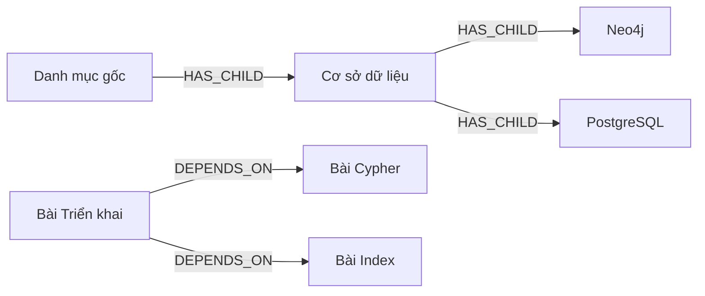
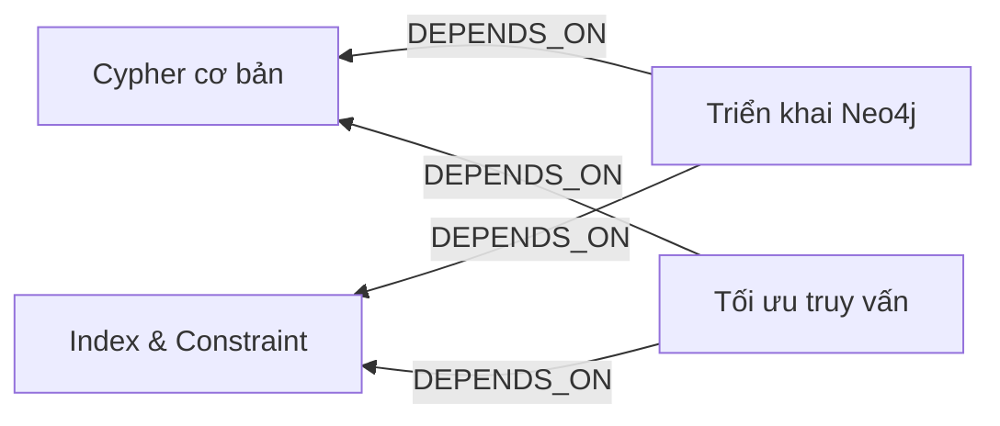

# Mô hình hóa phân cấp, mạng lưới và dữ liệu có thứ tự trong Neo4j

Trong phần **Thiết kế mô hình** của `DATABASE_ENGINE_GRAPH_NEO4J`, bài này tập trung vào cách biểu diễn ba kiểu quan hệ thường gặp bằng **property graph**: cấu trúc phân cấp, mạng lưới liên kết và chuỗi có thứ tự. Neo4j lưu các **node**, **relationship** có hướng, label và property; Cypher giúp truy vấn node liên quan, độ sâu, đường đi và thứ tự hiển thị. Chọn đúng mô hình quyết định cách kiểm tra tính hợp lệ, hiệu năng truy vấn và chi phí cập nhật.

## 1. Mục tiêu và cách nhận diện bài toán

Sau bài học, bạn có thể:

- Phân biệt **cây (tree)**, **đồ thị có hướng không chu trình (DAG)**, **mạng lưới (network)** và **danh sách có thứ tự (ordered sequence)**; quyết định khi nào cần kết hợp nhiều mô hình.
- Quy định rõ chiều quan hệ, định danh node, số liên kết cho phép, chu trình hợp lệ hay không và thứ tự có mang ý nghĩa nghiệp vụ hay không.
- Viết Cypher để lấy con/cháu, tổ tiên, phụ thuộc bắc cầu, gợi ý theo quan hệ hai chặng, đường đi ngắn nhất theo số cạnh và các phần tử theo vị trí.
- Nhận biết giới hạn của constraint, cách giữ tính toàn vẹn khi cập nhật trong transaction và cách xem kế hoạch thực thi bằng `EXPLAIN`/`PROFILE`.

| Câu hỏi nghiệp vụ | Mô hình thích hợp | Bất biến cần duy trì |
| --- | --- | --- |
| Danh mục cha–con, cây thư mục, sơ đồ tổ chức với một cấp trên trực tiếp | **Tree** | Mỗi node không phải gốc có đúng một cha; không có chu trình |
| Một công việc phụ thuộc nhiều công việc khác, một bài học có nhiều điều kiện tiên quyết | **DAG** | Nhiều quan hệ đi vào/đi ra được phép; không có chu trình có hướng |
| Người theo dõi nhau, các trạm kết nối, thực thể cộng tác | **Network** | Nhiều đường đi, nhánh và chu trình có thể hợp lệ |
| Playlist, quy trình từng bước, chương trong lộ trình học | **Ordered sequence** | Thứ tự là dữ liệu rõ ràng; không suy từ thứ tự lưu trữ |

**Điểm phân biệt:** Một quan hệ `HAS_CHILD` có thể tạo nên cây, nhưng nếu cho một node nhận hai cha thì cấu trúc không còn là cây. Một chuỗi `NEXT` cũng là đồ thị, nhưng ứng dụng phải quy định mỗi phần tử có bao nhiêu phần tử đứng trước/sau. Neo4j không tự suy ra hay tự áp đặt các quy tắc nghiệp vụ đó chỉ từ tên relationship.

## 2. Thiết kế quan hệ trước khi viết Cypher

Xét các câu hỏi sau cho mỗi loại relationship:

1. **Ý nghĩa và chiều:** `(parent)-[:HAS_CHILD]->(child)` nghĩa là cha hướng đến con; `(task)-[:DEPENDS_ON]->(prerequisite)` nghĩa là công việc hướng đến điều kiện cần hoàn thành trước. Hai chiều mang ý nghĩa khác nhau.
2. **Lực lượng liên kết (cardinality):** Một child có tối đa một cha, nhiều cha hay không giới hạn? Một bước được phép có hai bước kế tiếp không?
3. **Chu trình:** Có được phép đi theo cùng một loại cạnh rồi quay về node ban đầu không? Chu trình có thể phù hợp cho `FOLLOWS`, nhưng sai với `DEPENDS_ON` khi hiểu là điều kiện tiên quyết.
4. **Định danh:** Dùng `categoryId`, `taskId`, `accountId`… làm khóa nghiệp vụ ổn định; tạo uniqueness constraint để hạn chế node trùng. Không dùng internal ID của Neo4j làm khóa nghiệp vụ lâu dài.
5. **Vị trí và thời gian:** Mọi thứ tự cần được biểu diễn bằng property `position`, cạnh `NEXT`, hoặc cả hai với quy tắc đồng bộ. Nếu quan hệ có thời hạn hiệu lực, cân nhắc property thời gian trên cạnh hoặc node đại diện cho sự kiện.

Ví dụ tổng quan:



Hai cụm đồ thị đều chứa cạnh có hướng. Cụm danh mục được thiết kế thành **cây**; cụm điều kiện tiên quyết là **DAG** và có thể có nhiều tiền đề cho một bài.

## 3. Phân cấp dạng cây: danh mục và thư mục

### 3.1. Mô hình và bất biến

Với hệ thống danh mục, chọn:

- Node `(:Category {categoryId, name})`.
- Relationship `(parent:Category)-[:HAS_CHILD]->(child:Category)`.
- Một node gốc trong mỗi cây không có cha; mọi node còn lại có **đúng một cạnh `HAS_CHILD` đi vào** từ cha.
- Không có chu trình; node không được là con/cháu của chính nó.

Nếu danh mục có thể được gắn vào nhiều nhóm đồng thời, hãy xem xét **DAG phân loại** hoặc tách quan hệ `TAGGED_WITH`/`BELONGS_TO`, thay vì âm thầm phá quy tắc một cha.

### 3.2. Tạo dữ liệu mẫu

```cypher
CREATE CONSTRAINT category_id_unique IF NOT EXISTS
FOR (c:Category) REQUIRE c.categoryId IS UNIQUE;

MERGE (root:Category {categoryId: 'data'})
SET root.name = 'Dữ liệu'
MERGE (db:Category {categoryId: 'database'})
SET db.name = 'Cơ sở dữ liệu'
MERGE (graph:Category {categoryId: 'graph'})
SET graph.name = 'Cơ sở dữ liệu đồ thị'
MERGE (neo:Category {categoryId: 'neo4j'})
SET neo.name = 'Neo4j'
MERGE (root)-[:HAS_CHILD]->(db)
MERGE (db)-[:HAS_CHILD]->(graph)
MERGE (graph)-[:HAS_CHILD]->(neo);
```

`MERGE` giúp tránh tạo trùng mẫu đã khớp; khóa `categoryId` giúp Neo4j xác định node theo định danh. Tuy nhiên, uniqueness constraint trên node **không đảm bảo** một Category chỉ có một cha, cũng không ngăn chu trình `HAS_CHILD`. Hai quy tắc đó phải được kiểm tra khi ghi dữ liệu.

### 3.3. Truy vấn cây

**Lấy con trực tiếp:**

```cypher
MATCH (parent:Category {categoryId: $parentId})-[:HAS_CHILD]->(child:Category)
RETURN child.categoryId AS id, child.name AS name
ORDER BY name, id;
```

**Lấy hậu duệ tối đa sáu cấp**, kèm khoảng cách từ gốc:

```cypher
MATCH (root:Category {categoryId: $rootId})
MATCH p = (root)-[:HAS_CHILD*1..6]->(descendant:Category)
RETURN descendant.categoryId AS id,
       descendant.name AS name,
       min(length(p)) AS depth
ORDER BY depth, id;
```

Độ dài `1..6` giới hạn số relationship trong một đường đi. Nếu yêu cầu là **toàn bộ** hậu duệ, có thể dùng `*1..`, nhưng cần đánh giá kích thước cây và chi phí mở rộng; giới hạn độ sâu sáu ở trên sẽ bỏ sót node sâu hơn.

**Lấy tổ tiên** của một danh mục:

```cypher
MATCH p = (ancestor:Category)-[:HAS_CHILD*1..]->
          (target:Category {categoryId: $categoryId})
RETURN ancestor.categoryId AS id,
       ancestor.name AS name,
       length(p) AS distance
ORDER BY distance;
```

Ở cây hợp lệ, mỗi tổ tiên có một đường đi đến node đích. Nếu có nhiều đường đi cho cùng một node, dữ liệu có thể đã biến thành DAG hoặc vi phạm bất biến cây.

### 3.4. Chuyển nhánh sang cha mới

Khi chuyển một node `A` vào dưới `B`, cần kiểm tra:

- `A` và `B` khác nhau.
- `B` **không là hậu duệ** của `A`; nếu không sẽ tạo chu trình.
- Gỡ quan hệ cha cũ và tạo cha mới trong **cùng transaction**, đồng thời ngăn các lệnh sửa cây cạnh tranh nhau phá quy tắc một cha.

Ví dụ Cypher minh họa thao tác trong một transaction, với giả định ứng dụng đã kiểm soát cập nhật đồng thời:

```cypher
MATCH (child:Category {categoryId: $childId})
MATCH (newParent:Category {categoryId: $newParentId})
WHERE child <> newParent
  AND NOT EXISTS {
    MATCH (child)-[:HAS_CHILD*1..]->(newParent)
  }
OPTIONAL MATCH (:Category)-[old:HAS_CHILD]->(child)
WITH child, newParent, collect(old) AS oldRels
FOREACH (rel IN oldRels | DELETE rel)
MERGE (newParent)-[:HAS_CHILD]->(child)
RETURN child.categoryId AS movedId,
       newParent.categoryId AS parentId;
```

Nếu không trả về dòng nào, hãy coi thao tác là **không thành công** và xác minh nguyên nhân (không tìm thấy node, cùng node hoặc sẽ tạo chu trình). Kiểm tra đường đi và cập nhật cần được tổ chức cùng chiến lược khóa/đồng bộ ở tầng ghi, vì hai transaction cập nhật cạnh tranh có thể cùng vượt qua bước kiểm tra trên dữ liệu cũ.

## 4. Phân cấp nhiều tiền đề: DAG phụ thuộc

### 4.1. Khi nào cây không đủ?

Một bài học `Triển khai Neo4j` có thể yêu cầu **cả** `Cypher cơ bản` **và** `Index & Constraint`. Một tiền đề có thể được dùng lại bởi nhiều bài khác. Vì thế mô hình cây một cha không phù hợp; dùng DAG:



Chọn chiều `(task)-[:DEPENDS_ON]->(prerequisite)` và giữ nhất quán. DAG cho phép nhiều đường đi đến cùng một node, nhưng không cho `A` phụ thuộc bắc cầu vào chính `A`.

### 4.2. Tạo và truy vấn phụ thuộc

```cypher
CREATE CONSTRAINT task_id_unique IF NOT EXISTS
FOR (t:Task) REQUIRE t.taskId IS UNIQUE;

MERGE (build:Task {taskId: 'build'})
SET build.name = 'Build'
MERGE (test:Task {taskId: 'test'})
SET test.name = 'Test'
MERGE (deploy:Task {taskId: 'deploy'})
SET deploy.name = 'Deploy'
MERGE (test)-[:DEPENDS_ON]->(build)
MERGE (deploy)-[:DEPENDS_ON]->(test);
```

**Lấy tất cả tiền đề bắc cầu** của một task:

```cypher
MATCH (:Task {taskId: $taskId})-[:DEPENDS_ON*1..]->
      (prerequisite:Task)
RETURN DISTINCT prerequisite.taskId AS prerequisiteId
ORDER BY prerequisiteId;
```

**Xác định những task sẽ bị ảnh hưởng** khi một task thay đổi:

```cypher
MATCH (affected:Task)-[:DEPENDS_ON*1..]->
      (:Task {taskId: $changedTaskId})
RETURN DISTINCT affected.taskId AS affectedId
ORDER BY affectedId;
```

**Kiểm tra trước khi thêm `A DEPENDS_ON B`:**

```cypher
MATCH (a:Task {taskId: $taskId})
MATCH (b:Task {taskId: $prerequisiteId})
WHERE a <> b
  AND NOT EXISTS {
    MATCH (b)-[:DEPENDS_ON*1..]->(a)
  }
MERGE (a)-[:DEPENDS_ON]->(b)
RETURN a.taskId AS taskId, b.taskId AS prerequisiteId;
```

Lý do: nếu `B` đã phụ thuộc trực tiếp hoặc gián tiếp vào `A`, thêm `A → B` tạo chu trình. Giống mô hình cây, một truy vấn kiểm tra đơn lẻ **chưa đủ để bảo đảm an toàn khi ghi đồng thời**. Ứng dụng cần phối hợp giao dịch/khóa hoặc cơ chế tuần tự hóa cập nhật các quan hệ phụ thuộc.

### 4.3. Phát hiện chu trình và thứ tự thực thi

Truy vấn sau có thể tìm **một số** chu trình dài tối đa tám cạnh để kiểm tra dữ liệu mẫu:

```cypher
MATCH p = (t:Task)-[:DEPENDS_ON*1..8]->(t)
RETURN t.taskId AS startTask,
       [n IN nodes(p) | n.taskId] AS cycle
LIMIT 10;
```

Không có kết quả **không chứng minh** toàn đồ thị không có chu trình dài hơn tám cạnh. Với graph lớn, cần quy trình kiểm tra đầy đủ hoặc thuật toán phù hợp.

Một DAG có thể được sắp **topological order**: mỗi tiền đề đứng trước task phụ thuộc nó. Việc tính độ sâu bằng `length(p)` hay chỉ `ORDER BY taskId` **không thay thế** thuật toán topological sort (ví dụ Kahn hoặc DFS có phát hiện chu trình). Có thể thực hiện thuật toán ở ứng dụng hoặc sử dụng công cụ xử lý đồ thị thích hợp nếu đã được cài đặt.

## 5. Mạng lưới: kết nối nhiều hướng, nhiều kiểu quan hệ

### 5.1. Tách quan hệ theo đúng ngữ nghĩa

Trong mạng xã hội, `(a)-[:FOLLOWS]->(b)` thường là **có hướng**: A theo dõi B không đồng nghĩa B theo dõi A. Quan hệ cộng tác hoặc tuyến kết nối có thể được hiểu là hai chiều về nghiệp vụ; Neo4j vẫn lưu relationship có hướng, còn truy vấn có thể đi theo cả hai phía bằng mẫu `-[:CONNECTS]-`. Đừng mặc định hai relationship ngược chiều tồn tại nếu chưa chủ động lưu chúng.

Có thể đặt thuộc tính trên cạnh, ví dụ:

```cypher
MATCH (a:Account {accountId: $from})
MATCH (b:Account {accountId: $to})
MERGE (a)-[f:FOLLOWS]->(b)
ON CREATE SET f.since = date();
```

Với thông tin phức tạp có vòng đời độc lập (một lần giao dịch, một sự kiện, một lần đăng ký), cân nhắc tạo **node sự kiện** riêng thay vì nhồi mọi dữ liệu vào relationship.

### 5.2. Gợi ý kết nối qua hai chặng

Trường hợp cần gợi ý những tài khoản được **nhiều tài khoản mà tôi đang theo dõi** cùng theo dõi:

```cypher
MATCH (me:Account {accountId: $accountId})
      -[:FOLLOWS]->(via:Account)
      -[:FOLLOWS]->(suggested:Account)
WHERE suggested <> me
  AND NOT EXISTS {
    MATCH (me)-[:FOLLOWS]->(suggested)
  }
RETURN suggested.accountId AS suggestedId,
       count(DISTINCT via) AS viaCount
ORDER BY viaCount DESC, suggestedId
LIMIT 10;
```

Đây là truy vấn theo mẫu đường đi **hai cạnh có hướng**; nó không chứng minh hai tài khoản theo dõi lẫn nhau. Tên `viaCount` mô tả số tài khoản trung gian phù hợp.

### 5.3. Đường đi ngắn nhất theo số chặng

Ví dụ đường nối giữa các trạm, giả sử `CONNECTS` biểu diễn một chặng được phép đi theo cả hai chiều:

```cypher
MATCH (start:Station {code: $fromCode})
MATCH (finish:Station {code: $toCode})
MATCH p = shortestPath((start)-[:CONNECTS*..10]-(finish))
RETURN [n IN nodes(p) | n.code] AS stations,
       length(p) AS hops;
```

`shortestPath` ở đây tối thiểu hóa **số relationship**, không tối thiểu hóa tổng `distanceKm`, `cost` hay `duration`. Giới hạn `..10` nghĩa là sẽ không tìm ra tuyến cần hơn mười chặng. Khi cần đường đi tối ưu theo trọng số, có thể xem xét Dijkstra trong Neo4j Graph Data Science **nếu** plugin và phép chiếu đồ thị đã được chuẩn bị, hoặc một thuật toán có trọng số tại ứng dụng.

Mạng lưới thường chứa node bậc rất cao (ví dụ tài khoản nổi tiếng). Những phép mở rộng nhiều chặng từ các node này có thể sinh số đường đi rất lớn; cần giới hạn phạm vi nghiệp vụ và kiểm tra kế hoạch truy vấn.

## 6. Dữ liệu có thứ tự: `position`, `NEXT` và node phần tử

**Thứ tự relationship được lưu hoặc trả về mặc định không phải thứ tự nghiệp vụ.** Nếu ứng dụng cần “bài số 1, 2, 3” hoặc “bước kế tiếp”, thứ tự phải hiện diện trong mô hình và được `ORDER BY` khi truy vấn.

### 6.1. Ba lựa chọn phổ biến

| Cách biểu diễn | Ví dụ | Hợp khi | Điểm cần lưu ý |
| --- | --- | --- | --- |
| Property thứ tự trên node | `(:Lesson {position: 2})` | Mỗi lesson chỉ thuộc một danh sách cố định | Khi một lesson nằm trong nhiều lộ trình, một `position` duy nhất sẽ không đủ |
| Property trên quan hệ hoặc node thành viên | `(list)-[:HAS_ITEM {position: 2}]->(item)` hoặc `ListEntry.position` | Cùng item có thể xuất hiện trong các danh sách khác nhau | Cần quy tắc unique vị trí **trong từng danh sách** và xử lý đổi thứ tự |
| Cạnh `NEXT` | `(step1)-[:NEXT]->(step2)` | Quy trình cần điều hướng “bước tiếp theo” | Phải ngăn nhánh, chu trình, thiếu đầu/cuối; thay đổi thứ tự cần cập nhật nhiều cạnh |

Với playlist hoặc lộ trình học, **node thành viên `ListEntry`** thường linh hoạt nhất: cùng một bài hát/bài học có thể xuất hiện trong nhiều danh sách, thậm chí nhiều lần trong một danh sách, mà mỗi lần xuất hiện có vị trí riêng.

### 6.2. Ví dụ: Playlist có node thành viên

Mô hình:

```text
(:Playlist {playlistId})
    -[:HAS_ENTRY]->
(:ListEntry {entryId, listId, position})
    -[:REFERS_TO]->
(:Track {trackId, title})
```

Hai constraint sau giúp hạn chế trùng entry và trùng vị trí khi `listId`, `position` đều được gán:

```cypher
CREATE CONSTRAINT list_entry_id_unique IF NOT EXISTS
FOR (e:ListEntry) REQUIRE e.entryId IS UNIQUE;

CREATE CONSTRAINT list_entry_position_unique IF NOT EXISTS
FOR (e:ListEntry) REQUIRE (e.listId, e.position) IS UNIQUE;
```

`(listId, position)` là khóa ghép theo **một playlist**, không phải vị trí toàn cục. Lưu ý: uniqueness constraint không mặc nhiên bắt buộc property phải tồn tại; ứng dụng cần bảo đảm `listId` và `position` không bị thiếu và khớp với Playlist sở hữu entry. Ràng buộc tồn tại property có thể phụ thuộc edition/cấu hình Neo4j.

Tạo một entry mẫu (giả sử `entryId` và `position` đã được cấp hợp lệ):

```cypher
MERGE (list:Playlist {playlistId: 'pl-1'})
ON CREATE SET list.name = 'Lộ trình học Neo4j'
MERGE (track:Track {trackId: 'tr-1'})
ON CREATE SET track.title = 'Giới thiệu property graph'
MERGE (entry:ListEntry {entryId: 'entry-1'})
SET entry.listId = 'pl-1', entry.position = 0
MERGE (list)-[:HAS_ENTRY]->(entry)
MERGE (entry)-[:REFERS_TO]->(track);
```

Lấy thứ tự để hiển thị:

```cypher
MATCH (:Playlist {playlistId: $playlistId})
      -[:HAS_ENTRY]->(entry:ListEntry)
      -[:REFERS_TO]->(track:Track)
RETURN entry.entryId AS entryId,
       entry.position AS position,
       track.trackId AS trackId,
       track.title AS title
ORDER BY position ASC, entryId ASC;
```

`entryId` được dùng làm khóa phụ để kết quả ổn định nếu dữ liệu chưa đạt bất biến unique vị trí. Khi đổi thứ tự nhiều entry, cập nhật **trong một transaction**. Nếu có unique constraint trên vị trí, phép hoán đổi trực tiếp `0 ↔ 1` có thể vướng trùng vị trí tạm thời; cần chiến lược vị trí tạm hợp lệ hoặc đánh số lại theo các giai đoạn an toàn.

**Lưu ý:** Vì `listId` vừa nằm ở `ListEntry` vừa được suy ra từ cạnh `HAS_ENTRY`, hệ thống phải bảo đảm hai nguồn thông tin nhất quán; nếu không muốn lưu lặp dữ liệu, có thể đổi mô hình và cơ chế kiểm tra unique vị trí tương ứng.

### 6.3. Ví dụ: Chuỗi bước dùng `NEXT`

Giả sử quy trình đi theo một đường duy nhất:

```text
(Workflow)-[:STARTS_WITH]->(Step A)-[:NEXT]->(Step B)-[:NEXT]->(Step C)
```

Truy vấn các bước theo thứ tự từ node đầu:

```cypher
MATCH (:Workflow {workflowId: $workflowId})
      -[:STARTS_WITH]->(head:Step)
MATCH p = (head)-[:NEXT*0..]->(step:Step)
RETURN step.stepId AS stepId,
       length(p) AS ordinal
ORDER BY ordinal;
```

Chỉ có thể dùng `length(p)` như vị trí khi chuỗi hợp lệ: đúng một node đầu, mỗi bước có tối đa một `NEXT` đi ra/vào, không có chu trình và không nối chéo sang workflow khác. Nếu cho phép rẽ nhánh điều kiện, mô hình đã trở thành **workflow graph**; cần quyết định rõ điều kiện chọn nhánh, không còn là danh sách tuyến tính.

### 6.4. Chọn cách lưu cho thao tác kéo thả

- **Đọc cả danh sách, hiển thị theo số thứ tự:** `ListEntry.position` + `ORDER BY` thường đơn giản.
- **Đi tiếp/quay lui một bước:** `NEXT` giúp truy vấn quan hệ kế cận trực tiếp.
- **Cùng một nội dung nằm ở nhiều danh sách:** tách node nội dung khỏi node đại diện **lần xuất hiện**.
- **Đổi thứ tự thường xuyên:** cân nhắc chừa khoảng cách vị trí (10, 20, 30...) để giảm số lần đánh số lại, rồi chuẩn hóa định kỳ khi khoảng trống hết; mọi thao tác vẫn cần bảo toàn tính duy nhất vị trí.
- **Cần cả hai cách:** có thể lưu `position` lẫn `NEXT`, nhưng đây là hai biểu diễn của cùng thông tin, phải cập nhật nguyên tử và có cơ chế kiểm tra lệch nhau.

## 7. Kết hợp nhiều mô hình trong một hệ thống học tập

Một hệ thống học Neo4j có thể có:

- `Category-[:HAS_CHILD]->Category`: **cây danh mục** để điều hướng.
- `Lesson-[:DEPENDS_ON]->Lesson`: **DAG kiến thức tiên quyết** để kiểm tra điều kiện trước khi học.
- `LearningPath-[:HAS_ENTRY]->PathEntry-[:REFERS_TO]->Lesson`: **danh sách có thứ tự** để cá nhân hóa tiến trình học.
- `Learner-[:FOLLOWS]->Learner`: **mạng lưới** để gợi ý người cùng học.

Các quan hệ này trả lời những câu hỏi khác nhau. “Bài nào xuất hiện trước trong lộ trình?” là vấn đề thứ tự; “bài nào bắt buộc học trước?” là vấn đề phụ thuộc. Đặt hai ý nghĩa vào cùng một cạnh `NEXT` hoặc `HAS_CHILD` sẽ khiến dữ liệu khó kiểm tra và truy vấn sai.

Ví dụ lấy bài học theo thứ tự lộ trình và liệt kê **tiền đề trực tiếp**:

```cypher
MATCH (:LearningPath {pathId: $pathId})
      -[:HAS_ENTRY]->(entry:PathEntry)
      -[:REFERS_TO]->(lesson:Lesson)
OPTIONAL MATCH (lesson)-[:DEPENDS_ON]->(required:Lesson)
RETURN entry.position AS position,
       lesson.lessonId AS lessonId,
       lesson.title AS title,
       collect(DISTINCT required.lessonId) AS directPrerequisites
ORDER BY position, lessonId;
```

`OPTIONAL MATCH` giữ cả các bài không có tiền đề; `collect` trả về danh sách rỗng nếu không có `required`. Đây là tiền đề **trực tiếp**; muốn lấy toàn bộ tiền đề cần truy vấn đường đi độ dài biến thiên như phần DAG. Một lộ trình có thứ tự hiển thị **chưa chắc** thỏa tất cả ràng buộc tiên quyết: cần kiểm tra riêng rằng mọi bài bắt buộc nằm trước bài phụ thuộc hoặc đã được hoàn thành ở nơi khác.

## 8. Hiệu năng, index và tính toàn vẹn khi vận hành

### Chọn điểm bắt đầu của truy vấn

Truy vấn phân cấp/mạng lưới thường nên bắt đầu từ node được tìm bằng ID có index hoặc uniqueness constraint, rồi mới mở rộng relationship:

```cypher
EXPLAIN
MATCH (root:Category {categoryId: $rootId})
      -[:HAS_CHILD*1..4]->(child:Category)
RETURN DISTINCT child.categoryId;
```

Dùng `EXPLAIN` để xem kế hoạch mà không thực thi; dùng `PROFILE` khi muốn đo thống kê thực tế trong môi trường kiểm thử/phù hợp. Xem các dấu hiệu như cách Neo4j tìm node đầu (index seek hay scan), số hàng trung gian và mức mở rộng relationship. Uniqueness constraint tạo index tương ứng cho việc tìm node theo khóa.

### Tránh bùng nổ đường đi

- Giới hạn số chặng theo yêu cầu thật sự. Với graph nhiều nhánh, số đường đi có thể tăng nhanh theo độ sâu.
- Dùng `DISTINCT` khi cần **tập node kết quả**, vì một node có thể được tới bằng nhiều đường trong DAG/network. `DISTINCT` không ngăn chi phí tạo ra các đường trung gian.
- Tránh `MATCH p = ...` nếu chỉ cần biết sự tồn tại của quan hệ; `EXISTS { MATCH ... }` thường diễn đạt ý định rõ hơn cho kiểm tra điều kiện.
- Cẩn thận với supernode (node có hàng nghìn/hàng triệu quan hệ), với truy vấn toàn mạng và với việc chỉ gắn `LIMIT` ở cuối sau một phép mở rộng quá lớn.
- Đối với dữ liệu thứ tự, truy vấn theo playlist cụ thể, sắp xếp rõ bằng `ORDER BY` và phân trang nếu danh sách dài.

### Trách nhiệm của constraint và transaction

| Cần bảo vệ | Cơ chế gợi ý |
| --- | --- |
| ID của Category/Task/Account/Entry không trùng | Uniqueness constraint trên property nghiệp vụ |
| Vị trí không trùng **trong cùng danh sách** | Composite uniqueness trên `(listId, position)` nếu mô hình dùng `ListEntry` |
| Một child tối đa một cha | Quy tắc ghi, transaction, kiểm tra số cạnh đi vào; không được bảo đảm bởi uniqueness constraint trên `categoryId` |
| Không có chu trình trong cây/DAG | Kiểm tra reachability trước khi thêm cạnh, cơ chế kiểm soát cập nhật đồng thời và kiểm tra dữ liệu định kỳ |
| Chuỗi `NEXT` không phân nhánh/không vòng | Kiểm tra bậc vào/ra, tính liên thông và cập nhật cạnh trong transaction |
| Bản ghi theo đúng thứ tự | Truy vấn có `ORDER BY` hoặc đi theo chuỗi hợp lệ; không phụ thuộc thứ tự storage |

Khi nhập dữ liệu hàng loạt, thường tạo/merge node bằng khóa nghiệp vụ trước, sau đó tạo quan hệ theo khóa đã có; có thể xử lý các batch bằng `UNWIND` và transaction phù hợp. Với **Java Driver**, nên truyền tham số `$rootId`, `$taskId`… và quản lý transaction theo đơn vị thay đổi nghiệp vụ. Với **Spring Data Neo4j**, định nghĩa relationship đúng hướng và cân nhắc truy vấn Cypher tường minh/projection cho những graph nhiều nhánh, tránh vô tình tải một vùng đồ thị quá lớn. Đây cũng là nền tảng để tối ưu, theo dõi và vận hành hệ thống dữ liệu đồ thị ổn định.

## 9. Lỗi mô hình hóa thường gặp

| Hiện tượng | Hệ quả | Hướng xử lý |
| --- | --- | --- |
| Dùng `HAS_CHILD` để biểu diễn cả “nằm trong danh mục” và “phụ thuộc kiến thức” | Các truy vấn cha–con lẫn với quy tắc học trước | Tách `HAS_CHILD` và `DEPENDS_ON` |
| Thêm cha thứ hai vào node của cây | Có nhiều đường đến node; mất định nghĩa “một cha” | Chuyển sang DAG có chủ đích hoặc mô hình node liên kết riêng |
| Thêm cạnh trong DAG mà không kiểm tra đường ngược | Sinh chu trình phụ thuộc bất khả thi | Kiểm tra reachability và kiểm soát transaction |
| Tin rằng `MERGE` hoặc node constraint ngăn chu trình | Dữ liệu vẫn có thể sai logic dù ID không trùng | Kiểm tra bất biến ở tầng nghiệp vụ |
| Không lưu vị trí, dựa vào thứ tự kết quả `MATCH` | Danh sách có thể đổi thứ tự giữa các lần đọc | Lưu `position` hoặc `NEXT`; dùng `ORDER BY` |
| Lưu `position` ngay trên bài học dùng lại ở nhiều playlist | Mỗi playlist muốn thứ tự khác nhau nhưng chỉ có một vị trí | Dùng property trên membership hoặc node `ListEntry` |
| Gọi `shortestPath` cho tuyến đường có trọng số rồi xem là nhanh nhất | Ít chặng không có nghĩa ít phút hay ít chi phí | Dùng thuật toán có trọng số đúng bài toán |
| Mở rộng `*1..` từ supernode không giới hạn nghiệp vụ | Truy vấn chậm, tạo nhiều đường trung gian | Chọn node gốc có index, kiểm soát độ sâu, kiểm tra `PROFILE` |

## 10. Tự thực hành

**Bài tập 1 – Phân cấp:** Thiết kế một cây danh mục `Backend → Database → Graph → Neo4j`. Viết truy vấn lấy hậu duệ của `Backend` với `depth`; thử tạo cạnh từ `Neo4j` về `Backend` và giải thích vì sao phải từ chối.

**Bài tập 2 – DAG:** Mô hình các task `Build`, `Test`, `Deploy`, trong đó `Test` phụ thuộc `Build`, `Deploy` phụ thuộc `Test`. Hãy viết truy vấn trả tất cả tiền đề của `Deploy`. Kiểm tra trường hợp cố thêm `Build-[:DEPENDS_ON]->Deploy`.

**Bài tập 3 – Thứ tự:** Tạo hai lộ trình cùng chứa bài `Cypher cơ bản` nhưng ở vị trí khác nhau. Giải thích vì sao `position` nên nằm trên entry của lộ trình; viết truy vấn liệt kê entry theo vị trí tăng dần, rồi mô tả cách đổi chỗ hai entry khi đã bật composite uniqueness.

### Checklist trước khi đưa mô hình vào ứng dụng

- Mọi relationship có **một ý nghĩa và chiều rõ ràng**.
- Cây, DAG, network hay sequence có **bất biến được ghi rõ**, bao gồm trường hợp có/không có chu trình.
- Node có **khóa nghiệp vụ** và các constraint thích hợp.
- Quy trình cập nhật quan hệ quan trọng được thực hiện **trong transaction**, có kiểm soát cạnh tranh.
- Các truy vấn trả thứ tự có `ORDER BY`; truy vấn đường đi có chiến lược kiểm soát phạm vi và được xem bằng `EXPLAIN`/`PROFILE`.
- Trước khi tối ưu, phân biệt rõ câu hỏi **quan hệ**, **đường đi**, **điều kiện tiên quyết** hay **thứ tự hiển thị** để chọn đúng mô hình.

Một mô hình Neo4j tốt xuất phát từ ngữ nghĩa nghiệp vụ: **cây** cho phân cấp một cha; **DAG** cho phụ thuộc đa tiền đề không chu trình; **network** cho liên kết phong phú; **sequence** cho thứ tự rõ ràng. Property graph cho phép các cấu trúc ấy cùng tồn tại trong một database, miễn là từng relationship giữ đúng ý nghĩa và các bất biến được thực thi khi ghi dữ liệu.

