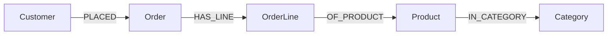

# Đánh giá mô hình bằng truy vấn mẫu, tính toàn vẹn và chi phí cập nhật

> **Chương:** Thiết kế mô hình
> **Phạm vi:** Neo4j property graph, Cypher, index/constraint và các quyết định thiết kế ảnh hưởng tới việc truy vấn, ghi dữ liệu và vận hành.

Một mô hình đồ thị trông trực quan chưa chắc đã là mô hình tốt. Trong Neo4j, cùng một nghiệp vụ có thể biểu diễn bằng node, relationship, thuộc tính trên relationship hoặc thuộc tính được sao chép sang node khác. Các cách biểu diễn này có thể đều đúng về mặt ý nghĩa, nhưng tạo ra đường truy vấn, khả năng kiểm soát dữ liệu và chi phí cập nhật rất khác nhau.

Cách đánh giá có thể kiểm chứng là đặt **mô hình trước ba phép thử đồng thời**:

1. **Truy vấn mẫu:** Các câu hỏi mà hệ thống thực sự cần trả lời có tìm được điểm bắt đầu chọn lọc, đi qua số relationship hợp lý và trả kết quả đúng không?
2. **Tính toàn vẹn:** Mô hình có biểu diễn và bảo vệ được danh tính, số lượng liên kết, quy tắc nghiệp vụ và dữ liệu lịch sử không?
3. **Chi phí cập nhật:** Mỗi sự kiện ghi phải thay đổi bao nhiêu node, relationship, index và dữ liệu dẫn xuất? Có làm phát sinh dữ liệu bất nhất hoặc điểm nghẽn ghi không?

Một phương án chỉ được coi là tốt khi đáp ứng được cả ba. Không có mô hình Neo4j tối ưu cho mọi workload; hãy đánh giá theo **những truy vấn và thao tác ghi cụ thể**, tần suất thực tế và các quy tắc nghiệp vụ bắt buộc.

## 1. Kết quả học tập và ngữ cảnh

Sau bài này, bạn có thể:

- Biến yêu cầu nghiệp vụ thành một bộ truy vấn Cypher đại diện, bao gồm tra cứu theo khóa, duyệt quan hệ, tổng hợp và truy vấn nhiều bước.
- Đọc kết quả `EXPLAIN` / `PROFILE` để tìm phần duyệt đồ thị, lọc, sắp xếp và tổng hợp tốn kém.
- Phân biệt ràng buộc mà Neo4j có thể khai báo bằng constraint với bất biến phải bảo vệ trong transaction và logic ứng dụng.
- Ước lượng *write amplification* khi thêm node trung gian, sao chép thuộc tính hoặc lưu trước kết quả tính toán.
- Thiết kế phép đo A/B công bằng giữa các phương án và ghi rõ sự đánh đổi khi lựa chọn mô hình.

Ví dụ xuyên suốt là hệ thống bán hàng: khách hàng đặt đơn, mỗi đơn có những dòng hàng, dòng hàng tham chiếu sản phẩm, sản phẩm thuộc danh mục. Đây là một property graph nhỏ nhưng đủ để bộc lộ những đánh đổi phổ biến trong mô hình hóa dữ liệu liên kết.

## 2. Xác định nghiệp vụ trước khi chọn hình dạng đồ thị

Các thực thể và quan hệ cần biểu diễn:

| Thành phần | Thuộc tính quan trọng | Ý nghĩa |
|---|---|---|
| `Customer` | `customerId`, `name` | Khách hàng có danh tính nghiệp vụ ổn định. |
| `Order` | `orderId`, `placedAt`, `status` | Đơn hàng cùng thời điểm đặt và trạng thái. |
| `OrderLine` | `lineId`, `quantity`, `unitPriceAtPurchase` | Một dòng hàng; lưu **đơn giá tại thời điểm giao dịch**. |
| `Product` | `productId`, `name`, `currentPrice` | Sản phẩm và giá bán hiện tại. |
| `Category` | `categoryId`, `name` | Nhóm sản phẩm. |

Các quy tắc giả định cho bài toán:

- Một `Order` thuộc đúng một `Customer`.
- Một `OrderLine` thuộc đúng một `Order` và tham chiếu đúng một `Product`.
- `quantity` phải lớn hơn 0, `unitPriceAtPurchase` không âm. Trong ví dụ, tiền được lưu bằng **số nguyên đơn vị tiền tệ**, tránh làm tròn kiểu số thực.
- Đơn đã hoàn tất phải có ít nhất một dòng hàng; đơn nháp có thể chưa có dòng nào.
- Trong ví dụ này, một sản phẩm chỉ xuất hiện trên tối đa một dòng của cùng đơn. Nếu nghiệp vụ cho phép nhiều dòng cùng sản phẩm (ví dụ chia khuyến mãi), phải sửa quy tắc kiểm tra tương ứng.
- Thay đổi `Product.currentPrice` không được làm thay đổi lịch sử giá trên `OrderLine`.

Các quy tắc này không phải đặc tính mặc định của Neo4j. Chúng là **bất biến nghiệp vụ** mà ta phải kiểm chứng ở từng mô hình.

### 2.1. Phương án A: lưu dòng hàng ngay trên relationship

`(:Customer)-[:PLACED]->(:Order)-[:CONTAINS {quantity, unitPriceAtPurchase}]->(:Product)`

Điểm mạnh: đọc sản phẩm trong đơn chỉ cần một bước từ đơn sang sản phẩm, số thực thể cần tạo khi thêm dòng hàng tương đối ít. Điểm yếu: dòng hàng không có node riêng để nhận thêm quan hệ hoặc quản lý vòng đời; kiểm soát danh tính từng dòng và các quy tắc liên kết có thể phức tạp hơn.

### 2.2. Phương án B: dòng hàng là node có danh tính riêng

`(:Customer)-[:PLACED]->(:Order)-[:HAS_LINE]->(:OrderLine)-[:OF_PRODUCT]->(:Product)`

`(:Product)-[:IN_CATEGORY]->(:Category)`



Điểm mạnh: `OrderLine` có thể mang khóa `lineId` duy nhất, thông tin điều chỉnh, khuyến mãi hoặc trạng thái hoàn trả; có thể viết constraint cho danh tính node. Điểm yếu: một dòng hàng yêu cầu thêm node và hai relationship, đồng thời truy vấn đơn hàng phải đi qua thêm một bước.

**Lựa chọn ban đầu để minh họa:** phương án B. Đây là giả thuyết thiết kế, không phải kết luận. Phải đo với workload ở phần tiếp theo để biết chi phí của node trung gian có chấp nhận được không.

## 3. Biến yêu cầu thành bộ truy vấn và thao tác ghi đại diện

Đừng chỉ kiểm tra một truy vấn `MATCH` chạy được trên vài bản ghi mẫu. Trước hết, hãy mô tả workload theo hành vi người dùng và luồng xử lý thực tế.

| Mã | Tình huống | Đường truy cập đáng chú ý | Tiêu chí cần đo |
|---|---|---|---|
| Q1 | Liệt kê 20 đơn mới nhất của một khách hàng | `Customer → Order`, sắp xếp theo thời gian | p95, số đơn phải quét trước `LIMIT` |
| Q2 | Xem chi tiết đơn và các sản phẩm | `Order → OrderLine → Product` | p95, số lần mở rộng relationship, đúng cả khi đơn nháp rỗng |
| Q3 | Sản phẩm bán chạy trong khoảng thời gian | Lọc `Order` theo trạng thái/ngày rồi tổng hợp `OrderLine` | p95, số dòng đầu vào tổng hợp, bộ nhớ |
| Q4 | Sản phẩm thường được mua cùng sản phẩm X | `Product ← OrderLine ← Order → OrderLine → Product` | Số đường đi trung gian, độ lệch do sản phẩm cực phổ biến |
| Q5 | Tính tổng tiền lịch sử của đơn | `Order → OrderLine` | Tính đúng của giá chốt đơn, chi phí cộng dồn |
| W1 | Thêm dòng hàng vào đơn nháp | Tạo node và liên kết, cập nhật index | Latency ghi, số thực thể tạo, xung đột concurrent |
| W2 | Thay đổi giá hiện tại của sản phẩm | Ghi `Product` | Có làm sai giá đơn cũ hoặc buộc cập nhật hàng loạt không? |
| W3 | Chuyển đơn sang `COMPLETED` | Đổi trạng thái với kiểm tra dòng hàng | Đảm bảo bất biến, tranh chấp ghi |
| W4 | Đổi danh mục sản phẩm | Sửa `IN_CATEGORY` | Số relationship phải đổi và dữ liệu sao chép cần đồng bộ |

Tần suất cũng quan trọng. Ví dụ, nếu Q1 chạy hàng trăm lần mỗi giây còn Q3 chỉ chạy vài lần mỗi giờ trong job báo cáo, mô hình nên ưu tiên Q1 dù Q3 cần thêm một bước tổng hợp. Khi chưa có số liệu thật, ghi rõ **giả định** rồi thay bằng log/APM từ Java Driver, Spring Data Neo4j hoặc dịch vụ gọi Cypher sau khi hệ thống hoạt động.

Phân tách thêm hai trường hợp đầu vào: khách hàng thông thường có vài đơn và khách hàng có hàng trăm nghìn đơn; sản phẩm thông thường và sản phẩm cực kỳ phổ biến. Bậc kết nối (*node degree*) chênh lệch lớn thường làm kết quả thử nghiệm trên dữ liệu nhỏ trở nên đánh lừa.

## 4. Dựng dữ liệu và hàng rào toàn vẹn tối thiểu

### 4.1. Khóa duy nhất và index

Với cú pháp Cypher của Neo4j 5.x và các bản mới có hỗ trợ cú pháp tương ứng, có thể khai báo:

```cypher
CREATE CONSTRAINT customer_id_unique IF NOT EXISTS
FOR (c:Customer) REQUIRE c.customerId IS UNIQUE;

CREATE CONSTRAINT order_id_unique IF NOT EXISTS
FOR (o:Order) REQUIRE o.orderId IS UNIQUE;

CREATE CONSTRAINT line_id_unique IF NOT EXISTS
FOR (l:OrderLine) REQUIRE l.lineId IS UNIQUE;

CREATE CONSTRAINT product_id_unique IF NOT EXISTS
FOR (p:Product) REQUIRE p.productId IS UNIQUE;

CREATE CONSTRAINT category_id_unique IF NOT EXISTS
FOR (cat:Category) REQUIRE cat.categoryId IS UNIQUE;

CREATE INDEX order_status_date IF NOT EXISTS
FOR (o:Order) ON (o.status, o.placedAt);
```

Các constraint `IS UNIQUE` hỗ trợ tra cứu theo khóa và ngăn **hai node có cùng giá trị khóa đã khai báo**. Tuy nhiên, uniqueness **không buộc mọi node phải có thuộc tính khóa**. Các loại existence/key constraint phụ thuộc phiên bản và edition; khi dùng chúng cần kiểm tra tính năng thực tế của môi trường. Đặc biệt, uniqueness của `OrderLine.lineId` không tự đảm bảo rằng dòng hàng có đúng một đơn, đúng một sản phẩm hoặc có `quantity > 0`.

Index kép `(status, placedAt)` được đặt theo Q3: lọc trạng thái bằng phép bằng và giới hạn thời gian bằng khoảng. Không có đảm bảo rằng Cypher planner sẽ dùng index cho mọi truy vấn; hãy đọc kế hoạch thực tế. Cũng không nên thêm index cho mọi thuộc tính vì index tiêu tốn bộ nhớ/đĩa và tạo thêm chi phí khi ghi.

### 4.2. Bộ dữ liệu nhỏ để chạy thử cú pháp

Ví dụ tạo một khách hàng, một đơn đã hoàn tất, một sản phẩm và một dòng hàng. Mỗi lệnh `MERGE` có thể gặp đối tượng đã tồn tại; `ON CREATE SET` giữ nguyên giá lịch sử đã ghi trước đó.

```cypher
MERGE (c:Customer {customerId: 'C001'})
  ON CREATE SET c.name = 'Lan'
MERGE (o:Order {orderId: 'O001'})
  ON CREATE SET o.placedAt = datetime('2026-11-01T09:00:00Z'),
                o.status = 'COMPLETED'
MERGE (p:Product {productId: 'P001'})
  ON CREATE SET p.name = 'Ban phim',
                p.currentPrice = 800000
MERGE (cat:Category {categoryId: 'CAT01'})
  ON CREATE SET cat.name = 'Phu kien'
MERGE (l:OrderLine {lineId: 'L001'})
  ON CREATE SET l.quantity = 2,
                l.unitPriceAtPurchase = 750000
MERGE (c)-[:PLACED]->(o)
MERGE (o)-[:HAS_LINE]->(l)
MERGE (l)-[:OF_PRODUCT]->(p)
MERGE (p)-[:IN_CATEGORY]->(cat);
```

Dữ liệu này đủ thử Q1, Q2, Q5 và việc tính tổng là **1.500.000** đơn vị tiền tệ. Nó **không đủ** để kết luận hiệu năng. Trước khi so sánh A/B, cần nạp dữ liệu phản ánh đúng kích thước, mật độ liên kết, phân bố thời gian và sản phẩm bán chạy.

## 5. Đọc mô hình qua truy vấn mẫu

Các biến như `$customerId`, `$orderId`, `$productId`, `$from`, `$to` và `$limit` là **tham số** do ứng dụng truyền vào; không nối trực tiếp dữ liệu người dùng vào chuỗi Cypher. Trong ví dụ thời gian, `$from` và `$to` là chuỗi ISO 8601 hợp lệ, sau đó được đổi sang `datetime`.

### Q1 — Lịch sử đơn hàng theo khách hàng

```cypher
MATCH (c:Customer {customerId: $customerId})-[:PLACED]->(o:Order)
RETURN o.orderId AS orderId,
       o.placedAt AS placedAt,
       o.status AS status
ORDER BY placedAt DESC
LIMIT $limit;
```

**Điểm cần quan sát:**

- Constraint khóa khách hàng có giúp planner tìm đúng một node `Customer` hay không?
- Nếu khách hàng có 500.000 đơn, việc đi từ khách hàng tới tất cả đơn và sắp xếp trước khi lấy 20 đơn có trở thành điểm nghẽn không?
- Có cần lọc trạng thái trước khi sắp xếp không? Có cần phân trang nhất quán theo `placedAt` và `orderId` không?

Nếu Q1 là đường đọc nóng và mỗi khách hàng có nhiều đơn, một giả thuyết tối ưu là lưu thêm `Order.customerId` cùng composite index `(customerId, placedAt)`:

```cypher
CREATE INDEX order_customer_date IF NOT EXISTS
FOR (o:Order) ON (o.customerId, o.placedAt);

MATCH (o:Order {customerId: $customerId})
RETURN o.orderId AS orderId, o.placedAt AS placedAt
ORDER BY placedAt DESC
LIMIT $limit;
```

Khi đó có cơ hội tìm các đơn theo khoảng khóa chỉ mục mà không cần duyệt toàn bộ cạnh `PLACED` của khách hàng. **Đổi lại**, `customerId` bị sao chép: việc tạo/chuyển chủ sở hữu đơn phải cập nhật nhất quán cả thuộc tính lẫn relationship. Đánh giá tính toán sau khi xác nhận index được dùng và truy vấn thực sự nhanh hơn.

### Q2 — Chi tiết đơn hàng, kể cả dữ liệu thiếu liên kết

```cypher
MATCH (o:Order {orderId: $orderId})
OPTIONAL MATCH (o)-[:HAS_LINE]->(l:OrderLine)
OPTIONAL MATCH (l)-[:OF_PRODUCT]->(p:Product)
RETURN o.orderId AS orderId,
       l.lineId AS lineId,
       p.productId AS productId,
       l.quantity AS quantity,
       l.unitPriceAtPurchase AS unitPriceAtPurchase
ORDER BY lineId;
```

Truy vấn bắt đầu từ `orderId` duy nhất rồi duyệt hai relationship. Dùng hai `OPTIONAL MATCH` riêng để vẫn nhìn thấy dòng hàng không có `OF_PRODUCT` (khi đó `productId` là `null`), rất hữu ích cho việc kiểm tra dữ liệu. Nếu dùng một `MATCH` bắt buộc cho cả đường đi, các dòng hàng lỗi có thể bị loại khỏi kết quả mà không có cảnh báo.

Đối với phương án A, từ `Order` chỉ cần đi một cạnh `CONTAINS` để đọc số lượng và đơn giá. Vì vậy Q2 thường có ít bước duyệt hơn trong A; tuy nhiên **số bước duyệt không đồng nghĩa trực tiếp với thời gian chạy**. Chi phí thực còn phụ thuộc số dòng hàng, index, cache, bản ghi tải lên và cách client xử lý kết quả.

### Q3 — Tổng hợp sản phẩm bán chạy

```cypher
MATCH (o:Order)
WHERE o.status = 'COMPLETED'
  AND o.placedAt >= datetime($from)
  AND o.placedAt < datetime($to)
MATCH (o)-[:HAS_LINE]->(l:OrderLine)-[:OF_PRODUCT]->(p:Product)
RETURN p.productId AS productId,
       sum(l.quantity) AS unitsSold
ORDER BY unitsSold DESC
LIMIT $limit;
```

Truy vấn có ba khoản chi phí chính: tìm tập đơn theo thời gian, mở rộng dòng hàng, và tổng hợp/sắp xếp. Index `(status, placedAt)` có thể giúp bước đầu; nó không loại bỏ khối lượng duyệt nếu khoảng thời gian bao phủ hàng triệu đơn.

Khi Q3 chạy thường xuyên trên khoảng thời gian lớn, có thể cân nhắc báo cáo bất đồng bộ hoặc một bảng/nút tổng hợp theo ngày. Nhưng đây là **dữ liệu dẫn xuất**: mỗi đơn hoàn tất, hủy hoặc hoàn trả sẽ cần quy tắc cộng/trừ và cơ chế đối soát. Hãy chứng minh nhu cầu bằng số đo trước khi thêm cấu trúc này.

### Q4 — Các sản phẩm thường xuất hiện trong cùng một đơn

```cypher
MATCH (p:Product {productId: $productId})
      <-[:OF_PRODUCT]-(seed:OrderLine)
      <-[:HAS_LINE]-(o:Order)
WHERE o.status = 'COMPLETED'
  AND o.placedAt >= datetime($from)
WITH DISTINCT p, o
MATCH (o)-[:HAS_LINE]->(:OrderLine)-[:OF_PRODUCT]->(other:Product)
WHERE other <> p
RETURN other.productId AS productId,
       count(DISTINCT o) AS coOrderCount
ORDER BY coOrderCount DESC
LIMIT $limit;
```

`DISTINCT` giúp không đếm lặp cùng một đơn nếu có nhiều đường dẫn tới nó. Truy vấn cũng minh họa điểm yếu của việc bắt đầu từ một sản phẩm cực phổ biến: số lượng `OrderLine` và `Order` trung gian có thể rất lớn trước khi lọc ngày. Khi đo, hãy thử cả sản phẩm phổ thông lẫn *hot product*; xem số hàng trung gian ở từng operator.

Nếu tính gợi ý cùng mua là chức năng nóng, một cạnh tổng hợp như `(:Product)-[:BOUGHT_TOGETHER {count, window}]->(:Product)` có thể rút ngắn đường đọc. Nhưng mỗi đơn mới làm phát sinh nhiều cặp sản phẩm cần cập nhật; với đơn có `k` sản phẩm khác nhau, số cặp không có thứ tự là `k × (k − 1) / 2`. Dữ liệu tổng hợp còn phải xử lý hủy đơn, hoàn hàng và thời gian hiệu lực. Đó là một đánh đổi đọc/ghi cần đo riêng.

### Q5 — Tính tổng tiền theo giá đã mua

```cypher
MATCH (o:Order {orderId: $orderId})
OPTIONAL MATCH (o)-[:HAS_LINE]->(l:OrderLine)
RETURN o.orderId AS orderId,
       sum(coalesce(l.quantity * l.unitPriceAtPurchase, 0)) AS totalAmount;
```

Phải dùng `unitPriceAtPurchase`, không dùng `Product.currentPrice`. Một đơn nháp chưa có dòng hàng có tổng bằng 0. Nếu lưu sẵn `o.totalAmount` để tăng tốc đọc, hãy quy định transaction nào cập nhật tổng, xử lý hoàn trả và đối soát cách tính lại từ dòng hàng. Nếu ứng dụng cho phép nhiều loại tiền, cần lưu và kiểm tra `currency`; không cộng số tiền của hai đơn vị tiền tệ như thể cùng một đơn vị.

### 5.1. Phân biệt kế hoạch và việc thực thi

Dùng `EXPLAIN` để xem kế hoạch ước tính **mà không chạy truy vấn**, và `PROFILE` để chạy truy vấn rồi xem thống kê thực tế:

```cypher
EXPLAIN
MATCH (o:Order {orderId: $orderId})-[:HAS_LINE]->(l:OrderLine)
RETURN l.lineId;

PROFILE
MATCH (o:Order {orderId: $orderId})-[:HAS_LINE]->(l:OrderLine)
RETURN l.lineId;
```

Những dấu hiệu nên đọc:

| Chỉ báo/kế hoạch | Câu hỏi cần trả lời |
|---|---|
| `NodeUniqueIndexSeek` / `NodeIndexSeek` | Truy vấn có bắt đầu từ thuộc tính có độ chọn lọc tốt không? |
| `NodeByLabelScan` / `AllNodesScan` | Có đang phải duyệt một tập node lớn mà lẽ ra có thể lọc sớm? |
| `Expand` và số `Rows` | Mỗi node đầu vào mở rộng thành bao nhiêu hàng? Có supernode không? |
| `Sort` / `Top` / `Aggregation` | Có xử lý lượng lớn bản ghi trước `LIMIT` hoặc trước khi nhóm không? |
| `CartesianProduct` | Các mẫu `MATCH` có vô tình không được nối với nhau, làm nhân số hàng? |
| `DB Hits`, page cache, bộ nhớ, thời gian | Số lần truy cập dữ liệu và áp lực tài nguyên thay đổi thế nào khi tăng quy mô? |

Tên operator và thống kê hiển thị có thể khác theo phiên bản Neo4j và runtime. **`DB Hits` không phải thời gian tính bằng mili giây**, và thời gian một lần chạy không đại diện cho p95. `PROFILE` **thực sự thực thi câu lệnh**; đừng dùng nó cho truy vấn ghi trên dữ liệu sản xuất chỉ để quan sát kế hoạch.

## 6. Kiểm chứng tính toàn vẹn bằng các truy vấn chủ động

Constraint khóa duy nhất chỉ giải quyết một phần. Với property graph, mối liên kết tồn tại hợp lệ về mặt kỹ thuật nhưng vẫn có thể sai quy tắc kinh doanh. Hãy coi các truy vấn kiểm tra dưới đây như *đặc tả có thể thực thi* và chạy trên dữ liệu thử, sau migration và trong job đối soát khi cần.

### 6.1. Mỗi đơn có đúng một khách hàng

```cypher
MATCH (o:Order)
OPTIONAL MATCH (c:Customer)-[:PLACED]->(o)
WITH o, count(c) AS customerLinks
WHERE customerLinks <> 1
RETURN o.orderId AS orderId, customerLinks;
```

Nếu kết quả khác rỗng, có đơn không có khách hoặc có nhiều cạnh `PLACED` dẫn tới đơn. `count(c)` đếm cả các cạnh trùng lặp, phù hợp khi yêu cầu chính xác **một relationship**.

### 6.2. Mỗi dòng hàng có đúng một đơn, một sản phẩm và số liệu hợp lệ

```cypher
MATCH (l:OrderLine)
OPTIONAL MATCH (o:Order)-[:HAS_LINE]->(l)
WITH l, count(o) AS orderLinks
OPTIONAL MATCH (l)-[:OF_PRODUCT]->(p:Product)
WITH l, orderLinks, count(p) AS productLinks
WHERE orderLinks <> 1
   OR productLinks <> 1
   OR l.quantity IS NULL
   OR l.quantity <= 0
   OR l.unitPriceAtPurchase IS NULL
   OR l.unitPriceAtPurchase < 0
RETURN l.lineId AS lineId,
       orderLinks,
       productLinks,
       l.quantity AS quantity,
       l.unitPriceAtPurchase AS unitPriceAtPurchase;
```

Dùng hai đoạn `OPTIONAL MATCH` và hai lần tổng hợp để không nhân chéo số cạnh khi một dòng hàng vừa có nhiều đơn vừa có nhiều sản phẩm. Nếu yêu cầu sản phẩm trong một đơn là duy nhất, kiểm tra thêm:

```cypher
MATCH (o:Order)-[:HAS_LINE]->(l:OrderLine)-[:OF_PRODUCT]->(p:Product)
WITH o, p, count(DISTINCT l) AS numberOfLines
WHERE numberOfLines > 1
RETURN o.orderId AS orderId,
       p.productId AS productId,
       numberOfLines;
```

Quy tắc này là **lựa chọn nghiệp vụ**. Không bật nó một cách máy móc cho hệ thống cho phép cùng sản phẩm ở nhiều dòng với điều kiện khác nhau.

### 6.3. Đơn hoàn tất phải có dòng hàng

```cypher
MATCH (o:Order)
WHERE o.status = 'COMPLETED'
  AND NOT EXISTS {
    MATCH (o)-[:HAS_LINE]->(:OrderLine)
  }
RETURN o.orderId AS invalidCompletedOrder;
```

Có thể mở rộng theo trạng thái: đơn đã hủy có được chứa dòng hàng hay không; tổng giá trị âm có hợp lệ khi hoàn tiền không; một `OrderLine` đã hoàn trả một phần có trường `returnedQuantity` như thế nào. Đưa các quyết định đó vào đặc tả nghiệp vụ trước khi tự động sửa dữ liệu.

### 6.4. Kiểm tra dữ liệu sao chép

Nếu tối ưu Q1 bằng `Order.customerId`, cần phát hiện khác biệt giữa thuộc tính và cạnh:

```cypher
MATCH (c:Customer)-[:PLACED]->(o:Order)
WHERE o.customerId IS NULL OR o.customerId <> c.customerId
RETURN o.orderId AS orderId,
       c.customerId AS linkedCustomer,
       o.customerId AS copiedCustomer;
```

Kiểm tra này chỉ phát hiện đơn **đã có** một cạnh `PLACED`; phải kết hợp với kiểm tra 6.1 để bắt đơn mất cạnh. Đây là lý do mỗi tối ưu bằng sao chép dữ liệu cần kèm quy tắc ghi và truy vấn đối soát rõ ràng.

### 6.5. Constraint, transaction và ứng dụng chia trách nhiệm thế nào?

| Loại quy tắc | Cơ chế bảo vệ thích hợp |
|---|---|
| `customerId`, `orderId`, `lineId` không bị trùng | Neo4j uniqueness constraint; kiểm tra tính hiện diện riêng khi cần. |
| Mỗi dòng có đúng một đơn và một sản phẩm | Logic tạo/sửa trong transaction, kiểm tra kết quả, job đối soát; constraint khóa đơn lẻ không bảo vệ cardinality này. |
| `quantity > 0`, giá không âm, trạng thái chuyển hợp lệ | Validate ở biên ứng dụng và trong đường ghi; kiểm tra lại dữ liệu bằng Cypher. |
| Đơn đã hoàn tất có ít nhất một dòng | Transaction hoàn tất đơn phải kiểm tra điều kiện; đánh giá race condition khi nhiều request ghi đồng thời. |
| Giá đơn cũ không đổi khi thay giá sản phẩm | Lưu snapshot trên dòng hàng; không cập nhật hàng loạt snapshot khi `currentPrice` đổi. |
| Thuộc tính sao chép khớp quan hệ gốc | Ghi cùng transaction khi cần tính nhất quán mạnh; đối soát định kỳ hoặc chấp nhận nhất quán cuối cùng theo hợp đồng rõ ràng. |

Một relationship Neo4j luôn có hai node đầu mút hợp lệ; tuy nhiên điều đó **không** đảm bảo đúng nhãn, đúng chiều, đúng số lượng hay đúng vai trò nghiệp vụ. Cũng không nên kỳ vọng câu `MERGE` tự nó bảo vệ tất cả trường hợp cập nhật đồng thời. Uniqueness constraint bảo vệ danh tính node; các thao tác nhiều bước cần transaction và chiến lược xử lý race/retry tương ứng.

## 7. Đo chi phí cập nhật thay vì chỉ tối ưu đường đọc

Khi thêm một dòng hàng vào đơn có sẵn:

| Thao tác | A — `CONTAINS` có thuộc tính | B — `OrderLine` có danh tính |
|---|---|---|
| Tạo thành phần | Thông thường 1 relationship `CONTAINS` | 1 node `OrderLine` và 2 relationship |
| Ghi dữ liệu số lượng/đơn giá | Thuộc tính relationship | Thuộc tính node |
| Bảo vệ danh tính dòng hàng | Cần xem khả năng constraint trên relationship và yêu cầu nghiệp vụ thực tế | Uniqueness constraint trên `lineId` |
| Thêm liên hệ tới khuyến mãi/hoàn trả ở cấp dòng | Có thể khó hoặc cần đổi mô hình | Có thể mở rộng từ node `OrderLine` |
| Lấy sản phẩm của một đơn | 1 bước relationship | 2 bước relationship |
| Đổi `Product.currentPrice` | Không cần sửa snapshot lịch sử | Không cần sửa snapshot lịch sử |

Bảng trên phản ánh **số thay đổi logic**, không phải số I/O hay latency đo được. Mỗi node/relationship còn có chi phí lưu trữ, log, khóa, index và đồng bộ transaction. Vì vậy có thể dùng một thước đo sơ bộ:

`WriteCost(W) ≈ nodeWrites + relationshipWrites + indexUpdates + derivedDataUpdates`

Các hạng tử không có trọng số bằng nhau; công thức này chỉ để **liệt kê nguồn chi phí**, không phải phép tính thời gian thực thi. Khi đo thật, dùng số transaction/giây, p95 latency ghi, CPU, bộ nhớ, page cache, số deadlock/retry, log và dung lượng index.

### 7.1. Ví dụ một thao tác ghi nguyên tử

Sau khi xác nhận đơn, sản phẩm, số lượng và quyền thao tác, ứng dụng có thể tạo dòng hàng bằng một câu Cypher trong transaction:

```cypher
MATCH (o:Order {orderId: $orderId})
MATCH (p:Product {productId: $productId})
WHERE o.status = 'DRAFT'
  AND $quantity > 0
  AND $unitPriceAtPurchase >= 0
CREATE (l:OrderLine {
  lineId: $lineId,
  quantity: $quantity,
  unitPriceAtPurchase: $unitPriceAtPurchase
})
CREATE (o)-[:HAS_LINE]->(l)
CREATE (l)-[:OF_PRODUCT]->(p)
RETURN l.lineId AS lineId;
```

Câu này tạo node và hai relationship như một đơn vị ghi. Nếu khóa `lineId` bị trùng, uniqueness constraint chặn việc tạo trùng. Nếu không tìm được đơn/sản phẩm hoặc điều kiện `DRAFT` không khớp, câu lệnh không trả dòng nào; caller **phải kiểm tra** số kết quả. Khi chạy nhiều request cạnh tranh, cần thiết kế cơ chế khóa/trạng thái hoặc optimistic concurrency phù hợp, đồng thời kiểm tra hành vi khi retry. `CREATE` với `lineId` cố định không tự tạo idempotency: gọi lại cùng yêu cầu sẽ va constraint, nên ứng dụng phải nhận biết yêu cầu đã hoàn tất hay xử lý khóa idempotency riêng.

Trong Java Driver, nên thực hiện toàn bộ luồng cập nhật liên quan ở cùng một write transaction. Với Spring Data Neo4j, cần kiểm tra ranh giới `@Transactional` của service và các Cypher tùy biến thực tế. Quan trọng là **mọi cập nhật cùng một bất biến** nằm trong một transaction có xử lý lỗi rõ ràng.

### 7.2. Ba bẫy của việc lưu trước dữ liệu để tăng tốc đọc

**Lưu tổng đơn trên `Order`:** Q5 đọc nhanh hơn nhưng thêm/sửa/xóa dòng, giảm giá, hủy đơn hoặc hoàn tiền đều phải cập nhật tổng. Nếu bỏ sót một nhánh ghi, dữ liệu sai âm thầm. Cần giao thức cập nhật và job đối soát `sum(quantity × unitPriceAtPurchase)`.

**Sao chép danh mục lên hàng triệu `OrderLine`:** Truy vấn báo cáo lịch sử có thể bớt một bước tới `Product`, nhưng đổi danh mục gây fan-out ghi rất lớn. Hơn nữa phải phân biệt “danh mục ở thời điểm bán” (snapshot lịch sử được giữ nguyên) với “danh mục hiện tại” (phải đồng bộ theo sản phẩm). Hai ý nghĩa này dẫn tới hai quy tắc cập nhật khác nhau.

**Lưu kết quả mua cùng lên cạnh `BOUGHT_TOGETHER`:** Đọc gợi ý nhanh hơn, song một đơn có nhiều sản phẩm tạo nhiều cặp cần cộng/trừ khi đơn hoàn tất, hủy hoặc hoàn. Có thể cập nhật bất đồng bộ, nhưng khi đó sản phẩm gợi ý cần chấp nhận độ trễ và có cơ chế tái tính.

Trước mỗi quyết định denormalization, hãy trả lời: **Ai là nguồn dữ liệu chuẩn? Những sự kiện nào làm dữ liệu sao chép thay đổi? Cần đồng bộ tức thì hay có thể trễ? Có câu truy vấn đối soát và quy trình sửa lỗi không?**

## 8. Phương pháp benchmark hai mô hình A và B

Không so sánh chỉ bằng ảnh chụp một câu `PROFILE` trên 10 node. Một bài thử tốt phải đảm bảo **tính tương đương về ý nghĩa kết quả** và phản ánh tải sử dụng.

### Bước 1 — Chốt đúng đắn trước hiệu năng

Tạo cùng dữ liệu nghiệp vụ trong A và B. Kiểm tra rằng Q1–Q5 cho cùng đơn, cùng sản phẩm, cùng số lượng, cùng tổng lịch sử. Chạy các kiểm tra toàn vẹn ở phần 6. Mô hình sai kết quả bị loại dù nhanh đến đâu.

### Bước 2 — Chọn dữ liệu có độ lớn và độ lệch phù hợp

Ví dụ dữ liệu tạo tải *giả định*: 500.000 khách hàng, 5 triệu đơn, 15 triệu dòng hàng, một số khách có số đơn rất lớn và một vài sản phẩm chiếm phần đáng kể doanh số. Những con số này chỉ minh họa cách thiết kế benchmark, **không phải số liệu hiệu năng của Neo4j**. Đưa thêm trường hợp đơn chưa có dòng, nhiều dòng, khách không có đơn, sản phẩm ít người mua, và dữ liệu sát ranh giới thời gian.

### Bước 3 — Đo đọc và ghi trên cùng điều kiện

Giữ cố định phiên bản Neo4j, cấu hình, bộ nhớ, phần cứng, dataset, index phù hợp, mức concurrency và truy vấn tương đương về kết quả. Chạy khởi động trước khi đo tải ổn định; nếu cần phân tích cold cache, đo thành một kịch bản riêng. Lặp đủ nhiều để lấy phân bố thay vì một số duy nhất.

Đo tối thiểu:

- **Đọc:** p50/p95/p99 latency, throughput, `Rows` và `DB Hits` theo operator, số hàng trung gian, page-cache misses và bộ nhớ.
- **Ghi:** p95 latency, transaction/giây, tỷ lệ retry/xung đột, tăng trưởng dung lượng node/relationship/index và thời gian thực hiện thao tác bảo trì.
- **Đúng đắn:** số vi phạm bất biến sau ghi đồng thời, sau migration và sau xử lý hủy/hoàn trả.
- **Vận hành:** thời gian rebuild/đối soát dữ liệu dẫn xuất, khả năng quan sát lỗi và chi phí mở rộng schema.

Ví dụ bảng ghi kết quả thật (để trống cho tới khi chạy):

| Chỉ số | A | B | Ngưỡng chấp nhận / nhận xét |
|---|---:|---:|---|
| Q2 p95 latency | Chưa đo | Chưa đo | Theo SLO chi tiết đơn |
| Q4 p95 với sản phẩm phổ biến | Chưa đo | Chưa đo | Phải thử phân bố đuôi |
| W1 p95 latency | Chưa đo | Chưa đo | Theo SLO thêm dòng |
| Throughput ghi ở concurrency mục tiêu | Chưa đo | Chưa đo | Không lỗi bất biến |
| Vi phạm cardinality sau thử cạnh tranh | Chưa đo | Chưa đo | **0** |
| Dung lượng dữ liệu và index | Chưa đo | Chưa đo | Trong ngân sách vận hành |

Đừng điền số “ước lượng” vào cột kết quả thực nghiệm. Nếu muốn đặt SLO mẫu trước khi chạy, có thể giả định Q1 p95 không quá 120 ms, Q2 p95 không quá 150 ms, W1 p95 không quá 100 ms trong môi trường kiểm thử được định nghĩa rõ; các ngưỡng đó phải điều chỉnh theo sản phẩm thực tế.

### Bước 4 — Chọn mô hình bằng điều kiện loại trừ và trọng số

Thứ tự quyết định hợp lý:

1. Loại mọi phương án không thỏa bất biến hoặc không có đường bảo vệ tính nhất quán đáng tin cậy.
2. Loại mọi phương án không đạt SLO bắt buộc ở p95/p99 hoặc tải ghi mục tiêu.
3. Trong các phương án còn lại, cân nhắc tần suất truy vấn/ghi, độ phức tạp ứng dụng, dung lượng, chi phí migration và tốc độ thay đổi nghiệp vụ.

Có thể biểu diễn chi phí tổng quát bằng:

`TotalCost = Σ [readFrequencyᵢ × normalizedReadCostᵢ] + Σ [writeFrequencyⱼ × normalizedWriteCostⱼ] + maintenanceCost`

Đây là cách tổ chức quyết định, không phải phương trình trực tiếp cho thời gian. **Chỉ cộng những đại lượng đã chuẩn hóa và có đơn vị/trọng số nhất quán**; không cộng thẳng `DB Hits` với mili giây hoặc số byte.

### Bước 5 — Ghi quyết định và điều kiện xem xét lại

Ví dụ bản ghi quyết định:

> Chọn B (`OrderLine` là node) khi danh tính dòng hàng, hoàn trả ở cấp dòng và mở rộng nghiệp vụ quan trọng; Q2/W1 vẫn đạt SLO sau benchmark. Chỉ thêm `Order.customerId` cùng index khi Q1 trên khách có bậc liên kết lớn thực sự bị giới hạn bởi sắp xếp; khi thêm phải cập nhật atomically và triển khai đối soát. Nếu chức năng đặt hàng đơn giản, dòng không có danh tính riêng và đo đạc cho thấy overhead của B đáng kể, cân nhắc A.

Đặt **điều kiện xem xét lại** như “Q1 p95 vượt SLO ở nhóm khách có trên 10.000 đơn” hoặc “W1 throughput không đạt tải mục tiêu”. Quyết định mô hình nên được thay đổi dựa trên số đo và thay đổi nghiệp vụ, không chỉ dựa vào sở thích thiết kế.

## 9. Những lỗi thường gặp khi đánh giá graph model

| Lỗi | Hậu quả | Cách sửa |
|---|---|---|
| Vẽ đồ thị đẹp nhưng chưa xác định truy vấn | Đường truy vấn nóng phải duyệt nhiều node/cạnh | Bắt đầu từ bộ Q/W có tần suất và dữ liệu đầu vào |
| Thử trên vài chục node có bậc liên kết đều nhau | Không phát hiện supernode, lệch dữ liệu và chi phí sắp xếp | Tạo tập kiểm thử có độ lớn và phân bố gần thực tế |
| Chỉ nhìn số hop | Bỏ qua độ chọn lọc, số hàng trung gian, sort/aggregate và cache | Đọc `PROFILE` và đo latency thực dưới tải |
| Nhầm uniqueness với cardinality/required property | Dòng hàng thiếu đơn hoặc có hai sản phẩm vẫn có thể tồn tại | Kết hợp constraint, transaction và query kiểm tra |
| Dùng giá hiện tại để tính đơn quá khứ | Báo cáo lịch sử đổi khi giá sản phẩm đổi | Dùng snapshot `unitPriceAtPurchase` |
| Sao chép thuộc tính để tăng tốc đọc mà không định nghĩa luồng ghi | Dữ liệu giữa node/cạnh lệch nhau | Xác định nguồn chuẩn, transaction và đối soát |
| Mở rộng đường đi không có điểm bắt đầu chọn lọc | Bùng nổ số đường đi và bộ nhớ | Neo truy vấn vào key/index, giới hạn miền và kiểm tra hàng trung gian |
| So một câu đọc rồi chọn mô hình | Ghi bị chậm, migration khó, invariant khó bảo vệ | Đo cả đọc, ghi, đúng đắn và chi phí vận hành |

## 10. Bài thực hành ngắn: đưa ra quyết định có căn cứ

Giả sử hệ thống có hai yêu cầu mới:

- Mỗi đơn có nhiều dòng hàng và mỗi dòng có thể được hoàn trả một phần, theo dõi lịch sử xử lý riêng.
- Màn hình khách hàng hiển thị 20 đơn gần nhất với p95 thấp, kể cả khách hàng có 100.000 đơn.

Hãy xây dựng **hai giả thuyết có thể kiểm chứng**:

**Giả thuyết 1:** chọn B vì `OrderLine` có danh tính và trạng thái riêng, phù hợp luồng hoàn trả. Viết thêm bất biến `0 ≤ returnedQuantity ≤ quantity` và cách kiểm tra bằng Cypher. Đo chi phí W1 và thao tác hoàn trả, không chỉ Q2.

**Giả thuyết 2:** giữ `PLACED` để biểu diễn quan hệ sở hữu, đồng thời thêm `Order.customerId` và index `(customerId, placedAt)` chỉ nếu Q1 trên khách có nhiều đơn không đạt SLO. So sánh kế hoạch và p95 của truy vấn bắt đầu từ khách với truy vấn tìm thẳng `Order` qua index; thiết kế check ở phần 6.4 để phát hiện sai lệch.

Kết quả thực hành tốt phải có: truy vấn tương đương cho A/B, các bất biến bắt buộc, cấu hình và phân bố dữ liệu thử, phép đo ghi/đọc, bảng kết quả **đo thật**, quyết định lựa chọn và điều kiện xem xét lại.

---

### Ghi nhớ

Đánh giá một property graph bằng Neo4j là bài toán **đúng nghĩa dữ liệu + đúng truy vấn + chấp nhận được chi phí biến đổi**. `EXPLAIN` và `PROFILE` giúp hiểu đường thực thi; constraint và transaction bảo vệ các quy tắc trong khả năng của chúng; còn workload đo dưới tải mới xác nhận một phương án nhanh và vận hành ổn. Mỗi bước tối ưu bằng node trung gian, relationship bổ sung hay dữ liệu sao chép đều cần được cân lại trên cả ba trục ấy.
