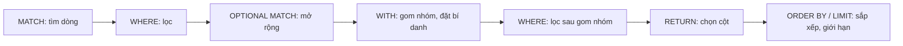

# Cấu trúc câu truy vấn Cypher và cách các mệnh đề phối hợp

> **Chương:** Nền tảng Cypher  
> **Phạm vi:** Truy vấn đồ thị thuộc tính (*property graph*) trong Neo4j bằng Cypher. Bài này tập trung vào cách tổ chức một câu truy vấn và cách kết quả của mệnh đề trước trở thành đầu vào cho mệnh đề sau.

## 1. Mục tiêu học tập

Sau bài học, bạn có thể:

- Đọc được một mẫu đồ thị gồm node, label, relationship, hướng quan hệ và thuộc tính.
- Phân biệt vai trò của các mệnh đề `MATCH`, `OPTIONAL MATCH`, `WHERE`, `WITH`, `RETURN`, `ORDER BY`, `SKIP`, `LIMIT`, `UNWIND` và các mệnh đề ghi dữ liệu.
- Dự đoán cách số dòng kết quả thay đổi khi mở rộng quan hệ, lọc, gom nhóm hoặc chọn kết quả tùy chọn.
- Dùng `WITH` để chia truy vấn thành các giai đoạn, đặt bí danh và kiểm soát phạm vi biến.
- Ghép các mệnh đề thành một truy vấn hoàn chỉnh, tránh các lỗi thường gặp về `null`, phép nhân Descartes và trùng dòng.

## 2. Tư duy nền tảng: truy vấn đồ thị là luồng các dòng dữ liệu

Trong Neo4j, dữ liệu được biểu diễn bằng **node** (đỉnh) và **relationship** (cạnh có hướng); cả hai đều có thể chứa thuộc tính. Cypher là ngôn ngữ truy vấn mang tính khai báo: bạn mô tả **mẫu đồ thị và kết quả cần lấy**, Neo4j chọn kế hoạch thực thi tương ứng.

Ví dụ mẫu đồ thị:

```cypher
(p:Person {id: 'p1'})-[r:WORKS_ON]->(pr:Project)
```

| Thành phần | Ý nghĩa |
|---|---|
| `(p:Person)` | Node được gán biến `p`, có label `Person`. |
| `{id: 'p1'}` | Điều kiện thuộc tính của node trong mẫu. |
| `-[r:WORKS_ON]->` | Relationship có type `WORKS_ON`, được gán biến `r`, đi từ `p` tới `pr`. |
| `(pr:Project)` | Node đích được gán biến `pr`, có label `Project`. |
| `(a)--(b)` | Mẫu quan hệ không yêu cầu hướng cụ thể. |

Một câu truy vấn có thể chỉ đọc, chỉ ghi, hoặc kết hợp đọc và ghi:

```cypher
MATCH (p:Person)-[:WORKS_ON]->(pr:Project)
WHERE p.age >= 25
RETURN p.name AS nguoi, pr.name AS duAn;
```

Hãy hình dung kết quả trung gian như một bảng các **dòng**: mỗi dòng chứa các biến đã được ràng buộc, chẳng hạn `p` và `pr`. Khi thêm mệnh đề:

1. `MATCH` tìm mẫu và có thể tạo **nhiều dòng** cho một node nếu node đó khớp nhiều quan hệ.
2. `WHERE` loại các dòng hoặc ràng buộc mẫu cần khớp, tùy mệnh đề mà nó đi kèm.
3. `WITH` chuyển một tập biến và giá trị sang giai đoạn tiếp theo; có thể gom nhóm, lọc, sắp xếp hay giới hạn.
4. `RETURN` quy định các cột được trả về cho ứng dụng.

Đây là mô hình tư duy để hiểu kết quả; nó không bắt buộc Neo4j phải thực thi vật lý đúng theo thứ tự từng dòng lệnh.

## 3. Đồ thị mẫu dùng xuyên suốt bài

Chạy khối lệnh sau trong **cơ sở dữ liệu thực hành** để tạo bốn nhân sự, ba dự án và các quan hệ tham gia dự án. `MERGE` giúp dùng lại node hoặc relationship phù hợp nếu chạy lại ví dụ; `SET` gán các giá trị mẫu đã biết.

```cypher
MERGE (an:Person {id: 'p1'})
SET an.name = 'An', an.age = 30, an.city = 'Hà Nội'
MERGE (binh:Person {id: 'p2'})
SET binh.name = 'Bình', binh.age = 27, binh.city = 'TP. Hồ Chí Minh'
MERGE (chi:Person {id: 'p3'})
SET chi.name = 'Chi', chi.age = 35, chi.city = 'Hà Nội'
MERGE (dung:Person {id: 'p4'})
SET dung.name = 'Dũng', dung.age = 24, dung.city = 'Đà Nẵng'

MERGE (api:Project {id: 'pr1'})
SET api.name = 'Graph API', api.status = 'active'
MERGE (reco:Project {id: 'pr2'})
SET reco.name = 'Recommendation', reco.status = 'planned'
MERGE (pipeline:Project {id: 'pr3'})
SET pipeline.name = 'Data Pipeline', pipeline.status = 'active'

MERGE (an)-[w1:WORKS_ON]->(api)
SET w1.role = 'lead'
MERGE (an)-[w2:WORKS_ON]->(reco)
SET w2.role = 'advisor'
MERGE (binh)-[w3:WORKS_ON]->(api)
SET w3.role = 'developer'
MERGE (chi)-[w4:WORKS_ON]->(reco)
SET w4.role = 'lead'

MERGE (an)-[:KNOWS]->(binh)
MERGE (binh)-[:KNOWS]->(chi);
```

Quan hệ chính có thể hình dung như sau:

```text
An   ──WORKS_ON──> Graph API (active)
  ╰──WORKS_ON──> Recommendation (planned)
Bình ──WORKS_ON──> Graph API (active)
Chi  ──WORKS_ON──> Recommendation (planned)
Dũng    (không có WORKS_ON)

Data Pipeline (active)   (chưa có ai tham gia)

An ──KNOWS──> Bình ──KNOWS──> Chi
```

Lưu ý: các nhận xét về số dòng và kết quả ở dưới giả định cơ sở dữ liệu thực hành chỉ có dữ liệu mẫu tương ứng, không có quan hệ `WORKS_ON` trùng lặp.

## 4. Khung cấu trúc một câu truy vấn

| Mệnh đề | Tác dụng và cách phối hợp thường gặp |
|---|---|
| `MATCH` | Tìm node/relationship theo mẫu và ràng buộc biến, thường bắt đầu giai đoạn đọc. |
| `OPTIONAL MATCH` | Tìm mẫu nếu có; nếu không, giữ dòng đầu vào và gán `null` cho các biến mới không khớp. |
| `WHERE` | Đặt điều kiện cho `MATCH`, `OPTIONAL MATCH` hoặc lọc các dòng sau `WITH`. Vị trí quyết định ý nghĩa. |
| `WITH` | Chuyển tiếp biến, biểu thức và kết quả gom nhóm; tạo ranh giới phạm vi biến. |
| `RETURN` | Chọn các biểu thức/cột cuối cùng trả cho bên gọi; có thể dùng `DISTINCT`. |
| `ORDER BY` | Sắp thứ tự sau `WITH` hoặc `RETURN`. |
| `SKIP`, `LIMIT` | Bỏ qua một số dòng và giới hạn số dòng, thường đi cùng `ORDER BY`. |
| `UNWIND` | Biến các phần tử của một danh sách thành các dòng để xử lý tiếp. |
| `CREATE`, `MERGE`, `SET`, `REMOVE`, `DELETE` | Tạo, tìm-hoặc-tạo, cập nhật và xóa dữ liệu đồ thị. |
| `CALL` | Gọi procedure hoặc subquery trong những truy vấn cần chia logic sâu hơn. |

Cypher không yêu cầu mọi câu truy vấn đều có tất cả mệnh đề. Chẳng hạn, truy vấn đọc thường kết thúc bằng `RETURN`, còn câu lệnh cập nhật có thể không trả về cột nào. `WHERE` và `ORDER BY` là các phần gắn với mệnh đề phù hợp, không phải những bước có thể đặt tùy ý tại mọi vị trí.

### 4.1. Mẫu đọc cơ bản

```cypher
MATCH (p:Person)
WHERE p.age >= 30
RETURN p.name AS ten, p.age AS tuoi
ORDER BY tuoi DESC;
```

- `MATCH` chọn các node `Person`.
- `WHERE` chỉ giữ người từ 30 tuổi.
- `RETURN` đưa các thuộc tính ra hai cột có bí danh `ten` và `tuoi`.
- `ORDER BY` sắp kết quả từ tuổi lớn đến nhỏ.

Với dữ liệu mẫu, kết quả là **Chi (35)** rồi **An (30)**.

### 4.2. Mở rộng quan hệ làm tăng số dòng

```cypher
MATCH (p:Person {id: 'p1'})-[r:WORKS_ON]->(pr:Project)
RETURN p.name AS nhanSu, r.role AS vaiTro, pr.name AS duAn;
```

Node `An` có hai quan hệ `WORKS_ON` nên có **hai dòng**, một dòng cho `Graph API` và một dòng cho `Recommendation`. Câu truy vấn `MATCH` node đơn lẻ có thể chỉ trả một dòng cho An, nhưng khi mở rộng tới các dự án, một node đầu vào có thể tạo nhiều kết quả khớp. Khi nối nhiều mẫu, hãy luôn tự hỏi: *mỗi dòng hiện tại có thể khớp bao nhiêu mẫu ở bước tiếp theo?*

## 5. `MATCH`, `WHERE` và điều kiện lọc

`MATCH` yêu cầu mẫu phải khớp. Ví dụ:

```cypher
MATCH (p:Person)-[:WORKS_ON]->(pr:Project)
WHERE pr.status = 'active' AND p.age >= 25
RETURN p.name AS nhanSu, pr.name AS duAn;
```

Kết quả có hai dòng: **An – Graph API** và **Bình – Graph API**. Chi chỉ tham gia dự án có trạng thái `planned`, còn Dũng không có quan hệ `WORKS_ON`, nên đều không khớp yêu cầu.

Các biểu thức điều kiện hay gặp:

```cypher
WHERE p.age >= 25
WHERE p.city IN ['Hà Nội', 'Đà Nẵng']
WHERE p.name STARTS WITH 'B'
WHERE p.age IS NOT NULL
WHERE p.age >= 25 AND p.city = 'Hà Nội'
```

Mỗi dòng `WHERE` trên là một ví dụ điều kiện riêng, không phải một truy vấn hoàn chỉnh để chạy nối tiếp. Với dữ liệu đầu vào có thể thay đổi, nên **tham số hóa**:

```cypher
MATCH (p:Person)
WHERE p.age >= $minAge
RETURN p.name AS ten, p.age AS tuoi;
```

`$minAge` do ứng dụng hoặc công cụ chạy truy vấn truyền vào. Tránh ghép chuỗi từ dữ liệu người dùng để dựng điều kiện Cypher.

## 6. `OPTIONAL MATCH`: giữ dòng khi không tìm thấy quan hệ

`MATCH` tương tự phép nối bắt buộc: không khớp thì dòng bị loại. `OPTIONAL MATCH` tương tự phép nối trái: dòng trước vẫn tồn tại, còn các biến mới của mẫu không khớp nhận `null`.

```cypher
MATCH (p:Person)
OPTIONAL MATCH (p)-[:WORKS_ON]->(pr:Project)
RETURN p.name AS nhanSu, pr.name AS duAn
ORDER BY nhanSu, duAn;
```

Trong dữ liệu mẫu, kết quả có **năm dòng**:

| nhanSu | duAn |
|---|---|
| An | Graph API |
| An | Recommendation |
| Bình | Graph API |
| Chi | Recommendation |
| Dũng | `null` |

`OPTIONAL MATCH` rất hữu ích khi cần báo cáo cả đối tượng chưa có quan hệ, ví dụ người chưa tham gia dự án.

### 6.1. `WHERE` đặt ở đâu sẽ quyết định dòng nào được giữ

Đặt `WHERE` ngay sau `OPTIONAL MATCH`:

```cypher
MATCH (p:Person)
OPTIONAL MATCH (p)-[:WORKS_ON]->(pr:Project)
WHERE pr.status = 'active'
RETURN p.name AS nhanSu, collect(pr.name) AS duAnDangChay
ORDER BY nhanSu;
```

Ở đây `WHERE` là điều kiện **của mẫu tùy chọn**: Neo4j tìm các dự án `active` cho từng người. Nếu không có dự án thỏa điều kiện, người đó vẫn được giữ. Chi và Dũng đều có danh sách `[]`; An và Bình có `['Graph API']`. Hàm `collect` bỏ qua giá trị `null`.

Đổi vị trí điều kiện sang **sau `WITH`** thì ý nghĩa khác:

```cypher
MATCH (p:Person)
OPTIONAL MATCH (p)-[:WORKS_ON]->(pr:Project)
WITH p, pr
WHERE pr.status = 'active'
RETURN p.name AS nhanSu, pr.name AS duAn;
```

Lúc này `WHERE` **lọc toàn bộ dòng trung gian** sau `WITH`. Dòng của Chi có dự án `planned` nên bị loại; dòng của Dũng có `pr = null` cũng bị loại. Kết quả chỉ còn An và Bình với dự án `Graph API`. Hai cách viết nhìn gần giống nhưng có ý nghĩa khác nhau đối với dữ liệu thiếu quan hệ.

### 6.2. `null` và phép đếm

```cypher
MATCH (p:Person)
OPTIONAL MATCH (p)-[:WORKS_ON]->(pr:Project)
RETURN p.name AS nhanSu,
       count(*) AS soDongTrungGian,
       count(pr) AS soDuAn
ORDER BY nhanSu;
```

Với Dũng, `count(*) = 1` vì `OPTIONAL MATCH` giữ lại một dòng; `count(pr) = 0` vì `pr` là `null`. Đây là khác biệt quan trọng: `count(*)` đếm dòng, còn `count(bieuThuc)` chỉ đếm giá trị khác `null`.

Khi cần kiểm tra thiếu dữ liệu, dùng `IS NULL` hoặc `IS NOT NULL` thay vì `= null`; so sánh thông thường với `null` không cho kết quả `true`.

## 7. `WITH`: kết nối các giai đoạn và kiểm soát phạm vi biến

`WITH` là mệnh đề quan trọng để tổ chức truy vấn dài. Nó có thể:

- Chỉ chuyển tiếp những biến cần dùng ở bước tiếp theo.
- Tạo bí danh và biểu thức tính toán.
- Gom nhóm với `count`, `collect`, `sum`, `avg`, ...
- Lọc kết quả đã tính bằng `WHERE`.
- Sắp xếp hoặc giới hạn số dòng **trước** khi mở rộng quan hệ ở giai đoạn sau.

### 7.1. Chuyển tiếp biến và đặt bí danh

```cypher
MATCH (p:Person)
WITH p.name AS ten, p.age AS tuoi
WHERE tuoi >= 30
RETURN ten, tuoi
ORDER BY tuoi DESC;
```

Sau `WITH p.name AS ten, p.age AS tuoi`, các biến `ten`, `tuoi` còn trong phạm vi; biến `p` **không còn**. Câu sau là sai vì dùng `p` ngoài phạm vi:

```cypher
// Minh họa lỗi phạm vi biến: KHÔNG chạy như truy vấn đúng
MATCH (p:Person)
WITH p.name AS ten
RETURN p.age AS tuoi;
```

Muốn dùng tiếp `p`, hãy truyền nó qua `WITH` (ví dụ `WITH p, p.name AS ten`), hoặc truyền hẳn các thuộc tính sẽ dùng. `WITH *` giữ mọi biến hiện có, nhưng liệt kê rõ biến thường dễ kiểm soát hơn trong truy vấn dài.

### 7.2. Gom nhóm và lọc kết quả tổng hợp

```cypher
MATCH (p:Person)
OPTIONAL MATCH (p)-[:WORKS_ON]->(pr:Project)
WITH p, count(pr) AS soDuAn
WHERE soDuAn >= 2
RETURN p.name AS nhanSu, soDuAn;
```

`WITH p, count(pr) AS soDuAn` gom các dòng theo `p`, tạo một dòng cho mỗi người với số dự án tương ứng. `WHERE soDuAn >= 2` chạy **sau khi đã tính** kết quả gom nhóm. Với đồ thị mẫu, chỉ có **An – 2**.

Lưu ý: sau khi `WITH` gom nhóm, biến `pr` không còn khả dụng nếu bạn không đưa nó vào đầu ra; đưa `pr` như một khóa nhóm sẽ thay đổi mức gom nhóm. Khi chỉ cần số lượng, hãy đưa `count(pr)` ra bí danh thay vì giữ từng project.

### 7.3. Đặt `ORDER BY` và `LIMIT` trước một `MATCH` khác

```cypher
MATCH (p:Person)
WITH p
ORDER BY p.age DESC
LIMIT 2
OPTIONAL MATCH (p)-[:WORKS_ON]->(pr:Project)
RETURN p.name AS nhanSu, collect(pr.name) AS duAn
ORDER BY nhanSu;
```

`WITH ... ORDER BY ... LIMIT 2` chọn **hai nhân sự lớn tuổi nhất trước** khi tìm dự án. Trong dữ liệu mẫu đó là Chi và An. Nếu đặt `LIMIT 2` ở cuối, giới hạn sẽ áp dụng sau quá trình mở rộng hoặc gom nhóm; ý nghĩa có thể khác.

## 8. `RETURN`, `DISTINCT`, sắp xếp và phân trang

`RETURN` quyết định các cột cuối cùng. Bạn có thể trả biến, thuộc tính, phép tính, biểu thức bản đồ, hoặc kết quả tổng hợp:

```cypher
MATCH (p:Person)-[:WORKS_ON]->(pr:Project)
RETURN p.name AS nhanSu,
       pr.name AS duAn,
       p.age + 1 AS tuoiNamSau
ORDER BY nhanSu ASC, duAn ASC
SKIP 0
LIMIT 10;
```

- `AS` đặt tên cột để ứng dụng dễ dùng.
- `ORDER BY x ASC|DESC` xác định thứ tự; mặc định là tăng dần.
- `SKIP n` bỏ qua `n` dòng đầu của kết quả đã sắp xếp; `LIMIT m` lấy tối đa `m` dòng tiếp theo.
- Khi phân trang, hãy chọn thứ tự có quy tắc rõ ràng (nếu cần, thêm khóa duy nhất làm tiêu chí phụ). Nếu không có `ORDER BY`, thứ tự kết quả không được bảo đảm.

Một người có nhiều dự án sẽ xuất hiện trên nhiều dòng. Nếu chỉ cần danh sách tên người **không lặp**:

```cypher
MATCH (p:Person)-[:WORKS_ON]->(:Project)
RETURN DISTINCT p.name AS nhanSu
ORDER BY nhanSu;
```

`DISTINCT` loại các dòng trùng nhau **theo các biểu thức được trả về**. Nó không tự sửa nguyên nhân sinh nhiều dòng. Khi cần đếm các giá trị duy nhất, có thể dùng `count(DISTINCT pr)`; khi cần gom các tên duy nhất, dùng `collect(DISTINCT pr.name)`.

Thứ tự phần tử trong danh sách do `collect` tạo ra không nên được giả định nếu đầu vào chưa có cách sắp xếp phù hợp.

## 9. Ghép nhiều mệnh đề thành một truy vấn hoàn chỉnh

Yêu cầu: **Lấy nhân sự từ 25 tuổi, có ít nhất một dự án; trả tên, số dự án và danh sách dự án; sắp xếp người có nhiều dự án lên trước, tối đa năm người.**

```cypher
MATCH (p:Person)
WHERE p.age >= 25
OPTIONAL MATCH (p)-[:WORKS_ON]->(pr:Project)
WITH p,
     count(pr) AS soDuAn,
     collect(DISTINCT pr.name) AS danhSachDuAn
WHERE soDuAn >= 1
RETURN p.name AS nhanSu, soDuAn, danhSachDuAn
ORDER BY soDuAn DESC, nhanSu ASC
LIMIT 5;
```

Phân tích luồng dữ liệu:

| Giai đoạn | Thao tác | Dòng còn lại trong dữ liệu mẫu |
|---|---|---|
| `MATCH (p:Person)` | Chọn tất cả nhân sự. | 4: An, Bình, Chi, Dũng. |
| `WHERE p.age >= 25` | Lọc người dưới 25 tuổi. | 3: An, Bình, Chi. |
| `OPTIONAL MATCH ...` | Mở rộng dự án và giữ người không có dự án. | 4 dòng: An có 2, Bình có 1, Chi có 1. |
| `WITH p, count(...), collect(...)` | Gom dòng theo người. | 3 dòng, mỗi người một dòng. |
| `WHERE soDuAn >= 1` | Lọc theo số dự án đã tính. | 3 dòng trong ví dụ này. |
| `RETURN ... ORDER BY ... LIMIT 5` | Chọn cột, sắp xếp, giới hạn. | 3 dòng trả về. |

Kết quả kỳ vọng:

| nhanSu | soDuAn | danhSachDuAn |
|---|---:|---|
| An | 2 | Graph API, Recommendation |
| Bình | 1 | Graph API |
| Chi | 1 | Recommendation |

Trong cột `danhSachDuAn`, hệ quản trị trả về **list**; thứ tự hai phần tử của An có thể khác thứ tự liệt kê ở bảng vì truy vấn chưa yêu cầu sắp xếp các phần tử của list.

Một cách phác họa các chặng:



## 10. Những mệnh đề phối hợp khác

### 10.1. `UNWIND` chuyển danh sách thành các dòng

`UNWIND` thường dùng khi nhận một danh sách ID từ ứng dụng và cần tìm node tương ứng:

```cypher
UNWIND ['p1', 'p2', 'khong-ton-tai'] AS id
OPTIONAL MATCH (p:Person {id: id})
RETURN id, p.name AS ten;
```

`UNWIND` tạo ba dòng theo các phần tử; `OPTIONAL MATCH` giữ lại dòng có ID không tồn tại, trả `ten = null`. Để tìm nhiều node theo ID, đôi khi dùng `WHERE p.id IN $ids` đơn giản hơn; chọn cách viết dựa trên việc có cần giữ vị trí và giá trị ID đầu vào không.

### 10.2. Ghi dữ liệu: `CREATE`, `MERGE`, `SET`, `DELETE`

Sau khi đọc được các mẫu đồ thị, có thể phối hợp mệnh đề ghi:

```cypher
// Tìm hoặc tạo một dự án theo id
MERGE (pr:Project {id: 'pr4'})
ON CREATE SET pr.name = 'Cypher Lab', pr.status = 'planned'
ON MATCH SET pr.name = 'Cypher Lab'
RETURN pr.id AS id, pr.name AS ten;
```

`CREATE` luôn tạo phần tử mới theo mẫu được chỉ định; `MERGE` tìm mẫu phù hợp hoặc tạo phần chưa khớp. `MERGE` **không tự đảm bảo duy nhất khi có thao tác đồng thời**: với ID nghiệp vụ, nên có uniqueness constraint thích hợp. `ON CREATE SET` và `ON MATCH SET` trong ví dụ áp dụng theo nhánh tạo mới hoặc đã khớp.

```cypher
// Cập nhật node đã tìm thấy
MATCH (pr:Project {id: 'pr4'})
SET pr.status = 'active'
RETURN pr.name AS ten, pr.status AS trangThai;
```

`REMOVE` bỏ label hoặc thuộc tính được chỉ định theo cú pháp phù hợp. `DELETE` xóa node hoặc relationship đã gắn biến; xóa node đang còn quan hệ bằng `DELETE` đơn thuần sẽ bị từ chối, còn `DETACH DELETE` xóa node cùng các quan hệ gắn với nó. Thực thi các ví dụ ghi trên cơ sở dữ liệu thực hành để không thay đổi dữ liệu sản xuất.

### 10.3. `CALL` và truy vấn con

`CALL` cho phép gọi procedure hoặc subquery khi cần đóng gói logic, xử lý nhiều giai đoạn hoặc trả kết quả để xử lý tiếp. Phạm vi biến truyền vào/trả ra từ subquery có quy tắc riêng theo cú pháp và phiên bản Cypher. Trong bài nền tảng này, hãy thành thạo `MATCH`, `OPTIONAL MATCH`, `WITH` và `RETURN` trước khi dùng `CALL` cho các tình huống phức tạp.

## 11. Các lỗi thường gặp khi phối hợp mệnh đề

| Hiện tượng | Nguyên nhân thường gặp | Cách xử lý |
|---|---|---|
| Thiếu người không có dự án | Dùng `MATCH` bắt buộc khi tìm relationship. | Dùng `OPTIONAL MATCH` nếu cần giữ cả người không khớp. |
| `OPTIONAL MATCH` rồi vẫn mất người | Đưa điều kiện trên biến tùy chọn sang `WHERE` sau `WITH` khiến dòng chứa `null` bị lọc. | Gắn điều kiện vào `OPTIONAL MATCH` hoặc xử lý rõ `null` theo mục tiêu. |
| Lỗi biến không xác định | Dùng lại biến không được truyền qua `WITH`. | Truyền biến hoặc thuộc tính cần thiết qua `WITH`. |
| Kết quả có dòng lặp | Một node khớp nhiều quan hệ; mở rộng tạo thêm dòng. | Kiểm tra cardinality; dùng `DISTINCT` hoặc gom nhóm khi đúng bài toán. |
| Số lượng sai khi dùng optional | Dùng `count(*)` để đếm thực thể quan hệ có thể là `null`. | Dùng `count(pr)` hoặc `count(r)` để đếm giá trị khớp. |
| Bùng nổ số dòng | Ghép các mẫu độc lập, ví dụ `MATCH (p:Person), (pr:Project)`, tạo tích Descartes. | Nối qua relationship/điều kiện thực sự liên quan; chỉ dùng phép nhân Descartes khi có chủ đích. |
| Phân trang cho kết quả không ổn định | `SKIP`/`LIMIT` thiếu thứ tự xác định. | Dùng `ORDER BY` với tiêu chí phụ phù hợp. |
| Gộp dữ liệu ở mức không mong muốn | Giữ quá nhiều biến làm khóa nhóm trong `WITH`. | Chỉ giữ các khóa nhóm thật sự cần và các biểu thức tổng hợp. |

Ví dụ phép nhân Descartes ngoài ý muốn:

```cypher
// Trước ví dụ tạo pr4: 4 Person x 3 Project = 12 dòng
MATCH (p:Person), (pr:Project)
RETURN p.name AS nhanSu, pr.name AS duAn;
```

Nếu ý định là “người đang tham gia dự án nào”, mẫu đúng là `(p:Person)-[:WORKS_ON]->(pr:Project)`.

## 12. Quan sát kế hoạch thực thi

Hiểu cách các mệnh đề kết nối là bước đầu để tối ưu truy vấn. Với Neo4j, có thể xem kế hoạch được dự kiến bằng `EXPLAIN` và kế hoạch có thống kê chạy thực tế bằng `PROFILE`:

```cypher
EXPLAIN
MATCH (p:Person)-[:WORKS_ON]->(pr:Project)
WHERE p.id = 'p1'
RETURN pr.name;
```

```cypher
PROFILE
MATCH (p:Person)-[:WORKS_ON]->(pr:Project)
WHERE p.id = 'p1'
RETURN pr.name;
```

Khi đọc kế hoạch, chú ý số dòng trung gian, cách tìm node ban đầu và bước mở rộng relationship. Với dữ liệu lớn, index hoặc constraint phù hợp trên thuộc tính tìm kiếm thường giúp tìm điểm bắt đầu nhanh hơn. `EXPLAIN` không thực thi truy vấn; `PROFILE` có thực thi, vì vậy hãy thận trọng khi dùng nó với câu truy vấn ghi dữ liệu.

## 13. Bài tập tự kiểm tra

**Bài 1.** Liệt kê **tất cả** nhân sự và số dự án mà mỗi người tham gia, kể cả người có 0 dự án. Kết quả dự kiến: An 2, Bình 1, Chi 1, Dũng 0.

<details>
<summary>Đáp án gợi ý</summary>

```cypher
MATCH (p:Person)
OPTIONAL MATCH (p)-[:WORKS_ON]->(pr:Project)
RETURN p.name AS nhanSu, count(pr) AS soDuAn
ORDER BY nhanSu;
```

</details>

**Bài 2.** Liệt kê tất cả nhân sự và danh sách **chỉ các dự án đang active** của họ. Người không có dự án active vẫn phải xuất hiện.

<details>
<summary>Đáp án gợi ý</summary>

```cypher
MATCH (p:Person)
OPTIONAL MATCH (p)-[:WORKS_ON]->(pr:Project)
WHERE pr.status = 'active'
RETURN p.name AS nhanSu, collect(pr.name) AS duAnDangChay
ORDER BY nhanSu;
```

</details>

**Bài 3.** Tìm những người tham gia **từ hai dự án trở lên**, trả tên và số dự án. Hãy dùng `WITH` để lọc sau khi đếm.

<details>
<summary>Đáp án gợi ý</summary>

```cypher
MATCH (p:Person)-[:WORKS_ON]->(pr:Project)
WITH p, count(pr) AS soDuAn
WHERE soDuAn >= 2
RETURN p.name AS nhanSu, soDuAn
ORDER BY soDuAn DESC;
```

</details>

## 14. Ghi nhớ

Khi đọc một truy vấn Cypher dài, hãy lần theo **các biến hiện có, số dòng dự kiến và ý nghĩa của từng bước**. `MATCH`/`OPTIONAL MATCH` quyết định mẫu nào tạo dòng, `WHERE` lọc tại vị trí được gắn, `WITH` kiểm soát dữ liệu và phạm vi chuyển tiếp, còn `RETURN` định hình kết quả cuối. Nắm vững luồng này là cơ sở để tiếp tục học truy vấn đường đi, gom nhóm nâng cao, tối ưu bằng index/constraint và tích hợp Java Driver hoặc Spring Data Neo4j.
