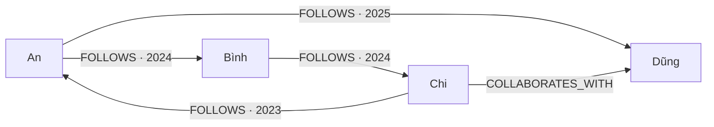

# MATCH để tìm quan hệ có hướng hoặc không chỉ định hướng

Trong Neo4j, **property graph** biểu diễn dữ liệu bằng **nút (node)**, **quan hệ (relationship)** và **thuộc tính (property)**. Mỗi quan hệ luôn có **nút bắt đầu**, **nút kết thúc**, **loại quan hệ** và có thể có các thuộc tính. Khi viết truy vấn đọc bằng Cypher, mệnh đề `MATCH` cho phép chỉ rõ hướng của quan hệ hoặc không chỉ định hướng.

Bài này thuộc chương **Truy vấn đọc** của module `DATABASE_ENGINE_GRAPH_NEO4J`. Trọng tâm là chọn đúng chiều kết nối giữa các nút trong Cypher, hiểu kết quả trả về và áp dụng vào bài toán thực tế. Kiến thức này là nền tảng để truy vấn đường đi, tối ưu truy vấn bằng index/constraint và tích hợp Neo4j với Java Driver hoặc Spring Data Neo4j.

## 1. Mục tiêu học tập

Sau bài này, bạn có thể:

1. Đọc và viết ba mẫu cơ bản: `(a)-[:TYPE]->(b)`, `(a)<-[:TYPE]-(b)` và `(a)-[:TYPE]-(b)`.
2. Giải thích khác biệt giữa **hướng lưu trữ** của một quan hệ và **hướng tìm kiếm** trong `MATCH`.
3. Tìm quan hệ theo loại, thuộc tính và hai nút đầu mút; lấy thông tin từ biến quan hệ.
4. Giải thích vì sao truy vấn không chỉ định hướng có thể tạo nhiều dòng hơn dự kiến và cách dùng `DISTINCT` khi phù hợp.
5. Viết truy vấn có tham số, sắp xếp/giới hạn kết quả và nhận biết các yếu tố tác động đến hiệu năng.

## 2. Hướng quan hệ trong property graph

Giả sử có hai người An và Bình, và An theo dõi Bình. Mô hình này có thể được lưu bằng một quan hệ `FOLLOWS`:

```text
(An)-[:FOLLOWS]->(Bình)
```

Ở đây:

- **An** là nút bắt đầu (source/start node).
- **Bình** là nút kết thúc (target/end node).
- **`FOLLOWS`** là loại quan hệ (relationship type).
- Mũi tên `->` cho biết hướng của quan hệ.

**Mọi quan hệ trong Neo4j đều có hướng lưu trữ.** Cú pháp không chỉ định hướng trong câu truy vấn chỉ có nghĩa là **chấp nhận quan hệ được lưu theo cả hai chiều**. Nó không biến quan hệ thành vô hướng trong cơ sở dữ liệu và cũng không tự tạo quan hệ ngược lại.

Điều này đặc biệt quan trọng với nghiệp vụ:

| Quan hệ | Ý nghĩa điển hình | Cần quan tâm hướng? |
| --- | --- | --- |
| `(a)-[:FOLLOWS]->(b)` | `a` theo dõi `b`. | Có; `a` theo dõi `b` không đồng nghĩa `b` theo dõi `a`. |
| `(a)-[:PURCHASED]->(o)` | Khách hàng `a` mua đơn hàng `o`. | Có; chiều thể hiện vai trò hai đầu mút. |
| `(a)-[:REPORTS_TO]->(b)` | Nhân viên `a` báo cáo cho `b`. | Có; đảo chiều sẽ đổi nghĩa. |
| `(a)-[:COLLABORATES_WITH]->(b)` | `a` và `b` hợp tác. | Nghiệp vụ có thể xem là hai chiều, nhưng quan hệ **vẫn** được lưu có hướng; lúc đọc có thể không chỉ định hướng. |

Không nên chọn `-[]-` chỉ vì muốn lấy “nhiều dữ liệu hơn”: với các quan hệ mang nghĩa bất đối xứng như `FOLLOWS`, bỏ hướng có thể làm sai kết luận nghiệp vụ.

## 3. Dữ liệu minh họa tự chứa

Các ví dụ bên dưới dùng nhãn `DemoPerson` và khóa `key` riêng cho bài này, tránh nhầm lẫn với các nút `Person` ở bài học khác. Hãy chạy trên **cơ sở dữ liệu thử nghiệm**. Lệnh `MERGE` giúp chạy lại ví dụ mà không tạo thêm nút hoặc quan hệ cùng mẫu trong điều kiện dữ liệu mẫu ban đầu không có bản ghi trùng.

```cypher
MERGE (an:DemoPerson {key: 'rq002-an'})
SET an.name = 'An'
MERGE (binh:DemoPerson {key: 'rq002-binh'})
SET binh.name = 'Bình'
MERGE (chi:DemoPerson {key: 'rq002-chi'})
SET chi.name = 'Chi'
MERGE (dung:DemoPerson {key: 'rq002-dung'})
SET dung.name = 'Dũng'

MERGE (an)-[f1:FOLLOWS]->(binh)
SET f1.since = 2024
MERGE (chi)-[f2:FOLLOWS]->(an)
SET f2.since = 2023
MERGE (an)-[f3:FOLLOWS]->(dung)
SET f3.since = 2025
MERGE (binh)-[f4:FOLLOWS]->(chi)
SET f4.since = 2024

MERGE (chi)-[c:COLLABORATES_WITH]->(dung)
SET c.project = 'Hệ thống đồ thị';
```

Sơ đồ các kết nối:



Có **bốn quan hệ `FOLLOWS`** và **một quan hệ `COLLABORATES_WITH`**. Chú ý Chi theo dõi An, nhưng An **không** có quan hệ `FOLLOWS` ngược lại đến Chi.

## 4. MATCH theo hướng đi ra: `->`

Cú pháp:

```cypher
MATCH (a:LabelA)-[:RELATIONSHIP_TYPE]->(b:LabelB)
RETURN a, b;
```

Mũi tên `->` yêu cầu một quan hệ đi **từ nút bên trái sang nút bên phải**. Ví dụ: tìm những người mà An đang theo dõi:

```cypher
MATCH (an:DemoPerson {key: 'rq002-an'})-[:FOLLOWS]->(nguoi:DemoPerson)
RETURN nguoi.key AS key, nguoi.name AS name
ORDER BY key;
```

Kết quả:

| key | name |
| --- | --- |
| `rq002-binh` | Bình |
| `rq002-dung` | Dũng |

Đối với quan hệ `(an)-[:FOLLOWS]->(nguoi)`, biến `an` được đặt ở **đầu bắt đầu** của quan hệ. Vì vậy, Chi không xuất hiện: trong dữ liệu, chính **Chi theo dõi An**.

Bạn cũng có thể đảo vị trí các nút trong biểu thức nhưng vẫn biểu diễn **cùng một chiều vật lý**:

```cypher
MATCH (nguoi:DemoPerson)<-[:FOLLOWS]-(an:DemoPerson {key: 'rq002-an'})
RETURN nguoi.name AS name
ORDER BY name;
```

Kết quả vẫn là Bình và Dũng. Mũi tên quyết định chiều quan hệ, không phải tên biến hay thứ tự nhìn của hai nút.

## 5. MATCH theo hướng đi vào: `<-`

Tìm những người **đang theo dõi An**:

```cypher
MATCH (an:DemoPerson {key: 'rq002-an'})<-[:FOLLOWS]-(nguoi:DemoPerson)
RETURN nguoi.key AS key, nguoi.name AS name
ORDER BY key;
```

Kết quả:

| key | name |
| --- | --- |
| `rq002-chi` | Chi |

Với mẫu `(an)<-[:FOLLOWS]-(nguoi)`, đầu mũi tên hướng **vào An**: quan hệ có nút bắt đầu là `nguoi` và nút kết thúc là `an`.

So sánh nhanh:

| Mẫu với nút `an` đã xác định | Ý nghĩa | Kết quả trên dữ liệu mẫu |
| --- | --- | --- |
| `(an)-[:FOLLOWS]->(p)` | An theo dõi `p`. | Bình, Dũng |
| `(an)<-[:FOLLOWS]-(p)` | `p` theo dõi An. | Chi |
| `(an)-[:FOLLOWS]-(p)` | Có quan hệ theo dõi nối An và `p` theo một trong hai chiều. | Bình, Chi, Dũng |

## 6. MATCH không chỉ định hướng: `-[]-`

Để tìm những người **có kết nối `FOLLOWS` với An, bất kể chiều**:

```cypher
MATCH (an:DemoPerson {key: 'rq002-an'})-[:FOLLOWS]-(nguoi:DemoPerson)
RETURN nguoi.key AS key, nguoi.name AS name
ORDER BY key;
```

Kết quả:

| key | name |
| --- | --- |
| `rq002-binh` | Bình |
| `rq002-chi` | Chi |
| `rq002-dung` | Dũng |

Mẫu `-[:FOLLOWS]-` chỉ yêu cầu hai nút được nối bởi quan hệ đúng loại; quan hệ thực tế có thể đi **từ An ra ngoài** hoặc **từ người khác vào An**.

Khi nghiệp vụ coi kết nối là “có hợp tác với nhau”, cú pháp này có thể rất phù hợp:

```cypher
MATCH (chi:DemoPerson {key: 'rq002-chi'})
      -[:COLLABORATES_WITH]-
      (dongNghiep:DemoPerson)
RETURN dongNghiep.name AS collaborator;
```

Kết quả: **Dũng**. Nhưng `(chi)-[:COLLABORATES_WITH]-(dung)` không nói rằng Neo4j đã lưu hai quan hệ ngược nhau: trong dữ liệu mẫu chỉ có **một** quan hệ `Chi -> Dũng`.

### 6.1. Quan hệ không chỉ định hướng vẫn có hướng thực tế

Khi cần biết chiều thực sự của mỗi kết nối, gán biến cho quan hệ rồi dùng `startNode()` và `endNode()`:

```cypher
MATCH (an:DemoPerson {key: 'rq002-an'})-[r:FOLLOWS]-(p:DemoPerson)
RETURN
  p.name AS neighbor,
  CASE
    WHEN startNode(r) = an THEN 'An theo dõi người này'
    ELSE 'Người này theo dõi An'
  END AS actualDirection,
  r.since AS since
ORDER BY neighbor;
```

Kết quả kỳ vọng:

| neighbor | actualDirection | since |
| --- | --- | ---: |
| Bình | An theo dõi người này | 2024 |
| Chi | Người này theo dõi An | 2023 |
| Dũng | An theo dõi người này | 2025 |

`startNode(r)` và `endNode(r)` luôn trả về hai đầu mút theo **hướng lưu trữ** của `r`, bất kể truy vấn `MATCH` có chỉ định hướng hay không.

### 6.2. Lưu ý số dòng khi cả hai đầu mút chưa xác định

Nếu không neo vào một nút cụ thể, mẫu không chỉ định hướng có thể khớp **hai cách gán biến đầu mút** cho một quan hệ: `a` là nguồn, `b` là đích; hoặc ngược lại. Do đó không nên nhầm số dòng với số quan hệ vật lý.

```cypher
MATCH (a:DemoPerson)-[r:FOLLOWS]-(b:DemoPerson)
RETURN
  count(*) AS matchedRows,
  count(DISTINCT r) AS distinctRelationships;
```

Với dữ liệu mẫu chỉ có bốn quan hệ `FOLLOWS`, không có self-loop và chưa thêm dữ liệu khác, kết quả là:

| matchedRows | distinctRelationships |
| ---: | ---: |
| 8 | 4 |

Muốn lấy **mỗi quan hệ vật lý một lần**, có thể khớp hướng từ nguồn sang đích:

```cypher
MATCH (source:DemoPerson)-[r:FOLLOWS]->(target:DemoPerson)
RETURN source.name AS follower, target.name AS followed, r.since AS since
ORDER BY follower, followed;
```

Kết quả chỉ có bốn dòng, mỗi quan hệ `FOLLOWS` một dòng. Khi thực sự cần khớp không chỉ định hướng, `DISTINCT r` hoặc `count(DISTINCT r)` giúp loại các lần khớp trùng **theo quan hệ**, nhưng `DISTINCT` trên thuộc tính như `name` có thể gộp nhầm các nút khác nhau trùng tên.

> Ghi chú: Số dòng còn phụ thuộc cấu trúc mẫu. Ví dụ quan hệ tự nối (`(p)-[:R]->(p)`), quan hệ song song giữa cùng hai nút hoặc một mẫu gồm nhiều chặng cần được xem xét riêng. Không suy số dòng chỉ từ số nút.

## 7. Chỉ định loại quan hệ và lấy thuộc tính

Trong Cypher, biến trong dấu ngoặc vuông đại diện cho **quan hệ**:

```cypher
MATCH (an:DemoPerson {key: 'rq002-an'})-[r:FOLLOWS]->(p:DemoPerson)
WHERE r.since >= 2025
RETURN an.name AS follower,
       p.name AS followed,
       type(r) AS relationshipType,
       r.since AS since;
```

Kết quả là một dòng: **An → Dũng**, loại `FOLLOWS`, từ năm 2025. Trong truy vấn này:

- `r` là biến quan hệ; `r.since` lấy thuộc tính `since`.
- `:FOLLOWS` hạn chế loại quan hệ cần tìm.
- `type(r)` trả về chuỗi biểu diễn loại quan hệ, ở đây là `'FOLLOWS'`.
- `WHERE r.since >= 2025` áp dụng điều kiện cho **thuộc tính quan hệ**, không phải thuộc tính nút.

Nếu bỏ loại quan hệ, Cypher có thể khớp bất kỳ loại nào:

```cypher
MATCH (chi:DemoPerson {key: 'rq002-chi'})-[r]-(p:DemoPerson)
RETURN p.name AS neighbor, type(r) AS type
ORDER BY type, neighbor;
```

Với dữ liệu mẫu, có ba kết nối tính theo các quan hệ vật lý nối Chi: `Chi -> An` (`FOLLOWS`), `Bình -> Chi` (`FOLLOWS`) và `Chi -> Dũng` (`COLLABORATES_WITH`).

Các cách viết ngắn cần nhớ:

| Cú pháp | Cách hiểu |
| --- | --- |
| `(a)-[:FOLLOWS]->(b)` | Đúng loại `FOLLOWS`, hướng từ `a` đến `b`. |
| `(a)<-[:FOLLOWS]-(b)` | Đúng loại `FOLLOWS`, hướng từ `b` đến `a`. |
| `(a)-[:FOLLOWS]-(b)` | Đúng loại `FOLLOWS`, chấp nhận hai hướng. |
| `(a)-[r:FOLLOWS]->(b)` | Như mẫu đầu, đồng thời gán biến `r`. |
| `(a)-->(b)` | Có quan hệ đi từ `a` đến `b`, không giới hạn loại. |
| `(a)--(b)` | Có quan hệ giữa `a` và `b` theo một trong hai hướng, không giới hạn loại. |

## 8. Kết hợp điều kiện trên hai nút và quan hệ

Một mẫu `MATCH` có thể ràng buộc đồng thời **nút nguồn**, **nút đích** và **thuộc tính quan hệ**:

```cypher
MATCH (source:DemoPerson {key: 'rq002-an'})
      -[r:FOLLOWS]->
      (target:DemoPerson {key: 'rq002-binh'})
WHERE r.since >= 2024
RETURN source.name AS sourceName,
       target.name AS targetName,
       r.since AS since;
```

Kết quả là **An, Bình, 2024**. Truy vấn ngược hướng sau đây không trả về dòng nào với dữ liệu mẫu:

```cypher
MATCH (binh:DemoPerson {key: 'rq002-binh'})
      -[:FOLLOWS]->
      (an:DemoPerson {key: 'rq002-an'})
RETURN binh.name, an.name;
```

Như vậy, việc có quan hệ giữa hai nút **không** đảm bảo chiều ngược lại tồn tại.

### 8.1. Kiểm tra sự tồn tại thay vì lấy toàn bộ đường nối

Khi chỉ cần biết An có đang theo dõi Bình hay không, có thể đếm số quan hệ khớp:

```cypher
MATCH (an:DemoPerson {key: 'rq002-an'})
      -[:FOLLOWS]->
      (binh:DemoPerson {key: 'rq002-binh'})
RETURN count(*) > 0 AS follows;
```

Kết quả: `true`. Nếu có nhiều quan hệ song song cùng loại giữa hai nút, `count(*)` có thể lớn hơn 1 nhưng điều kiện tồn tại vẫn đúng.

### 8.2. Giữ nút khi không có kết nối bằng OPTIONAL MATCH

`MATCH` thông thường không tạo dòng khi mẫu quan hệ không khớp. Khi cần giữ lại nút gốc dù chưa có quan hệ, dùng `OPTIONAL MATCH`:

```cypher
MATCH (p:DemoPerson {key: 'rq002-dung'})
OPTIONAL MATCH (p)-[:FOLLOWS]->(q:DemoPerson)
RETURN p.name AS person, q.name AS follows;
```

Dũng không theo dõi ai trong dữ liệu mẫu, nên kết quả vẫn có một dòng: `person = 'Dũng'` và `follows = null`. Điều này hữu ích khi xây dựng giao diện hiển thị danh sách người dùng kể cả khi họ chưa có quan hệ theo dõi.

## 9. Viết truy vấn có tham số để sử dụng trong ứng dụng

Không nên nối trực tiếp dữ liệu nhập vào chuỗi Cypher. Dùng tham số, chẳng hạn `$personKey` và `$fromYear`, để lọc an toàn và tái sử dụng câu truy vấn:

```cypher
MATCH (p:DemoPerson {key: $personKey})-[r:FOLLOWS]->(q:DemoPerson)
WHERE r.since >= $fromYear
RETURN q.key AS key, q.name AS name, r.since AS since
ORDER BY since DESC, key ASC;
```

Với `personKey = 'rq002-an'`, `fromYear = 2024`, kết quả sắp theo năm giảm dần là Dũng (2025) rồi Bình (2024).

Ví dụ Java Driver (giả định ứng dụng đã cấu hình và cung cấp `Driver` của Neo4j):

```java
import java.util.List;
import java.util.Map;
import org.neo4j.driver.Driver;

public class FollowQuery {
    public static List<String> followedNames(Driver driver, String personKey) {
        try (var session = driver.session()) {
            return session.executeRead(tx ->
                tx.run("""
                    MATCH (p:DemoPerson {key: $personKey})
                          -[:FOLLOWS]->(q:DemoPerson)
                    RETURN q.name AS name
                    ORDER BY name
                    """, Map.of("personKey", personKey))
                  .list(record -> record.get("name").asString())
            );
        }
    }
}
```

Gọi `followedNames(driver, "rq002-an")` trả về danh sách tên `[Bình, Dũng]`. Đối với Spring Data Neo4j, có thể sử dụng cùng mẫu Cypher trong truy vấn repository với tham số được binding; ánh xạ đầu ra phụ thuộc kiểu dữ liệu và entity của ứng dụng.

## 10. Sắp xếp, giới hạn và tránh kết quả trùng

Khi hiển thị danh sách lớn, hãy có thứ tự xác định trước khi lấy một phần kết quả:

```cypher
MATCH (p:DemoPerson {key: 'rq002-an'})-[r:FOLLOWS]-(q:DemoPerson)
RETURN q.key AS key, q.name AS name, r.since AS since
ORDER BY since DESC, key ASC
LIMIT 2;
```

Kết quả là **Dũng (2025)** rồi **Bình (2024)**. Vì truy vấn không chỉ định hướng, Chi cũng là hàng xóm của An, nhưng quan hệ Chi → An bắt đầu năm 2023 nên không lọt vào hai dòng đầu.

Khi cần chọn mỗi nút đích duy nhất, ví dụ nhiều quan hệ khác loại cùng nối đến một người:

```cypher
MATCH (p:DemoPerson {key: 'rq002-chi'})-[r]-(q:DemoPerson)
RETURN DISTINCT q.key AS key, q.name AS name
ORDER BY key;
```

`DISTINCT` ở đây loại những dòng trùng bộ giá trị `(key, name)`. Nếu cần kiểm đếm số **quan hệ** thì dùng `count(DISTINCT r)`; nếu cần kiểm đếm số **nút hàng xóm** thì dùng `count(DISTINCT q)`. Hai khái niệm này khác nhau khi có nhiều loại hoặc nhiều quan hệ nối cùng cặp nút.

## 11. Hiệu năng: chọn điểm xuất phát và hướng duyệt

Với graph lớn, hiệu năng phụ thuộc vào số nút phải quét, độ chọn lọc của điều kiện và số quan hệ cần mở rộng. Truy vấn bắt đầu từ một nút có định danh rõ ràng thường dễ tối ưu hơn một mẫu không có điểm neo.

Nếu `DemoPerson.key` là định danh duy nhất trong mô hình thực tế, có thể tạo **unique constraint** trên cơ sở dữ liệu thử nghiệm:

```cypher
CREATE CONSTRAINT demo_person_key_unique IF NOT EXISTS
FOR (p:DemoPerson) REQUIRE p.key IS UNIQUE;
```

Ràng buộc này ngăn hai nút `DemoPerson` có cùng `key` khác null và tạo index hỗ trợ tra cứu bằng khóa. Lệnh sẽ thất bại nếu dữ liệu hiện có vi phạm tính duy nhất.

Đánh giá kế hoạch truy vấn:

```cypher
EXPLAIN
MATCH (p:DemoPerson {key: $personKey})-[:FOLLOWS]->(q:DemoPerson)
RETURN q.name AS name;
```

`EXPLAIN` cho biết kế hoạch dự kiến mà không thực thi truy vấn. `PROFILE` **thực thi truy vấn** và cung cấp thống kê vận hành. Tùy dữ liệu, index và phiên bản Neo4j, kế hoạch có thể sử dụng tìm nút bằng index rồi mở rộng quan hệ theo hướng đã chỉ định.

Các nguyên tắc thực hành:

1. Xác định **đúng loại quan hệ** (`:FOLLOWS`, `:REPORTS_TO`...) để không duyệt cả các loại không liên quan.
2. Dùng **hướng cụ thể** nếu câu hỏi nghiệp vụ yêu cầu; `->` và `<-` diễn tả chính xác chiều cần tìm. Mẫu không chỉ định hướng có thể mở rộng sang cả hai hướng.
3. Bắt đầu từ **nút đã được lọc tốt** (nhãn + thuộc tính định danh) khi có thể; cân nhắc constraint/index cho thuộc tính được tra cứu thường xuyên.
4. Chỉ `RETURN` những cột cần thiết, và dùng `ORDER BY` cùng `LIMIT` khi phân trang/hiển thị danh sách.
5. Đo bằng `EXPLAIN`/`PROFILE` và dữ liệu thực; không mặc định truy vấn có hướng luôn nhanh hơn hoặc mọi truy vấn đều dùng index.

## 12. Lỗi thường gặp

| Hiện tượng | Nguyên nhân | Hướng xử lý |
| --- | --- | --- |
| Tìm “người An theo dõi” nhưng ra Chi | Dùng `(an)<-[:FOLLOWS]-(p)` hoặc bỏ hướng. | Dùng `(an)-[:FOLLOWS]->(p)`. |
| Tìm “người theo dõi An” nhưng ra Bình, Dũng | Dùng chiều đi ra. | Dùng `(an)<-[:FOLLOWS]-(p)`. |
| Nghĩ quan hệ hợp tác không có hướng lưu trữ | Nhầm `-[:COLLABORATES_WITH]-` với quan hệ vô hướng vật lý. | Nhớ mọi relationship trong Neo4j đều có hướng; truy vấn có thể bỏ yêu cầu về hướng. |
| Đếm tám “quan hệ” dù chỉ tạo bốn | Hai biến nút đều chưa neo, mẫu không chỉ định hướng tạo hai cách gán đầu mút. | Dùng `count(DISTINCT r)` hoặc khớp theo hướng lưu trữ nếu cần mỗi quan hệ một lần. |
| Câu `MATCH` không có dòng nào | Không có quan hệ đúng chiều, đúng loại hoặc đúng bộ lọc. | Kiểm tra dữ liệu và điều kiện; dùng `OPTIONAL MATCH` nếu phải giữ nút gốc. |
| Kết quả có nhiều dòng cùng một người | Có nhiều quan hệ hoặc nhiều đường khớp đến cùng người. | Xác định cần đếm nút, quan hệ hay đường khớp rồi áp dụng `DISTINCT` tương ứng. |
| `LIMIT` thay đổi người được trả về | Không có `ORDER BY` ổn định. | Sắp xếp theo tiêu chí nghiệp vụ, thêm khóa duy nhất để phá hòa. |

## 13. Bài tập tự luyện

Dùng bộ dữ liệu ở mục 3. Hãy thử viết Cypher trước khi đối chiếu đáp án.

**Bài 1.** Truy vấn danh sách những người mà Bình đang theo dõi, bao gồm tên và năm bắt đầu theo dõi.

**Bài 2.** Tìm tất cả những người có quan hệ `FOLLOWS` trực tiếp với Chi, không phân biệt chiều. Trả về tên theo thứ tự bảng chữ cái.

**Bài 3.** Tìm tất cả các quan hệ loại `FOLLOWS` **đi vào Chi**, trả về tên người theo dõi Chi và năm theo dõi.

**Bài 4.** Viết truy vấn cho biết trong dữ liệu mẫu có bao nhiêu quan hệ `FOLLOWS` vật lý, kể cả khi dùng mẫu không chỉ định hướng.

**Bài 5.** Tìm người An theo dõi từ năm 2025 trở đi bằng tham số `$fromYear`. Kết quả mong đợi là ai?

### Đáp án tham khảo

**Bài 1**

```cypher
MATCH (p:DemoPerson {key: 'rq002-binh'})-[r:FOLLOWS]->(q:DemoPerson)
RETURN q.name AS followed, r.since AS since;
```

Kết quả: **Chi, 2024**.

**Bài 2**

```cypher
MATCH (p:DemoPerson {key: 'rq002-chi'})-[:FOLLOWS]-(q:DemoPerson)
RETURN q.name AS neighbor
ORDER BY neighbor;
```

Kết quả: **An, Bình**. Quan hệ `COLLABORATES_WITH` với Dũng không thuộc loại `FOLLOWS` nên không được chọn.

**Bài 3**

```cypher
MATCH (p:DemoPerson {key: 'rq002-chi'})<-[r:FOLLOWS]-(q:DemoPerson)
RETURN q.name AS follower, r.since AS since;
```

Kết quả: **Bình, 2024**.

**Bài 4**

```cypher
MATCH (a:DemoPerson)-[r:FOLLOWS]-(b:DemoPerson)
RETURN count(DISTINCT r) AS totalRelationships;
```

Kết quả: **4** quan hệ vật lý.

**Bài 5**

```cypher
MATCH (p:DemoPerson {key: 'rq002-an'})-[r:FOLLOWS]->(q:DemoPerson)
WHERE r.since >= $fromYear
RETURN q.name AS followed
ORDER BY followed;
```

Với `fromYear = 2025`, kết quả: **Dũng**.

## 14. Tổng kết

- `(a)-[:R]->(b)` khớp chiều **từ a đến b**; `(a)<-[:R]-(b)` khớp chiều **từ b đến a**; `(a)-[:R]-(b)` khớp **một trong hai chiều**.
- Hướng lưu trữ của quan hệ trong Neo4j luôn tồn tại, kể cả khi truy vấn không chỉ định hướng; hướng trong `MATCH` diễn tả mẫu cần khớp.
- Gán biến `[r:R]` để đọc thuộc tính `r.property`, loại `type(r)` và hai đầu mút `startNode(r)`/`endNode(r)`.
- Phân biệt **số dòng khớp**, **số quan hệ vật lý** và **số nút hàng xóm**; chọn `DISTINCT` hoặc `count(DISTINCT ...)` theo mục tiêu.
- Sử dụng nhãn, định danh, tham số và kế hoạch truy vấn để xử lý chính xác, có hiệu năng khi chuyển sang bài toán graph thực tế, truy vấn đường đi và tích hợp ứng dụng Java.
