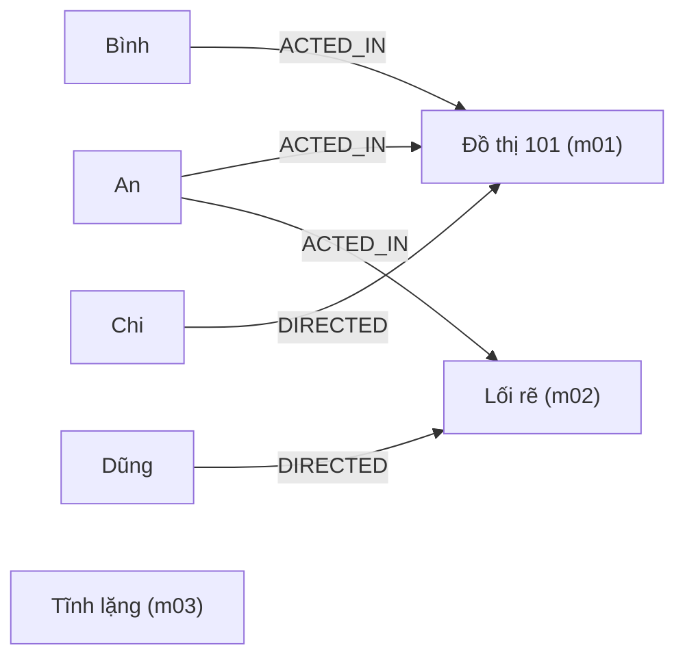

# Kết hợp nhiều mẫu liên thông và nhận diện tích Descartes ngoài ý muốn

Trong Neo4j, dữ liệu được mô hình hóa dưới dạng **property graph**: các nút mang nhãn và thuộc tính, còn các quan hệ có hướng nối giữa những nút. Ngôn ngữ **Cypher** dùng `MATCH` để tìm những mẫu đồ thị phù hợp. Khi truy vấn gồm nhiều mẫu, cách liên kết các biến nút/quan hệ quyết định liệu kết quả có phản ánh đúng các kết nối thực tế hay chỉ là phép ghép mọi tổ hợp của hai tập dữ liệu.

Bài học thuộc chương **Truy vấn đọc** của module `DATABASE_ENGINE_GRAPH_NEO4J`. Nội dung tập trung vào **kết hợp các mẫu liên thông trong `MATCH`** và **phát hiện tích Descartes (Cartesian product) ngoài ý muốn**. Đây là kỹ năng cần thiết trước khi truy vấn đường đi phức tạp, tối ưu kế hoạch Cypher, thiết kế index/constraint và gọi truy vấn từ Java Driver hoặc Spring Data Neo4j.

## 1. Mục tiêu học tập

Sau bài này, bạn có thể:

1. Kết hợp hai hoặc nhiều mẫu `MATCH` qua **biến nút dùng chung** hoặc quan hệ nối rõ ràng.
2. Phân biệt **mẫu liên thông** với **mẫu rời nhau**; biết khi nào dữ liệu sẽ bị nhân số dòng.
3. Tính số dòng dự kiến trong các truy vấn có nhiều nhánh, nhiều quan hệ hoặc `OPTIONAL MATCH`.
4. Nhận diện tích Descartes ngoài ý muốn qua câu Cypher, kết quả trả về và kế hoạch `EXPLAIN`/`PROFILE`.
5. Viết lại truy vấn để thể hiện chính xác ràng buộc liên kết, và dùng `DISTINCT`, `WITH`, tổng hợp đúng mục đích.

## 2. Mẫu liên thông là gì?

Xét một hệ thống phim với ba loại đối tượng: người diễn xuất, bộ phim và người đạo diễn.

```text
(Diễn viên)-[:ACTED_IN]->(Phim)<-[:DIRECTED]-(Đạo diễn)
```

Đây là **mẫu liên thông** vì cả hai quan hệ đều nối đến **cùng một nút phim**. Trong Cypher, biến `m` biểu thị đúng nút phim dùng chung:

```cypher
MATCH (a:Person)-[:ACTED_IN]->(m:Movie)<-[:DIRECTED]-(d:Person)
RETURN a.name, m.title, d.name;
```

Đặt hai mẫu trên hai mệnh đề cũng giữ nguyên liên kết nếu sử dụng lại biến `m`:

```cypher
MATCH (a:Person)-[:ACTED_IN]->(m:Movie)
MATCH (d:Person)-[:DIRECTED]->(m)
RETURN a.name, m.title, d.name;
```

Ở đây, mệnh đề `MATCH` thứ hai yêu cầu đạo diễn `d` đạo diễn **chính bộ phim `m` đã được tìm thấy ở mệnh đề đầu**. Truy vấn chỉ tạo những bộ ba (diễn viên, phim, đạo diễn) có kết nối thực trong đồ thị.

Ngược lại, nếu dùng hai biến phim khác nhau mà không có điều kiện liên kết:

```cypher
MATCH (a:Person)-[:ACTED_IN]->(actedMovie:Movie)
MATCH (d:Person)-[:DIRECTED]->(directedMovie:Movie)
RETURN a.name, actedMovie.title, d.name, directedMovie.title;
```

thì hai nhánh truy vấn **độc lập**. Cypher có thể kết hợp từng dòng diễn xuất với **mọi** dòng đạo diễn, kể cả khi `actedMovie` và `directedMovie` là hai bộ phim hoàn toàn khác nhau. Đó là một tình huống dễ gây **tích Descartes ngoài ý muốn**.

## 3. Bộ dữ liệu thực hành

Các ví dụ sử dụng nhãn riêng `RQ003Person`, `RQ003Movie` và thuộc tính khóa `key` để tự chứa, không phụ thuộc dữ liệu bài khác. Hãy chạy phần khởi tạo trên **cơ sở dữ liệu thực hành**, vì `MERGE`/`SET` làm thay đổi dữ liệu. Giả định bộ dữ liệu chưa có nút trùng khóa hoặc quan hệ song song cùng mẫu; khi chạy lại trên dữ liệu mẫu sạch, `MERGE` không tạo thêm nút và quan hệ tương ứng.

```cypher
MERGE (an:RQ003Person {key: 'an'})
SET an.name = 'An'
MERGE (binh:RQ003Person {key: 'binh'})
SET binh.name = 'Bình'
MERGE (chi:RQ003Person {key: 'chi'})
SET chi.name = 'Chi'
MERGE (dung:RQ003Person {key: 'dung'})
SET dung.name = 'Dũng'

MERGE (m1:RQ003Movie {key: 'm01'})
SET m1.title = 'Đồ thị 101'
MERGE (m2:RQ003Movie {key: 'm02'})
SET m2.title = 'Lối rẽ'
MERGE (m3:RQ003Movie {key: 'm03'})
SET m3.title = 'Tĩnh lặng'

MERGE (an)-[r1:ACTED_IN]->(m1)
SET r1.role = 'Chính'
MERGE (an)-[r2:ACTED_IN]->(m2)
SET r2.role = 'Phụ'
MERGE (binh)-[r3:ACTED_IN]->(m1)
SET r3.role = 'Phụ'

MERGE (chi)-[:DIRECTED]->(m1)
MERGE (dung)-[:DIRECTED]->(m2);
```

Sơ đồ kết nối:



Tổng quan dữ liệu:

| Nhóm | Số lượng | Chi tiết |
| --- | ---: | --- |
| Nút `RQ003Person` | 4 | An, Bình, Chi, Dũng |
| Nút `RQ003Movie` | 3 | `m01`, `m02`, `m03` |
| Quan hệ `ACTED_IN` | 3 | An → m01, An → m02, Bình → m01 |
| Quan hệ `DIRECTED` | 2 | Chi → m01, Dũng → m02 |
| Phim chưa có quan hệ | 1 | m03 chưa có diễn viên/đạo diễn trong dữ liệu mẫu |

Từ đây, mọi con số **kết quả dự kiến** đều dựa trên đúng bộ dữ liệu trên, chưa bổ sung nút hoặc quan hệ khác.

## 4. Kết hợp nhiều mẫu liên thông đúng cách

### 4.1. Viết một mẫu đường đi có hai quan hệ

```cypher
MATCH (a:RQ003Person)-[:ACTED_IN]->(m:RQ003Movie)<-[:DIRECTED]-(d:RQ003Person)
RETURN
  a.key AS actorKey,
  a.name AS actor,
  m.title AS movie,
  d.name AS director
ORDER BY m.key, a.key;
```

Kết quả:

| actorKey | actor | movie | director |
| --- | --- | --- | --- |
| `an` | An | Đồ thị 101 | Chi |
| `binh` | Bình | Đồ thị 101 | Chi |
| `an` | An | Lối rẽ | Dũng |

Hai người An và Bình cùng tham gia m01 nên tạo **hai dòng khác nhau** với đạo diễn Chi. Đây là số dòng hợp lệ của mẫu liên thông, không phải tích Descartes vô nghĩa. Phim m03 không xuất hiện vì không có quan hệ diễn xuất và đạo diễn phù hợp.

### 4.2. Chia thành hai MATCH có biến chung

```cypher
MATCH (a:RQ003Person)-[:ACTED_IN]->(m:RQ003Movie)
MATCH (d:RQ003Person)-[:DIRECTED]->(m)
RETURN a.name AS actor, m.title AS movie, d.name AS director
ORDER BY m.key, a.key;
```

Kết quả vẫn là **3 dòng** như mục 4.1. Trong `MATCH` thứ hai, `m` đã được ràng buộc bởi câu trước; đó không phải một bộ phim tùy ý mới.

### 4.3. Viết các mẫu ngăn bằng dấu phẩy nhưng vẫn liên thông

```cypher
MATCH
  (a:RQ003Person)-[:ACTED_IN]->(m:RQ003Movie),
  (d:RQ003Person)-[:DIRECTED]->(m)
RETURN a.name AS actor, m.title AS movie, d.name AS director
ORDER BY m.key, a.key;
```

Ở đây hai mẫu có **biến `m` chung**, vì vậy chúng vẫn liên thông. Dấu phẩy hoặc số lượng mệnh đề `MATCH` **không tự quyết định** có tích Descartes; điều quan trọng là **các mẫu có ràng buộc liên kết hay không**.

### 4.4. Dùng WHERE để lọc khi các mẫu đã liên thông

```cypher
MATCH (a:RQ003Person)-[r:ACTED_IN]->(m:RQ003Movie)
MATCH (d:RQ003Person)-[:DIRECTED]->(m)
WHERE r.role = 'Chính'
RETURN a.name AS actor, m.title AS movie, d.name AS director;
```

Kết quả: **An – Đồ thị 101 – Chi**. Điều kiện `r.role = 'Chính'` lọc vai diễn, còn biến `m` dùng chung bảo đảm hai quan hệ thuộc cùng bộ phim.

## 5. Tích Descartes: nhận biết qua số dòng

Cho hai tập kết quả độc lập:

- Tập A có `n` dòng.
- Tập B có `m` dòng.

Nếu truy vấn kết hợp **mọi dòng của A với mọi dòng của B**, kết quả có:

\[
N_{\text{kết quả}} = n \times m
\]

Ví dụ không giới hạn kết nối giữa người và phim:

```cypher
MATCH (p:RQ003Person)
MATCH (m:RQ003Movie)
RETURN count(*) AS totalRows;
```

Có **4 người × 3 phim = 12 dòng**. Những kết hợp như `(Chi, 'Tĩnh lặng')` vẫn xuất hiện dù Chi chưa có quan hệ gì với m03. Câu truy vấn đang yêu cầu tất cả **cặp người–phim**, chứ không hỏi “ai tham gia phim nào”.

So sánh với truy vấn có liên kết:

```cypher
MATCH (p:RQ003Person)-[:ACTED_IN]->(m:RQ003Movie)
RETURN count(*) AS totalRows;
```

Kết quả là **3 dòng**, tương ứng ba quan hệ `ACTED_IN` thực tế.

### 5.1. Tích Descartes ngoài ý muốn trong truy vấn nhiều quan hệ

Ví dụ dễ mắc lỗi khi cần lấy **diễn viên cùng đạo diễn của một phim**:

```cypher
// SAI mục tiêu nghiệp vụ: không nối actedMovie với directedMovie.
MATCH (a:RQ003Person)-[:ACTED_IN]->(actedMovie:RQ003Movie)
MATCH (d:RQ003Person)-[:DIRECTED]->(directedMovie:RQ003Movie)
RETURN a.name AS actor,
       actedMovie.key AS actedMovie,
       d.name AS director,
       directedMovie.key AS directedMovie
ORDER BY actedMovie, actor, directedMovie;
```

Nhánh diễn xuất có **3 dòng**; nhánh đạo diễn có **2 dòng**. Kết quả 3 × 2 = **6 dòng**:

| actor | actedMovie | director | directedMovie | Đúng cùng phim? |
| --- | --- | --- | --- | --- |
| An | m01 | Chi | m01 | Có |
| An | m01 | Dũng | m02 | Không |
| Bình | m01 | Chi | m01 | Có |
| Bình | m01 | Dũng | m02 | Không |
| An | m02 | Chi | m01 | Không |
| An | m02 | Dũng | m02 | Có |

Ba dòng “Không” là các kết hợp **không được hỗ trợ bởi đường nối diễn viên–phim–đạo diễn**. Nếu đưa kết quả này lên giao diện, hệ thống có thể gán nhầm đạo diễn cho phim.

**Sửa bằng cách tái sử dụng cùng biến phim:**

```cypher
MATCH (a:RQ003Person)-[:ACTED_IN]->(m:RQ003Movie)
MATCH (d:RQ003Person)-[:DIRECTED]->(m)
RETURN a.name AS actor, m.key AS movieKey, d.name AS director
ORDER BY movieKey, actor;
```

Kết quả còn **3 dòng đúng**. Khi nghiệp vụ yêu cầu một quan hệ thực sự giữa hai nhánh, hãy thể hiện nó **trực tiếp bằng mẫu đồ thị dùng chung biến hoặc bằng một quan hệ nối**.

### 5.2. Vì sao DISTINCT không chữa được lỗi liên kết?

```cypher
MATCH (a:RQ003Person)-[:ACTED_IN]->(actedMovie:RQ003Movie)
MATCH (d:RQ003Person)-[:DIRECTED]->(directedMovie:RQ003Movie)
RETURN DISTINCT a.name AS actor, d.name AS director
ORDER BY actor, director;
```

`DISTINCT` chỉ loại các dòng có **cùng bộ giá trị được trả về**. Nó không biết người nào và đạo diễn nào phải cùng một bộ phim. Trong ví dụ này, các cặp `(An, Chi)`, `(An, Dũng)`, `(Bình, Chi)` và `(Bình, Dũng)` vẫn tồn tại, trong đó `(Bình, Dũng)` là kết hợp sai nếu hỏi “đạo diễn phim Bình tham gia”.

**Nguyên tắc:** sửa điều kiện nối mẫu trước; chỉ dùng `DISTINCT` khi nghiệp vụ thực sự cần loại bản ghi lặp.

## 6. Khi nào nhân dòng là hợp lệ?

Ngay cả mẫu **liên thông** cũng có thể trả về nhiều dòng, vì một nút có thể nối tới nhiều nút khác.

Ví dụ phim m01 có **2 diễn viên** và **1 đạo diễn**, nên mẫu:

```cypher
MATCH (a:RQ003Person)-[:ACTED_IN]->(m:RQ003Movie {key: 'm01'})
MATCH (d:RQ003Person)-[:DIRECTED]->(m)
RETURN a.name AS actor, d.name AS director
ORDER BY actor;
```

trả về **2 dòng**, tương ứng hai cặp diễn viên–đạo diễn **cùng phim**. Nếu m01 có thêm một đạo diễn thứ hai, mẫu có thể trả **2 diễn viên × 2 đạo diễn = 4 dòng** cho chính phim đó. Đây là việc liệt kê các tổ hợp hợp lệ trong phạm vi **cùng nút phim**, khác với việc ghép mọi phim với mọi phim.

Để phân biệt hai trường hợp, hãy tự hỏi:

1. Mỗi dòng đang biểu diễn một sự kiện hoặc kết nối nào?
2. Những biến ở các nhánh có cùng chỉ đến một nút thật sự, hay chỉ trùng tên thuộc tính?
3. Một nút có thể có nhiều quan hệ cùng loại hoặc nhiều người ở mỗi nhánh không?
4. Nếu một nhánh tăng gấp đôi dữ liệu, số dòng tăng là **đúng nghiệp vụ** hay là dấu hiệu thiếu điều kiện nối?

## 7. WHERE, WITH và phạm vi biến

### 7.1. Điều kiện lọc không mặc nhiên là liên kết đồ thị

Ví dụ sau vẫn định nghĩa **hai nút phim độc lập**, rồi lọc theo giá trị thuộc tính:

```cypher
MATCH (a:RQ003Person)-[:ACTED_IN]->(m1:RQ003Movie)
MATCH (d:RQ003Person)-[:DIRECTED]->(m2:RQ003Movie)
WHERE m1.key = m2.key
RETURN a.name, m1.title, d.name;
```

Với bộ dữ liệu mẫu, kết quả đúng là ba dòng vì `key` của ba phim đang phân biệt. Tuy nhiên, điều kiện `m1.key = m2.key` chỉ so **giá trị chuỗi**; nếu có hai nút phim khác nhau mang cùng `key`, phép lọc vẫn có thể ghép nhầm. Hơn nữa, kế hoạch tối ưu có thể phải xử lý một phép nối giữa hai tập dữ liệu. Nếu yêu cầu là **cùng nút phim**, dùng chung một biến `m` phản ánh chính xác hơn:

```cypher
MATCH (a:RQ003Person)-[:ACTED_IN]->(m:RQ003Movie)
MATCH (d:RQ003Person)-[:DIRECTED]->(m)
RETURN a.name, m.title, d.name;
```

Lưu ý: bộ lập kế hoạch Cypher có thể tối ưu điều kiện `WHERE m1.key = m2.key` thành phép nối theo giá trị; không thể kết luận kế hoạch thực thi **luôn** tạo toàn bộ tích Descartes trước rồi mới lọc. Vấn đề chính là cách biểu diễn ràng buộc và tính đúng đắn nghiệp vụ.

### 7.2. WITH giữ hoặc loại biến, không tự nối hai mẫu

`WITH` chuyển các biến được chọn sang phần tiếp theo của truy vấn và có thể dùng để tổng hợp sớm. Tuy vậy, thêm `WITH` đơn thuần **không tạo ra liên kết**:

```cypher
MATCH (p:RQ003Person)
WITH p
MATCH (m:RQ003Movie)
RETURN count(*) AS totalRows;
```

Kết quả vẫn là **12** vì mọi người đều được ghép với mọi phim. Ngược lại:

```cypher
MATCH (a:RQ003Person)-[:ACTED_IN]->(m:RQ003Movie)
WITH a, m
MATCH (d:RQ003Person)-[:DIRECTED]->(m)
RETURN a.name AS actor, m.title AS movie, d.name AS director;
```

Truy vấn này giữ biến `m` qua `WITH`, rồi tái sử dụng nó để nối đúng phim với đạo diễn. `WITH` cũng có thể làm thay đổi **số dòng** khi dùng `DISTINCT` hoặc phép tổng hợp; cần chọn đúng thời điểm vì bỏ một biến khỏi `WITH` sẽ khiến biến đó không còn khả dụng ở phần sau.

### 7.3. Chú ý OPTIONAL MATCH và nhân số dòng

`OPTIONAL MATCH` giữ dòng của phần trước ngay cả khi không tìm được mẫu khớp; các biến không khớp nhận `null`. Nhưng nếu có **nhiều mẫu khớp**, một dòng vẫn có thể mở rộng thành nhiều dòng.

```cypher
MATCH (m:RQ003Movie)
OPTIONAL MATCH (a:RQ003Person)-[:ACTED_IN]->(m)
OPTIONAL MATCH (d:RQ003Person)-[:DIRECTED]->(m)
RETURN
  m.key AS movieKey,
  count(*) AS rowsAfterMatches,
  count(DISTINCT a) AS actorCount,
  count(DISTINCT d) AS directorCount
ORDER BY movieKey;
```

Với dữ liệu mẫu:

| movieKey | rowsAfterMatches | actorCount | directorCount |
| --- | ---: | ---: | ---: |
| m01 | 2 | 2 | 1 |
| m02 | 1 | 1 | 1 |
| m03 | 1 | 0 | 0 |

Phim m01 tạo hai dòng vì có hai diễn viên; đạo diễn Chi xuất hiện trong **cả hai** dòng. Phim m03 có một dòng giữ lại với các biến diễn viên và đạo diễn là `null`; do đó `count(*) = 1` dù phim chưa có cả hai loại quan hệ.

Nếu thay `count(DISTINCT d)` bằng `count(d)`, m01 bị đếm thành **hai lượt đạo diễn** dù thực tế chỉ có **một người đạo diễn**. Điều này không phải lỗi tích Descartes giữa hai tập phim rời nhau, mà là **nhân bản dòng do nhiều nhánh khớp với cùng phim**.

### 7.4. Tổng hợp sớm để giảm nhân số dòng

Nếu chỉ cần số lượng diễn viên và đạo diễn, thay vì liệt kê mọi cặp người, có thể tổng hợp từng nhánh theo phim:

```cypher
MATCH (m:RQ003Movie)
OPTIONAL MATCH (a:RQ003Person)-[:ACTED_IN]->(m)
WITH m, count(DISTINCT a) AS actorCount
OPTIONAL MATCH (d:RQ003Person)-[:DIRECTED]->(m)
RETURN
  m.key AS movieKey,
  actorCount,
  count(DISTINCT d) AS directorCount
ORDER BY movieKey;
```

Ở đây `WITH m, count(DISTINCT a)` gộp các dòng diễn viên về **một dòng cho mỗi phim** trước khi truy vấn đạo diễn. Nhờ vậy, phần sau không cần mang theo từng bản sao dòng diễn viên. Kết quả đúng là:

| movieKey | actorCount | directorCount |
| --- | ---: | ---: |
| m01 | 2 | 1 |
| m02 | 1 | 1 |
| m03 | 0 | 0 |

Tối ưu này có ích khi các nhánh có số kết nối lớn, nhưng không thay thế việc viết đúng mẫu liên thông.

## 8. Lọc theo sự tồn tại thay vì nhân các tổ hợp

Đôi khi câu hỏi chỉ là: **Phim nào có cả diễn viên lẫn đạo diễn?** Nếu không cần liệt kê từng cặp diễn viên–đạo diễn, hãy kiểm tra sự tồn tại của hai mẫu:

```cypher
MATCH (m:RQ003Movie)
WHERE EXISTS {
  MATCH (:RQ003Person)-[:ACTED_IN]->(m)
}
AND EXISTS {
  MATCH (:RQ003Person)-[:DIRECTED]->(m)
}
RETURN m.key AS movieKey, m.title AS movie
ORDER BY movieKey;
```

Kết quả là **m01** và **m02**, mỗi phim một dòng. Mẫu con `EXISTS { ... }` tham chiếu cùng biến `m` của truy vấn ngoài và trả về điều kiện đúng/sai; nó không cần nhân từng người diễn xuất với từng đạo diễn để trả danh sách phim.

Đây là lựa chọn phù hợp cho truy vấn kiểm tra “có tồn tại quan hệ hay không”, đặc biệt khi mỗi phim có nhiều người tham gia.

## 9. Phát hiện vấn đề bằng EXPLAIN và PROFILE

Neo4j cung cấp hai công cụ quan sát kế hoạch Cypher:

- `EXPLAIN`: xem kế hoạch **dự kiến**, không thực thi câu truy vấn.
- `PROFILE`: **thực thi** truy vấn và bổ sung thống kê thực tế, thường gồm số dòng đi qua từng toán tử và số lần truy cập dữ liệu (DB hits).

Thử phân tích truy vấn có hai nhánh độc lập:

```cypher
EXPLAIN
MATCH (a:RQ003Person)-[:ACTED_IN]->(actedMovie:RQ003Movie)
MATCH (d:RQ003Person)-[:DIRECTED]->(directedMovie:RQ003Movie)
RETURN a.name, actedMovie.title, d.name, directedMovie.title;
```

Và quan sát số dòng thực tế:

```cypher
PROFILE
MATCH (a:RQ003Person)-[:ACTED_IN]->(actedMovie:RQ003Movie)
MATCH (d:RQ003Person)-[:DIRECTED]->(directedMovie:RQ003Movie)
RETURN a.name, actedMovie.title, d.name, directedMovie.title;
```

Tùy phiên bản Neo4j, thống kê và cách bộ tối ưu lập kế hoạch, bạn có thể nhìn thấy toán tử `CartesianProduct` hoặc một cấu trúc thực thi khác tương đương về **sự kết hợp của các tập kết quả độc lập**. Một số công cụ hiển thị cảnh báo về các mẫu không kết nối; nội dung cảnh báo và hình dạng kế hoạch không nên xem là bất biến giữa các phiên bản.

Để đánh giá, hãy đọc song song:

1. **Tính liên thông của mẫu**: có biến nút chung hoặc quan hệ nối hai nhánh không?
2. **Rows**: số dòng ở các bước tăng lên bao nhiêu, có tăng theo tích số dòng hai nhánh không?
3. **DB Hits/chi phí**: hệ thống phải quét bao nhiêu nút và mở rộng bao nhiêu quan hệ?
4. **Ý nghĩa kết quả**: một dòng có thực sự khẳng định liên kết mà nghiệp vụ muốn hay không?

Đối chiếu với kế hoạch của truy vấn sửa đúng:

```cypher
PROFILE
MATCH (a:RQ003Person)-[:ACTED_IN]->(m:RQ003Movie)
MATCH (d:RQ003Person)-[:DIRECTED]->(m)
RETURN a.name, m.title, d.name;
```

Truy vấn sửa đúng có **3 kết quả**, còn truy vấn độc lập có **6 kết quả** với dữ liệu mẫu. Tuy nhiên, số dòng ít hơn không tự động chứng minh truy vấn nhanh hơn trong mọi cơ sở dữ liệu; hiệu năng cần được đánh giá cùng index, số bậc của nút và kế hoạch thật.

### 9.1. Index và điểm neo truy vấn

Với dữ liệu lớn, điều kiện tìm nút đầu tiên bằng khóa có tính chọn lọc cao giúp hạn chế số dòng đầu vào trước khi mở rộng các quan hệ:

```cypher
MATCH (a:RQ003Person {key: $actorKey})-[:ACTED_IN]->(m:RQ003Movie)
MATCH (d:RQ003Person)-[:DIRECTED]->(m)
RETURN a.name AS actor, m.title AS movie, d.name AS director
ORDER BY m.key;
```

Với `actorKey = 'an'`, kết quả là An với hai phim m01 và m02 cùng đạo diễn tương ứng. Trong hệ thống thực tế, có thể tạo unique constraint/index thích hợp trên thuộc tính định danh `RQ003Person.key`; constraint/index **giúp tìm nút hiệu quả**, nhưng **không sửa** một truy vấn thiếu điều kiện nối. Không nên tạo index chỉ để che dấu tích Descartes.

## 10. Khi nào tích Descartes là chủ ý?

Không phải tích Descartes nào cũng sai. Ví dụ một ứng dụng cần liệt kê **mọi cặp người–phim** để lập bảng đánh giá hoặc tạo các kịch bản thử nghiệm. Khi đó:

```cypher
MATCH (p:RQ003Person)
MATCH (m:RQ003Movie)
RETURN p.name AS person, m.title AS movie
ORDER BY p.key, m.key;
```

Truy vấn chủ ý tạo **12 cặp**. Cần phân biệt:

| Câu hỏi | Kiểu truy vấn phù hợp |
| --- | --- |
| “Ai tham gia phim nào?” | `MATCH (p)-[:ACTED_IN]->(m)` |
| “Ai diễn xuất trong phim có đạo diễn nào?” | `MATCH (p)-[:ACTED_IN]->(m)<-[:DIRECTED]-(d)` |
| “Mỗi phim có bao nhiêu diễn viên và đạo diễn?” | Tổng hợp theo `m`, cân nhắc `OPTIONAL MATCH` và `count(DISTINCT ...)` |
| “Phim nào có cả diễn viên và đạo diễn?” | Kiểm tra `EXISTS` trên cùng biến `m` |
| “Tất cả kết hợp người và phim, dù không liên quan?” | Tích Descartes **có chủ ý**, dự trù số dòng trước khi chạy |

Với yêu cầu cố ý kết hợp mọi cặp, hãy kiểm soát kích thước đầu vào; nhân hai tập rất lớn có thể sinh ra lượng kết quả khổng lồ.

## 11. Các lỗi phổ biến và cách sửa

| Dấu hiệu | Nguyên nhân khả dĩ | Cách xử lý |
| --- | --- | --- |
| Kết quả tự nhiên bị nhân `n × m` | Hai mẫu không dùng chung nút/không nối quan hệ. | Gắn hai nhánh vào cùng biến nút nếu cùng đối tượng. |
| Hai phim khác nhau bị ghép cùng một dòng diễn viên–đạo diễn | Dùng `actedMovie` và `directedMovie` độc lập. | Tái sử dụng một biến `m`. |
| Thêm `DISTINCT` nhưng vẫn có cặp sai | `DISTINCT` chỉ xóa kết quả trùng, không xác nhận liên kết. | Sửa cấu trúc `MATCH` trước khi xét `DISTINCT`. |
| Đếm đạo diễn/diễn viên lớn hơn thực tế | Các nhánh `OPTIONAL MATCH` cùng mở rộng nhiều dòng. | Dùng `count(DISTINCT node)` hoặc tổng hợp từng nhánh. |
| Phim chưa có người tham gia bị bỏ mất | `MATCH` bắt buộc cả hai quan hệ phải khớp. | Dùng `OPTIONAL MATCH` nếu muốn giữ tất cả phim. |
| Kế hoạch xuất hiện `CartesianProduct` hay tăng Rows đột ngột | Có các tập khớp độc lập hoặc tổ hợp nhiều nhánh. | Kiểm tra mẫu, số dòng đầu vào và ngữ nghĩa cần trả về. |
| Thêm `WITH` nhưng kết quả vẫn phình to | `WITH` giữ dòng nhưng không thêm điều kiện liên kết. | Mang theo biến kết nối hoặc tổng hợp đúng cấp. |
| Chỉ dùng `LIMIT` để “chữa” kết quả quá nhiều | Giới hạn số dòng đầu ra, không sửa kết hợp sai. | Liên kết mẫu đúng, sau đó mới `ORDER BY`/`LIMIT`. |

## 12. Bài tập tự luyện

Sử dụng dữ liệu mục 3. Hãy tự viết truy vấn và dự đoán số dòng trước khi xem đáp án.

**Bài 1.** Viết truy vấn liệt kê tên diễn viên, phim và đạo diễn **của cùng phim** bằng hai mệnh đề `MATCH`. Kết quả có bao nhiêu dòng?

**Bài 2.** Chỉ dùng hai mẫu độc lập để truy vấn tất cả quan hệ diễn xuất và đạo diễn. Kết quả có bao nhiêu dòng? Có bao nhiêu dòng diễn xuất và đạo diễn không thuộc cùng một phim?

**Bài 3.** Tìm danh sách phim **có ít nhất một diễn viên và ít nhất một đạo diễn**, mỗi phim chỉ một dòng, không cần liệt kê mọi cặp người.

**Bài 4.** Thống kê số người diễn xuất và số người đạo diễn cho **cả ba phim**, kể cả `m03` chưa có quan hệ.

**Bài 5.** Xem truy vấn sau và giải thích vì sao nó không giải quyết được lỗi:

```cypher
MATCH (a:RQ003Person)-[:ACTED_IN]->(m1:RQ003Movie)
WITH a, m1
MATCH (d:RQ003Person)-[:DIRECTED]->(m2:RQ003Movie)
RETURN DISTINCT a.name, d.name;
```

### Đáp án tham khảo

**Bài 1**

```cypher
MATCH (a:RQ003Person)-[:ACTED_IN]->(m:RQ003Movie)
MATCH (d:RQ003Person)-[:DIRECTED]->(m)
RETURN a.name AS actor, m.title AS movie, d.name AS director
ORDER BY m.key, a.key;
```

**3 dòng**: An–m01–Chi, Bình–m01–Chi, An–m02–Dũng.

**Bài 2**

```cypher
MATCH (a:RQ003Person)-[:ACTED_IN]->(m1:RQ003Movie)
MATCH (d:RQ003Person)-[:DIRECTED]->(m2:RQ003Movie)
RETURN
  count(*) AS total,
  sum(CASE WHEN m1 = m2 THEN 1 ELSE 0 END) AS sameMovie,
  sum(CASE WHEN m1 <> m2 THEN 1 ELSE 0 END) AS differentMovie;
```

Kết quả: `total = 6`, `sameMovie = 3`, `differentMovie = 3`.

**Bài 3**

```cypher
MATCH (m:RQ003Movie)
WHERE EXISTS { MATCH (:RQ003Person)-[:ACTED_IN]->(m) }
  AND EXISTS { MATCH (:RQ003Person)-[:DIRECTED]->(m) }
RETURN m.key AS movieKey, m.title AS movie
ORDER BY movieKey;
```

**2 phim**: `m01` và `m02`.

**Bài 4**

```cypher
MATCH (m:RQ003Movie)
OPTIONAL MATCH (a:RQ003Person)-[:ACTED_IN]->(m)
WITH m, count(DISTINCT a) AS actors
OPTIONAL MATCH (d:RQ003Person)-[:DIRECTED]->(m)
RETURN m.key AS movieKey, actors, count(DISTINCT d) AS directors
ORDER BY movieKey;
```

Kết quả: `m01 = (2, 1)`, `m02 = (1, 1)`, `m03 = (0, 0)`.

**Bài 5**

`WITH a, m1` chỉ giữ biến sau nhánh diễn xuất; mệnh đề `MATCH` tiếp theo lại sử dụng `m2` là **biến phim mới**, không liên thông với `m1`. `RETURN DISTINCT` có thể làm giảm số cặp trùng theo **tên**, nhưng vẫn không xác nhận rằng `a` diễn xuất trong phim do `d` đạo diễn. Cách sửa là dùng lại `m1`:

```cypher
MATCH (a:RQ003Person)-[:ACTED_IN]->(m:RQ003Movie)
WITH a, m
MATCH (d:RQ003Person)-[:DIRECTED]->(m)
RETURN a.name AS actor, m.title AS movie, d.name AS director;
```

## 13. Ghi nhớ

- **Liên thông** nghĩa là các mẫu cùng ràng buộc vào một nút/quan hệ hoặc nối với nhau qua đường quan hệ thực tế; biến nút dùng chung giúp diễn đạt điều này trong Cypher.
- **Tích Descartes** xuất hiện khi các tập kết quả độc lập được ghép mọi tổ hợp: `n × m` dòng. Nó có thể là chủ ý, nhưng thường sai khi câu hỏi đòi một liên kết thực.
- **Mẫu liên thông vẫn có thể nhân dòng hợp lệ** khi có nhiều quan hệ ở các nhánh. Cần phân biệt tổng số dòng khớp với số nút hoặc số quan hệ duy nhất.
- `DISTINCT` loại trùng, `WITH` truyền biến hoặc tổng hợp, `OPTIONAL MATCH` giữ dòng khi không khớp; không công cụ nào tự khôi phục điều kiện kết nối đã bị bỏ quên.
- Dùng `EXPLAIN`/`PROFILE` để kiểm tra kế hoạch và số dòng; **sửa ngữ nghĩa truy vấn trước**, rồi mới điều chỉnh hiệu năng và index.
