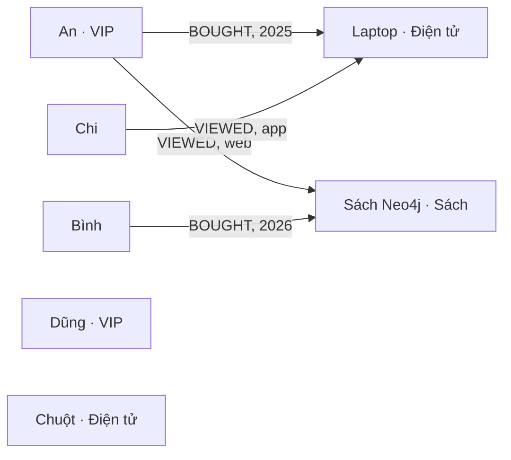

# WHERE để lọc thuộc tính, nhãn, kiểu quan hệ và sự tồn tại

Trong Neo4j, dữ liệu được tổ chức theo mô hình **property graph**: nút (node) có nhãn và thuộc tính, còn quan hệ (relationship) có loại, hướng và thuộc tính riêng. Mệnh đề `MATCH` của Cypher tìm các mẫu đồ thị; **`WHERE`** bổ sung điều kiện để chỉ giữ những kết quả phù hợp với yêu cầu nghiệp vụ.

Bài này thuộc chương **Truy vấn đọc** của module `DATABASE_ENGINE_GRAPH_NEO4J`, tập trung vào bốn nhóm điều kiện thường gặp: **thuộc tính**, **nhãn nút**, **kiểu quan hệ** và **sự tồn tại**. Nắm vững chúng giúp viết truy vấn liên kết chính xác, tránh lọc nhầm dữ liệu khi tìm đường đi, đồng thời tạo nền tảng cho tối ưu index/constraint và tích hợp với Java Driver hoặc Spring Data Neo4j.

## 1. Mục tiêu học tập

Sau bài này, bạn có thể:

1. Dùng `WHERE` với toán tử so sánh, logic, chuỗi và danh sách trên thuộc tính nút hoặc quan hệ.
2. Lọc nút theo **nhãn** và theo các điều kiện kết hợp giữa nhãn với thuộc tính.
3. Lọc theo **loại quan hệ** bằng `type(r)` và phân biệt với lọc theo nhãn nút.
4. Kiểm tra thuộc tính có giá trị bằng `IS [NOT] NULL` và kiểm tra sự tồn tại của mẫu quan hệ bằng `EXISTS { ... }`.
5. Hiểu hành vi của `null`, vị trí `WHERE` sau `OPTIONAL MATCH`, cách tham số hóa và cách đánh giá hiệu năng.

## 2. Bộ dữ liệu thực hành

Giả sử một cửa hàng cần trả lời các câu hỏi như: “Khách hàng VIP nào đang hoạt động?”, “Ai đã mua sản phẩm?”, “Ai chưa mua sản phẩm nào?” hoặc “Khách hàng nào từng xem sản phẩm điện tử?”. Ta sẽ dùng hai loại nút `RQ004Customer`, `RQ004Product`, hai loại quan hệ `BOUGHT`, `VIEWED` và một nhãn bổ sung `RQ004VIP`.

Chạy phần chuẩn bị sau **chỉ trong cơ sở dữ liệu thực hành**. Các khóa `key` và nhãn `RQ004...` dành riêng cho bài này để tránh xung đột với bài khác. `MERGE` phù hợp để chạy lại trên dữ liệu mẫu sạch khi mỗi khóa chỉ đại diện một nút và không có quan hệ song song cùng mẫu.

```cypher
MERGE (an:RQ004Customer {key: 'c01'})
SET an.name = 'An', an.city = 'Hà Nội',
    an.age = 28, an.active = true,
    an.email = 'an@example.test'
SET an:RQ004VIP

MERGE (binh:RQ004Customer {key: 'c02'})
SET binh.name = 'Bình', binh.city = 'Đà Nẵng',
    binh.age = 34, binh.active = true,
    binh.email = 'binh@example.test'

MERGE (chi:RQ004Customer {key: 'c03'})
SET chi.name = 'Chi', chi.city = 'Hà Nội',
    chi.age = 30, chi.active = false
REMOVE chi.email

MERGE (dung:RQ004Customer {key: 'c04'})
SET dung.name = 'Dũng', dung.city = 'TP. Hồ Chí Minh',
    dung.age = 22, dung.active = true
SET dung:RQ004VIP
REMOVE dung.email

MERGE (laptop:RQ004Product {key: 'p01'})
SET laptop.name = 'Laptop', laptop.category = 'Điện tử',
    laptop.price = 22000000, laptop.available = true

MERGE (book:RQ004Product {key: 'p02'})
SET book.name = 'Sách Neo4j', book.category = 'Sách',
    book.price = 380000, book.available = true

MERGE (mouse:RQ004Product {key: 'p03'})
SET mouse.name = 'Chuột', mouse.category = 'Điện tử',
    mouse.price = 450000, mouse.available = false

MERGE (an)-[b1:BOUGHT]->(laptop)
SET b1.year = 2025, b1.quantity = 1
MERGE (binh)-[b2:BOUGHT]->(book)
SET b2.year = 2026, b2.quantity = 2
MERGE (an)-[v1:VIEWED]->(book)
SET v1.channel = 'web'
MERGE (chi)-[v2:VIEWED]->(laptop)
SET v2.channel = 'app';
```

Sơ đồ dữ liệu:



| Nhóm dữ liệu | Số lượng | Ghi chú |
| --- | ---: | --- |
| `RQ004Customer` | 4 | An, Bình, Chi, Dũng |
| Khách có thêm nhãn `RQ004VIP` | 2 | An, Dũng |
| `RQ004Product` | 3 | Laptop, Sách Neo4j, Chuột |
| Quan hệ `BOUGHT` | 2 | An → Laptop, Bình → Sách Neo4j |
| Quan hệ `VIEWED` | 2 | An → Sách Neo4j, Chi → Laptop |
| Khách không có thuộc tính `email` | 2 | Chi, Dũng |

Mọi ví dụ trả kết quả dự kiến bên dưới đều giả định chỉ có đúng bộ dữ liệu này đối với các nhãn `RQ004...`.

## 3. Cú pháp và vai trò của WHERE

Cấu trúc thông dụng nhất:

```cypher
MATCH (c:RQ004Customer)
WHERE c.active = true
RETURN c.key AS customerKey, c.name AS customer
ORDER BY customerKey;
```

Kết quả: **An, Bình, Dũng**. Chi bị loại vì `active = false`.

Trong Cypher, `WHERE` là phần điều kiện gắn với `MATCH` (hoặc `OPTIONAL MATCH`); nó cũng có thể dùng sau `WITH` để lọc các dòng được chuyển sang phần truy vấn tiếp theo. `WHERE` giữ lại các dòng mà biểu thức điều kiện được đánh giá là **`true`**; cả `false` lẫn `null` đều không được giữ.

Một mẫu đơn giản có thể lọc bằng bản đồ thuộc tính:

```cypher
MATCH (c:RQ004Customer {city: 'Hà Nội'})
RETURN c.name AS customer
ORDER BY customer;
```

Tương đương về ý nghĩa lọc với:

```cypher
MATCH (c:RQ004Customer)
WHERE c.city = 'Hà Nội'
RETURN c.name AS customer
ORDER BY customer;
```

Hai câu đều tìm **An và Chi**. Với điều kiện khác phép bằng hoặc kết hợp nhiều kiểu điều kiện, `WHERE` thường rõ ràng hơn.

## 4. Lọc theo thuộc tính nút

### 4.1. So sánh bằng, khác và khoảng giá trị

| Toán tử | Ví dụ | Ý nghĩa |
| --- | --- | --- |
| `=` | `c.city = 'Hà Nội'` | Giá trị bằng chuỗi chỉ định |
| `<>` | `c.city <> 'Hà Nội'` | Giá trị khác chuỗi chỉ định |
| `>`, `>=` | `c.age >= 28` | Lớn hơn / lớn hơn hoặc bằng |
| `<`, `<=` | `p.price < 1000000` | Nhỏ hơn / nhỏ hơn hoặc bằng |
| `IN` | `c.age IN [22, 28]` | Bằng một giá trị trong danh sách |

Ví dụ tìm khách 25–35 tuổi và đang hoạt động:

```cypher
MATCH (c:RQ004Customer)
WHERE c.age >= 25 AND c.age <= 35 AND c.active = true
RETURN c.name AS customer, c.age AS age
ORDER BY age, customer;
```

Kết quả: **An (28 tuổi)** và **Bình (34 tuổi)**. Chi 30 tuổi nhưng không hoạt động; Dũng 22 tuổi nên không đạt khoảng tuổi.

Ví dụ lọc theo danh sách địa điểm:

```cypher
MATCH (c:RQ004Customer)
WHERE c.city IN ['Hà Nội', 'Đà Nẵng']
RETURN c.name AS customer, c.city AS city
ORDER BY c.key;
```

Kết quả: **An, Bình, Chi**.

> **Kiểu dữ liệu và chữ hoa/thường:** `c.age = 28` khác `c.age = '28'` vì một vế là số, một vế là chuỗi. So sánh chuỗi thông thường có phân biệt chữ hoa/chữ thường và dấu tiếng Việt. Tên thuộc tính `city` cũng khác `City`.

### 4.2. Kết hợp điều kiện bằng AND, OR, NOT

```cypher
MATCH (c:RQ004Customer)
WHERE c.active = true
  AND (c.city = 'Hà Nội' OR c.city = 'Đà Nẵng')
RETURN c.name AS customer
ORDER BY c.key;
```

Kết quả: **An và Bình**. Dấu ngoặc giúp làm rõ: khách phải hoạt động và ở một trong hai thành phố. Với biểu thức phức tạp, dùng ngoặc để tránh phụ thuộc vào việc người đọc nhớ thứ tự ưu tiên của `NOT`, `AND`, `OR`.

Ví dụ phủ định:

```cypher
MATCH (c:RQ004Customer)
WHERE NOT (c.city = 'Hà Nội')
RETURN c.name AS customer
ORDER BY c.key;
```

Kết quả: **Bình và Dũng**. Nếu `city` không tồn tại, biểu thức `NOT (c.city = 'Hà Nội')` cho kết quả `null` thay vì tự động là `true`; xem thêm phần xử lý null.

### 4.3. Lọc chuỗi và biểu thức

```cypher
MATCH (c:RQ004Customer)
WHERE c.name STARTS WITH 'A'
RETURN c.name AS customer;
```

Kết quả: **An**. Một số phép thường dùng:

| Cú pháp | Ví dụ | Cách hiểu |
| --- | --- | --- |
| `STARTS WITH` | `c.name STARTS WITH 'A'` | Bắt đầu bằng chuỗi |
| `ENDS WITH` | `c.name ENDS WITH 'nh'` | Kết thúc bằng chuỗi |
| `CONTAINS` | `p.name CONTAINS 'Neo4j'` | Chứa chuỗi con |
| `=~` | `c.name =~ 'A.*'` | Khớp biểu thức chính quy trên toàn chuỗi |

Để tìm tên không phân biệt hoa/thường có thể viết:

```cypher
MATCH (c:RQ004Customer)
WHERE toLower(c.name) = toLower($name)
RETURN c.key AS customerKey, c.name AS customer;
```

Với `name = 'an'`, kết quả là An. Tuy nhiên, bọc thuộc tính bằng hàm như `toLower(c.name)` có thể hạn chế việc sử dụng range index thông thường cho so sánh trực tiếp. Trên hệ thống lớn, cân nhắc một thuộc tính tìm kiếm đã chuẩn hóa và index tương ứng; việc chuyển chữ hoa/thường không giải quyết mọi quy tắc về dấu tiếng Việt.

## 5. Lọc theo nhãn nút

**Nhãn (label)** phân loại nút; **thuộc tính (property)** lưu giá trị trên nút. Một nút có thể mang nhiều nhãn. Trong bộ dữ liệu mẫu, An và Dũng vừa có `RQ004Customer` vừa có `RQ004VIP`.

### 5.1. Dùng nhãn ngay trong MATCH

```cypher
MATCH (c:RQ004Customer:RQ004VIP)
RETURN c.name AS vipCustomer
ORDER BY c.key;
```

Kết quả: **An, Dũng**. Mẫu hai nhãn đòi hỏi nút phải có **cả hai nhãn**.

### 5.2. Dùng điều kiện nhãn trong WHERE

```cypher
MATCH (c:RQ004Customer)
WHERE c:RQ004VIP AND c.active = true
RETURN c.name AS activeVip
ORDER BY c.key;
```

Kết quả: **An, Dũng**. Biểu thức `c:RQ004VIP` kiểm tra nút `c` có nhãn `RQ004VIP` hay không. Nó không phải phép so sánh một thuộc tính tên `RQ004VIP`.

Tìm người đang hoạt động nhưng **không** mang nhãn VIP:

```cypher
MATCH (c:RQ004Customer)
WHERE NOT c:RQ004VIP AND c.active = true
RETURN c.name AS regularActiveCustomer;
```

Kết quả: **Bình**.

| Nhu cầu | Cú pháp phù hợp |
| --- | --- |
| Chỉ tìm khách VIP | `MATCH (c:RQ004Customer:RQ004VIP)` |
| Tìm khách, sau đó lọc VIP cùng điều kiện khác | `WHERE c:RQ004VIP AND c.active = true` |
| Lọc khách không phải VIP | `WHERE NOT c:RQ004VIP` |
| Lấy tên các nhãn để hiển thị/kiểm tra | `RETURN labels(c) AS labels` |

Trong truy vấn động, không nên ghép trực tiếp tên nhãn không được kiểm soát từ người dùng vào câu Cypher. Tùy phiên bản Neo4j, khả năng biểu diễn nhãn động khác nhau; nếu ứng dụng dùng tên nhãn linh hoạt, hãy kiểm tra cú pháp của phiên bản đang triển khai và xác thực danh sách nhãn cho phép.

## 6. Lọc theo kiểu và thuộc tính quan hệ

Loại quan hệ (relationship type) như `BOUGHT` hoặc `VIEWED` **không phải nhãn của nút**. Thông thường, ta giới hạn loại ngay trong mẫu:

```cypher
MATCH (c:RQ004Customer)-[r:BOUGHT]->(p:RQ004Product)
RETURN c.name AS customer, p.name AS product, r.year AS year
ORDER BY c.key;
```

Kết quả:

| customer | product | year |
| --- | --- | ---: |
| An | Laptop | 2025 |
| Bình | Sách Neo4j | 2026 |

### 6.1. Dùng type(r) trong WHERE

Khi đã gán biến `r` cho quan hệ, hàm `type(r)` trả về tên loại quan hệ dưới dạng chuỗi:

```cypher
MATCH (c:RQ004Customer)-[r]->(p:RQ004Product)
WHERE type(r) = 'VIEWED'
RETURN c.name AS customer, p.name AS product, r.channel AS channel
ORDER BY c.key;
```

Kết quả:

| customer | product | channel |
| --- | --- | --- |
| An | Sách Neo4j | web |
| Chi | Laptop | app |

Lọc nhiều loại cùng lúc bằng `IN`:

```cypher
MATCH (c:RQ004Customer)-[r]->(p:RQ004Product)
WHERE type(r) IN ['BOUGHT', 'VIEWED']
  AND p.price > 1000000
RETURN c.name AS customer,
       type(r) AS action,
       p.name AS product
ORDER BY c.key, action;
```

Kết quả: **An – BOUGHT – Laptop** và **Chi – VIEWED – Laptop**. Sách Neo4j bị loại vì giá nhỏ hơn một triệu đồng; Chuột chưa có quan hệ với khách nào.

**Chọn cách lọc nào?** Nếu đã biết chính xác loại quan hệ, `-[r:BOUGHT]->` thường dễ đọc và cung cấp thêm thông tin cho bộ tối ưu. Nếu điều kiện loại phụ thuộc vào biểu thức hoặc một tập loại, `type(r)` hữu ích; song đừng dùng nó khi một mẫu có loại cố định đơn giản đã đủ diễn đạt ý định.

### 6.2. Lọc thuộc tính quan hệ kết hợp thuộc tính nút

```cypher
MATCH (c:RQ004Customer)-[r:BOUGHT]->(p:RQ004Product)
WHERE r.year >= 2026 AND p.available = true
RETURN c.name AS customer,
       p.name AS product,
       r.quantity AS quantity,
       r.year AS year;
```

Kết quả: **Bình – Sách Neo4j – số lượng 2 – năm 2026**. `r.year` và `r.quantity` là thuộc tính của quan hệ; `p.available` là thuộc tính của nút sản phẩm.

**Hướng quan hệ vẫn quan trọng:** mẫu `(c)-[r:BOUGHT]->(p)` tìm hành động mua đi từ khách đến sản phẩm. Nếu viết ngược `(c)<-[r:BOUGHT]-(p)` với dữ liệu mẫu này, không có kết quả. Điều kiện `WHERE` không tự đảo hướng của `MATCH`.

## 7. Kiểm tra sự tồn tại của thuộc tính

Không phải mọi nút đều có cùng tập thuộc tính. Chẳng hạn Chi và Dũng chưa có `email`. Khi truy cập một thuộc tính vắng mặt, Cypher trả về `null`.

Tìm khách **có email**:

```cypher
MATCH (c:RQ004Customer)
WHERE c.email IS NOT NULL
RETURN c.name AS customer, c.email AS email
ORDER BY c.key;
```

Kết quả: **An** và **Bình**.

Tìm khách **thiếu email**:

```cypher
MATCH (c:RQ004Customer)
WHERE c.email IS NULL
RETURN c.name AS customer
ORDER BY c.key;
```

Kết quả: **Chi** và **Dũng**.

| Biểu thức | Với `email` tồn tại | Với `email` không tồn tại |
| --- | --- | --- |
| `c.email IS NOT NULL` | `true` | `false` |
| `c.email IS NULL` | `false` | `true` |
| `c.email = 'an@example.test'` | `true` hoặc `false` tùy giá trị | `null` |
| `c.email <> 'an@example.test'` | `true` hoặc `false` tùy giá trị | `null` |

**Không dùng** `c.email = null` hay `c.email <> null` để kiểm tra thiếu dữ liệu. Các phép so sánh đó không cho kết quả `true` khi thuộc tính thiếu. Đối với thuộc tính nút/quan hệ, hãy ưu tiên `IS NULL` và `IS NOT NULL`. Cú pháp hàm `exists(n.property)` trong tài liệu Cypher cũ đã bị thay thế/loại bỏ ở các phiên bản mới; `IS NOT NULL` là cách hiện đại, rõ nghĩa.

Nếu cần giá trị hiển thị mặc định, có thể dùng `coalesce`:

```cypher
MATCH (c:RQ004Customer)
RETURN c.name AS customer,
       coalesce(c.email, 'Chưa cập nhật') AS emailDisplay
ORDER BY c.key;
```

Lưu ý `coalesce` không làm thuộc tính thiếu xuất hiện trong dữ liệu; nó chỉ chọn giá trị thay thế cho biểu thức trả về.

### 7.1. Logic ba giá trị

Trong Cypher, biểu thức logic có thể là `true`, `false` hoặc `null`. Ví dụ:

```cypher
MATCH (c:RQ004Customer)
WHERE NOT (c.email = 'an@example.test')
RETURN c.name AS customer
ORDER BY c.key;
```

Kết quả chỉ có **Bình**. An bị loại vì email khớp; Chi và Dũng cũng bị loại vì email thiếu, phép so sánh trả `null`, rồi `NOT null` vẫn là `null`.

Nếu muốn “không có email bằng địa chỉ trên, **kể cả chưa có email**”, phải diễn đạt rõ:

```cypher
MATCH (c:RQ004Customer)
WHERE c.email IS NULL
   OR c.email <> 'an@example.test'
RETURN c.name AS customer
ORDER BY c.key;
```

Kết quả: **Bình, Chi, Dũng**.

## 8. Kiểm tra sự tồn tại của mẫu quan hệ bằng EXISTS

Kiểm tra thuộc tính `IS NOT NULL` và kiểm tra mẫu đồ thị **`EXISTS { ... }`** là hai nhu cầu khác nhau. `EXISTS` trả về điều kiện đúng/sai tùy có ít nhất một dòng khớp trong truy vấn con hay không.

### 8.1. Khách đã mua ít nhất một sản phẩm

```cypher
MATCH (c:RQ004Customer)
WHERE EXISTS {
  MATCH (c)-[:BOUGHT]->(:RQ004Product)
}
RETURN c.name AS buyer
ORDER BY c.key;
```

Kết quả: **An, Bình**. Biến `c` bên trong `EXISTS { ... }` tham chiếu **cùng nút khách hàng** của truy vấn ngoài, nhờ đó kiểm tra sự tồn tại gắn với từng khách cụ thể.

`EXISTS` không cần trả về từng sản phẩm đã mua: chỉ cần ít nhất một mẫu khớp thì điều kiện là `true`. Điều này tránh nhân số dòng khi một khách mua nhiều sản phẩm mà câu hỏi chỉ cần danh sách khách.

### 8.2. Khách chưa từng mua sản phẩm nào

```cypher
MATCH (c:RQ004Customer)
WHERE NOT EXISTS {
  MATCH (c)-[:BOUGHT]->(:RQ004Product)
}
RETURN c.name AS nonBuyer
ORDER BY c.key;
```

Kết quả: **Chi, Dũng**. Chi có quan hệ `VIEWED` nhưng chưa có `BOUGHT`; Dũng chưa có quan hệ với sản phẩm.

### 8.3. Tồn tại quan hệ kèm điều kiện trên nút đích

Tìm những khách **đã xem ít nhất một sản phẩm thuộc nhóm Điện tử**:

```cypher
MATCH (c:RQ004Customer)
WHERE EXISTS {
  MATCH (c)-[:VIEWED]->(p:RQ004Product)
  WHERE p.category = 'Điện tử'
}
RETURN c.name AS viewer
ORDER BY c.key;
```

Kết quả: **Chi**. An từng xem Sách Neo4j nhưng sản phẩm này thuộc nhóm Sách.

### 8.4. Kết hợp nhãn, thuộc tính và EXISTS

Tìm khách **VIP**, **đang hoạt động** và **đã mua sản phẩm từ một triệu đồng trở lên**:

```cypher
MATCH (c:RQ004Customer)
WHERE c:RQ004VIP
  AND c.active = true
  AND EXISTS {
    MATCH (c)-[:BOUGHT]->(p:RQ004Product)
    WHERE p.price >= 1000000
  }
RETURN c.name AS vipBuyer;
```

Kết quả: **An**. Dũng là VIP đang hoạt động nhưng chưa mua hàng.

### 8.5. Phân biệt EXISTS, MATCH và OPTIONAL MATCH

| Ý định nghiệp vụ | Hướng tiếp cận |
| --- | --- |
| Chỉ cần biết một khách **có** quan hệ mua nào hay không | `WHERE EXISTS { MATCH (c)-[:BOUGHT]->(...) }` |
| Chỉ lấy khách **không có** quan hệ mua | `WHERE NOT EXISTS { MATCH (c)-[:BOUGHT]->(...) }` |
| Cần trả về **từng sản phẩm** khách đã mua | `MATCH (c)-[:BOUGHT]->(p) RETURN ...` |
| Cần giữ khách **ngay cả khi không mua** | `OPTIONAL MATCH (c)-[:BOUGHT]->(p)` |
| Cần kiểm tra **thuộc tính email** có giá trị | `WHERE c.email IS NOT NULL` |

Không nên viết truy vấn trả về mọi quan hệ rồi `DISTINCT` để mô phỏng phép kiểm tra sự tồn tại khi bản chất bài toán chỉ hỏi “có hay không”.

## 9. Vị trí WHERE với OPTIONAL MATCH

`OPTIONAL MATCH` giữ các dòng hiện có khi mẫu quan hệ không khớp và gán `null` cho những biến không tìm thấy. **`WHERE` đi ngay sau `OPTIONAL MATCH` là điều kiện của phép ghép tùy chọn**, nên cần chú ý sự khác biệt giữa lọc mẫu quan hệ và lọc các dòng kết quả.

### 9.1. Giữ mọi khách, chỉ lấy sản phẩm mua giá cao

```cypher
MATCH (c:RQ004Customer)
OPTIONAL MATCH (c)-[:BOUGHT]->(p:RQ004Product)
WHERE p.price >= 1000000
RETURN c.name AS customer,
       collect(p.name) AS expensivePurchases
ORDER BY c.key;
```

Kết quả:

| customer | expensivePurchases |
| --- | --- |
| An | `['Laptop']` |
| Bình | `[]` |
| Chi | `[]` |
| Dũng | `[]` |

Điều kiện giá là một phần của `OPTIONAL MATCH`. Với Bình, sản phẩm Sách Neo4j không đạt điều kiện giá nên phần ghép tùy chọn không khớp, nhưng **dòng khách Bình vẫn được giữ**. Hàm `collect` bỏ qua giá trị `null`, vì vậy ta nhận danh sách rỗng.

### 9.2. Lọc dòng sau OPTIONAL MATCH

```cypher
MATCH (c:RQ004Customer)
OPTIONAL MATCH (c)-[:BOUGHT]->(p:RQ004Product)
WITH c, p
WHERE p.price >= 1000000
RETURN c.name AS customer, p.name AS product;
```

Kết quả **chỉ còn An – Laptop**. Ở đây `WHERE` nằm **sau `WITH`**, vì thế nó lọc những dòng đã ghép. Các dòng có `p = null` (Chi, Dũng) và dòng có sản phẩm giá thấp (Bình) đều bị loại.

**Quy tắc thực hành:** khi muốn giữ nút gốc ngay cả khi không có quan hệ thỏa điều kiện, gắn `WHERE` với `OPTIONAL MATCH` tương ứng; khi muốn loại cả dòng kết quả không đạt, lọc ở giai đoạn sau, chẳng hạn với `WITH ... WHERE`.

## 10. Truy vấn tham số trong ứng dụng

Ở ứng dụng thực, dữ liệu lọc có thể đến từ ô tìm kiếm, API hoặc cấu hình. Tham số `$...` giúp tách câu lệnh khỏi giá trị đầu vào và tránh ghép chuỗi Cypher trực tiếp.

```cypher
MATCH (c:RQ004Customer)
WHERE c.city = $city
  AND c.active = $active
  AND c.age >= $minAge
RETURN c.key AS customerKey, c.name AS customer
ORDER BY customerKey;
```

Với tham số `city = 'Hà Nội'`, `active = true` và `minAge = 25`, kết quả là **An**.

Ví dụ sử dụng Java Driver (giả định biến `driver` đã được cấu hình, dùng phiên bản Driver hỗ trợ `executeRead`):

```java
import java.util.List;
import java.util.Map;
import org.neo4j.driver.Driver;

public class CustomerSearch {
    public static List<String> findActiveNames(Driver driver, String city) {
        try (var session = driver.session()) {
            return session.executeRead(tx ->
                tx.run("""
                    MATCH (c:RQ004Customer)
                    WHERE c.city = $city AND c.active = true
                    RETURN c.name AS name
                    ORDER BY c.key
                    """, Map.of("city", city))
                  .list(record -> record.get("name").asString())
            );
        }
    }
}
```

Gọi `findActiveNames(driver, "Hà Nội")` trả về `[An]`. Nguyên tắc tương tự áp dụng cho truy vấn `@Query` có binding tham số trong Spring Data Neo4j. Giá trị thuộc tính và tham số nên có kiểu dữ liệu đúng: `$minAge` là số, `$active` là boolean.

## 11. Kiểm tra hiệu năng khi lọc bằng WHERE

Điều kiện `WHERE` không nhất thiết được đánh giá theo đúng thứ tự từ trái sang phải như viết trong văn bản; **Cypher planner** có thể chọn kế hoạch tối ưu tùy thống kê dữ liệu, index và mô hình truy vấn. Đừng đoán rằng điều kiện viết trước luôn chạy trước.

Trên cơ sở dữ liệu thử nghiệm, bạn có thể cân nhắc index cho thuộc tính thường tìm:

```cypher
CREATE RANGE INDEX rq004_customer_city_idx IF NOT EXISTS
FOR (c:RQ004Customer) ON (c.city);
```

Nếu mỗi khách có `key` duy nhất, constraint sau giúp bảo đảm tính duy nhất và hỗ trợ tra cứu:

```cypher
CREATE CONSTRAINT rq004_customer_key_unique IF NOT EXISTS
FOR (c:RQ004Customer) REQUIRE c.key IS UNIQUE;
```

Constraint có thể thất bại nếu các nút hiện tại đã có `key` trùng nhau. Tùy phiên bản và loại index, không phải mọi phép lọc chuỗi hoặc phép gọi hàm trên thuộc tính đều sử dụng index giống nhau.

Xem kế hoạch **mà chưa thực thi** câu truy vấn:

```cypher
EXPLAIN
MATCH (c:RQ004Customer)
WHERE c.city = 'Hà Nội' AND c.active = true
RETURN c.key, c.name;
```

Khi muốn xem số dòng và truy cập dữ liệu thực tế, có thể dùng `PROFILE` (lệnh này **thực thi** truy vấn):

```cypher
PROFILE
MATCH (c:RQ004Customer)
WHERE c.city = 'Hà Nội' AND c.active = true
RETURN c.key, c.name;
```

Nên quan sát:

1. Truy vấn bắt đầu từ nhãn và/hoặc thuộc tính có độ chọn lọc phù hợp chưa?
2. Có thao tác tìm kiếm index, quét nhãn hay quét toàn bộ nút? Kế hoạch thực tế do planner quyết định.
3. Điều kiện lọc có giảm số dòng trước các bước mở rộng quan hệ lớn không?
4. Cần đếm sự tồn tại hay trả toàn bộ quan hệ? `EXISTS { ... }` thường diễn đạt đúng hơn nếu chỉ hỏi có/không.
5. Có xử lý `null` và hướng quan hệ đúng ngữ nghĩa không? Một kế hoạch nhanh vẫn là sai nếu lọc nhầm dữ liệu.

Index và constraint giúp truy cập dữ liệu hiệu quả hơn, nhưng **không sửa được** điều kiện `WHERE` sai hoặc mẫu quan hệ thiếu kết nối.

## 12. Lỗi thường gặp

| Hiện tượng | Nguyên nhân thường gặp | Cách sửa |
| --- | --- | --- |
| Tìm khách VIP nhưng không thấy ai | Nhầm `RQ004VIP` là thuộc tính `c.RQ004VIP` thay vì nhãn. | Dùng `WHERE c:RQ004VIP` hoặc mẫu có nhãn. |
| Tìm khách đã mua mà ra cả khách chỉ xem | Không lọc `type(r)` hoặc mẫu quan hệ không giới hạn loại. | Dùng `-[r:BOUGHT]->` hoặc `WHERE type(r) = 'BOUGHT'`. |
| Không tìm ra khách thiếu email | Viết `c.email = null`. | Dùng `c.email IS NULL`. |
| `NOT (c.email = '...')` không giữ người thiếu email | `NOT null` vẫn là `null`. | Thêm `c.email IS NULL OR ...` nếu muốn bao gồm giá trị thiếu. |
| Muốn giữ mọi khách nhưng kết quả chỉ có người đã mua | `WHERE` được đặt sau `WITH` và lọc luôn dòng không khớp. | Đặt điều kiện đúng vào `OPTIONAL MATCH` hoặc cấu trúc lại mục tiêu. |
| Trả trùng khách có nhiều lần mua | Dùng `MATCH` rồi trả một dòng cho mỗi quan hệ. | Dùng `EXISTS { ... }` nếu chỉ cần kiểm tra có mua, hoặc `DISTINCT` khi thực sự cần loại trùng. |
| Truy vấn chạy chậm sau khi dùng hàm trên thuộc tính | Biểu thức có thể hạn chế index thông thường. | Xem `PROFILE`; cân nhắc thuộc tính chuẩn hóa và index thích hợp. |
| Kết quả rỗng dù biết có quan hệ | Sai hướng `->`/`<-`, kiểu quan hệ hoặc chữ hoa/thường của chuỗi. | Kiểm tra mẫu `MATCH` và loại/hướng đã lưu. |

## 13. Bài tập tự luyện

Hãy dùng bộ dữ liệu mục 2 và tự dự đoán số dòng trước khi xem đáp án.

**Bài 1.** Tìm các khách đang hoạt động, từ 25 tuổi trở lên, ở Hà Nội hoặc Đà Nẵng.

**Bài 2.** Tìm khách mang nhãn `RQ004VIP` nhưng chưa mua sản phẩm nào.

**Bài 3.** Tìm khách đã thực hiện hành động `BOUGHT` hoặc `VIEWED` với sản phẩm thuộc nhóm `Điện tử`. Trả về tên khách, loại hành động và tên sản phẩm.

**Bài 4.** Tìm khách chưa có `email` nhưng **đã xem** ít nhất một sản phẩm.

**Bài 5.** Viết truy vấn trả về **mọi khách** và tên sản phẩm đã mua có giá từ 1 triệu đồng, kể cả khách không có sản phẩm phù hợp.

**Bài 6.** Phân tích vì sao truy vấn sau không trả về Chi và Dũng:

```cypher
MATCH (c:RQ004Customer)
WHERE c.email <> 'an@example.test'
RETURN c.name;
```

### Đáp án tham khảo

**Bài 1**

```cypher
MATCH (c:RQ004Customer)
WHERE c.active = true
  AND c.age >= 25
  AND c.city IN ['Hà Nội', 'Đà Nẵng']
RETURN c.name AS customer
ORDER BY c.key;
```

Kết quả: **An và Bình**.

**Bài 2**

```cypher
MATCH (c:RQ004Customer)
WHERE c:RQ004VIP
  AND NOT EXISTS {
    MATCH (c)-[:BOUGHT]->(:RQ004Product)
  }
RETURN c.name AS vipWithoutPurchase;
```

Kết quả: **Dũng**.

**Bài 3**

```cypher
MATCH (c:RQ004Customer)-[r]->(p:RQ004Product)
WHERE type(r) IN ['BOUGHT', 'VIEWED']
  AND p.category = 'Điện tử'
RETURN c.name AS customer,
       type(r) AS action,
       p.name AS product
ORDER BY c.key, action;
```

Kết quả: **An – BOUGHT – Laptop** và **Chi – VIEWED – Laptop**.

**Bài 4**

```cypher
MATCH (c:RQ004Customer)
WHERE c.email IS NULL
  AND EXISTS {
    MATCH (c)-[:VIEWED]->(:RQ004Product)
  }
RETURN c.name AS viewerWithoutEmail;
```

Kết quả: **Chi**.

**Bài 5**

```cypher
MATCH (c:RQ004Customer)
OPTIONAL MATCH (c)-[:BOUGHT]->(p:RQ004Product)
WHERE p.price >= 1000000
RETURN c.name AS customer,
       collect(p.name) AS products
ORDER BY c.key;
```

Kết quả: **An = [Laptop]**, **Bình = []**, **Chi = []**, **Dũng = []**.

**Bài 6**

Với Chi và Dũng, `email` thiếu nên `c.email` là `null`. Biểu thức `null <> 'an@example.test'` có kết quả `null`, không phải `true`; vì vậy `WHERE` loại hai dòng này. Muốn giữ cả khách không có email:

```cypher
MATCH (c:RQ004Customer)
WHERE c.email IS NULL OR c.email <> 'an@example.test'
RETURN c.name AS customer
ORDER BY c.key;
```

Kết quả: **Bình, Chi, Dũng**.

## 14. Ghi nhớ

- `WHERE` bổ sung điều kiện cho `MATCH`, `OPTIONAL MATCH` hoặc lọc dòng sau `WITH`; chỉ biểu thức nhận giá trị `true` mới giữ kết quả.
- Lọc **thuộc tính** bằng các toán tử `=`, `<>`, `>=`, `IN`, logic và các phép chuỗi; chú ý đúng kiểu dữ liệu và chữ hoa/thường.
- Lọc **nhãn nút** bằng `n:Label` và lọc **loại quan hệ** bằng mẫu `-[r:TYPE]->` hoặc `type(r)`.
- Kiểm tra **thuộc tính có giá trị** bằng `IS NOT NULL`; kiểm tra **có mẫu quan hệ** bằng `EXISTS { MATCH ... }` và phủ định bằng `NOT EXISTS { ... }`.
- Hiểu `null` và sự khác biệt giữa `OPTIONAL MATCH ... WHERE` với `WITH ... WHERE` để tránh vô tình loại nút gốc.
- Tham số hóa giá trị đầu vào, thiết kế index phù hợp và dùng `EXPLAIN`/`PROFILE` để kiểm chứng trước khi tối ưu các truy vấn Neo4j trong ứng dụng Java/Spring.
