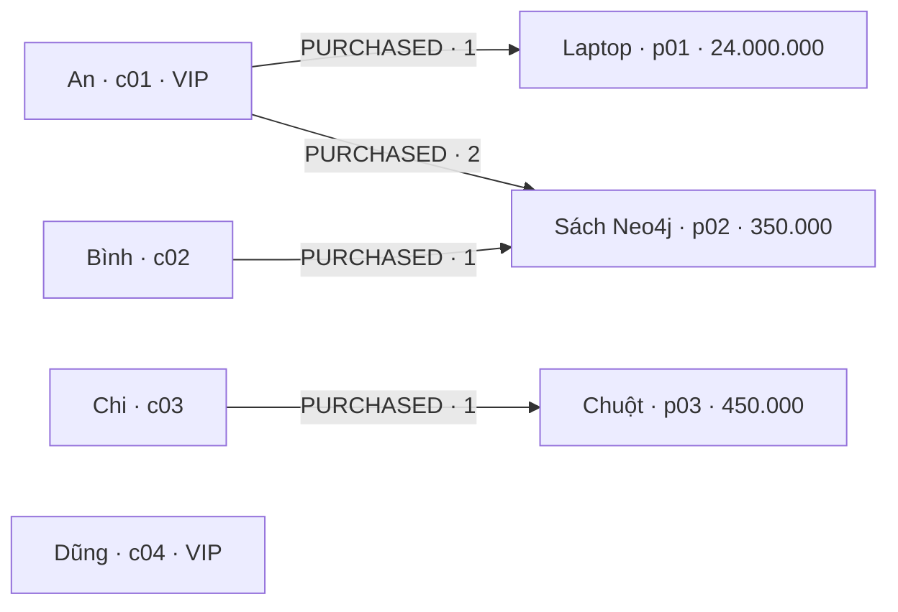

# RETURN để chọn trường, trả về thực thể và đặt bí danh

Trong **Neo4j**, dữ liệu được biểu diễn bằng **property graph** gồm nút (*node*), quan hệ (*relationship*) và các thuộc tính (*property*). Mệnh đề `MATCH` trong **Cypher** xác định những mẫu đồ thị phù hợp, còn **`RETURN`** quyết định dữ liệu nào của các mẫu đó được đưa ra kết quả truy vấn. Nắm được `RETURN` giúp bạn thiết kế dữ liệu đầu ra đúng nhu cầu: chỉ lấy vài thuộc tính, trả về nguyên nút hoặc quan hệ, biểu diễn đường đi, đặt bí danh, loại trùng và tổng hợp.

Bài học thuộc chương **Truy vấn đọc** của module `DATABASE_ENGINE_GRAPH_NEO4J`. Những ví dụ dưới đây liên hệ việc mô hình hóa dữ liệu liên kết, truy vấn quan hệ và đường đi với ứng dụng Java Driver hoặc Spring Data Neo4j. Phần tạo dữ liệu là để thực hành; trọng tâm của bài là **đọc và định dạng kết quả**, không phải các thao tác ghi.

## 1. Kết quả cần đạt

Sau khi học, bạn có thể:

1. Phân biệt kết quả trả về **thuộc tính**, **biểu thức**, **nút**, **quan hệ**, **đường đi**, **map** và **danh sách**.
2. Chỉ định cột và bí danh bằng `RETURN ... AS ...`; hiểu cách dùng bí danh ở `ORDER BY` và các bước `WITH`.
3. Dùng `RETURN DISTINCT` để loại trùng đúng ngữ nghĩa và tránh nhầm số dòng với số thực thể.
4. Kết hợp `RETURN` với `ORDER BY`, `SKIP`, `LIMIT`, `count`, `sum` và `collect`.
5. Chọn dạng dữ liệu trả về phù hợp cho API, giao diện hoặc Java Driver và kiểm tra kết quả trên bộ dữ liệu mẫu.

## 2. Dữ liệu thực hành tự chứa

Giả sử một hệ thống bán hàng lưu khách hàng, sản phẩm và những lần mua hàng. Để tránh xung đột với bài khác, ví dụ sử dụng nhãn riêng `RQ005Customer`, `RQ005Product` và thuộc tính `key`. Chạy phần khởi tạo sau **trong cơ sở dữ liệu thực hành**. Các lệnh `MERGE`/`SET` tạo hoặc cập nhật dữ liệu; chúng không phải một phần của truy vấn `RETURN`.

```cypher
MERGE (an:RQ005Customer {key: 'c01'})
SET an.name = 'An', an.city = 'Hà Nội',
    an.active = true, an.email = 'an@example.test'
SET an:RQ005VIP

MERGE (binh:RQ005Customer {key: 'c02'})
SET binh.name = 'Bình', binh.city = 'Đà Nẵng',
    binh.active = true, binh.email = 'binh@example.test'

MERGE (chi:RQ005Customer {key: 'c03'})
SET chi.name = 'Chi', chi.city = 'Hà Nội',
    chi.active = false
REMOVE chi.email

MERGE (dung:RQ005Customer {key: 'c04'})
SET dung.name = 'Dũng', dung.city = 'TP. Hồ Chí Minh',
    dung.active = true
SET dung:RQ005VIP
REMOVE dung.email

MERGE (laptop:RQ005Product {key: 'p01'})
SET laptop.name = 'Laptop', laptop.price = 24000000,
    laptop.category = 'Điện tử'

MERGE (book:RQ005Product {key: 'p02'})
SET book.name = 'Sách Neo4j', book.price = 350000,
    book.category = 'Sách'

MERGE (mouse:RQ005Product {key: 'p03'})
SET mouse.name = 'Chuột', mouse.price = 450000,
    mouse.category = 'Điện tử'

MERGE (an)-[r1:PURCHASED]->(laptop)
SET r1.quantity = 1, r1.year = 2026
MERGE (an)-[r2:PURCHASED]->(book)
SET r2.quantity = 2, r2.year = 2026
MERGE (binh)-[r3:PURCHASED]->(book)
SET r3.quantity = 1, r3.year = 2025
MERGE (chi)-[r4:PURCHASED]->(mouse)
SET r4.quantity = 1, r4.year = 2026;
```

Đoạn trên giả định các nút có `key` riêng biệt và mỗi cặp khách–sản phẩm chỉ có một quan hệ `PURCHASED` trong dữ liệu mẫu. Với hệ thống thật, một khách có thể mua cùng sản phẩm nhiều lần; khi đó nên mô hình hóa một nút đơn hàng/giao dịch hoặc khóa định danh giao dịch rõ ràng, thay vì coi mỗi cặp khách–sản phẩm là một lần mua duy nhất.

Sơ đồ:



Tóm tắt dữ liệu mẫu:

| Tập dữ liệu | Số lượng | Chi tiết |
| --- | ---: | --- |
| Nút `RQ005Customer` | 4 | An, Bình, Chi, Dũng |
| Nút `RQ005Product` | 3 | Laptop, Sách Neo4j, Chuột |
| Quan hệ `PURCHASED` | 4 | An mua 2 loại sản phẩm; Bình và Chi mỗi người mua 1 loại |
| Khách chưa có quan hệ mua | 1 | Dũng |
| Khách không có thuộc tính `email` | 2 | Chi, Dũng |

Mọi kết quả minh họa tiếp theo giả định chỉ có các bản ghi mẫu trên trong các nhãn `RQ005...`.

## 3. Cấu trúc cơ bản của RETURN

```cypher
MATCH (c:RQ005Customer)
RETURN c.name;
```

`MATCH` ràng buộc biến `c` với từng nút khách hàng phù hợp. `RETURN c.name` lấy **giá trị thuộc tính `name`** của mỗi nút, vì vậy kết quả có một cột mặc định tên `c.name` và bốn dòng. Không có `ORDER BY` nên **thứ tự dòng không được bảo đảm**.

| Cú pháp | Dữ liệu trả về | Ví dụ ứng dụng |
| --- | --- | --- |
| `RETURN c.name` | Giá trị thuộc tính, như chuỗi | Danh sách tên khách |
| `RETURN c.key, c.name` | Nhiều cột giá trị | Danh sách khóa và tên |
| `RETURN c` | Đối tượng nút Neo4j | Xử lý nhãn và toàn bộ thuộc tính của nút |
| `RETURN r` | Đối tượng quan hệ | Xem loại, hướng, thuộc tính của quan hệ |
| `RETURN path` | Đối tượng đường đi | Minh họa chuỗi nút–quan hệ |
| `RETURN c { .key, .name }` | Map dựng từ thuộc tính nút | Định dạng cấu trúc phản hồi API |
| `RETURN count(c)` | Giá trị tổng hợp | Đếm khách hàng |

Một câu `RETURN` không tự tìm quan hệ hay dữ liệu: nó chỉ xuất những biến và biểu thức có sẵn tại vị trí đó. Trong một truy vấn thường có dạng `MATCH ... WHERE ... RETURN ... ORDER BY ... LIMIT ...`.

## 4. Chọn một hay nhiều thuộc tính

### 4.1. Chỉ lấy những trường cần dùng

```cypher
MATCH (c:RQ005Customer)
RETURN c.key, c.name, c.city
ORDER BY c.key;
```

Với dữ liệu mẫu, kết quả là:

| c.key | c.name | c.city |
| --- | --- | --- |
| c01 | An | Hà Nội |
| c02 | Bình | Đà Nẵng |
| c03 | Chi | Hà Nội |
| c04 | Dũng | TP. Hồ Chí Minh |

Đây là dạng **trả về scalar/giá trị**: mỗi thuộc tính trở thành một cột. Khi xây dựng API, chỉ chọn các trường ứng dụng thực sự cần để tránh truyền dữ liệu dư thừa, đặc biệt nếu nút có nhiều thuộc tính lớn hoặc nhạy cảm.

### 4.2. Đặt tên cột bằng AS

```cypher
MATCH (c:RQ005Customer)
RETURN c.key AS customerId,
       c.name AS customerName,
       c.city AS city
ORDER BY customerId;
```

Kết quả vẫn là bốn dòng như mục 4.1, nhưng tên cột nay là `customerId`, `customerName` và `city`. Từ khóa **`AS`** đặt *bí danh* cho biểu thức kết quả, không đổi tên thuộc tính được lưu trong graph.

Bạn nên dùng bí danh khi:

- Tên thuộc tính nội bộ khác tên cần hiển thị, ví dụ `c.key AS customerId`.
- Truy vấn lấy thuộc tính cùng tên từ nhiều nút, ví dụ `c.name AS customerName` và `p.name AS productName`.
- Trả về kết quả biểu thức hoặc tổng hợp, ví dụ `count(r) AS purchaseCount`.
- Ứng dụng Java dùng `record.get("customerName")` để đọc đúng cột.

### 4.3. Lấy thuộc tính từ nhiều thực thể kết nối

```cypher
MATCH (c:RQ005Customer)-[r:PURCHASED]->(p:RQ005Product)
RETURN c.name AS customer,
       p.name AS product,
       r.quantity AS quantity,
       p.price AS unitPrice
ORDER BY c.key, p.key;
```

Kết quả:

| customer | product | quantity | unitPrice |
| --- | --- | ---: | ---: |
| An | Laptop | 1 | 24000000 |
| An | Sách Neo4j | 2 | 350000 |
| Bình | Sách Neo4j | 1 | 350000 |
| Chi | Chuột | 1 | 450000 |

**Vì sao An xuất hiện hai dòng?** Mẫu `MATCH` tìm hai quan hệ mua hàng khác nhau của An, nên `RETURN` nhận hai dòng đầu vào. Dấu hiệu trùng tên khách ở đây là dữ liệu liên kết hợp lệ, không có nghĩa Cypher tự sao chép nút An.

## 5. Trả về nguyên nút, quan hệ hoặc đường đi

### 5.1. Trả về nút (node)

```cypher
MATCH (c:RQ005Customer {key: 'c01'})
RETURN c AS customerNode;
```

Cột `customerNode` chứa **một giá trị kiểu nút Neo4j**: nhãn (ví dụ `RQ005Customer` và `RQ005VIP` của An) cùng các thuộc tính `key`, `name`, `city`, `active`, `email`. Đây không phải chỉ là chuỗi tên hoặc một map tự dựng. Cách trình bày cụ thể phụ thuộc Neo4j Browser, API client hoặc driver.

Nút được trả về không tự bao gồm toàn bộ các quan hệ xung quanh nó trong kết quả dữ liệu. Nếu ứng dụng cần các quan hệ, bạn phải truy vấn và trả về chúng theo yêu cầu.

### 5.2. Trả về quan hệ (relationship)

```cypher
MATCH (c:RQ005Customer {key: 'c01'})
      -[r:PURCHASED]->
      (p:RQ005Product {key: 'p01'})
RETURN r AS purchaseRelationship;
```

Cột `purchaseRelationship` chứa **thực thể quan hệ** có loại `PURCHASED`, đầu bắt đầu là An, đầu kết thúc là Laptop và thuộc tính `quantity = 1`, `year = 2026`.

Nếu chỉ cần mô tả quan hệ bằng các trường có thể dùng trong bảng hoặc JSON, truy vấn trực tiếp:

```cypher
MATCH (c:RQ005Customer)-[r:PURCHASED]->(p:RQ005Product)
RETURN c.key AS customerId,
       p.key AS productId,
       type(r) AS relationshipType,
       r.quantity AS quantity
ORDER BY customerId, productId;
```

`type(r)` trả chuỗi tên loại quan hệ. `r.quantity` chỉ là giá trị thuộc tính, còn `r` là đối tượng quan hệ.

### 5.3. Trả về cả nút và quan hệ

```cypher
MATCH (c:RQ005Customer {key: 'c01'})-[r:PURCHASED]->(p:RQ005Product)
RETURN c AS customerNode, r AS purchaseRelationship, p AS productNode
ORDER BY p.key;
```

Truy vấn tạo **hai dòng**: An–quan hệ mua Laptop–Laptop và An–quan hệ mua Sách–Sách. Cả ba cột đều giữ kiểu dữ liệu graph tương ứng. Điều này hữu ích khi client cần phân tích cấu trúc kết nối.

### 5.4. Trả về đường đi (path)

```cypher
MATCH path = (c:RQ005Customer {key: 'c01'})
             -[:PURCHASED]->
             (p:RQ005Product)
RETURN path AS purchasePath;
```

Biến `path` đại diện một **đường đi** gồm các nút và quan hệ đã khớp. Với dữ liệu mẫu, An có hai đường đi một chặng: An → Laptop và An → Sách Neo4j.

Để xem các thành phần đường đi như dữ liệu riêng:

```cypher
MATCH path = (c:RQ005Customer {key: 'c01'})
             -[:PURCHASED]->
             (p:RQ005Product)
RETURN nodes(path) AS pathNodes,
       relationships(path) AS pathRelationships
ORDER BY p.key;
```

`nodes(path)` là danh sách các nút trên đường đi; `relationships(path)` là danh sách các quan hệ. Từ các ví dụ một chặng này có thể mở rộng đến bài toán tìm đường đi nhiều chặng trong graph.

> **Phân biệt:** `RETURN c` trả một nút; `RETURN properties(c)` trả map các thuộc tính của nút; `RETURN c.name` trả một giá trị chuỗi. Chúng có thể hiển thị thông tin tương tự nhưng **kiểu dữ liệu và khả năng xử lý phía client khác nhau**.

## 6. RETURN với biểu thức, hàm và giá trị null

### 6.1. Biểu thức tính toán

`RETURN` chấp nhận biểu thức, không giới hạn ở thuộc tính có sẵn:

```cypher
MATCH (c:RQ005Customer)-[r:PURCHASED]->(p:RQ005Product)
RETURN c.name AS customer,
       p.name AS product,
       r.quantity AS quantity,
       p.price AS unitPrice,
       r.quantity * p.price AS lineTotal
ORDER BY c.key, p.key;
```

Kết quả cột `lineTotal` lần lượt là:

| customer | product | lineTotal |
| --- | --- | ---: |
| An | Laptop | 24000000 |
| An | Sách Neo4j | 700000 |
| Bình | Sách Neo4j | 350000 |
| Chi | Chuột | 450000 |

`lineTotal` là **cột tính toán**, không phải một thuộc tính `lineTotal` đã được ghi vào quan hệ hay nút.

### 6.2. Hàm trên node và relationship

```cypher
MATCH (c:RQ005Customer {key: 'c01'})-[r:PURCHASED]->(p:RQ005Product)
RETURN labels(c) AS customerLabels,
       properties(p) AS productProperties,
       type(r) AS relationshipType,
       properties(r) AS relationshipProperties
ORDER BY p.key;
```

Ý nghĩa:

| Biểu thức | Loại kết quả | Mục đích |
| --- | --- | --- |
| `labels(c)` | Danh sách chuỗi nhãn | Kiểm tra nút có những nhãn nào |
| `properties(p)` | Map thuộc tính | Lấy các thuộc tính sản phẩm dưới dạng map |
| `type(r)` | Chuỗi | Lấy loại quan hệ |
| `properties(r)` | Map thuộc tính | Lấy `quantity`, `year` của quan hệ |
| `elementId(c)` | Chuỗi định danh phần tử do Neo4j cung cấp | Công cụ truy cập/đối chiếu theo phiên bản và phạm vi hệ thống |

Đối với định danh bền vững của nghiệp vụ, sử dụng `c.key` hoặc thuộc tính định danh riêng có constraint phù hợp; **không coi `elementId()` là khóa nghiệp vụ lâu dài**.

### 6.3. Thuộc tính không có giá trị

Trong dữ liệu mẫu, Chi và Dũng không có `email`. Nếu truy vấn:

```cypher
MATCH (c:RQ005Customer)
RETURN c.key AS customerId,
       c.name AS customer,
       c.email AS email
ORDER BY customerId;
```

thì cột `email` của Chi và Dũng sẽ là `null`. Muốn thay thế khi **hiển thị**:

```cypher
MATCH (c:RQ005Customer)
RETURN c.name AS customer,
       coalesce(c.email, 'Chưa cập nhật') AS emailDisplay
ORDER BY c.key;
```

`coalesce` trả về đối số đầu tiên khác `null`. Trong truy vấn này, nó giúp hiển thị chuỗi `'Chưa cập nhật'` cho Chi và Dũng **mà không ghi thêm thuộc tính** vào graph.

## 7. Map projection: chọn trường trong một cấu trúc

Khi một API cần trả về một **đối tượng có các trường đặt tên**, thay vì nhiều cột rời, Cypher hỗ trợ *map projection*:

```cypher
MATCH (c:RQ005Customer {key: 'c01'})
RETURN c { .key, .name, .city } AS customer;
```

Kết quả là một map tương đương:

```json
{
  "key": "c01",
  "name": "An",
  "city": "Hà Nội"
}
```

Trong biểu thức `c { .key, .name, .city }`, các thành phần `.key`, `.name`, `.city` lấy những trường tương ứng từ **nút `c`**. Kết quả **là map**, không phải node.

Bạn cũng có thể thêm khóa mới bằng biểu thức:

```cypher
MATCH (p:RQ005Product {key: 'p02'})
RETURN p {
  .key,
  .name,
  .price,
  priceAfterTenPercentDiscount: p.price * 0.9
} AS productView;
```

Map trả về gồm `key`, `name`, `price` và `priceAfterTenPercentDiscount`. Phép tính chỉ phục vụ biểu diễn kết quả, không cập nhật giá sản phẩm trong cơ sở dữ liệu. Lưu ý phép nhân với `0.9` tạo giá trị số có thể là số thực; trong nghiệp vụ tiền tệ cần quy định cách làm tròn, kiểu dữ liệu và đơn vị tiền phù hợp.

Nếu chủ ý lấy **tất cả thuộc tính** cùng một trường tính toán, dùng dạng `.*`:

```cypher
MATCH (p:RQ005Product {key: 'p02'})
RETURN p { .*, displayName: p.name + ' (' + p.category + ')' } AS productView;
```

`.*` đưa các thuộc tính hiện có vào map. Khi tạo API công khai, nên **chọn trường tường minh** hơn là mặc định xuất toàn bộ thuộc tính, để tránh lộ dữ liệu không cần thiết khi schema thay đổi.

### 7.1. Map lồng nhau cho đơn hàng hoặc bản ghi kết nối

```cypher
MATCH (c:RQ005Customer {key: 'c01'})-[r:PURCHASED]->(p:RQ005Product)
RETURN {
  customer: c { .key, .name },
  product: p { .key, .name, .price },
  quantity: r.quantity,
  lineTotal: r.quantity * p.price
} AS purchase
ORDER BY p.key;
```

Mỗi dòng có một map `purchase` bao gồm thông tin người mua, sản phẩm và thành tiền. An có **hai dòng** vì có hai quan hệ mua hàng. Các map lồng nhau thường thuận tiện để chuyển thành đối tượng phản hồi của API.

> **Lưu ý:** `RETURN c { .name }` không giống `RETURN c.name`. Biểu thức đầu trả về **map** `{name: 'An'}`, biểu thức sau trả **chuỗi** `'An'`.

## 8. RETURN * và phạm vi biến

`RETURN *` trả về **tất cả biến đang có trong phạm vi truy vấn**:

```cypher
MATCH (c:RQ005Customer {key: 'c01'})-[r:PURCHASED]->(p:RQ005Product)
RETURN *
ORDER BY p.key;
```

Trong câu này, `*` trả về `c` (node), `r` (relationship), `p` (node). Nếu trước đó đã có `WITH`, chỉ những biến được `WITH` chuyển tiếp mới còn trong phạm vi.

Ví dụ:

```cypher
MATCH (c:RQ005Customer)-[r:PURCHASED]->(p:RQ005Product)
WITH c.name AS customerName, p.name AS productName
RETURN *
ORDER BY customerName, productName;
```

Kết quả chỉ còn hai cột `customerName` và `productName`; các biến `c`, `r`, `p` không còn sẵn để trả về ở phần sau vì `WITH` không giữ chúng.

Khi thiết kế API hoặc truy vấn production, tránh dùng `RETURN *` nếu không chủ động kiểm soát phạm vi: thêm một biến ở các phần trước có thể khiến cấu trúc đầu ra thay đổi. `RETURN *` phù hợp để thăm dò dữ liệu trong giai đoạn phát triển.

## 9. RETURN DISTINCT: chọn kết quả duy nhất

`DISTINCT` loại **những dòng trùng trên toàn bộ tập biểu thức được trả về**:

```cypher
MATCH (c:RQ005Customer)
RETURN DISTINCT c.city AS city;
```

Dữ liệu có bốn khách nhưng chỉ có **ba thành phố khác nhau**: Hà Nội, Đà Nẵng, TP. Hồ Chí Minh. Kết quả có ba dòng; không nên suy thứ tự nếu không có `ORDER BY`.

Nếu trả về thêm tên khách:

```cypher
MATCH (c:RQ005Customer)
RETURN DISTINCT c.city AS city, c.name AS customer
ORDER BY customer;
```

thì kết quả có **bốn dòng** vì bộ giá trị *(city, customer)* khác nhau cho cả bốn người. `DISTINCT` không chỉ xét một cột được chọn ngầm định.

### 9.1. Loại trùng thực thể và loại trùng giá trị khác nhau

Khi khớp các quan hệ mua hàng:

```cypher
MATCH (c:RQ005Customer)-[:PURCHASED]->(p:RQ005Product)
RETURN c.name AS customer
ORDER BY customer;
```

Kết quả có bốn dòng: `An`, `An`, `Bình`, `Chi`. Nếu chỉ cần danh sách người mua:

```cypher
MATCH (c:RQ005Customer)-[:PURCHASED]->(:RQ005Product)
RETURN DISTINCT c.key AS customerId, c.name AS customer
ORDER BY customerId;
```

Kết quả là ba khách **An, Bình, Chi**. Chọn thêm `key` giúp phân biệt các khách có tên trùng nhau trong dữ liệu thật.

Muốn đếm thực thể khác nhau, có thể dùng `count(DISTINCT c)`. Đếm `count(c)` trong mẫu quan hệ có thể tính một khách nhiều lần nếu khách có nhiều quan hệ. Tùy câu hỏi nghiệp vụ, **số lượt mua**, **số sản phẩm khác nhau** và **số khách khác nhau** là ba đại lượng riêng biệt.

**Quan trọng:** `DISTINCT` chỉ loại trùng trong kết quả, không tự sửa các mẫu `MATCH` thiếu liên kết hoặc sai điều kiện lọc.

## 10. ORDER BY, SKIP và LIMIT khi trả về dữ liệu

`RETURN` có thể đi kèm sắp xếp và phân trang:

```cypher
MATCH (c:RQ005Customer)
RETURN c.key AS customerId, c.name AS customer
ORDER BY customerId ASC
SKIP 1
LIMIT 2;
```

Với khóa `c01` đến `c04`, kết quả là `(c02, Bình)` và `(c03, Chi)`.

| Mệnh đề | Công dụng |
| --- | --- |
| `ORDER BY customerId ASC` | Sắp xếp theo khóa tăng dần |
| `ORDER BY unitPrice DESC` | Sắp xếp theo giá giảm dần nếu `unitPrice` là một bí danh trả về |
| `SKIP 1` | Bỏ qua một dòng đầu tiên trong thứ tự đã xác định |
| `LIMIT 2` | Chỉ lấy tối đa hai dòng |

Bí danh được khai báo trong `RETURN` có thể được dùng để sắp xếp, ví dụ `RETURN p.price AS unitPrice ORDER BY unitPrice DESC`. Nếu không có `ORDER BY`, `LIMIT` có thể trả về tập dòng khác nhau giữa các lần chạy hoặc kế hoạch thực thi. Khi phân trang, nên thêm khóa duy nhất để **phá hòa** nếu tiêu chí chính có giá trị trùng:

```cypher
MATCH (p:RQ005Product)
RETURN p.key AS productId, p.name AS product, p.price AS price
ORDER BY price DESC, productId ASC
LIMIT 2;
```

Kết quả lần lượt là **Laptop (24.000.000)** và **Chuột (450.000)**. Với dữ liệu lớn hoặc thay đổi liên tục, phân trang theo khóa/cursor thường phù hợp hơn phân trang `SKIP` sâu.

## 11. Tổng hợp với RETURN: count, sum, collect

`RETURN` có thể tạo **kết quả tổng hợp** thay vì trả một dòng cho từng mẫu khớp.

### 11.1. Đếm nút hoặc quan hệ

```cypher
MATCH (c:RQ005Customer)
RETURN count(c) AS customerCount;
```

Kết quả: `customerCount = 4`.

```cypher
MATCH (:RQ005Customer)-[r:PURCHASED]->(:RQ005Product)
RETURN count(r) AS purchaseRelationshipCount;
```

Kết quả: `purchaseRelationshipCount = 4`. Đếm số người **có mua**:

```cypher
MATCH (c:RQ005Customer)-[:PURCHASED]->(:RQ005Product)
RETURN count(DISTINCT c) AS buyerCount;
```

Kết quả: `buyerCount = 3`.

`count(*)` đếm **số dòng đầu vào**, kể cả khi biểu thức nào đó là `null`; còn `count(expr)` chỉ đếm những lần biểu thức đó **khác `null`**. Trong `OPTIONAL MATCH`, sự khác nhau này thường rất quan trọng.

### 11.2. Gom nhóm theo khách và tính doanh thu

```cypher
MATCH (c:RQ005Customer)
OPTIONAL MATCH (c)-[r:PURCHASED]->(p:RQ005Product)
RETURN c.key AS customerId,
       c.name AS customer,
       count(r) AS purchaseRelations,
       coalesce(sum(r.quantity * p.price), 0) AS totalSpent,
       collect(p.name) AS products
ORDER BY customerId;
```

Kết quả:

| customerId | customer | purchaseRelations | totalSpent | products |
| --- | --- | ---: | ---: | --- |
| c01 | An | 2 | 24700000 | Laptop, Sách Neo4j |
| c02 | Bình | 1 | 350000 | Sách Neo4j |
| c03 | Chi | 1 | 450000 | Chuột |
| c04 | Dũng | 0 | 0 | Danh sách rỗng |

Các cột `customerId` và `customer` là **khóa nhóm**; các hàm tổng hợp tính trên những dòng thuộc từng khách. Vì dùng `OPTIONAL MATCH`, Dũng vẫn xuất hiện dù không có quan hệ mua; `count(r)` trả 0 và `collect(p.name)` bỏ qua giá trị `null`. Không nên dựa vào **thứ tự phần tử trong `collect`** nếu chưa chủ động sắp xếp dữ liệu đầu vào.

### 11.3. Trả về danh sách sản phẩm dưới dạng map

```cypher
MATCH (c:RQ005Customer)
OPTIONAL MATCH (c)-[r:PURCHASED]->(p:RQ005Product)
RETURN c.key AS customerId,
       c.name AS customer,
       collect(p {
         .key,
         .name,
         .price
       }) AS products
ORDER BY customerId;
```

Mỗi dòng trả về một khách và danh sách map sản phẩm. Với Dũng, `p` là `null`; map projection `p { ... }` cũng là `null` và `collect` bỏ qua nó, tạo danh sách rỗng. Nếu cần cả số lượng mua, có thể tạo map bao ngoài và chú ý xử lý `null` khi dùng `OPTIONAL MATCH`.

### 11.4. Nhận diện nhóm ngầm trong RETURN

Ví dụ sau đếm số quan hệ mua **cho từng sản phẩm**:

```cypher
MATCH (c:RQ005Customer)-[r:PURCHASED]->(p:RQ005Product)
RETURN p.key AS productId,
       p.name AS product,
       count(r) AS purchaseRelations,
       sum(r.quantity) AS unitsPurchased
ORDER BY productId;
```

Kết quả:

| productId | product | purchaseRelations | unitsPurchased |
| --- | --- | ---: | ---: |
| p01 | Laptop | 1 | 1 |
| p02 | Sách Neo4j | 2 | 3 |
| p03 | Chuột | 1 | 1 |

**Sách Neo4j** xuất hiện trong hai quan hệ mua hàng (An và Bình), nhưng tổng số đơn vị mua là **3** (An mua 2, Bình mua 1). Đây là ví dụ vì sao cần chọn đúng công thức tổng hợp thay vì nhìn số dòng.

## 12. WITH và bí danh giữa các bước

`WITH` có thể dùng để đổi tên biến, giữ lại các trường trung gian, tính toán trước khi `RETURN` cuối cùng:

```cypher
MATCH (c:RQ005Customer)-[r:PURCHASED]->(p:RQ005Product)
WITH c, sum(r.quantity * p.price) AS totalSpent
WHERE totalSpent >= $minimum
RETURN c.key AS customerId,
       c.name AS customer,
       totalSpent
ORDER BY totalSpent DESC, customerId ASC;
```

Với `minimum = 1000000`, chỉ có **An (24.700.000)**. `WITH` gom các dòng mua theo khách và đặt bí danh `totalSpent`; phần sau có thể lọc bí danh này rồi chọn các cột trả về.

**Phạm vi biến:** Sau `WITH c, sum(...) AS totalSpent`, biến `p` và `r` không còn trong phạm vi. Câu `RETURN p.name` lúc đó không hợp lệ nếu không đưa `p` qua `WITH` (hoặc truy vấn lại). Đặt bí danh ở `RETURN` làm thay đổi tên **cột kết quả**, còn đặt ở `WITH` giúp **biến trung gian** có tên mới để bước tiếp theo sử dụng.

## 13. Đọc kết quả RETURN trong Java Driver

Một truy vấn trả cột với bí danh ổn định sẽ dễ ánh xạ sang DTO hoặc đối tượng Java. Ví dụ dưới đây giả định ứng dụng đã tạo kết nối `Driver` từ Neo4j Java Driver phiên bản hỗ trợ `executeRead`.

```java
import java.util.List;
import java.util.Map;
import org.neo4j.driver.Driver;

public class CustomerReader {
    public record CustomerView(String customerId, String customerName) {}

    public static List<CustomerView> findByCity(Driver driver, String city) {
        try (var session = driver.session()) {
            return session.executeRead(tx ->
                tx.run("""
                    MATCH (c:RQ005Customer)
                    WHERE c.city = $city
                    RETURN c.key AS customerId,
                           c.name AS customerName
                    ORDER BY customerId
                    """, Map.of("city", city))
                  .list(row -> new CustomerView(
                      row.get("customerId").asString(),
                      row.get("customerName").asString()
                  ))
            );
        }
    }
}
```

Với `city = "Hà Nội"`, danh sách trả về gồm `CustomerView("c01", "An")` và `CustomerView("c03", "Chi")`. Chú ý:

1. Chuỗi trong `row.get("customerName")` phải khớp **bí danh ở `RETURN`**.
2. `asString()` phù hợp khi cột là chuỗi; với giá trị số, map hoặc đối tượng graph cần đọc đúng kiểu `Value` tương ứng.
3. Nếu truy vấn trả `RETURN c AS customerNode` thì `row.get("customerNode").asNode()` trả đối tượng node; đó không phải cùng kiểu với `RETURN c.name AS customerName`.
4. Dùng tham số `$city` để truyền giá trị thay vì nối trực tiếp đầu vào vào chuỗi Cypher.
5. Khi viết repository query trong Spring Data Neo4j, bí danh và hình dạng dữ liệu trả về phải phù hợp DTO/projection hoặc ánh xạ entity đang sử dụng.

## 14. Chọn cấu trúc RETURN theo bài toán

| Mục tiêu | Ví dụ RETURN | Lý do |
| --- | --- | --- |
| Bảng danh sách khách | `c.key AS id, c.name AS name` | Ít cột, tên rõ ràng |
| Cần nguyên nút để làm việc với graph | `c AS customerNode` | Giữ kiểu node và nhãn |
| Hiển thị thông tin một lần mua | `c.name, p.name, r.quantity` | Lấy dữ liệu từ hai nút và quan hệ |
| Phân tích đường đi | `path AS purchasePath` | Giữ cấu trúc đường đi |
| API dạng đối tượng | `c { .key, .name } AS customer` | Chọn trường thành map |
| API dạng đối tượng lồng nhau | `{customer: c { .name }, product: p { .name }} AS purchase` | Gói dữ liệu theo cấu trúc mong muốn |
| Danh sách thành phố khác nhau | `DISTINCT c.city AS city` | Không lặp cùng giá trị |
| Thống kê số người mua | `count(DISTINCT c) AS buyerCount` | Đếm đúng số thực thể |
| Danh sách sản phẩm từng khách | `c.key, collect(p.name) AS products` | Gom nhiều dòng quan hệ thành danh sách |

Với hệ thống thật, chọn dạng `RETURN` cũng là một phần của thiết kế hợp đồng API: thay đổi bí danh, kiểu cột hoặc kiểu dữ liệu (node sang map) có thể yêu cầu sửa code Java/Spring Data Neo4j đang đọc kết quả.

## 15. Những lỗi thường gặp

| Hiện tượng | Nguyên nhân | Cách xử lý |
| --- | --- | --- |
| `row.get("name")` lỗi hoặc trả thiếu dữ liệu | Truy vấn thực tế trả `c.name` hoặc đặt bí danh `customerName` | Dùng `AS name` hoặc đọc đúng tên cột |
| Mong nhận tên khách nhưng nhận một node | Viết `RETURN c` thay vì `RETURN c.name` | Chọn giá trị thuộc tính hoặc map theo nhu cầu |
| Mong nhận node nhưng nhận map | Viết `RETURN c { .key, .name }` | Hiểu map projection khác node; dùng `RETURN c` nếu cần node |
| Khách An xuất hiện hai lần | Một khách có hai quan hệ `PURCHASED` | Dùng `DISTINCT c`/`DISTINCT c.key` nếu chỉ cần khách duy nhất |
| Đếm sai số người mua | `count(c)` đếm dòng quan hệ thay vì người khác nhau | Dùng `count(DISTINCT c)` |
| Dũng không có trong danh sách tổng hợp | Dùng `MATCH` bắt buộc có quan hệ mua | Dùng `OPTIONAL MATCH` khi cần giữ khách không mua |
| `collect` cho thứ tự không ổn định | Không sắp xếp đầu vào trước tổng hợp | Sắp xếp đúng mục tiêu, hoặc sắp xếp danh sách sau khi tổng hợp |
| `RETURN p.name` báo biến chưa xác định | `WITH` trước đó không chuyển tiếp biến `p` | Giữ biến hoặc truy vấn lại theo đúng phạm vi |
| Phân trang `LIMIT` không ổn định | Thiếu `ORDER BY` hay khóa phá hòa | Thêm tiêu chí sắp xếp xác định |
| API bị đổi cột ngoài dự kiến | Dùng `RETURN *` rồi sửa mẫu `MATCH`/`WITH` | Chỉ định rõ cột và bí danh cố định |
| Trả về nhiều trường nhạy cảm | Dùng `RETURN n` hoặc `n {.*}` không có chủ đích | Chỉ chọn trường được phép xuất và cần cho client |

## 16. Bài tập tự luyện

Thực hành trên bộ dữ liệu mục 2. Hãy viết truy vấn rồi dự đoán **số dòng, tên cột và kiểu dữ liệu**, sau đó đối chiếu đáp án.

**Bài 1.** Trả `key` của khách thành bí danh `id`, `name` thành `fullName` và `city` thành `city`; sắp xếp theo `id`.

**Bài 2.** Liệt kê bốn quan hệ mua hàng, trả tên khách, tên sản phẩm, số lượng và thành tiền dưới bí danh `lineTotal`.

**Bài 3.** Trả danh sách **khách có mua hàng duy nhất**, dùng khóa định danh để tránh nhầm người trùng tên. Kết quả có mấy dòng?

**Bài 4.** Trả tất cả khách kèm `purchaseCount` và `totalSpent`. Khách chưa mua vẫn phải xuất hiện với giá trị 0.

**Bài 5.** Với `key = 'c01'`, trả về một map `customer` chỉ gồm `key`, `name`, `city`, không chứa thuộc tính `email`.

**Bài 6.** Trả về nguyên một quan hệ mua hàng giữa An và Laptop, sau đó sửa truy vấn để chỉ trả `type(r)` và `r.quantity`. Hai kết quả khác kiểu dữ liệu như thế nào?

**Bài 7.** Phân trang danh sách sản phẩm giảm dần theo giá; lấy hai sản phẩm đầu tiên, đặt tên cột `productId`, `productName`, `unitPrice`.

**Bài 8.** Giải thích vì sao câu sau không trả đúng **số người mua**:

```cypher
MATCH (c:RQ005Customer)-[:PURCHASED]->(:RQ005Product)
RETURN count(c) AS buyerCount;
```

### Đáp án và giải thích tham khảo

**Bài 1**

```cypher
MATCH (c:RQ005Customer)
RETURN c.key AS id, c.name AS fullName, c.city AS city
ORDER BY id;
```

Kết quả bốn dòng từ `c01` đến `c04`, ba cột `id`, `fullName`, `city`.

**Bài 2**

```cypher
MATCH (c:RQ005Customer)-[r:PURCHASED]->(p:RQ005Product)
RETURN c.name AS customer, p.name AS product,
       r.quantity AS quantity,
       r.quantity * p.price AS lineTotal
ORDER BY c.key, p.key;
```

Bốn dòng; tổng tiền dòng tương ứng `24.000.000`, `700.000`, `350.000`, `450.000`.

**Bài 3**

```cypher
MATCH (c:RQ005Customer)-[:PURCHASED]->(:RQ005Product)
RETURN DISTINCT c.key AS customerId, c.name AS customer
ORDER BY customerId;
```

Ba dòng: **An, Bình, Chi**. Dũng chưa mua hàng.

**Bài 4**

```cypher
MATCH (c:RQ005Customer)
OPTIONAL MATCH (c)-[r:PURCHASED]->(p:RQ005Product)
RETURN c.key AS customerId,
       count(r) AS purchaseCount,
       coalesce(sum(r.quantity * p.price), 0) AS totalSpent
ORDER BY customerId;
```

Kết quả: `c01 → (2, 24.700.000)`, `c02 → (1, 350.000)`, `c03 → (1, 450.000)`, `c04 → (0, 0)`.

**Bài 5**

```cypher
MATCH (c:RQ005Customer {key: 'c01'})
RETURN c { .key, .name, .city } AS customer;
```

Kết quả là **một map** có ba khóa, không chứa `email`.

**Bài 6**

```cypher
MATCH (c:RQ005Customer {key: 'c01'})
      -[r:PURCHASED]->
      (p:RQ005Product {key: 'p01'})
RETURN r AS purchaseRelationship;
```

Truy vấn này trả một **relationship**. Để trả các cột giá trị:

```cypher
MATCH (c:RQ005Customer {key: 'c01'})
      -[r:PURCHASED]->
      (p:RQ005Product {key: 'p01'})
RETURN type(r) AS relationshipType,
       r.quantity AS quantity;
```

Kết quả thứ hai gồm chuỗi `'PURCHASED'` và số `1`, không còn một thực thể quan hệ nguyên vẹn.

**Bài 7**

```cypher
MATCH (p:RQ005Product)
RETURN p.key AS productId,
       p.name AS productName,
       p.price AS unitPrice
ORDER BY unitPrice DESC, productId ASC
LIMIT 2;
```

Hai dòng: **Laptop (24.000.000)** và **Chuột (450.000)**.

**Bài 8**

`count(c)` đếm từng dòng khớp của mẫu khách–quan hệ–sản phẩm. An có hai quan hệ mua hàng nên được tính hai lần; kết quả là `4`. Số người mua thực tế là `3`, cần:

```cypher
MATCH (c:RQ005Customer)-[:PURCHASED]->(:RQ005Product)
RETURN count(DISTINCT c) AS buyerCount;
```

## 17. Ghi nhớ

- **`RETURN` quyết định hình dạng đầu ra**: giá trị thuộc tính, biểu thức, nút, quan hệ, đường đi, map hoặc kết quả tổng hợp.
- `AS` đặt bí danh cho cột, giúp kết quả rõ nghĩa và client Java/Spring Data Neo4j đọc cột nhất quán; `WITH` có thể chuyển bí danh sang bước tiếp theo.
- `RETURN node` giữ **kiểu node**, `RETURN node.property` trả **giá trị**, còn `RETURN node { .property }` trả **map**.
- `DISTINCT` loại các dòng trùng theo các biểu thức được trả về. Đếm người, quan hệ hay mặt hàng cần chọn `count(DISTINCT ...)` hoặc `count(...)` đúng yêu cầu.
- `ORDER BY` xác định thứ tự kết quả; kết hợp `SKIP`/`LIMIT` cần khóa sắp xếp ổn định để phân trang chính xác.
- `count`, `sum`, `collect` giúp tổng hợp từ nhiều dòng `MATCH` thành dữ liệu báo cáo. Với `OPTIONAL MATCH` cần phân biệt `count(*)` và `count(expr)` khi có `null`.
- Chọn rõ trường và bí danh đầu ra giúp giảm dữ liệu truyền, tránh lộ thuộc tính không cần thiết và giữ hợp đồng API ổn định khi ứng dụng đọc Neo4j qua Java Driver hoặc Spring Data Neo4j.
