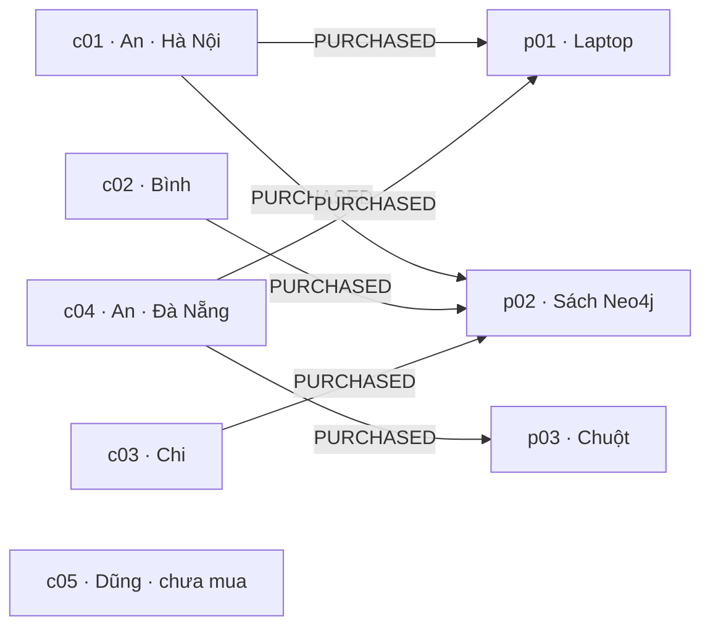

# DISTINCT để xử lý giá trị lặp và hiểu ảnh hưởng đến kết quả

Trong Neo4j, **Cypher** trả kết quả dưới dạng các **dòng**. Mỗi dòng chứa những giá trị được chọn bởi `RETURN`: thuộc tính, nút (node), quan hệ (relationship), đường đi (path), map hoặc giá trị tổng hợp. Một người có thể xuất hiện trên nhiều dòng vì họ có nhiều kết nối trong **property graph**. Đây là hành vi hợp lệ, nhưng khi làm báo cáo hay xây dựng API, chúng ta đôi khi muốn **loại những dòng trùng nhau**.

Từ khóa **`DISTINCT`** đáp ứng nhu cầu đó. Tuy nhiên, ý nghĩa “trùng” phụ thuộc vào **biểu thức được chọn**: hai khách trùng tên có thể là hai nút khác nhau; hai lần mua cùng sản phẩm cũng có thể là hai quan hệ khác nhau. Nếu dùng `DISTINCT` không đúng vị trí, truy vấn có thể che giấu dữ liệu quan trọng hoặc tạo thống kê sai.

Bài thuộc chương **Truy vấn đọc** trong module `DATABASE_ENGINE_GRAPH_NEO4J`. Trọng tâm là cách hoạt động của `DISTINCT`, tác động tới số dòng và các phép tổng hợp, đồng thời liên hệ đến tối ưu Cypher, index/constraint, truy vấn quan hệ, Java Driver và Spring Data Neo4j.

## 1. Mục tiêu học tập

Sau bài này, bạn có thể:

1. Phân biệt **dòng trùng**, **giá trị thuộc tính trùng** và **thực thể đồ thị trùng**.
2. Viết `RETURN DISTINCT`, `WITH DISTINCT`, `count(DISTINCT ...)` và `collect(DISTINCT ...)` đúng ngữ nghĩa.
3. Giải thích vì sao thêm hoặc bớt cột ở `RETURN DISTINCT` có thể thay đổi số dòng.
4. Phân tích ảnh hưởng của `DISTINCT` khi kết hợp `MATCH`, `OPTIONAL MATCH`, `ORDER BY`, `SKIP` và `LIMIT`.
5. Nhận biết trường hợp `DISTINCT` che giấu mẫu nối sai, gây mất thông tin hoặc tạo chi phí xử lý không cần thiết.
6. Đọc kết quả có bí danh ổn định từ Java Driver và đánh giá kế hoạch với `EXPLAIN`/`PROFILE`.

## 2. Bộ dữ liệu thực hành

Hãy xét hệ thống bán hàng gồm khách hàng và sản phẩm. Mỗi khách có khóa `key` riêng, nhưng **tên không bắt buộc duy nhất**. Cố ý cho hai khách cùng tên **An** để phân biệt loại trùng theo **giá trị** với trùng theo **thực thể**.

Chạy đoạn Cypher sau trong **cơ sở dữ liệu thử nghiệm**. Các nhãn `RQ006Customer` và `RQ006Product` được đặt riêng cho bài để hạn chế nhầm với dữ liệu khác. `MERGE` giúp việc chạy lại trên dữ liệu mẫu sạch không sinh thêm nút/quan hệ cùng mẫu, với giả định không có bản ghi trùng khóa và không có quan hệ song song cùng cặp từ trước.

```cypher
MERGE (c1:RQ006Customer {key: 'c01'})
SET c1.name = 'An', c1.city = 'Hà Nội'
MERGE (c2:RQ006Customer {key: 'c02'})
SET c2.name = 'Bình', c2.city = 'TP. Hồ Chí Minh'
MERGE (c3:RQ006Customer {key: 'c03'})
SET c3.name = 'Chi', c3.city = 'Hà Nội'
MERGE (c4:RQ006Customer {key: 'c04'})
SET c4.name = 'An', c4.city = 'Đà Nẵng'
MERGE (c5:RQ006Customer {key: 'c05'})
SET c5.name = 'Dũng', c5.city = 'Hà Nội'

MERGE (p1:RQ006Product {key: 'p01'})
SET p1.name = 'Laptop', p1.category = 'Điện tử', p1.price = 20000000
MERGE (p2:RQ006Product {key: 'p02'})
SET p2.name = 'Sách Neo4j', p2.category = 'Sách', p2.price = 400000
MERGE (p3:RQ006Product {key: 'p03'})
SET p3.name = 'Chuột', p3.category = 'Điện tử', p3.price = 500000

MERGE (c1)-[r1:PURCHASED]->(p1)
SET r1.quantity = 1, r1.year = 2026
MERGE (c1)-[r2:PURCHASED]->(p2)
SET r2.quantity = 1, r2.year = 2025
MERGE (c2)-[r3:PURCHASED]->(p2)
SET r3.quantity = 2, r3.year = 2026
MERGE (c3)-[r4:PURCHASED]->(p2)
SET r4.quantity = 1, r4.year = 2026
MERGE (c4)-[r5:PURCHASED]->(p1)
SET r5.quantity = 1, r5.year = 2026
MERGE (c4)-[r6:PURCHASED]->(p3)
SET r6.quantity = 1, r6.year = 2025;
```

Sơ đồ liên kết:



| Đại lượng | Số lượng trong bộ dữ liệu mẫu |
| --- | ---: |
| Nút `RQ006Customer` | 5 |
| Tên khách khác nhau | 4 (An, Bình, Chi, Dũng) |
| Thành phố khác nhau | 3 (Hà Nội, TP. Hồ Chí Minh, Đà Nẵng) |
| Nút `RQ006Product` | 3 |
| Quan hệ `PURCHASED` | 6 |
| Khách **đã mua** (nút khác nhau) | 4 (`c01` đến `c04`) |
| Khách **chưa mua** | 1 (`c05`) |

Các kết quả dự kiến ở phần sau giả định chỉ có bộ dữ liệu mẫu trên đối với các nhãn `RQ006...`.

## 3. Vì sao truy vấn không có DISTINCT trả dòng lặp?

Ví dụ đơn giản:

```cypher
MATCH (c:RQ006Customer)
RETURN c.name AS customerName
ORDER BY customerName;
```

Kết quả có **5 dòng**:

| customerName |
| --- |
| An |
| An |
| Bình |
| Chi |
| Dũng |

Hai dòng `An` đến từ **hai nút khác nhau**, `c01` và `c04`. Cypher không tự loại trùng khi `RETURN` chỉ chọn tên.

Nếu truy vấn theo quan hệ mua hàng:

```cypher
MATCH (c:RQ006Customer)-[:PURCHASED]->(p:RQ006Product)
RETURN c.key AS customerKey,
       c.name AS customerName,
       p.name AS product
ORDER BY customerKey, p.key;
```

Kết quả:

| customerKey | customerName | product |
| --- | --- | --- |
| c01 | An | Laptop |
| c01 | An | Sách Neo4j |
| c02 | Bình | Sách Neo4j |
| c03 | Chi | Sách Neo4j |
| c04 | An | Laptop |
| c04 | An | Chuột |

Có **6 dòng** vì `MATCH` tìm 6 quan hệ mua. Cùng một khách có thể xuất hiện nhiều lần khi nối tới nhiều sản phẩm; cùng một sản phẩm có thể xuất hiện nhiều lần vì được nhiều khách mua. Đây là **bản chất của dữ liệu liên kết**, chưa phải lỗi.

Một câu hỏi trước khi áp dụng `DISTINCT` là: **đơn vị kết quả cần được xem là duy nhất là gì?** Tên khách, nút khách, sản phẩm, cặp khách–sản phẩm hay quan hệ mua? Mỗi lựa chọn có thể cho một số dòng khác nhau.

## 4. RETURN DISTINCT: loại trùng theo những gì được trả về

### 4.1. Một cột

```cypher
MATCH (c:RQ006Customer)
RETURN DISTINCT c.name AS customerName
ORDER BY customerName;
```

Kết quả là **4 tên**: An, Bình, Chi và Dũng. `DISTINCT` giữ một dòng cho mỗi **giá trị `c.name` khác nhau**. Trong truy vấn này, hai nút An bị gộp vì ta chỉ trả tên.

Tương tự, liệt kê các thành phố khác nhau:

```cypher
MATCH (c:RQ006Customer)
RETURN DISTINCT c.city AS city
ORDER BY city;
```

Kết quả có **3 dòng**: Hà Nội, Đà Nẵng và TP. Hồ Chí Minh (được sắp theo quy tắc so sánh chuỗi của hệ thống).

### 4.2. Nhiều cột: DISTINCT xét toàn bộ bộ giá trị

```cypher
MATCH (c:RQ006Customer)
RETURN DISTINCT c.city AS city,
                c.name AS customerName
ORDER BY city, customerName;
```

Kết quả có **5 dòng** vì không có hai nút nào cùng **cả tên lẫn thành phố** trong dữ liệu mẫu. `DISTINCT` xét **toàn bộ bộ (city, customerName)** chứ không chỉ cột đứng sau từ khóa `DISTINCT`.

| Câu RETURN | Số dòng | “Duy nhất” theo |
| --- | ---: | --- |
| `RETURN c.name` | 5 | Không loại trùng |
| `RETURN DISTINCT c.name` | 4 | Tên khách |
| `RETURN DISTINCT c.city` | 3 | Thành phố |
| `RETURN DISTINCT c.city, c.name` | 5 | Cặp (thành phố, tên) |
| `RETURN DISTINCT c.key, c.name` | 5 | Cặp (khóa định danh, tên) |

Chỉ cần thêm một cột phân biệt các dòng trước đó là số dòng đầu ra có thể tăng. Đừng suy rằng `DISTINCT` luôn cho “mỗi khách một dòng”; nó cho **mỗi bộ giá trị trả về một dòng**.

### 4.3. Thực thể khác với giá trị thuộc tính

```cypher
MATCH (c:RQ006Customer)
RETURN DISTINCT c AS customerNode;
```

Kết quả có **5 nút**, bởi `c01` và `c04` là hai **thực thể khác nhau** dù đều có `name = 'An'`.

Nếu chỉ cần những khách có mua:

```cypher
MATCH (c:RQ006Customer)-[:PURCHASED]->(:RQ006Product)
RETURN DISTINCT c.key AS customerKey, c.name AS name
ORDER BY customerKey;
```

Kết quả là **4 khách**: `c01`, `c02`, `c03`, `c04`. Sử dụng khóa ứng dụng `key` giúp phân biệt khách trùng tên và tạo đầu ra dễ dùng cho API. Trong hệ thống thực tế, nên ràng buộc duy nhất cho `key` nếu đây là định danh nghiệp vụ.

## 5. DISTINCT trên nhiều biến: đừng làm mất liên kết thật

Giả sử cần hiển thị danh sách **cặp tên khách–tên sản phẩm**:

```cypher
MATCH (c:RQ006Customer)-[:PURCHASED]->(p:RQ006Product)
RETURN DISTINCT c.name AS customerName,
                p.name AS productName
ORDER BY customerName, productName;
```

Kết quả chỉ có **5 dòng**:

| customerName | productName |
| --- | --- |
| An | Chuột |
| An | Laptop |
| An | Sách Neo4j |
| Bình | Sách Neo4j |
| Chi | Sách Neo4j |

Hai quan hệ **c01 → Laptop** và **c04 → Laptop** bị biểu diễn thành cùng một cặp `('An', 'Laptop')`, nên `DISTINCT` gộp lại. Nếu mục tiêu là **một dòng cho mỗi cặp khách–sản phẩm thực tế**, kết quả 5 dòng là **thiếu thông tin**.

Cách đúng khi cần nhận diện khách hàng riêng:

```cypher
MATCH (c:RQ006Customer)-[:PURCHASED]->(p:RQ006Product)
RETURN DISTINCT c.key AS customerKey,
                c.name AS customerName,
                p.key AS productKey,
                p.name AS productName
ORDER BY customerKey, productKey;
```

Kết quả là **6 dòng**, phân biệt `c01` với `c04`. Cũng có thể `RETURN DISTINCT c, p` nếu client cần các thực thể Neo4j, nhưng khi ánh xạ DTO nên chọn khóa và thuộc tính tường minh.

Một phân biệt quan trọng nữa:

- `RETURN DISTINCT c, p` loại các lần xuất hiện trùng **cặp nút**.
- `RETURN DISTINCT r` loại các lần xuất hiện trùng **quan hệ vật lý**, nếu biến `r` đã được gán trong `MATCH`.
- Nếu cùng một cặp nút có **nhiều quan hệ hợp lệ** (ví dụ hai giao dịch khác nhau), `DISTINCT c, p` có thể gộp chúng nhưng `DISTINCT r` vẫn giữ từng quan hệ.

Do đó, khi thiết kế graph giao dịch, cần xác định “một lần mua” là **một quan hệ** hay **một nút đơn hàng/giao dịch**; không thể suy ra số giao dịch chỉ từ cặp khách–sản phẩm.

## 6. Đếm bằng count và count(DISTINCT ...)

`RETURN DISTINCT` thay đổi **số dòng trả về**. Trong thống kê, ta thường muốn đếm giá trị hoặc thực thể khác nhau ngay trong hàm tổng hợp.

```cypher
MATCH (c:RQ006Customer)-[r:PURCHASED]->(p:RQ006Product)
RETURN
  count(*) AS matchedRows,
  count(r) AS purchaseRelationships,
  count(c) AS customerOccurrences,
  count(DISTINCT c) AS uniqueCustomerNodes,
  count(DISTINCT c.name) AS uniqueCustomerNames,
  count(DISTINCT p) AS uniqueProductNodes;
```

Kết quả:

| matchedRows | purchaseRelationships | customerOccurrences | uniqueCustomerNodes | uniqueCustomerNames | uniqueProductNodes |
| ---: | ---: | ---: | ---: | ---: | ---: |
| 6 | 6 | 6 | 4 | 3 | 3 |

Diễn giải:

- Có **6 dòng** khớp vì có 6 quan hệ mua.
- `count(c) = 6` vì An `c01` và An `c04` có hai quan hệ mỗi người.
- `count(DISTINCT c) = 4` đếm **4 nút khách mua khác nhau**.
- `count(DISTINCT c.name) = 3` đếm **3 tên khách mua khác nhau**: An, Bình, Chi.
- `count(DISTINCT p) = 3` đếm **3 nút sản phẩm** đã được mua.

### 6.1. Đếm bộ giá trị gồm nhiều cột

Để đếm các **cặp tên hiển thị khác nhau**, có thể dùng `WITH DISTINCT` cho hai cột rồi đếm số dòng:

```cypher
MATCH (c:RQ006Customer)-[:PURCHASED]->(p:RQ006Product)
WITH DISTINCT c.name AS customerName,
              p.name AS productName
RETURN count(*) AS distinctDisplayedPairs;
```

Kết quả là **5**. Ngược lại, đếm cặp **khóa khách–khóa sản phẩm**:

```cypher
MATCH (c:RQ006Customer)-[:PURCHASED]->(p:RQ006Product)
WITH DISTINCT c.key AS customerKey,
              p.key AS productKey
RETURN count(*) AS distinctCustomerProductPairs;
```

Kết quả là **6**. Đây là cách diễn đạt rõ ràng khi cần áp dụng `DISTINCT` lên **nhiều biểu thức cùng lúc** rồi đếm.

### 6.2. DISTINCT không giống constraint duy nhất

`DISTINCT` chỉ xử lý **kết quả của một truy vấn**. Nó không ngăn hai nút có cùng `key` xuất hiện trong cơ sở dữ liệu. Nếu nghiệp vụ yêu cầu `RQ006Customer.key` là duy nhất, cần một **ràng buộc dữ liệu** phù hợp, chẳng hạn:

```cypher
// Chỉ thực hiện trên cơ sở dữ liệu thử nghiệm hoặc khi thay đổi schema đã được phê duyệt.
CREATE CONSTRAINT rq006_customer_key_unique IF NOT EXISTS
FOR (c:RQ006Customer) REQUIRE c.key IS UNIQUE;
```

Lệnh trên có thể thất bại nếu dữ liệu hiện tại vi phạm ràng buộc. Constraint/index phục vụ tính toàn vẹn dữ liệu và hỗ trợ tìm kiếm; còn `RETURN DISTINCT` phục vụ loại trùng ở kết quả. Hai công cụ giải quyết **hai vấn đề khác nhau**.

## 7. WITH DISTINCT: loại trùng giữa các giai đoạn

`WITH` chuyển dữ liệu sang giai đoạn kế tiếp và xác định những biến còn trong phạm vi. Khi đi với `DISTINCT`, nó có thể **rút gọn các dòng trung gian** trước phép khớp hoặc phép tổng hợp tiếp theo.

Ví dụ lấy các khách đã mua, sau đó trả khóa và tên:

```cypher
MATCH (c:RQ006Customer)-[:PURCHASED]->(:RQ006Product)
WITH DISTINCT c
RETURN c.key AS customerKey,
       c.name AS customerName
ORDER BY customerKey;
```

Sau `MATCH` có 6 dòng; sau `WITH DISTINCT c` còn **4 dòng**, ứng với 4 nút khách khác nhau. Kết quả cuối cũng có 4 dòng.

Một ví dụ có bước nối tiếp:

```cypher
MATCH (c:RQ006Customer)-[:PURCHASED]->(:RQ006Product)
WITH DISTINCT c
MATCH (c)-[:PURCHASED]->(p:RQ006Product)
RETURN c.key AS customerKey, p.name AS product
ORDER BY customerKey, p.key;
```

Sau `WITH DISTINCT c` có 4 khách. Mệnh đề `MATCH` sau đó mở rộng quan hệ mua của từng khách, nên kết quả lại có **6 dòng**. `WITH DISTINCT` không có nghĩa toàn bộ truy vấn về sau luôn phải duy nhất: **mẫu khớp tiếp theo có thể tạo nhiều dòng mới**.

Trong các truy vấn dài, hãy xác định xem loại trùng ở giai đoạn nào hợp lý; nếu loại trùng quá sớm, bạn có thể mất dữ liệu cần thiết cho phép tính phía sau.

### 7.1. Loại trùng quá sớm làm sai tổng hợp

Hai truy vấn sau **không tương đương**:

```cypher
// Đúng: tính mỗi quan hệ mua của từng khách.
MATCH (c:RQ006Customer)-[r:PURCHASED]->(p:RQ006Product)
RETURN c.key AS customerKey,
       sum(r.quantity * p.price) AS totalSpent
ORDER BY customerKey;
```

và:

```cypher
// Sai nếu mục tiêu là tính doanh thu: đã làm mất các dòng mua.
MATCH (c:RQ006Customer)-[r:PURCHASED]->(p:RQ006Product)
WITH DISTINCT c
RETURN c.key AS customerKey,
       count(*) AS remainingRows
ORDER BY customerKey;
```

Truy vấn sau chỉ biết mỗi khách một dòng, không còn các biến `r`, `p` hoặc số tiền của từng quan hệ; `remainingRows` luôn bằng 1 cho mỗi khách mua. **Không nên dùng `WITH DISTINCT` để “tối ưu” khi phần sau vẫn cần các lần khớp riêng biệt.**

## 8. collect(DISTINCT ...): danh sách không trùng

`collect` gom nhiều dòng thành danh sách. Nếu các biểu thức lặp lại, danh sách cũng có thể chứa các giá trị trùng, trừ khi yêu cầu `DISTINCT`.

```cypher
MATCH (p:RQ006Product)<-[:PURCHASED]-(c:RQ006Customer)
RETURN p.key AS productKey,
       collect(c.name) AS buyerNames,
       collect(DISTINCT c.name) AS distinctBuyerNames,
       collect(DISTINCT c.key) AS distinctBuyerKeys
ORDER BY productKey;
```

Ý nghĩa cho từng sản phẩm:

| Sản phẩm | buyerNames | distinctBuyerNames | distinctBuyerKeys |
| --- | --- | --- | --- |
| Laptop (`p01`) | An, An | An | c01, c04 |
| Sách Neo4j (`p02`) | An, Bình, Chi | An, Bình, Chi | c01, c02, c03 |
| Chuột (`p03`) | An | An | c04 |

Các ô ghi những **phần tử** dự kiến, không cam kết thứ tự bên trong danh sách; `collect` không bảo đảm thứ tự nếu không chủ động sắp xếp trước khi tổng hợp.

Đặc biệt với Laptop, `collect(DISTINCT c.name)` chỉ có `'An'`, mặc dù có **hai khách khác nhau** mua Laptop. Để đếm đúng số khách, dùng `count(DISTINCT c)` hoặc `count(DISTINCT c.key)`.

Nếu muốn API nhận danh sách khóa khách và cần thứ tự xác định, có thể loại trùng và sắp xếp trước khi `collect`:

```cypher
MATCH (p:RQ006Product)<-[:PURCHASED]-(c:RQ006Customer)
WITH DISTINCT p, c
ORDER BY p.key, c.key
RETURN p.key AS productKey,
       collect(c.key) AS customerKeys
ORDER BY productKey;
```

Mẫu này bảo toàn các khách khác nhau và sắp đầu vào của phép `collect`; ví dụ `p01` cho danh sách `['c01', 'c04']`. Nếu không cần thứ tự, chỉ cần `collect(DISTINCT c.key)` là đủ.

## 9. DISTINCT, OPTIONAL MATCH và null

`OPTIONAL MATCH` giữ nút gốc khi không có quan hệ khớp, đồng thời trả `null` cho biến quan hệ/nút chưa tìm được. Thử:

```cypher
MATCH (c:RQ006Customer)
OPTIONAL MATCH (c)-[r:PURCHASED]->(p:RQ006Product)
RETURN
  count(*) AS rowsAfterOptionalMatch,
  count(r) AS matchedRelationships,
  count(DISTINCT c) AS allCustomers,
  count(DISTINCT p) AS distinctProducts;
```

Kết quả:

| rowsAfterOptionalMatch | matchedRelationships | allCustomers | distinctProducts |
| ---: | ---: | ---: | ---: |
| 7 | 6 | 5 | 3 |

Vì bốn khách mua tạo tổng cộng 6 dòng và khách `c05` chưa mua được giữ lại bằng **một dòng có `r = null`, `p = null`**, nên `count(*) = 7`. `count(r)` chỉ đếm 6 giá trị khác `null`.

### 9.1. DISTINCT giữ một dòng null, count(DISTINCT ...) bỏ qua null

```cypher
MATCH (c:RQ006Customer)
OPTIONAL MATCH (c)-[:PURCHASED]->(p:RQ006Product)
RETURN DISTINCT p.name AS productName
ORDER BY productName;
```

Kết quả có **4 giá trị khác nhau**: `'Laptop'`, `'Sách Neo4j'`, `'Chuột'` và **`null`** (đại diện khách chưa có sản phẩm khớp). Các dòng `null` được `DISTINCT` gộp thành **một dòng `null`**.

Ngược lại:

```cypher
MATCH (c:RQ006Customer)
OPTIONAL MATCH (c)-[:PURCHASED]->(p:RQ006Product)
RETURN count(DISTINCT p.name) AS distinctProductNames;
```

Kết quả là **3** vì `count(expr)` bỏ qua `null`, kể cả khi có `DISTINCT`. Tương tự, `collect(DISTINCT p.name)` không đưa `null` vào danh sách.

Điểm cần nhớ: **loại trùng dòng** và **đếm giá trị khác null** là hai thao tác có quy tắc khác nhau.

## 10. DISTINCT với ORDER BY, SKIP và LIMIT

Khi phân trang danh sách duy nhất, thứ tự các bước xử lý ảnh hưởng tới kết quả.

```cypher
MATCH (c:RQ006Customer)
RETURN DISTINCT c.city AS city
ORDER BY city ASC
SKIP 1
LIMIT 2;
```

Ở đây, truy vấn chọn **ba thành phố duy nhất**, sắp xếp rồi bỏ qua một giá trị đầu, lấy hai giá trị tiếp theo. `ORDER BY` là cần thiết nếu muốn kết quả phân trang ổn định; có thể thêm tiêu chí phá hòa khi danh sách có các giá trị đồng hạng.

So với truy vấn chỉ lấy hai khách đầu tiên rồi mới loại thành phố trùng:

```cypher
MATCH (c:RQ006Customer)
WITH c
ORDER BY c.key
LIMIT 2
RETURN DISTINCT c.city AS city
ORDER BY city;
```

Lúc này chỉ xét khách `c01` (Hà Nội) và `c02` (TP. Hồ Chí Minh), nên kết quả gồm **hai thành phố của hai khách đầu tiên**. Điều này khác về ngữ nghĩa với “lấy hai thành phố sau khi đã chọn danh sách thành phố duy nhất”.

### 10.1. Không dùng LIMIT để sửa truy vấn trả dư

`LIMIT 10` chỉ giới hạn số dòng đầu ra. Nếu mẫu `MATCH` thiếu liên kết, sai hướng hoặc sinh nhiều dòng không đúng nghiệp vụ, `LIMIT` không sửa được lỗi đó. Hãy xác định đúng đơn vị kết quả và điều kiện nối, sau đó mới áp dụng `DISTINCT`, sắp xếp và phân trang.

## 11. DISTINCT không thể sửa tích Descartes

Xét ví dụ ghép **mọi khách** với **mọi sản phẩm** mà không có quan hệ kết nối:

```cypher
MATCH (c:RQ006Customer)
MATCH (p:RQ006Product)
RETURN count(*) AS combinations;
```

Với 5 khách × 3 sản phẩm, truy vấn cho **15 dòng**. Nếu chỉ trả:

```cypher
MATCH (c:RQ006Customer)
MATCH (p:RQ006Product)
RETURN DISTINCT c.key AS customerKey
ORDER BY customerKey;
```

thì kết quả có 5 khóa khách. Nhưng điều đó **không có nghĩa** mọi khách đã mua sản phẩm; `DISTINCT` chỉ che việc các tổ hợp độc lập đã bị nhân lên.

Nếu câu hỏi là **“khách nào đã mua hàng?”**, cần nối quan hệ:

```cypher
MATCH (c:RQ006Customer)-[:PURCHASED]->(:RQ006Product)
RETURN DISTINCT c.key AS customerKey
ORDER BY customerKey;
```

Kết quả chỉ có **4 khách đã mua** (`c01`–`c04`). Đây là khác biệt về **đúng/sai ngữ nghĩa**, không phải chỉ khác số dòng.

Nếu cần đếm số lần mua thực sự, không nên gộp theo tên hoặc cặp khách–sản phẩm khi dữ liệu có nhiều giao dịch hợp lệ. Hãy chọn thực thể giao dịch hoặc quan hệ tương ứng làm đơn vị đếm.

## 12. Đánh giá hiệu năng và lựa chọn phạm vi DISTINCT

Để loại trùng, hệ thống có thể phải **theo dõi những giá trị đã gặp** hoặc xử lý theo thứ tự phù hợp. Với tập kết quả lớn, điều này tốn CPU, bộ nhớ hoặc tài nguyên trung gian. Tác động thực tế phụ thuộc kế hoạch truy vấn, số dòng đầu vào, số giá trị duy nhất, index và phiên bản Neo4j.

Kiểm tra kế hoạch mà không chạy truy vấn:

```cypher
EXPLAIN
MATCH (c:RQ006Customer)-[:PURCHASED]->(p:RQ006Product)
RETURN DISTINCT c.key AS customerKey
ORDER BY customerKey;
```

Để quan sát số dòng và chi phí thực tế trên dữ liệu thử nghiệm:

```cypher
PROFILE
MATCH (c:RQ006Customer)-[:PURCHASED]->(p:RQ006Product)
RETURN DISTINCT c.key AS customerKey
ORDER BY customerKey;
```

`EXPLAIN` chỉ tạo kế hoạch dự kiến; `PROFILE` **thực thi truy vấn** và cho biết thống kê thực tế. Tùy kế hoạch, có thể gặp các toán tử xử lý tính duy nhất như `Distinct`, `OrderedDistinct` hoặc các toán tử tổng hợp/tương đương. **Tên và thứ tự toán tử không cố định** giữa các phiên bản và tình huống.

Một số nguyên tắc thực tế:

1. **Tìm đúng quan hệ trước:** `MATCH (c)-[:PURCHASED]->(p)` thay vì ghép hai tập rời rồi cố loại trùng.
2. **Chỉ chọn các trường cần thiết:** loại trùng trên toàn bộ nút/map lớn có thể tốn hơn loại trùng theo khóa ngắn, nếu khóa thực sự xác định được đơn vị kết quả.
3. **Tránh DISTINCT thừa:** nếu truy vấn đã đảm bảo một dòng cho mỗi khóa duy nhất thì thêm `DISTINCT` có thể không mang lại lợi ích.
4. **Dùng index/constraint cho điểm tìm kiếm hợp lý:** index giúp tìm nút theo thuộc tính nhưng không tự loại trùng từ các nhánh quan hệ.
5. **Chọn vị trí DISTINCT theo nhu cầu phía sau:** loại trùng sớm có thể giảm dòng trung gian, nhưng phải giữ đủ dữ liệu để tổng hợp chính xác.
6. **Đo bằng `PROFILE`:** quan sát cardinality (rows), DB hits và chi phí thay vì đoán truy vấn có `DISTINCT` luôn nhanh/chậm hơn.

Đối với một dịch vụ cần trả danh sách khách mua hàng, `RETURN DISTINCT c.key AS customerKey` là cấu trúc hợp lý khi API cần khóa duy nhất. Với báo cáo số giao dịch hoặc doanh thu, hãy giữ các quan hệ mua đến bước tổng hợp tương ứng.

## 13. Sử dụng DISTINCT trong Java Driver

Ví dụ ứng dụng muốn trả danh sách **khách đã mua tại Hà Nội**, mỗi khách đúng một lần. Sử dụng khóa ứng dụng và bí danh ổn định giúp tránh lẫn những khách trùng tên.

```cypher
MATCH (c:RQ006Customer)-[:PURCHASED]->(:RQ006Product)
WHERE c.city = $city
RETURN DISTINCT c.key AS customerKey,
                c.name AS customerName
ORDER BY customerKey;
```

Với `city = 'Hà Nội'`, kết quả là **c01 – An** và **c03 – Chi**. Khách c05 – Dũng ở Hà Nội nhưng **chưa mua**, nên không xuất hiện.

Ví dụ Java Driver, giả định đối tượng `Driver` được kết nối và phiên bản Driver hỗ trợ `executeRead`:

```java
import java.util.List;
import java.util.Map;
import org.neo4j.driver.Driver;

public class BuyerReader {
    public record Buyer(String customerKey, String customerName) {}

    public static List<Buyer> findBuyersInCity(Driver driver, String city) {
        try (var session = driver.session()) {
            return session.executeRead(tx ->
                tx.run("""
                    MATCH (c:RQ006Customer)-[:PURCHASED]->(:RQ006Product)
                    WHERE c.city = $city
                    RETURN DISTINCT c.key AS customerKey,
                                    c.name AS customerName
                    ORDER BY customerKey
                    """, Map.of("city", city))
                  .list(record -> new Buyer(
                      record.get("customerKey").asString(),
                      record.get("customerName").asString()
                  ))
            );
        }
    }
}
```

Với Spring Data Neo4j, mẫu Cypher tương tự có thể đặt trong truy vấn `@Query` với tham số binding; kiểu projection/DTO cần khớp tên và kiểu cột. Lưu ý `DISTINCT` ở Cypher loại trùng **trên giá trị trả về từ database**; nếu backend thực hiện thêm ánh xạ, lọc hoặc nhóm dữ liệu, tính duy nhất ở tầng API phải được xác định theo khóa nghiệp vụ của ứng dụng.

## 14. Bảng lựa chọn nhanh

| Nhu cầu | Cấu trúc phù hợp | Kết quả với bộ mẫu |
| --- | --- | --- |
| Liệt kê mọi dòng tên khách | `RETURN c.name` | 5 dòng |
| Liệt kê tên khách khác nhau | `RETURN DISTINCT c.name` | 4 tên |
| Liệt kê khách khác nhau theo thực thể | `RETURN DISTINCT c` | 5 nút |
| Liệt kê khách đã mua, không lặp | `MATCH (c)-[:PURCHASED]->(...) RETURN DISTINCT c.key` | 4 khách |
| Đếm số quan hệ mua | `count(r)` | 6 |
| Đếm số nút khách đã mua | `count(DISTINCT c)` | 4 |
| Đếm tên khách mua khác nhau | `count(DISTINCT c.name)` | 3 |
| Đếm cặp tên khách–sản phẩm | `WITH DISTINCT c.name, p.name RETURN count(*)` (cần bí danh cụ thể) | 5 |
| Đếm cặp khóa khách–sản phẩm | `WITH DISTINCT c.key, p.key RETURN count(*)` (cần bí danh cụ thể) | 6 |
| Danh sách tên khách mua theo từng sản phẩm | `collect(DISTINCT c.name)` | Laptop chỉ còn một tên An |
| Danh sách khóa khách mua theo từng sản phẩm | `collect(DISTINCT c.key)` | Laptop có c01 và c04 |
| Giữ khách chưa mua khi thống kê | `OPTIONAL MATCH` kết hợp `count(r)` | c05 có 0 quan hệ |

## 15. Lỗi thường gặp và cách xử lý

| Dấu hiệu | Nguyên nhân | Hướng giải quyết |
| --- | --- | --- |
| Tên An chỉ còn một dòng dù có hai khách | `DISTINCT` đặt trên `c.name`, không phải thực thể/khóa | Thêm `c.key` hoặc trả `DISTINCT c` |
| Trả cặp người–sản phẩm bị thiếu bản ghi | Hai người trùng tên mua cùng sản phẩm | Dùng khóa định danh cho từng đầu mút |
| Đếm khách mua được 6 thay vì 4 | `count(c)` đếm dòng quan hệ | Dùng `count(DISTINCT c)` |
| Đếm tên người mua được 3 thay vì 4 | `count(DISTINCT c.name)` gộp hai người tên An | Đếm nút `c` hoặc khóa duy nhất |
| `RETURN DISTINCT` có thêm cột lại tăng số dòng | Mỗi bộ giá trị nhiều cột khác nhau | Xác định bộ giá trị cần coi là duy nhất |
| `count(DISTINCT p.name)` thấp hơn số dòng `RETURN DISTINCT p.name` khi có khách không mua | `count` bỏ `null`, còn `RETURN DISTINCT` giữ một dòng `null` | Xác định có tính `null` hay không |
| Dùng `WITH DISTINCT c` rồi mất `r.quantity` | Bước `WITH` bỏ biến quan hệ và sản phẩm | Giữ dữ liệu hoặc tổng hợp trước khi loại trùng |
| `DISTINCT` che lỗi nối các tập rời | Hai mẫu `MATCH` không liên thông nhưng đầu ra bị gộp | Thêm mẫu/điều kiện liên kết đúng nghiệp vụ |
| Dùng `LIMIT` nhưng trang kết quả thay đổi | Thiếu `ORDER BY` ổn định | Sắp xếp theo khóa và phân trang sau khi chọn tập kết quả duy nhất |
| Truy vấn dùng DISTINCT chậm trên đồ thị lớn | Tập trung gian quá lớn hoặc DISTINCT trên giá trị cồng kềnh | Thu hẹp mẫu, chỉ lấy trường cần, xem `PROFILE` |

## 16. Bài tập tự luyện

Dùng dữ liệu ở mục 2. Hãy dự đoán **số dòng** và **đơn vị đang được coi là duy nhất** trước khi xem lời giải.

**Bài 1.** Liệt kê các thành phố khác nhau của khách hàng. Kết quả có bao nhiêu dòng?

**Bài 2.** Liệt kê tên các khách đã mua ít nhất một sản phẩm, không lặp **tên**. Sau đó thay đổi truy vấn để không lặp **nút khách**. Hai kết quả có cùng số dòng không?

**Bài 3.** Đếm số quan hệ mua, số khách mua khác nhau và số sản phẩm đã được mua.

**Bài 4.** Trả về mỗi cặp tên khách–tên sản phẩm khác nhau. Vì sao số dòng ít hơn số cặp khách–sản phẩm vật lý?

**Bài 5.** Dùng `collect(DISTINCT ...)` để lấy danh sách các **khóa khách** đã mua từng sản phẩm. Với Laptop, danh sách cần có hai khách nào?

**Bài 6.** Giữ tất cả khách, kể cả chưa mua, rồi trả về số quan hệ mua theo từng khách. Dũng phải có giá trị bao nhiêu?

**Bài 7.** So sánh số dòng của `RETURN DISTINCT p.name` và `count(DISTINCT p.name)` khi có `OPTIONAL MATCH` từ tất cả khách tới sản phẩm.

**Bài 8.** Phân tích vì sao `RETURN DISTINCT c.key` không sửa được truy vấn sau nếu mục tiêu là “khách đã mua hàng”:

```cypher
MATCH (c:RQ006Customer), (p:RQ006Product)
RETURN DISTINCT c.key AS customerKey;
```

### Đáp án tham khảo

**Bài 1**

```cypher
MATCH (c:RQ006Customer)
RETURN DISTINCT c.city AS city
ORDER BY city;
```

Kết quả có **3 dòng**.

**Bài 2**

```cypher
MATCH (c:RQ006Customer)-[:PURCHASED]->(:RQ006Product)
RETURN DISTINCT c.name AS buyerName
ORDER BY buyerName;
```

Có **3 tên**: An, Bình, Chi. Để lấy **4 khách khác nhau**:

```cypher
MATCH (c:RQ006Customer)-[:PURCHASED]->(:RQ006Product)
RETURN DISTINCT c.key AS customerKey, c.name AS buyerName
ORDER BY customerKey;
```

Kết quả là `c01`, `c02`, `c03`, `c04`.

**Bài 3**

```cypher
MATCH (c:RQ006Customer)-[r:PURCHASED]->(p:RQ006Product)
RETURN count(r) AS purchases,
       count(DISTINCT c) AS buyers,
       count(DISTINCT p) AS products;
```

Kết quả: **6 quan hệ mua, 4 khách mua, 3 sản phẩm**.

**Bài 4**

```cypher
MATCH (c:RQ006Customer)-[:PURCHASED]->(p:RQ006Product)
RETURN DISTINCT c.name AS customerName, p.name AS productName
ORDER BY customerName, productName;
```

Có **5 dòng** do hai khách khác nhau tên An đều mua Laptop và cặp tên bị gộp. Dùng `c.key` và `p.key` để phân biệt sáu cặp thực tế.

**Bài 5**

```cypher
MATCH (p:RQ006Product)<-[:PURCHASED]-(c:RQ006Customer)
RETURN p.key AS productKey,
       collect(DISTINCT c.key) AS buyerKeys
ORDER BY productKey;
```

Laptop (`p01`) có **c01 và c04** (thứ tự trong danh sách không được bảo đảm).

**Bài 6**

```cypher
MATCH (c:RQ006Customer)
OPTIONAL MATCH (c)-[r:PURCHASED]->(:RQ006Product)
RETURN c.key AS customerKey,
       count(r) AS purchaseCount
ORDER BY customerKey;
```

Kết quả `c01 = 2`, `c02 = 1`, `c03 = 1`, `c04 = 2`, `c05 = 0`.

**Bài 7**

```cypher
MATCH (c:RQ006Customer)
OPTIONAL MATCH (c)-[:PURCHASED]->(p:RQ006Product)
RETURN DISTINCT p.name AS productName;
```

Trả **4 dòng**: ba tên sản phẩm và một `null`. Truy vấn:

```cypher
MATCH (c:RQ006Customer)
OPTIONAL MATCH (c)-[:PURCHASED]->(p:RQ006Product)
RETURN count(DISTINCT p.name) AS distinctProductNames;
```

Trả một dòng chứa giá trị **3** vì `count` bỏ qua `null`.

**Bài 8**

Hai mẫu `(c:RQ006Customer)` và `(p:RQ006Product)` độc lập, tạo **15 dòng kết hợp** trước khi chọn cột đầu ra. `DISTINCT c.key` chỉ gom thành **5 khóa khách**, gồm cả Dũng chưa mua. Truy vấn đúng phải có quan hệ `PURCHASED`:

```cypher
MATCH (c:RQ006Customer)-[:PURCHASED]->(:RQ006Product)
RETURN DISTINCT c.key AS customerKey
ORDER BY customerKey;
```

Kết quả là **4 khóa khách đã mua**.

## 17. Ghi nhớ

- `DISTINCT` loại các dòng có **cùng bộ giá trị được chọn**, không mặc định loại theo khóa hay thực thể nghiệp vụ.
- `RETURN DISTINCT c.name` khác `RETURN DISTINCT c` khi nhiều nút có cùng tên; định danh nghiệp vụ duy nhất giúp tránh gộp nhầm.
- `count(DISTINCT x)` đếm số giá trị `x` **khác null**, còn `collect(DISTINCT x)` gom các giá trị khác null không lặp thành danh sách.
- `WITH DISTINCT` loại trùng **tại một giai đoạn**; các mệnh đề `MATCH` sau đó có thể lại sinh nhiều dòng. Loại quá sớm có thể làm mất thông tin cần tổng hợp.
- `RETURN DISTINCT` có thể giữ **một dòng null**, trong khi `count(DISTINCT ...)` **không đếm null**.
- `DISTINCT` không sửa được truy vấn nối sai, tích Descartes hoặc điều kiện lọc thiếu. Hãy sửa cấu trúc graph pattern trước, rồi mới dùng `DISTINCT`.
- Để kết quả ổn định cho API hoặc phân trang, chọn khóa rõ ràng, đặt bí danh, sắp xếp với `ORDER BY` và quan sát chi phí bằng `EXPLAIN`/`PROFILE`.
