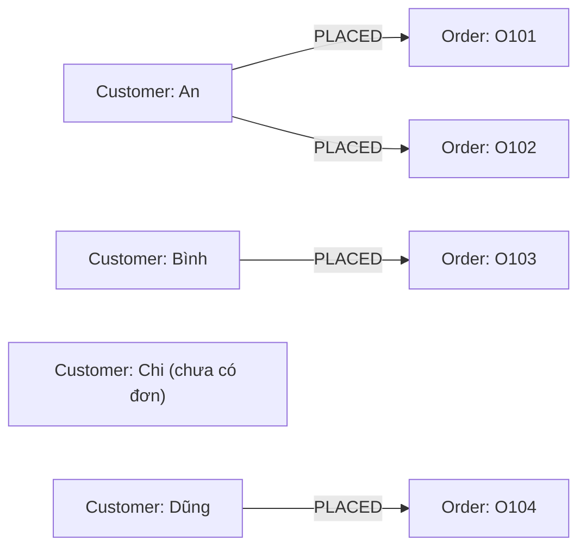
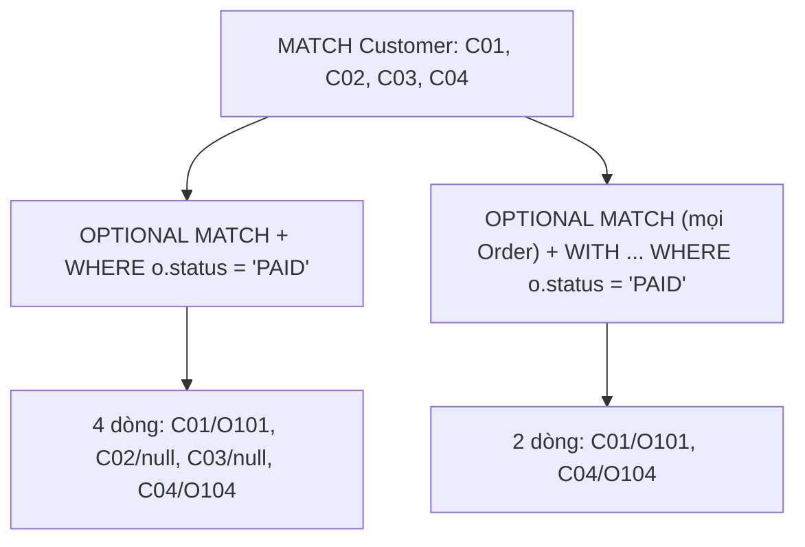

# OPTIONAL MATCH, giá trị `null` và vị trí điều kiện lọc trong Cypher

## 1. Mục tiêu và bối cảnh

Trong Neo4j, dữ liệu được biểu diễn bằng **property graph**: node lưu thực thể, relationship nối các thực thể, và property chứa thông tin của node hoặc relationship. Khi dùng **Cypher** để truy vấn quan hệ, không phải node nào cũng có đủ mọi mối liên kết. Ví dụ, một khách hàng có thể chưa đặt đơn hàng; một nhân viên có thể chưa được gán quản lý; một khóa học có thể chưa có học viên.

`OPTIONAL MATCH` cho phép giữ lại các dòng dữ liệu đầu vào ngay cả khi phần mẫu đồ thị cần tìm **không khớp**. Các biến mới không tìm thấy sẽ nhận giá trị `null`. Đây là công cụ thiết yếu khi làm truy vấn đọc, nhưng cũng là nguồn gây sai kết quả nếu đặt `WHERE` sai chỗ.

Sau bài học, bạn có thể:

1. Phân biệt `MATCH` với `OPTIONAL MATCH` và dự đoán số dòng kết quả khi thiếu relationship.
2. Giải thích cách `null` xuất hiện, lan truyền qua so sánh, phép logic và các phép tổng hợp.
3. Phân biệt `WHERE` của `OPTIONAL MATCH` với `WHERE` sau `WITH` bằng kết quả thực tế.
4. Viết truy vấn giữ đủ node gốc khi chỉ quan tâm relationship thỏa điều kiện.
5. Phát hiện các bẫy như `COUNT(*)`, kiểm tra `IS NULL` sai vị trí và nhiều `OPTIONAL MATCH` làm nhân số dòng.

Nội dung sử dụng cú pháp Cypher theo dòng Neo4j hiện đại và phù hợp định hướng học mô hình hóa, index/constraint, tối ưu truy vấn, Java Driver và Spring Data Neo4j trong module `DATABASE_ENGINE_GRAPH_NEO4J`. Khi triển khai thực tế, cần kiểm tra cú pháp và khả năng của phiên bản Neo4j đang sử dụng.

## 2. Hiểu `OPTIONAL MATCH` qua một hình dung đơn giản

Với mẫu `(c:Customer)-[:PLACED]->(o:Order)`:

- `MATCH` tìm các cặp khách hàng–đơn hàng **có quan hệ khớp**. Khách hàng không có đơn hàng bị loại khỏi kết quả.
- `OPTIONAL MATCH` cố gắng tìm cặp tương tự nhưng **giữ khách hàng**, kể cả khi không tìm thấy đơn; biến `o` khi đó là `null`.

Có thể hình dung cách giữ dòng của `OPTIONAL MATCH` tương tự ý tưởng *left outer join* trong SQL, nhưng cần nhớ Cypher hoạt động theo **mẫu đồ thị**, các biến đã được gắn trước đó và thứ tự các clause. Đây là phép so sánh để học ngữ nghĩa, không phải quy tắc chuyển đổi truy vấn một-một.



`OPTIONAL MATCH` **không tạo ra relationship hay node mới**. Nó chỉ trả về dòng với biến chưa khớp có giá trị `null`. Nếu một khách hàng có hai đơn hàng, khách đó vẫn xuất hiện **hai dòng**; tùy chọn ở đây là “có thể không tìm thấy”, không phải “chỉ lấy một bản ghi”.

## 3. Chuẩn bị dữ liệu để chạy các ví dụ

Giả sử hệ thống bán hàng có bốn khách hàng:

| Khách hàng | `id` | `vip` | Đơn hàng |
|---|---|---|---|
| An | `C01` | `true` | `O101` đã thanh toán, `O102` đã hủy |
| Bình | `C02` | `false` | `O103` đã hủy |
| Chi | `C03` | `false` | Chưa có đơn |
| Dũng | `C04` | `true` | `O104` đã thanh toán |

Chúng ta dùng `(:Customer)-[:PLACED]->(:Order)`. Mỗi `Order` có `id`, `status`, `total`. Trạng thái thanh toán là `PAID`; trạng thái hủy là `CANCELLED`. Mọi ví dụ bên dưới đều giả định cơ sở dữ liệu thực hành chỉ chứa bộ dữ liệu này đối với các nhãn/quan hệ đang xét.

Tạo constraint theo khóa nghiệp vụ để hỗ trợ việc chạy lại script:

```cypher
CREATE CONSTRAINT customer_id_unique IF NOT EXISTS
FOR (c:Customer) REQUIRE c.id IS UNIQUE;

CREATE CONSTRAINT order_id_unique IF NOT EXISTS
FOR (o:Order) REQUIRE o.id IS UNIQUE;
```

Nạp khách hàng:

```cypher
UNWIND [
  {id: 'C01', name: 'An',   vip: true},
  {id: 'C02', name: 'Bình', vip: false},
  {id: 'C03', name: 'Chi',  vip: false},
  {id: 'C04', name: 'Dũng', vip: true}
] AS row
MERGE (c:Customer {id: row.id})
SET c.name = row.name,
    c.vip = row.vip;
```

Nạp đơn hàng và tạo quan hệ:

```cypher
UNWIND [
  {id: 'O101', customerId: 'C01', status: 'PAID',      total: 120},
  {id: 'O102', customerId: 'C01', status: 'CANCELLED', total: 40},
  {id: 'O103', customerId: 'C02', status: 'CANCELLED', total: 70},
  {id: 'O104', customerId: 'C04', status: 'PAID',      total: 200}
] AS row
MERGE (o:Order {id: row.id})
SET o.status = row.status,
    o.total = row.total
WITH o, row
MATCH (c:Customer {id: row.customerId})
MERGE (c)-[:PLACED]->(o);
```

Ở dữ liệu mẫu này, `MERGE` giữ tính có thể chạy lại dựa trên khóa định danh và mẫu quan hệ. Nếu nạp dữ liệu thật từ file, cần bổ sung xử lý định danh thiếu, node tham chiếu không có, xung đột bản ghi và thao tác đồng thời.

Đối soát dữ liệu:

```cypher
MATCH (c:Customer)
RETURN count(c) AS customerCount;

MATCH (o:Order)
RETURN count(o) AS orderCount;

MATCH (:Customer)-[r:PLACED]->(:Order)
RETURN count(r) AS placedCount;
```

Mong đợi: **4 khách hàng**, **4 đơn**, **4 quan hệ `PLACED`**.

## 4. `MATCH` và `OPTIONAL MATCH` khác nhau thế nào?

### 4.1. `MATCH` loại dòng không có quan hệ

```cypher
MATCH (c:Customer)-[:PLACED]->(o:Order)
RETURN c.id AS customer, o.id AS orderId
ORDER BY customer, orderId;
```

| `customer` | `orderId` |
|---|---|
| `C01` | `O101` |
| `C01` | `O102` |
| `C02` | `O103` |
| `C04` | `O104` |

`C03` không xuất hiện, vì Chi chưa có đơn hàng và không có mẫu đồ thị nào khớp.

### 4.2. `OPTIONAL MATCH` giữ dòng khách hàng chưa có đơn

```cypher
MATCH (c:Customer)
OPTIONAL MATCH (c)-[:PLACED]->(o:Order)
RETURN c.id AS customer, o.id AS orderId
ORDER BY customer, orderId;
```

| `customer` | `orderId` |
|---|---|
| `C01` | `O101` |
| `C01` | `O102` |
| `C02` | `O103` |
| `C03` | `null` |
| `C04` | `O104` |

Phần `MATCH (c:Customer)` trước tiên tạo bốn dòng, mỗi dòng chứa một khách hàng. `OPTIONAL MATCH` mở rộng mỗi dòng theo quan hệ `PLACED`: dòng của An được mở thành hai dòng; dòng Chi vẫn còn nhưng `o` được gán `null`. Kết quả có **5 dòng**.

### 4.3. `OPTIONAL MATCH` giữ dòng nào?

Một quy tắc quan trọng: `OPTIONAL MATCH` giữ **dòng hiện có tại thời điểm clause chạy**. Nó không phục hồi các dòng đã bị loại bởi một `MATCH` hoặc `WHERE` trước đó.

Ví dụ:

```cypher
MATCH (c:Customer)
WHERE c.vip = true
OPTIONAL MATCH (c)-[:PLACED]->(o:Order)
RETURN c.id AS customer, o.id AS orderId
ORDER BY customer, orderId;
```

Chỉ còn `C01` và `C04`, vì `WHERE c.vip = true` đã loại Bình và Chi **trước** khi `OPTIONAL MATCH` thực thi. Việc dùng `OPTIONAL MATCH` không khiến các khách hàng đã bị loại xuất hiện lại.

## 5. `null` trong Cypher: không có giá trị, không phải một chuỗi

Khi `OPTIONAL MATCH` thất bại, các biến mới của phần tùy chọn nhận `null`:

```cypher
MATCH (c:Customer)
OPTIONAL MATCH (c)-[:PLACED]->(o:Order)
RETURN c.id AS customer,
       o AS orderNode,
       o.status AS status,
       o.total > 100 AS isLargeOrder
ORDER BY customer;
```

Đối với `C03`, cả `orderNode`, `status` và `isLargeOrder` đều là `null`. Truy cập property của một biến node `null` trả về `null`, thay vì tạo một giá trị mặc định. Nếu một node tồn tại nhưng **không có property** được đọc, kết quả đọc property đó cũng là `null`.

### 5.1. Ba trạng thái logic: `true`, `false`, `null`

Cypher sử dụng logic ba giá trị khi điều kiện chứa `null`:

| Biểu thức | Kết quả | Giải thích |
|---|---|---|
| `null = 5` | `null` | Không thể kết luận bằng hay khác |
| `null <> 5` | `null` | Không thể kết luận khác |
| `null = null` | `null` | So sánh bằng không dùng để nhận diện thiếu giá trị |
| `null IS NULL` | `true` | Kiểm tra thiếu giá trị đúng cách |
| `null IS NOT NULL` | `false` | Giá trị không tồn tại |
| `false AND null` | `false` | Một vế đã sai, cả phép `AND` sai |
| `true AND null` | `null` | Chưa thể kết luận đúng hay sai |
| `true OR null` | `true` | Một vế đã đúng, cả phép `OR` đúng |
| `false OR null` | `null` | Chưa thể kết luận đúng hay sai |

**Trong `WHERE`, chỉ dòng có điều kiện đánh giá thành `true` mới được giữ**. Kết quả `false` **hoặc** `null` đều bị loại khi `WHERE` thực hiện việc lọc dòng.

Ví dụ, với `C03`, điều kiện `o.status <> 'CANCELLED'` không phải `true`; nó là `null`. Vì thế, viết `WHERE o.status <> 'CANCELLED'` sau khi tùy chọn ghép đơn sẽ khiến khách hàng chưa có đơn bị loại.

### 5.2. `IS NULL`, `IS NOT NULL` và `coalesce`

```cypher
MATCH (c:Customer)
OPTIONAL MATCH (c)-[:PLACED]->(o:Order)
RETURN c.id AS customer,
       o IS NULL AS noMatchedOrder,
       coalesce(o.status, 'CHƯA CÓ ĐƠN') AS displayStatus
ORDER BY customer, displayStatus;
```

`IS NULL` là phép kiểm tra đúng khi muốn biết biến hoặc property thiếu giá trị. `coalesce(x, y, ...)` trả về **giá trị đầu tiên khác `null`**; nó hữu ích để hiển thị mặc định, nhưng không thay đổi sự thật rằng relationship hay property có thể thiếu.

Trong Neo4j, đặt một property thành `null` thường có tác dụng **xóa property đó**. Do đó, cần phân biệt thiếu property trong dữ liệu với giá trị `null` trong kết quả truy vấn.

## 6. Trọng tâm: `WHERE` đặt ở đâu?

### 6.1. `WHERE` gắn với `OPTIONAL MATCH`: lọc *mẫu được ghép*

Mục tiêu: **hiển thị tất cả khách hàng**, nhưng nếu có đơn hàng thì chỉ ghép các đơn `PAID`.

```cypher
MATCH (c:Customer)
OPTIONAL MATCH (c)-[:PLACED]->(o:Order)
WHERE o.status = 'PAID'
RETURN c.id AS customer, o.id AS paidOrder
ORDER BY customer, paidOrder;
```

Kết quả:

| `customer` | `paidOrder` | Giải thích |
|---|---|---|
| `C01` | `O101` | An có một đơn `PAID`; `O102` không thỏa |
| `C02` | `null` | Bình có đơn `CANCELLED` nhưng không có đơn `PAID` |
| `C03` | `null` | Chi chưa có đơn |
| `C04` | `O104` | Dũng có một đơn `PAID` |

Điểm quan trọng: trong Cypher, `WHERE` **đi liền sau `OPTIONAL MATCH` là một phần của chính `OPTIONAL MATCH`**. Nó quy định mẫu nào được coi là khớp. Nếu không có đơn nào thỏa `PAID`, kết quả vẫn giữ dòng khách hàng với `o = null`. Đây chính là thứ ta cần khi giữ mọi khách hàng làm tập gốc.

Đối với điều kiện so sánh property đơn giản, có thể viết tương đương:

```cypher
MATCH (c:Customer)
OPTIONAL MATCH (c)-[:PLACED]->(o:Order {status: 'PAID'})
RETURN c.id AS customer, o.id AS paidOrder
ORDER BY customer, paidOrder;
```

### 6.2. `WHERE` sau `WITH`: lọc *dòng kết quả đã được tạo*

Hãy chuyển điều kiện xuống sau `WITH`:

```cypher
MATCH (c:Customer)
OPTIONAL MATCH (c)-[:PLACED]->(o:Order)
WITH c, o
WHERE o.status = 'PAID'
RETURN c.id AS customer, o.id AS paidOrder
ORDER BY customer;
```

Kết quả:

| `customer` | `paidOrder` |
|---|---|
| `C01` | `O101` |
| `C04` | `O104` |

Tại thời điểm `WITH c, o`, truy vấn đã tạo **5 dòng** gồm cả đơn hủy và dòng `o = null` của Chi. `WHERE` sau đó là **bộ lọc dòng**; nó loại `O102`, `O103` và dòng `null`. Kết quả chỉ còn hai khách hàng có đơn `PAID`.



Hai câu Cypher chỉ khác vị trí `WHERE`, nhưng trả lời **hai câu hỏi nghiệp vụ khác nhau**:

| Cần trả lời | Cách viết đúng |
|---|---|
| “Mọi khách hàng; nếu có đơn `PAID` thì lấy đơn đó” | `OPTIONAL MATCH ... WHERE o.status = 'PAID'` |
| “Chỉ những khách hàng có đơn `PAID`” | `MATCH ... WHERE o.status = 'PAID'`, hoặc `OPTIONAL MATCH ... WITH ... WHERE ...` nếu có lý do dùng tùy chọn |
| “Mọi khách hàng cùng số đơn `PAID`, kể cả bằng 0” | `OPTIONAL MATCH ... WHERE ... WITH c, count(o) ...` |
| “Khách hàng chưa từng đặt đơn nào” | `NOT EXISTS { MATCH ... }` hoặc `OPTIONAL MATCH ... WITH ... WHERE o IS NULL` |

### 6.3. Một `WHERE` trên biến đã tồn tại cũng có thể gây bất ngờ

Ở đây, điều kiện trên `c` nằm **trong** phần tùy chọn:

```cypher
MATCH (c:Customer)
OPTIONAL MATCH (c)-[:PLACED]->(o:Order)
WHERE c.vip = true
RETURN c.id AS customer, o.id AS orderId
ORDER BY customer, orderId;
```

`C02` vẫn xuất hiện với `orderId = null`, mặc dù Bình **có** đơn `O103`; vì điều kiện `c.vip = true` làm cho phép ghép tùy chọn không khớp. `C03` cũng xuất hiện với `null`. Nếu yêu cầu là **chỉ khách hàng VIP**, hãy chuyển `WHERE c.vip = true` lên ngay sau `MATCH (c:Customer)`:

```cypher
MATCH (c:Customer)
WHERE c.vip = true
OPTIONAL MATCH (c)-[:PLACED]->(o:Order)
RETURN c.id AS customer, o.id AS orderId
ORDER BY customer, orderId;
```

Chỉ còn các dòng thuộc `C01` và `C04`. Đây là ví dụ cho thấy không thể chỉ nhìn tên biến trong điều kiện; cần xét **clause mà `WHERE` gắn vào**.

### 6.4. Thêm `OR o IS NULL` sau `WITH` có khôi phục mọi khách hàng không?

Thử:

```cypher
MATCH (c:Customer)
OPTIONAL MATCH (c)-[:PLACED]->(o:Order)
WITH c, o
WHERE o.status = 'PAID' OR o IS NULL
RETURN c.id AS customer, o.id AS orderId
ORDER BY customer;
```

Kết quả có `C01/O101`, `C03/null`, `C04/O104` — **không có Bình (`C02`)**.

Lý do: Bình có một relationship khớp ở `OPTIONAL MATCH` nên tạo ra dòng `C02/O103`; không có dòng `C02/null` dự phòng. Sau khi `WITH ... WHERE` loại `O103`, Bình đã mất. `OR o IS NULL` chỉ giữ Chi, người **thực sự không có relationship nào** ở lần ghép không lọc.

Nếu muốn giữ tất cả khách hàng và chỉ ghép đơn `PAID`, hãy lọc ngay **trong `OPTIONAL MATCH`** như mục 6.1, thay vì cố phục hồi dòng đã bị loại.

## 7. Các mẫu truy vấn thường gặp

### 7.1. Đếm đơn thỏa điều kiện, kể cả khách hàng có 0 đơn

```cypher
MATCH (c:Customer)
OPTIONAL MATCH (c)-[:PLACED]->(o:Order)
WHERE o.status = 'PAID'
WITH c, count(o) AS paidOrderCount, sum(o.total) AS paidTotal
RETURN c.id AS customer,
       paidOrderCount,
       paidTotal
ORDER BY customer;
```

| `customer` | `paidOrderCount` | `paidTotal` |
|---|---:|---:|
| `C01` | 1 | 120 |
| `C02` | 0 | 0 |
| `C03` | 0 | 0 |
| `C04` | 1 | 200 |

Trong Cypher, `count(o)` **bỏ qua `null`**, vì thế Bình và Chi có số đơn thỏa điều kiện bằng 0. `sum(o.total)` bỏ qua đầu vào `null` và trả về 0 khi không có giá trị số phù hợp. Nếu chỉ muốn đếm số đơn `PAID`, tránh viết `count(*)` trong mẫu này: với một dòng tùy chọn chứa `o = null`, `count(*)` sẽ đếm **một dòng**, không phải **không đơn hàng**.

Đối chiếu:

```cypher
MATCH (c:Customer)
OPTIONAL MATCH (c)-[:PLACED]->(o:Order)
WHERE o.status = 'PAID'
RETURN c.id AS customer,
       count(*) AS rowCount,
       count(o) AS paidOrderCount
ORDER BY customer;
```

Với `C02` và `C03`, `rowCount = 1` nhưng `paidOrderCount = 0`. Trong đồ thị có nhiều relationship khác nhau đi đến cùng một đơn, có thể cần `count(DISTINCT o)` để tránh đếm lặp do cách ghép dữ liệu.

### 7.2. Tìm khách hàng chưa có bất kỳ đơn hàng nào

```cypher
MATCH (c:Customer)
OPTIONAL MATCH (c)-[:PLACED]->(o:Order)
WITH c, o
WHERE o IS NULL
RETURN c.id AS customer;
```

Kết quả chỉ là `C03`. **Điều kiện `o IS NULL` phải được áp dụng sau khi bước ghép đã tạo dòng**. Nếu đặt `WHERE o IS NULL` ngay sau `OPTIONAL MATCH`, nó sẽ trở thành điều kiện của mẫu tùy chọn; các `Order` thực sự khớp không phải `null`, nên kết quả sẽ là các khách hàng với `o = null` và không còn mang ý nghĩa “chỉ khách hàng không có đơn”.

Trong nhiều bài toán, biểu thức tồn tại rõ nghĩa hơn và không tạo nhiều dòng trung gian:

```cypher
MATCH (c:Customer)
WHERE NOT EXISTS {
  MATCH (c)-[:PLACED]->(:Order)
}
RETURN c.id AS customer;
```

### 7.3. Phân biệt “không có đơn” với “không có đơn đã thanh toán”

```cypher
MATCH (c:Customer)
RETURN c.id AS customer,
       EXISTS {
         MATCH (c)-[:PLACED]->(:Order)
       } AS hasAnyOrder,
       EXISTS {
         MATCH (c)-[:PLACED]->(o:Order)
         WHERE o.status = 'PAID'
       } AS hasPaidOrder
ORDER BY customer;
```

| `customer` | `hasAnyOrder` | `hasPaidOrder` |
|---|---|---|
| `C01` | `true` | `true` |
| `C02` | `true` | `false` |
| `C03` | `false` | `false` |
| `C04` | `true` | `true` |

Đây là hai định nghĩa nghiệp vụ khác nhau. **Bình có đơn nhưng không có đơn `PAID`**; **Chi chưa có bất kỳ đơn nào**. `EXISTS { ... }` giúp hỏi trực tiếp một mẫu quan hệ có tồn tại hay không, phù hợp khi không cần trả về danh sách từng đơn.

### 7.4. Lọc khách hàng theo điều kiện, nhưng vẫn giữ khách hàng không có đơn

Giả sử muốn xem tất cả khách hàng VIP và các đơn hàng `PAID` của họ (nếu có):

```cypher
MATCH (c:Customer)
WHERE c.vip = true
OPTIONAL MATCH (c)-[:PLACED]->(o:Order)
WHERE o.status = 'PAID'
RETURN c.id AS customer, o.id AS paidOrder
ORDER BY customer;
```

Điều kiện `c.vip` chọn **khách hàng đầu vào**; điều kiện `o.status` chọn **đơn được ghép tùy chọn**. Hãy giữ hai câu hỏi đó riêng biệt khi thiết kế truy vấn.

### 7.5. Nhiều `OPTIONAL MATCH` có thể làm nhân dòng

Trong property graph, một node có thể nối tới nhiều node theo từng loại relationship. Nếu thực hiện hai phép ghép độc lập kiểu một-nhiều trên cùng khách hàng, số dòng trung gian có thể là tích của số kết quả từng nhánh:

```cypher
// Ví dụ cấu trúc khi mô hình có thêm quan hệ :FOLLOWS
MATCH (c:Customer)
OPTIONAL MATCH (c)-[:PLACED]->(o:Order)
OPTIONAL MATCH (c)-[:FOLLOWS]->(b:Brand)
RETURN c.id AS customer,
       count(DISTINCT o) AS orderCount,
       count(DISTINCT b) AS brandCount;
```

Nếu khách hàng có **2 đơn** và **3 nhãn hàng theo dõi**, kết hợp hai nhánh có thể tạo **6 dòng trung gian**. `DISTINCT` giúp đếm các node riêng biệt; với tập dữ liệu lớn, cũng nên cân nhắc tính tổng hợp mỗi nhánh riêng trước khi ghép để tránh tạo quá nhiều dòng. Ví dụ trên dùng thêm `Brand`/`FOLLOWS` để minh họa cấu trúc; bộ dữ liệu mẫu của bài **không có** các node/quan hệ này.

## 8. Quy trình tự kiểm tra khi truy vấn trả thiếu dòng

Khi kết quả `OPTIONAL MATCH` không như mong đợi, hãy kiểm tra theo thứ tự:

1. **Tập gốc là gì?** Clause `MATCH` đầu tiên đã lọc mất node nào chưa? Viết truy vấn chỉ gồm `MATCH` đầu vào và `RETURN` để đếm.
2. **Mỗi dòng có bao nhiêu mẫu khớp?** Một node có thể cho ra 0, 1 hoặc nhiều relationship, nên số dòng tăng là bình thường.
3. **`WHERE` thuộc clause nào?** Nằm sau `MATCH`/`OPTIONAL MATCH` thì áp dụng vào mẫu của clause đó; nằm sau `WITH` thì lọc dòng đang được chuyển tiếp.
4. **Điều kiện trên biến tùy chọn có nhận `null` không?** `o.status = 'PAID'` khi `o = null` cũng là `null`; `WHERE` lọc dòng nếu điều kiện không phải `true`.
5. **Kết quả tổng hợp đang đếm node hay đếm dòng?** So sánh `count(o)`, `count(*)` và `count(DISTINCT o)`.
6. **Bài toán thực sự cần dữ liệu tùy chọn hay chỉ cần kiểm tra tồn tại?** Nếu chỉ cần giá trị `true`/`false`, cân nhắc `EXISTS { ... }`.

Để phân tích hiệu năng, có thể bắt đầu bằng `EXPLAIN` và sau đó dùng `PROFILE` trên dữ liệu đại diện:

```cypher
EXPLAIN
MATCH (c:Customer {id: $customerId})
OPTIONAL MATCH (c)-[:PLACED]->(o:Order)
WHERE o.status = 'PAID'
RETURN c.id, o.id;
```

Trong hệ thống thật, index/constraint trên khóa `Customer.id`, độ chọn lọc của điều kiện và số quan hệ từ mỗi node ảnh hưởng đến cách Neo4j thực thi. Không tối ưu bằng cách di chuyển `WHERE` nếu việc di chuyển **làm đổi nghĩa truy vấn**; trước tiên hãy giữ nguyên yêu cầu nghiệp vụ và đối chiếu số dòng/kết quả.

## 9. Bài tập thực hành và đáp án gợi ý

### Bài tập 1 — Giữ mọi khách hàng, chỉ lấy đơn hủy

Yêu cầu: trả `customer`, `cancelledOrder`, kể cả khách hàng không có đơn `CANCELLED`. Kỳ vọng `C01/O102`, `C02/O103`, `C03/null`, `C04/null`.

**Đáp án tham khảo:**

```cypher
MATCH (c:Customer)
OPTIONAL MATCH (c)-[:PLACED]->(o:Order)
WHERE o.status = 'CANCELLED'
RETURN c.id AS customer, o.id AS cancelledOrder
ORDER BY customer;
```

### Bài tập 2 — Chỉ khách hàng có đơn đã thanh toán

Yêu cầu: trả danh sách `customer` **không trùng**, chỉ gồm khách hàng đã có ít nhất một đơn `PAID`.

**Đáp án tham khảo:**

```cypher
MATCH (c:Customer)-[:PLACED]->(o:Order)
WHERE o.status = 'PAID'
RETURN DISTINCT c.id AS customer
ORDER BY customer;
```

Kết quả `C01`, `C04`.

### Bài tập 3 — Sửa truy vấn làm mất khách hàng

Truy vấn dưới đây được viết với yêu cầu “đếm đơn `PAID` của **mọi** khách hàng”, nhưng chỉ trả về khách hàng có đơn đã thanh toán:

```cypher
MATCH (c:Customer)
OPTIONAL MATCH (c)-[:PLACED]->(o:Order)
WITH c, o
WHERE o.status = 'PAID'
RETURN c.id, count(o);
```

Hãy sửa để trả đủ bốn khách hàng và kết quả 1, 0, 0, 1 tương ứng `C01` đến `C04`.

**Đáp án tham khảo:**

```cypher
MATCH (c:Customer)
OPTIONAL MATCH (c)-[:PLACED]->(o:Order)
WHERE o.status = 'PAID'
RETURN c.id AS customer, count(o) AS paidOrderCount
ORDER BY customer;
```

Chuyển điều kiện vào `OPTIONAL MATCH` khiến khách hàng không có đơn phù hợp vẫn được giữ lại với `o = null`.

### Bài tập 4 — Phân tích ba trường hợp

Hãy dự đoán kết quả cho `C02` trong ba truy vấn:

```cypher
// A: điều kiện gắn với OPTIONAL MATCH
MATCH (c:Customer {id: 'C02'})
OPTIONAL MATCH (c)-[:PLACED]->(o:Order)
WHERE o.status = 'PAID'
RETURN c.id, o.id;
```

```cypher
// B: điều kiện lọc sau WITH
MATCH (c:Customer {id: 'C02'})
OPTIONAL MATCH (c)-[:PLACED]->(o:Order)
WITH c, o
WHERE o.status = 'PAID'
RETURN c.id, o.id;
```

```cypher
// C: điều kiện lọc sau WITH, thêm nhánh null
MATCH (c:Customer {id: 'C02'})
OPTIONAL MATCH (c)-[:PLACED]->(o:Order)
WITH c, o
WHERE o.status = 'PAID' OR o IS NULL
RETURN c.id, o.id;
```

**Giải thích:**

- **A:** một dòng `C02, null` vì không có đơn `PAID` khớp với mẫu tùy chọn.
- **B:** không có dòng vì dòng `C02/O103` bị lọc sau `WITH`.
- **C:** vẫn không có dòng; `OPTIONAL MATCH` đã tìm thấy `O103`, nên không tạo thêm dòng `C02/null`.

## 10. Ghi nhớ để áp dụng trong Java Driver và Spring Data Neo4j

Khi đưa Cypher vào repository, Java Driver hoặc Spring Data Neo4j, cần quyết định API sẽ trả về loại dữ liệu nào: **danh sách có thể rỗng**, **một đối tượng có thể không tồn tại**, hay **một bản ghi giữ node gốc nhưng có thuộc tính tùy chọn**. Các trường hợp này không tương đương.

Ví dụ `OPTIONAL MATCH` có thể trả về **một record với cột `orderId = null`** cho khách hàng chưa có đơn; đó không giống truy vấn trả về **không record nào**. Khi ánh xạ sang Java, hãy đọc/kiểm tra `null` của cột trả về theo API driver hoặc cấu hình mapping đang sử dụng, rồi mới tạo DTO. Đừng mặc định rằng thiếu relationship có nghĩa là thiếu khách hàng.

Đối với API hiển thị danh sách khách hàng và tổng số đơn `PAID`, một truy vấn dùng `OPTIONAL MATCH ... WHERE ... count(o)` thường diễn đạt đúng yêu cầu giữ khách hàng có số lượng bằng 0. Nếu API chỉ cần xác nhận có đơn hay không, `EXISTS { ... }` có thể cho kết quả boolean trực tiếp và tránh ghép một tập dòng lớn. Khi dữ liệu tăng, đo bằng `PROFILE` trên truy vấn đúng ngữ nghĩa trước khi tối ưu.

**Quy tắc cốt lõi:** `OPTIONAL MATCH` giữ dòng đầu vào khi **mẫu tùy chọn** không khớp; `null` biểu thị phần thiếu; `WHERE` gắn với `OPTIONAL MATCH` giới hạn mẫu được ghép, còn `WHERE` sau `WITH` lọc các dòng đã hình thành. Hiểu ba điều này giúp tránh phần lớn lỗi “mất dòng” trong truy vấn đọc đồ thị Neo4j.
