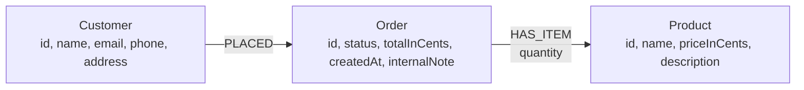

# Viết truy vấn Cypher chỉ trả dữ liệu cần thiết cho phía ứng dụng

## 1. Vì sao truy vấn đọc cần quan tâm đến dữ liệu trả về?

Trong **Neo4j**, dữ liệu được tổ chức theo mô hình **property graph**: mỗi node và relationship có thể mang nhiều property; truy vấn **Cypher** có thể đi qua nhiều relationship và trả về node, relationship, path hoặc giá trị tính toán. Khi ứng dụng Java, REST API hoặc Spring Data Neo4j chỉ cần vài trường để hiển thị, việc trả về cả node và mọi quan hệ liên quan có thể gây lãng phí.

Ví dụ, màn hình “Đơn hàng gần đây” chỉ cần **mã đơn, trạng thái, tổng tiền và thời điểm tạo**, nhưng truy vấn lại trả về toàn bộ `Customer`, `Order` và `Product`. Dữ liệu thừa làm tăng kích thước kết quả đi qua giao thức Bolt, chi phí chuyển đổi dữ liệu thành object/JSON và bộ nhớ dùng để giữ kết quả. Một mẫu truy vấn trải qua nhiều quan hệ còn có thể làm **nhân số hàng** trước khi dữ liệu tới ứng dụng.

Nguyên tắc cốt lõi:

> **Bắt đầu từ hợp đồng dữ liệu của màn hình/API, rồi viết câu Cypher tạo đúng hình dạng, số hàng và trường dữ liệu mà hợp đồng đó yêu cầu.**

Điều này không có nghĩa không bao giờ trả về node hoặc path: chức năng chỉnh sửa đầy đủ thuộc tính hay trực quan hóa đường đi có thể cần chúng. Nhưng với danh sách, thẻ thông tin, dashboard và phần lớn endpoint đọc, dữ liệu được **chiếu chọn (projection)** thường là lựa chọn thích hợp.

### 1.1. Ba chiều cần giới hạn

| Chiều | Câu hỏi thiết kế | Công cụ Cypher thường dùng |
|---|---|---|
| **Trường dữ liệu** | Mỗi dòng cần những property nào? | `RETURN n.id AS id`, map projection `n{.id, .name}` |
| **Số hàng** | Mỗi request cần tối đa bao nhiêu kết quả? | `WHERE`, `ORDER BY`, `LIMIT`, `SKIP` hoặc phân trang bằng cursor |
| **Độ mở rộng đồ thị** | Cần đi qua bao nhiêu relationship và tập hợp các node con như thế nào? | Mẫu `MATCH` có phạm vi rõ ràng, `WITH`, `OPTIONAL MATCH`, `collect()` |

Giảm **kích thước phản hồi** không đồng nghĩa tự động giảm **chi phí thực thi truy vấn**: một truy vấn trả 10 hàng vẫn có thể phải quét hoặc sắp xếp rất nhiều hàng. Phần sau sẽ phân biệt rõ hai vấn đề.

## 2. Ví dụ xuyên suốt: API danh sách đơn hàng

Giả sử hệ thống bán hàng có các node và relationship:



Một endpoint `GET /customers/{customerId}/orders` cần trả danh sách đơn hàng, tối đa 20 đơn trong một lượt. Hợp đồng dữ liệu minh họa:

```json
[
  {
    "orderId": "ORD-101",
    "status": "SHIPPED",
    "totalInCents": 265000,
    "createdAt": "2026-11-20T09:15:00Z"
  }
]
```

Endpoint này **không cần** email, số điện thoại, địa chỉ, ghi chú nội bộ, các sản phẩm trong mỗi đơn hoặc toàn bộ cấu trúc đồ thị. Dữ liệu trả về nên có đúng bốn trường nêu trên.

### 2.1. Cách viết lấy thừa dữ liệu

```cypher
MATCH (customer:Customer {id: $customerId})-[:PLACED]->(o:Order)
RETURN customer, o;
```

Câu truy vấn trên trả về hai **node** cho mỗi hàng. Driver có thể nhận các property của `customer` và `o`, kể cả những property endpoint không dùng. Nếu mỗi customer có nhiều order, thông tin customer còn bị lặp lại ở nhiều hàng.

```cypher
MATCH (customer:Customer {id: $customerId})-[:PLACED]->(o:Order)
RETURN *;
```

`RETURN *` trả về **mọi biến đang nằm trong phạm vi câu truy vấn**; ở đây là `customer` và `o`. Nó không tự lấy toàn bộ node trong database, nhưng vẫn có thể trả nhiều dữ liệu hơn yêu cầu API.

Tương tự, `RETURN properties(o)` hoặc `RETURN o{.*}` vẫn lấy **tất cả property** của đơn hàng; đổi cách đóng gói dữ liệu không làm kết quả hẹp lại.

### 2.2. Chiếu chọn đúng bốn trường

```cypher
MATCH (:Customer {id: $customerId})-[:PLACED]->(o:Order)
RETURN
  o.id AS orderId,
  o.status AS status,
  o.totalInCents AS totalInCents,
  toString(o.createdAt) AS createdAt
ORDER BY o.createdAt DESC, o.id DESC
LIMIT $pageSize;
```

Ở đây:

- `(:Customer {id: $customerId})` xác định customer; không đặt tên biến vì không cần trả hay sử dụng node customer ở phần còn lại.
- `RETURN o.id ...` chỉ chiếu chọn bốn trường ứng dụng yêu cầu. Các alias `orderId`, `status`... là tên cột mà Java Driver nhìn thấy.
- `toString(o.createdAt)` là một ví dụ chuyển giá trị thời gian thành chuỗi để phục vụ DTO/JSON. Nếu ứng dụng cần đối tượng thời gian gốc, có thể trả `o.createdAt` và chuyển kiểu ở Java.
- `ORDER BY o.createdAt DESC, o.id DESC` tạo thứ tự xác định. Trường `id` nên là khóa duy nhất để phá hòa khi nhiều đơn có cùng thời điểm.
- `LIMIT $pageSize` giới hạn số hàng trả về. Phía ứng dụng vẫn cần chặn giá trị page size ở mức hợp lý, ví dụ 1–100.

Truy vấn này giả định mỗi đơn hàng được nối với customer bằng một relationship `PLACED` duy nhất. Nếu dữ liệu có nhiều đường nối trùng tới cùng một đơn, cần sửa ràng buộc dữ liệu hoặc xử lý trùng lặp có chủ đích.

**Lưu ý:** `LIMIT` hạn chế số hàng xuất ra, nhưng database có thể vẫn phải xét hoặc sắp xếp nhiều đơn hàng để tìm ra nhóm đầu tiên. Hiệu quả của việc lọc, index và sắp xếp cần được kiểm tra riêng.

## 3. Chọn hình dạng kết quả: cột tường minh hay map projection?

### 3.1. Trả về các cột đơn giản

```cypher
MATCH (p:Product)
WHERE p.id = $productId
RETURN
  p.id AS id,
  p.name AS name,
  p.priceInCents AS priceInCents;
```

Hình dạng này dễ ánh xạ sang Java record hoặc DTO. Tên alias cần được thống nhất với code đọc `Record.get("id")`, `Record.get("name")`.

### 3.2. Trả một map có đúng các khóa cần thiết

```cypher
MATCH (p:Product {id: $productId})
RETURN p{
  .id,
  .name,
  priceInCents: p.priceInCents
} AS product;
```

**Map projection** `p{.id, .name, ...}` tạo map chỉ với những trường được chọn. Phần `.id`, `.name` lấy property tương ứng từ node; `priceInCents: ...` cho phép chỉ định rõ biểu thức hoặc đổi cách đặt tên khóa.

Ví dụ, API muốn tên `displayName`:

```cypher
MATCH (p:Product {id: $productId})
RETURN p{
  .id,
  displayName: coalesce(p.name, 'Chưa đặt tên')
} AS product;
```

`coalesce(...)` chọn giá trị đầu tiên khác `null`, hữu ích khi API cần giá trị mặc định. Tuy nhiên, dữ liệu gốc thiếu trường đôi khi là lỗi cần phát hiện; không nên thay `null` bằng giá trị mặc định trong mọi trường hợp.

Nếu node có property không tồn tại, chiếu chọn cần được kiểm thử theo kỳ vọng mapper và schema phản hồi. Hãy quyết định rõ API muốn giá trị `null`, trường vắng mặt hay lỗi dữ liệu trước khi viết mapper.

### 3.3. Khi nào trả node hoặc path?

| Nhu cầu | Kiểu kết quả hợp lý |
|---|---|
| Thẻ sản phẩm: mã, tên, giá | Scalar columns hoặc map projection |
| Danh sách đơn: mã, trạng thái, ngày | Scalar columns, `ORDER BY` và `LIMIT` |
| Chi tiết đơn gồm các dòng hàng | Một map/DTO đơn hàng với danh sách con đã tổng hợp |
| Giao diện hiển thị chính các node và edge của một đường đi | Node, relationship hoặc path có kiểm soát theo số bước và số kết quả |
| Công cụ quản trị cần chỉnh sửa mọi property của node | Có thể trả node đầy đủ nếu thực sự cần |

Không dùng `RETURN n` chỉ vì nó ngắn hơn `RETURN n.id, n.name`; hãy chọn theo hợp đồng dữ liệu.

## 4. Giới hạn số hàng trước khi mở rộng quan hệ

Một rủi ro điển hình của property graph là **nhân hàng**. Nếu 1 đơn hàng có 8 dòng sản phẩm, câu lệnh sau trả 8 hàng chứa lặp thông tin đơn:

```cypher
MATCH (:Customer {id: $customerId})-[:PLACED]->(o:Order)
MATCH (o)-[line:HAS_ITEM]->(p:Product)
RETURN o.id AS orderId, p.name AS productName, line.quantity AS quantity;
```

Nếu API cần **một dòng cho mỗi đơn**, chỉ thêm `LIMIT 20` ở cuối có thể giới hạn 20 **dòng sản phẩm**, không phải 20 **đơn hàng**. Một đơn có nhiều sản phẩm có thể chiếm phần lớn trang, và các đơn không có sản phẩm có thể biến mất vì `MATCH` yêu cầu quan hệ tồn tại.

### 4.1. Chọn trang đơn hàng trước, rồi tổng hợp dòng hàng

Giả sử endpoint chi tiết danh sách cần mỗi đơn gồm mã, trạng thái và `items`:

```json
[
  {
    "orderId": "ORD-101",
    "status": "SHIPPED",
    "items": [
      {"productId": "P-7", "name": "Bàn phím", "quantity": 1},
      {"productId": "P-9", "name": "Chuột", "quantity": 2}
    ]
  }
]
```

Truy vấn:

```cypher
MATCH (:Customer {id: $customerId})-[:PLACED]->(o:Order)
WHERE o.status IN $allowedStatuses
WITH o
ORDER BY o.createdAt DESC, o.id DESC
SKIP $offset
LIMIT $pageSize

OPTIONAL MATCH (o)-[line:HAS_ITEM]->(p:Product)
WITH
  o,
  collect(
    CASE
      WHEN p IS NULL THEN null
      ELSE {
        productId: p.id,
        name: p.name,
        quantity: line.quantity
      }
    END
  ) AS items
RETURN
  o.id AS orderId,
  o.status AS status,
  items
ORDER BY o.createdAt DESC, o.id DESC;
```

Cách tổ chức các bước:

1. `MATCH` tìm đơn của customer; `WHERE` chỉ giữ trạng thái được yêu cầu.
2. `WITH o ORDER BY ... SKIP ... LIMIT ...` xác định **trang đơn hàng** trước khi truy vấn các dòng hàng.
3. `OPTIONAL MATCH` giữ cả đơn không có dòng hàng khớp; nếu dùng `MATCH` thường, đơn không có dòng hàng sẽ bị loại.
4. `collect(...)` gom các dòng hàng thành một list cho từng `o`. Trường hợp `p IS NULL` không đưa map giả vào danh sách; `collect()` bỏ qua giá trị `null`.
5. `RETURN` chỉ đưa ra các trường yêu cầu và sắp thứ tự lại cho kết quả cuối.

**Giới hạn quan trọng:** Chỉ phân trang theo đơn hàng chưa giới hạn **số dòng sản phẩm của một đơn**. Nếu một đơn có hàng chục nghìn dòng, phản hồi vẫn rất lớn. Khi đó cần thiết kế API chi tiết tách riêng, đặt giới hạn theo nghiệp vụ hoặc phân trang danh sách dòng hàng. Không thể thay `LIMIT` ở cuối bằng một con số nhỏ mà giữ nguyên ý nghĩa “N đơn, mỗi đơn có tất cả dòng hàng”.

### 4.2. Đừng dùng DISTINCT để chữa mọi vấn đề

`DISTINCT` có ích khi một dữ liệu thực sự xuất hiện nhiều lần theo mẫu truy vấn, nhưng nó không xác định lại hợp đồng một đơn/một dòng:

```cypher
MATCH (o:Order)-[:HAS_ITEM]->(p:Product)
RETURN DISTINCT o.id AS orderId, p.id AS productId;
```

Kết quả vẫn có **một hàng cho mỗi cặp đơn–sản phẩm khác nhau**. Nếu client cần một hàng theo đơn, phải quyết định dùng `collect()`, phép tổng hợp khác hoặc loại hẳn đường nối tới sản phẩm nếu không cần.

Nếu chỉ cần **số lượng sản phẩm** thay vì danh sách, trả một giá trị tổng hợp thường tiết kiệm hơn trả toàn bộ sản phẩm để Java tự đếm:

```cypher
MATCH (o:Order {id: $orderId})
OPTIONAL MATCH (o)-[:HAS_ITEM]->(p:Product)
RETURN o.id AS orderId, count(p) AS productCount;
```

Ví dụ này đếm số dòng quan hệ có product khớp. Nó **không phải tổng `quantity`** của các dòng hàng; nếu hợp đồng cần tổng số đơn vị, phải tính từ property `line.quantity` với quy tắc xử lý `null` phù hợp.

## 5. Phân trang đúng đối tượng, đúng thứ tự

### 5.1. Phân trang bằng SKIP/LIMIT

```cypher
MATCH (:Customer {id: $customerId})-[:PLACED]->(o:Order)
RETURN o.id AS orderId, o.status AS status
ORDER BY o.createdAt DESC, o.id DESC
SKIP $offset
LIMIT $pageSize;
```

Ví dụ trang 2 với page size 20 dùng `$offset = 20`. Cách này dễ triển khai, nhưng offset lớn có thể làm database phải đi qua nhiều kết quả trước trang cần lấy. Nếu dữ liệu thay đổi giữa hai request, việc chèn/xóa đơn cũng có thể gây trùng hoặc bỏ sót giữa các trang.

**Không phân trang khi thiếu `ORDER BY`**, vì thứ tự kết quả không được bảo đảm. Khi nhiều bản ghi trùng ngày, thêm khóa duy nhất như `o.id` để phân trang ổn định hơn.

### 5.2. Phân trang bằng cursor cho danh sách dài

Nếu API lấy nhiều trang liên tiếp theo `createdAt DESC, id DESC`, có thể dùng vị trí của phần tử cuối trang trước:

```cypher
MATCH (:Customer {id: $customerId})-[:PLACED]->(o:Order)
WHERE
  $cursorCreatedAt IS NULL
  OR o.createdAt < $cursorCreatedAt
  OR (
    o.createdAt = $cursorCreatedAt
    AND o.id < $cursorId
  )
RETURN
  o.id AS orderId,
  o.status AS status,
  o.totalInCents AS totalInCents,
  o.createdAt AS createdAt
ORDER BY o.createdAt DESC, o.id DESC
LIMIT $pageSize;
```

Trong ví dụ này `$cursorCreatedAt` phải cùng **kiểu temporal** với `o.createdAt` (chẳng hạn gửi qua Java Driver dưới dạng kiểu thời gian tương thích), còn `$cursorId` phải cùng kiểu với `o.id`. Ở trang đầu, truyền `null` cho `cursorCreatedAt`. Sau đó dùng giá trị `createdAt` và `orderId` của phần tử cuối để yêu cầu trang tiếp.

Cursor giúp tránh nhiều vấn đề của offset lớn, nhưng hiệu quả thực thi còn phụ thuộc mô hình dữ liệu, index và query plan. Nó cũng không tạo một snapshot bất biến khi dữ liệu thay đổi giữa các request; ứng dụng cần chính sách nhất quán phù hợp.

## 6. Lọc bằng tham số và chú ý index

Chỉ trả ít trường sẽ không bù được một truy vấn phải quét toàn đồ thị. Với endpoint tìm customer theo mã, điều kiện:

```cypher
MATCH (c:Customer {id: $customerId})
RETURN c.id AS id, c.name AS name;
```

nên đi kèm **constraint duy nhất hoặc index** thích hợp trên `:Customer(id)` theo mô hình dữ liệu. Chẳng hạn, nếu `Customer.id` thực sự là khóa nghiệp vụ duy nhất:

```cypher
CREATE CONSTRAINT customer_id_unique IF NOT EXISTS
FOR (c:Customer)
REQUIRE c.id IS UNIQUE;
```

Câu lệnh trên là thao tác **thay đổi schema**, chỉ dùng khi thiết lập môi trường và đã kiểm tra dữ liệu có đáp ứng tính duy nhất. Không chạy lệnh tạo constraint trong mỗi request đọc.

Các lưu ý quan trọng:

- Đưa `WHERE` và việc chọn điểm bắt đầu truy vấn vào đúng chỗ để hạn chế số node/relationship cần duyệt; chọn nhãn và loại relationship cụ thể khi biết trước.
- Sử dụng **tham số** `$customerId`, `$pageSize`, `$allowedStatuses`... thay vì nối chuỗi từ đầu vào người dùng. Giá trị phải được validate (kiểu, giới hạn trang, trạng thái hợp lệ).
- Index hỗ trợ tìm điểm bắt đầu, nhưng không bảo đảm mọi `ORDER BY`/`LIMIT` đều rẻ. Cần kiểm tra truy vấn trên dữ liệu thật.
- Chỉ lấy dữ liệu cần thiết cũng giúp giảm việc đưa property nhạy cảm qua các tầng ứng dụng; tuy nhiên kiểm soát quyền truy cập vẫn phải được thực hiện độc lập.

## 7. Trả kết quả gọn về Java Driver

Khi các cột của Cypher đã đúng với DTO, code Java không cần đọc node đầy đủ rồi lọc thủ công.

Ví dụ với API của Neo4j Java Driver hỗ trợ `Session.executeRead(...)`:

```java
import java.util.List;
import java.util.Map;
import org.neo4j.driver.Driver;
import org.neo4j.driver.Result;
import org.neo4j.driver.Session;
import org.neo4j.driver.SessionConfig;

public class OrderQueries {
    public record OrderSummary(
            String orderId,
            String status,
            long totalInCents,
            String createdAt
    ) {}

    public static List<OrderSummary> findRecentOrders(
            Driver driver, String customerId, int requestedPageSize) {

        if (customerId == null || customerId.isBlank()) {
            throw new IllegalArgumentException("customerId is required");
        }
        int pageSize = Math.max(1, Math.min(requestedPageSize, 100));

        String cypher = """
                MATCH (:Customer {id: $customerId})-[:PLACED]->(o:Order)
                RETURN
                    o.id AS orderId,
                    o.status AS status,
                    o.totalInCents AS totalInCents,
                    toString(o.createdAt) AS createdAt
                ORDER BY o.createdAt DESC, o.id DESC
                LIMIT $pageSize
                """;

        try (Session session = driver.session(
                SessionConfig.forDatabase("neo4j"))) {
            return session.executeRead(tx -> {
                Result result = tx.run(
                        cypher,
                        Map.of("customerId", customerId, "pageSize", pageSize)
                );
                return result.list(record -> new OrderSummary(
                        record.get("orderId").asString(),
                        record.get("status").asString(),
                        record.get("totalInCents").asLong(),
                        record.get("createdAt").asString()
                ));
            });
        }
    }
}
```

Các điểm cần nhớ:

- `record.get("orderId")` truy cập cột theo **alias của Cypher**. Nếu alias thay đổi mà mapper không đổi, code sẽ lỗi.
- `result.list(...)` materialize danh sách trong bộ nhớ, nên cần giới hạn số hàng có ý nghĩa. Với tập dữ liệu lớn hoặc cần streaming, xem API cursor/stream của phiên bản driver đang dùng.
- Đoạn ví dụ giả định dữ liệu đúng schema: `status` và `createdAt` tồn tại, `totalInCents` là số nguyên phù hợp kiểu `long`. Khi dữ liệu có thể `null`, cần dùng DTO nullable và xử lý `Value.isNull()` trước khi gọi các hàm chuyển kiểu.
- Cần chọn tên database và thiết lập phiên bản Java Driver phù hợp với môi trường; câu lệnh mẫu không cố định việc kết nối hoặc xác thực `Driver`.

### 7.1. Với Spring Data Neo4j

Trong Spring Data Neo4j, đừng mặc định phải nạp cả aggregate entity và mọi quan hệ liên quan cho một endpoint danh sách. Với dữ liệu đọc dạng tóm tắt, có thể dùng **DTO/projection** hoặc custom query với `Neo4jClient` và mapper chuyển `Record` sang DTO.

Ví dụ ý tưởng mapping:

```java
// Trong một component đã được inject Neo4jClient:
record ProductCard(String id, String name, long priceInCents) {}

Collection<ProductCard> cards = neo4jClient.query("""
        MATCH (p:Product)
        WHERE p.id IN $productIds
        RETURN p.id AS id, p.name AS name,
               p.priceInCents AS priceInCents
        """)
    .bind(productIds).to("productIds")
    .fetchAs(ProductCard.class)
    .mappedBy((typeSystem, record) ->
        new ProductCard(
            record.get("id").asString(),
            record.get("name").asString(),
            record.get("priceInCents").asLong()
        )
    )
    .all();
```

Đây là đoạn minh họa đặt **bên trong class/component** có sẵn biến `neo4jClient` và `productIds`; các import, wiring và xử lý dữ liệu trống phụ thuộc dự án. Kiểm tra API thực tế của phiên bản Spring Data Neo4j đang dùng. Trọng tâm là xác định **hợp đồng DTO trước**, rồi để câu Cypher chỉ tạo các cột DTO cần đọc.

Nếu dùng repository query và interface projection, cần kiểm tra quy tắc mapping và khả năng hỗ trợ của đúng phiên bản Spring Data Neo4j; việc đổi một entity đầy đủ sang DTO không nhất thiết chỉ là đổi kiểu trả về.

## 8. Đếm tổng, danh sách chi tiết và vấn đề N+1

Một API phân trang có thể cần cả `items` và `totalItems`. Truy vấn danh sách đã `LIMIT` không tự nói cho bạn tổng số đơn trước phân trang.

Nếu API thực sự cần total count, có thể dùng truy vấn riêng với cùng điều kiện lọc:

```cypher
MATCH (:Customer {id: $customerId})-[:PLACED]->(o:Order)
WHERE o.status IN $allowedStatuses
RETURN count(o) AS totalItems;
```

Không đưa phép mở rộng `HAS_ITEM` vào truy vấn count nếu mục đích chỉ đếm đơn hàng, vì join với các dòng sản phẩm có thể khiến phép đếm sai hoặc tốn chi phí. Nếu mô hình cho phép nhiều đường nối tới cùng một order, phải xem xét `count(DISTINCT o)` và ràng buộc dữ liệu.

Ngược lại, **không** mặc định chạy count trong mọi request: nếu giao diện chỉ cần biết “còn trang sau không”, có thể yêu cầu `pageSize + 1` bản ghi để xác định `hasNext`, sau đó chỉ trả tối đa `pageSize` cho client.

Một lỗi phổ biến phía Java là:

1. Query thứ nhất lấy 20 order.
2. Với mỗi order, code chạy thêm một query để lấy sản phẩm.
3. Tổng cộng có **21 lần truy vấn** cho một trang.

Đây là biểu hiện của mẫu **N+1 queries**. Có thể tránh bằng truy vấn tổng hợp có `collect()` như mục 4 hoặc một query lấy các dòng sản phẩm theo **danh sách orderId** và ghép dữ liệu trong Java. Chọn phương án nào tùy khối lượng hàng con và nhu cầu API; “gộp tất cả vào một câu” không phải lúc nào cũng tốt nếu nó làm sinh lượng kết quả quá lớn.

## 9. Đo kết quả: ít byte hơn chưa chắc query nhanh hơn

Hãy đánh giá trên hai nhóm chỉ số:

| Phía Neo4j Server | Phía ứng dụng/API |
|---|---|
Số hàng trung gian và cuối cùng qua từng operator trong execution plan | Kích thước phản hồi JSON hoặc dữ liệu nhận từ driver |
`DB Hits`, operator scan/expand/sort, thời gian thực thi | Số record/object được materialize |
Sử dụng index, mức tiêu thụ bộ nhớ của query | Thời gian chuyển đổi sang DTO/JSON |
Độ lớn kết quả trước và sau `collect()` | Tổng thời gian đáp ứng, bộ nhớ Java, số round-trip |

Xem plan mà không thực thi câu truy vấn:

```cypher
EXPLAIN
MATCH (:Customer {id: $customerId})-[:PLACED]->(o:Order)
RETURN o.id AS orderId, o.status AS status
ORDER BY o.createdAt DESC, o.id DESC
LIMIT $pageSize;
```

Để quan sát thống kê thực thi, chạy `PROFILE` với cùng truy vấn và tham số:

```cypher
PROFILE
MATCH (:Customer {id: $customerId})-[:PLACED]->(o:Order)
RETURN o.id AS orderId, o.status AS status
ORDER BY o.createdAt DESC, o.id DESC
LIMIT $pageSize;
```

`PROFILE` **thực thi truy vấn**. Trong ví dụ trên chỉ có thao tác đọc; với truy vấn có thao tác ghi, phải cân nhắc ảnh hưởng trước khi chạy. Màn hình plan có thể cho biết operator, Rows, DB Hits và index usage tùy công cụ và phiên bản Neo4j. Nó không tự đo toàn bộ số byte HTTP/JSON được gửi về API; các chỉ số đó cần quan sát ở ứng dụng.

Một phép so sánh hữu ích là cố định cùng dữ liệu và cùng bộ tham số:

| Phương án | Kết quả trả | Điều cần so sánh |
|---|---|---|
| `RETURN customer, o` | Node đầy đủ, customer lặp giữa các dòng | Payload/DTO, xử lý Java |
| `RETURN o.id, o.status, ...` | Bốn cột cần thiết | Payload/DTO, thời gian truy vấn |
| Mở rộng sản phẩm trước `LIMIT` | Hàng theo quan hệ order–product | Row cardinality, tính đúng của phân trang |
| `LIMIT` order trước, rồi `collect()` | Mỗi order một hàng chứa list item | Row cardinality, bộ nhớ và kích thước item list |

Đừng kết luận tối ưu chỉ vì số cột ít hơn; việc truy vấn thêm quan hệ, `DISTINCT`, `collect()` hoặc `ORDER BY` có thể tạo ra chi phí khác. Chọn phương án vừa đúng hợp đồng API vừa đáp ứng mục tiêu hiệu năng đã đo.

## 10. Các lỗi thiết kế thường gặp

| Cách làm | Vấn đề | Cách sửa |
|---|---|---|
| `RETURN *` trong API công khai | Kết quả thay đổi theo biến trong query; dễ lộ/đưa thừa dữ liệu | Trả alias hoặc map projection tường minh |
| `RETURN n` dù chỉ dùng `n.id` | Nhận cả node và property không cần | `RETURN n.id AS id` |
| `MATCH` tất cả quan hệ, rồi `LIMIT` | Giới hạn hàng đã nở, sai đơn vị phân trang | Xác định tập node gốc và phân trang trước khi expand |
| Thiếu `ORDER BY` | Trang kết quả không ổn định | Sắp xếp có khóa phá hòa |
| `OPTIONAL MATCH` rồi lọc sai chỗ | Vô tình loại dữ liệu thiếu quan hệ | Xác định rõ ý nghĩa của `null` và vị trí điều kiện |
| `collect()` mọi quan hệ của mọi node | List rất lớn, tăng bộ nhớ | Giới hạn tập node gốc và dữ liệu con, hoặc tách endpoint |
| Dùng `DISTINCT` cho tất cả | Chi phí khử trùng lặp mà chưa giải quyết đúng cardinality | Xác định một hàng đại diện cho thực thể nào |
| Lấy toàn bộ order rồi lọc trạng thái ở Java | Tốn truyền dữ liệu và RAM | Đưa điều kiện vào `WHERE` |
| Query một lần cho mỗi order để tìm items | N+1 round-trip | Dùng query batch hoặc gom quan hệ có kiểm soát |
| Trả `createdAt` lúc là chuỗi lúc là temporal | Mapper/JSON khó nhất quán | Quy định rõ kiểu và chuyển đổi tại một tầng |

## 11. Bài tập áp dụng

### Bài tập 1: API thẻ thông tin sản phẩm

Yêu cầu chỉ trả `id`, `name` và `priceInCents` của sản phẩm theo `$productId`. Viết Cypher không trả node đầy đủ.

<details>
<summary>Gợi ý lời giải</summary>

```cypher
MATCH (p:Product {id: $productId})
RETURN
  p.id AS id,
  p.name AS name,
  p.priceInCents AS priceInCents;
```

</details>

### Bài tập 2: Phân trang 10 đơn hàng

Ứng dụng muốn 10 đơn của một customer, sắp theo `createdAt` giảm dần, có khóa phá hòa `id`. Hãy xác định vì sao đoạn sau chưa đúng:

```cypher
MATCH (:Customer {id: $customerId})-[:PLACED]->(o:Order)
MATCH (o)-[:HAS_ITEM]->(p:Product)
RETURN o.id, p.name
LIMIT 10;
```

**Gợi ý:** Đoạn này không sắp xếp, phân trang theo **dòng order–product** thay vì đơn hàng và bỏ các đơn không có product. Hãy bắt đầu từ tập `o`, `ORDER BY ... LIMIT 10` trong `WITH`, sau đó mới nối `HAS_ITEM` nếu API thật sự cần product.

### Bài tập 3: Kiểm chứng tối ưu

Một truy vấn mới chỉ trả 4 cột thay vì node `Order` đầy đủ. Thời gian đáp ứng API hầu như không thay đổi. Có thể kết luận thay đổi không có ích?

**Gợi ý:** Chưa. Hãy so sánh số byte truyền, thời gian deserialize/map DTO và mức dùng bộ nhớ Java. Đồng thời xem `PROFILE`: server có thể vẫn tốn phần lớn thời gian ở scan/sort; khi đó cần thêm index, thay điều kiện lọc hoặc cách phân trang để cải thiện tốc độ.

## 12. Ghi nhớ

Trong Neo4j, tối ưu truy vấn đọc bắt đầu từ việc xác định **một hàng kết quả đại diện cho gì** và **ứng dụng cần đúng những property nào**. Dùng `RETURN` tường minh hoặc map projection để thu hẹp cột; dùng `WHERE`, `ORDER BY` và phân trang để kiểm soát số hàng; dùng `WITH` trước khi mở rộng relationship và `collect()` khi API cần cấu trúc lồng nhau.

Với Java Driver hoặc Spring Data Neo4j, hãy ánh xạ các alias Cypher trực tiếp sang DTO, tránh nạp entity và quan hệ thừa. Cuối cùng, đánh giá cả **query plan ở Neo4j** lẫn **payload, số object và thời gian xử lý ở ứng dụng** để xác nhận hiệu quả thật sự.
