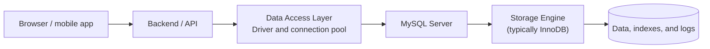

# What Is MySQL and Its Role in Application Systems

MySQL is a Relational Database Management System (RDBMS) used to store, organize, query, and protect structured data. In an application system, MySQL is often the place that holds long-lived business data such as accounts, products, orders, payments, and transaction history. The application sends requests to MySQL via SQL statements; MySQL verifies access privileges, executes the requests, and returns the results.

This lesson introduces MySQL, how it participates in application architecture, and its key responsibilities. This is the foundation for learning how to design tables, choose data types, write queries, use indexes, manage transactions, and operate a database.

## 1. What Is MySQL?

MySQL is a relational database management system. Data is organized into **databases**, **tables**, **rows**, and **columns**:

- A database groups the data objects of an application or a business domain.
- A table describes a type of object, such as `customers` storing customer information.
- A row is a specific record in a table.
- A column describes an attribute of the record, such as `email`, `created_at`, or `status`.

Tables can be linked together using keys. For example, an order belongs to a customer; the `customer_id` column in the `orders` table can reference the primary key `id` of the `customers` table. The relational structure keeps data organized, limits duplication, and expresses business rules.

MySQL uses **SQL (Structured Query Language)** to define structures, read, and modify data. Two concepts should be distinguished:

- **SQL** is the language used to work with relational data.
- **MySQL** is the database management software that understands SQL and is responsible for storing, executing, controlling access, and protecting data.

MySQL follows a client–server model. MySQL Server runs as a service; applications, command-line tools, or administration tools connect to this service using the MySQL protocol. A single server can serve multiple connections and multiple applications, depending on the deployment and configuration.

## 2. Where Does MySQL Sit in Application Architecture?

In a typical web or mobile application, users do not connect directly to MySQL. Requests go through the backend tier so the application can authenticate users, apply business rules, and control which statements are allowed to execute.



The role of each component:

1. **Client** sends a request, such as viewing an order list or creating an account.
2. **Backend/API** authenticates and authorizes users at the application level, validates input data, and enforces business rules.
3. **Data access layer** uses a driver/connector to send SQL statements to MySQL. A connection pool reuses a pool of connections to reduce the overhead of continuously creating new connections.
4. **MySQL Server** accepts connections, authenticates database accounts, parses statements, selects an execution plan, and coordinates operations with the storage engine.
5. **Storage engine** performs reading, writing, and data management on storage devices. InnoDB is a common choice for transactional applications because it supports transactions, row-level locking, foreign keys, and crash recovery.

For example, when a user opens the purchase history page, the backend may send a `SELECT` query to retrieve the current user's orders. When the user places an order, the backend checks the cart and inventory, then sends the necessary `INSERT` or `UPDATE` statements within a transaction. MySQL persists the changes and returns the result so the backend can respond to the client.

## 3. Core Responsibilities of MySQL

### 3.1. Storing Structured Data

MySQL stores data in tables with predefined structures. Column data types define the kind of values stored, such as integers, strings, dates/times, or decimal numbers. Choosing appropriate data types keeps data consistent and avoids wasting storage space.

MySQL also stores objects that support data access, such as indexes and the metadata required to manage transactions. Data is written to persistent storage according to the storage engine's mechanisms and server configuration.

### 3.2. Querying and Transforming Data

SQL allows applications to read, insert, update, and delete data. Common statement groups include:

| Statement group | Purpose | Example |
| --- | --- | --- |
| `SELECT` | Read data | Retrieve a list of orders |
| `INSERT` | Insert records | Create a new order |
| `UPDATE` | Update records | Change order status |
| `DELETE` | Delete records | Delete a record according to business rules |
| `CREATE`, `ALTER`, `DROP` | Define or modify structure | Create a table, add a column |

A query can filter, sort, group, and join data from multiple tables. Therefore, the backend does not need to load all data into application memory and perform every filter or join itself.

### 3.3. Maintaining Data Integrity

MySQL provides constraints to prevent invalid data from entering the database:

- `PRIMARY KEY` uniquely identifies each row.
- `FOREIGN KEY` expresses referential relationships between tables and helps prevent references to non-existent records.
- `UNIQUE` prevents duplicate values within the constrained scope.
- `NOT NULL` requires a column to have a value.
- `CHECK` can express validity conditions for column values on MySQL versions that support enforcing this constraint.

For example, a customer's email usually needs to be unique; an order must reference an existing customer. Placing critical rules at the database level helps protect consistency even when multiple application threads write data concurrently.

### 3.4. Managing Transactions and Concurrent Access

A business operation may require multiple SQL statements. For instance, creating an order involves writing order header information and order line items. If only part of it succeeds, the data can fall into an inconsistent state. A transaction groups related operations into a single unit: either all are confirmed, or unconfirmed changes are rolled back.

With InnoDB, transactions adhere to the ACID properties:

- **Atomicity:** changes within a transaction are processed as a single unit.
- **Consistency:** a valid transaction must bring data from one valid state to another valid state, following the applied constraints and rules.
- **Isolation:** concurrent transactions are controlled to limit unwanted mutual interference.
- **Durability:** committed changes are protected according to the system's logging and recovery mechanisms.

When multiple users read or update data simultaneously, MySQL coordinates transactions, locks, and concurrency control mechanisms to manage conflicts. Applications still need to design transactions properly, handle errors, and retry when encountering situations such as deadlocks.

### 3.5. Supporting Query Performance

MySQL can use **indexes** to find rows faster without having to scan the entire table in many cases. Indexes aligned with frequently used filter conditions, join columns, or sort orders can improve query latency.

Indexes also consume storage space and increase overhead when inserting, updating, or deleting data. Therefore, indexes should not be created by guesswork. Developers need to examine actual queries, inspect execution plans with `EXPLAIN`, measure performance, and adjust based on observed metrics.

### 3.6. Access Control and Operational Support

MySQL manages accounts, roles, and privileges at the database level. An application account can be restricted to reading or writing only the required schemas, tables, or operations. Least-privilege access control helps reduce damage if connection credentials are leaked or the application has a bug.

MySQL also provides mechanisms to support backup, recovery, logging, and replication. Replication can help create replicas for read scaling or improve availability, but a synchronized replica does not replace an independent backup. An operational process requires a backup schedule, retention policy, and testing of actual recovery capability.

## 4. Example: MySQL Storing Data for an Ordering Feature

Suppose an online store needs to store customers, orders, and the product line items within each order. The initial data model can be designed as follows:

```sql
CREATE TABLE customers (
    id BIGINT UNSIGNED NOT NULL AUTO_INCREMENT,
    email VARCHAR(254) NOT NULL,
    full_name VARCHAR(150) NOT NULL,
    created_at DATETIME NOT NULL DEFAULT CURRENT_TIMESTAMP,
    PRIMARY KEY (id),
    UNIQUE KEY uq_customers_email (email)
) ENGINE=InnoDB DEFAULT CHARSET=utf8mb4;

CREATE TABLE orders (
    id BIGINT UNSIGNED NOT NULL AUTO_INCREMENT,
    customer_id BIGINT UNSIGNED NOT NULL,
    status VARCHAR(20) NOT NULL DEFAULT 'pending',
    created_at DATETIME NOT NULL DEFAULT CURRENT_TIMESTAMP,
    PRIMARY KEY (id),
    KEY idx_orders_customer_created (customer_id, created_at),
    CONSTRAINT fk_orders_customer
        FOREIGN KEY (customer_id) REFERENCES customers (id)
) ENGINE=InnoDB DEFAULT CHARSET=utf8mb4;

CREATE TABLE order_items (
    order_id BIGINT UNSIGNED NOT NULL,
    line_no SMALLINT UNSIGNED NOT NULL,
    product_name VARCHAR(200) NOT NULL,
    quantity INT UNSIGNED NOT NULL,
    unit_price DECIMAL(13, 2) NOT NULL,
    PRIMARY KEY (order_id, line_no),
    CONSTRAINT fk_order_items_order
        FOREIGN KEY (order_id) REFERENCES orders (id)
) ENGINE=InnoDB DEFAULT CHARSET=utf8mb4;
```

In this example:

- `customers.id` and `orders.id` are primary keys identifying records.
- `orders.customer_id` links an order to a customer via a foreign key.
- `order_items.order_id` links each order line item to its corresponding order.
- `uq_customers_email` prevents two customers from having the same email.
- `idx_orders_customer_created` supports queries that commonly filter orders by customer and sort by creation time.
- `DECIMAL(13, 2)` is suitable for storing monetary amounts requiring decimal precision; approximate floating-point types should not be used for currency.
- `utf8mb4` supports storing the full range of Unicode characters, including Vietnamese and many other character sets.

When creating an order, the backend can execute multiple operations within the same transaction:

```sql
START TRANSACTION;

INSERT INTO orders (customer_id, status)
VALUES (42, 'pending');

SET @new_order_id = LAST_INSERT_ID();

INSERT INTO order_items (
    order_id, line_no, product_name, quantity, unit_price
)
VALUES (
    @new_order_id, 1, 'Keyboard', 1, 1250000.00
);

COMMIT;
```

If an operation fails before committing, the application must roll back the transaction to avoid saving an order missing its detail records. `LAST_INSERT_ID()` returns the auto-increment ID just generated on the current connection; the statements in this example must run on the same database connection. In real application code, use the driver's transaction API and parameterized statements instead of concatenating user input directly into SQL strings.

To read orders along with customer details and total amount, the application can use table joins and aggregation:

```sql
SELECT
    o.id,
    o.created_at,
    o.status,
    c.full_name,
    SUM(oi.quantity * oi.unit_price) AS total_amount
FROM orders AS o
JOIN customers AS c ON c.id = o.customer_id
JOIN order_items AS oi ON oi.order_id = o.id
WHERE o.customer_id = ?
GROUP BY o.id, o.created_at, o.status, c.full_name
ORDER BY o.created_at DESC;
```

The `?` mark is a placeholder commonly supported by drivers in prepared statements. The backend passes the `customer_id` value separately through the parameterized API. This approach ensures values are handled with the correct type and avoids building queries by directly concatenating input data into SQL.

This example illustrates how MySQL both persists data long-term, protects relationships between tables, executes transactions, and provides querying capabilities to power application features.

## 5. Responsibility Boundaries Between the Application and MySQL

MySQL is critical, but it does not replace the entire backend. A clear division of responsibilities makes the system easier to maintain:

| Backend / application | MySQL |
| --- | --- |
| Authenticating end users and applying business rules | Authenticating connection accounts and checking database privileges |
| Deciding whether a business request is permitted to execute | Executing SQL statements within the scope of granted privileges |
| Coordinating APIs, sending notifications, calling external services | Storing relational data and maintaining data constraints |
| Validating input data at the UI/business level | Enforcing data types, keys, and constraints at the storage level |
| Managing processing flows and responding to clients | Managing transactions, locks, queries, and durable storage |

Database account passwords should not be placed in source code or applications running on user devices. Connection credentials should be managed by the backend through appropriate secret configuration; application accounts require least privilege and connections must be secured according to deployment requirements.

MySQL is also not the optimal tool for every data type and every workload. A cache can reduce repeated reads; a dedicated search engine may be better suited for complex full-text search; object storage is suitable for storing large files. These systems can work alongside MySQL, with MySQL continuing to hold structured business data and the relationships that must be guaranteed.

## 6. Common Deployment Models

- **Single MySQL server:** suitable for small applications or early stages, when load and availability requirements are still simple.
- **Managed MySQL (managed database):** the service provider assists with part of the work such as server provisioning, patching, backups, and monitoring; the team is still responsible for schema design, access permissions, and recovery policies.
- **Replication:** data from a source server is replicated to one or more other servers. This architecture can support read scaling or availability strategies, but requires understanding replication lag and how failover is handled during an incident.
- **Connection pooling:** the backend maintains a bounded pool of connections to avoid creating too many concurrent connections and to control MySQL resource usage.

When choosing a model, consider read/write throughput, data size, acceptable latency, recovery requirements, budget, and operational capacity. Replication does not automatically guarantee the ability to recover deleted or erroneously written data; backups and restore testing remain essential.

## 7. Principles to Establish from the Start

1. Design tables around business entities and relationships; choose data types suited to the value domain.
2. Define primary keys, foreign keys, and constraints to protect data integrity.
3. Use InnoDB for most application transactional data and prefer `utf8mb4` for text data.
4. Use prepared statements or parameterized query APIs; never concatenate SQL strings from untrusted input data.
5. Place operations that must succeed together inside a single transaction; keep transactions short and handle errors explicitly.
6. Create indexes based on actual queries; use `EXPLAIN` and measured metrics to evaluate impact.
7. Grant database privileges following the least-privilege principle and manage connection secrets securely.
8. Perform regular backups, define retention periods, and test the recovery procedure.

## 8. MySQL Learning Path in the Module

To master MySQL in an application system, it is best to study the following interconnected knowledge areas:

1. **Overview:** understand the relational model, MySQL's role, and how applications connect to the server.
2. **Table design:** choose data types, primary keys, foreign keys, and constraints.
3. **SQL:** practice `SELECT`, `INSERT`, `UPDATE`, `DELETE`, table joins, and aggregate queries.
4. **Indexes and performance:** read `EXPLAIN`, identify expensive queries, and choose appropriate indexes.
5. **Transactions and concurrency:** understand ACID, isolation levels, locks, deadlocks, and conflict handling.
6. **Security and operations:** manage accounts/privileges, backup/restore, replication, monitoring, and troubleshooting.

These areas are interconnected: data design affects how queries are written; queries determine index requirements; transactions and locks affect correctness when multiple requests run concurrently; security and backups protect data when the application operates in production.

## 9. Key Takeaways

MySQL is a relational database management system following a client–server model that uses SQL to manage structured data. In an application architecture, the backend sends requests to MySQL to store, read, and update business data. MySQL is responsible for executing queries, enforcing constraints, managing transactions and concurrent access, supporting performance via indexes, and providing access control and data operations mechanisms.

Understanding MySQL's proper role helps developers design better data models, write safe queries, maintain consistency under concurrent operations, and prepare data protection, backup, and recovery procedures for the application.
