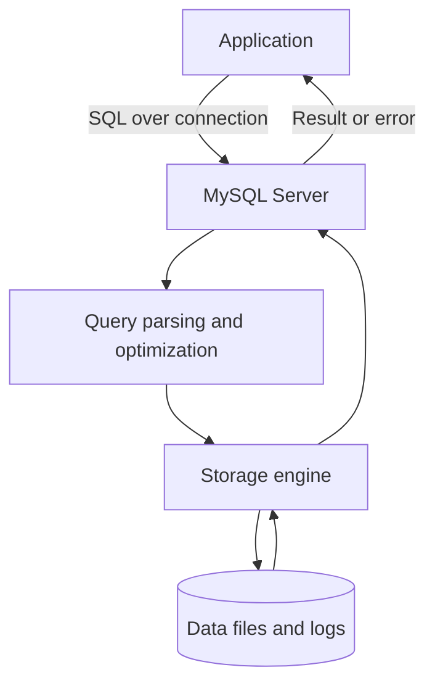
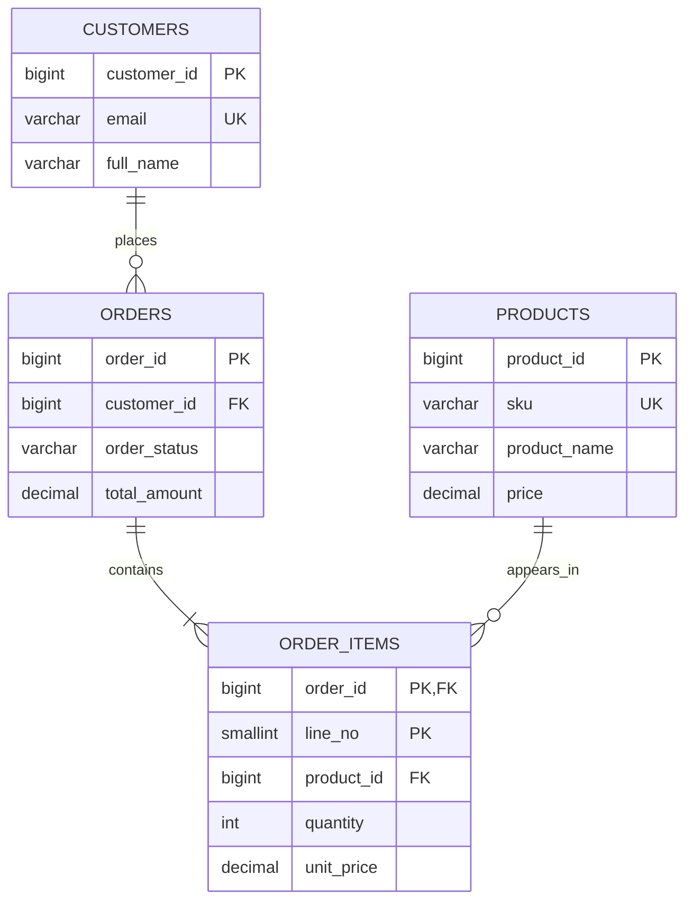
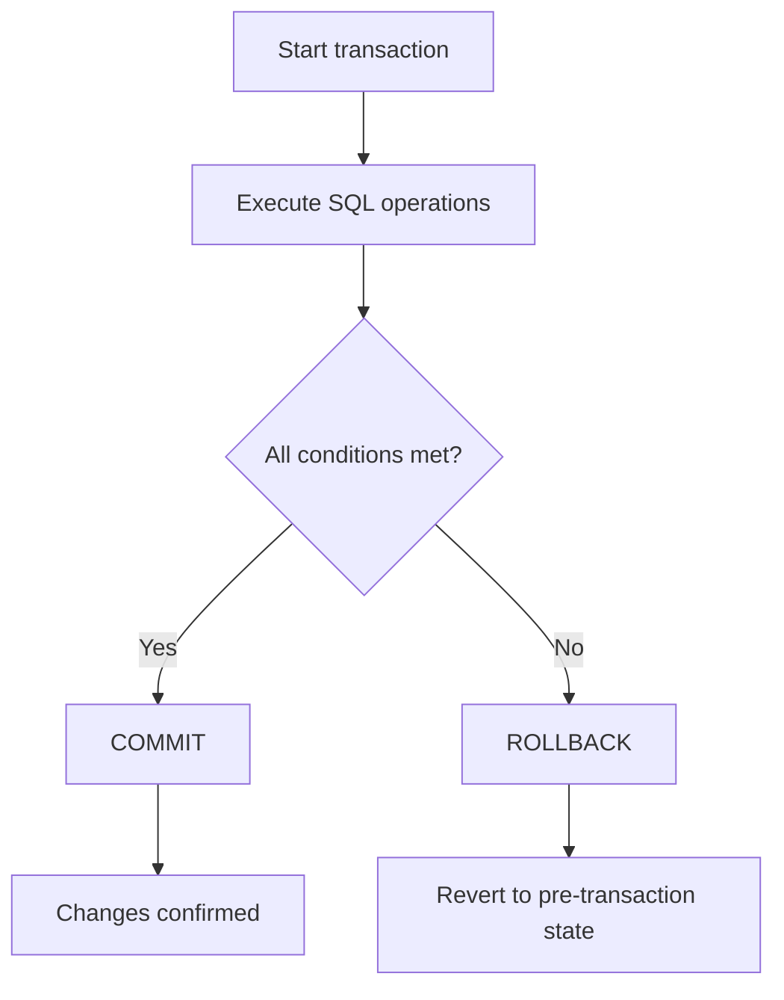
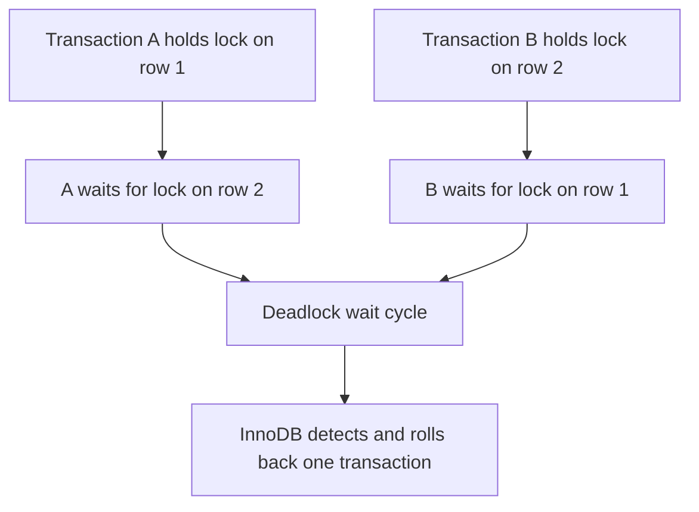

# Relational Storage, Data Integrity, and Transaction Processing

MySQL solves a core set of application problems: storing structured data, representing relationships between entities, protecting data from invalid states, and handling multiple concurrent operations while preserving consistent results. Understanding these problems clarifies why tables, keys, and constraints must be designed carefully before writing SQL queries.

This lesson belongs to the **DATABASE_MYSQL** module. The module aims to master MySQL from table design, data types, keys, and SQL queries to indexes, transactions, and concurrency control; while practicing reading execution plans, optimizing queries, managing access privileges, backing up, and troubleshooting relational database operations. In this lesson, the focus is on the foundations of the relational model, integrity, and transactions — the mechanisms on which the techniques in subsequent lessons rely.

## 1. Why Does an Application Need a Relational Database?

Imagine an online store. The application needs to store customers, products, orders, and each product line item within an order. The data must persist after the application restarts, multiple users may place orders at the same time, and an order must not reference a non-existent customer.

If data is only stored in program variables, it can be lost when the process stops. If written directly to separate files, the application must handle searching, concurrent updates, recovery from partial writes, and keeping related files consistent on its own. As data volume and concurrent access threads grow, the storage-handling code quickly becomes complex.

A Database Management System (DBMS) takes responsibility for managing data and provides shared mechanisms:

- **Persistent storage:** data is written to storage devices and can be recovered after a process or server crash, depending on configuration and storage mechanisms.
- **Structured access:** applications use SQL to insert, read, update, and delete data.
- **Relationship representation:** data is divided into tables and linked by keys.
- **Validity protection:** data constraints are declared at the database level so that multiple applications abide by them together.
- **Concurrency coordination:** multiple connection sessions can operate simultaneously without arbitrarily overwriting or reading each other's intermediate states.
- **Transactions:** a group of related operations can be committed together or aborted together.

MySQL is a Relational Database Management System (RDBMS). MySQL Server receives SQL statements, checks privileges, parses and optimizes queries, and then coordinates with the storage engine to read or write data. For most transactional applications, InnoDB is the commonly used storage engine and the default choice in modern MySQL versions.



Distinguish two concepts: **MySQL** is the database management system; **InnoDB** is a storage engine inside MySQL, responsible for organizing storage and enforcing many mechanisms such as locking, MVCC, transactions, and crash recovery. SQL statements describe what the application wants to do; the engine executes operations on data according to its rules.

## 2. How Does the Relational Model Organize Data?

The relational model represents data as relations, typically implemented as tables. A table has a name, columns, and multiple rows. Each row describes a record; each column describes an attribute with a defined data type.

For example, the `customers` table can store customer information:

| customer_id | email | full_name |
|---:|---|---|
| 101 | an@example.com | Nguyen An |
| 102 | binh@example.com | Tran Binh |

`customer_id` identifies each customer. `email` and `full_name` are attributes of the customer. A row in a table should not represent multiple customers, and a column should not contain an unstructured list of multiple values.

### 2.1. Primary Key Identifies a Row

A Primary Key (PK) is a column or combination of columns used to uniquely identify each row in a table. A primary key must be unique and cannot be `NULL`.

```sql
CREATE TABLE customers (
    customer_id BIGINT UNSIGNED NOT NULL AUTO_INCREMENT,
    email       VARCHAR(255) NOT NULL,
    full_name   VARCHAR(150) NOT NULL,
    created_at  TIMESTAMP NOT NULL DEFAULT CURRENT_TIMESTAMP,
    PRIMARY KEY (customer_id),
    UNIQUE KEY uk_customers_email (email)
) ENGINE = InnoDB
  DEFAULT CHARACTER SET = utf8mb4;
```

In this example, `customer_id` is the primary key. `AUTO_INCREMENT` instructs MySQL to automatically assign an incrementing value when inserting a new row without passing `customer_id`. The `UNIQUE` constraint ensures two customers do not share the same email according to the column's comparison and collation rules.

A primary key should generally remain stable throughout a record's lifecycle. If a business attribute can change — such as email or a display code — using it as the primary key can make updating relationships difficult. A dedicated surrogate identifier key typically keeps referencing tables simpler.

### 2.2. Foreign Key Represents Relationships

A Foreign Key (FK) is a column or group of columns that references a primary key or a unique key in another table. A foreign key expresses that the referenced value must exist on the referenced side, according to the rules of the constraint.

Three common relationship types:

- **One-to-one (1:1):** a record in table A links to at most one record in table B. For example, an account has one separate extended profile.
- **One-to-many (1:N):** a record in table A can link to multiple records in table B. For example, a customer has many orders.
- **Many-to-many (N:N):** multiple records in A link to multiple records in B. For example, an order contains multiple products and a product can appear in multiple orders. This relationship is typically implemented using a junction table.

For the online store, data can be organized into four tables:



`orders` stores the general information of an order. `order_items` stores the line items belonging to an order. The composite primary key `(order_id, line_no)` identifies each line within an order; `product_id` references the product. The `order_items` table is the junction table that converts the many-to-many relationship between orders and products into two one-to-many relationships.

An important design choice is storing `unit_price` in `order_items`. A product's current price may change, but a placed order needs to preserve the price at the time of purchase. Therefore, `unit_price` is historical data of the order line item, not simply a copy that can always be re-queried from `products.price`.

### 2.3. Separating Data to Reduce Update Anomalies

If all information is stored in one large table, customer information would be repeated across every order line item. When a customer changes their email, the application would have to update multiple rows; missing a row creates conflicting versions of information. Deleting the last line item of an order could also accidentally erase customer information if the two types of data are mixed together.

Normalization is the practice of organizing tables and data dependencies to limit duplication and avoid anomalies during inserts, updates, and deletes. At a foundational practical level:

- Each table should describe a single entity type or a clearly defined relationship.
- Each column should hold a single value belonging to a defined data domain, rather than packing multiple independently unqueryable values into a single string.
- Attributes should be stored in the table matching the object they describe.
- Relationships between tables should be represented by keys, not by string concatenation or positional conventions.

Normalization does not mean splitting tables as much as possible. Design must balance integrity, query patterns, join costs, and business requirements. When storing a pre-aggregated value for fast reads, such as `orders.total_amount`, the system must update that value in the same transaction as the order line items and have a reconciliation mechanism when needed.

## 3. How Is Data Integrity Protected?

Data Integrity is the requirement that data always obeys defined rules. An application can validate inputs before sending SQL, but application-tier validation is not enough to protect data when multiple services, background jobs, administrative commands, or connection sessions write to the same database concurrently.

Constraints declared in the database create a shared boundary. MySQL rejects any operation that violates a constraint supported by the engine, regardless of which application issued the statement.

### 3.1. Categories of Integrity Rules

| Rule category | Question to answer | Common mechanisms |
|---|---|---|
| Entity integrity | Is each record uniquely identified? | `PRIMARY KEY`, `UNIQUE`, `NOT NULL` |
| Referential integrity | Does a child record reference an existing parent record? | `FOREIGN KEY` |
| Domain integrity | Is the value of the right type, required, and within the allowed domain? | Data types, `NOT NULL`, `CHECK`, `DEFAULT` |
| Business integrity | Does the data satisfy the rules of business operations? | Appropriate constraints, transactions, and business logic |

For example: the quantity of an order line item must be greater than 0; price cannot be negative; customer emails must not be duplicated; an order must belong to an existing customer. Some rules can be expressed directly with constraints, whereas rules spanning multiple rows or tables often need to be checked inside a transaction.

### 3.2. Common Constraints in MySQL

- `NOT NULL`: the column must have a value. `NULL` means unknown or missing value, not synonymous with an empty string or the number 0.
- `PRIMARY KEY`: uniquely identifies each row; a table can have only one primary key declaration, though the key may consist of multiple columns.
- `UNIQUE`: prevents duplicate key values. For a multi-column unique index, uniqueness applies to the combination of values. Understand how MySQL handles `NULL`: a unique index can contain multiple rows with `NULL` in the key column.
- `FOREIGN KEY`: enforces referential relationships. With InnoDB, the referenced column must have an appropriate index and the foreign key column must also be indexed; MySQL can automatically create an index for the foreign key if no suitable index exists.
- `CHECK`: evaluates a row-level boolean condition. MySQL enforces `CHECK` starting in version 8.0.16; if supporting older versions, verify that version's behavior rather than assuming the constraint is enforced.
- `DEFAULT`: supplies a default value when a statement omits the column. A default value is not a substitute for clearly defining which columns are required.

Example declarations for products and orders:

```sql
CREATE TABLE products (
    product_id   BIGINT UNSIGNED NOT NULL AUTO_INCREMENT,
    sku          VARCHAR(64) NOT NULL,
    product_name VARCHAR(200) NOT NULL,
    price        DECIMAL(12, 2) NOT NULL,
    is_active    BOOLEAN NOT NULL DEFAULT TRUE,
    PRIMARY KEY (product_id),
    UNIQUE KEY uk_products_sku (sku),
    CONSTRAINT chk_products_price CHECK (price >= 0)
) ENGINE = InnoDB;

CREATE TABLE orders (
    order_id     BIGINT UNSIGNED NOT NULL AUTO_INCREMENT,
    customer_id  BIGINT UNSIGNED NOT NULL,
    order_status VARCHAR(20) NOT NULL DEFAULT 'PENDING',
    total_amount DECIMAL(14, 2) NOT NULL DEFAULT 0,
    created_at   TIMESTAMP NOT NULL DEFAULT CURRENT_TIMESTAMP,
    PRIMARY KEY (order_id),
    KEY idx_orders_customer_created (customer_id, created_at),
    CONSTRAINT fk_orders_customer
        FOREIGN KEY (customer_id)
        REFERENCES customers (customer_id)
        ON UPDATE RESTRICT
        ON DELETE RESTRICT,
    CONSTRAINT chk_orders_total CHECK (total_amount >= 0)
) ENGINE = InnoDB;

CREATE TABLE order_items (
    order_id   BIGINT UNSIGNED NOT NULL,
    line_no    SMALLINT UNSIGNED NOT NULL,
    product_id BIGINT UNSIGNED NOT NULL,
    quantity   INT UNSIGNED NOT NULL,
    unit_price DECIMAL(12, 2) NOT NULL,
    PRIMARY KEY (order_id, line_no),
    KEY idx_order_items_product (product_id),
    CONSTRAINT fk_order_items_order
        FOREIGN KEY (order_id)
        REFERENCES orders (order_id)
        ON DELETE CASCADE,
    CONSTRAINT fk_order_items_product
        FOREIGN KEY (product_id)
        REFERENCES products (product_id)
        ON DELETE RESTRICT,
    CONSTRAINT chk_order_items_quantity CHECK (quantity > 0),
    CONSTRAINT chk_order_items_price CHECK (unit_price >= 0)
) ENGINE = InnoDB;
```

In this model, deleting an order deletes its dependent line items thanks to `ON DELETE CASCADE`. A product referenced by an order line item cannot be deleted due to `ON DELETE RESTRICT`. Actual policies also depend on history retention, auditing, and order cancellation workflows; many systems choose to mark a product as discontinued rather than physically deleting it.

`CHECK` is suitable for row-level rules such as `quantity > 0`. It is not a general-purpose mechanism to verify the sum across multiple rows, balances between two accounts, or complex state spanning multiple tables. Those rules must be enforced using transactions and appropriate business logic.

### 3.3. Choosing Data Types Also Protects Integrity

Data types constrain the shape of values and affect how MySQL compares, stores, and indexes them:

- Use `INT` or `BIGINT` for integers; choose `UNSIGNED` when the value domain does not need negative numbers and that convention fits the system.
- Use `DECIMAL(p, s)` for money and quantities requiring exact decimal precision. Avoid `FLOAT` or `DOUBLE` to represent monetary amounts requiring exact reconciliation because they are approximate floating-point types.
- Use `VARCHAR(n)` for variable-length strings and `CHAR(n)` when data has an appropriate fixed length. Choose a charset such as `utf8mb4` for full Unicode support.
- Choose `DATE`, `DATETIME`, or `TIMESTAMP` based on temporal semantics and the application's timezone conventions. The system should standardize how time is stored and displayed, typically storing timestamps in UTC at the application layer or following a documented convention.
- Only allow `NULL` when the "missing/unknown" state truly carries meaning. Do not use `NULL` in place of a business-defined default value.

For example, `price DECIMAL(12, 2) NOT NULL` expresses intent far more clearly than storing prices as strings or binary floating-point types. Good data types prevent malformed data right at the storage boundary.

## 4. Transactions Protect a Multi-Operation Business Action

A business workflow often consists of multiple SQL statements yet must be treated as a single unit. When a customer places an order, the system may need to create the order, insert order line items, deduct inventory, and record payment. If creating the order succeeds but deducting inventory fails, the data would reflect an unfulfillable order.

A transaction groups related operations into a single processing unit. The application starts a transaction, executes statements, and then confirms with `COMMIT` or aborts with `ROLLBACK`.



### 4.1. The Four ACID Properties

ACID describes the key properties of a transaction:

| Property | Meaning | Example in a money transfer workflow |
|---|---|---|
| Atomicity | Changes within a transaction are applied as a single unit or aborted as a single unit. | Debiting account A and crediting account B must both succeed together. |
| Consistency | A transaction brings the database from one valid state to another valid state, obeying constraints and business rules. | Balances cannot become negative if the business prohibits negative balances. |
| Isolation | Concurrent transactions must not observe or corrupt each other's intermediate states according to the active isolation level. | Two concurrent withdrawal requests must not spend the same single balance twice. |
| Durability | Once committed successfully, changes are preserved according to the system's recovery guarantees. | After a transfer is confirmed, a MySQL restart must not cause the transaction to disappear under a properly durable configuration. |

ACID does not mean every failure resolves itself automatically. The application must still check statement results, handle connection errors, decide when to retry appropriately, and configure MySQL to achieve the desired durability level. Consistency also depends on designing proper constraints and business logic.

### 4.2. Money Transfer Example Using a Transaction

Suppose the `accounts` table has `account_id` as the primary key and `balance DECIMAL(14, 2)` as the balance. Transferring 500,000 VND from account 101 to account 202 requires that both accounts exist, the source account has sufficient funds, and both updates are confirmed together.

```sql
START TRANSACTION;

-- Lock the two records in the same consistent order across all execution flows.
SELECT account_id, balance
FROM accounts
WHERE account_id = 101
FOR UPDATE;

SELECT account_id, balance
FROM accounts
WHERE account_id = 202
FOR UPDATE;

-- The application verifies that both accounts exist and the source account has sufficient balance.
-- If not, the application executes ROLLBACK.

UPDATE accounts
SET balance = balance - 500000
WHERE account_id = 101
  AND balance >= 500000;

-- The application must verify that the UPDATE above affected exactly one row.
-- If not, execute ROLLBACK.

UPDATE accounts
SET balance = balance + 500000
WHERE account_id = 202;

-- Only COMMIT when the second update also affects exactly one row.
COMMIT;
```

This is an illustrative skeleton; checking affected row counts and taking the `ROLLBACK` branch must be implemented in application code or a stored program. Never unconditionally execute `COMMIT` regardless of whether earlier statements succeeded or failed. In a real system, clearly define how to handle non-existent accounts, transfer limits, transaction fees, accounting ledgers, and idempotency keys to prevent duplicate processing.

`SELECT ... FOR UPDATE` is a locking read: it requests locks on the read rows so that other transactions cannot concurrently modify them in a conflicting way before the current transaction finishes. Locks are held until `COMMIT` or `ROLLBACK`. All transfer flows should lock accounts in a consistent order to reduce the risk of deadlocks.

### 4.3. Transactions Must Have Clear Boundaries

A transaction should contain only the changes that must succeed or fail together. For example, creating an order and deducting inventory usually belong in the same transaction if both changes reside in the same database and the business requires atomicity.

Do not keep a transaction open while waiting for user confirmation, calling slow network services, or performing unrelated work. Long transactions hold locks longer, increasing lock wait contention, deadlock likelihood, and reducing throughput for other requests.

For applications using a connection pool, ensure the transaction is terminated before returning the connection to the pool. If an execution path forgets `COMMIT` or `ROLLBACK`, the connection may hold the transaction and its locks open longer than intended.

## 5. How Are Concurrent Transactions Coordinated?

In production environments, multiple connection sessions may read or modify the same row simultaneously. Using transactions alone is not enough; the system needs isolation rules and locking mechanisms to decide which transaction sees which data.

### 5.1. Concurrent Read and Write Anomalies

Several phenomena are commonly used to describe concurrency anomalies:

- **Dirty read:** a transaction reads an uncommitted change made by another transaction. If the writing transaction subsequently rolls back, the read data never actually became committed data.
- **Non-repeatable read:** the same query reads a row twice within one transaction and receives different values because another transaction committed an update in between.
- **Phantom read:** re-executing a range query returns a different set of matching rows because another transaction inserted or deleted matching rows.
- **Lost update:** two transactions read the same old value, compute a new value in the application, and overwrite it; the first transaction's update can be lost without appropriate locking or an atomic update statement.

Lost update example: inventory quantity is 10. Two requests both read 10, each sells 1 unit, and both write back 9. The final result is 9 even though 2 units were sold. This can be avoided using an atomic statement like `UPDATE inventory SET quantity = quantity - 1 WHERE product_id = ? AND quantity >= 1` and checking affected rows, or using a locking read inside a transaction when the business workflow requires multi-step checks.

### 5.2. MVCC and Locking in InnoDB

InnoDB combines locking and Multi-Version Concurrency Control (MVCC). MVCC maintains the necessary data versions so that certain read queries can see a consistent snapshot without blocking all write operations. Undo logs help reconstruct older versions to serve consistent reads and rollbacks.

Two important read modes can be distinguished:

- **Consistent nonlocking read:** a normal `SELECT` query reads data from the snapshot that the transaction is permitted to see under the current isolation level. It generally does not place exclusive locks on the read rows.
- **Locking read:** `SELECT ... FOR UPDATE` or `SELECT ... FOR SHARE` acquires locks to protect data during an operation that must coordinate with a subsequent write. Syntax availability and locking details depend on the MySQL version.

Write locks prevent conflicting modifications. InnoDB typically locks at the row level, but range queries and indexes can cause the engine to place additional gap locks or next-key locks depending on the isolation level and query pattern. Consequently, `WHERE` conditions and indexes directly affect lock scope, not just query speed.

### 5.3. Transaction Isolation Levels

MySQL/InnoDB supports four standard isolation levels:

| Isolation level | Dirty read | Non-repeatable read | Phantom read | General characteristics |
|---|---|---|---|---|
| `READ UNCOMMITTED` | Possible | Possible | Possible | Weakest level; queries may see uncommitted changes. |
| `READ COMMITTED` | No | Possible | Possible | Each consistent read takes a fresh snapshot at the start of the statement. |
| `REPEATABLE READ` | No | No for consistent reads within the same transaction | Handled by InnoDB via snapshots and appropriate locking; locking/range reads may use next-key locks | Default level of InnoDB in MySQL. |
| `SERIALIZABLE` | No | No | No under serializable isolation | Stricter level; can increase lock contention and reduce concurrency. |

Do not infer from an isolation level name alone that every query behaves identically. Under `REPEATABLE READ`, normal consistent reads use the same snapshot throughout the transaction; locking reads follow specific locking rules to protect ranges. To predict exact behavior, examine the query type, indexes, MySQL version, and how the transaction is executed.

You can check and change the isolation level for a session:

```sql
SELECT @@transaction_isolation;

SET SESSION TRANSACTION ISOLATION LEVEL READ COMMITTED;
```

`SET SESSION` changes the setting only for the current connection. System-wide changes have broader operational impact and require careful evaluation. Do not change the isolation level just to work around a bug that has not yet been reproduced and understood.

### 5.4. Deadlocks Are a Condition That Must Be Handled

A deadlock occurs when transactions hold locks that the other transactions are waiting for, forming a wait cycle that cannot progress on its own.



InnoDB detects deadlocks and selects one transaction as the victim to roll back, allowing the other transaction to proceed. Applications must treat deadlock errors as an expected possibility in concurrent systems: catch the error, roll back if needed depending on connection state, and retry the entire transaction with a bounded retry limit and appropriate backoff. Retrying only the last SQL statement is usually incorrect because earlier steps in the transaction were rolled back.

Ways to reduce deadlocks:

1. Access rows in the same consistent order across business flows.
2. Keep transactions short and lock only the data needed.
3. Create appropriate indexes for lookup and update conditions to avoid scanning and locking an unnecessarily large range.
4. Never wait for user input or external service calls while holding locks.
5. Design bounded retries with logging and business-appropriate idempotency.

A deadlock does not necessarily prove the schema is wrong. It is an outcome that can arise when valid transactions contend for resources; the goal is to reduce its frequency and handle it safely when it happens.

## 6. Why Is InnoDB Suitable for Transactional Applications?

The storage engine determines how tables are stored and many aspects of read and write behavior. MySQL can support multiple engines; each has different characteristics and limitations. For applications requiring transactions, foreign keys, and concurrency handling, InnoDB is typically the right choice.

Key characteristics of InnoDB:

- Supports transactions with `COMMIT` and `ROLLBACK`.
- Supports row-level locking and MVCC to coordinate concurrent access.
- Supports foreign keys to enforce referential integrity.
- Provides logging and crash recovery mechanisms; redo logs support recovering committed changes according to the durability configuration.
- Organizes data as a clustered index; with InnoDB, table rows are organized by the primary key. If a table does not declare a primary key, InnoDB selects a suitable unique index or generates an internal hidden identifier.

Therefore, the primary key is not merely a logical rule. It also affects how InnoDB physically organizes data and how secondary indexes reference rows. Choosing a small, stable, well-suited primary key generally yields a more compact index structure.

Indexes also relate to integrity and concurrency. Unique indexes enforce uniqueness; indexes on foreign keys speed up locating related records; proper indexes help update queries locate target rows faster and shrink lock scope. However, each index increases storage usage and overhead on `INSERT`, `UPDATE`, and `DELETE`. Indexes should be created based on actual queries and constraints.

## 7. Design Decisions Are Interconnected

Designing relationships, constraints, transactions, and indexes are not independent steps. A decision in one area affects the others.

| Decision | Benefit | Considerations |
|---|---|---|
| Choosing a stable primary key | Identifies records and organizes data in InnoDB | Key size affects secondary indexes; avoid keys that change frequently. |
| Declaring foreign keys | Protects referential integrity across tables | Requires defining delete/update policies and appropriate indexes. |
| Using `DECIMAL` for money | Avoids floating-point rounding errors in monetary calculations | Choose sufficient precision and scale for the business; define rounding rules. |
| Grouping multiple changes in a transaction | Preserves atomicity for a business workflow | Long transactions increase lock hold duration and deadlock risk. |
| Choosing an isolation level | Controls how transactions observe concurrent data | Higher isolation levels can increase contention and wait times. |
| Creating indexes for query predicates | Reduces row lookup cost and lock scope | Indexes add write overhead and storage cost; verify with execution plans. |

For example, a conditional inventory update statement:

```sql
UPDATE inventory
SET quantity = quantity - 1
WHERE product_id = 501
  AND quantity >= 1;
```

If `product_id` is the primary key, MySQL can locate the exact row via the index and evaluate `quantity >= 1` directly during the update operation. The application checks the affected row count: one row means one unit was reserved; zero rows means the product does not exist or inventory is insufficient. When the business requires creating the order and deducting inventory atomically, this statement must run inside the same transaction as the corresponding order creation operations.

## 8. When Should You Choose a Relational Database?

MySQL fits well when data has a relatively well-defined structure, entities relate to one another, the application needs joined queries, and atomic changes are required. Common examples include e-commerce systems, customer management, accounting, inventory management, booking systems, and internal business workflows.

When evaluating, ask these questions:

- Does the data have clear entities and relationships?
- Do primary keys, foreign keys, uniqueness, or value domains need enforcement at the storage layer?
- Does a single business operation need to update multiple records together?
- Can multiple users modify the same resource concurrently?
- Does the application need to join, filter, sort, and aggregate across related data?
- Do durability, recovery, and operational requirements align with MySQL?

Not all data requires a relational model. Flexible document data, time-series data, or large-scale analytical systems may benefit from complementary technologies or a different management system. Technology selection should stem from specific queries, consistency needs, read/write loads, scalability, and operational requirements.

## 9. Thinking Process When Designing a Business Workflow

When given a requirement like "a customer places an order containing multiple products", you can proceed in this sequence:

1. **Identify entities:** customer, product, order, and order line item.
2. **Identify relationships:** a customer has many orders; an order has many line items; each line item references a product.
3. **Choose keys:** stable identifiers for each entity; an appropriate composite key for order line items.
4. **Identify validity rules:** unique email, non-negative price, positive quantity, order must have a customer.
5. **Choose data types:** integers for identifiers and quantities, `DECIMAL` for money, appropriate temporal types for order creation time.
6. **Define transaction boundaries:** creating the order, inserting line items, and deducting inventory must succeed or fail together per business rules.
7. **Consider concurrency:** two requests buying the last remaining unit must be coordinated so inventory is not oversold.
8. **Identify indexes:** primary keys, unique keys, and indexes supporting foreign keys, querying orders by customer, or updating inventory.
9. **Test failure scenarios:** invalid data, non-existent referenced records, insufficient inventory, mid-transaction errors, deadlocks, and retries.

This process turns a business requirement into a verifiable data model and SQL behavior. The critical question is not only "which tables need to be created?" but also "which states are allowed to exist, and what happens when multiple operations run concurrently?".

## 10. Practice and Self-Check

### Exercise 1: Identifying Relationships

A school manages students, courses, and enrollments. A student can enroll in many courses; each course has many students. Identify the required tables, primary keys, foreign keys, and junction table. If a student can enroll in a given course only once, identify the constraint that can enforce this rule.

**Hint:** use `students`, `courses`, and `enrollments`; place a unique key on the `(student_id, course_id)` pair in the junction table.

### Exercise 2: Choosing Data Types and Constraints

A products table has an SKU code, name, price, and active status. Choose the data types, identify required columns, primary key, unique key, and valid price condition.

**Hint:** use `DECIMAL` for price, `NOT NULL` for required attributes, `UNIQUE` for SKU, and `CHECK (price >= 0)` on MySQL versions that enforce CHECK.

### Exercise 3: Defining Transaction Boundaries

A ticket-booking operation must create a reservation and decrement available seats. If decrementing seats fails because no seats remain, the reservation must not exist in a confirmed state. Specify the statements that belong in the same transaction and how to check the updated row count.

**Hint:** perform a conditional update `available_seats > 0`, check affected rows, and only then create or confirm the reservation; roll back if a seat could not be secured. If duplicate request protection is needed, design an additional unique request ID.

### Exercise 4: Analyzing Concurrent Access

Two transactions both read an inventory quantity of 1. Each transaction wants to sell one unit. Explain why the "read quantity in the application then write new quantity" pattern can cause a lost update and propose an atomic update statement.

**Hint:** use `UPDATE ... SET quantity = quantity - 1 WHERE product_id = ? AND quantity >= 1`, then check affected rows.

### Self-Check Questions

1. Why does an orders table need a foreign key referencing customers?
2. How do a primary key and a unique key differ in intended purpose?
3. Why should money not be stored using `FLOAT` or `DOUBLE`?
4. When is `COMMIT` needed, and when is `ROLLBACK` needed?
5. What categories of problems do the four ACID properties address?
6. How does a dirty read differ from a non-repeatable read?
7. How does MVCC support consistent reads?
8. Why can an index affect the lock scope of an update statement?
9. What is a deadlock, and why does an application need a transaction retry strategy?
10. Why might the selling price at order time need to be stored in `order_items` rather than always reading from the `products` table?

## 11. Key Takeaways

MySQL provides the foundation for applications to store relational data and share it across multiple concurrent sessions. Tables and keys describe structure and relationships; data types and constraints protect valid states; transactions group changes requiring atomicity; and MVCC, locks, and isolation levels coordinate concurrent operations. InnoDB combines these mechanisms to support transactional applications.

When designing, start from business rules and allowed data states. From there, choose appropriate table models, keys, constraints, transaction boundaries, and indexes. This approach builds a solid foundation for writing SQL, reading execution plans, optimizing queries, and operating MySQL safely.
