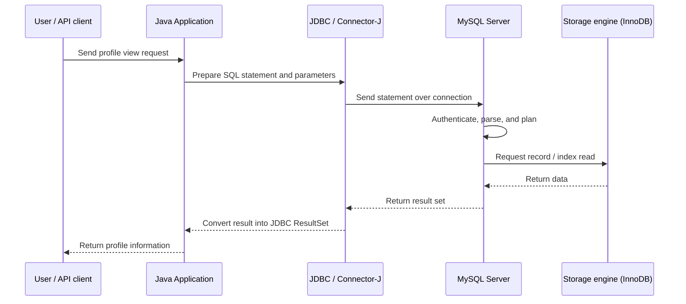

# Distinguishing MySQL Server, SQL, Storage Engine, and the Java Application

When a Java application writes or reads data from MySQL, several components participate in a single request. MySQL Server accepts connections and coordinates statements; SQL describes operations on data; the storage engine manages how data is stored and accessed; and the Java application implements business logic and sends requests to the database. Understanding each component's exact role helps us design systems, troubleshoot errors, and optimize queries in the right place.

Within the scope of **DATABASE_MYSQL**, this lesson places MySQL inside the architecture of a Java application: from the moment the application sends a statement to the moment the server reads or writes data and returns the result.

## 1. Four Components, Four Roles

| Component | Nature | Primary role |
|---|---|---|
| **MySQL Server** | Database management server software; the server process is typically named `mysqld` | Accepts connections, authenticates accounts, receives and processes SQL, chooses execution plans, coordinates with the storage engine, and returns results |
| **SQL** | Language used to define, query, and modify data | Describes *which* data to read or modify; not a server or a database program |
| **Storage engine** | MySQL component managing data storage and access for tables | Organizes records and indexes, reads/writes data, and provides mechanisms such as transactions and locking depending on the engine |
| **Java application** | Application-tier program that uses the database | Executes business logic, receives input from users or APIs, sends SQL via JDBC, reads results, and decides the next business step |

### MySQL Server: Receiving and Coordinating Requests

MySQL Server is the running database management system serving connections from applications or administration tools. When a client connects, the server checks authentication credentials and access privileges. Next, the server receives SQL statements, parses syntax, validates semantics, selects an execution plan, and coordinates with the storage engine to access data.

The server also manages server-tier capabilities such as connections, sessions, metadata, access privileges, and parts of query processing. Therefore, MySQL Server is not merely a container for files on disk. It is the component that orchestrates the entire database session.

A single server can manage multiple databases (schemas), and each database contains multiple tables. A Java application typically connects to a host address, a port, a database, and an account with appropriate privileges.

### SQL: Language for Describing Data Operations

SQL (Structured Query Language) is the language for working with relational databases. MySQL supports SQL along with its own extensions and syntax differences. SQL does not store data by itself, nor is it a process running on the server.

Common statement groups include:

| Group | Purpose | Examples |
|---|---|---|
| DDL | Define database and table structure | `CREATE TABLE`, `ALTER TABLE`, `DROP TABLE` |
| DML | Insert, update, or delete records | `INSERT`, `UPDATE`, `DELETE` |
| Data querying | Read and combine data | `SELECT`, `JOIN`, `GROUP BY` |
| DCL | Manage access privileges | `GRANT`, `REVOKE` |
| TCL | Control transactions | `START TRANSACTION`, `COMMIT`, `ROLLBACK` |

For example, the following statement asks the server to find a customer by email:

```sql
SELECT id, full_name
FROM customers
WHERE email = 'an@example.com';
```

The SQL statement states the desired result. MySQL Server decides how to execute that statement, while the storage engine participates in reading the required records and indexes.

### Storage Engine: How a Table Is Stored and Accessed

The storage engine is the component beneath the SQL processing layer, responsible for managing table data. MySQL supports a pluggable multi-storage-engine architecture; the engine is chosen per table. Engines can differ in transaction support, locking, foreign keys, crash recovery, and data layout.

Two commonly mentioned engines are:

- **InnoDB**: the default engine in modern MySQL versions. InnoDB supports ACID transactions, row-level locking, foreign keys, MVCC, and crash recovery. It is generally the right choice for business applications that need safe data updates and relationships across tables.
- **MyISAM**: an older engine that does not support transactions or foreign keys like InnoDB; locking is primarily at the table level. It may still appear in legacy systems, so understanding its characteristics is important when maintaining or migrating data.

The storage engine does not replace MySQL Server. The server receives and processes SQL statements at the common layer, then invokes the appropriate operations through the engine interface. The engine performs the storage- and data-access-related work. Because each engine has different capabilities, the choice of engine directly affects a table's consistency, locking, and performance.

You can check which engine is in use with SQL:

```sql
-- View the storage engines supported by the server
SHOW ENGINES;

-- View table definition, including storage engine
SHOW CREATE TABLE customers;
```

In the `SHOW CREATE TABLE` output, pay attention to the `ENGINE=...` clause, such as `ENGINE=InnoDB`.

### Java Application: Where Business Logic Executes

The Java application typically runs in a separate process from MySQL Server. The application may expose REST APIs, a web interface, or run background jobs. It is responsible for business rules such as validating requests, determining which actions a user is permitted to perform, and orchestrating multiple operations to complete a feature.

To work with MySQL, Java commonly uses **JDBC** (Java Database Connectivity), a standard Java API. With MySQL, the application uses the **MySQL Connector/J** driver to implement JDBC communication with the server. JDBC is the API; Connector/J is the specific driver; neither is a storage engine.

A Java application does not connect directly into InnoDB to read data files. It opens a connection to MySQL Server through the driver, sends statements, and receives results over the MySQL protocol.

## 2. How Does a Query Travel Through the System?

Suppose a user opens a customer profile page. The Java application needs to read the customer's name from the `customers` table. The high-level processing flow is as follows:



The steps can be understood concretely as follows:

1. The user sends a request to an API or UI provided by the Java application.
2. Java validates the input and prepares the SQL statement. The JDBC driver manages sending the statement over the connection to MySQL Server.
3. MySQL Server authenticates the connection session, verifies privileges, and processes the statement. The query optimizer may choose a table scan or an index lookup based on the table structure and current statistics.
4. The server calls the storage engine to read the required data. If the table uses InnoDB, InnoDB performs record and index access according to its mechanisms.
5. Results flow back through MySQL Server and the JDBC driver to the Java application. Java transforms the results into a business-appropriate response.

This diagram shows the high-level flow. A complex query may require multiple engine accesses, joins, sorting, or aggregation at the server layer before returning results.

## 3. Java Sending SQL via JDBC

The following example illustrates a Java application querying a customer by email. Assume `dataSource` is configured with a JDBC URL, account credentials, and MySQL Connector/J; `email` is the feature's input value.

```java
String sql = "SELECT id, full_name FROM customers WHERE email = ?";

try (Connection connection = dataSource.getConnection();
     PreparedStatement statement = connection.prepareStatement(sql)) {

    statement.setString(1, email);

    try (ResultSet resultSet = statement.executeQuery()) {
        if (resultSet.next()) {
            long id = resultSet.getLong("id");
            String fullName = resultSet.getString("full_name");

            // Map data into an application object or response.
        }
    }
}
```

In this example:

- The `sql` string is the SQL statement that the application asks MySQL to execute.
- `Connection`, `PreparedStatement`, and `ResultSet` are JDBC API types.
- `dataSource` provides the connection; the Connector/J driver handles communication with MySQL Server.
- `?` is a parameter placeholder. `setString` passes the email value separately from the statement structure, avoiding direct string concatenation of input data into SQL and reducing SQL injection risk.
- When `executeQuery()` is called, the statement is sent to the server and results are read through `ResultSet`.

The Java snippet does not directly read InnoDB files, nor does it execute SQL on the application machine. Statement processing happens on MySQL Server; the storage engine participates when data needs to be read or written.

For multi-record update operations that must succeed or fail together, the application can use a JDBC transaction: disable auto-commit, execute the SQL statements, call `commit()` on completion, or `rollback()` on error. MySQL Server coordinates the transaction and a storage engine such as InnoDB provides the storage-layer transaction mechanisms.

## 4. Dividing Responsibilities During Design and Troubleshooting

Understanding the boundaries between components helps pinpoint where to inspect when a feature malfunctions.

| Task or issue | Primary components involved | What to check |
|---|---|---|
| API returns wrong data due to wrong business rules | Java application | Business logic, data mapping, input conditions |
| Cannot connect to database | Java, JDBC driver, and MySQL Server | JDBC URL, network and port, server status, account and privileges |
| SQL syntax error or missing execution privilege | SQL and MySQL Server | Syntax, schema, account, granted privileges |
| Slow query | SQL, MySQL Server optimizer, and storage engine | Filter predicates, `JOIN` operations, indexes, execution plan, amount of data read |
| Inconsistent or blocked update transaction | Java application, MySQL Server, and storage engine | Transaction boundaries, commit/rollback, locks, and isolation level |
| Table lacks expected transaction or foreign key behavior | Storage engine | Actual engine of the table and capabilities supported by that engine |

For example, if a query is slow, do not assume by default that the bug is in Java. Check whether the SQL query filters data properly, which execution plan MySQL Server chose, and how many records the storage engine had to read. Conversely, if the SQL result is correct but the API returns the wrong format or applies the wrong rule, inspect the Java code.

## 5. Common Misconceptions

**"MySQL and SQL are the same thing."** MySQL is a database management system; SQL is the language MySQL supports for manipulating data. SQL is also supported by many other management systems, although each has differences in syntax and features.

**"InnoDB is MySQL Server."** InnoDB is a storage engine that MySQL Server uses for tables. The server also handles connections, authentication, parsing, and statement coordination.

**"Java connects directly to the database engine."** Java typically connects to MySQL Server through a JDBC driver. The server processes requests and then coordinates with the corresponding engine.

**"JDBC is MySQL Connector/J."** JDBC is the standard API specification; Connector/J is the MySQL driver implementing that API. Changing the driver or connection configuration does not change a table's storage engine.

**"Changing the storage engine only changes how files are stored."** The engine also determines critical capabilities and behaviors such as transactions, locking, foreign keys, and recovery. Therefore, evaluate data characteristics and business needs before changing an engine.

## 6. Self-Check on a MySQL Database

When you have access to a test MySQL environment, run the following commands to connect these concepts to a live system:

```sql
-- Version of the server currently connected to
SELECT VERSION();

-- Engines supported by the server and their statuses
SHOW ENGINES;

-- Table structure and declared engine
SHOW CREATE TABLE customers;
```

After reviewing the output, answer these questions for yourself:

1. Which component is `SELECT VERSION()` asking to provide information?
2. Where in the `SHOW CREATE TABLE` output is the table's engine shown?
3. When Java calls `executeQuery()`, which component parses the SQL statement and which component accesses the table's data?

If you can answer these three questions, you have grasped the basic boundaries between the Java application, SQL, MySQL Server, and the storage engine. This is the foundation for studying table design, data types, keys, indexes, transactions, concurrency control, and query optimization in MySQL.
