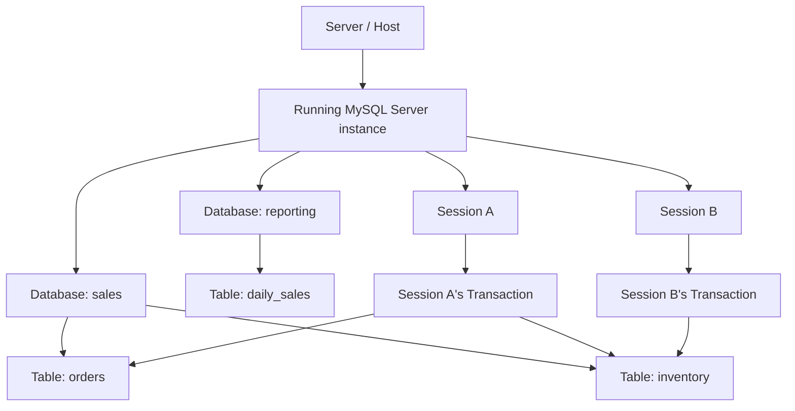

# Terminology Map: Server, Instance, Database, Table, Session, and Transaction

## Lesson Objectives

After this lesson, you will be able to:

- Distinguish between a host, MySQL Server, and a MySQL server instance.
- Explain how a database and a table serve as logical data organization layers.
- Describe how a session is created from a client connection and what state it holds.
- Identify which session a transaction belongs to, and where it starts and ends.
- Read a MySQL operational scenario and trace it to the exact layer being referenced.

These terms often appear together in documentation, configurations, and error messages. They are closely related, yet represent distinct layers: the software serving queries, a running MySQL environment, a logical data namespace, a structure storing data, a connection context, and a unit of work that must maintain consistency.

## 1. Seeing the Big Picture Before Diving Into Each Term

Imagine a retail application connecting to MySQL. The application sends SQL statements over a connection. MySQL accepts the connection, authenticates the account, and creates a working context for that connection. This context can select a default database, read or write tables, and execute one or more operations within a transaction.

The diagram below shows the conceptual relationships between the layers:



This diagram is a conceptual map, not a memory allocation diagram or an on-disk file layout. One instance can manage multiple databases and serve multiple sessions concurrently. A single session can access multiple tables, even tables in different databases if the account has been granted privileges. A transaction is the scope of operations for a session at a given point in time; it can read or modify multiple tables.

## 2. MySQL Server: The Software That Receives and Processes SQL

**MySQL Server** is the database server software. It accepts connections from applications or client tools, authenticates users, receives SQL statements, parses syntax, optimizes execution plans, coordinates with the storage engine to read or write data, and manages activities such as authorization, locking, logging, and recovery.

On an operating system, the MySQL server process typically runs via the `mysqld` program. When people say "MySQL Server is running", they are usually referring to this service software. Distinguish it from:

- **Host (machine):** the physical machine, virtual machine, or container providing CPU, RAM, disk, and network resources.
- **MySQL Server:** the software processing database requests.
- **MySQL client:** the program sending requests to the server, such as a backend application, MySQL Shell, or the `mysql` command-line program.

Client and server are two communication roles. The application does not need to run on the same machine as MySQL Server; they can connect over a network if network configuration, authentication, and access privileges permit.

For example, when an application runs the statement:

```sql
SELECT order_id, total_amount
FROM sales.orders
WHERE order_id = 1001;
```

The client sends the statement to MySQL Server. The server checks privileges, parses the statement, chooses how to retrieve the data, and returns the results to the client. The client does not read InnoDB data files directly on its own.

## 3. MySQL Server Instance: A Running MySQL Environment

An **instance** (often called a *MySQL server instance*) is a running MySQL Server environment with its own operational state and configuration. In a typical deployment, one instance is associated with one `mysqld` process, one data directory, a port or socket configuration, and its own log files and runtime resources.

An instance usually has identifying components such as:

- The `mysqld` process and startup parameters.
- The data directory, where MySQL manages data and metadata.
- The TCP port or Unix socket that clients use to connect.
- Configuration, PID file, error log, and related log files.
- Running state in memory, such as the buffer pool, caches, and session information.

A single host machine can run multiple MySQL instances. In that case, each instance must be configured with proper isolation, typically including its own data directory, its own port or socket, and its own runtime files. Never allow multiple independent MySQL processes to open and manage the same data directory as if each process were its sole owner.

One instance can contain multiple databases. Thus, `sales` and `reporting` in the diagram are two databases inside the same instance, not necessarily two separate servers.

### How to Inspect the Connected Instance

Run the following query on the current connection:

```sql
SELECT VERSION() AS mysql_version,
       @@hostname AS server_host,
       @@port AS server_port,
       @@datadir AS data_directory;
```

The result helps identify the server version, the hostname the server reports for itself, the TCP port, and the data directory. `@@port` indicates the configured TCP port value; the current connection may also have been established over a socket or through a proxy layer. When multiple instances exist, cross-check both the connection endpoint and configuration values rather than relying solely on the hostname.

> Note on terminology: in conversation, "server" is sometimes used to mean the host, the MySQL software, or an instance. When troubleshooting an incident, ask clearly whether the discussion refers to the host machine, the MySQL service, or a specific instance.

## 4. Database: Logical Namespace for Grouping Objects

In MySQL, a **database** is a logical namespace used to group database objects. Common objects include tables, views, stored procedures, functions, and events. Triggers are attached to tables. In MySQL, the word **schema** is used synonymously with **database**; therefore `CREATE SCHEMA` and `CREATE DATABASE` are equivalent ways of writing the statement in this context.

Databases help separate data by purpose or business domain. For example:

- `sales` contains orders and inventory.
- `accounting` contains vouchers and accounting data.
- `reporting` contains views or tables serving reports.

Create a database and select the default database for a session:

```sql
CREATE DATABASE sales
  CHARACTER SET utf8mb4
  COLLATE utf8mb4_unicode_ci;

USE sales;

SELECT DATABASE() AS current_database;
```

`USE sales` changes the default database of the **current session**. It does not move data to another database, nor does it alter the default database of any other connections. If you do not want to depend on a default database, qualify names fully using `database_name.table_name`:

```sql
SELECT order_id, total_amount
FROM sales.orders;
```

A session can access tables across multiple databases within the same instance if the account holds the corresponding privileges. The default database only shortens object names; it is not the only boundary the session is allowed to access.

## 5. Table: Logical Structure Storing Rows and Columns

A **table** is a relational data structure consisting of columns and rows. Each column has a name and a data type; each row represents a record. A table usually has a primary key to identify rows and may have foreign keys, unique constraints, indexes, and other constraints.

For example, the `sales` database can contain an `orders` table:

```sql
CREATE TABLE sales.orders (
    order_id BIGINT UNSIGNED NOT NULL AUTO_INCREMENT,
    customer_id BIGINT UNSIGNED NOT NULL,
    order_status VARCHAR(30) NOT NULL,
    total_amount DECIMAL(12, 2) NOT NULL,
    created_at TIMESTAMP NOT NULL DEFAULT CURRENT_TIMESTAMP,
    PRIMARY KEY (order_id),
    KEY idx_orders_customer_created (customer_id, created_at)
) ENGINE = InnoDB;
```

In this example:

- `orders` is the table name; `sales.orders` is the fully qualified name including database and table.
- `order_id`, `customer_id`, `order_status`, `total_amount`, and `created_at` are columns.
- `PRIMARY KEY` uniquely identifies each row.
- `idx_orders_customer_created` is an index supporting queries by customer and creation time.
- `ENGINE = InnoDB` selects the storage engine managing how the table's data is stored and accessed.

A table is a logical concept. Physical table data is managed by the storage engine; do not assume that one table always maps to exactly one file with the same name as the table. With InnoDB, data and indexes are managed inside tablespaces; on-disk layout depends on configuration such as file-per-table mode and shared tablespace settings.

Inspecting databases and tables:

```sql
SHOW DATABASES;
SHOW TABLES FROM sales;
SHOW CREATE TABLE sales.orders;
```

`SHOW CREATE TABLE` is especially useful when reviewing the actual table definition, including data types, indexes, constraints, and storage engine.

## 6. Session: Working Context of a Connection

A **session** is the working context maintained by MySQL for a client connection. Under standard connection protocols, each connection to the server corresponds to one session. One account can open multiple connections, so the same account can have multiple concurrent sessions.

A session begins when the server accepts the connection and ends when the connection is closed or disconnected. Throughout that lifetime, the session holds state that affects subsequent statements, such as:

- The authenticated account and privilege context.
- The default database selected via `USE`.
- Session-scoped system variables, such as `sql_mode` or `time_zone` if set individually.
- Temporary tables, prepared statements, and certain other working states.
- The current transaction state, including uncommitted changes and associated locks.

Inspecting information about the current session:

```sql
SELECT CONNECTION_ID() AS connection_id,
       USER() AS login_identity,
       CURRENT_USER() AS privilege_identity,
       DATABASE() AS current_database,
       @@autocommit AS autocommit_mode;
```

`CONNECTION_ID()` helps identify the current connection on the server. `DATABASE()` returns the session's default database; the result is `NULL` if the session has not selected a default database. `@@autocommit` indicates the current session's automatic commit mode.

### Common Misunderstandings About Sessions

**A session is not a database.** A database is a logical group of objects managed by an instance; a session is the state of a connection actively working with the instance.

**A session is not an account.** An account is an identity used for authentication and privilege assignment. One account can create multiple sessions; those sessions can choose different default databases and set different session variables.

**A session is not a transaction.** A session persists across many statements and can execute many sequential transactions. A transaction can end with `COMMIT` or `ROLLBACK` while the session remains open.

In applications using a connection pool, physical connections are typically reused across multiple application requests. Because session state can persist after a request finishes, the pooling library must manage resetting or reinitializing connection state before handing it to the next request. Otherwise, a default database, session variable, or unfinished transaction could leak into another request.

## 7. Transaction: A Unit of Work Requiring Consistent Processing

A **transaction** is a unit of work comprising one or more data operations, terminated by `COMMIT` or `ROLLBACK`. Transactions group related changes into a single unit so that the DBMS guarantees ACID properties within the scope supported by the storage engine.

With InnoDB, the four ACID properties are generally understood as follows:

| Property | Practical meaning |
|---|---|
| Atomicity | Changes in the transaction are committed together; on rollback, changes can be rolled back within the transaction's scope. |
| Consistency | A transaction moves data from one valid state to another valid state when the application and constraints are designed properly. |
| Isolation | Concurrent transactions are coordinated according to the isolation level to control mutual interference. |
| Durability | After a successful commit, changes are protected according to InnoDB's logging and recovery mechanisms. |

A transaction belongs to the session executing it. `COMMIT` and `ROLLBACK` commands in one session only end that session's transaction; they do not commit on behalf of other connections.

### Example: Creating an Order and Deducting Inventory

Suppose an application needs to record an order and decrement the item's quantity in stock. Because the two operations are business-related, they belong in the same transaction:

```sql
START TRANSACTION;

INSERT INTO sales.orders
    (customer_id, order_status, total_amount)
VALUES
    (501, 'PENDING', 1250000.00);

UPDATE sales.inventory
SET quantity = quantity - 1
WHERE product_id = 42
  AND quantity >= 1;

-- The application must check the number of rows updated by UPDATE.
-- Only COMMIT when both the order and the inventory deduction are valid.
COMMIT;
```

This SQL snippet illustrates transaction boundaries; in a real application, logic must inspect the `UPDATE` result. If no matching inventory row was updated, the application must `ROLLBACK` and handle the out-of-stock case. If committed, both creating the order and decrementing inventory are confirmed in that transaction. If rolled back before commit, the InnoDB changes of that transaction are undone.

### Autocommit and Transaction Boundaries

MySQL typically initializes sessions with `autocommit = 1`. In this mode, each successful statement using a transactional storage engine is normally committed as its own separate transaction if no explicit transaction is open. When multiple statements belong to one unit of work, open a transaction explicitly:

```sql
START TRANSACTION;
UPDATE sales.inventory
SET quantity = quantity - 1
WHERE product_id = 42;

-- Check the result and perform related operations.
COMMIT;
```

If a business condition fails, use `ROLLBACK` instead of `COMMIT`. You can use `SAVEPOINT` and `ROLLBACK TO SAVEPOINT` to revert to a point inside a transaction, though savepoints do not create independent nested transactions.

Some DDL statements such as `CREATE TABLE`, `ALTER TABLE`, and `DROP TABLE` can cause an implicit commit. Therefore, do not assume every structural change can be undone with `ROLLBACK` like ordinary DML operations. Additionally, rollback capability and ACID guarantees depend on the storage engine; InnoDB supports transactions, whereas non-transactional engines like MyISAM do not provide the same rollback semantics.

## 8. Tracing a Request from Client to Data

Consider the flow when a staff member confirms an order:

1. The backend application acts as the **client**, connecting to the MySQL endpoint.
2. **MySQL Server** on the host accepts the connection and authenticates the account.
3. The connection is served inside a **session**, with its own `CONNECTION_ID()` and state.
4. The session selects the default **database** `sales`, or references `sales.orders` directly.
5. Statements read and write data on **tables** such as `orders` and `inventory`.
6. Statements that must succeed together are placed in a **transaction**; the application commits when valid or rolls back on error.

When investigating an error, identify the relevant layer first:

| Symptom or question | Term to inspect | Initial inspection step |
|---|---|---|
| Cannot connect to MySQL machine or port | Host, MySQL Server, instance | Check address, port/socket, service process, and network configuration. |
| Connected to wrong environment or wrong data cluster | Instance | Cross-check endpoint, `@@hostname`, `@@port`, and `@@datadir`. |
| `Unknown database` | Database | Check database name, connected instance, and access privileges. |
| `Table doesn't exist` | Table | Check default database, full `database.table` name, and case sensitivity per OS/configuration. |
| A connection has an unexpected default database or variable | Session | Check `DATABASE()`, `CONNECTION_ID()`, and session-scoped variables. |
| Data changes were not saved or were reverted | Transaction | Check `autocommit`, `START TRANSACTION`, `COMMIT`, `ROLLBACK`, and pre-commit errors. |
| Transaction waiting too long or deadlocked | Transaction and session | Identify participating sessions, open transactions, statements, and related locks. |

Error messages are only initial clues. For example, `Table doesn't exist` can appear when the table genuinely has not been created, but it can also happen because the session connected to the wrong instance or used the wrong default database. Always verify the connection context before concluding that data is lost.

## 9. Quick Reference Table

| Term | Conceptual layer | Identifying question |
|---|---|---|
| Host | Infrastructure | Which machine or environment is MySQL running on? |
| MySQL Server | Service software | Which component receives and processes SQL? |
| Instance | Running server environment | Which specific MySQL process, data directory, and endpoint are being used? |
| Database (schema) | Logical namespace | Within what scope are data objects grouped? |
| Table | Logical data structure | Which rows and columns store this type of data? |
| Session | Connection context | What identity and working state does the current connection hold? |
| Transaction | Unit of work | Which changes need to commit or roll back together? |

You can remember this with a sequence of questions: **where are you connecting (instance), in what context are you working (session), which namespace is selected (database), on which structure are you operating (table), and which group of changes are you confirming (transaction)**. MySQL Server is the software behind receiving and coordinating all of those activities.

## 10. Self-Check

1. A host machine runs two `mysqld` processes with two separate ports and two separate data directories. How many instances are there? Can there be multiple databases inside each instance?
2. Two connections log in with the same account, but each runs `USE` with a different database. Why is this not a contradiction?
3. A session runs `START TRANSACTION`, updates two tables, and then runs `COMMIT`. What happens to the session after committing?
4. An application runs `UPDATE` when `autocommit = 1` without explicitly starting a transaction. How is the change normally handled with InnoDB?
5. Why should one table not be equated with a single physical file on disk?

**Suggested answers:** (1) There are two instances; each instance can manage multiple databases. (2) The default database is per-session state, not shared account state. (3) The transaction ends, but the session remains open and can continue executing statements or start a new transaction. (4) A successful statement is normally committed as its own transaction. (5) The storage engine manages data and indexes through tablespaces; physical layout depends on configuration.
