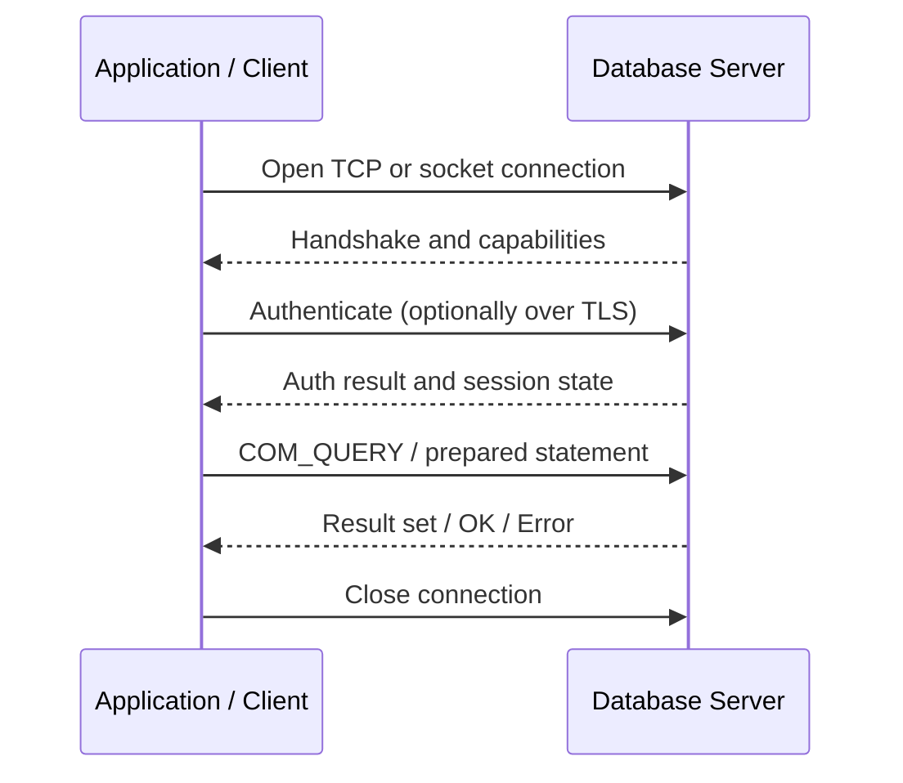

# Distinguishing MySQL from MariaDB and MySQL-Protocol-Compatible Systems

## Objectives

After this lesson, you will be able to:

- Explain why MariaDB originated from MySQL yet is now an independent database management system.
- Distinguish MySQL protocol compatibility from SQL, behavioral, and operational compatibility.
- Identify systems commonly referred to as *MySQL-compatible* and understand which layer they are compatible at.
- Choose the right client, driver, and verification steps before connecting or migrating an application between systems.

## 1. How Are MySQL and MariaDB Related?

**MySQL** is a relational database management system (RDBMS) using SQL, encompassing a server, clients, connector libraries, and various administration tools. MySQL was originally developed by MySQL AB, later acquired by Sun Microsystems, and is now developed by Oracle. MySQL Community Server is released under the GPL license; Oracle also provides related commercial products and services.

**MariaDB** started as a fork of MySQL initiated by people who had previously worked on MySQL development. The initial goal was to maintain a MySQL-compatible, community-driven server branch. Over the years, the two projects evolved independently, adding features and changing internals in different directions. MariaDB Server is also a relational RDBMS using SQL, but it is no longer an unconditional drop-in replacement for every MySQL version.

Their relationship can be visualized as follows:

```text
                  MySQL (separate product line)
                 /
MySQL history --+
                 \
                  MariaDB (initial fork, independent development)
```

Their shared origin explains why the two systems share many similarities: the client/server model, connection protocol, common SQL syntax, familiar data types, and many tools that work with both. Independent evolution explains why differences in syntax, data types, authentication plugins, optimizers, replication, and administration tools have become increasingly significant.

Therefore, when someone says "MariaDB is MySQL-compatible", always ask **compatible at which version, which features, and which layer**.

## 2. What Is the MySQL Protocol?

The MySQL protocol (MySQL client/server protocol) defines the rules for exchanging data between a client program and the database server. The client can be a command-line tool, a Java/PHP/Python/Go application, or a proxy. The server receives requests, executes commands, and sends back results or errors.

Over TCP/IP, the default port is typically `3306`. When running on the same host, clients can also connect via a Unix socket or named pipe depending on OS and configuration. Port `3306` is only a default value, not proof of whether the server runs MySQL or MariaDB.

A connection session typically follows these main steps:

1. **Handshake:** the server sends version information and the protocol capabilities it supports.
2. **Authentication:** the client sends credentials using the negotiated or configured authentication mechanism; TLS may be used to protect transport.
3. **Session setup:** both sides agree on options such as character set, collation, and connection capabilities.
4. **Command exchange:** the client sends commands such as SQL queries, prepared statement preparation, or session state changes.
5. **Result return:** the server returns a result set, affected row count, status info, or an error code.



Two servers that both speak the MySQL protocol can exchange messages in a way a compatible client understands. This **does not guarantee** the two servers interpret every SQL statement identically or produce the same results.

## 3. Four Compatibility Layers to Distinguish

| Layer | Meaning | Question to verify |
|---|---|---|
| Connection protocol | Client and server understand handshake, authentication, command packets, and response framing | Does the driver complete handshake and login successfully? |
| SQL syntax | Server parses and accepts statements, DDL, functions, and data types | Are `CREATE TABLE` statements, queries, and functions supported? |
| Semantics and behavior | Executed statements yield identical results, type coercion rules, transactions, collations, and errors | Do data and business outcomes remain unchanged? |
| Operations and ecosystem | Backup, replication, clustering, monitoring, privilege management, and upgrade tools work compatibly | Do deployment and recovery procedures function properly? |

For example: an application might successfully log in to MariaDB using a MySQL-protocol-aware driver, yet immediately fail because a collation in the schema does not exist in the running MariaDB version. A successful connection only verifies part of the protocol layer—not that the application will run cleanly.

## 4. Common Differences Between MySQL and MariaDB

Exact differences depend on version. Do not take a single trait from MySQL 5.7, MySQL 8.x, or one MariaDB branch as a universal rule across all versions.

| Aspect | MySQL | MariaDB | Migration impact |
|---|---|---|---|
| Development and release | Product line developed by Oracle | Independently developed project and product line | Track separate release schedules, support lifecycles, and maintenance policies |
| Versioning | Uses MySQL's version numbering | Uses MariaDB's own version numbering | Similar version numbers do not mean identical feature parity |
| Authentication | Has its own authentication plugins; defaults vary by version | Has its own plugin set and configuration model | Check account auth plugins and driver capabilities |
| Data types and functions | Has specific data types, functions, and internal representations | Has its own extensions and differences | Check DDL, JSON data, date/time functions, and type casting |
| Optimizer and indexes | Execution plans, statistics, and optimization strategies per MySQL | Different optimization strategies and certain index features per MariaDB | Re-read `EXPLAIN` and benchmark on real data |
| Transactions and storage engines | InnoDB is the common default transactional engine | Supports InnoDB alongside its own engines and options | Check engines, isolation levels, locks, and transaction behavior |
| Replication and HA | Offers replication and solutions like Group Replication / InnoDB Cluster | Offers replication and integrations such as Galera Cluster | Do not assume topology, log formats, or failover tools are interchangeable |
| Administration | Includes MySQL Shell, MySQL Router, and MySQL ecosystem tools | Has MariaDB's own clients, tools, and utilities | Verify backup, restore, monitoring, and upgrade tooling |

One notable example is the `JSON` type. MySQL has a native `JSON` data type with dedicated binary storage and handling. In many MariaDB versions, `JSON` is provided as a compatibility alias backed by `LONGTEXT` with JSON validity checks. Therefore, seeing `JSON` declared in a schema is not enough to conclude the two systems share the same storage format, indexing, or JSON query performance.

Another example is authentication. MySQL and MariaDB may support different plugins or differ in version support. If an application account logs in on the old server yet fails after switching servers, inspect the account's authentication plugin, driver version, TLS settings, and server configuration rather than checking only the password.

## 5. Systems Commonly Called MySQL-Compatible

"MySQL-compatible" describes compatibility scope, not a single uniform certification standard. The following products have different goals and boundaries:

| System | Nature | Compatibility scope and notes |
|---|---|---|
| Percona Server for MySQL | Server distribution built on MySQL, adding operational and performance enhancements | Aims for high-level drop-in MySQL compatibility; still verify version, plugins, and bundled tools |
| Amazon Aurora MySQL-compatible | Managed database service with a custom storage and operational architecture | Exposes endpoints and compatibility with certain MySQL versions; feature limits and behaviors depend on Aurora version |
| TiDB | Distributed database supporting the MySQL protocol and a subset of MySQL syntax | Can use many MySQL clients, but is not MySQL Server; verify differences in SQL, transactions, DDL, and optimizer |
| OceanBase in MySQL mode | Distributed database offering a MySQL compatibility mode | Supports the MySQL protocol and substantial SQL syntax; verify specific features against version and deployment mode |
| Vitess | Middleware layer for coordination, routing, and sharding across MySQL databases | Exposes a MySQL-protocol interface to clients within a Vitess architecture; not a standalone storage engine or MySQL fork |

Additionally, **ProxySQL** frequently appears in MySQL architectures. It is a MySQL-protocol-aware proxy for routing, connection pooling, or applying query rules. ProxySQL is not an RDBMS server that stores data and cannot replace MySQL/MariaDB as a database server.

When evaluating a compatible system, identify its role first: database server, MySQL distribution, cloud service, distributed database, or middleware. Only then inspect protocol support and SQL feature coverage.

## 6. Identifying the Connected Server

Do not infer the server type solely from hostname, port, container name, or environment variable names. Query the server directly after connecting:

```sql
SELECT
    VERSION() AS server_version,
    @@version_comment AS distribution;

SHOW VARIABLES LIKE 'version%';
SHOW VARIABLES LIKE 'sql_mode';
SHOW VARIABLES LIKE 'character_set_server';
SHOW VARIABLES LIKE 'collation_server';
SHOW ENGINES;
```

`VERSION()` typically reports the server's version string; `@@version_comment` provides distribution details in many releases. Output can be customized by service providers or distributions, so combine it with product documentation and full version details.

In a terminal, you can check installed clients:

```bash
mysql --version
mariadb --version
```

Note: these two commands display the version of the **client** binary being invoked, not proof of the server version or type on the other end. To identify the server, connect and run SQL queries.

Client connection examples:

```bash
# MySQL client
mysql -h 127.0.0.1 -P 3306 -u app_user -p app_db

# MariaDB client (if installed)
mariadb -h 127.0.0.1 -P 3306 -u app_user -p app_db
```

Depending on the distribution, clients may use different binary names or aliases. The `-p` flag prompts interactively for a password; avoid passing passwords directly on the command line because they can leak via command history or process listings.

## 7. Choosing a Driver for the Application

The driver must support the protocol, authentication method, and actual server version. A Java application may use typical JDBC URLs like these:

```properties
# MySQL Connector/J
jdbc:mysql://db.example:3306/app_db

# MariaDB Connector/J
jdbc:mariadb://db.example:3306/app_db
```

These two URLs illustrate selecting the corresponding driver, not a promise that every driver works with every MySQL-compatible server. Check documentation for the exact connector version in use, actual dependencies in the application, and TLS, timeout, and connection pool options.

Before moving to production, verify at minimum:

- Does the driver complete the handshake and authenticate against the account's active plugin?
- Does the connection encrypt via TLS and validate certificates per environment policy?
- Do the connection charset and collation match the schema and data?
- Do prepared statements, batch updates, generated keys, stored procedures, and transactions behave as the application expects?
- Does the connection pool handle reconnects, timeouts, and failover errors cleanly?

Do not merely swap the JDBC URL string and conclude the application is compatible. Run integration tests against the exact server and driver being deployed.

## 8. Evaluation Process Before Replacing MySQL with MariaDB or a Compatible System

A migration should be verified layer by layer to avoid confusing "can connect" with "the application runs correctly".

1. **Inventory the current source:** server version, edition/distribution, storage engines, auth plugins, SQL mode, charset, collation, and driver.
2. **Audit schemas:** review data types, indexes, generated columns, constraints, partitions, triggers, events, views, and stored procedures.
3. **Test queries:** run business queries, SQL functions, type casts, JSON operations, date/time handling, and collation-dependent queries.
4. **Test transactions:** verify isolation levels, rollbacks, row locks, deadlocks, and update ordering under concurrent connections.
5. **Test auth and security:** test application accounts, plugins, privilege grants, TLS, and network policies.
6. **Test operations:** test backup/restore, replication or clustering, monitoring, upgrades, crash recovery, and failover procedures.
7. **Benchmark performance:** use realistic data and load; compare `EXPLAIN`, query latency, CPU usage, memory, and I/O.
8. **Dry-run migration and reconcile:** test on a data copy, reconcile row counts and record contents, and only then plan a cutover with a rollback path.

For example, if the source runs MySQL 8 and the target is MariaDB, pay special attention to collations, authentication plugins, DDL syntax, JSON expressions, MySQL-only features, and your backup/replication tooling. This list is a starting point; final conclusions must rest on your specific version and workload.

## 9. Interpreting Common Compatibility Errors

| Symptom | Possible cause | Inspection step |
|---|---|---|
| `Access denied` on login | Wrong credentials, host not permitted, auth plugin mismatch, or incompatible TLS policy | Check user/host, account auth plugin, server logs, and TLS config |
| `Unknown collation` | Target server lacks the collation requested by schema or client | Check source/target collations and define an intentional mapping before migrating data |
| Syntax error on `CREATE TABLE` or query | SQL feature, data type, or syntax supported only on one system/version | Isolate the failing statement and check version-matched documentation |
| Query runs but returns different results | Differences in collation, data types, type casting, SQL mode, or function semantics | Create a small test dataset and compare edge-case outputs |
| App connects but fails on prepared statements | Differences in driver, capabilities, or server prepared-statement handling | Check connector version and reproduce with a minimal test |
| Performance drops after migration | Differences in optimizer, statistics, indexes, config, or storage engine | Run `EXPLAIN`, check indexes, and measure on equivalent data |

Error messages are only clues. Capture the full error code, SQL statement, server version, driver version, and relevant configuration to pinpoint the root cause.

## 10. Conclusion

MySQL and MariaDB share a common history and many similarities, yet they are now two independently developed database management systems. Many other products also support the MySQL protocol to leverage existing clients and drivers, though their compatibility scopes differ.

Always separate four questions: **can it connect, does the SQL run, are the results accurate, and can the system be operated reliably**. Only after verifying all four layers against your exact version and workload do you have a sound basis for choosing or replacing a MySQL-compatible system.
