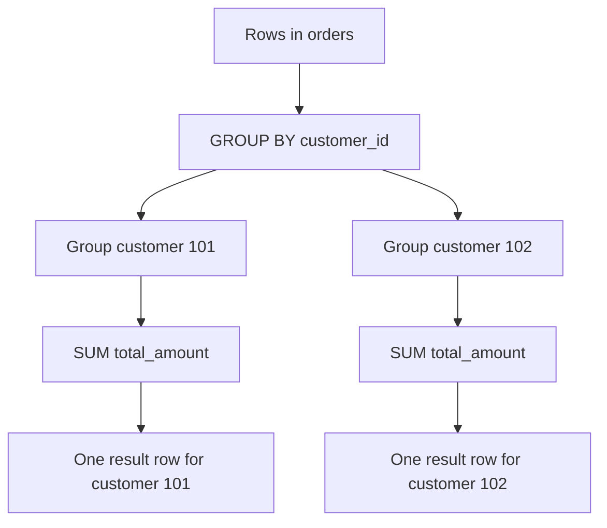

# ONLY_FULL_GROUP_BY and Rules for Determining Values Within a Group

An aggregate query typically collapses multiple rows into one result row per group. In that case, every value appearing in `SELECT`, `HAVING`, or `ORDER BY` must have a well-defined meaning for the entire group. If a group contains multiple distinct order statuses while the query only groups by customer, MySQL cannot know on its own which status to display. The `ONLY_FULL_GROUP_BY` SQL mode helps detect such ambiguous queries.

This lesson belongs to the **DATABASE_MYSQL** module. The module aims to master MySQL from table design, data types, keys, and SQL queries to indexes, transactions, and concurrency control, while also practicing reading execution plans, query tuning, authorization, backups, and handling relational database operational issues. In the **SQL Modes and Semantics** chapter, this lesson focuses on `ONLY_FULL_GROUP_BY`, determinism of data when grouping, and how to write aggregate queries that match business semantics.

## 1. Why Can a GROUP BY Query Be Ambiguous?

Suppose the `orders` table has multiple orders per customer:

| order_id | customer_id | order_status | total_amount |
|---:|---:|---|---:|
| 1001 | 101 | PAID | 250000 |
| 1002 | 101 | SHIPPED | 180000 |
| 1003 | 101 | CANCELLED | 90000 |
| 1004 | 102 | PAID | 420000 |

We want to calculate the total order amount per customer. The following query has a clear meaning:

```sql
SELECT
    customer_id,
    SUM(total_amount) AS total_spent
FROM orders
GROUP BY customer_id;
```

Each group has one `customer_id`, and `SUM()` produces one aggregated value across all rows in the group.

However, if we add `order_status` without changing the grouping:

```sql
SELECT
    customer_id,
    order_status,
    SUM(total_amount) AS total_spent
FROM orders
GROUP BY customer_id;
```

The group for customer 101 contains three statuses: `PAID`, `SHIPPED`, and `CANCELLED`. The query produces only one result row for customer 101, yet asks to display a single `order_status`. There is no rule specifying which status should be chosen.

This is a **semantic** problem, not merely a syntax issue. MySQL needs to know whether each non-aggregated expression has a deterministic value for each group.

## 2. GROUP BY Produces One Row per Group

`GROUP BY` partitions input rows into groups based on the values of one or more expressions. Aggregate functions compute results from the rows belonging to each group.



A grouped query typically contains two types of expressions:

- **Grouping expressions:** columns or expressions in `GROUP BY`; they define the groups.
- **Aggregate expressions:** functions such as `COUNT()`, `SUM()`, `AVG()`, `MIN()`, or `MAX()` computed from the rows in a group.

Expressions not inside an aggregate function must be proven to have a single unique value within each group. There are two common ways:

1. The expression is included in `GROUP BY`.
2. The expression is functionally dependent on the grouping columns, so the grouping columns uniquely determine its value.

`ONLY_FULL_GROUP_BY` requires MySQL to enforce this check in aggregate queries. The relevant condition applies to expressions in `SELECT`, `HAVING`, and `ORDER BY`.

## 3. What Is ONLY_FULL_GROUP_BY?

`ONLY_FULL_GROUP_BY` is an SQL mode requiring grouped queries to reference only non-aggregated values that can be determined from the grouping keys or from functional dependencies recognized by MySQL.

This mode is enabled by default in modern MySQL versions, including MySQL 5.7.5 and later and MySQL 8.0. However, the actual configuration can be altered by configuration files, administrative commands, or connection settings; always check the session of the connection executing the query.

```sql
SELECT
    VERSION() AS mysql_version,
    @@GLOBAL.sql_mode AS global_sql_mode,
    @@SESSION.sql_mode AS session_sql_mode;

SELECT FIND_IN_SET('ONLY_FULL_GROUP_BY', @@SESSION.sql_mode) AS mode_enabled;
```

If `mode_enabled` is greater than 0, the mode is present in the session's SQL mode list. Each connection has its own `@@SESSION.sql_mode`; therefore, two clients connected to the same server can execute queries with different behavior if their session modes differ.

### 3.1. Common Error When the Mode Is Enabled

For the ambiguous query shown earlier, MySQL typically returns an error like:

```text
ERROR 1055 (42000): Expression ... is not in GROUP BY clause
and contains nonaggregated column ... which is not functionally dependent
on columns in GROUP BY clause; this is incompatible with
sql_mode=only_full_group_by
```

The message indicates that the non-aggregated expression is not in `GROUP BY` and MySQL cannot prove it is functionally dependent on the grouping columns.

When an aggregate query has no `GROUP BY`, the entire row set is treated as a single group. A non-aggregated column not constrained to a single unique value can also cause an error, typically error 1140.

### 3.2. The Mode Does Not Fix the Query Automatically

`ONLY_FULL_GROUP_BY` does not decide for the application which value to pick. It forces the query to express the business rule explicitly. If you need the status of the latest order, select the exact latest row; if you need order counts per status, add status to the grouping key; if any arbitrary representative value is acceptable, you can use `ANY_VALUE()` with full awareness of its nondeterminism.

## 4. Approach 1: Put All Grouping Dimensions in GROUP BY

If the goal is to compute the total amount per customer **and** status, then `order_status` is a grouping dimension of the result. Add it to `GROUP BY`:

```sql
SELECT
    customer_id,
    order_status,
    COUNT(*) AS order_count,
    SUM(total_amount) AS total_amount
FROM orders
GROUP BY customer_id, order_status
ORDER BY customer_id, order_status;
```

The result might include:

| customer_id | order_status | order_count | total_amount |
|---:|---|---:|---:|
| 101 | CANCELLED | 1 | 90000 |
| 101 | PAID | 1 | 250000 |
| 101 | SHIPPED | 1 | 180000 |
| 102 | PAID | 1 | 420000 |

Each `(customer_id, order_status)` combination forms a group. There is no longer a need to pick an arbitrary status within a group.

### 4.1. Multi-Column GROUP BY

The columns in `GROUP BY` define the granularity (grain) of the result. Adding a column to the group generally increases or keeps the number of groups unchanged, rather than leaving the aggregated result at the same grain as before.

Example:

```sql
-- One row per customer.
SELECT customer_id, SUM(total_amount) AS revenue
FROM orders
GROUP BY customer_id;

-- One row per customer and month.
SELECT
    customer_id,
    DATE_FORMAT(created_at, '%Y-%m') AS order_month,
    SUM(total_amount) AS revenue
FROM orders
GROUP BY customer_id, DATE_FORMAT(created_at, '%Y-%m');
```

In the second query, the result has customer-and-month grain. Ensure the expression in `SELECT` matches the grouping expression. For easier maintenance, you can use a CTE or derived table to compute `order_month` first and then group by the alias in the outer query.

### 4.2. Using WHERE and HAVING in the Right Places

`WHERE` filters rows before grouping; `HAVING` filters groups after aggregation has been computed.

```sql
SELECT
    customer_id,
    COUNT(*) AS order_count,
    SUM(total_amount) AS revenue
FROM orders
WHERE created_at >= '2026-01-01'
  AND order_status <> 'CANCELLED'
GROUP BY customer_id
HAVING SUM(total_amount) >= 1000000
ORDER BY revenue DESC;
```

- `WHERE` restricts which orders enter the grouping step.
- `GROUP BY` creates one group per customer.
- `HAVING` keeps only groups with a total amount of at least one million.
- `ORDER BY` sorts the result rows after grouping.

Do not place aggregate conditions like `SUM(total_amount) >= ...` in `WHERE`, because group totals do not yet exist at that stage. Conversely, regular row-filtering conditions should be placed in `WHERE` to reduce the number of rows that must be aggregated.

## 5. Approach 2: Relying on Functional Dependency

It is not always necessary to put every column in `GROUP BY`. If the grouping key uniquely determines a row or another value, MySQL can prove that column is functionally dependent on the grouping key.

### 5.1. What Is Functional Dependency?

A column set X determines a column set Y (written X → Y) if any two rows with the same X value must also have the same Y value.

For example, the `customers` table has:

```sql
CREATE TABLE customers (
    customer_id BIGINT UNSIGNED NOT NULL,
    email       VARCHAR(255) NOT NULL,
    full_name   VARCHAR(150) NOT NULL,
    city        VARCHAR(100),
    PRIMARY KEY (customer_id),
    UNIQUE KEY uq_customers_email (email)
) ENGINE = InnoDB;
```

Because `customer_id` is the primary key, each `customer_id` identifies at most one customer row. Therefore:

```text
customer_id -> email, full_name, city
```

If we group by `customer_id`, the `email`, `full_name`, and `city` columns for that customer each have a single unique value. MySQL recognizes this functional dependency and allows the query:

```sql
SELECT
    c.customer_id,
    c.full_name,
    c.email,
    COUNT(o.order_id) AS order_count,
    COALESCE(SUM(o.total_amount), 0) AS total_spent
FROM customers AS c
LEFT JOIN orders AS o
    ON o.customer_id = c.customer_id
GROUP BY c.customer_id;
```

Here, `c.customer_id` is the primary key of `customers`. The remaining customer attributes are functionally dependent on that key. `COUNT(o.order_id)` counts orders; for customers with no orders, `LEFT JOIN` produces a null-extended row with `o.order_id = NULL`, so `COUNT(o.order_id)` evaluates to 0. `SUM()` over no non-null values returns `NULL`, so `COALESCE()` converts it to 0 for reporting purposes.

### 5.2. A Unique Key Guarantees Functional Dependency Only When NOT NULL

A unique index on `email` can also uniquely identify a row if `email` is `NOT NULL`:

```sql
email VARCHAR(255) NOT NULL,
UNIQUE KEY uq_customers_email (email)
```

If a unique column allows `NULL`, MySQL permits multiple rows with `NULL` in the unique index. Therefore, seeing `UNIQUE` alone is not enough to conclude a value is always uniquely determined; `NOT NULL` must also be considered.

With a composite unique key `(tenant_id, external_code)`, both key columns must be determined within the group to uniquely identify a row via that key. If part of the unique key is missing, functional dependency may no longer hold.

### 5.3. Functional Dependency Is Not Inferred from Current Data

Suppose today all orders for a given customer happen to have the same `sales_region`. That does not prove `customer_id -> sales_region` if the schema and constraints do not enforce that rule. A query might run on current data yet become invalid or wrong when a new row is added.

To rely on functional dependency, use keys or constraints that actually enforce the relationship. If a business rule is not expressed via keys/constraints, include the expression in `GROUP BY` or compute it explicitly.

## 6. WHERE Conditions Can Make Non-Aggregated Values Deterministic

MySQL can also accept a non-aggregated column when a `WHERE` condition restricts that column to a single constant value across all rows entering the grouping step.

Example:

```sql
SELECT
    order_status,
    SUM(total_amount) AS total_amount
FROM orders
WHERE order_status = 'PAID';
```

Every input row has `order_status = 'PAID'`, so this expression has the same single value in the result. The query does not require `GROUP BY` because the entire input set is aggregated into one row.

Multiple columns can be constrained using equality conditions combined with `AND`:

```sql
SELECT
    order_status,
    currency_code,
    SUM(total_amount) AS total_amount
FROM orders
WHERE order_status = 'PAID'
  AND currency_code = 'VND';
```

The selected columns each have a fixed value in the input row set. MySQL can recognize this single-value restriction case. Do not generalize this to `OR` conditions, range conditions, or complex expressions without testing on the actual MySQL version.

If the query has a `GROUP BY`, filtering conditions must still align with each group's semantics. Use `WHERE` to filter input rows; do not use it as a way to hide columns that vary within a group.

## 7. Use Aggregate Functions When You Truly Need an Aggregated Value

If the goal is to get the minimum, maximum, average, or count, express it directly with an aggregate function.

```sql
SELECT
    customer_id,
    COUNT(*) AS order_count,
    SUM(total_amount) AS total_amount,
    AVG(total_amount) AS average_order_amount,
    MIN(created_at) AS first_order_at,
    MAX(created_at) AS last_order_at
FROM orders
GROUP BY customer_id;
```

The functions have distinct meanings:

| Function | Meaning |
|---|---|
| `COUNT(*)` | Counts all rows in the group. |
| `COUNT(column)` | Counts rows where column value is not `NULL`. |
| `COUNT(DISTINCT column)` | Counts distinct values, ignoring `NULL`. |
| `SUM(column)` | Sums non-`NULL` values. |
| `AVG(column)` | Averages non-`NULL` values. |
| `MIN(column)` | Minimum value according to the data type's comparison rules. |
| `MAX(column)` | Maximum value according to the data type's comparison rules. |

If all input values to `SUM()` are `NULL` or no rows match, the result can be `NULL`. Use `COALESCE(SUM(...), 0)` when business logic requires displaying a total of 0.

### 7.1. MIN/MAX Do Not Automatically Select Other Columns from the Same Row

A common conceptual mistake is:

```sql
SELECT
    customer_id,
    MAX(created_at) AS latest_order_at,
    MAX(order_status) AS order_status
FROM orders
GROUP BY customer_id;
```

`MAX(created_at)` and `MAX(order_status)` are computed independently. `order_status` returns the maximum value in comparison order, not necessarily the status of the order with the largest `created_at`. Two aggregate values do not automatically come from the same source row.

If you need the status of the latest order, you must identify the latest row first and then take the status from that row. See section 10.

## 8. ANY_VALUE(): Accepting a Nondeterministic Value

MySQL provides `ANY_VALUE(expr)` to indicate that the query accepts an arbitrary value of the expression within the group and does not require checking it under `ONLY_FULL_GROUP_BY`.

```sql
SELECT
    customer_id,
    ANY_VALUE(order_status) AS sample_status,
    SUM(total_amount) AS total_amount
FROM orders
GROUP BY customer_id;
```

`ANY_VALUE()` is not an aggregate function like `MIN()` or `MAX()`. It does not mean picking the first row, last row, latest order, or a value ordered by `ORDER BY`. It merely allows the query to use a value that the application accepts as nondeterministic within the group.

Only use `ANY_VALUE()` when:

- The value genuinely does not matter to the result; or
- A business rule guarantees every row in the group has the same value, even though MySQL does not recognize that functional dependency; and
- Another mechanism protects that data rule from being violated in the future.

Do not use `ANY_VALUE()` to mask errors when a report requires a meaningful value, such as the latest status or current address. In those cases, explicitly define the row selection criteria.

## 9. ORDER BY Does Not Determine Which Row Is Selected in a Group

Another misconception is adding `ORDER BY` to force MySQL to pick the desired value:

```sql
SELECT
    customer_id,
    order_status,
    MAX(created_at) AS latest_order_at
FROM orders
GROUP BY customer_id
ORDER BY latest_order_at DESC;
```

`ORDER BY` sorts result rows after the groups have already been formed. It does not tell MySQL which source row to read `order_status` from. If `order_status` is undetermined within the group, the query remains invalid when `ONLY_FULL_GROUP_BY` is enabled.

Similarly, `ORDER BY created_at DESC` does not turn a non-aggregated column into "the value from the latest row". To pick the latest row, you must rank rows or exclude rows for which a newer row exists.

## 10. Selecting a Representative Row with Deterministic Rules

Suppose the requirement is to get the latest order for each customer, including `order_id`, `created_at`, and `order_status`. We need a rule for handling ties when two orders share the exact same timestamp.

A deterministic rule is:

1. Select the largest `created_at` per customer.
2. If multiple orders share the same `created_at`, select the largest `order_id` as a tie-breaker.

Since `order_id` is the primary key, this secondary ordering is guaranteed to be unique.

### 10.1. Using ROW_NUMBER() in MySQL 8.0+

```sql
WITH ranked_orders AS (
    SELECT
        order_id,
        customer_id,
        created_at,
        order_status,
        ROW_NUMBER() OVER (
            PARTITION BY customer_id
            ORDER BY created_at DESC, order_id DESC
        ) AS row_num
    FROM orders
)
SELECT
    order_id,
    customer_id,
    created_at,
    order_status
FROM ranked_orders
WHERE row_num = 1;
```

`ROW_NUMBER()` numbers the rows within each customer partition according to the declared order. `row_num = 1` keeps exactly one row per customer. `order_id DESC` ensures deterministic results even when creation timestamps collide.

If you only use `ORDER BY created_at DESC` and multiple rows have the same timestamp, the order among tied rows is not guaranteed. Adding a unique key as a tie-breaker produces reproducible results.

### 10.2. Using NOT EXISTS When Window Functions Are Unavailable

In older MySQL versions without window function support, you can select the row that has no newer row according to the deterministic rule:

```sql
SELECT
    o.order_id,
    o.customer_id,
    o.created_at,
    o.order_status
FROM orders AS o
WHERE NOT EXISTS (
    SELECT 1
    FROM orders AS newer
    WHERE newer.customer_id = o.customer_id
      AND (
          newer.created_at > o.created_at
          OR (
              newer.created_at = o.created_at
              AND newer.order_id > o.order_id
          )
      )
);
```

This query assumes `created_at` is not `NULL`. If the column is nullable, you must define where `NULL` sits in the business ordering and add the corresponding conditions. You can also use a subquery to find `MAX(created_at)` and then resolve ties, though a tie-breaker is still needed so only one row remains.

An index such as `(customer_id, created_at, order_id)` can help queries filtering by customer and ordering by time. Verify with `EXPLAIN` on actual data.

### 10.3. ROW_NUMBER, RANK, and DENSE_RANK

Three distinct ranking functions:

| Function | Behavior on Ties | When to Use |
|---|---|---|
| `ROW_NUMBER()` | Each row receives a distinct sequential number | Need exactly one row, with an explicit tie-breaker. |
| `RANK()` | Tied rows share the same rank, subsequent ranks skip numbers | Want to keep all tied rows at a ranking position. |
| `DENSE_RANK()` | Tied rows share the same rank, next rank is consecutive without gaps | Want consecutive rankings across distinct value levels. |

If the business requires all orders sharing the latest timestamp, use `RANK()` ordered by `created_at DESC` and filter for rank 1. If exactly one order is required, use `ROW_NUMBER()` with a tie-breaker key.

## 11. GROUP_CONCAT and Ordering Within a Group

When aggregating multiple values into a single string, MySQL provides `GROUP_CONCAT()`:

```sql
SELECT
    customer_id,
    GROUP_CONCAT(
        order_status
        ORDER BY created_at DESC, order_id DESC
        SEPARATOR ', '
    ) AS statuses
FROM orders
GROUP BY customer_id;
```

`ORDER BY` inside `GROUP_CONCAT()` defines the order of concatenated values. If a stable order is needed, specify sort criteria and a tie-breaker. An outer `ORDER BY` only sorts the result groups; it does not control element order inside the concatenated string.

The output length of `GROUP_CONCAT()` is bounded by `group_concat_max_len`. If results are truncated, check this variable and statement warnings; do not assume the returned string always contains all elements.

## 12. GROUP BY and String Collations

When grouping by a string column, collation rules affect which values are considered equal. Under a case-insensitive collation, values like `MySQL` and `mysql` may fall into the same group. Under an accent-insensitive collation, strings differing only by accents may compare equal depending on the specific collation.

Check column collation:

```sql
SHOW FULL COLUMNS FROM customers;
```

Or:

```sql
SELECT
    COLUMN_NAME,
    CHARACTER_SET_NAME,
    COLLATION_NAME
FROM INFORMATION_SCHEMA.COLUMNS
WHERE TABLE_SCHEMA = DATABASE()
  AND TABLE_NAME = 'customers'
  AND COLUMN_NAME = 'city';
```

If business logic requires distinguishing strings by binary rules or a different collation, explicitly specify the appropriate collation. Do not change a collation solely to increase group counts; verify the comparison semantics you need to preserve.

Additionally, rows with `NULL` in the grouping column are placed into the same `NULL` group. If missing values need to be treated as distinct states, represent those states with a separate column or explicit data rule.

## 13. JOIN Before GROUP BY: Controlling Grain and Avoiding Sum Multiplication

When joining multiple one-to-many tables before aggregating, row counts can multiply. This is a common bug causing `SUM()` or `COUNT()` to be larger than reality, even though the query passes `ONLY_FULL_GROUP_BY`.

For example, an order has multiple line items and multiple payments. Joining both `order_items` and `payments` directly on `order_id` can pair every line item with every payment. The order total or payment total becomes multiplied.

One approach is to aggregate each child table to the right grain first before joining:

The example below uses CTEs (`WITH`), supported from MySQL 8.0 onward. In MySQL 5.7, each CTE can be replaced by a derived table in the `FROM` clause.

```sql
WITH item_totals AS (
    SELECT
        order_id,
        SUM(quantity * unit_price) AS item_total
    FROM order_items
    GROUP BY order_id
),
payment_totals AS (
    SELECT
        order_id,
        SUM(paid_amount) AS paid_total
    FROM payments
    GROUP BY order_id
)
SELECT
    o.order_id,
    COALESCE(i.item_total, 0) AS item_total,
    COALESCE(p.paid_total, 0) AS paid_total
FROM orders AS o
LEFT JOIN item_totals AS i
    ON i.order_id = o.order_id
LEFT JOIN payment_totals AS p
    ON p.order_id = o.order_id;
```

Each CTE returns at most one row per `order_id`, so the join does not create a Cartesian product between line items and payments. Identify the grain of each table and each aggregation step before writing reporting queries.

`ONLY_FULL_GROUP_BY` validates expression determinism relative to grouping; it does not guarantee that joins do not duplicate data. These two concerns must be checked separately.

## 14. Queries Without GROUP BY and DISTINCT Queries

A query with an aggregate function but no `GROUP BY` treats all matching rows as one group:

```sql
SELECT
    COUNT(*) AS order_count,
    SUM(total_amount) AS revenue
FROM orders
WHERE order_status = 'PAID';
```

The result is a single row. If you add a non-aggregated column like `customer_id`, the query has no rule for choosing which customer out of the entire order set:

```sql
-- Ambiguous: one group can contain multiple customer_id values.
SELECT customer_id, SUM(total_amount)
FROM orders;
```

If you want one row per customer, add `GROUP BY customer_id`. If you want a unique list of customers without computing totals, use `SELECT DISTINCT customer_id` instead of writing an unnecessary grouped query.

`DISTINCT` removes duplicate rows from the result set; `GROUP BY` forms groups to apply aggregate functions or express result granularity. The two constructs can yield similar output in simple queries, but their semantics and extensibility differ.

## 15. Configuring and Checking ONLY_FULL_GROUP_BY

### 15.1. Checking the Current Session

```sql
SELECT @@SESSION.sql_mode;

SELECT
    FIND_IN_SET('ONLY_FULL_GROUP_BY', @@SESSION.sql_mode) > 0
    AS only_full_group_by_enabled;
```

Check from the exact application connection or connection pool running the query. Output from another administrative window does not prove the application session has the same SQL mode.

### 15.2. Enabling the Mode for a Session

In MySQL installations with the `sys` schema, you can add the mode while preserving existing modes:

```sql
SET SESSION sql_mode =
    sys.list_add(@@SESSION.sql_mode, 'ONLY_FULL_GROUP_BY');
```

This command only affects the current session. When the connection closes, the session setting is lost. For pooled connections, configure it where connections are created or set the server baseline so new connections receive the same value.

### 15.3. Global Changes and Persistent Configuration

Administrators can change the global value for new connections:

```sql
SET GLOBAL sql_mode =
    sys.list_add(@@GLOBAL.sql_mode, 'ONLY_FULL_GROUP_BY');
```

Already open sessions do not automatically adopt the new global value. To persist configuration across restarts, declare it in the MySQL configuration file or use the persistence mechanism supported by your version. Do not grant privileges to change global SQL mode to regular application accounts.

### 15.4. Why You Should Not Disable the Mode Just to Make a Query Run

You can remove the mode from a session using `sys.list_drop()` if a test environment needs to observe the behavior:

```sql
SET SESSION sql_mode =
    sys.list_drop(@@SESSION.sql_mode, 'ONLY_FULL_GROUP_BY');
```

When the mode is disabled, MySQL may accept queries containing non-aggregated columns and pick an arbitrary value from the group. Results can vary depending on execution plans, indexes, data, or MySQL version. Disabling the mode hides an unresolved business question.

If comparison is needed for diagnostics, perform it only in a test session and re-enable it afterward. The sustainable fix is to clarify the grain, add the column to `GROUP BY`, use an appropriate aggregate, establish functional dependency, or select rows via a deterministic rule.

## 16. Workflow for Designing Aggregate Queries

Before writing `SELECT`, answer these questions in order:

1. **What does one result row represent?** One customer, one customer per month, or one customer per status?
2. **What is the grouping key?** List the exact columns/expressions that define a group.
3. **What metrics need to be computed?** Choose `COUNT`, `SUM`, `AVG`, `MIN`, `MAX`, or the appropriate function.
4. **Are there any other non-aggregated columns?** Check whether they are in the grouping set or guaranteed functionally dependent on the grouping key.
5. **If a representative row is needed, what is the selection rule?** Define the primary criterion and a unique tie-breaker.
6. **Do joins multiply rows?** Check the grain before and after each join; pre-aggregate child tables if needed.
7. **Does a condition belong in WHERE or HAVING?** Filter rows before grouping with `WHERE`; filter grouped results with `HAVING`.
8. **Is the result order specified?** Add an outer `ORDER BY`; if an aggregate function concatenates a list, sort inside the function.
9. **Does collation affect string grouping?** Confirm comparison rules match business semantics.
10. **Does the query run under the application's real SQL mode?** Check `@@SESSION.sql_mode` and test on the target MySQL version.

## 17. Complete Worked Example

Requirement: report paid revenue per customer in 2026, including only customers with total revenue of at least one million VND, displaying customer name and email.

```sql
SELECT
    c.customer_id,
    c.full_name,
    c.email,
    COUNT(o.order_id) AS paid_order_count,
    SUM(o.total_amount) AS paid_revenue
FROM customers AS c
JOIN orders AS o
    ON o.customer_id = c.customer_id
WHERE o.order_status = 'PAID'
  AND o.created_at >= '2026-01-01 00:00:00'
  AND o.created_at <  '2027-01-01 00:00:00'
GROUP BY c.customer_id
HAVING SUM(o.total_amount) >= 1000000
ORDER BY paid_revenue DESC, c.customer_id;
```

The query groups by `c.customer_id`. Because it is the primary key of `customers`, `full_name` and `email` are functionally dependent on it. `COUNT()` and `SUM()` compute values from the filtered orders. `WHERE` restricts status and time range before grouping; `HAVING` filters customers by revenue; `ORDER BY` sorts the resulting groups.

If the requirement changes to revenue per customer **and status**, `o.order_status` must be added to both `SELECT` and `GROUP BY`. If the requirement is to display the status of the latest order, a ranking query as in section 10 must be used instead of adding `ANY_VALUE()`.

## 18. Common Issues and How to Handle Them

| Symptom | Cause | Resolution |
|---|---|---|
| Error 1055 when adding a column to SELECT | Column is not in GROUP BY and not functionally dependent on grouping columns | Decide whether the column is a grouping dimension or needs aggregation/separate row selection. |
| Disabling the mode makes the query run, but results vary | MySQL chooses a nondeterministic non-aggregated value | Rewrite the query with explicit business rules. |
| `MAX(created_at)` used, but status is not from the latest order | Aggregate functions are computed independently | Use `ROW_NUMBER()` or an anti-join with a tie-breaker. |
| Added column to GROUP BY, but totals got split up | Result grain changed | Confirm reporting requirements and intended grouping key. |
| Total amount increased after JOINing another child table | One-to-many join multiplied rows | Pre-aggregate each child table to the proper grain before joining. |
| GROUP_CONCAT produces varying element order | No ORDER BY declared inside the function | Place ORDER BY and a tie-breaker inside `GROUP_CONCAT()`. |
| Runs in MySQL Workbench, but application hits error 1055 | Different session SQL modes | Inspect `@@SESSION.sql_mode` via the application connection. |
| Column has a unique index, yet not recognized as unique | Unique key allows NULL or part of a composite key is missing | Check `NOT NULL` and all columns of the unique key. |

## 19. Practice Exercises

### Exercise 1: Identifying Nondeterministic Expressions

With the `orders` table, run the query:

```sql
SELECT customer_id, order_status, SUM(total_amount)
FROM orders
GROUP BY customer_id;
```

**Task:** explain why `order_status` does not have a single deterministic value per customer. Rewrite the query to compute revenue by customer and status.

### Exercise 2: Functional Dependency via Primary Key

Create a `customers` table with `customer_id` as primary key, then join with `orders`. Write a query fetching `customer_id`, `full_name`, `email`, and order count.

**Task:** group by `customer_id`, and explain why the customer info columns can appear outside aggregate functions.

### Exercise 3: Nullable Unique Key and Functional Dependency

Create a unique key on `external_code` allowing `NULL`, and insert multiple rows with `NULL`.

**Task:** explain why a nullable unique key does not guarantee a unique value across all rows and why you should not infer functional dependency from the word `UNIQUE` alone.

### Exercise 4: Is ANY_VALUE Appropriate?

Write a query using `ANY_VALUE(order_status)` alongside `SUM(total_amount)` per customer.

**Task:** describe what the result can and cannot guarantee. Explain why `ANY_VALUE()` does not mean retrieving the latest status.

### Exercise 5: Selecting the Latest Order per Customer

Write a query using `ROW_NUMBER()` to fetch one latest order per customer. Add `order_id DESC` as a tie-breaker.

**Task:** create test data with two orders sharing the same `created_at` and verify whether the result is stable.

### Exercise 6: Avoiding Multiplication on JOIN

Create an order with multiple `order_items` and multiple `payments`. Calculate total item amount and total paid amount.

**Task:** compare direct joining against pre-aggregating each child table before joining. Explain the difference in grain.

### Exercise 7: Checking SQL Mode per Session

Run `SELECT @@SESSION.sql_mode` from the mysql client and from a Java application. If results differ, identify which configuration caused the discrepancy.

**Task:** enable `ONLY_FULL_GROUP_BY` for a test session, run an ambiguous query, and explain the resulting error.

## 20. GROUP BY Query Review Checklist

- [ ] Clearly defined what a single result row represents.
- [ ] Grouping columns reflect the exact business grain.
- [ ] Every non-aggregated expression is in GROUP BY or has guaranteed functional dependency.
- [ ] `ANY_VALUE()` is not used to pretend to pick the first or latest row.
- [ ] If selecting a representative row, sorting criteria and a unique tie-breaker are defined.
- [ ] `MIN()`/`MAX()` are used accurately without assuming columns come from the same row.
- [ ] Row-filtering conditions are in WHERE; group-filtering conditions are in HAVING.
- [ ] Joins do not multiply figures prior to aggregation.
- [ ] Element order inside aggregate functions like GROUP_CONCAT is declared explicitly.
- [ ] String column collation aligns with grouping semantics.
- [ ] Application session SQL mode has been verified.
- [ ] Query has been tested on the target MySQL version.

## 21. Key Takeaways

`ONLY_FULL_GROUP_BY` requires aggregate queries to use only non-aggregated values that can be determined within each group. A column may appear outside an aggregate function when it is in `GROUP BY`, is functionally dependent on the grouping key, or is constrained to a single value in the input set under conditions recognized by MySQL.

When multiple grouping dimensions are needed, add them to `GROUP BY`. When an aggregated value is needed, use the semantically appropriate aggregate function. When a representative row is needed, select it via an explicit rule such as `ROW_NUMBER()` with a tie-breaker. `ANY_VALUE()` merely accepts a nondeterministic value; an outer `ORDER BY` does not decide which source row is chosen. Writing queries according to exact grain and business rules keeps results stable, verifiable, and safe as data grows.
