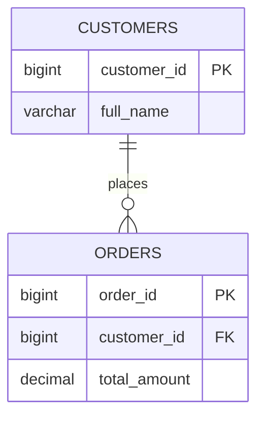

# FOREIGN KEY, Data Type/Index Conditions, and Supported Engines

An order has a `customer_id` pointing to the customer who placed it. If an application accidentally writes a non-existent `customer_id`, the order data loses its link to a customer. A `FOREIGN KEY` lets MySQL enforce this relationship right in the database, even when data is written from multiple different applications or SQL statements.

To create a foreign key in MySQL, the two related columns must have compatible data types, the columns need appropriate indexes, and both tables must use a storage engine that supports foreign key checks. For standard relational applications, the common choice is InnoDB. This lesson belongs to the **DATABASE_MYSQL** module and focuses on those requirements, how to declare foreign keys, and how to diagnose errors.

## 1. What Does a Foreign Key Protect?

A foreign key constrains values in a child table to reference a valid row in a parent table. For example:

- `customers` is the parent table; each customer has a `customer_id`.
- `orders` is the child table; each order stores the `customer_id` of the customer who owns the order.
- A non-`NULL` `orders.customer_id` value must match a corresponding value in `customers.customer_id`.



A foreign key guarantees referential integrity. It does not automatically create parent data, does not validate every business rule, and does not replace application-level validation. For example, a foreign key ensures the customer exists, but does not decide whether that customer is permitted to purchase a given product.

## 2. Data Type Requirements

The two columns in a foreign key relationship must have compatible types. MySQL InnoDB enforces specific rules:

| Type Group | Key Requirement |
|---|---|
| Integers | Must use the exact same integer type and same signedness; e.g., `BIGINT UNSIGNED` references `BIGINT UNSIGNED`, not signed `BIGINT` or `INT UNSIGNED` |
| Exact numeric types like `DECIMAL` | Precision and scale must be compatible; the safe approach is declaring the exact same type and parameters on both sides |
| Non-binary character strings | Must have the same character set and collation; string length does not strictly have to match, though keeping definitions consistent is recommended unless there is a reason otherwise |
| Binary strings | Sizes should correspond; use the same type and length on both sides |

Do not assume two types are compatible simply because their values "look similar". `INT` and `BIGINT` have different storage ranges; signed `INT` and `INT UNSIGNED` have different value ranges; `VARCHAR` with the same charset but different collations also fails the requirement for non-binary string columns.

### Example: Integer Types Must Match

Parent table declaration:

```sql
CREATE TABLE customers (
    customer_id BIGINT UNSIGNED NOT NULL AUTO_INCREMENT,
    full_name VARCHAR(150) NOT NULL,
    PRIMARY KEY (customer_id)
) ENGINE=InnoDB;
```

The child table must use the matching type for `customer_id`:

```sql
CREATE TABLE orders (
    order_id BIGINT UNSIGNED NOT NULL AUTO_INCREMENT,
    customer_id BIGINT UNSIGNED NOT NULL,
    total_amount DECIMAL(15,2) NOT NULL,
    PRIMARY KEY (order_id),
    KEY idx_orders_customer_id (customer_id),
    CONSTRAINT fk_orders_customer
        FOREIGN KEY (customer_id)
        REFERENCES customers (customer_id)
) ENGINE=InnoDB;
```

If `orders.customer_id` is declared as signed `BIGINT` while the parent column is `BIGINT UNSIGNED`, InnoDB may reject creating the foreign key due to mismatched signedness. Fix the column definition to match rather than trying to coerce types with `CAST()` in queries.

### Example: String Columns Must Share Charset and Collation

If using an external code as a referenced key, align character set and collation:

```sql
CREATE TABLE product_catalog (
    product_code VARCHAR(30)
        CHARACTER SET utf8mb4
        COLLATE utf8mb4_0900_as_cs NOT NULL,
    product_name VARCHAR(150) NOT NULL,
    PRIMARY KEY (product_code)
) ENGINE=InnoDB;

CREATE TABLE order_items (
    order_item_id BIGINT UNSIGNED NOT NULL AUTO_INCREMENT,
    product_code VARCHAR(30)
        CHARACTER SET utf8mb4
        COLLATE utf8mb4_0900_as_cs NOT NULL,
    quantity INT UNSIGNED NOT NULL,
    PRIMARY KEY (order_item_id),
    KEY idx_order_items_product_code (product_code),
    CONSTRAINT fk_order_items_product
        FOREIGN KEY (product_code)
        REFERENCES product_catalog (product_code)
) ENGINE=InnoDB;
```

If the two string columns have different collations—for instance, `utf8mb4_0900_as_cs` on one side and `utf8mb4_0900_ai_ci` on the other—creating the foreign key can fail. Check `SHOW CREATE TABLE` on both tables to verify the actual charset and collation.

## 3. Index Requirements on Parent and Child Tables

InnoDB needs indexes to quickly verify relationships when inserting/updating rows in the child table or deleting/updating keys in the parent table.

**On the parent (referenced) table:** the referenced columns must have a suitable index. The standard, clearest design is referencing a `PRIMARY KEY` or a `UNIQUE NOT NULL` key. When referencing multiple columns, column order must match the leading columns of the corresponding index.

**On the child (referencing) table:** the foreign key columns must form the leading prefix of an index in the exact same order. If no suitable index exists yet, InnoDB normally auto-creates an index for the foreign key. However, explicitly declaring the index is recommended to control its name and design it to serve business queries as well.

For example, the following index fits a single-column foreign key:

```sql
KEY idx_orders_customer_id (customer_id)
```

For a composite foreign key `(tenant_id, customer_id)`, an index starting with those exact two columns in that order is suitable:

```sql
KEY idx_orders_tenant_customer (tenant_id, customer_id)
```

An index `(customer_id, tenant_id)` does not share the same prefix order, so it cannot directly substitute for the index above for a composite foreign key on `(tenant_id, customer_id)`.

### Why Reference a Primary Key or UNIQUE Key?

Standard SQL models relationships as referencing a unique key of the parent table. InnoDB in some MySQL versions permitted referencing a non-unique index as a non-standard extension. That behavior is version-dependent and is restricted/deprecated in newer MySQL releases. Do not design new schemas relying on non-unique parent indexes; reference `PRIMARY KEY` or `UNIQUE NOT NULL` for a clear one-to-many contract on the referenced side and better compatibility.

`TEXT`/`BLOB` column types can generally only be indexed by prefix, whereas foreign keys require a full-column index on referenced columns. Therefore, they are unsuitable for foreign keys. Use bounded-length codes like `VARCHAR` or integer keys.

## 4. The Storage Engine Must Support FOREIGN KEY

Foreign keys in MySQL are enforced by the storage engine, not solely by SQL syntax at the server layer. For MySQL, InnoDB is the standard choice supporting both foreign key checks and transactions.

| Engine / Table Type | FOREIGN KEY Support |
|---|---|
| InnoDB | Supported; enforces foreign key constraints |
| MyISAM | Does not enforce foreign keys; FK declarations provide no referential integrity protection |
| `TEMPORARY` tables | Does not support foreign key declarations in the manner of permanent tables |
| InnoDB tables partitioned with MySQL partitioning | Foreign keys are not supported on partitioned InnoDB tables in MySQL 8.0 |

Both tables participating in a relationship must use a storage engine that supports foreign keys. For example, if the parent table is InnoDB and the child table is MyISAM, you cannot rely on an FK to protect the relationship.

Check table engines:

```sql
SHOW TABLE STATUS LIKE 'customers';
SHOW TABLE STATUS LIKE 'orders';

SHOW CREATE TABLE customers;
SHOW CREATE TABLE orders;
```

In `SHOW CREATE TABLE`, check the end of the definition for `ENGINE=InnoDB`. You can view supported engines on the server with:

```sql
SHOW ENGINES;
```

If maintaining a system using MyISAM, plan to convert both parent and child tables to InnoDB and verify data and indexes before adding foreign keys. Simply adding a `FOREIGN KEY` clause to DDL without switching engines does not create referential integrity.

## 5. Declaring FOREIGN KEY and Behavior When Parent Data Changes

Foreign keys can be declared directly when creating a table:

```sql
CREATE TABLE departments (
    department_id BIGINT UNSIGNED NOT NULL AUTO_INCREMENT,
    department_name VARCHAR(120) NOT NULL,
    PRIMARY KEY (department_id)
) ENGINE=InnoDB;

CREATE TABLE employees (
    employee_id BIGINT UNSIGNED NOT NULL AUTO_INCREMENT,
    department_id BIGINT UNSIGNED NOT NULL,
    full_name VARCHAR(150) NOT NULL,
    PRIMARY KEY (employee_id),
    KEY idx_employees_department_id (department_id),
    CONSTRAINT fk_employees_department
        FOREIGN KEY (department_id)
        REFERENCES departments (department_id)
        ON UPDATE CASCADE
        ON DELETE RESTRICT
) ENGINE=InnoDB;
```

The two important referential actions are `ON DELETE` and `ON UPDATE`:

| Action | When Triggered | Meaning |
|---|---|---|
| `RESTRICT` | Deleting/updating parent key while referencing child rows exist | Rejects the parent operation |
| `NO ACTION` | When deleting/updating parent key | In InnoDB, equivalent to `RESTRICT` and checked immediately, not a deferred constraint |
| `CASCADE` | Deleting/updating parent key | Automatically deletes or updates matching child rows |
| `SET NULL` | Deleting/updating parent key | Sets child FK columns to `NULL`; those FK columns must allow `NULL` |

If `ON DELETE`/`ON UPDATE` is omitted, the default behavior rejects any operation that violates the relationship. `SET DEFAULT` is not supported by InnoDB as an effective foreign key action; do not use it in designs.

Choose actions according to business semantics:

- Use `RESTRICT` when a customer or department must not be deleted if dependent data exists.
- Use `CASCADE` when child rows only make sense while the parent row exists—for example, line items of a draft shopping cart that can be deleted with the cart.
- Use `SET NULL` when child rows remain valid after detaching the link and the FK column is nullable.

Do not use `CASCADE` out of habit. A delete on a parent table can propagate through multiple relationship levels; understand the full impact before applying it.

## 6. NULL and Composite Foreign Keys

A nullable FK column means a child row may not yet be attached to a parent row. With a single-column FK, `NULL` does not require finding a matching parent row. If the relationship is mandatory, declare the FK column `NOT NULL`.

Example where an employee may not yet be assigned to a department:

```sql
CREATE TABLE employees_optional_department (
    employee_id BIGINT UNSIGNED NOT NULL,
    department_id BIGINT UNSIGNED NULL,
    PRIMARY KEY (employee_id),
    KEY idx_employee_department (department_id),
    CONSTRAINT fk_employee_optional_department
        FOREIGN KEY (department_id)
        REFERENCES departments (department_id)
        ON DELETE SET NULL
) ENGINE=InnoDB;
```

For a composite foreign key, if one or more components of the child key are `NULL`, MySQL applies behavior equivalent to `MATCH SIMPLE`: it does not require finding a parent row for that combination. MySQL does not implement SQL-standard `MATCH FULL`/`MATCH PARTIAL` variants; do not add a `MATCH` clause expecting it to alter validation behavior.

If business rules require either all components to be populated or all to be empty, design additional constraints or logic. Do not assume a composite foreign key automatically forces all columns to be simultaneously `NULL` or simultaneously non-`NULL`.

## 7. Composite and Self-Referencing Foreign Keys

### Composite Foreign Keys

A relationship can span multiple columns, commonly used when data is scoped by tenant or when the business key is a combination:

```sql
CREATE TABLE tenant_users (
    tenant_id BIGINT UNSIGNED NOT NULL,
    user_id BIGINT UNSIGNED NOT NULL,
    display_name VARCHAR(120) NOT NULL,
    PRIMARY KEY (tenant_id, user_id)
) ENGINE=InnoDB;

CREATE TABLE tenant_orders (
    order_id BIGINT UNSIGNED NOT NULL AUTO_INCREMENT,
    tenant_id BIGINT UNSIGNED NOT NULL,
    user_id BIGINT UNSIGNED NOT NULL,
    PRIMARY KEY (order_id),
    KEY idx_tenant_orders_user (tenant_id, user_id),
    CONSTRAINT fk_tenant_orders_user
        FOREIGN KEY (tenant_id, user_id)
        REFERENCES tenant_users (tenant_id, user_id)
) ENGINE=InnoDB;
```

The order of columns in `FOREIGN KEY` must match the order of the referenced columns. The child table index must also start with `(tenant_id, user_id)` in the same order. This ensures an order points to a user within the correct tenant.

### Self-Referencing Foreign Keys

A table can reference itself, such as an employee-and-manager hierarchy:

```sql
CREATE TABLE staff (
    staff_id BIGINT UNSIGNED NOT NULL AUTO_INCREMENT,
    manager_id BIGINT UNSIGNED NULL,
    full_name VARCHAR(150) NOT NULL,
    PRIMARY KEY (staff_id),
    KEY idx_staff_manager (manager_id),
    CONSTRAINT fk_staff_manager
        FOREIGN KEY (manager_id)
        REFERENCES staff (staff_id)
        ON DELETE SET NULL
) ENGINE=InnoDB;
```

A manager is also an employee in the same table. `manager_id` allows `NULL` to represent an employee without a direct manager. While the foreign key guarantees the manager exists, it does not automatically prevent an employee from managing themselves or creating multi-level management cycles; those rules require separate business validation.

## 8. Adding FOREIGN KEY to Tables with Existing Data

When adding a foreign key to an existing table, MySQL must verify existing child rows. If any value is not found in the parent table, `ALTER TABLE` will fail.

Before adding the key, search for orphan rows:

```sql
SELECT o.order_id, o.customer_id
FROM orders AS o
LEFT JOIN customers AS c
    ON c.customer_id = o.customer_id
WHERE o.customer_id IS NOT NULL
  AND c.customer_id IS NULL;
```

If the query returns rows, decide how to handle them per business rules: recreate valid parent data, fix child keys to point to the right customer, set them to `NULL` if the relationship is optional, or remove invalid data after approval. Never blindly delete orphan data just to make DDL succeed.

After cleaning data and confirming types/indexes/engine, add the key:

```sql
ALTER TABLE orders
    ADD CONSTRAINT fk_orders_customer
    FOREIGN KEY (customer_id)
    REFERENCES customers (customer_id)
    ON UPDATE CASCADE
    ON DELETE RESTRICT;
```

This operation may require a metadata lock and a full-table data validation scan; duration depends on table size, load, MySQL version, and DDL algorithm. In production, test first on a data copy and plan the deployment window.

## 9. Verifying Foreign Keys After Creation

`SHOW CREATE TABLE` is a fast way to view constraint declarations and engine:

```sql
SHOW CREATE TABLE orders;
```

To inspect relationships via metadata:

```sql
SELECT
    TABLE_SCHEMA,
    TABLE_NAME,
    CONSTRAINT_NAME,
    COLUMN_NAME,
    REFERENCED_TABLE_SCHEMA,
    REFERENCED_TABLE_NAME,
    REFERENCED_COLUMN_NAME,
    ORDINAL_POSITION
FROM INFORMATION_SCHEMA.KEY_COLUMN_USAGE
WHERE TABLE_SCHEMA = DATABASE()
  AND REFERENCED_TABLE_NAME IS NOT NULL
ORDER BY TABLE_NAME, CONSTRAINT_NAME, ORDINAL_POSITION;
```

To inspect delete and update actions:

```sql
SELECT
    CONSTRAINT_SCHEMA,
    TABLE_NAME,
    CONSTRAINT_NAME,
    REFERENCED_TABLE_NAME,
    UPDATE_RULE,
    DELETE_RULE
FROM INFORMATION_SCHEMA.REFERENTIAL_CONSTRAINTS
WHERE CONSTRAINT_SCHEMA = DATABASE();
```

To inspect indexes on both tables:

```sql
SHOW INDEX FROM orders;
SHOW INDEX FROM customers;
```

Cross-check column order, uniqueness, and actual data types; do not merely check whether an index happens to share the FK's name.

## 10. Dropping and Modifying Foreign Keys

If you need to change the `ON DELETE` action or the list of referenced columns, you normally must drop the old constraint and recreate it:

```sql
ALTER TABLE orders
    DROP FOREIGN KEY fk_orders_customer;

ALTER TABLE orders
    ADD CONSTRAINT fk_orders_customer
    FOREIGN KEY (customer_id)
    REFERENCES customers (customer_id)
    ON DELETE CASCADE
    ON UPDATE CASCADE;
```

`DROP FOREIGN KEY` removes the constraint. The supporting index may remain because it can also serve other queries; check `SHOW INDEX` before dropping an index. Do not drop an index if it still serves queries or other constraints.

Do not use `SET foreign_key_checks = 0` as a routine fix for FK creation errors. When checks are disabled, MySQL can allow inconsistent data; re-enabling this variable does not retroactively scan and verify all data written while checks were off. If used in a controlled import/restore process, manually verify for orphan rows before allowing applications to resume writes.

## 11. Common FOREIGN KEY Errors

| Error / Symptom | Common Cause | How to Inspect |
|---|---|---|
| `Cannot add foreign key constraint` or error 1215 | Mismatched type, signedness, charset/collation, index, engine, or existing data | `SHOW CREATE TABLE` on both tables, `SHOW INDEX`, `SHOW ENGINE INNODB STATUS` |
| `Referencing column ... and referenced column ... are incompatible` (commonly code 3780) | Incompatible numeric type, signedness, or string attributes | Compare `COLUMN_TYPE`, charset, and collation of both columns |
| Missing suitable index on referenced table | Parent column lacks a matching index or composite column order is wrong | `SHOW INDEX FROM parent_table` |
| Failure when adding FK to table with existing data | Orphan rows exist in child table | Run a `LEFT JOIN` query to find child rows without parents |
| `Cannot delete or update a parent row` (commonly code 1451) | Referencing child rows exist and action is `RESTRICT`/`NO ACTION` | Locate child rows and determine the appropriate delete/update policy |
| `Cannot add or update a child row` (commonly code 1452) | New FK value does not exist in parent table | Check the supplied value and corresponding parent row |
| Creating FK between two tables fails even though columns match | Tables use different engines or an engine without FK support | Check `ENGINE` in `SHOW CREATE TABLE` |

When an FK creation error does not clearly state the cause, InnoDB may provide details in engine status:

```sql
SHOW ENGINE INNODB STATUS;
```

Look for the `LATEST FOREIGN KEY ERROR` section. Its text typically pinpoints the table/column name or unmet condition. This output may contain other server activity details; share only what is necessary when asking for support.

## 12. Checklist Before Creating a FOREIGN KEY

Before running DDL, verify step-by-step:

1. Parent table has a suitable primary key or unique key to reference.
2. Child and parent columns have compatible types; integer types match in size and signedness.
3. For non-binary strings, character set and collation match on both columns.
4. Composite columns share the exact same order in FK and index; child index starts with all FK columns.
5. Both tables use an FK-supporting engine, typically InnoDB; avoid `TEMPORARY` tables or partitioned tables that do not support FKs.
6. Existing child data has no orphan rows.
7. `ON DELETE`/`ON UPDATE` reflect business rules; `SET NULL` is used only when the column allows `NULL`.
8. DDL impact, locking, and validation duration have been evaluated in a test environment.

## 13. Hands-on Exercises

1. Create a `customers` table with a `BIGINT UNSIGNED` primary key, then create `orders` with a matching FK and the InnoDB engine.
2. Try changing the child column to signed `BIGINT` or `INT UNSIGNED`; observe the error and explain the difference.
3. Create two string code columns with different charsets/collations, attempt to create an FK, then fix them to be compatible.
4. Omit the child index before adding the FK and observe the index InnoDB generates; then redesign an explicit index with an appropriate column order.
5. Try deleting a customer who has orders with `RESTRICT`, then test `CASCADE` on a test schema and explain the number of affected rows.
6. Add an FK to a child table containing orphan data; use a `LEFT JOIN` query to locate and resolve the data before retrying.
7. Use `INFORMATION_SCHEMA.KEY_COLUMN_USAGE` and `REFERENTIAL_CONSTRAINTS` to list FK relationships and actions.

You have mastered this lesson when you can explain why foreign keys require compatible data types, proper indexes on both sides, and a supporting storage engine—and when you can create, verify, alter, and troubleshoot FKs in a test schema. Treat FKs as part of data design and the contract between tables, not merely a line of syntax in `CREATE TABLE`.
