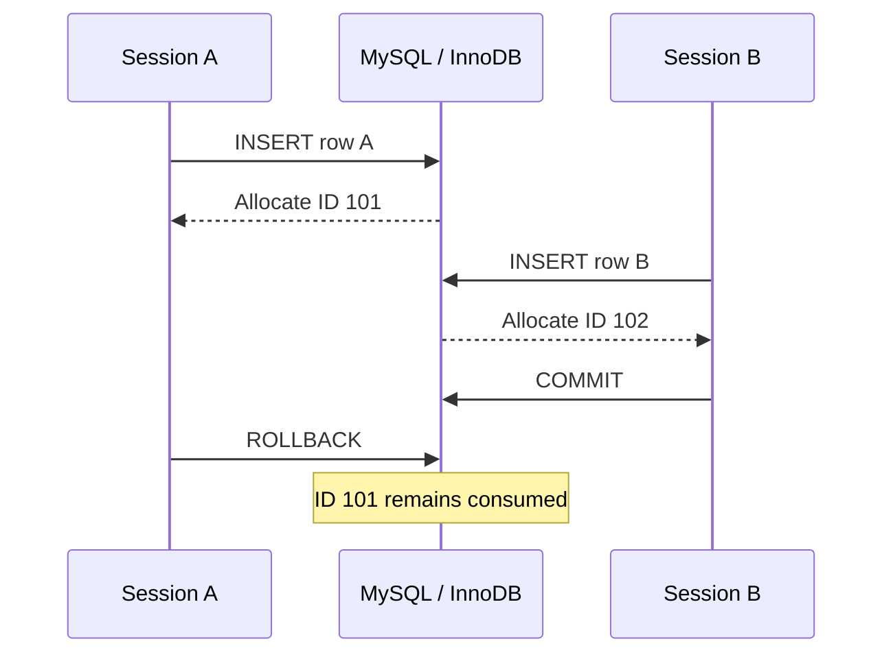

# AUTO_INCREMENT, Value Allocation, and Gaps After Rollback

AUTO_INCREMENT lets MySQL automatically assign numeric values to a column when inserting new rows. This mechanism is commonly used to generate technical primary keys so every record gets a unique identifier without the application computing it manually. However, AUTO_INCREMENT is not a gapless transactional counter: allocated values can leave gaps when transactions roll back, statements fail, rows are deleted, or multiple clients write concurrently.

In the **DATABASE_MYSQL** module, understanding how values are allocated helps you design primary keys, foreign keys, transactions, and concurrency handling properly. This lesson covers how to declare it, how MySQL allocates numbers, why gaps occur, how to retrieve generated IDs in Java applications, and how to design gapless document numbers if the business genuinely requires them.

## 1. What Is AUTO_INCREMENT Used For?

AUTO_INCREMENT is an attribute on an integer column. When an INSERT omits a value for this column, MySQL automatically generates the next value from the table's counter.

Example:

```sql
CREATE TABLE customers (
    customer_id BIGINT UNSIGNED NOT NULL AUTO_INCREMENT,
    full_name VARCHAR(150) NOT NULL,
    email VARCHAR(255) NOT NULL,
    PRIMARY KEY (customer_id),
    UNIQUE KEY uk_customers_email (email)
) ENGINE = InnoDB;
```

Insert a row without specifying `customer_id`:

```sql
INSERT INTO customers (full_name, email)
VALUES ('Nguyen An', 'an@example.com');
```

MySQL automatically assigns `customer_id`. The application uses that value to reference the record in subsequent operations.

A table can have only one AUTO_INCREMENT column. That column must be indexed; typically it is the PRIMARY KEY. Use `BIGINT UNSIGNED` when a table can grow very large and does not need negative values. Choose the data type according to expected lifespan and scale, because once the numeric limit is reached, new ID allocations fail.

AUTO_INCREMENT is best suited for a **surrogate key** (technical replacement key). Do not use it to encode invoice numbers, contract numbers, or business sequence numbers if those numbers must be contiguous, follow year/organization rules, or require cancellation controls.

## 2. When Does MySQL Generate a New Value?

For an AUTO_INCREMENT column, common cases are:

| Value in INSERT | Typical Behavior |
|---|---|
| Omit column from INSERT list | MySQL generates a new value |
| Assign NULL | MySQL generates a new value |
| Assign 0 | Normally generates a new value |
| Assign 0 with NO_AUTO_VALUE_ON_ZERO enabled | Stores 0 instead of requesting a new generated value |
| Assign an explicit positive number | Uses the supplied value if valid; a higher value may advance the counter |
| Assign a negative value | Do not use; behavior and validity depend on type, data validation, and configuration |

Example:

```sql
INSERT INTO customers (full_name, email)
VALUES ('Binh Tran', 'binh@example.com');

INSERT INTO customers (customer_id, full_name, email)
VALUES (NULL, 'Chi Le', 'chi@example.com');

INSERT INTO customers (customer_id, full_name, email)
VALUES (0, 'Dung Pham', 'dung@example.com');
```

All three statements ask MySQL to generate an ID under normal configuration. If the session enables `NO_AUTO_VALUE_ON_ZERO`, 0 is treated as an explicit value; it will usually collide with the primary key or be rejected by constraints.

Check the mode:

```sql
SELECT @@SESSION.sql_mode;
```

Do not use ID 0 as a special code for an "unknown" record. This complicates foreign keys, application logic, and numbering rules.

## 3. When Is the Counter Allocated?

MySQL allocates values during write statement execution, without waiting for transaction commit. When InnoDB allocates a value for a row, that value is reserved for the insert operation. If the transaction later rolls back, InnoDB does not return the allocated number to the counter for reuse.

Example in a session:

```sql
START TRANSACTION;

INSERT INTO customers (full_name, email)
VALUES ('Rollback User', 'rollback@example.com');

SELECT LAST_INSERT_ID() AS allocated_id;

ROLLBACK;

INSERT INTO customers (full_name, email)
VALUES ('Next User', 'next@example.com');

SELECT LAST_INSERT_ID() AS next_allocated_id;
```

The first ID was allocated inside the rolled-back transaction. The next insert receives a higher ID, leaving a gap. This is normal behavior and does not mean data was lost or InnoDB malfunctioned.

It is important to distinguish:

- **ID allocation:** MySQL reserves a value while executing INSERT.
- **Commit:** the transaction confirms data changes.
- **Rollback:** undoes transactional data changes, but does not reclaim allocated IDs.

This design lets multiple clients allocate IDs without holding a transactional counter lock until the transaction finishes.

## 4. Why Does AUTO_INCREMENT Have Gaps?

Gaps are a normal characteristic of AUTO_INCREMENT. Common causes include:

| Cause | Example | Why a Gap Occurs |
|---|---|---|
| Rollback | Insert in a transaction followed by ROLLBACK | Allocated values are not reclaimed |
| Failed INSERT | Unique key violation or data error after ID allocation | Value reserved for the failed operation may be discarded |
| INSERT IGNORE | Row skipped due to duplicate | Counter may have advanced during processing |
| ON DUPLICATE KEY UPDATE | Insert turns into an update of an existing row | An auto-increment value can be consumed without creating a new row |
| DELETE | Deleting a row with an ID in the middle or at the end | MySQL does not renumber remaining rows |
| Explicit ID insert | Inserting an ID greater than the current counter | The next counter value is bumped up |
| Bulk insert and concurrency | Concurrent `INSERT ... SELECT` or `LOAD DATA` | Engine may pre-allocate or interleave value ranges |
| Increment configuration | `auto_increment_increment` greater than 1 | Allocated IDs step by the configured increment |

For example, after creating IDs 1, 2, and 3, deleting row 2 does not cause MySQL to change ID 3 to 2. Renumbering IDs would break foreign keys, caches, logs, and references stored in other systems.

**Do not use `COUNT(*)` to predict the next ID.** Row count neither equals the maximum key value nor reflects the internal counter.

## 5. Experiment Observing Gaps After Rollback

Create a dedicated table in a lab environment:

```sql
CREATE TABLE auto_inc_lab (
    id BIGINT UNSIGNED NOT NULL AUTO_INCREMENT,
    note VARCHAR(100) NOT NULL,
    PRIMARY KEY (id)
) ENGINE = InnoDB;
```

Insert an initial row:

```sql
INSERT INTO auto_inc_lab (note) VALUES ('committed row');

SELECT LAST_INSERT_ID() AS first_id;
```

Next, allocate an ID inside a transaction and roll back:

```sql
START TRANSACTION;

INSERT INTO auto_inc_lab (note)
VALUES ('will be rolled back');

SELECT LAST_INSERT_ID() AS rolled_back_id;

ROLLBACK;
```

Insert a new row and inspect the IDs:

```sql
INSERT INTO auto_inc_lab (note)
VALUES ('after rollback');

SELECT LAST_INSERT_ID() AS next_id;

SELECT id, note
FROM auto_inc_lab
ORDER BY id;
```

You will see the ID allocated to the rolled-back row does not appear in the table, while the new row receives a higher ID. This gap must not be treated as a missing record; it is the result of the ID allocation policy.

You can check the next AUTO_INCREMENT value reported by the server in metadata:

```sql
SELECT
    TABLE_NAME,
    AUTO_INCREMENT
FROM INFORMATION_SCHEMA.TABLES
WHERE TABLE_SCHEMA = DATABASE()
  AND TABLE_NAME = 'auto_inc_lab';
```

`AUTO_INCREMENT` in metadata is the next value reported by the server at query time; it can change with concurrent inserts or counter adjustments. Do not use this metadata query to allocate IDs for an application.

## 6. ID Allocation in a Multi-Client Environment

Multiple connections can insert into a table simultaneously. InnoDB must coordinate value allocation to prevent two rows from receiving the same ID.

Imagine two sessions:



In this example, Session B can commit before Session A. ID 102 exists even though ID 101 has no committed row. Thus, increasing IDs do not guarantee commit order or business order.

### 6.1. innodb_autoinc_lock_mode

InnoDB provides the `innodb_autoinc_lock_mode` variable to control locking behavior when allocating auto-increment values:

| Mode | Name | Characteristics |
|---:|---|---|
| 0 | Traditional | Uses a table-level AUTO-INC lock for insert statements; guarantees values within each statement are allocated consecutively |
| 1 | Consecutive | Simple inserts use a lighter locking mechanism; bulk inserts use an AUTO-INC lock to allocate a contiguous sequence within the statement |
| 2 | Interleaved | Does not hold a statement-level AUTO-INC table lock; concurrent statements can interleave ID allocations |

A simple insert is a statement where the number of rows to be inserted is known in advance, such as `INSERT ... VALUES`. A bulk insert is a statement where the row count is not fully known upfront, such as `INSERT ... SELECT` or `LOAD DATA`.

In MySQL 8.0, the default mode is 2 (interleaved); older versions may use a different default. Check the variable on your exact server:

```sql
SELECT
    @@GLOBAL.innodb_autoinc_lock_mode
        AS innodb_autoinc_lock_mode;
```

Mode 2 enables higher concurrency, but does not guarantee a dedicated contiguous range per bulk statement when multiple statements run concurrently. Under statement-based replication, interleaved allocation can produce non-deterministic results; MySQL recommends row-based replication for this mode. MySQL 8.0 defaults to row-based binary logging.

Do not change the lock mode merely to try forcing contiguous IDs. This setting is a concurrency and replication decision, not an invoice numbering tool.

## 7. Increment Step and Offset Variables

Two variables can affect the ID sequence:

- `auto_increment_increment`: interval between auto-generated values.
- `auto_increment_offset`: starting offset in the sequence.

They are commonly used in certain multi-source or multi-primary replication setups to reduce ID collision risk across nodes.

Inspect them:

```sql
SELECT
    @@GLOBAL.auto_increment_increment AS global_increment,
    @@GLOBAL.auto_increment_offset AS global_offset,
    @@SESSION.auto_increment_increment AS session_increment,
    @@SESSION.auto_increment_offset AS session_offset;
```

If `auto_increment_increment` is greater than 1, IDs might be 1, 3, 5... or another offset sequence depending on `auto_increment_offset`. Therefore, never assume the next ID always equals the current ID plus 1.

## 8. Retrieving the Generated ID in Applications

### 8.1. LAST_INSERT_ID()

`LAST_INSERT_ID()` returns the first auto-increment value generated by the most recent INSERT statement on **the current connection itself**. This value is unaffected by inserts on other connections.

Example:

```sql
INSERT INTO auto_inc_lab (note)
VALUES ('created by current session');

SELECT LAST_INSERT_ID();
```

For a multi-row insert, `LAST_INSERT_ID()` returns the first ID generated for the statement, not the last ID of the batch. Do not deduce all IDs by adding the row count to the first ID without accounting for increment settings and concurrent allocation.

### 8.2. Java JDBC Generated Keys

In Java, use JDBC generated keys to retrieve the ID without running `SELECT MAX(id)`:

```java
public long createCustomer(Connection connection) throws SQLException {
    String sql = "INSERT INTO customers (full_name, email) VALUES (?, ?)";

    try (PreparedStatement ps = connection.prepareStatement(
            sql, Statement.RETURN_GENERATED_KEYS)) {
        ps.setString(1, "Nguyen An");
        ps.setString(2, "an@example.com");

        int affectedRows = ps.executeUpdate();
        if (affectedRows != 1) {
            throw new SQLException("Unexpected affected row count: " + affectedRows);
        }

        try (ResultSet keys = ps.getGeneratedKeys()) {
            if (!keys.next()) {
                throw new SQLException("MySQL did not return a generated key");
            }
            return keys.getLong(1);
        }
    }
}
```

This snippet assumes JDBC types (`Connection`, `PreparedStatement`, `Statement`, `ResultSet`, `SQLException`) are imported from `java.sql`.

Use the exact same `Connection` that executed the INSERT to read the generated key. Do not open another connection and call `LAST_INSERT_ID()`, because each connection maintains its own state.

Never use the following pattern:

```sql
SELECT MAX(customer_id) FROM customers;
```

Between INSERT and SELECT, another client can insert a new row. `MAX(id)` can return another client's ID and link the wrong record. `LAST_INSERT_ID()` or JDBC generated keys solve this properly.

## 9. Setting or Adjusting AUTO_INCREMENT

You can inspect the next value using:

```sql
SHOW TABLE STATUS LIKE 'customers';
```

Or check `INFORMATION_SCHEMA.TABLES` as shown earlier.

When you need to set a starting point for a table, use:

```sql
ALTER TABLE customers AUTO_INCREMENT = 10000;
```

If the requested value is less than or equal to the current maximum value in the column, MySQL will not set the counter below the required threshold to avoid key collisions. The actual next value also depends on existing data and counter state.

A few notes:

- Inserting an explicit ID higher than the current value can advance the counter.
- Deleting the row with the highest ID does not automatically step the counter backward.
- InnoDB since MySQL 8.0 persists the AUTO_INCREMENT counter durably. In earlier versions, InnoDB's counter could reinitialize from the highest remaining value in the table after a server restart; therefore, do not rely on preserving trailing gaps across versions.
- `DELETE FROM table` does not reset the counter to 1.
- `TRUNCATE TABLE` removes all rows and resets the counter, but it is a DDL operation with an implicit commit and cannot be rolled back like `DELETE`.
- Never use `ALTER TABLE ... AUTO_INCREMENT = 1` to renumber data currently referenced by the system.

Reusing previously allocated IDs can cause logs, caches, URLs, events, or integrated systems to mistake a new ID for an old record. Technical IDs should remain stable throughout a record's lifetime.

## 10. AUTO_INCREMENT Is Not a Contiguous Sequence

An auto-increment primary key only needs to satisfy unique identification. It does not guarantee:

- Zero gaps.
- Increments of exactly one.
- Commit order matching ID order.
- IDs reflecting exact creation time.
- IDs indicating total record count.
- Reusability of IDs after transaction rollback.

For example, two orders with IDs 100 and 105 do not mean orders 101–104 were deleted. Those numbers may have been allocated to failed inserts, rolled-back transactions, or other operations.

If you need to sort by creation time, use an appropriate timestamp column such as `created_at` alongside a stable tie-breaker. Never use an ID as a business clock.

## 11. When Business Rules Require Contiguous Document Numbers

Some domains such as invoices, receipts, or legal documents require display numbers following specific rules. First clarify what "contiguous" means: contiguous within a fiscal year, per branch, per document type, or simply non-duplicate? Accounting/legal regulations may require retaining voided numbers rather than reusing them.

Do not use AUTO_INCREMENT as this numbering mechanism. Separate them:

- `id`: technical primary key, which can use AUTO_INCREMENT.
- `invoice_number`: document number following business rules, allocated by a dedicated mechanism.
- `status`: issued, voided, or adjusted status.
- `issued_at`: issuance timestamp.

### 11.1. Business Counter Using Transactions

You can use a counter row per document type or per numbering scope:

```sql
CREATE TABLE document_counters (
    document_type VARCHAR(30) NOT NULL,
    next_number BIGINT UNSIGNED NOT NULL,
    PRIMARY KEY (document_type)
) ENGINE = InnoDB;

INSERT INTO document_counters (document_type, next_number)
VALUES ('INVOICE', 1001);
```

Inside a transaction, the application locks the counter row, reads the current number, increments the counter, and creates the document before committing:

```sql
START TRANSACTION;

SELECT next_number
FROM document_counters
WHERE document_type = 'INVOICE'
FOR UPDATE;

-- Application reads next_number as invoice_number.

UPDATE document_counters
SET next_number = next_number + 1
WHERE document_type = 'INVOICE';

INSERT INTO invoices (invoice_number, customer_id, total_amount)
VALUES (?, ?, ?);

COMMIT;
```

Reading the counter, incrementing the number, and inserting the document must all occur inside the same InnoDB transaction. `SELECT ... FOR UPDATE` locks the counter row, making other transactions of the same type wait. If the transaction rolls back before issuance, the counter update also rolls back and the number can be reused.

This approach serializes number allocation within the scope of one counter row, so it can become a bottleneck at high throughput. You can partition counters by year, branch, or document type if business rules permit. For legal compliance, keep an audit trail of issued and voided documents; never delete or reuse issued numbers illegally.

This is an architectural example; add error handling, deadlock retries, a unique constraint on the document number, and real-world issuance rules.

## 12. Comprehensive Lab

Perform in a lab database:

1. Create an InnoDB table with a `BIGINT UNSIGNED AUTO_INCREMENT` primary key.
2. Insert a normal row and retrieve the ID with `LAST_INSERT_ID()`.
3. Start a transaction, insert a second row, record the ID, then roll back.
4. Insert a third row and observe the gap.
5. Run `SELECT id, note ... ORDER BY id` to confirm only committed rows exist.
6. Run `SHOW TABLE STATUS` or query `INFORMATION_SCHEMA.TABLES` to observe the counter.
7. Insert an explicit ID higher than the counter in the test table and see how the next value changes.
8. In Java, retrieve generated keys using `Statement.RETURN_GENERATED_KEYS`.
9. Test two concurrent sessions inserting and observe that IDs do not reflect commit order.
10. Explain why `MAX(id) + 1`, `COUNT(*)`, or `AUTO_INCREMENT` cannot be used for contiguous invoice numbers.

At the end of the lab, verify primary keys, referencing foreign keys, and committed data. Never run `TRUNCATE` on a table holding data you need to keep just to make the ID sequence look prettier.

## 13. Common Mistakes

| Mistake | Consequence | Fix |
|---|---|---|
| Expecting gapless IDs after rollback | Misunderstanding normal InnoDB behavior | Accept gaps for technical keys |
| Using `MAX(id) + 1` | Race condition when multiple clients insert | Use AUTO_INCREMENT and generated keys |
| Using ID as an invoice number | Gaps, commit ordering, and legal rules are unguaranteed | Use a separate transactional business counter |
| Using `COUNT(*)` to compute the next ID | Breaks with deletes, rollbacks, or explicit IDs | Never infer the counter from row counts |
| Assuming higher IDs always commit later | Transactions can commit in a different order | Use timestamps or business fields to determine time |
| Deleting the last row to reset ID | Counter does not automatically step back | Manage IDs as durable identifiers |
| Calling `SELECT LAST_INSERT_ID()` on another connection | Reads unrelated connection state | Use the same connection or JDBC generated keys |
| Running `TRUNCATE` expecting to roll back | TRUNCATE is DDL with an implicit commit | Only use when intending to wipe everything without rollback |

## 14. Key Takeaways

- AUTO_INCREMENT automatically generates numeric values when the column is omitted, given NULL, or given 0 under standard configuration.
- An AUTO_INCREMENT column must be indexed; typically used as a technical primary key.
- InnoDB allocates IDs during INSERT execution; rollback does not reclaim allocated IDs.
- Gaps can arise from rollbacks, failed inserts, IGNORE, upserts, deletes, explicit ID inserts, concurrency, or configured increment steps.
- IDs do not reflect commit order, are not row-count counters, and are not guaranteed to be contiguous.
- `innodb_autoinc_lock_mode` controls how concurrent statements coordinate ID allocation; mode 2 allows interleaving and pairs with row-based replication.
- Use `LAST_INSERT_ID()` or JDBC generated keys on the same connection that executed the INSERT; never use `MAX(id) + 1`.
- You can set a starting point with `ALTER TABLE ... AUTO_INCREMENT`, but never reuse previously issued IDs in a live system.
- If the business requires contiguous document numbers, use a separate counter locked and updated inside a transaction, along with auditing and voiding rules.

Treat AUTO_INCREMENT as an efficient mechanism for creating technical identifiers, not as a promise of a gapless business sequence. Keeping these two purposes separate makes key design, transactions, and concurrency handling far more predictable and safe.
