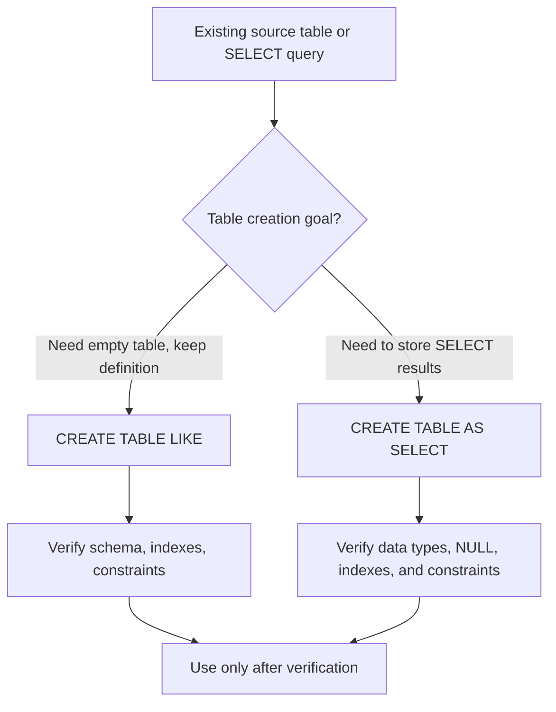

# CREATE TABLE LIKE, CREATE TABLE AS SELECT, and Properties to Verify

MySQL provides two common ways to create a table based on an existing table or query: `CREATE TABLE ... LIKE` and `CREATE TABLE ... AS SELECT` (CTAS). The two statements look similar, yet they serve different purposes. `LIKE` creates an empty table based on the source table's definition; CTAS creates a table from the result structure of a `SELECT` query and simultaneously populates the rows returned by that query.

If misused, you can end up with a table containing data but missing a required primary key, indexes, foreign keys, or defaults. This lesson shows how to distinguish both approaches, identify which properties are inherited, add explicit definitions, and verify results through metadata.

This lesson belongs to the **DATABASE_MYSQL** module. The module aims at mastering MySQL from table design, data types, keys, and SQL queries to indexes, transactions, and concurrency control—as well as practicing execution plan reading, query optimization, privileges, backups, and operational troubleshooting for relational databases. Within the **Tables and Constraints** chapter, this lesson focuses on creating tables from existing structures or query results and verifying critical properties before putting new tables into use.

## 1. Two Distinct Needs When Creating Tables

Consider an operational `orders` table. Two common requirements arise:

1. Create an `orders_stage` table with a structure closely matching `orders` to load test data or prepare an empty copy.
2. Create a `customer_order_summary` table containing aggregated order counts and revenue per customer for reporting.

The first requirement needs to copy a table definition. The second requirement needs to build a schema from a query's expression list and store the query results in a new table.



`LIKE` focuses on copying structure. CTAS focuses on materializing a query result into a data table. Both require post-creation verification; neither command guarantees every business property is copied automatically.

## 2. CREATE TABLE LIKE: Copy Definition, Not Data

### 2.1. Basic Syntax

```sql
CREATE TABLE orders_stage LIKE orders;
```

This statement creates an empty `orders_stage` based on the definition of `orders`. The new table retains many structural properties of the source table, including column definitions and indexes. No data rows from `orders` are copied.

You can specify source and target databases:

```sql
CREATE TABLE staging_db.orders_stage
LIKE production_db.orders;
```

The source object must be a table compatible with `LIKE` syntax; do not treat this statement as a way to clone a view or an arbitrary query. If you need to create a table from a view or from joins, aggregates, or expressions, use CTAS or declare the schema explicitly and run `INSERT ... SELECT`.

### 2.2. Source Structure Example

Suppose the source table was created as follows:

```sql
CREATE TABLE orders (
    order_id     BIGINT UNSIGNED NOT NULL AUTO_INCREMENT,
    customer_id  BIGINT UNSIGNED NOT NULL,
    order_status VARCHAR(20) NOT NULL DEFAULT 'PENDING',
    total_amount DECIMAL(14, 2) NOT NULL,
    created_at   DATETIME(6) NOT NULL DEFAULT CURRENT_TIMESTAMP(6),
    updated_at   DATETIME(6) NOT NULL DEFAULT CURRENT_TIMESTAMP(6)
                              ON UPDATE CURRENT_TIMESTAMP(6),
    PRIMARY KEY (order_id),
    KEY idx_orders_customer_created (customer_id, created_at),
    KEY idx_orders_status_created (order_status, created_at),
    CONSTRAINT chk_orders_total_nonnegative CHECK (total_amount >= 0)
) ENGINE = InnoDB
  DEFAULT CHARACTER SET = utf8mb4
  COLLATE = utf8mb4_0900_ai_ci;
```

Create an empty table from that definition:

```sql
CREATE TABLE orders_stage LIKE orders;

SHOW CREATE TABLE orders_stage;
SELECT COUNT(*) AS row_count FROM orders_stage;
```

`COUNT(*)` must return 0 immediately after table creation. `SHOW CREATE TABLE` lets you inspect the actual definition of the new table instead of relying solely on the statement executed.

### 2.3. What LIKE Inherits and What Must Be Checked Separately

`CREATE TABLE ... LIKE` creates an empty table and inherits column definitions and indexes from the source table. However, do not treat it as an exact clone of every dependent object.

| Property | Behavior to Understand |
|---|---|
| Data rows | Not copied; the target table is empty. |
| Column names, data types | Taken from the source table definition. |
| `NOT NULL`, `DEFAULT`, `AUTO_INCREMENT` on columns | Column definition attributes are inherited; the source's current counter is not copied as data. |
| Primary key and indexes | Copied according to the table definition. |
| Generated columns | Column definition attributes are kept per source structure; verify expressions in `SHOW CREATE TABLE`. |
| Foreign keys | Foreign key definitions are not preserved by `CREATE TABLE ... LIKE`; recreate them if the new table needs those relationships. |
| Triggers | Not copied because triggers are separate objects attached to the source table. |
| Check constraints | Verify with `SHOW CREATE TABLE` and metadata on the exact version; do not assume based merely on index copying. |
| Engine, charset, collation, partitions, and table options | Inspect the resulting definition; directory options such as `DATA DIRECTORY` and `INDEX DIRECTORY` are not preserved as a physical clone. |
| Privileges granted directly on source table | Do not treat `LIKE` as copying grants; verify effective privileges on the target table. |

A particularly critical point: the MySQL documentation explicitly states that foreign key definitions are not preserved by `CREATE TABLE ... LIKE`. If the new table needs referential constraints, add them back with `ALTER TABLE` after creation and appropriate data validation.

For CHECK constraints, generated columns, partitions, and table options, behavior may depend on MySQL version or object type. The safe workflow is inspecting `SHOW CREATE TABLE` on both source and target, then cross-checking metadata for every property the application relies on.

### 2.4. LIKE Does Not Copy the Current AUTO_INCREMENT Value

`LIKE` copies the `AUTO_INCREMENT` attribute on the column, but the new target table is not a copy of the source table's sequence state. Do not rely on the source's current counter to guarantee the next ID in the target table.

Check:

```sql
SHOW TABLE STATUS LIKE 'orders';
SHOW TABLE STATUS LIKE 'orders_stage';
```

If a specific starting value is needed, set it explicitly after creating the table:

```sql
ALTER TABLE orders_stage AUTO_INCREMENT = 100000;
```

The new value must exceed existing key values in the target table. Do not set the counter to simulate ID continuity; `AUTO_INCREMENT` does not guarantee gapless sequences.

### 2.5. LIKE Followed by INSERT to Copy Data as Well

If you need a table with a closely matching structure and data copied over, combine two steps:

```sql
CREATE TABLE orders_copy LIKE orders;

INSERT INTO orders_copy (
    order_id,
    customer_id,
    order_status,
    total_amount,
    created_at,
    updated_at
)
SELECT
    order_id,
    customer_id,
    order_status,
    total_amount,
    created_at,
    updated_at
FROM orders;
```

Listing columns explicitly on both sides avoids column-order dependencies and makes migrations easier to review. If the table contains generated columns, do not write directly to them; select only writable columns and let MySQL compute generated values.

Because `orders_copy` has the same primary key and indexes as the source table, insertion can fail if source data contains duplicate keys from prior operations or if the target table is not actually empty. On large tables, maintaining indexes during insert incurs overhead; measure duration and storage beforehand on large datasets.

## 3. CREATE TABLE AS SELECT (CTAS): Create a Table from Query Results

### 3.1. Basic Syntax

```sql
CREATE TABLE customer_order_summary AS
SELECT
    customer_id,
    COUNT(*) AS order_count,
    SUM(total_amount) AS total_amount
FROM orders
GROUP BY customer_id;
```

MySQL builds the `customer_order_summary` table from the expressions in the `SELECT` list and inserts the resulting rows into the new table. In the example above, each customer gets one summary row.

CTAS is useful for:

- Snapshot tables for reporting or analytics.
- Aggregated results stored for downstream processing.
- Staging tables built from joins, filters, or transformations.
- Intermediate tables in ETL pipelines.

CTAS is not a way to copy a source table's full schema. The new structure is derived from the metadata of expressions in `SELECT` plus any explicit definitions you declare alongside it.

### 3.2. Column Names Derived from the Select List

CTAS column names generally come from the select items. For base columns, names follow the source column name; for expressions, assign clear aliases:

```sql
CREATE TABLE monthly_revenue AS
SELECT
    customer_id,
    DATE_FORMAT(created_at, '%Y-%m') AS order_month,
    SUM(total_amount) AS revenue
FROM orders
GROUP BY
    customer_id,
    DATE_FORMAT(created_at, '%Y-%m');
```

Aliases `order_month` and `revenue` become the new table's column names. Avoid cryptic expression names or duplicate names; assign stable aliases so applications and downstream ETL steps can reference them cleanly.

If the select list produces two columns with the same name, MySQL will raise a duplicate column name error when creating the table. Assign unique aliases:

```sql
CREATE TABLE customer_contact_export AS
SELECT
    c.customer_id,
    c.email AS customer_email,
    s.email AS support_email
FROM customers AS c
JOIN support_assignments AS a
    ON a.customer_id = c.customer_id
JOIN staff AS s
    ON s.staff_id = a.staff_id;
```

### 3.3. Data Types Inferred from Expressions

CTAS determines column types from the result type of each `SELECT` expression. The resulting type may differ from the source column's type:

- `COUNT(*)` returns a large integer type.
- `SUM()` and `AVG()` follow result type rules depending on input types.
- `CONCAT()` returns a string with charset/collation determined from its arguments.
- `CASE` must unify the types of its result branches.
- `DATE_FORMAT()` returns a string, not `DATE` or `DATETIME`.
- Multiplication or division can produce numeric types with different precision/scale than the source column.

For example, `order_month` above is a `YYYY-MM` string because `DATE_FORMAT()` returns a string. If you need the month column as a first-of-month date, use an appropriate date expression or declare the target type explicitly.

Never infer types from alias names. Inspect actual types:

```sql
SHOW CREATE TABLE monthly_revenue;

SELECT
    COLUMN_NAME,
    COLUMN_TYPE,
    IS_NULLABLE,
    COLUMN_DEFAULT,
    CHARACTER_SET_NAME,
    COLLATION_NAME
FROM INFORMATION_SCHEMA.COLUMNS
WHERE TABLE_SCHEMA = DATABASE()
  AND TABLE_NAME = 'monthly_revenue'
ORDER BY ORDINAL_POSITION;
```

### 3.4. CTAS Does Not Automatically Create Indexes from Source Tables

A commonly missed detail: CTAS does not automatically create indexes on the new table just because output columns come from indexed columns in the source table.

Example:

```sql
CREATE TABLE customer_order_summary AS
SELECT
    customer_id,
    COUNT(*) AS order_count,
    SUM(total_amount) AS total_amount
FROM orders
GROUP BY customer_id;
```

The new table holds the result columns, yet lacks a primary key or index on `customer_id`. If applications frequently query by `customer_id`, create an index or declare it in the table definition.

```sql
ALTER TABLE customer_order_summary
    ADD PRIMARY KEY (customer_id);
```

Only add a primary key after confirming `customer_id` is non-`NULL` and each customer appears only once. If the source query does not guarantee one row per customer, adding the key will fail or misrepresent the data model.

## 4. Declaring Explicit Attributes When Using CTAS

MySQL lets you declare column definitions and indexes before the `SELECT` clause. This gives you control over data types, nullability, defaults, and indexes on the target table instead of relying purely on expression-inferred types.

```sql
CREATE TABLE customer_order_summary (
    customer_id  BIGINT UNSIGNED NOT NULL,
    order_count  BIGINT UNSIGNED NOT NULL,
    total_amount DECIMAL(16, 2) NOT NULL,
    PRIMARY KEY (customer_id),
    KEY idx_summary_total_amount (total_amount)
) ENGINE = InnoDB
  DEFAULT CHARACTER SET = utf8mb4
  COLLATE = utf8mb4_0900_ai_ci
AS
SELECT
    customer_id,
    COUNT(*) AS order_count,
    CAST(SUM(total_amount) AS DECIMAL(16, 2)) AS total_amount
FROM orders
GROUP BY customer_id;
```

In this example:

- Column definitions specify names, types, `NOT NULL`, and indexes.
- `PRIMARY KEY` and a secondary index are explicitly declared.
- `ENGINE`, charset, and collation are chosen for the target table.
- `CAST()` clarifies the desired result type for the total amount.
- `SELECT` supplies data to populate the columns in matching order.

When combining explicit column definitions with a select list, ensure the number and order of columns match. Use clear aliases even when target column names are declared so readers understand the mapping.

CTAS allows declaring indexes, but do not treat it as syntax for declaring every constraint of a full operational table. Specifically, foreign keys cannot be declared directly inside `CREATE TABLE ... SELECT`; create the table using standard DDL or add foreign keys afterward via `ALTER TABLE` when needed.

### 4.1. Adding a Foreign Key After CTAS

Suppose the target table must reference `customers`:

```sql
ALTER TABLE customer_order_summary
    ADD CONSTRAINT fk_summary_customer
    FOREIGN KEY (customer_id)
    REFERENCES customers (customer_id);
```

Before adding the foreign key, verify:

- Both columns have compatible data types, including signed/unsigned.
- The referenced column has a suitable index and is an eligible referenced key.
- Storage engine supports foreign keys, typically InnoDB.
- No orphan rows exist in the target table.
- `ON DELETE` and `ON UPDATE` rules fit business requirements.

If CTAS was used to build a historical snapshot, adding a foreign key may be inappropriate because the snapshot must retain data even if the source entity is later deleted. Decide based on the new table's purpose.

## 5. Comparing CREATE TABLE LIKE and CTAS

| Criterion | `CREATE TABLE ... LIKE` | `CREATE TABLE ... AS SELECT` |
|---|---|---|
| Goal | Create an empty table matching a source table definition. | Create a table from query results and load data. |
| Initial data | Copies no rows. | Inserts rows returned by `SELECT`. |
| Input source | Definition of a single table. | A query expression, which may include joins, filters, aggregates, and expressions. |
| Column names | Match the source table. | Match select items/aliases or explicit column definitions. |
| Column types and attributes | Inherited from source column definitions. | Inferred from expressions or declared explicitly. |
| Primary key/indexes | Inherits source indexes. | Does not auto-inherit source indexes; declare explicitly if needed. |
| Foreign keys | Does not preserve foreign key definitions. | Not copied automatically; cannot declare FKs directly inside CTAS. |
| Triggers | Does not copy source triggers. | Does not copy triggers from selected tables. |
| Defaults and AUTO_INCREMENT | Column attributes inherited; current counter not copied. | Do not assume inheritance; declare explicitly when needed. |
| Engine/charset/collation | Verify resulting definition; do not treat as a physical copy of every table option. | Specify explicitly via table options when guarantees are needed. |
| Typical use cases | Empty staging tables, test tables, preparing structural clones. | Reporting snapshots, aggregate tables, staging from SELECT. |

Quick selection rules:

- Need an empty table closely matching a source table's structure: start with `LIKE`, then verify FKs, triggers, and dependent properties.
- Need to persist query results: use CTAS, but explicitly specify column types, indexes, constraints, and charset/collation.
- Need a data copy with a closely matching structure: use `LIKE` followed by `INSERT ... SELECT` with explicit column lists.
- Need a new operational table with strict relationships and data rules: prefer explicit DDL; populate with `INSERT ... SELECT` once the schema is created.

## 6. Properties to Verify After Creating a Table

Never check only that the command ran without error. Verify the new table across all of the following property layers.

### 6.1. Column Definitions

Check:

- Column names and order.
- Data types, lengths, precision, and scale.
- `UNSIGNED`, `ZEROFILL` if still present in legacy schemas.
- `NULL`/`NOT NULL`.
- `DEFAULT`.
- `AUTO_INCREMENT`.
- Generated columns and generation expressions.
- Charset and collation of string columns.
- Comments or specific attributes needed by administrative tools.

```sql
SHOW FULL COLUMNS FROM orders_stage;

SELECT
    COLUMN_NAME,
    ORDINAL_POSITION,
    COLUMN_TYPE,
    IS_NULLABLE,
    COLUMN_DEFAULT,
    EXTRA,
    GENERATION_EXPRESSION,
    CHARACTER_SET_NAME,
    COLLATION_NAME
FROM INFORMATION_SCHEMA.COLUMNS
WHERE TABLE_SCHEMA = DATABASE()
  AND TABLE_NAME = 'orders_stage'
ORDER BY ORDINAL_POSITION;
```

`SHOW FULL COLUMNS` additionally displays string column collations. `INFORMATION_SCHEMA.COLUMNS` supports automated, detailed verification.

### 6.2. Indexes and Keys

Verify primary key, unique indexes, and column ordering in composite indexes:

```sql
SHOW INDEX FROM orders_stage;

SELECT
    INDEX_NAME,
    NON_UNIQUE,
    SEQ_IN_INDEX,
    COLUMN_NAME,
    SUB_PART,
    INDEX_TYPE
FROM INFORMATION_SCHEMA.STATISTICS
WHERE TABLE_SCHEMA = DATABASE()
  AND TABLE_NAME = 'orders_stage'
ORDER BY INDEX_NAME, SEQ_IN_INDEX;
```

For composite indexes, `SEQ_IN_INDEX` indicates column position. Do not check index names alone; confirm exact columns, ordering, prefix length, and uniqueness.

### 6.3. Foreign Keys and CHECK Constraints

Verify foreign keys:

```sql
SELECT
    CONSTRAINT_NAME,
    COLUMN_NAME,
    REFERENCED_TABLE_NAME,
    REFERENCED_COLUMN_NAME
FROM INFORMATION_SCHEMA.KEY_COLUMN_USAGE
WHERE TABLE_SCHEMA = DATABASE()
  AND TABLE_NAME = 'orders_stage'
  AND REFERENCED_TABLE_NAME IS NOT NULL;
```

Verify CHECK constraints on MySQL 8.0.16 and later:

```sql
SELECT
    tc.CONSTRAINT_NAME,
    cc.CHECK_CLAUSE
FROM INFORMATION_SCHEMA.TABLE_CONSTRAINTS AS tc
JOIN INFORMATION_SCHEMA.CHECK_CONSTRAINTS AS cc
    ON cc.CONSTRAINT_SCHEMA = tc.CONSTRAINT_SCHEMA
   AND cc.CONSTRAINT_NAME = tc.CONSTRAINT_NAME
WHERE tc.TABLE_SCHEMA = DATABASE()
  AND tc.TABLE_NAME = 'orders_stage'
  AND tc.CONSTRAINT_TYPE = 'CHECK';
```

`CHECK` has been enforced since MySQL 8.0.16. On older versions, verify actual support and do not rely on a CHECK declaration that may go unenforced.

### 6.4. Engine, Charset, Collation, and Table Options

```sql
SHOW CREATE TABLE orders_stage;

SELECT
    TABLE_NAME,
    ENGINE,
    ROW_FORMAT,
    TABLE_COLLATION,
    CREATE_OPTIONS
FROM INFORMATION_SCHEMA.TABLES
WHERE TABLE_SCHEMA = DATABASE()
  AND TABLE_NAME = 'orders_stage';
```

`SHOW CREATE TABLE` is the most useful comprehensive check because it reveals the exact DDL MySQL recorded. Metadata in `INFORMATION_SCHEMA.TABLES` adds details on engine, row format, collation, and create options.

### 6.5. Triggers and Dependent Objects

Triggers are separate objects, not part of the column/index list. Check triggers on source and target tables with:

```sql
SHOW TRIGGERS FROM production_db LIKE 'orders';
SHOW TRIGGERS FROM staging_db LIKE 'orders_stage';
```

If the new table requires audit, synchronization, or validation behavior implemented via triggers, create new triggers deliberately after reviewing their logic and dependencies. Never copy triggers mechanically if they write to production schemas or tables.

## 7. CREATE TABLE LIKE and CTAS with Temporary Tables

MySQL allows creating temporary tables with both forms:

```sql
CREATE TEMPORARY TABLE temp_orders LIKE orders;

CREATE TEMPORARY TABLE temp_customer_totals AS
SELECT
    customer_id,
    SUM(total_amount) AS total_amount
FROM orders
GROUP BY customer_id;
```

A temporary table exists only within the session that created it and is dropped when the session ends. A temporary table with the same name as a permanent table shadows that permanent table inside the session. Therefore, use distinct names and avoid letting applications confuse temporary tables with permanent ones.

Temporary tables are handy for intermediate processing, yet you must still check column types, indexes, and charset/collation. Do not assume that because a temporary table is short-lived, data quality or access permissions do not matter.

One transactional difference to remember: regular `CREATE TABLE` is DDL with an implicit commit. `CREATE TEMPORARY TABLE` does not trigger an implicit commit in the same manner, yet creating a temporary table is itself not rolled back like a transactional data change. Do not rely on `ROLLBACK` to drop a newly created temporary table.

## 8. CTAS, INSERT SELECT, and Data Consistency

CTAS combines creating a table with running a source query. When stricter schema control is needed or the target table will be reused, split into two steps:

```sql
CREATE TABLE customer_order_summary (
    customer_id  BIGINT UNSIGNED NOT NULL,
    order_count  BIGINT UNSIGNED NOT NULL,
    total_amount DECIMAL(16, 2) NOT NULL,
    PRIMARY KEY (customer_id)
) ENGINE = InnoDB;

INSERT INTO customer_order_summary (
    customer_id,
    order_count,
    total_amount
)
SELECT
    customer_id,
    COUNT(*),
    CAST(SUM(total_amount) AS DECIMAL(16, 2))
FROM orders
GROUP BY customer_id;
```

Separating schema creation from data loading provides clear benefits:

- DDL is reviewed and version-controlled independently.
- Indexes and constraints can be created in the right deployment order.
- Data loading can be re-run according to a designed pipeline.
- Row counts, monetary totals, and output data are easy to inspect before publishing the table.

However, splitting into two steps does not automatically guarantee a consistent snapshot if source data changes between table creation and data loading. If a consistent business snapshot is required, establish transaction/isolation levels or a snapshot mechanism aligned with how MySQL executes DDL and SELECT. Regular DDL triggers an implicit commit; do not assume you can wrap `CREATE TABLE` and an entire ETL job inside one transaction and roll everything back.

### 8.1. Reconciling Row Counts and Totals After CTAS

After creating an aggregate table, compare row counts and metric totals:

```sql
SELECT COUNT(*) AS summary_rows
FROM customer_order_summary;

SELECT
    COUNT(DISTINCT customer_id) AS source_customers
FROM orders;

SELECT SUM(total_amount) AS source_total
FROM orders;

SELECT SUM(total_amount) AS summary_total
FROM customer_order_summary;
```

Two totals can only be compared directly when using the same filter scope, same `NULL` handling, same currency unit, and same point-in-time data. If CTAS includes a `WHERE` clause or joins, apply those exact conditions to the verification queries.

## 9. Charset and Collation When Creating Tables from a Source

With `LIKE`, column and table charset/collation are taken from the copied source definition. With CTAS, charset/collation of expression results follow MySQL character set/collation rules and default or explicit table options.

If the target table stores long-lived data, specify table defaults explicitly:

```sql
CREATE TABLE customer_names_snapshot (
    customer_id BIGINT UNSIGNED NOT NULL,
    full_name   VARCHAR(150) CHARACTER SET utf8mb4
                             COLLATE utf8mb4_0900_ai_ci NOT NULL,
    PRIMARY KEY (customer_id)
) ENGINE = InnoDB
  DEFAULT CHARACTER SET = utf8mb4
  COLLATE = utf8mb4_0900_ai_ci
AS
SELECT customer_id, full_name
FROM customers;
```

Verify `CHARACTER_SET_NAME` and `COLLATION_NAME` in `INFORMATION_SCHEMA.COLUMNS` after creation. This is especially important if CTAS contains `CONCAT()`, `CASE`, literals, or conversions across multiple columns with differing collations.

`utf8mb4_0900_ai_ci` is a MySQL 8.0 collation. If running on MySQL 5.7, choose a supported collation such as `utf8mb4_unicode_ci` and verify the result on the target server.

## 10. Common Errors

| Symptom | Possible Cause | Resolution |
|---|---|---|
| Table created with LIKE has no data | `LIKE` copies only the definition | Run `INSERT ... SELECT` if rows need to be copied. |
| Table created with LIKE is missing foreign keys | Foreign key definitions are not preserved | Recreate FKs via `ALTER TABLE` after verifying data. |
| New table does not fire source triggers | Triggers are not copied | Review and create dedicated triggers if business logic requires them. |
| CTAS has data but queries are slow | Indexes are not auto-inherited from source | Create primary/secondary indexes for the workload and check with `EXPLAIN`. |
| CTAS has unexpected column types | Types inferred from SELECT expressions | Declare explicit column definitions or use explicit `CAST()`. |
| CTAS column names are cryptic or collide | Select items lack stable aliases | Assign unique aliases to every expression. |
| CTAS lacks source AUTO_INCREMENT/defaults | CTAS does not copy full source column attributes | Declare schema explicitly before SELECT or use DDL + INSERT SELECT. |
| Adding primary key fails | CTAS data has NULLs or duplicates in key column | Check `GROUP BY`, NULLs, and duplicates before adding the key. |
| Adding foreign key fails | Incompatible column types, missing index, or orphan rows | Verify types, engine, indexes, and query for orphan rows. |
| Totals differ from source | Different SELECT scope, join row multiplication, or different NULL handling | Check grain, join cardinality, filters, and aggregates. |

## 11. Selection and Deployment Workflows

### Case A: Creating an Empty Table for Testing

```sql
CREATE TABLE orders_test LIKE orders;
SHOW CREATE TABLE orders_test;
SHOW INDEX FROM orders_test;
```

Then inspect foreign keys, CHECK constraints, triggers, table options, and privileges. Load data only after confirming the target structure fits the test purpose.

### Case B: Creating a Reporting Summary Table

```sql
CREATE TABLE customer_revenue_snapshot (
    customer_id BIGINT UNSIGNED NOT NULL,
    revenue     DECIMAL(16, 2) NOT NULL,
    PRIMARY KEY (customer_id)
) ENGINE = InnoDB
  DEFAULT CHARACTER SET = utf8mb4
  COLLATE = utf8mb4_0900_ai_ci
AS
SELECT
    customer_id,
    CAST(SUM(total_amount) AS DECIMAL(16, 2)) AS revenue
FROM orders
GROUP BY customer_id;
```

Then verify row count, total revenue, primary key, column types, and execution plans of queries reading the snapshot.

### Case C: Creating a New Operational Table from Legacy Data

When the target table will become part of the operational data model, declare full DDL first:

```sql
CREATE TABLE archived_orders (
    order_id     BIGINT UNSIGNED NOT NULL,
    customer_id  BIGINT UNSIGNED NOT NULL,
    order_status VARCHAR(20) NOT NULL,
    total_amount DECIMAL(14, 2) NOT NULL,
    created_at   DATETIME(6) NOT NULL,
    PRIMARY KEY (order_id),
    KEY idx_archived_orders_customer (customer_id)
) ENGINE = InnoDB
  DEFAULT CHARACTER SET = utf8mb4
  COLLATE = utf8mb4_0900_ai_ci;

INSERT INTO archived_orders (
    order_id,
    customer_id,
    order_status,
    total_amount,
    created_at
)
SELECT
    order_id,
    customer_id,
    order_status,
    total_amount,
    created_at
FROM orders
WHERE created_at < '2025-01-01';
```

This clearly defines keys and indexes before data is loaded. If foreign keys or CHECK constraints are needed, declare them in DDL or add them after validating data.

## 12. Privileges and Operational Notes

Creating a table requires the `CREATE` privilege on the target database; reading source tables requires appropriate privileges such as `SELECT`. Adding indexes, constraints, foreign keys, or triggers may require additional privileges. Use a deployment account with least privilege; do not grant DDL privileges to an application account solely for running reports.

CTAS can copy sensitive data into a new table. Before creating a snapshot, clarify:

- Which columns are genuinely needed in the select list.
- Who has read access to the target table.
- Whether data needs masking or removal of personally identifiable information.
- How long the snapshot table will exist and under what retention policy it will be dropped.
- Whether source data can change while the query is running.

On large tables, CTAS and `INSERT ... SELECT` can consume substantial I/O, CPU, and disk space while placing load on source tables. Check disk space, execution time, locks/metadata locks, and operational plans before running in production. Never run CTAS into a table name actively used by an application as a hot-swap shortcut without a clear cutover strategy.

Regular `CREATE TABLE` is DDL with an implicit commit. With `TEMPORARY` tables, implicit commit rules differ, yet creating a temporary table still cannot be rolled back like InnoDB data changes. Understand the exact transaction semantics for your MySQL version and table type.

## 13. Verification Checklist Before Using a New Table

- [ ] Chose the right goal: empty schema-matched table, table holding SELECT results, or new operational table.
- [ ] Column names, order, and aliases are clear and non-duplicate.
- [ ] Data types, lengths, precision, and scale are accurate.
- [ ] `NULL`, `NOT NULL`, and `DEFAULT` meet requirements.
- [ ] `AUTO_INCREMENT` and starting values are verified separately.
- [ ] Primary key, unique keys, and secondary indexes have the right columns/order.
- [ ] Foreign keys are recreated if needed; do not assume LIKE/CTAS preserved them.
- [ ] CHECK constraints are verified on the exact MySQL version.
- [ ] Triggers are reviewed and created separately if needed.
- [ ] Generated columns and expressions are checked via `SHOW CREATE TABLE`.
- [ ] Engine, row format, charset, collation, and partitions are verified.
- [ ] Row counts and aggregate metrics are reconciled against the source.
- [ ] Target table contains no sensitive data beyond required scope.
- [ ] Indexes and access privileges match the target workload.
- [ ] Storage, duration, and operational impacts have been evaluated.

## 14. Hands-on Exercises

### Exercise 1: Copying Structure with LIKE

Create an `orders_stage` table from `orders` using `CREATE TABLE LIKE`. Use `SHOW CREATE TABLE`, `SHOW INDEX`, and `INFORMATION_SCHEMA.COLUMNS` to compare them.

**Requirement:** identify inherited column attributes and indexes, and confirm the target table initially contains zero rows.

### Exercise 2: Checking Foreign Keys and Triggers

Create a source table with a foreign key and a trigger in a test environment, then create a new table using `LIKE`.

**Requirement:** compare metadata of source and target; explain why FKs/triggers must be recreated when the business requires them.

### Exercise 3: Creating a Snapshot with CTAS

Create a summary table of order counts and total amounts by customer using `CREATE TABLE ... AS SELECT`.

**Requirement:** inspect data types, nullability, row count, and indexes of the target table. Identify which properties were not automatically inherited.

### Exercise 4: Declaring Explicit Schema for CTAS

Recreate the summary table, but declare column types, primary key, secondary index, engine, and charset/collation before the SELECT clause.

**Requirement:** compare `SHOW CREATE TABLE` outputs of both tables and explain the benefits of explicit declarations.

### Exercise 5: Comparing Data After Copying

Use `CREATE TABLE LIKE` followed by `INSERT ... SELECT` to copy data for a date range. Use CTAS to create another table from the exact same condition.

**Requirement:** compare structure, indexes, constraints, row counts, and monetary totals between the two target tables.

### Exercise 6: Testing CTAS with Expressions

Create a table from a query using `COUNT()`, `SUM()`, `DATE_FORMAT()`, and `CASE`.

**Requirement:** inspect column types, alias names, and charset/collation, and identify which columns require `CAST()` or explicit definitions.

## 15. Key Takeaways

`CREATE TABLE ... LIKE` creates an empty table based on a source table's definition, including column definitions and indexes; foreign key definitions and triggers are not copied as a complete clone. `CREATE TABLE ... AS SELECT` creates a table from query results and loads data, but does not automatically inherit indexes or business attributes from source tables. CTAS data types are inferred from SELECT expressions unless declared explicitly.

For operational tables needing stable keys, indexes, defaults, foreign keys, and charset/collation, declare the schema explicitly and load data with `INSERT ... SELECT`. Whichever method you use, inspect `SHOW CREATE TABLE`, query `INFORMATION_SCHEMA`, reconcile data, and confirm privileges before putting the new table into service.
