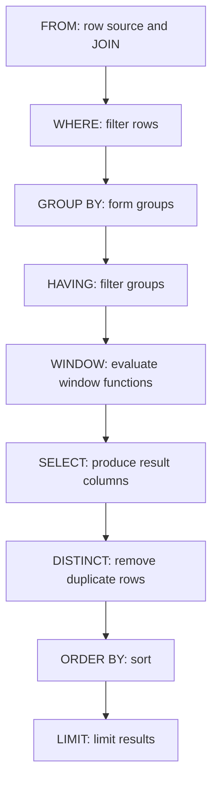

# SELECT Structure and Logical Processing Order of Clauses

`SELECT` is the central statement for reading data in MySQL. A query may simply retrieve a few columns from one table, combine multiple tables, filter rows, group data, perform calculations, sort, or limit the number of results. As queries grow longer, understanding the exact role and logical processing order of each clause helps you avoid alias errors, misplaced conditions, incorrect aggregations, and unstable pagination.

In SQL, the order in which clauses are written does not completely match the logical order in which the query is interpreted. For example, `SELECT` is written before `WHERE`, but logically MySQL determines the row source from `FROM` and filters rows with `WHERE` before building the output list in the select list. This is also why an alias declared in the select list cannot be used in the `WHERE` clause of the same query block.

This lesson presents the common `SELECT` query structure, the meaning of each clause, logical processing order, how to use aliases, data grouping, window functions, sorting, and pagination. The scope covers data-reading syntax and semantics in MySQL; advanced optimization techniques will be developed in the lessons on indexes and execution plans.

## Learning Objectives

After this lesson, you will be able to:

- Read and write a multi-clause `SELECT` structure in the correct syntactic order.
- Explain the roles of `FROM`, `WHERE`, `GROUP BY`, `HAVING`, `WINDOW`, `SELECT`, `DISTINCT`, `ORDER BY`, and `LIMIT`.
- Distinguish between statement writing order, logical processing order, and physical execution order chosen by the optimizer.
- Understand why an alias in the select list cannot be used in `WHERE` but can be used in `ORDER BY` and certain other clauses in MySQL.
- Choose the right placement for row-filtering conditions and group-filtering conditions.
- Use aggregate functions and window functions without miscounting rows or altering data granularity.
- Write queries with sorted and stable paginated results.

## 1. Common SELECT Syntax Skeleton

A query block typically has the following structure:

```sql
SELECT [DISTINCT] select_expression [, ...]
FROM source_table_or_expression
[WHERE row_condition]
[GROUP BY grouping_expression [, ...]]
[HAVING group_condition]
[WINDOW window_name AS (window_definition) [, ...]]
[ORDER BY sort_expression [ASC | DESC] [, ...]]
[LIMIT row_count [OFFSET offset]];
```

Clauses in square brackets are optional. A simple query may only need `SELECT`; when reading data from a table, `FROM` is usually included. Aggregate queries use `GROUP BY` and optionally `HAVING`; queries requiring sorting use `ORDER BY`; paginated queries commonly use `LIMIT`.

MySQL also supports other options such as `ALL`, `SQL_CALC_FOUND_ROWS` in older versions, `INTO`, and locking clauses like `FOR UPDATE`. These have their own syntax and purposes; the skeleton above focuses on the clauses that appear most frequently in data-reading queries.

You can run `SELECT` without a table:

```sql
SELECT 1 + 2 AS result,
       CURRENT_DATE() AS today;
```

MySQL does not require writing `FROM DUAL` for queries that do not read from a table. `SELECT 1` is valid.

## 2. Preparing Data Used in This Lesson

The following examples use two tables: customers and orders. Run them in your sandbox database:

```sql
CREATE TABLE select_customer (
    customer_id BIGINT UNSIGNED NOT NULL,
    customer_name VARCHAR(100) NOT NULL,
    city VARCHAR(60) NOT NULL,
    PRIMARY KEY (customer_id)
) ENGINE = InnoDB
  DEFAULT CHARACTER SET = utf8mb4;

CREATE TABLE select_order (
    order_id BIGINT UNSIGNED NOT NULL,
    customer_id BIGINT UNSIGNED NOT NULL,
    order_status VARCHAR(20) NOT NULL,
    ordered_at DATETIME(6) NOT NULL,
    total_amount DECIMAL(12,2) NOT NULL,
    PRIMARY KEY (order_id),
    KEY idx_select_order_customer (customer_id),
    KEY idx_select_order_ordered_at (ordered_at),
    CONSTRAINT fk_select_order_customer
        FOREIGN KEY (customer_id)
        REFERENCES select_customer (customer_id)
) ENGINE = InnoDB
  DEFAULT CHARACTER SET = utf8mb4;

INSERT INTO select_customer
    (customer_id, customer_name, city)
VALUES
    (1, 'Nguyen An', 'Hanoi'),
    (2, 'Tran Binh', 'Ho Chi Minh City'),
    (3, 'Le Chi', 'Hanoi'),
    (4, 'Pham Dung', 'Da Nang');

INSERT INTO select_order
    (order_id, customer_id, order_status, ordered_at, total_amount)
VALUES
    (101, 1, 'PAID',      '2025-01-10 09:15:00.100000', 120000.00),
    (102, 1, 'PENDING',   '2025-01-12 10:30:00.200000',  80000.00),
    (103, 2, 'PAID',      '2025-01-11 14:00:00.300000', 250000.00),
    (104, 3, 'CANCELLED', '2025-01-15 08:45:00.400000',  50000.00),
    (105, 2, 'PAID',      '2025-02-02 16:20:00.500000', 100000.00);
```

Customer 4 has no orders yet. This dataset helps illustrate the difference between queries reading only the customer table, join queries, and aggregate queries. The tables include primary keys and basic indexes so the example statements can run standalone.

## 3. SELECT List: Choosing Columns and Expressions to Return

The select list is the part immediately following the `SELECT` keyword. You can select columns, expressions, constants, functions, or combinations of those values:

```sql
SELECT
    customer_id,
    customer_name,
    city
FROM select_customer;
```

You should explicitly specify the required columns instead of always writing `SELECT *`. Listing columns helps readers see the result structure, reduces unnecessary data transfer, and avoids making the application depend on newly added columns in the table.

If all columns are needed, `*` is valid:

```sql
SELECT *
FROM select_customer;
```

In multi-table queries, use table names or aliases to clearly indicate the column source:

```sql
SELECT
    c.customer_id,
    c.customer_name,
    o.order_id,
    o.total_amount
FROM select_customer AS c
JOIN select_order AS o
    ON o.customer_id = c.customer_id;
```

If two tables have a column with the same name, such as `customer_id`, the prefix `c.` or `o.` avoids ambiguous column names and makes the query easier to read.

### 3.1. Expressions and Aliases

You can compute values in the select list:

```sql
SELECT
    order_id,
    total_amount,
    total_amount * 0.10 AS estimated_tax,
    total_amount * 1.10 AS amount_with_tax
FROM select_order;
```

An alias names a result column. It can be written using `AS`:

```sql
SELECT total_amount * 1.10 AS amount_after_tax
FROM select_order;
```

In MySQL, `AS` can be omitted in many cases:

```sql
SELECT total_amount * 1.10 amount_after_tax
FROM select_order;
```

You should use `AS` to clearly distinguish between the expression and the result column name. If an alias contains spaces or keywords, backticks may be required, though simple unaccented alias names that do not collide with keywords are easier to work with.

## 4. FROM: Determining the Row Source

`FROM` specifies the table, view, derived table, or data source that the query reads. A source can have an alias:

```sql
SELECT c.customer_name
FROM select_customer AS c;
```

A table alias shortens the name and is used in the remaining clauses of the query block. After defining the alias `c`, use `c.customer_name`; do not continue using the long name if doing so makes the statement harder to read.

The data source can be multiple combined tables:

```sql
SELECT
    c.customer_name,
    o.order_id,
    o.order_status
FROM select_customer AS c
INNER JOIN select_order AS o
    ON o.customer_id = c.customer_id;
```

The result only includes customers with matching orders due to the `INNER JOIN`. If you need to keep customers who have no orders yet, use `LEFT JOIN`:

```sql
SELECT
    c.customer_id,
    c.customer_name,
    o.order_id
FROM select_customer AS c
LEFT JOIN select_order AS o
    ON o.customer_id = c.customer_id
ORDER BY c.customer_id, o.order_id;
```

Customer 4 still appears, with the columns from `select_order` set to `NULL`. Details on join types and join conditions will be covered more deeply in the section on table join queries.

## 5. WHERE: Filtering Individual Rows Before Grouping

`WHERE` determines which rows are passed forward to the grouping and result-building steps. The `WHERE` condition is evaluated on the source data after `FROM` and before `GROUP BY`.

```sql
SELECT order_id, customer_id, total_amount
FROM select_order
WHERE order_status = 'PAID';
```

Only rows with status `PAID` are included in the result. You can combine conditions:

```sql
SELECT order_id, customer_id, total_amount
FROM select_order
WHERE order_status = 'PAID'
  AND total_amount >= 150000;
```

When mixing `AND` and `OR`, use parentheses to express intent clearly:

```sql
SELECT order_id, order_status, total_amount
FROM select_order
WHERE order_status = 'PAID'
  AND (total_amount >= 200000 OR customer_id = 1);
```

Do not rely on the reader remembering operator precedence. Parentheses prevent unintended logic changes when adding new conditions.

Common predicates include comparisons, `IN`, `BETWEEN`, `LIKE`, `IS NULL`, and logical operators. For `NULL`, use `IS NULL` or `IS NOT NULL`; do not write `column = NULL` because that comparison evaluates to `UNKNOWN`.

### 5.1. WHERE Cannot Use Same-Level Select List Aliases

The following example is invalid within the same query block:

```sql
SELECT
    total_amount * 1.10 AS amount_after_tax
FROM select_order
WHERE amount_after_tax > 200000;
```

The reason is that `WHERE` is logically processed before the select list creates the alias `amount_after_tax`. Repeat the expression instead:

```sql
SELECT
    total_amount * 1.10 AS amount_after_tax
FROM select_order
WHERE total_amount * 1.10 > 200000;
```

Or place the expression in a derived table and filter in the outer query:

```sql
SELECT calculated.amount_after_tax
FROM (
    SELECT total_amount * 1.10 AS amount_after_tax
    FROM select_order
) AS calculated
WHERE calculated.amount_after_tax > 200000;
```

A derived table creates a separate query block, so the alias becomes a column of the outer data source.

## 6. GROUP BY: Combining Rows into Groups

`GROUP BY` groups rows that share the same value in one or more expressions. After grouping, aggregate functions can compute a single result per group.

Example counting orders and summing revenue by customer:

```sql
SELECT
    customer_id,
    COUNT(*) AS order_count,
    SUM(total_amount) AS total_revenue,
    AVG(total_amount) AS average_order_value
FROM select_order
GROUP BY customer_id
ORDER BY customer_id;
```

Common aggregate functions:

| Function | Meaning |
|---|---|
| `COUNT(*)` | Counts the number of rows in the group |
| `COUNT(expression)` | Counts non-`NULL` values of the expression |
| `SUM(expression)` | Sums non-`NULL` values |
| `AVG(expression)` | Computes the average of non-`NULL` values |
| `MIN(expression)` | Minimum value |
| `MAX(expression)` | Maximum value |

Do not confuse `COUNT(*)` with `COUNT(column)`. If a column contains `NULL`, `COUNT(column)` does not count those rows; `COUNT(*)` still counts them.

### 6.1. Column Rules in SELECT with GROUP BY

When using `GROUP BY`, each expression in the select list generally must be:

- An expression present in `GROUP BY`.
- An aggregate function such as `COUNT()`, `SUM()`, or `MAX()`.
- An expression validly functionally dependent on the grouping columns under MySQL rules, such as a column uniquely determined by the grouping key.

Example to avoid:

```sql
SELECT customer_id, order_status, SUM(total_amount)
FROM select_order
GROUP BY customer_id;
```

A customer can have multiple order statuses. MySQL cannot pick a single meaningful `order_status` for each customer group. With `ONLY_FULL_GROUP_BY` enabled (the default in MySQL 8.0), this query is typically rejected.

If you want to aggregate by both customer and status, add the status to the grouping:

```sql
SELECT
    customer_id,
    order_status,
    SUM(total_amount) AS amount_by_status
FROM select_order
GROUP BY customer_id, order_status
ORDER BY customer_id, order_status;
```

Do not disable `ONLY_FULL_GROUP_BY` just to make a query run. Determine the exact level of granularity each result row should represent.

### 6.2. GROUP BY and Aliases in MySQL

MySQL allows referencing select list aliases in `GROUP BY`:

```sql
SELECT
    YEAR(ordered_at) AS order_year,
    COUNT(*) AS order_count
FROM select_order
GROUP BY order_year;
```

This is a MySQL convenience feature. However, when an alias matches a source column name or when the query needs portability across multiple database systems, write the expression explicitly or use a derived table to reduce confusion.

## 7. HAVING: Filtering After Groups Are Formed

`HAVING` filters groups after `GROUP BY`. It commonly uses conditions with aggregate functions:

```sql
SELECT
    customer_id,
    COUNT(*) AS order_count,
    SUM(total_amount) AS total_revenue
FROM select_order
WHERE order_status <> 'CANCELLED'
GROUP BY customer_id
HAVING SUM(total_amount) >= 200000
ORDER BY total_revenue DESC;
```

`WHERE` excludes cancelled rows before grouping; `HAVING` only keeps groups whose total amount meets the threshold. These two clauses are not interchangeable:

| Clause | Logical Timing | Used For |
|---|---|---|
| `WHERE` | Before `GROUP BY` | Filtering individual source rows |
| `HAVING` | After `GROUP BY` | Filtering groups or aggregated results |

MySQL allows using select list aliases in `HAVING`:

```sql
SELECT
    customer_id,
    SUM(total_amount) AS total_revenue
FROM select_order
GROUP BY customer_id
HAVING total_revenue >= 200000;
```

However, to avoid confusion when an alias shares the same name as a column or when porting queries across database systems, you can repeat the aggregate expression or use an outer query block.

Do not put all conditions into `HAVING`. If a condition depends only on individual rows, put it in `WHERE` to eliminate data early according to the query's semantics and give the optimizer an opportunity to reduce the number of rows to group.

### 7.1. HAVING Without GROUP BY

MySQL allows `HAVING` in a query without `GROUP BY`. When there is an aggregate function without an explicit grouping, all input rows are treated as a single group:

```sql
SELECT SUM(total_amount) AS all_order_amount
FROM select_order
HAVING SUM(total_amount) > 0;
```

The query returns one row if the sum is greater than 0; if the condition is false, no rows are returned. In non-aggregate queries, `HAVING` may also be accepted by MySQL, but `WHERE` is usually the clearer place for row-filtering conditions.

## 8. WINDOW: Defining Windows for Window Functions

Window functions compute values across a set of rows related to the current row without collapsing rows into a single row like `GROUP BY` does. For example, you can compute a running total per customer while keeping each order as its own row.

`WINDOW` lets you name a window specification for reuse:

```sql
SELECT
    order_id,
    customer_id,
    ordered_at,
    total_amount,
    SUM(total_amount) OVER customer_order_window AS running_total
FROM select_order
WINDOW customer_order_window AS (
    PARTITION BY customer_id
    ORDER BY ordered_at, order_id
    ROWS BETWEEN UNBOUNDED PRECEDING AND CURRENT ROW
)
ORDER BY customer_id, ordered_at, order_id;
```

- `PARTITION BY customer_id` divides the data into a separate window for each customer.
- `ORDER BY ordered_at, order_id` defines the row order within each window.
- The frame `ROWS BETWEEN UNBOUNDED PRECEDING AND CURRENT ROW` spans from the first row of the window up to the current row.
- `SUM() OVER ...` computes the running total without losing individual order rows.

Window functions are logically processed after `WHERE`, `GROUP BY`, and `HAVING`. Therefore, you cannot use a window result directly in the `WHERE` clause of the same query block:

```sql
-- Invalid: running_total does not exist yet at the WHERE step
SELECT
    order_id,
    SUM(total_amount) OVER (ORDER BY ordered_at) AS running_total
FROM select_order
WHERE running_total > 200000;
```

To filter by a window result, place the query in a CTE or derived table:

```sql
WITH order_running_total AS (
    SELECT
        order_id,
        customer_id,
        ordered_at,
        total_amount,
        SUM(total_amount) OVER (
            PARTITION BY customer_id
            ORDER BY ordered_at, order_id
            ROWS BETWEEN UNBOUNDED PRECEDING AND CURRENT ROW
        ) AS running_total
    FROM select_order
)
SELECT *
FROM order_running_total
WHERE running_total > 200000
ORDER BY customer_id, ordered_at, order_id;
```

The outer query block receives `running_total` as a source column, so it can filter with `WHERE`. CTEs are supported starting in MySQL 8.0.

## 9. SELECT: Producing Output Expressions

After the row source has been determined, filtered, grouped, and window-processed according to logical semantics, the select list specifies the columns and expressions to return. Example:

```sql
SELECT
    customer_id,
    COUNT(*) AS order_count,
    SUM(total_amount) AS total_revenue,
    ROUND(AVG(total_amount), 2) AS average_order_value
FROM select_order
WHERE order_status = 'PAID'
GROUP BY customer_id;
```

Each result row represents a customer with at least one paid order. The select list can contain grouping columns, aggregate expressions, constants, and expressions calculated from grouped results.

In queries with window functions, the select list can also contain window function values alongside detail columns:

```sql
SELECT
    order_id,
    total_amount,
    AVG(total_amount) OVER () AS average_all_orders
FROM select_order;
```

This query still returns one row per order; the average value is repeated on each row.

## 10. DISTINCT: Removing Duplicate Result Rows

`DISTINCT` removes duplicate rows across the selected set of columns:

```sql
SELECT DISTINCT city
FROM select_customer
ORDER BY city;
```

The result contains each city once. If the select list has multiple columns, MySQL removes duplicates across the entire combination of selected columns:

```sql
SELECT DISTINCT city, customer_name
FROM select_customer
ORDER BY city, customer_name;
```

Two customers in the same city with different names still produce two distinct result rows. `DISTINCT` does not mean "take only unique values of the first column".

### 10.1. DISTINCT and Aggregate Functions

You can use `DISTINCT` inside an aggregate function:

```sql
SELECT COUNT(DISTINCT customer_id) AS customers_with_orders
FROM select_order;
```

This counts how many distinct customers have orders. It differs from `SELECT DISTINCT customer_id ...`, which returns the list of customer IDs.

### 10.2. DISTINCT Does Not Replace GROUP BY

If you need to compute sums or counts per group, use `GROUP BY`. If you only need to eliminate duplicate rows in the output, use `DISTINCT`. Do not add both mechanically; decide beforehand what granularity the output needs to represent.

## 11. ORDER BY: Defining Result Order

SQL does not guarantee row order if a query has no `ORDER BY`. Even if one execution appears to return rows in primary key or insertion order, that is not a contract of the query.

`ORDER BY` can sort by columns, expressions, or output aliases:

```sql
SELECT
    order_id,
    total_amount,
    total_amount * 1.10 AS amount_after_tax
FROM select_order
ORDER BY amount_after_tax DESC, order_id ASC;
```

- `ASC` is ascending and is the default.
- `DESC` is descending.
- You can sort by multiple expressions; subsequent expressions break ties among rows with equal values in preceding expressions.

MySQL allows aliases in `ORDER BY` because the logical sort step occurs after the select list. Column positions can also be used, such as `ORDER BY 2 DESC`, but this easily breaks when the select list changes; prefer explicit alias names or expressions.

### 11.1. Stable Sorting

If multiple rows share the same `ordered_at`, sorting only by timestamp leaves the order among rows with identical timestamps undefined. Add a unique key as a tie-breaker:

```sql
SELECT order_id, customer_id, ordered_at
FROM select_order
ORDER BY ordered_at DESC, order_id DESC;
```

This ordering can serve as the foundation for stable pagination. Without a tie-breaker, separate runs or pages may yield different ordering for rows with equal sort values.

### 11.2. Sorting NULLs

In MySQL, when sorting ascending, `NULL` values usually appear before non-null values; when sorting descending, `NULL` values usually appear after. If you need a different rule, write an explicit sort expression, such as:

```sql
ORDER BY (optional_value IS NULL), optional_value ASC;
```

The expression `(optional_value IS NULL)` places non-null rows first because false (0) comes before true (1).

## 12. LIMIT: Limiting the Number of Returned Rows

`LIMIT` restricts the number of result rows after logical sorting:

```sql
SELECT order_id, ordered_at, total_amount
FROM select_order
ORDER BY ordered_at DESC, order_id DESC
LIMIT 3;
```

MySQL supports two ways to write an offset:

```sql
LIMIT row_count OFFSET offset
```

or:

```sql
LIMIT offset, row_count
```

For example, fetching the second page with two rows per page:

```sql
SELECT order_id, ordered_at, total_amount
FROM select_order
ORDER BY ordered_at DESC, order_id DESC
LIMIT 2 OFFSET 2;
```

Always combine `LIMIT` with `ORDER BY` if the application requires deterministic results. Without `ORDER BY`, MySQL can return any set of rows matching the query; a subsequent run may return different rows.

### 12.1. Offset Pagination and Keyset Pagination

Offset pagination is simple, but large offsets can force MySQL to read and discard many rows before returning the requested page. For a list ordered by a key, keyset pagination can start from the last value of the previous page:

```sql
SELECT order_id, ordered_at, total_amount
FROM select_order
WHERE (ordered_at, order_id) < (?, ?)
ORDER BY ordered_at DESC, order_id DESC
LIMIT 20;
```

The two parameters are the `(ordered_at, order_id)` pair from the last row of the previous page. Because `order_id` is a unique key, the pair produces a stable pagination order. Row constructor comparison is supported by MySQL; for complex conditions or explicit control, you can write the equivalent:

```sql
WHERE ordered_at < ?
   OR (ordered_at = ? AND order_id < ?)
```

The appropriate index for keyset pagination depends on the actual filters and ordering; verify with `EXPLAIN`. Keyset pagination is especially useful when users step sequentially through large lists.

## 13. Logical Processing Order of SELECT

The written order of a statement typically begins with `SELECT`, whereas the common logical processing order of a query block is:

1. `FROM`: identify the data source and build the input row set, including join processing.
2. `WHERE`: filter individual source rows.
3. `GROUP BY`: group remaining rows into groups.
4. `HAVING`: filter groups after aggregation.
5. `WINDOW`: define windows and evaluate window functions over the appropriate row sets.
6. `SELECT`: produce output expressions and columns.
7. `DISTINCT`: eliminate duplicate output rows if requested.
8. `ORDER BY`: sort the result set.
9. `LIMIT`: restrict the number of rows returned.

Here, `WINDOW` describes the logical phase of window processing; the `WINDOW` clause in SQL syntax is where named window specifications are defined. Not every query uses all steps. For example, an ungrouped query skips `GROUP BY` and `HAVING`; a non-paginated query does not need `LIMIT`.

Overview diagram:



This order explains several important rules:

- `WHERE` cannot see aliases created in the select list of the same query block.
- `HAVING` can filter aggregated results and in MySQL can reference select list aliases.
- `ORDER BY` can use select list aliases.
- Window functions cannot be filtered directly by a same-level `WHERE` clause because they are evaluated after the row-filtering step.
- `LIMIT` only caps the output after the query has determined the result set and logical order.

## 14. Logical Order Is Not Physical Execution Order

Logical processing order is a model for understanding query results and name/alias visibility rules. It does **not** mean MySQL must execute each step sequentially in the exact order listed above.

The MySQL optimizer can transform the physical plan to reduce cost while preserving SQL semantics, for example:

- Pushing a filter predicate closer to the source table when the transformation is valid.
- Choosing a join order different from the order tables are written in the query.
- Using an index to locate rows instead of scanning the entire table.
- Computing or materializing a derived table/CTE depending on optimization capabilities and query characteristics.
- Using a temporary table or filesort when needed for grouping, deduplication, or sorting.

Therefore, use logical order to write correct queries and understand alias scope; use `EXPLAIN` or `EXPLAIN ANALYZE` to inspect the actual physical plan. Do not assume that because `WHERE` appears after `SELECT` in text, MySQL must evaluate every select list expression before filtering rows.

## 15. Which Clauses Can Use Aliases?

In MySQL, select list aliases can be referenced in certain clauses, though not everywhere:

| Clause | Use same-query-block select list alias? | Explanation |
|---|---|---|
| `WHERE` | No | Logical filtering happens before the select list creates aliases |
| `GROUP BY` | Yes | MySQL supports aliases as a convenience |
| `HAVING` | Yes | Can filter by the alias of a result expression |
| `ORDER BY` | Yes | Sorting happens after the select list determines outputs |
| Same-level `SELECT` | Should not be relied upon | Cannot use a newly created alias as a variable in another same-level select list expression |

Valid example:

```sql
SELECT
    customer_id,
    SUM(total_amount) AS revenue
FROM select_order
GROUP BY customer_id
HAVING revenue > 100000
ORDER BY revenue DESC;
```

Invalid example because `WHERE` cannot see the alias:

```sql
SELECT total_amount * 1.10 AS gross_amount
FROM select_order
WHERE gross_amount > 200000;
```

If you need to reuse an expression multiple times, consider a derived table or CTE:

```sql
WITH order_amounts AS (
    SELECT
        order_id,
        total_amount * 1.10 AS gross_amount
    FROM select_order
)
SELECT order_id, gross_amount
FROM order_amounts
WHERE gross_amount > 200000
ORDER BY gross_amount DESC;
```

The CTE clarifies the boundary between the two query blocks: the `gross_amount` alias is created inside and becomes a source column for the outer query.

## 16. Comprehensive Multi-Clause Example

The following query retrieves total paid revenue by customer in January 2025, keeping only customers with revenue of 100,000 or more, sorted by descending revenue and limited to three rows:

```sql
SELECT
    c.customer_id,
    c.customer_name,
    COUNT(o.order_id) AS paid_order_count,
    SUM(o.total_amount) AS paid_revenue
FROM select_customer AS c
JOIN select_order AS o
    ON o.customer_id = c.customer_id
WHERE o.order_status = 'PAID'
  AND o.ordered_at >= '2025-01-01 00:00:00'
  AND o.ordered_at <  '2025-02-01 00:00:00'
GROUP BY c.customer_id, c.customer_name
HAVING SUM(o.total_amount) >= 100000
ORDER BY paid_revenue DESC, c.customer_id ASC
LIMIT 3;
```

You can read the query according to its logical meaning:

1. `FROM` and `JOIN` build the row source from customers and orders.
2. `WHERE` keeps only `PAID` orders in January 2025.
3. `GROUP BY` creates one group per customer.
4. `HAVING` keeps only groups whose total revenue meets the threshold.
5. `SELECT` produces order count and total revenue for each group.
6. `ORDER BY` sorts by revenue, then by ID as a tie-breaker.
7. `LIMIT` returns at most three rows.

This example also shows that time conditions should use half-open intervals, while the status condition is a row-filtering condition and belongs in `WHERE`. The lesson on time-range filtering and indexes covers writing index-friendly time conditions in more depth.

## 17. Common Mistakes When Writing SELECT

- Putting row-filtering conditions into `HAVING` when no aggregation is needed, making the query intent harder to read and potentially filtering later than necessary.
- Putting aggregate conditions like `SUM(amount) > ...` in `WHERE`; aggregate functions must be filtered in `HAVING` or an outer query block.
- Using a select list alias in a same-level `WHERE` clause and getting an unknown column error.
- Selecting non-grouped and non-aggregated columns when `ONLY_FULL_GROUP_BY` is enabled.
- Assuming `GROUP BY` automatically sorts results; write `ORDER BY` when ordering is required.
- Assuming results always follow primary key order without `ORDER BY`.
- Using `DISTINCT` while selecting extra columns that keep rows distinct across the full select list.
- Using `LIMIT` without stable ordering and seeing duplicated or skipped rows across pages.
- Using `SELECT *` in long-lived APIs, coupling the application to every column in the table.
- Confusing logical order with the physical execution plan and concluding the optimizer must process steps sequentially as shown in the diagram.

## 18. Checklist for Reading and Writing a SELECT Statement

- Identified the source row set and tables involved in `FROM`.
- Assigned clear table aliases and qualified columns with matching names.
- Selected the right columns/expressions in the select list with clear aliases where needed.
- Placed individual row-filtering conditions in `WHERE`.
- Used `GROUP BY` at the exact granularity required for aggregation.
- Verified non-aggregated columns in the select list comply with `ONLY_FULL_GROUP_BY` rules.
- Used `HAVING` for group or aggregate result filtering.
- Determined whether window functions are needed to preserve detail rows.
- Understood that `DISTINCT` applies across the entire selected result row.
- Included `ORDER BY` if result order matters; added a unique tie-breaker when stability is required.
- Used `LIMIT` with appropriate ordering if the query paginates.
- Distinguished logical order from the physical plan and used `EXPLAIN` when evaluating performance.

`SELECT` is a chain of clauses, each with a distinct role: row source, row filtering, grouping, group filtering, window processing, output column generation, deduplication, sorting, and result limiting. Understanding logical order tells you where each condition belongs and which aliases can be referenced; understanding the difference from physical execution keeps you from guessing how the optimizer runs the query. When each clause is written clearly and ordering is always specified where stability is needed, queries become easier to read, verify, and optimize.
