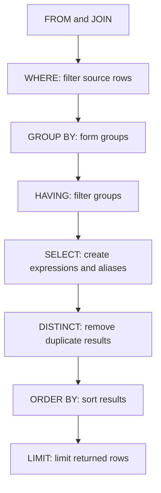

# Alias Resolution Rules in WHERE, GROUP BY, and ORDER BY

In a `SELECT` statement, we commonly assign aliases to expressions to make output easier to read, such as `SUM(total_amount) AS revenue` or `YEAR(created_at) AS order_year`. Aliases can be referenced in clauses such as `GROUP BY`, `HAVING`, and `ORDER BY` in MySQL, but cannot be used directly in `WHERE` of the same query level. Additionally, when an alias shares the same name as a source column, MySQL applies different precedence rules between `ORDER BY` and `GROUP BY`/`HAVING`.

Understanding alias scope and resolution order helps avoid `Unknown column` errors, prevents grouping or sorting by the wrong column, and produces clearer SQL for **DATABASE_MYSQL** applications.

## 1. What Is a Column Alias in SELECT?

An alias names an expression in the `SELECT` list. You can use the `AS` keyword for clarity:

```sql
SELECT
    order_id,
    quantity * unit_price AS line_total
FROM order_items;
```

In the result, the expression column `quantity * unit_price` is named `line_total`. `AS` can be omitted in many cases, but should be written explicitly so a missing comma is not parsed as an alias:

```sql
-- If selecting two columns, a comma is mandatory
SELECT order_id, quantity
FROM orders;

-- If giving an alias to a column, write AS explicitly
SELECT order_id AS order_number
FROM orders;

-- If you forget the comma, quantity is interpreted as an alias for order_id
SELECT order_id quantity
FROM orders;
```

An alias only renames the column in the query's result set. It does not rename the real column in the table and does not create a new physical column.

## 2. Which Clauses Can Reference an Alias?

In MySQL, an alias of a `SELECT` expression can be used in `GROUP BY`, `HAVING`, and `ORDER BY`. That alias cannot be used in `WHERE` of the same query block.

| Clause | Use same-level SELECT alias? | Purpose |
|---|---|---|
| `WHERE` | No | Filters source rows before grouping and computing output expressions |
| `GROUP BY` | Yes, via MySQL extension | Groups rows by an aliased expression |
| `HAVING` | Yes, via MySQL extension | Filters groups, typically based on aggregated results |
| `ORDER BY` | Yes | Sorts output by an alias |

Example of an alias used in both `GROUP BY` and `ORDER BY`:

```sql
SELECT
    YEAR(created_at) AS order_year,
    COUNT(*) AS order_count
FROM orders
GROUP BY order_year
ORDER BY order_year;
```

MySQL allows `order_year` to reference the expression `YEAR(created_at)` in `GROUP BY` and `ORDER BY`. Using distinct alias names that do not collide with source column names keeps SQL readable and avoids resolution conflicts.

## 3. Why Cannot an Alias Be Used in WHERE?

`WHERE` filters input rows before expressions in the `SELECT` list are defined in query semantics. Therefore, an alias created in `SELECT` is not yet within the scope that `WHERE` can reference.

The following example is invalid:

```sql
SELECT
    quantity * unit_price AS line_total
FROM order_items
WHERE line_total > 1000;
```

MySQL may report `Unknown column 'line_total' in 'where clause'`. There are two valid ways to write this depending on your goal.

**Approach 1: Rewrite the expression in WHERE**

```sql
SELECT
    quantity * unit_price AS line_total
FROM order_items
WHERE quantity * unit_price > 1000;
```

**Approach 2: Wrap the query in a derived table or CTE**

```sql
SELECT
    item_totals.line_total
FROM (
    SELECT quantity * unit_price AS line_total
    FROM order_items
) AS item_totals
WHERE item_totals.line_total > 1000;
```

In the outer query, `line_total` is already a column of the derived table `item_totals`, so `WHERE` can reference it like any ordinary input column.

With a CTE in MySQL 8.0 and later:

```sql
WITH item_totals AS (
    SELECT
        order_item_id,
        quantity * unit_price AS line_total
    FROM order_items
)
SELECT order_item_id, line_total
FROM item_totals
WHERE line_total > 1000;
```

There is no need to create a CTE merely to avoid repeating a short expression. Derived tables/CTEs are useful when expressions are complex, reused multiple times, or when computation steps should be cleanly separated.

## 4. Using Aliases in GROUP BY

MySQL allows using aliases in `GROUP BY`, although this is an extension beyond standard SQL. Example computing monthly revenue:

```sql
SELECT
    DATE_FORMAT(created_at, '%Y-%m') AS order_month,
    SUM(total_amount) AS revenue
FROM orders
GROUP BY order_month
ORDER BY order_month;
```

`order_month` represents the expression `DATE_FORMAT(created_at, '%Y-%m')`. The query is semantically equivalent to repeating the expression:

```sql
SELECT
    DATE_FORMAT(created_at, '%Y-%m') AS order_month,
    SUM(total_amount) AS revenue
FROM orders
GROUP BY DATE_FORMAT(created_at, '%Y-%m')
ORDER BY order_month;
```

If compatibility with other SQL engines is required, verify alias support in `GROUP BY`; repeating the expression or using a derived table/CTE is usually more portable.

Do not rely on column positions in `GROUP BY` such as `GROUP BY 1`. Although MySQL supports ordinal references in some contexts, they are hard to read and break silently when the `SELECT` list changes. Use explicit expressions or clearly named aliases.

## 5. Using Aliases in HAVING

`HAVING` filters groups after `GROUP BY` forms them. MySQL allows referencing aggregate expression aliases in `HAVING`:

```sql
SELECT
    customer_id,
    SUM(total_amount) AS revenue
FROM orders
GROUP BY customer_id
HAVING revenue > 100000
ORDER BY revenue DESC;
```

Here:

- `WHERE` (if present) filters input orders, such as keeping only `PAID` orders.
- `GROUP BY` groups orders by customer.
- `SUM()` calculates revenue for each group.
- `HAVING revenue > 100000` retains only groups whose revenue exceeds the threshold.
- `ORDER BY revenue DESC` sorts groups by descending revenue.

Combined example:

```sql
SELECT
    customer_id,
    SUM(total_amount) AS revenue
FROM orders
WHERE status = 'PAID'
GROUP BY customer_id
HAVING revenue >= 500000
ORDER BY revenue DESC;
```

MySQL supports aliases in `HAVING` as an extension. For greater portability, rewrite the condition with the aggregate expression:

```sql
HAVING SUM(total_amount) >= 500000
```

Do not use `HAVING` in place of `WHERE` when a condition only filters source rows. For instance, filtering order status belongs in `WHERE`, reducing the number of rows to group and giving the optimizer a chance to apply indexes earlier.

## 6. Using Aliases in ORDER BY

`ORDER BY` can reference aliases of expressions in the `SELECT` list:

```sql
SELECT
    order_id,
    quantity * unit_price AS line_total
FROM order_items
ORDER BY line_total DESC;
```

You can sort by multiple aliases:

```sql
SELECT
    customer_id,
    COUNT(*) AS order_count,
    SUM(total_amount) AS revenue
FROM orders
GROUP BY customer_id
ORDER BY revenue DESC, order_count DESC, customer_id ASC;
```

If multiple rows share equal sort values, add a unique key as a tie-breaker such as `customer_id` so the result order is stable. An alias only names an expression; it does not make ordering deterministic when sort keys tie.

## 7. When an Alias Matches a Source Column Name: Precedence Rules

This is a case that easily produces subtle bugs. MySQL does not apply the exact same name-lookup order across every clause:

- In `ORDER BY`, MySQL searches expressions in the `SELECT` list first, then searches columns in `FROM`.
- In `GROUP BY` and `HAVING`, MySQL searches columns in `FROM` first, then searches aliases in the `SELECT` list.

Thus, the same unqualified name can resolve to two different expressions depending on the clause.

### Example of an Alias Matching the Primary Key Name

Suppose table `demo` has two columns `id` and `code`, where `id` is the primary key:

```sql
CREATE TABLE demo (
    id INT NOT NULL PRIMARY KEY,
    code INT NOT NULL
);

INSERT INTO demo (id, code)
VALUES (1, 90), (2, 20), (3, 50);
```

Consider the query:

```sql
SELECT
    code AS id,
    COUNT(*) AS row_count
FROM demo
GROUP BY id
ORDER BY id;
```

The name `id` is used in two clauses with two different meanings:

- `GROUP BY id` resolves to column `demo.id` from `FROM`, because source columns take precedence in `GROUP BY`.
- `ORDER BY id` resolves to the alias `code AS id` in the `SELECT` list, because aliases take precedence in `ORDER BY`.

This query groups by primary key `demo.id`, so each group has one row; results are then sorted by the `code` values output under the name `id`. This is valid syntax but surprising to read. Avoid giving aliases the same names as source columns.

### How to Make Intent Explicit

If you intend to reference a source column, qualify it with the table name:

```sql
GROUP BY demo.id
```

If you intend to use an alias, choose a name that does not collide with any source column:

```sql
SELECT
    code AS displayed_code,
    COUNT(*) AS row_count
FROM demo
GROUP BY demo.id
ORDER BY displayed_code;
```

Clear alias names and qualified source columns let readers know exactly which expression is being grouped or sorted.

## 8. Ambiguity in GROUP BY and HAVING

When an unqualified name appears as both a source table column and a `SELECT`-list alias, `GROUP BY` and `HAVING` prioritize the column in `FROM`. When `HAVING` has an ambiguous name between a grouped column and an alias, MySQL may emit a warning; precedence goes to the column used in `GROUP BY`.

For example, if table `payments` has a column `amount` and a query assigns another alias also named `amount`, readers cannot easily tell which one later clauses refer to:

```sql
SELECT
    ABS(amount) AS amount,
    COUNT(*) AS payment_count
FROM payments
GROUP BY amount
HAVING amount > 0;
```

In `GROUP BY` and `HAVING`, `amount` is looked up in the source table first. Do not rely on MySQL guessing the author's intent. Rename the alias, such as `absolute_amount`, or explicitly qualify the source column as `payments.amount`.

Practical naming guidelines:

- Do not give aliases the same names as columns in tables in `FROM`.
- Use meaningful prefixes or suffixes for aggregate expressions, such as `total_revenue`, `order_count`, `normalized_name`.
- When querying multiple tables with shared column names, always qualify with `table_alias.column_name`.
- If a query is complex, break it into a CTE/derived table with a clear output column schema.

## 9. Quoting Aliases Properly

MySQL allows aliases containing spaces or special characters via identifier quoting. Example:

```sql
SELECT SUM(total_amount) AS `Total revenue`
FROM orders;
```

When referencing that alias in another clause, use backticks or unquoted identifier syntax:

```sql
SELECT SUM(total_amount) AS `Total revenue`
FROM orders
ORDER BY `Total revenue` DESC;
```

Do not use single quotes to reference an alias in `GROUP BY` or `ORDER BY`:

```sql
-- 'revenue' is a string literal, not an alias reference
SELECT SUM(total_amount) AS revenue
FROM orders
GROUP BY 'revenue';
```

In an alias reference position, single quotes denote a string literal. Use backtick identifier quoting if the alias needs quoting. Best of all, keep aliases short, free of spaces, and unquoted so SQL remains easy to read.

## 10. Aliases Cannot Be Used in Other Expressions in the Same SELECT List

An alias of one select expression is not an intermediate variable available to subsequent select expressions in the same list:

```sql
-- Invalid in MySQL
SELECT
    quantity * unit_price AS line_total,
    line_total * 0.1 AS tax_amount
FROM order_items;
```

To reuse the calculation, repeat the expression:

```sql
SELECT
    quantity * unit_price AS line_total,
    quantity * unit_price * 0.1 AS tax_amount
FROM order_items;
```

Or wrap the expression in a derived table or CTE:

```sql
SELECT
    item_totals.line_total,
    item_totals.line_total * 0.1 AS tax_amount
FROM (
    SELECT
        order_item_id,
        quantity * unit_price AS line_total
    FROM order_items
) AS item_totals;
```

In the outer query, `line_total` is an input column from the derived table and can be used in other expressions.

## 11. Logical Processing Order and Understanding Aliases

To understand why aliases are unavailable in `WHERE`, visualize the general logical processing order of a query as follows:



This is a semantic model for reasoning about expression scope, not a claim that the optimizer always executes physically step-by-step in diagram order. The optimizer can transform the plan for efficiency while preserving query semantics.

MySQL includes an extension allowing `GROUP BY` and `HAVING` to reference aliases even though semantically the `SELECT` list is formed after those clauses. Remember that this is a MySQL name-resolution rule—do not infer that aliases exist in every clause merely because they are declared in `SELECT`.

## 12. Checklist When a Query Reports Unknown Column or Mis-Groups/Mis-Sorts

1. Check whether the alias is declared in the right query block.
2. If the error appears in `WHERE`, replace the alias with the original expression or wrap the query in a CTE/derived table.
3. If using an alias in `GROUP BY`/`HAVING`, check whether a source column shares the same name; columns in `FROM` take precedence.
4. If using an alias in `ORDER BY`, remember that aliases in `SELECT` take precedence over source columns.
5. Qualify source columns with `table_alias.column_name` when multiple tables or ambiguous names are involved.
6. Avoid aliases colliding with column names, duplicate alias names, or unnecessary spaces in aliases.
7. Use backticks when identifier quoting is needed; never use single quotes to reference an alias.
8. Use `HAVING` only for group-filtering conditions; place row-filtering conditions in `WHERE`.
9. If portability to other database systems is needed, review MySQL extensions such as aliases in `GROUP BY` and `HAVING`.

## 13. Practice Exercises

Assume tables `orders(order_id, customer_id, status, total_amount, created_at)` and `order_items(order_item_id, order_id, quantity, unit_price)`.

1. Create an alias `line_total` for `quantity * unit_price`; try using the alias in `WHERE` and observe the error.
2. Rewrite the condition using the original expression, then rewrite it using a derived table to filter by `line_total`.
3. Build a revenue report by customer with alias `revenue`; use the alias in `HAVING` and `ORDER BY`.
4. Create an alias `order_month` from `DATE_FORMAT(created_at, '%Y-%m')`; use the alias in `GROUP BY` and `ORDER BY`.
5. Create a test table with two columns `id` and `code`; run `SELECT code AS id ... GROUP BY id ORDER BY id` to observe the differing precedence rules.
6. Rename the alias so it does not collide with the source column, qualify the column with a table alias, and compare query clarity.
7. Try an alias containing a space; reference it with backticks and then with single quotes to distinguish identifiers from string literals.

You have completed this lesson when you know exactly which aliases are valid in each clause, can explain the difference in name-resolution order between `ORDER BY` and `GROUP BY`/`HAVING`, and can rewrite queries when an alias is not yet in scope. Choose unique, meaningful aliases that do not collide with source column names so your SQL stays readable and maintainable.
