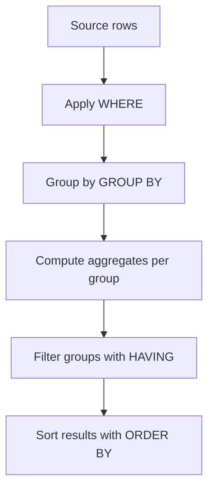

# GROUP BY Single Column, Composite Keys, or Expressions

`GROUP BY` groups rows that share the same values across one or more grouping keys to compute counts, sums, averages, or other metrics. The choice of grouping keys determines the granularity of the report: grouping by customer produces one row per customer; grouping by customer and status produces one row per combination; grouping by a date expression can produce one row per month or per day.

If you omit a necessary grouping key, groups can be merged incorrectly for the business logic. If you add too many keys, a report meant to have one row per customer gets split into many smaller rows. Therefore, before writing SQL, clearly define what a single result row represents.

This lesson belongs to the **DATABASE_MYSQL** module. The module aims to master MySQL from table design, data types, keys, and SQL queries to indexes, transactions, and concurrency control, while practicing execution plan reading, query optimization, privilege management, backups, and troubleshooting relational database operations. In the **Aggregation and Set Operations** chapter, this lesson focuses on choosing grouping keys from a single column, multiple columns, or expressions so aggregated results accurately reflect business semantics.

## 1. Which Groups Does GROUP BY Create?

`GROUP BY` divides the input row set into groups based on the values of the specified list of expressions. Each unique combination of grouping values forms one output group. Aggregate functions such as `COUNT()`, `SUM()`, `AVG()`, `MIN()`, and `MAX()` are evaluated over the rows belonging to each group.



Example `orders` table:

| order_id | tenant_id | customer_id | status | total_amount |
|---:|---:|---:|---|---:|
| 1001 | 1 | 101 | PAID | 250000 |
| 1002 | 1 | 101 | SHIPPED | 180000 |
| 1003 | 1 | 102 | PAID | 420000 |
| 1004 | 2 | 101 | PAID | 90000 |
| 1005 | 2 | 101 | CANCELLED | 50000 |

Query:

```sql
SELECT
    tenant_id,
    customer_id,
    COUNT(*) AS order_count,
    SUM(total_amount) AS revenue
FROM orders
GROUP BY tenant_id, customer_id;
```

The result has one row for each `(tenant_id, customer_id)` combination. Customer 101 appears in both tenant 1 and tenant 2, so those two groups are not merged together.

## 2. Define the Grain Before Choosing Grouping Keys

**Grain** is the level of detail that each output row represents. This is the most important decision when designing an aggregate report.

For example, the same `orders` table can produce different reports:

| Requirement | Result grain | Suggested grouping key |
|---|---|---|
| Total revenue per tenant | One row per tenant | `tenant_id` |
| Total revenue per customer within each tenant | One row per tenant and customer | `tenant_id, customer_id` |
| Order count by status | One row per status | `status` |
| Order count by customer and status | One row per customer within each status | `customer_id, status`, or add `tenant_id` for multi-tenant data |
| Monthly revenue | One row per month | `YEAR(created_at), MONTH(created_at)` |
| Revenue per customer in each month | One row per customer and month | `customer_id` plus month expression; add `tenant_id` if needed |

Phrase the requirement as "each result row represents ..." before writing `GROUP BY`. If you cannot complete this sentence yet, the grouping key is usually not well defined.

## 3. GROUP BY a Single Column

This is the simplest case: one group for each distinct value of a single column.

```sql
SELECT
    status,
    COUNT(*) AS order_count,
    SUM(total_amount) AS total_revenue
FROM orders
GROUP BY status
ORDER BY status;
```

The result has one row per status. All `PAID` orders belong to the same group, `SHIPPED` orders belong to another group, and so on.

### 3.1. Counting Rows by an Attribute

```sql
SELECT
    customer_id,
    COUNT(*) AS order_count
FROM orders
GROUP BY customer_id
ORDER BY order_count DESC, customer_id;
```

This query shows how many orders each customer has. `COUNT(*)` counts every row in the group, even when any column contains `NULL`.

If you want to count non-`NULL` values of a column, use `COUNT(column)`:

```sql
SELECT
    customer_id,
    COUNT(shipped_at) AS shipped_order_count
FROM orders
GROUP BY customer_id;
```

`COUNT(shipped_at)` only counts rows where `shipped_at` is not `NULL`; it does not necessarily equal the total number of orders.

### 3.2. Grouping by One Column with Multiple Metrics

```sql
SELECT
    status,
    COUNT(*) AS order_count,
    SUM(total_amount) AS total_amount,
    AVG(total_amount) AS average_amount,
    MIN(total_amount) AS smallest_order,
    MAX(total_amount) AS largest_order
FROM orders
GROUP BY status;
```

Every aggregate is computed independently over the same group. `MIN(total_amount)` and `MAX(total_amount)` return the minimum and maximum values of that column; they do not automatically pull other columns from the same source row.

### 3.3. Grouping by a Nullable Column

Rows with `NULL` in the grouping key are placed into the same `NULL` group:

```sql
SELECT
    shipping_method,
    COUNT(*) AS order_count
FROM orders
GROUP BY shipping_method;
```

If multiple orders have no `shipping_method` yet, they appear together in the `NULL` group. You can present a readable label with `COALESCE()`:

```sql
SELECT
    COALESCE(shipping_method, 'NOT_ASSIGNED') AS shipping_method,
    COUNT(*) AS order_count
FROM orders
GROUP BY COALESCE(shipping_method, 'NOT_ASSIGNED');
```

Only replace `NULL` with a label if that label cannot collide with a valid business value. If the string `'NOT_ASSIGNED'` can also be a real value, replacing `NULL` with it merges two groups with different meanings. In that case, keep `NULL` or group by an expression that explicitly distinguishes the missing state.

## 4. GROUP BY Multiple Columns: Composite Reporting Keys

When a group is identified by a combination of multiple columns, list all of those columns in `GROUP BY`:

```sql
SELECT
    tenant_id,
    customer_id,
    status,
    COUNT(*) AS order_count,
    SUM(total_amount) AS revenue
FROM orders
GROUP BY tenant_id, customer_id, status
ORDER BY tenant_id, customer_id, status;
```

Each `(tenant_id, customer_id, status)` combination is a distinct group. A customer with multiple order statuses will have multiple result rows; the same `customer_id` across two different tenants will also not be merged into one.

### 4.1. Adding Columns to GROUP BY Changes Granularity

Compare the two queries:

```sql
-- One row per customer within a tenant.
SELECT tenant_id, customer_id, SUM(total_amount) AS revenue
FROM orders
GROUP BY tenant_id, customer_id;

-- One row per customer, tenant, and status.
SELECT tenant_id, customer_id, status, SUM(total_amount) AS revenue
FROM orders
GROUP BY tenant_id, customer_id, status;
```

The second query has a finer grain. Customer-level total revenue is split into parts by status. If a report only needs totals per customer, adding `status` to the group splits the results beyond what was requested.

### 4.2. Column Order in GROUP BY

In terms of defining groups, `GROUP BY a, b` and `GROUP BY b, a` produce the exact same value combinations. However, column order can affect composite index usability and how the optimizer executes the query.

Example index:

```sql
CREATE INDEX idx_orders_tenant_customer_status
    ON orders (tenant_id, customer_id, status);
```

This index is ordered left to right. It can support queries along the prefixes `(tenant_id)`, `(tenant_id, customer_id)`, or all three columns, depending on predicates and the plan. It is not equivalent to an index starting with `status` when a query filters only by `status`.

Do not reorder `GROUP BY` solely to match an index without checking the execution plan and filtering requirements. Design indexes around the overall workload, including `WHERE`, `JOIN`, `GROUP BY`, and `ORDER BY`.

### 4.3. Schema Composite Keys and Grouping Keys Are Not the Same Concept

A composite primary key in a schema is a constraint guaranteeing uniqueness of a column combination in a table. The column list in `GROUP BY` is a row-grouping rule for a query. They can match, but they do not have to.

For example, the `order_items` table has a composite primary key `(order_id, line_no)`. If you want total quantity per order, group only by `order_id`; if you want each line item as its own group, group by both `order_id, line_no`.

```sql
-- One group per order.
SELECT order_id, SUM(quantity) AS total_quantity
FROM order_items
GROUP BY order_id;

-- One group per line item; since the composite key is unique, each group typically has one row.
SELECT order_id, line_no, SUM(quantity) AS line_quantity
FROM order_items
GROUP BY order_id, line_no;
```

Do not put all primary key columns into `GROUP BY` out of habit. Choose grouping keys according to the desired grain.

## 5. Functional Dependency and ONLY_FULL_GROUP_BY

If a column is uniquely determined by the grouping key, MySQL may allow that column to appear in `SELECT` even if it is not listed in `GROUP BY` and not inside an aggregate function.

For example, `customers.customer_id` is a primary key:

```sql
SELECT
    c.customer_id,
    c.full_name,
    c.email,
    COUNT(o.order_id) AS order_count
FROM customers AS c
LEFT JOIN orders AS o
    ON o.customer_id = c.customer_id
GROUP BY c.customer_id;
```

`customer_id` uniquely determines `full_name` and `email` in `customers`. This is functional dependency. `ONLY_FULL_GROUP_BY` checks this determinacy to avoid arbitrarily picking a value from the group.

Check the mode in the current session:

```sql
SELECT @@SESSION.sql_mode;
```

If an expression is not in `GROUP BY`, not aggregated, and not functionally dependent in a way MySQL recognizes, the query can raise error 1055. Do not disable the mode to mask an incorrect grouping key. Review the grain, add the missing classification dimension to the group, or pick a row using a deterministic rule.

A nullable unique key requires careful consideration: a unique index can allow multiple `NULL` values, so not every unique column guarantees a single value for all rows. When relying on functional dependency, consider all key columns and `NOT NULL` constraints.

## 6. GROUP BY Expressions

A grouping key does not have to be a physical column. You can group by a calculation or function applied to one or more columns.

### 6.1. Grouping by Date from DATETIME

Suppose `created_at` stores date and time. To count orders per day:

```sql
SELECT
    DATE(created_at) AS order_date,
    COUNT(*) AS order_count,
    SUM(total_amount) AS revenue
FROM orders
GROUP BY DATE(created_at)
ORDER BY order_date;
```

All rows on the same date are grouped together, regardless of hour, minute, or second. The expression `DATE(created_at)` returns the date part.

If `created_at` is `TIMESTAMP`, values are interpreted in the session time zone. Therefore, grouping dates can change when the session time zone changes. For local-date reporting, set the session to the proper business time zone or convert timestamps according to an agreed rule before extracting the date.

### 6.2. Grouping by Year and Month

```sql
SELECT
    YEAR(created_at) AS order_year,
    MONTH(created_at) AS order_month,
    COUNT(*) AS order_count,
    SUM(total_amount) AS revenue
FROM orders
GROUP BY YEAR(created_at), MONTH(created_at)
ORDER BY order_year, order_month;
```

The two expressions for year and month form the grouping key. Do not group by `MONTH(created_at)` alone if the data spans multiple years, because January of different years will be merged together.

If you only need a month label like `2026-05`, you can use `DATE_FORMAT()`:

```sql
SELECT
    DATE_FORMAT(created_at, '%Y-%m') AS order_month,
    COUNT(*) AS order_count,
    SUM(total_amount) AS revenue
FROM orders
GROUP BY DATE_FORMAT(created_at, '%Y-%m')
ORDER BY order_month;
```

`DATE_FORMAT()` returns a string. If you need to use the month as a date value for joining or further date calculations, consider deriving the first day of the month as a date expression instead of storing a string label.

### 6.3. Grouping by Arithmetic Expressions

You can bucket data into value ranges:

```sql
SELECT
    FLOOR(total_amount / 100000) AS amount_bucket,
    COUNT(*) AS order_count,
    SUM(total_amount) AS bucket_total
FROM orders
GROUP BY FLOOR(total_amount / 100000)
ORDER BY amount_bucket;
```

For example, `amount_bucket = 2` represents the range from 200,000 up to (but below) 300,000 if `total_amount` is non-negative. Clearly document the unit and how negative values, `NULL`, or exact boundaries are handled.

### 6.4. Grouping by CASE to Create Business Buckets

When grouping by business-defined labels, use `CASE`:

```sql
SELECT
    CASE
        WHEN total_amount < 100000 THEN 'SMALL'
        WHEN total_amount < 500000 THEN 'MEDIUM'
        ELSE 'LARGE'
    END AS amount_segment,
    COUNT(*) AS order_count,
    SUM(total_amount) AS revenue
FROM orders
GROUP BY
    CASE
        WHEN total_amount < 100000 THEN 'SMALL'
        WHEN total_amount < 500000 THEN 'MEDIUM'
        ELSE 'LARGE'
    END
ORDER BY amount_segment;
```

`CASE` branches are evaluated in order; a value matching an earlier branch stops evaluating later branches. For `total_amount IS NULL`, none of the comparison predicates evaluate to true, so the row falls into the `ELSE` branch in this example. If `NULL` needs its own group, add `WHEN total_amount IS NULL THEN 'UNKNOWN'` before the thresholds.

Repeating long expressions in both `SELECT` and `GROUP BY` makes maintenance error-prone. You can move the expression into a derived table and group by the alias in the outer query:

```sql
SELECT
    categorized.amount_segment,
    COUNT(*) AS order_count,
    SUM(categorized.total_amount) AS revenue
FROM (
    SELECT
        total_amount,
        CASE
            WHEN total_amount IS NULL THEN 'UNKNOWN'
            WHEN total_amount < 100000 THEN 'SMALL'
            WHEN total_amount < 500000 THEN 'MEDIUM'
            ELSE 'LARGE'
        END AS amount_segment
    FROM orders
) AS categorized
GROUP BY categorized.amount_segment
ORDER BY categorized.amount_segment;
```

A derived table clarifies each step and works on MySQL versions that support subqueries in `FROM`.

## 7. Aliases and Ordinal Positions in GROUP BY

MySQL allows referencing select-list aliases in `GROUP BY` in many cases:

```sql
SELECT
    DATE(created_at) AS order_date,
    COUNT(*) AS order_count
FROM orders
GROUP BY order_date;
```

However, aliases can cause confusion when they shadow column names or when porting queries to other database engines. Use explicit expressions or a derived table when portability and readability are priorities.

MySQL also supports select-list ordinal positions:

```sql
SELECT customer_id, status, COUNT(*) AS order_count
FROM orders
GROUP BY 1, 2;
```

`1` and `2` here refer to the first and second expressions in `SELECT`, respectively. This syntax is concise, but its meaning silently changes if someone inserts or reorders columns. For application code and long-lived migrations, write explicit column names or expressions.

Ordinal position references in `GROUP BY` have been deprecated since MySQL 8.0. Use appropriate column names, expressions, or aliases to avoid relying on legacy syntax.

## 8. WHERE, GROUP BY, and HAVING

`WHERE` filters rows before grouping. `HAVING` filters groups after aggregates have been computed. Placing each condition in the right stage both clarifies SQL intent and can reduce the amount of data processed.

```sql
SELECT
    customer_id,
    COUNT(*) AS order_count,
    SUM(total_amount) AS revenue
FROM orders
WHERE created_at >= '2026-01-01'
  AND created_at <  '2027-01-01'
  AND status <> 'CANCELLED'
GROUP BY customer_id
HAVING SUM(total_amount) >= 1000000
ORDER BY revenue DESC, customer_id;
```

Logical sequence:

1. `WHERE` admits only non-cancelled orders from 2026 into the input set.
2. `GROUP BY` forms one group per customer.
3. `COUNT()` and `SUM()` compute metrics for each group.
4. `HAVING` excludes groups with revenue below one million.
5. `ORDER BY` sorts the resulting rows.

If you only need to filter by status, place the condition in `WHERE`; do not group all statuses and then filter them out with `HAVING`. Conversely, conditions based on total revenue must go in `HAVING` because they do not exist before grouping.

### 8.1. Filtering on Grouped Expressions

To retrieve only dates with at least 100 orders:

```sql
SELECT
    DATE(created_at) AS order_date,
    COUNT(*) AS order_count
FROM orders
WHERE created_at >= '2026-01-01'
  AND created_at <  '2027-01-01'
GROUP BY DATE(created_at)
HAVING COUNT(*) >= 100
ORDER BY order_date;
```

You cannot replace `HAVING COUNT(*) >= 100` with `WHERE COUNT(*) >= 100`, because aggregates have not been computed during the row-filtering stage.

## 9. How NULL and Collation Affect Grouping

### 9.1. NULL Values Form a Single Group

In `GROUP BY`, `NULL` values of the same grouping expression are placed into a single group. This differs from the comparison `NULL = NULL`, which does not return TRUE in SQL.

```sql
SELECT
    coupon_code,
    COUNT(*) AS order_count
FROM orders
GROUP BY coupon_code;
```

All orders without a `coupon_code` are counted together in the `NULL` group. If you need to separately count rows missing a code, you can write:

```sql
SELECT
    COUNT(*) AS all_orders,
    COUNT(coupon_code) AS orders_with_coupon,
    SUM(coupon_code IS NULL) AS orders_without_coupon
FROM orders;
```

### 9.2. Collation Determines String Grouping

When grouping by a string column, collation determines whether two strings are treated as equivalent. Under a case-insensitive collation, `Hanoi` and `hanoi` fall into the same group. Under an accent-insensitive collation, strings differing only by diacritics can be considered equivalent by collation rules.

Inspect collation:

```sql
SHOW FULL COLUMNS FROM customers;
```

Or:

```sql
SELECT
    COLUMN_NAME,
    CHARACTER_SET_NAME,
    COLLATION_NAME
FROM INFORMATION_SCHEMA.COLUMNS
WHERE TABLE_SCHEMA = DATABASE()
  AND TABLE_NAME = 'customers'
  AND COLUMN_NAME = 'city';
```

If business logic requires distinguishing case or accents, choose a collation matching that requirement and test on the target MySQL version. Do not assume the number of groups equals the number of byte-distinct strings.

### 9.3. Displayed Value of Equivalent String Groups

When a collation treats multiple strings as equivalent, one group can contain different spellings. If you need to display a canonical name, store or look up a separate normalized value; do not rely on an arbitrary source value stably representing the entire group.

## 10. GROUP BY and Aggregate Functions

Common aggregate functions used with groups:

| Function | Purpose | Notes |
|---|---|---|
| `COUNT(*)` | Counts every row | Does not exclude rows with `NULL`. |
| `COUNT(expr)` | Counts non-`NULL` expressions | May differ from `COUNT(*)`. |
| `COUNT(DISTINCT expr)` | Counts distinct values | Ignores `NULL`; can be resource-intensive. |
| `SUM(expr)` | Sum of values | Returns `NULL` if there are no non-`NULL` input values. |
| `AVG(expr)` | Average | Computed over non-`NULL` values. |
| `MIN(expr)` / `MAX(expr)` | Minimum/maximum | Does not fetch other columns from the same row. |
| `GROUP_CONCAT(expr)` | Concatenates values into a string | Has length limits and its own ordering clause inside the function. |

Example:

```sql
SELECT
    status,
    COUNT(*) AS row_count,
    COUNT(shipped_at) AS shipped_count,
    COUNT(DISTINCT customer_id) AS unique_customers,
    COALESCE(SUM(total_amount), 0) AS revenue,
    AVG(total_amount) AS average_amount
FROM orders
GROUP BY status;
```

`COALESCE(SUM(...), 0)` should only be used if the report defines missing data as a total of 0. `NULL` and 0 have different meanings; do not substitute them mechanically.

If you need to concatenate an ordered list:

```sql
SELECT
    customer_id,
    GROUP_CONCAT(
        order_id
        ORDER BY created_at DESC, order_id DESC
        SEPARATOR ', '
    ) AS recent_order_ids
FROM orders
GROUP BY customer_id;
```

Element ordering must be declared inside `GROUP_CONCAT()`. An outer `ORDER BY` only sorts the output groups.

## 11. GROUP BY and JOIN: Preserving the Right Grain

A query can be syntactically valid in its grouping yet still compute wrong totals because a JOIN multiplies rows. Suppose each order has multiple line items and multiple payments. Directly joining both child tables on `order_id` can produce a Cartesian product between line items and payments.

For example, if an order has 3 line items and 2 payments, a direct join can produce 6 rows. Both `SUM(order_items.quantity * unit_price)` and `SUM(payments.paid_amount)` are then at risk of being multiplied.

Aggregate each child table to the right grain before joining:

```sql
SELECT
    o.order_id,
    i.item_total,
    p.paid_total
FROM orders AS o
LEFT JOIN (
    SELECT
        order_id,
        SUM(quantity * unit_price) AS item_total
    FROM order_items
    GROUP BY order_id
) AS i
    ON i.order_id = o.order_id
LEFT JOIN (
    SELECT
        order_id,
        SUM(paid_amount) AS paid_total
    FROM payments
    GROUP BY order_id
) AS p
    ON p.order_id = o.order_id;
```

Each derived table has at most one row per `order_id`. When joined with `orders`, the join does not multiply line items against payments.

Before every JOIN, ask: how many rows on the right side can match one row on the left side? If both sides are one-to-many, consider pre-aggregating or restructuring the query.

## 12. GROUP BY Does Not Guarantee Result Ordering

Do not rely on returned row order simply because a query has `GROUP BY`. If the application needs a specific order, always use `ORDER BY`:

```sql
SELECT
    status,
    COUNT(*) AS order_count
FROM orders
GROUP BY status
ORDER BY order_count DESC, status ASC;
```

Adding a tie-breaker such as `status` stabilizes the order when two groups have the same `order_count`. If you need pagination over grouped results, sort by the grouping key or a unique ordering before applying `LIMIT` and `OFFSET`.

## 13. Indexes and GROUP BY Performance

### 13.1. Composite Indexes Can Support Grouping

If you frequently group by `(tenant_id, customer_id)`, an index starting with those two columns can help MySQL read values in an appropriate order:

```sql
CREATE INDEX idx_orders_tenant_customer
    ON orders (tenant_id, customer_id);
```

This index can support the query:

```sql
SELECT
    tenant_id,
    customer_id,
    COUNT(*) AS order_count
FROM orders
WHERE tenant_id = 1
GROUP BY tenant_id, customer_id;
```

With an equality predicate on `tenant_id`, rows for that tenant are narrowed down; the subsequent ordering by `customer_id` can aid grouping. Still, the optimizer makes its choice based on cardinality, statistics, row counts, and access cost.

### 13.2. GROUP BY on Expressions May Struggle to Use Base Column Indexes

Example:

```sql
SELECT DATE(created_at) AS order_date, COUNT(*)
FROM orders
GROUP BY DATE(created_at);
```

A regular index on `created_at` does not mean every grouping by `DATE(created_at)` can be satisfied directly from the index. An expression is applied to the column value, and the optimizer must evaluate how to execute it.

If the workload frequently groups by day, consider a generated column:

```sql
ALTER TABLE orders
    ADD COLUMN created_date DATE
        GENERATED ALWAYS AS (DATE(created_at)) STORED,
    ADD INDEX idx_orders_created_date (created_date);
```

This example assumes `created_at` is `DATETIME` and the date rule does not depend on session time-zone conversions. If it is `TIMESTAMP`, design the business date and time zone explicitly first; do not store a generated date with local meaning if conversion depends on the session.

MySQL 8.0.13 and later support functional indexes for certain expressions:

```sql
CREATE INDEX idx_orders_created_day
    ON orders ((DATE(created_at)));
```

Functional indexes have restrictions on expressions and versions. Verify expression support, determinism, and execution plans on the target server before using them.

### 13.3. EXPLAIN to Verify

```sql
EXPLAIN
SELECT
    tenant_id,
    customer_id,
    COUNT(*) AS order_count
FROM orders
WHERE tenant_id = 1
GROUP BY tenant_id, customer_id;
```

Examine fields such as:

- `key`: index chosen by the optimizer.
- `type`: access method, e.g., `ref`, `range`, `index`, or `ALL`.
- `rows`: estimated number of rows to read.
- `Extra`: may show `Using temporary` or `Using filesort`.

`Using temporary` and `Using filesort` are not automatically errors. For reports that aggregate many groups or sort by aggregate values, they can be a natural part of the plan. Measure latency, actual rows processed, and resource usage on representative data before changing indexes.

## 14. Common Grouping Key Design Mistakes

| Mistake | Consequence | Fix |
|---|---|---|
| Grouping by `customer_id` while omitting `tenant_id` in a multi-tenant system | Merges customers sharing an ID across tenants | Include `tenant_id` in the grouping key. |
| Grouping by `MONTH(created_at)` without the year | Merges January across multiple years | Group by both `YEAR()` and `MONTH()`. |
| Adding `status` to GROUP BY when the report only needs customer totals | One customer is split into multiple rows | Remove `status` from the grouping key or revise the report requirement. |
| Using `DATE_FORMAT()` while assuming the result is a DATE type | Hard to join/do date math and may cause string conversions | Use a date type or appropriate month expression. |
| Grouping strings without checking collation | Different spellings are unexpectedly merged or split | Choose a collation matching business comparison rules. |
| Selecting unaggregated columns outside the group | `ONLY_FULL_GROUP_BY` error or non-deterministic results if mode is disabled | Use a complete grouping key, functional dependency, or explicit row selection rule. |
| Joining multiple one-to-many tables before SUM | Totals are multiplied | Aggregate each side to the same grain before joining. |
| Assuming GROUP BY automatically sorts results | Order changes across plans/versions | Use an explicit `ORDER BY`. |

## 15. Complete Reporting Example

Requirement: report order count and revenue by tenant, customer, and month in 2026; exclude cancelled orders; keep only groups with at least 3 orders.

```sql
SELECT
    tenant_id,
    customer_id,
    YEAR(created_at) AS order_year,
    MONTH(created_at) AS order_month,
    COUNT(*) AS order_count,
    SUM(total_amount) AS revenue
FROM orders
WHERE created_at >= '2026-01-01 00:00:00'
  AND created_at <  '2027-01-01 00:00:00'
  AND status <> 'CANCELLED'
GROUP BY
    tenant_id,
    customer_id,
    YEAR(created_at),
    MONTH(created_at)
HAVING COUNT(*) >= 3
ORDER BY
    tenant_id,
    customer_id,
    order_year,
    order_month;
```

The result granularity is one row per tenant, customer, and month. The date filter uses a half-open interval to bound input data and favor an index on `created_at`. `GROUP BY` uses both year and month expressions, so the same month in different years is never merged.

If `created_at` is `TIMESTAMP` and the report operates in local dates/months, configure the appropriate session time zone or convert to the business time zone before extracting the month. Also verify that `status <> 'CANCELLED'` handles `NULL` as desired; in SQL, comparing with `NULL` does not return TRUE, so rows with `status IS NULL` are excluded by this predicate.

## 16. Hands-on Exercises

### Exercise 1: Grouping by a Single Column

On the `orders` table, calculate order count and revenue by `status`.

**Requirement:** include `COUNT(*)`, `SUM(total_amount)`, and sort by revenue descending. Explain why `ORDER BY` is needed even when `GROUP BY` is present.

### Exercise 2: Grouping by a Composite Key

Calculate revenue by `tenant_id` and `customer_id`.

**Requirement:** compare the group count with a query grouped only by `customer_id`; explain the case where two tenants share the same customer ID.

### Exercise 3: Choosing Report Grain

Write three queries: revenue by customer, by customer and status, and by customer and month.

**Requirement:** describe what one result row represents in each query and explain the impact of adding a column to `GROUP BY`.

### Exercise 4: Grouping by Date Expressions

Count orders by day, then by month, and by year-month.

**Requirement:** create data across two years with the same month, demonstrate how `GROUP BY MONTH(created_at)` merges the data, and fix it by combining `YEAR()` with `MONTH()`.

### Exercise 5: Grouping by CASE Buckets

Divide orders into three segments `SMALL`, `MEDIUM`, and `LARGE` based on `total_amount`.

**Requirement:** handle `NULL` separately, verify the 100,000 and 500,000 boundaries, and ensure every row belongs to exactly one bucket.

### Exercise 6: NULL and Collation

Create `city` data containing `NULL`, `Hanoi`, `hanoi`, and accent variants.

**Requirement:** group the data under the current collation; explain why the number of groups can differ from the number of byte-distinct strings.

### Exercise 7: WHERE and HAVING

Write a query that counts only orders in 2026, excludes cancelled orders, and returns only customers with at least 3 orders.

**Requirement:** explain which conditions belong in `WHERE` and which belong in `HAVING`.

### Exercise 8: GROUP BY and JOIN

Create an order with multiple line items and multiple payments. Compute total item amount and total paid amount.

**Requirement:** compare a direct join with aggregating each child table by `order_id` before joining.

### Exercise 9: Indexes and EXPLAIN

Create a composite index `(tenant_id, customer_id, status)`. Run `EXPLAIN` for a query grouped by tenant and customer.

**Requirement:** record `key`, `type`, `rows`, and `Extra`; explain why a composite index has column order and why the optimizer might choose another plan.

## 17. GROUP BY Design Checklist

- [ ] Described the grain: what a single result row represents.
- [ ] Selected the right single column, multiple columns, or expression as the grouping key.
- [ ] Included tenant/namespace if IDs are only unique within a scope.
- [ ] Avoided grouping by finer-grained columns than the report requires.
- [ ] Grouped by both year and month when data spans multiple years.
- [ ] Verified time zone handling when grouping `TIMESTAMP` data by local day/month.
- [ ] Defined how `NULL` in grouping keys should be handled.
- [ ] Checked collation of string columns.
- [ ] Non-aggregated expressions comply with `ONLY_FULL_GROUP_BY`.
- [ ] Row filters are in `WHERE`; group filters are in `HAVING`.
- [ ] Joins do not multiply rows before aggregating.
- [ ] Used `ORDER BY` whenever a specific result order is needed.
- [ ] Indexes are designed for the workload and verified with `EXPLAIN`.
- [ ] Row counts and aggregate totals are reconciled against source data.

## 18. Takeaways

`GROUP BY` creates one group for each unique combination of values in the expression list. Single-column grouping fits cases where each column value is a business group; multi-column grouping forms composite keys for finer grain; expression grouping handles days, months, numeric ranges, or `CASE`-defined segments.

Always define the grain first, then choose the grouping keys. `NULL` values are grouped into one group; collation governs string comparison; time zones can affect date expressions on `TIMESTAMP`; `ONLY_FULL_GROUP_BY` protects the determinism of non-aggregated values. Indexes can assist grouping but must be verified with `EXPLAIN`. Result order is guaranteed only with `ORDER BY`, and syntactically valid aggregations still require checking grain and JOIN cardinality to ensure figures are not multiplied.
