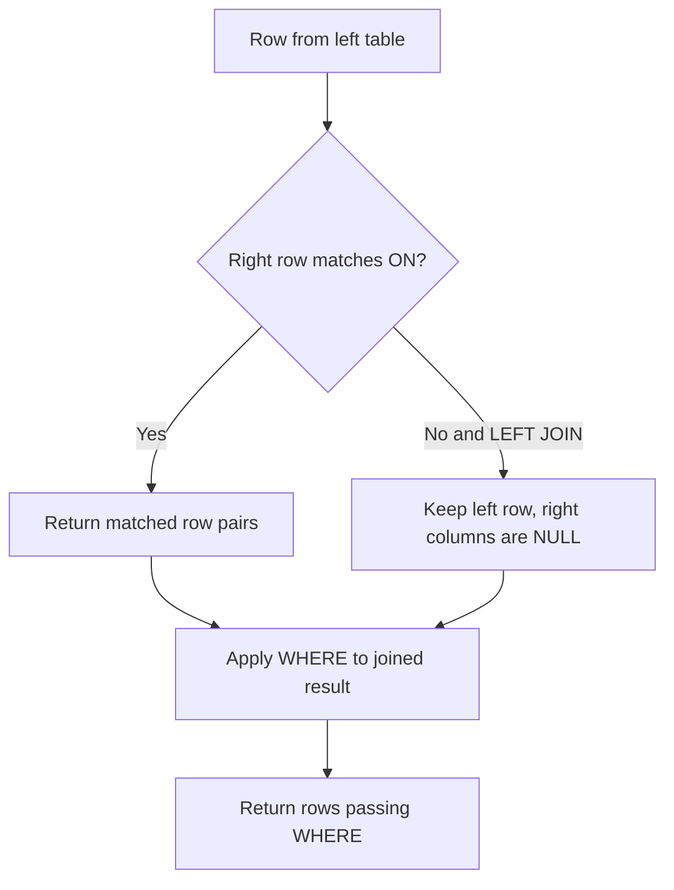

# Condition Placement in ON vs. WHERE and Its Impact on OUTER JOIN

In a query with a `JOIN`, the exact same condition can change the result depending on where it is placed. With `INNER JOIN`, a join condition can often be written in `ON` or `WHERE` while preserving the same row set when the transformation is logically equivalent. With `LEFT JOIN` and `RIGHT JOIN`, the difference is critical: conditions in `ON` determine which rows are considered a match; conditions in `WHERE` filter the result after the OUTER JOIN has already padded unmatched rows with `NULL`.

Placing a condition in the wrong clause can accidentally eliminate rows that should be preserved, making a `LEFT JOIN` behave like an `INNER JOIN`. This lesson helps you identify which table must be preserved, which conditions only restrict pairing, and which conditions genuinely filter rows out of the final result.

This lesson belongs to the **DATABASE_MYSQL** module. The module aims to build mastery of MySQL from table design, data types, keys, and SQL queries to indexes, transactions, and concurrency control, while practicing reading execution plans, optimizing queries, managing privileges, backing up, and handling relational database operations. Within the **JOINs and Subqueries** chapter, this lesson focuses on `ON`/`WHERE` condition placement and its impact on `OUTER JOIN`.

## 1. INNER JOIN and OUTER JOIN Preserve Rows Differently

`INNER JOIN` returns only row combinations that satisfy the join condition. `LEFT JOIN` keeps every row from the left table; if no matching right-side row is found, the right-side columns are returned as `NULL`. `RIGHT JOIN` works symmetrically in the opposite direction: it keeps every row from the right table.



The diagram depicts the logical semantics of `LEFT JOIN`: find matching pairs via `ON`, pad unmatched rows on the preserved side with `NULL`, and only then apply `WHERE`. The optimizer may physically execute the query differently as long as the result preserves exact SQL semantics.

Key points to remember:

- `ON` answers the question: *should these two rows be paired together?*
- `WHERE` answers the question: *should this post-JOIN result row be kept?*
- With an OUTER JOIN, a `WHERE` condition referencing the `NULL`-padded side can eliminate the very rows the OUTER JOIN was designed to preserve.

## 2. Preparing the Practice Dataset

We use two tables: `employees` for employees and `departments` for departments. An employee may not yet be assigned to a department, may reference a department that no longer exists in the sample data, or may belong to an inactive department.

```sql
DROP TABLE IF EXISTS employees;
DROP TABLE IF EXISTS departments;

CREATE TABLE departments (
    department_id INT NOT NULL,
    department_name VARCHAR(80) NOT NULL,
    is_active TINYINT(1) NOT NULL,
    PRIMARY KEY (department_id)
) ENGINE = InnoDB;

CREATE TABLE employees (
    employee_id INT NOT NULL,
    employee_name VARCHAR(80) NOT NULL,
    department_id INT NULL,
    is_active TINYINT(1) NOT NULL,
    PRIMARY KEY (employee_id),
    KEY idx_employees_department (department_id)
) ENGINE = InnoDB;

INSERT INTO departments (department_id, department_name, is_active)
VALUES
    (10, 'Engineering', 1),
    (20, 'Sales', 0),
    (30, 'Finance', 1);

INSERT INTO employees (employee_id, employee_name, department_id, is_active)
VALUES
    (1, 'Linh', 10, 1),
    (2, 'Minh', 20, 1),
    (3, 'An', NULL, 1),
    (4, 'Hoa', 99, 1),
    (5, 'Son', 30, 0);
```

`department_id = 99` is intentionally included in the sample data to illustrate a case with no matching department row. In production schemas, foreign keys can prevent such orphaned references, yet unassigned employees (`department_id IS NULL`) remain a common scenario.

## 3. Basic LEFT JOIN: Preserving Every Left-Side Row

The following query retrieves all employees and their department names when found:

```sql
SELECT
    e.employee_id,
    e.employee_name,
    e.department_id,
    d.department_name
FROM employees AS e
LEFT JOIN departments AS d
    ON d.department_id = e.department_id
ORDER BY e.employee_id;
```

The result contains five employees:

| employee_id | employee_name | department_id | department_name |
|---:|---|---:|---|
| 1 | Linh | 10 | Engineering |
| 2 | Minh | 20 | Sales |
| 3 | An | `NULL` | `NULL` |
| 4 | Hoa | 99 | `NULL` |
| 5 | Son | 30 | Finance |

All rows from `employees` are preserved. Employee An has no `department_id`; Hoa has a department ID that does not exist in `departments`. In both cases, the right-side columns are padded with `NULL`.

This is the core behavior of `LEFT JOIN`. When adding conditions, decide whether you want to restrict which departments get matched or remove employees from the result.

## 4. Conditions on the Right Table Placed in ON

Suppose the requirement is: retrieve all employees, but display department details only for active departments. Employees in inactive departments must still appear; only their department information should not be joined into the result.

Place the department condition in `ON`:

```sql
SELECT
    e.employee_id,
    e.employee_name,
    d.department_name
FROM employees AS e
LEFT JOIN departments AS d
    ON d.department_id = e.department_id
   AND d.is_active = 1
ORDER BY e.employee_id;
```

Result:

| employee_id | employee_name | department_name |
|---:|---|---|
| 1 | Linh | Engineering |
| 2 | Minh | `NULL` |
| 3 | An | `NULL` |
| 4 | Hoa | `NULL` |
| 5 | Son | Finance |

The condition `d.is_active = 1` allows only active departments to qualify as matching rows. For Minh, the Sales department exists but fails `ON`, so for this join no right-side row matches; `LEFT JOIN` keeps Minh and pads the department columns with `NULL`.

This is the right pattern when you want to preserve all employees and pull in department data only when it meets a condition.

## 5. Placing a Right-Side Condition in WHERE Can Drop Left-Side Rows

Consider this query:

```sql
SELECT
    e.employee_id,
    e.employee_name,
    d.department_name
FROM employees AS e
LEFT JOIN departments AS d
    ON d.department_id = e.department_id
WHERE d.is_active = 1
ORDER BY e.employee_id;
```

Only Linh and Son remain in the result. Why?

1. `LEFT JOIN` first matches departments by `department_id`.
2. Employees An and Hoa have no matching department, so `d.is_active` is `NULL`.
3. Employee Minh matches Sales, where `d.is_active = 0`.
4. `WHERE d.is_active = 1` keeps only rows where the condition evaluates to TRUE. Both FALSE and UNKNOWN are discarded.
5. Consequently, unmatched rows from the LEFT JOIN are eliminated from the result.

When a `WHERE` condition requires a specific value on the right side, it generally removes `NULL`-padded rows. The query then produces results similar to an `INNER JOIN` with respect to that condition.

### 5.1. Comparing the Two Placements

| Intent | Condition Placement | Behavior |
|---|---|---|
| Keep all employees, match only active departments | `ON ... AND d.is_active = 1` | Employees in inactive departments still appear with `NULL` department columns. |
| Only employees with an active department | `WHERE d.is_active = 1` | Employees without a department or in inactive departments are dropped. |
| Employees in active departments plus employees with no matching department | `WHERE d.is_active = 1 OR d.department_id IS NULL` with a JOIN that does not filter status in ON | Keeps unmatched rows, while dropping employees matched to inactive departments. |

These three requirements are different. Choose condition placement based on the exact meaning you need, not syntactic habit.

## 6. Conditions on the Left Table: ON and WHERE Also Differ

It is not only right-side conditions that matter. In a `LEFT JOIN`, the left table is the preserved side. A condition on the left table placed in `ON` only affects pairing with the right table; it does not remove left-side rows from the result.

### 6.1. Placing Employee Status in ON

```sql
SELECT
    e.employee_id,
    e.employee_name,
    d.department_name
FROM employees AS e
LEFT JOIN departments AS d
    ON d.department_id = e.department_id
   AND e.is_active = 1;
```

All employees still appear. For Son (`is_active = 0`), `e.is_active = 1` fails, so Finance is not joined; Son's row gets `department_name = NULL`.

### 6.2. Placing Employee Status in WHERE

```sql
SELECT
    e.employee_id,
    e.employee_name,
    d.department_name
FROM employees AS e
LEFT JOIN departments AS d
    ON d.department_id = e.department_id
WHERE e.is_active = 1;
```

This query removes Son from the result while still joining departments for the remaining employees. That is usually the intent when reporting only active employees.

Rule:

- Place a left-table condition in `WHERE` if you want to filter out left-side rows.
- Place a left-table condition in `ON` if you only want to restrict when left-side rows pair with the right side while still preserving the left-side rows.

## 7. When Is WHERE ... IS NULL an Anti-Join?

A common query pattern is finding left-side rows that have no matching right-side row:

```sql
SELECT
    e.employee_id,
    e.employee_name
FROM employees AS e
LEFT JOIN departments AS d
    ON d.department_id = e.department_id
WHERE d.department_id IS NULL;
```

Because `d.department_id` is a primary key and cannot be `NULL` in a real department row, a `NULL` value after the LEFT JOIN proves no right-side row matched. The result is An and Hoa.

This is called the **anti-join pattern**: returning left-side rows for which no corresponding right-side row was found.

### 7.1. Which Column to Check in WHERE IS NULL

You must check a right-side column that is guaranteed `NOT NULL` in every matched row, typically the primary key:

```sql
WHERE d.department_id IS NULL
```

Do not check a nullable business column:

```sql
-- May mistakenly match rows that did join but whose manager_name is actually NULL.
WHERE d.manager_name IS NULL
```

If the department exists but `manager_name` has not been assigned yet, the query still evaluates the condition as TRUE even though a right-side row matched. The result no longer means "has no department."

### 7.2. Anti-Join with a Condition in ON

Requirement: find employees who do not belong to an active department. You can put the department status condition in `ON`, then check the right-side primary key:

```sql
SELECT
    e.employee_id,
    e.employee_name
FROM employees AS e
LEFT JOIN departments AS d
    ON d.department_id = e.department_id
   AND d.is_active = 1
WHERE d.department_id IS NULL;
```

The result includes Minh (Sales is inactive), An (no department assigned), and Hoa (unmatched department ID). The condition in `ON` defines "whether an active department exists"; `WHERE ... IS NULL` selects employees who have no department satisfying that definition.

If you remove `d.is_active = 1` from `ON`, the query only finds employees without any matching department at all; Minh will not appear because Sales still exists.

## 8. NOT EXISTS as an Explicit Way to Write an Anti-Join

You can express "no matching active department exists" with `NOT EXISTS`:

```sql
SELECT
    e.employee_id,
    e.employee_name
FROM employees AS e
WHERE NOT EXISTS (
    SELECT 1
    FROM departments AS d
    WHERE d.department_id = e.department_id
      AND d.is_active = 1
);
```

`NOT EXISTS` checks whether the subquery returns any rows. It often expresses negated existence directly and does not depend on choosing a right-side column to test with `IS NULL`.

With equivalent conditions and suitable indexes, the optimizer can transform both `NOT EXISTS` and the `LEFT JOIN ... IS NULL` pattern into an efficient anti-join strategy. Do not assume one form is always faster; write whichever expresses the intent most clearly and verify with `EXPLAIN`.

### 8.1. Beware of NOT IN and NULL

Avoid replacing `NOT EXISTS` with `NOT IN` when the subquery can return `NULL`:

```sql
SELECT e.employee_id
FROM employees AS e
WHERE e.department_id NOT IN (
    SELECT d.department_id
    FROM departments AS d
);
```

If the subquery value set contains `NULL`, the `NOT IN` comparison can evaluate to UNKNOWN and return no rows as expected. `NOT EXISTS` is generally safer for anti-joins because the correlated predicate is evaluated row by row. If using `NOT IN`, ensure the subquery column cannot contain `NULL`.

## 9. RIGHT JOIN Follows Symmetric Rules

`RIGHT JOIN` preserves all rows of the right table. Conditions in `ON` decide which left-side rows match; right-side rows with no left-side match still appear with `NULL` in left-side columns.

Example retrieving all departments, including departments without employees:

```sql
SELECT
    d.department_id,
    d.department_name,
    e.employee_id,
    e.employee_name
FROM employees AS e
RIGHT JOIN departments AS d
    ON d.department_id = e.department_id
ORDER BY d.department_id, e.employee_id;
```

If the employee condition is placed in `ON`, every department is still preserved:

```sql
SELECT
    d.department_id,
    d.department_name,
    e.employee_name
FROM employees AS e
RIGHT JOIN departments AS d
    ON d.department_id = e.department_id
   AND e.is_active = 1;
```

Departments without active employees still appear, with `NULL`-padded employee columns.

If `e.is_active = 1` is moved to `WHERE`, departments without matching employees are dropped because `e.is_active` is `NULL`. The result then contains only departments with active employees.

In new code, many teams prefer rewriting `RIGHT JOIN` as `LEFT JOIN` by swapping table order. The example above can be written as:

```sql
SELECT
    d.department_id,
    d.department_name,
    e.employee_id,
    e.employee_name
FROM departments AS d
LEFT JOIN employees AS e
    ON e.department_id = d.department_id;
```

Writing `LEFT JOIN` usually helps readers immediately identify which table is being preserved.

## 10. INNER JOIN: ON and WHERE Conditions Are Usually Equivalent

With `INNER JOIN`, the following two forms generally produce the same row set when the condition is moved intact without altering expression semantics:

```sql
SELECT e.employee_id, d.department_name
FROM employees AS e
INNER JOIN departments AS d
    ON d.department_id = e.department_id
   AND d.is_active = 1;
```

```sql
SELECT e.employee_id, d.department_name
FROM employees AS e
INNER JOIN departments AS d
    ON d.department_id = e.department_id
WHERE d.is_active = 1;
```

Because `INNER JOIN` keeps only matching pairs, pair-filtering predicates can be expressed in either `ON` or `WHERE`. Even so, keep the relationship condition between the two tables in `ON` and result filters in `WHERE` for readability.

Do not generalize this rule to OUTER JOINs. With `LEFT JOIN`/`RIGHT JOIN`, moving a condition between `ON` and `WHERE` can change whether unmatched rows are preserved.

## 11. Combining Multiple JOINs: Filtering at the Right Stage

When a query joins three or more tables, condition placement can affect which rows are preserved at each join step.

Suppose you have `employees`, `departments`, and `projects`. Requirement: retrieve all employees, show their active department if any, and show open projects belonging to that department.

```sql
SELECT
    e.employee_id,
    e.employee_name,
    d.department_name,
    p.project_name
FROM employees AS e
LEFT JOIN departments AS d
    ON d.department_id = e.department_id
   AND d.is_active = 1
LEFT JOIN projects AS p
    ON p.department_id = d.department_id
   AND p.project_status = 'OPEN'
ORDER BY e.employee_id, p.project_name;
```

The department status condition is in the `ON` clause of the first join; the project status condition is in the `ON` clause of the second join. As a result, employees remain preserved even when they have no active department or their department has no open projects.

If you add:

```sql
WHERE p.project_status = 'OPEN'
```

at the end of the query, rows where `p` was padded with `NULL` are discarded. That drops employees without open projects, violating the original requirement.

With chained OUTER JOINs, read from left to right and verify after each step: which table is preserved, which conditions define a match, and which conditions filter the final output. When nested logic gets complex, use parentheses and derived tables to clarify join groupings.

## 12. Preserving Rows and Filtering Data via Derived Tables

Another way to restrict the right-side row set before joining is using a derived table:

```sql
SELECT
    e.employee_id,
    e.employee_name,
    d.department_name
FROM employees AS e
LEFT JOIN (
    SELECT department_id, department_name
    FROM departments
    WHERE is_active = 1
) AS d
    ON d.department_id = e.department_id;
```

The subquery brings only active departments into the candidate matching set. `LEFT JOIN` still preserves all employees. Semantically, this is equivalent to putting `d.is_active = 1` in the `ON` condition of the earlier example.

Derived tables are helpful when:

- The right side requires filtering with multiple conditions or expressions.
- The right side needs pre-aggregation before joining to avoid row multiplication.
- You want to break complex logic into easier-to-verify steps.
- You want to ensure the JOIN input already has the target grain.

MySQL may merge or materialize a derived table depending on the query and optimizer. Physical execution may vary, while result semantics must remain intact.

## 13. OUTER JOIN Combined with GROUP BY and COUNT

A common requirement is counting employees per department while still displaying departments that have no employees yet.

```sql
SELECT
    d.department_id,
    d.department_name,
    COUNT(e.employee_id) AS employee_count
FROM departments AS d
LEFT JOIN employees AS e
    ON e.department_id = d.department_id
   AND e.is_active = 1
GROUP BY d.department_id, d.department_name
ORDER BY d.department_id;
```

### 13.1. Why Use COUNT(e.employee_id) Instead of COUNT(*)?

For a department without matching employees, `LEFT JOIN` still emits one result row where all `e.*` columns are `NULL`.

- `COUNT(*)` counts that padded row and returns 1 for a department with zero matching employees.
- `COUNT(e.employee_id)` ignores `NULL`; because `employee_id` is a non-nullable primary key on real rows, it returns 0 when there are no employees.

This is a critical distinction when counting rows on the non-preserved side.

### 13.2. Do Not Move the Employee Filter to WHERE

If you write:

```sql
SELECT
    d.department_id,
    d.department_name,
    COUNT(e.employee_id) AS employee_count
FROM departments AS d
LEFT JOIN employees AS e
    ON e.department_id = d.department_id
WHERE e.is_active = 1
GROUP BY d.department_id, d.department_name;
```

departments without active employees are filtered out before grouping. To keep those departments and report 0, move `e.is_active = 1` into `ON`.

### 13.3. SUM and COALESCE

If you need total salary by department:

```sql
SELECT
    d.department_id,
    d.department_name,
    COUNT(e.employee_id) AS employee_count,
    COALESCE(SUM(e.salary), 0) AS total_salary
FROM departments AS d
LEFT JOIN employees AS e
    ON e.department_id = d.department_id
   AND e.is_active = 1
GROUP BY d.department_id, d.department_name;
```

`SUM(e.salary)` returns `NULL` when there are no non-`NULL` values; `COALESCE(..., 0)` converts it to 0 per reporting convention. Only do this if a department with no employees should display total salary as 0 under business rules.

## 14. Common ON/WHERE Condition Patterns

| Goal | Suggested Syntax | Expected Result |
|---|---|---|
| All customers and matching orders | `LEFT JOIN orders ON ...` | Keeps customers with no orders yet. |
| All customers, match only paid orders | `LEFT JOIN orders ON ... AND status = 'PAID'` | Customers with only unpaid orders still appear with `NULL` order columns. |
| Only customers with paid orders | `LEFT JOIN ... ON ... WHERE order.status = 'PAID'` or `INNER JOIN` | Drops customers without PAID orders. |
| Customers who have never ordered | `LEFT JOIN ... WHERE order_id IS NULL` or `NOT EXISTS` | Keeps only customers with no matching order rows. |
| All departments and active employees | `departments LEFT JOIN employees ON ... AND employee.is_active = 1` | Keeps departments without active employees. |
| Only departments with active employees | `INNER JOIN ... ON ... AND employee.is_active = 1` | Keeps only departments with at least one matching employee. |
| All active employees, with department if any | `employees LEFT JOIN departments ON ... WHERE employee.is_active = 1` | Filters employees while keeping those without a department. |

## 15. WHERE Conditions That Intentionally Keep NULL Rows

Not every `WHERE` condition referencing the right side drops unmatched rows. Some conditions checking `IS NULL` or logical combinations can preserve `NULL`-padded rows.

Example:

```sql
SELECT e.employee_id, e.employee_name, d.department_name
FROM employees AS e
LEFT JOIN departments AS d
    ON d.department_id = e.department_id
WHERE d.is_active = 1
   OR d.department_id IS NULL;
```

The query keeps employees in active departments as well as employees without a matching department. However, Minh—who belongs to inactive Sales—is excluded because the real right-side row has `department_id = 20` (not `NULL`) and `is_active = 0`.

This is not the same as placing `d.is_active = 1` in `ON`: putting it in `ON` treats an inactive department as "unmatched" for the join, thereby keeping Minh with `NULL` department columns.

Distinguish the two requirements:

- **Keep employees even when their department is inactive, while hiding inactive department details:** filter status in `ON`.
- **Keep employees without a department and employees in active departments; exclude employees assigned to inactive departments:** use `WHERE ... OR right_pk IS NULL` with a JOIN that does not filter status in `ON`.

## 16. NULLs and Negation Conditions

Comparisons with `NULL` do not return TRUE or FALSE; they typically return UNKNOWN. `WHERE` keeps only rows where the condition evaluates to TRUE; FALSE and UNKNOWN are both discarded.

For example:

```sql
WHERE d.is_active <> 0
```

does not keep rows where `d.is_active` is `NULL`. Thus, negated conditions like `<>`, `!=`, or `NOT (x = value)` can drop unmatched rows from an OUTER JOIN.

If you want to keep unmatched rows:

```sql
WHERE d.is_active <> 0
   OR d.department_id IS NULL
```

Or put the status condition in `ON` if the intent is to restrict matched right-side rows while preserving the left side.

Do not apply `COALESCE(d.is_active, 0)` mechanically across every condition. Replacing `NULL` with 0 can blur the difference between "no department row exists" and "the department exists but is inactive."

## 17. FULL OUTER JOIN in MySQL

MySQL does not offer direct `FULL OUTER JOIN` syntax. If you need to keep every row from both sides, you can combine a `LEFT JOIN` with the right-only rows using `UNION ALL`:

```sql
SELECT
    a.id AS a_id,
    a.value AS a_value,
    b.id AS b_id,
    b.value AS b_value
FROM table_a AS a
LEFT JOIN table_b AS b
    ON b.id = a.id

UNION ALL

SELECT
    a.id AS a_id,
    a.value AS a_value,
    b.id AS b_id,
    b.value AS b_value
FROM table_a AS a
RIGHT JOIN table_b AS b
    ON b.id = a.id
WHERE a.id IS NULL;
```

The second branch retrieves only right-side rows without a matching left-side row. The condition `a.id IS NULL` must check a left-side key that is non-nullable on real rows. `UNION ALL` avoids unnecessary deduplication because the two branches are designed to be disjoint.

This is an extended technique; for ordinary problems, use `LEFT JOIN` or `RIGHT JOIN` depending on which side needs to be preserved.

## 18. Checking Performance with EXPLAIN

Condition placement affects both semantics and the query plan. After confirming correct results, inspect the plan:

```sql
EXPLAIN
SELECT
    e.employee_id,
    e.employee_name,
    d.department_name
FROM employees AS e
LEFT JOIN departments AS d
    ON d.department_id = e.department_id
   AND d.is_active = 1
WHERE e.is_active = 1;
```

Read the key fields:

- `type`: how MySQL accesses each table.
- `possible_keys`: candidate indexes available.
- `key`: the chosen index.
- `rows`: estimated rows to read.
- `filtered`: estimated percentage of rows remaining after conditions.
- `Extra`: additional info such as filter conditions or temporary/filesort usage.

For large queries, you can use `EXPLAIN ANALYZE` in MySQL 8.0.18 and later to execute the query and inspect actual iterator timings and row counts. Only use it on appropriate queries and environments since it actually runs the SQL statement.

Indexes typically worth evaluating:

- An index on the join key of the right table, e.g., `departments(department_id)`.
- An index on the foreign key / join column of the left table, e.g., `employees(department_id)`.
- Indexes supporting filter predicates such as `employees(is_active)` or composite indexes aligned with filter and join order.

Do not create an index solely because a column appears in `ON` or `WHERE`. Evaluate selectivity, row count, query frequency, write overhead, and the actual execution plan. In InnoDB, the primary key is the clustered index and secondary indexes store the primary key in leaf records; this layout also influences read costs.

## 19. Decision Workflow for Placing Conditions

When writing an OUTER JOIN, follow these steps:

1. **Choose the side to preserve.** With `LEFT JOIN`, all left-side rows must remain; with `RIGHT JOIN`, all right-side rows must remain.
2. **Write the base key-matching condition in ON.** Join the keys of the two tables explicitly.
3. **Evaluate conditions on the non-preserved side.** If you only want to restrict which rows can match while keeping the preserved side, place the condition in `ON`.
4. **Evaluate conditions meant to remove result rows.** If non-matching rows must disappear from the report, place the condition in `WHERE`.
5. **Handle unmatched rows intentionally.** Use `right_pk IS NULL`, `OR ... IS NULL`, or `NOT EXISTS` according to requirements.
6. **With multiple JOINs, evaluate step by step.** Identify which table remains preserved after each join.
7. **With aggregates, verify COUNT and SUM.** Use `COUNT(right_pk)` to count matched rows; decide how missing totals should be represented.
8. **Verify results with edge-case data.** Include `NULL` foreign keys, unmatched keys, filtered right-side rows, and multiple matching rows.
9. **Read EXPLAIN once results are correct.** Optimization must never alter intended semantics.

## 20. Common Mistakes and Fixes

| Mistake | Consequence | Fix |
|---|---|---|
| Putting `right.status = ...` in WHERE while intending to keep all left rows | Unmatched rows are dropped; LEFT JOIN behaves like INNER JOIN | Move the condition to ON. |
| Putting a left-table filter in ON while intending to drop left rows | Left rows still appear with NULL right columns | Move the condition into WHERE. |
| Anti-join checking a nullable column on the right side | Mistakenly treats a matched row with a real NULL value as unmatched | Check the primary key or a NOT NULL column. |
| Using COUNT(*) to count right-side rows after LEFT JOIN | Unmatched rows still get counted as 1 | Use COUNT(right_table.primary_key). |
| Moving conditions from ON to WHERE without checking OUTER JOIN | Alters the preserved row set | Test unmatched rows and right rows that fail the condition. |
| Using NOT IN with a subquery containing NULL | Results may be empty or missing rows due to UNKNOWN | Use NOT EXISTS or exclude NULLs properly. |
| Joining multiple one-to-many tables then aggregating | Metrics get multiplied | Aggregate each side to the right grain before JOINing. |
| Looking only at EXPLAIN without verifying results | May optimize a semantically wrong query | Verify the row set first, then optimize. |

## 21. Hands-On Exercises

### Exercise 1: Comparing ON and WHERE

Using the `employees` and `departments` tables from Section 2, run:

```sql
SELECT e.employee_id, e.employee_name, d.department_name
FROM employees AS e
LEFT JOIN departments AS d
    ON d.department_id = e.department_id
   AND d.is_active = 1;

SELECT e.employee_id, e.employee_name, d.department_name
FROM employees AS e
LEFT JOIN departments AS d
    ON d.department_id = e.department_id
WHERE d.is_active = 1;
```

**Task:** List the employees returned by each query and explain which rows were filtered out.

### Exercise 2: Conditions on the Left Side

Move `e.is_active = 1` back and forth between `ON` and `WHERE`.

**Task:** Explain why Son still appears with a `NULL` department when the condition is placed in `ON`.

### Exercise 3: Anti-Join

Find employees without a matching department. Then find employees without an active department.

**Task:** Compare `LEFT JOIN ... IS NULL` with `NOT EXISTS`; explain why you should check the right-side primary key.

### Exercise 4: Departments Without Employees

Use `departments LEFT JOIN employees` to list all departments and their active employee counts.

**Task:** Compare `COUNT(*)` and `COUNT(employee_id)` for departments without employees.

### Exercise 5: Multiple OUTER JOINs

Create a `projects` table and join employees, departments, and projects. Return all employees and match only open projects.

**Task:** Move `project_status = 'OPEN'` from `ON` to `WHERE` and describe which rows disappear.

### Exercise 6: NULL and NOT IN

Create a subquery containing a `NULL` value and compare `NOT IN` with `NOT EXISTS`.

**Task:** Explain the impact of UNKNOWN and propose a safe anti-join pattern.

### Exercise 7: EXPLAIN

Create indexes on the join keys and run `EXPLAIN` for a `LEFT JOIN` query with conditions in `ON` and `WHERE`.

**Task:** Record `key`, `type`, `rows`, `filtered`, and `Extra`; explain how the optimizer can vary physical execution while preserving SQL semantics.

## 22. OUTER JOIN Review Checklist

- [ ] Identified which table/side must be preserved.
- [ ] Key join conditions are explicitly placed in `ON`.
- [ ] Conditions meant only to restrict matchable rows are placed in `ON`.
- [ ] Conditions meant to remove result rows are placed in `WHERE`.
- [ ] Checked `WHERE` conditions referencing columns on the `NULL`-padded side.
- [ ] Anti-joins check the primary key or a `NOT NULL` column on the right side.
- [ ] `NOT IN` cannot receive an unexpected `NULL` from the subquery.
- [ ] Used `COUNT(right_pk)` when counting matched rows.
- [ ] Tested missing join keys, `NULL` keys, and unmatched keys.
- [ ] For multiple JOINs, verified which side is preserved at every step.
- [ ] Aggregates are not multiplied by one-to-many relationships.
- [ ] Verified query output before optimizing indexes.
- [ ] Read `EXPLAIN` or `EXPLAIN ANALYZE` in an appropriate environment.

## 23. Summary

With `LEFT JOIN`, `ON` decides which right-side rows pair with each left-side row; if none match, MySQL keeps the left row and pads the right side with `NULL`. `WHERE` filters the post-join result. Consequently, a predicate like `right_table.status = 'ACTIVE'` placed in `WHERE` typically drops unmatched rows and strips `LEFT JOIN` of its row-preserving behavior.

Place right-side conditions in `ON` when you want to preserve the entire left side while matching only qualifying right rows. Place conditions in `WHERE` when you genuinely want to remove rows from the final result. For anti-joins, test the right-side primary key or use `NOT EXISTS`; when counting rows after an OUTER JOIN, use `COUNT(right_pk)`. Always test unmatched rows, `NULL`s, and multi-match cases before tuning with indexes and `EXPLAIN`.
