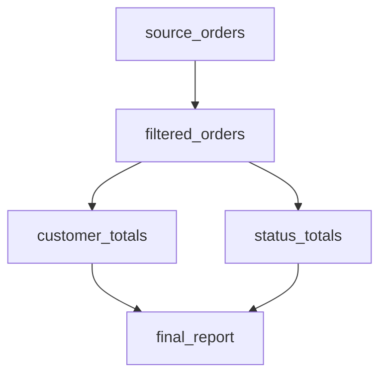

# Name Scope, Multiple CTEs, and Reference Relationships Between CTEs

A Common Table Expression (CTE) allows you to name a temporary result set scoped to a single SQL statement. When a query has multiple steps, you can declare multiple CTEs within the same `WITH` clause and let a later CTE reference a CTE declared earlier. This organization helps break a large query into named steps that are easy to read and verify.

However, a CTE is not a temporary table that persists across a session. A CTE name is valid only within the statement containing the `WITH` clause; declaration order and query scope determine where that name can be referenced. Understanding these rules helps avoid nonexistent-name errors, circular references, and confusion between CTEs and physical tables.

This lesson belongs to the **DATABASE_MYSQL** module. The module aims to master MySQL from table design, data types, keys, and SQL queries to indexes, transactions, and concurrency control; as well as practicing reading execution plans, query tuning, privilege management, backups, and handling relational database operations. Within the **CTEs and Tree Queries** chapter, this lesson focuses on CTE name scope, declaring multiple CTEs, and the reference relationships between them.

## 1. A CTE Is a Name Bound to a Statement-Scoped Subquery

A CTE is declared using `WITH`:

```sql
WITH paid_orders AS (
    SELECT order_id, customer_id, total_amount
    FROM orders
    WHERE status = 'PAID'
)
SELECT
    customer_id,
    SUM(total_amount) AS paid_revenue
FROM paid_orders
GROUP BY customer_id;
```

`paid_orders` is the name of the CTE. The query inside the parentheses produces a set of rows that the outer statement can reference like a data source in `FROM`.

CTEs have important characteristics:

- A CTE name is valid only within the statement containing `WITH`.
- A CTE does not automatically create a physical table in the schema.
- A CTE does not persist data between two independent statements.
- A CTE can be referenced by the main query and by other CTEs if ordering/scoping rules permit.
- A CTE can be referenced multiple times within the same statement.
- A CTE does not guarantee that results are materialized or cached; the optimizer decides the appropriate execution strategy.

CTEs commonly help split a query into logical steps. They do not replace temporary tables when you need to store results across multiple statements, nor do they replace views reused long-term across multiple statements.

## 2. CTE Name Scope: Single-Statement Only

A CTE name is declared at the start of a statement and can be used in the query portion belonging to that statement.

```sql
WITH active_customers AS (
    SELECT customer_id, full_name
    FROM customers
    WHERE is_active = 1
)
SELECT customer_id, full_name
FROM active_customers;
```

After the statement finishes, the name `active_customers` no longer exists:

```sql
-- Error: active_customers is not a table/view in the schema.
SELECT * FROM active_customers;
```

If you need to use the result in the next statement, you must redeclare the CTE, create a temporary table, create a physical table, or use a view depending on your goal.

### 2.1. Two Statements Require Two Separate Declarations

```sql
WITH active_customers AS (
    SELECT customer_id
    FROM customers
    WHERE is_active = 1
)
SELECT COUNT(*) AS active_count
FROM active_customers;

WITH active_customers AS (
    SELECT customer_id
    FROM customers
    WHERE is_active = 1
)
SELECT customer_id
FROM active_customers
ORDER BY customer_id;
```

Each of the two statements above has its own separate CTE. Using the same name does not mean the second statement reuses an object or data created by the first statement.

### 2.2. A CTE Is Not a Temporary Table

| Characteristic | CTE | Temporary table |
|---|---|---|
| Creation syntax | `WITH name AS (...)` | `CREATE TEMPORARY TABLE ...` |
| Scope | One statement | The session that created the table |
| Usable in the next statement | No, must be redeclared | Yes, in the same session while the table exists |
| Stored as a schema object | No | Session temporary table, not a permanent table |
| Can proactively create indexes afterward | Not via DDL on the CTE | Appropriate indexes can be created on the temporary table |
| Common purpose | Splitting logical steps within one query | Storing and reusing intermediate data across multiple statements |

## 3. Declaring Multiple CTEs in a Single WITH

A `WITH` clause can declare multiple CTEs, separated by commas:

```sql
WITH
source_orders AS (
    SELECT order_id, customer_id, status, total_amount
    FROM orders
),
paid_orders AS (
    SELECT order_id, customer_id, total_amount
    FROM source_orders
    WHERE status = 'PAID'
),
customer_totals AS (
    SELECT
        customer_id,
        COUNT(*) AS paid_order_count,
        SUM(total_amount) AS paid_revenue
    FROM paid_orders
    GROUP BY customer_id
)
SELECT
    customer_id,
    paid_order_count,
    paid_revenue
FROM customer_totals
ORDER BY paid_revenue DESC;
```

The query has three CTEs:

1. `source_orders` defines the input order dataset.
2. `paid_orders` references `source_orders` and keeps only paid orders.
3. `customer_totals` references `paid_orders` to aggregate by customer.

The main query reads from `customer_totals`. Each CTE names a logical step, allowing you to test each part individually before assembling the complete query.

### 3.1. Commas Separate CTEs, Not Statement Terminators

General syntax:

```sql
WITH
    cte_name_1 [(column_list)] AS (subquery_1),
    cte_name_2 [(column_list)] AS (subquery_2),
    cte_name_3 [(column_list)] AS (subquery_3)
SELECT ...;
```

There is only one `WITH` at the beginning of the query block; subsequent CTEs are added using commas. Do not place a semicolon after each CTE definition because a semicolon terminates the SQL statement.

### 3.2. A CTE Can Reference an Earlier CTE

In a non-recursive `WITH`, a CTE declared later can reference a CTE declared earlier:

```sql
WITH
base_data AS (
    SELECT customer_id, total_amount
    FROM orders
),
large_orders AS (
    SELECT customer_id, total_amount
    FROM base_data
    WHERE total_amount >= 1000000
)
SELECT *
FROM large_orders;
```

`large_orders` can see `base_data` because `base_data` precedes it in the same `WITH` clause.

### 3.3. A Non-Recursive CTE Cannot Reference a CTE Declared Later

Declaration order matters. The following example is invalid:

```sql
-- Invalid: first_step references later_step declared afterward.
WITH
first_step AS (
    SELECT * FROM later_step
),
later_step AS (
    SELECT customer_id FROM customers
)
SELECT * FROM first_step;
```

In a non-recursive `WITH`, a CTE can only reference CTEs that have already appeared before it. Reorder the declarations so the source is defined before where it is used:

```sql
WITH
later_step AS (
    SELECT customer_id FROM customers
),
first_step AS (
    SELECT customer_id FROM later_step
)
SELECT * FROM first_step;
```

This is also why you should order the CTE list by dependency: data sources first, transformation steps next, and final result queries last.

## 4. Reference Relationships Between CTEs Form a Dependency Graph

When there are multiple CTEs, you can view each CTE as a node and each reference as a dependency edge. If `summary` reads `filtered_orders`, then `summary` depends on `filtered_orders`.



For example, one source CTE can be used by two different aggregation CTEs, and then the final query joins those two results:

```sql
WITH
source_orders AS (
    SELECT order_id, customer_id, status, total_amount
    FROM orders
    WHERE created_at >= '2026-01-01'
      AND created_at <  '2027-01-01'
),
customer_totals AS (
    SELECT
        customer_id,
        COUNT(*) AS order_count,
        SUM(total_amount) AS revenue
    FROM source_orders
    GROUP BY customer_id
),
status_totals AS (
    SELECT
        customer_id,
        COUNT(*) AS paid_order_count
    FROM source_orders
    WHERE status = 'PAID'
    GROUP BY customer_id
)
SELECT
    c.customer_id,
    c.order_count,
    c.revenue,
    COALESCE(s.paid_order_count, 0) AS paid_order_count
FROM customer_totals AS c
LEFT JOIN status_totals AS s
    ON s.customer_id = c.customer_id;
```

`source_orders` is referenced by two different CTEs. `customer_totals` and `status_totals` are independent of each other; both depend on `source_orders`. The final query combines the two aggregated sets by `customer_id`.

### 4.1. Ordering CTEs by Dependency

A maintainable convention:

1. Source CTEs: filter and select the necessary columns from physical tables.
2. Normalization CTEs: rename, standardize values, or create shared expressions.
3. Business logic CTEs: compute specific groups or metrics.
4. Presentation CTEs: combine results, rank, or format data.
5. Main query: return the final result set.

Not every query needs all layers. Split out a CTE when each step has a clear meaning; do not create too many tiny CTEs just to rename a simple column.

### 4.2. Do Not Create Circular Dependencies in Non-Recursive CTEs

Example of a circular dependency:

```sql
-- Invalid in a non-recursive WITH.
WITH
cte_a AS (SELECT * FROM cte_b),
cte_b AS (SELECT * FROM cte_a)
SELECT * FROM cte_a;
```

`cte_a` needs `cte_b`, while `cte_b` needs `cte_a`. There is no first step to evaluate. If the problem genuinely requires iterating across rows, consider a recursive CTE with `WITH RECURSIVE` and a clear termination condition; do not use arbitrary circular references between CTEs.

## 5. A CTE Can Be Referenced Multiple Times

A CTE can appear multiple times within the same statement. For example, calculating revenue per customer and then comparing each customer against the average revenue across all customers:

```sql
WITH
customer_totals AS (
    SELECT customer_id, SUM(total_amount) AS revenue
    FROM orders
    GROUP BY customer_id
),
overall_average AS (
    SELECT AVG(revenue) AS average_revenue
    FROM customer_totals
)
SELECT
    ct.customer_id,
    ct.revenue,
    oa.average_revenue
FROM customer_totals AS ct
CROSS JOIN overall_average AS oa
WHERE ct.revenue > oa.average_revenue;
```

`customer_totals` is referenced in `overall_average` and again in the main query. `overall_average` returns one aggregated row to compare against each customer.

Another case is referencing the same CTE twice with different aliases to compare two segments:

```sql
WITH
sales_by_period AS (
    SELECT
        customer_id,
        CASE
            WHEN created_at >= '2026-01-01'
             AND created_at <  '2027-01-01' THEN 'CURRENT'
            WHEN created_at >= '2025-01-01'
             AND created_at <  '2026-01-01' THEN 'PREVIOUS'
        END AS period_name,
        total_amount
    FROM orders
    WHERE (created_at >= '2026-01-01' AND created_at < '2027-01-01')
       OR (created_at >= '2025-01-01' AND created_at < '2026-01-01')
),
period_totals AS (
    SELECT
        customer_id,
        period_name,
        SUM(total_amount) AS revenue
    FROM sales_by_period
    GROUP BY customer_id, period_name
)
SELECT
    current_period.customer_id,
    current_period.revenue AS current_revenue,
    previous_period.revenue AS previous_revenue
FROM period_totals AS current_period
LEFT JOIN period_totals AS previous_period
    ON previous_period.customer_id = current_period.customer_id
   AND previous_period.period_name = 'PREVIOUS'
WHERE current_period.period_name = 'CURRENT';
```

`period_totals` is referenced twice with different aliases. The aliases name each occurrence in `FROM`; they do not create two new CTE definitions.

### 5.1. Multiple References Do Not Mean Re-Running the Entire Query Multiple Times

Do not infer the number of computations solely from how many times a CTE name appears in SQL. MySQL may merge the CTE into the consuming query or materialize the intermediate result depending on the structure and plan. If the CTE is materialized, MySQL can build the intermediate result once and reuse it across references in the same statement.

Check `EXPLAIN` or `EXPLAIN ANALYZE` on your target MySQL version to understand the actual plan. Do not rely on CTEs as a guaranteed caching mechanism across statements.

## 6. Naming Columns for a CTE

CTE column names are usually taken from the inner select list. You can assign aliases directly:

```sql
WITH customer_metrics AS (
    SELECT
        customer_id AS id,
        COUNT(*) AS order_count,
        SUM(total_amount) AS revenue
    FROM orders
    GROUP BY customer_id
)
SELECT id, order_count, revenue
FROM customer_metrics;
```

MySQL also allows declaring a list of column names right after the CTE name:

```sql
WITH customer_metrics (id, order_count, revenue) AS (
    SELECT
        customer_id,
        COUNT(*),
        SUM(total_amount)
    FROM orders
    GROUP BY customer_id
)
SELECT id, order_count, revenue
FROM customer_metrics;
```

The outer column list assigns names positionally to the expressions in the select list. The number of names must match the number of columns returned; otherwise, MySQL raises an error.

### 6.1. Using Aliases to Avoid Cryptic Names

With expressions:

```sql
WITH order_stats AS (
    SELECT
        customer_id,
        SUM(quantity * unit_price) AS gross_amount,
        COUNT(*) AS line_count
    FROM order_items
    GROUP BY customer_id
)
SELECT
    customer_id,
    gross_amount,
    line_count
FROM order_stats;
```

Aliases describe business meaning better than expression strings. Avoid generic names like `value`, `result`, `col1` in CTEs used across multiple steps.

### 6.2. Column Names in a CTE Must Be Clear and Unique

If a CTE reads data from multiple tables that share column names, assign aliases to avoid ambiguity:

```sql
WITH customer_contacts AS (
    SELECT
        c.customer_id,
        c.email AS customer_email,
        s.email AS support_email
    FROM customers AS c
    JOIN support_assignments AS a
        ON a.customer_id = c.customer_id
    JOIN staff AS s
        ON s.staff_id = a.staff_id
)
SELECT customer_id, customer_email, support_email
FROM customer_contacts;
```

When referencing a CTE, use table aliases and column qualification if multiple sources share the same column name:

```sql
SELECT
    cm.customer_id,
    cm.revenue
FROM customer_metrics AS cm;
```

## 7. CTE Scope in Nested Queries

A CTE declared in an outer query block can be referenced inside subqueries within that scope.

```sql
WITH active_customers AS (
    SELECT customer_id
    FROM customers
    WHERE is_active = 1
)
SELECT
    c.customer_id,
    c.full_name
FROM customers AS c
WHERE EXISTS (
    SELECT 1
    FROM active_customers AS ac
    WHERE ac.customer_id = c.customer_id
);
```

The subquery inside `EXISTS` sees `active_customers` declared in the outer query block.

### 7.1. Inner Nested CTEs Have a Narrower Scope

A subquery can declare its own CTE using `WITH`. The inner CTE is usable in that query block and deeper nested query blocks within its scope:

```sql
WITH active_customers AS (
    SELECT customer_id
    FROM customers
    WHERE is_active = 1
)
SELECT outer_result.customer_id
FROM (
    WITH recent_orders AS (
        SELECT DISTINCT customer_id
        FROM orders
        WHERE created_at >= '2026-01-01'
    )
    SELECT customer_id
    FROM recent_orders
) AS outer_result
JOIN active_customers AS ac
    ON ac.customer_id = outer_result.customer_id;
```

Here:

- `active_customers` is declared in the outer query block and can be referenced by the outer query.
- `recent_orders` is declared inside the derived table; the query inside the derived table uses it.
- The outer query cannot reference `recent_orders` directly by CTE name because that name belongs to the nested query block scope.
- The derived table `outer_result` exposes the selected columns outward through the derived table's alias.

In complex queries, name nested CTEs differently from outer CTEs so readers do not have to guess which scope a name refers to.

### 7.2. Outer and Inner CTEs Can Shadow Source Names

A CTE can share the same name as a table or view. Within the scope of the statement, the CTE name takes precedence during name resolution over a table/view of the same name. This can cause the query to read the wrong source if duplicate names are used.

Illustrative example:

```sql
WITH orders AS (
    SELECT order_id, customer_id
    FROM archived_orders
)
SELECT *
FROM orders;
```

Even if the schema also has a physical table `orders`, the outer query still references the `orders` CTE within the scope of the statement. It does not automatically read the physical table of the same name.

To avoid confusion:

- Name CTEs to clearly express the dataset or processing step, such as `paid_orders`, `recent_customers`.
- Avoid naming a CTE the same as a table/view already used in the same query.
- Use explicit schema qualification when you need to reference a physical table whose name matches a CTE, such as `sales_db.orders`.
- Assign aliases to tables and CTEs in `FROM` when a query has multiple sources.

## 8. CTEs vs. Derived Tables, Views, and Temporary Tables

These mechanisms can all represent an intermediate result set, but they differ in scope and purpose.

| Mechanism | Usage | Scope | When suitable |
|---|---|---|---|
| CTE | `WITH x AS (...) SELECT ...` | One statement | Multiple logical steps, re-referencing the result set within the same statement. |
| Derived table | `FROM (SELECT ...) AS x` | The query block containing it | A subset used at only one location in the query. |
| View | `CREATE VIEW ... AS SELECT ...` | Schema object | Query logic that needs to be reused across multiple statements/users. |
| Temporary table | `CREATE TEMPORARY TABLE ...` | Session | Need to retain intermediate data across multiple statements or proactively create indexes. |
| Permanent table | `CREATE TABLE ...` | Schema/database | Need to store data long-term or manage snapshots. |

CTEs usually make queries more readable than derived tables when there are multiple layers. However, converting a derived table into a CTE does not guarantee better performance; the optimizer may handle both constructs similarly.

## 9. Non-Recursive CTEs and Recursive CTEs

A non-recursive CTE does not reference itself. CTEs in a normal `WITH` only reference preceding CTEs.

A recursive CTE is declared using `WITH RECURSIVE` and can reference itself to generate a sequence of results over multiple iterations. A recursive CTE typically has:

1. **Anchor member:** produces the starting rows, without referencing the recursive CTE.
2. **Recursive member:** references the CTE to produce the next generation of rows.
3. **Termination condition:** limits when no further rows are produced.

Example counting from 1 to 5:

```sql
WITH RECURSIVE numbers (n) AS (
    SELECT 1
    UNION ALL
    SELECT n + 1
    FROM numbers
    WHERE n < 5
)
SELECT n
FROM numbers;
```

The `RECURSIVE` keyword allows the `numbers` CTE to reference itself in the recursive part. There is no need to use `RECURSIVE` for non-recursive CTEs.

### 9.1. Multiple CTEs Together Inside WITH RECURSIVE

`WITH RECURSIVE` can contain both non-recursive CTEs and recursive CTEs. A non-recursive CTE can be declared first to serve as a source for the recursive CTE or the final query:

```sql
WITH RECURSIVE
limits AS (
    SELECT 5 AS max_value
),
numbers (n) AS (
    SELECT 1
    UNION ALL
    SELECT numbers.n + 1
    FROM numbers
    CROSS JOIN limits
    WHERE numbers.n < limits.max_value
)
SELECT n
FROM numbers;
```

`limits` is declared first and used by the recursive member. `numbers` references itself in the recursive part. This is an explicitly declared self-reference, unlike two non-recursive CTEs circularly referencing each other.

### 9.2. Limits and Termination Conditions

A recursive CTE must have a termination condition. If the recursive part keeps producing rows without terminating, the query may hit the recursion limit or consume significant resources. MySQL has the `cte_max_recursion_depth` variable to set a default depth limit; inspect it and configure a limit appropriate to your problem.

```sql
SELECT @@SESSION.cte_max_recursion_depth;
```

Do not raise the limit just to let a query run longer. First verify the join conditions, anchor member, termination condition, and the possibility of cycles in the data.

## 10. Using Multiple CTEs to Structure Business Queries

Example: generate a revenue report by customer, including only active customers, summing paid orders, and ranking revenue.

```sql
WITH
active_customers AS (
    SELECT customer_id, full_name
    FROM customers
    WHERE is_active = 1
),
paid_orders AS (
    SELECT order_id, customer_id, total_amount
    FROM orders
    WHERE status = 'PAID'
),
customer_revenue AS (
    SELECT
        customer_id,
        COUNT(*) AS paid_order_count,
        SUM(total_amount) AS revenue
    FROM paid_orders
    GROUP BY customer_id
),
ranked_revenue AS (
    SELECT
        customer_id,
        paid_order_count,
        revenue,
        DENSE_RANK() OVER (ORDER BY revenue DESC) AS revenue_rank
    FROM customer_revenue
)
SELECT
    c.customer_id,
    c.full_name,
    COALESCE(r.paid_order_count, 0) AS paid_order_count,
    COALESCE(r.revenue, 0) AS revenue,
    r.revenue_rank
FROM active_customers AS c
LEFT JOIN ranked_revenue AS r
    ON r.customer_id = c.customer_id
ORDER BY r.revenue_rank, c.customer_id;
```

Each step has its own responsibility:

- `active_customers`: filters the list of customers to report on.
- `paid_orders`: filters paid orders.
- `customer_revenue`: aggregates order count and revenue by customer.
- `ranked_revenue`: ranks customers by revenue.
- Main query: preserves active customers even when they have no PAID orders yet.

CTEs clarify the dependency order and allow testing individual steps. If you want to test `customer_revenue` in isolation, you can temporarily replace the main query with `SELECT * FROM customer_revenue`; when running in practice, the entire `WITH` must still be declared in that same statement.

## 11. CTEs and MySQL Optimization Capabilities

A CTE is a logical query construct. MySQL can process a CTE by merging its body into the consuming query block or materializing the intermediate result, depending on conditions and the execution plan.

Therefore:

- Do not assume a CTE always creates a physical temporary table.
- Do not assume every reference to a CTE re-executes the source query.
- Do not assume a CTE is faster than a derived table.
- Do not treat a CTE as a cache across statements.

Inspect the plan:

```sql
EXPLAIN
WITH
paid_orders AS (
    SELECT customer_id, total_amount
    FROM orders
    WHERE status = 'PAID'
),
customer_totals AS (
    SELECT customer_id, SUM(total_amount) AS revenue
    FROM paid_orders
    GROUP BY customer_id
)
SELECT customer_id, revenue
FROM customer_totals
WHERE revenue >= 1000000;
```

On MySQL 8.0.18 and later, `EXPLAIN ANALYZE` can execute the query and report actual row counts and timings across iterators:

```sql
EXPLAIN ANALYZE
WITH paid_orders AS (
    SELECT customer_id, total_amount
    FROM orders
    WHERE status = 'PAID'
)
SELECT customer_id, SUM(total_amount) AS revenue
FROM paid_orders
GROUP BY customer_id;
```

`EXPLAIN ANALYZE` actually runs the analyzed statement. Use it on read queries in an appropriate environment; do not run it casually on statements with write side effects.

## 12. Common Pitfalls When Working with Multiple CTEs

| Symptom | Cause | Resolution |
|---|---|---|
| `Table ... doesn't exist` when referencing a CTE | CTE went out of scope or name was misspelled | Declare `WITH` inside the exact statement using the CTE. |
| Earlier CTE references a CTE declared later | Violates non-recursive WITH reference ordering | Order sources first, dependent steps afterward. |
| Two CTEs circularly reference each other | Non-recursive dependency cycle | Refactor the logic or use a recursive CTE if it is genuinely an iterative problem. |
| CTE name matches a table/view | CTE can shadow the schema object of the same name | Use clearly descriptive names and qualify tables with schema when needed. |
| Outer query cannot see inner CTE | CTE is declared inside a nested query block | Move the CTE to the required outer scope or expose results through a derived table. |
| Column list count mismatch | Declared name count does not match select item count | Check the order and count of expressions in the CTE. |
| Ambiguous column when joining multiple CTEs | Missing qualification or unclear aliases | Use an alias for each CTE and prefix column names. |
| Query is slow despite using CTEs | CTEs do not guarantee materialization or indexes | Read EXPLAIN, inspect predicates, joins, aggregates, and indexes on source tables. |
| Expecting to use a CTE in the next statement | Confusing CTEs with temporary tables | Reuse WITH, temporary tables, or views according to the required scope. |

## 13. Workflow for Designing Multiple CTEs

When a query requires multiple steps, you can follow this sequence:

1. **Define the final output.** Specify the columns and grain of the result set.
2. **Identify data sources.** Choose the physical tables and required columns.
3. **Create source CTEs.** Give them descriptive names and filter the appropriate data range.
4. **Identify dependencies.** Note which CTE needs the result of which CTE.
5. **Order by reference dependency.** Any referenced CTE must appear before the CTE that uses it in a non-recursive WITH.
6. **Assign clear column aliases.** Avoid duplicate names or cryptic expression names.
7. **Separate independent branches.** If multiple CTEs depend on the same source, declare them after the source CTE and combine them in a later step.
8. **Check scope.** Ensure CTEs are referenced within the same statement and the appropriate query block.
9. **Check for name collisions.** Avoid naming CTEs the same as tables/views or other CTEs in nested scopes.
10. **Verify the plan.** Use EXPLAIN to inspect merging/materialization, row counts, and actual index usage.

## 14. Practice Exercises

### Exercise 1: Statement Scope

Declare the CTE `active_customers` and query it. Then run a new `SELECT` statement referencing only `active_customers` without `WITH`.

**Requirement:** explain why the first statement succeeds while the second raises an error.

### Exercise 2: Multiple CTEs in a Dependency Chain

Create three CTEs: `source_orders`, `paid_orders`, and `customer_totals`.

**Requirement:** describe the reference relationships and order them in the proper declaration sequence.

### Exercise 3: Referencing a CTE Multiple Times

Create the CTE `period_totals` and reference it twice using different aliases to compare two sets or two segments.

**Requirement:** explain the difference between a CTE name and the alias of each occurrence in FROM.

### Exercise 4: Detecting a Forward Reference

Write a query where the first CTE references a second CTE declared afterward. Observe the error, then swap the declaration order.

**Requirement:** explain the rule that non-recursive CTEs can only reference preceding CTEs.

### Exercise 5: Nested Scope

Declare an outer CTE and a CTE inside a derived table. Try referencing the outer CTE from the subquery; try referencing the inner CTE from the outer query.

**Requirement:** identify which CTE is visible in each query block and why a derived table needs an alias.

### Exercise 6: CTE Name Matching a Table

In a test environment, create an `orders` table, then declare a CTE with the same name `orders` reading from another table.

**Requirement:** determine which source the outer query reads; rewrite using a different CTE name and schema qualification for clarity.

### Exercise 7: Recursive and Non-Recursive CTEs

Declare a `limits` CTE and a recursive `numbers` CTE using `WITH RECURSIVE` to generate a sequence of numbers.

**Requirement:** point out the anchor member, recursive member, self-reference, and termination condition; explain why this is not a circular reference between two ordinary CTEs.

### Exercise 8: EXPLAIN

Write a query containing a CTE referenced multiple times. Run `EXPLAIN`, and if appropriate run `EXPLAIN ANALYZE`.

**Requirement:** describe the plan chosen by the optimizer and explain why you cannot conclude the execution count simply by counting how many times the CTE name appears in SQL.

## 15. CTE Review Checklist

- [ ] The CTE is declared in the exact statement that uses it.
- [ ] Each CTE name accurately describes the dataset or processing step.
- [ ] Non-recursive CTEs only reference CTEs declared earlier.
- [ ] There are no dependency cycles among non-recursive CTEs.
- [ ] Branches sharing the same source CTE are clearly organized.
- [ ] A CTE referenced multiple times has its own alias at each FROM occurrence.
- [ ] The column list matches the number of select items and column names are unambiguous.
- [ ] Nested CTEs are placed in the appropriate query block.
- [ ] Avoid CTE names colliding with tables/views or other CTEs in confusing scopes.
- [ ] Do not confuse CTEs with temporary tables, views, or physical tables.
- [ ] Recursive CTEs have a clear anchor, recursive member, and termination condition.
- [ ] Inspected the plan with EXPLAIN when the query has multiple steps or multiple references.

## 16. Key Takeaways

A CTE is the name of a result set scoped to a single statement. One `WITH` can declare multiple CTEs, separated by commas. In non-recursive CTEs, a CTE can only reference CTEs declared before it; organize the list in dependency order and avoid cycles.

An outer CTE can be used in subqueries within its scope; a CTE declared inside a nested query block is scoped only to that query block. A CTE name can shadow a table/view of the same name, so use clearly descriptive names. A CTE can be referenced multiple times, though that alone does not dictate how the optimizer executes it. Use `EXPLAIN` to inspect merging or materialization, and choose between CTEs, derived tables, views, or temporary tables based on the required usage scope.
