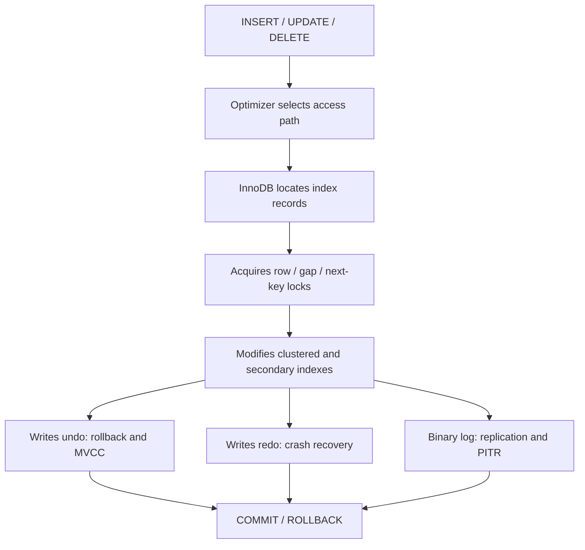

# Impact of DML on Indexes, Locks, Undo, Redo, and Binary Logs

A DML statement such as INSERT, UPDATE, or DELETE does more than alter values in a single row. In InnoDB, each operation can also modify the clustered index and multiple secondary indexes, acquire locks to protect data, write undo records for rollback and consistent reads, write redo records for crash recovery, and generate binary log events for replication and point-in-time recovery.

Consequently, an UPDATE that modifies just one column can trigger multiple writes inside the storage engine. If that column appears in several indexes, the transaction must also update the affected index structures. If the WHERE condition scans a wide range, InnoDB may lock more index records than the number of rows ultimately modified. If a transaction remains open for a long time, undo versions persist longer and purge struggles to clean up. If binary logging is enabled, committed changes are also written to logs at the server layer.

In the **DATABASE_MYSQL** module, understanding this chain of effects helps you design indexes, split batches, reduce lock contention, estimate write amplification, and configure appropriate durability settings. This lesson traces the lifecycle of DML in InnoDB, distinguishes the roles of indexes, locks, undo, redo, and binary logs, and outlines how to observe and optimize workloads.

## 1. Big Picture When a DML Statement Runs

An INSERT, UPDATE, or DELETE statement passes through multiple layers:

1. MySQL parses the statement, checks privileges and constraints, and chooses an execution plan.
2. InnoDB locates the target records via the clustered index or secondary indexes.
3. InnoDB acquires the required locks to protect those records and surrounding index ranges.
4. InnoDB modifies data and index pages in the buffer pool.
5. Undo records are generated to support rollback and MVCC consistent reads.
6. Redo records are written so page changes can be replayed after a crash.
7. If binary logging is enabled, MySQL writes DML events to the binary log according to the binlog format.
8. On commit, InnoDB and the binary log coordinate to keep transaction outcomes consistent; flush settings dictate durability guarantees across crashes.

You can visualize the simplified flow:



This diagram shows the involved components, not a strict physical write order for every operation. InnoDB has buffering, background flushing, group commit, and its own commit coordination mechanism. The key takeaway is that a single DML statement generates work in both the storage engine and the server layer.

## 2. InnoDB Stores Data Using Clustered and Secondary Indexes

To understand DML cost, first understand how InnoDB organizes data.

### 2.1. Clustered Index

In InnoDB, row data is stored in the leaf pages of the clustered index. Normally, the clustered index is the PRIMARY KEY.

Example:

```sql
CREATE TABLE orders (
    order_id BIGINT UNSIGNED NOT NULL,
    customer_id BIGINT UNSIGNED NOT NULL,
    status VARCHAR(20) NOT NULL,
    total_amount DECIMAL(12, 2) NOT NULL,
    created_at DATETIME NOT NULL,
    PRIMARY KEY (order_id)
) ENGINE = InnoDB;
```

Rows are organized in primary key order inside the clustered index. When accessing a row by `order_id`, InnoDB traverses to the leaf record of the clustered index and reads the row data directly there.

If a table declares no PRIMARY KEY, InnoDB picks a unique index with NOT NULL columns as the clustered index if one exists. If no suitable key exists, InnoDB creates a hidden clustered index using an internal row ID.

Because the clustered index holds row data, modifying even an unindexed column requires updating the clustered record. However, if that column does not appear in any secondary index, secondary index entries do not need to be modified simply because its value changed.

### 2.2. Secondary Indexes

A secondary index is a separate B-tree storing the indexed columns alongside the primary key of the corresponding row.

Example:

```sql
CREATE INDEX idx_orders_customer_status
    ON orders (customer_id, status);

CREATE INDEX idx_orders_created_at
    ON orders (created_at);
```

Leaf entries of `idx_orders_customer_status` store `customer_id`, `status`, and `order_id` (the primary key) so InnoDB can look up the clustered record whenever additional columns are needed.

This has two consequences:

- A single row can appear in multiple index structures.
- The wider the PRIMARY KEY, the more space secondary indexes consume because every secondary index entry embeds the primary key.

Choosing a short, stable, immutable primary key reduces both storage footprint and secondary index maintenance overhead.

## 3. How Does DML Affect Indexes?

### 3.1. INSERT

When inserting a new row, InnoDB typically must:

- Find the position in the clustered index and insert the clustered record.
- Insert an entry into every relevant secondary index.
- Check PRIMARY KEY and UNIQUE indexes to guarantee no duplicates.
- Check any related FOREIGN KEY constraints.
- Acquire required locks for insertion and constraint checks.
- Write undo/redo as required by the transaction and generate binlog events if binary logging is enabled.

Example:

```sql
INSERT INTO orders (
    order_id,
    customer_id,
    status,
    total_amount,
    created_at
)
VALUES (
    90001,
    501,
    'PENDING',
    1250000.00,
    CURRENT_TIMESTAMP
);
```

If a table has three secondary indexes, inserting one row is not a single write to the table: it also adds entries to those three indexes. The more indexes exist, the higher the write cost and storage usage.

### 3.2. Updating an Unindexed Column

Suppose `total_amount` is not in any secondary index:

```sql
UPDATE orders
SET total_amount = 1300000.00
WHERE order_id = 90001;
```

InnoDB locates the row via the PRIMARY KEY, locks the target record, writes undo and redo, and modifies the clustered record. Secondary indexes that do not include `total_amount` generally do not require entry updates.

This is one reason not to index every column: each added index increases the work required on writes.

### 3.3. Updating an Indexed Column

If updating `status`, which belongs to `idx_orders_customer_status`:

```sql
UPDATE orders
SET status = 'PAID'
WHERE order_id = 90001;
```

InnoDB must update the clustered record and update any secondary index containing `status`. Logically, the old index entry no longer matches the new value, and a new entry for the new value must be created. The engine manages delete-marking and inserting entries internally; do not think of this as a simple in-place byte edit.

If an indexed column appears in multiple secondary indexes, every affected index must be updated. Updating a primary key is even costlier: because the primary key is embedded in secondary indexes, changing a PRIMARY KEY can require moving the clustered record and updating key references across every secondary index.

### 3.4. DELETE

When deleting a row:

```sql
DELETE FROM orders
WHERE order_id = 90001;
```

InnoDB does not necessarily physically erase the entire record right away. The row and associated index entries are delete-marked; undo retains the information needed for rollback and for active consistent reads that still see the old version. Once no read view requires the old version, the purge thread removes the delete-marked versions and entries.

Therefore, deleting many rows can generate substantial undo volume and prolonged purge work. Deleting rows does not immediately shrink data pages or reduce tablespace file size on disk.

### 3.5. Summary Table of Effects

| Operation | Clustered Index | Secondary Indexes | Undo / Redo |
|---|---|---|---|
| INSERT | Inserts new row | Inserts corresponding entry into each index | Undo needed for rollback; redo records changes |
| UPDATE unindexed column | Modifies row | Usually unchanged | Undo stores old value; redo records changes |
| UPDATE indexed column | Modifies row | Updates indexes containing that column | Undo/redo for related changes |
| UPDATE PRIMARY KEY | Moves / changes row key | May update every secondary index because they embed PK | Can generate heavy undo/redo |
| DELETE | Delete-marks row | Delete-marks related entries; purge cleans up later | Undo supports rollback/MVCC; redo records changes |

Exact physical details depend on version, index structure, page state, and storage engine. The table above summarizes the typical logical impact in InnoDB.

## 4. Indexes Increase Write Cost and Write Amplification

Well-chosen indexes speed up read queries, yet every extra index requires storage and maintenance work.

An INSERT into a heavily indexed table modifies multiple B-trees. Updating a column included in several indexes modifies multiple entries. DELETE must delete-mark every corresponding entry. These modifications create extra page changes, redo records, buffer pool dirty pages, and downstream I/O.

This is a form of **write amplification**: a small logical change to a row generates multiple physical writes across different structures.

### 4.1. Example of Over-Indexing

Orders table:

```sql
CREATE TABLE order_items (
    item_id BIGINT PRIMARY KEY,
    order_id BIGINT NOT NULL,
    product_id BIGINT NOT NULL,
    quantity INT NOT NULL,
    unit_price DECIMAL(12, 2) NOT NULL,
    status VARCHAR(20) NOT NULL,
    created_at DATETIME NOT NULL,
    KEY idx_order (order_id),
    KEY idx_product (product_id),
    KEY idx_status (status),
    KEY idx_created (created_at),
    KEY idx_quantity (quantity),
    KEY idx_price (unit_price)
) ENGINE = InnoDB;
```

If the actual workload frequently searches only by `order_id` and `product_id`, standalone indexes on `quantity`, `unit_price`, `status`, and `created_at` may not deliver enough read benefit to justify their write cost. Never judge from schema alone; inspect actual queries, selectivity, and execution plans.

### 4.2. Choosing Indexes Based on Workload

Before adding an index:

1. Identify which read queries are actually slow and frequent.
2. Inspect existing indexes, column order, and leftmost prefixes.
3. Evaluate whether the column has adequate selectivity.
4. Consider composite indexes instead of multiple single-column indexes if they serve the workload together.
5. Measure INSERT/UPDATE/DELETE cost before and after the change.
6. Monitor index footprint, buffer pool usage, and write latency.

Do not drop an index solely because few queries used it over a short observation window. An index may serve periodic reporting queries, UNIQUE/FOREIGN KEY constraints, or a critical business flow.

### 4.3. Change Buffer for Secondary Indexes

InnoDB provides change buffering for certain secondary index modifications when the target index page is not currently in the buffer pool. Eligible modifications can be recorded in the change buffer and merged later when the page is read or during background operations.

This mechanism reduces random secondary-index page reads at write time. However:

- Not every type of index modification is eligible.
- Unique secondary indexes must check uniqueness and are not buffered in this standard way.
- Change buffering does not eliminate index maintenance cost; it defers and batches part of the work.
- Settings and behavior vary by version; check `innodb_change_buffering` on the target server.

Never rely on the change buffer to justify creating unnecessary indexes.

## 5. Which Locks Does DML Acquire in InnoDB?

InnoDB uses locks on index records and index ranges to coordinate concurrent access. Because locks attach to index records, the access path chosen by the optimizer directly affects the locking scope.

Key lock types:

| Lock Type | Meaning |
|---|---|
| Record lock | Locks a single index record |
| Gap lock | Locks the gap between index records, preventing other transactions from inserting into that gap |
| Next-key lock | Combines a record lock and a gap lock on the interval ending at that record |
| Insert intention lock | Signals intent to insert into a gap; allows concurrent inserts at different positions in the same gap |
| Intention lock | Table-level lock signaling intent, coordinating with row-level locks |
| AUTO-INC lock | Coordination mechanism for AUTO_INCREMENT allocation depending on `innodb_autoinc_lock_mode` |

DML normally requires an exclusive record lock on modified records. For range queries, gap or next-key locks may protect ranges from phantom inserts depending on isolation level and query type.

### 5.1. Metadata Locks vs. Row Locks

When accessing a table, DML also acquires a metadata lock (MDL) to protect the table definition while the statement and transaction use it. Normal DML acquires metadata locks compatible with regular reads/writes, yet can block or be blocked by DDL requiring a conflicting metadata lock, such as certain `ALTER TABLE` operations.

Metadata locks protect table metadata; record/gap/next-key locks protect data and index ranges in InnoDB. A transaction may hold few row locks yet still block DDL because it has not finished and still holds an MDL. Therefore, when `ALTER TABLE` hangs, inspect long-running transactions and metadata locks, not just row locks.

### 5.2. UPDATE and DELETE Lock Along the Access Path

Example:

```sql
UPDATE orders
SET status = 'CANCELLED'
WHERE customer_id = 501
  AND created_at < '2026-01-01';
```

If an index `(customer_id, created_at)` exists, InnoDB can target a relatively narrow index region. Without an appropriate index, the server may have to scan far more rows; DML may inspect and lock many more records while searching for rows matching the condition.

Key point: the number of rows actually modified does not necessarily equal the number of index records scanned or locks acquired during execution. A poorly indexed filter predicate can widen the lock scope and increase contention.

Run `EXPLAIN` on an equivalent `SELECT` with the same `WHERE` condition to understand the access path, then confirm with lock instrumentation and realistic workloads. On supported versions, MySQL also allows `EXPLAIN` directly on certain `UPDATE`/`DELETE` statements—verify syntax and version behavior.

### 5.3. Record Locks and Unique Lookups

For queries using a unique index to locate exactly one row via the entire unique key, InnoDB typically needs only a record lock on the found record without locking the preceding gap when the record is found. If no record is found or the condition is a range or non-unique lookup, the locked scope can be broader depending on isolation level.

Example updating by primary key:

```sql
UPDATE orders
SET status = 'PAID'
WHERE order_id = 90001;
```

Lookup by a unique primary key generally produces a small, predictable lock scope compared to updating by an unindexed column.

## 6. Isolation Levels Affect Gap Locks and Next-Key Locks

InnoDB defaults to `REPEATABLE READ` in MySQL. The isolation level governs range locking and what consistent reads see.

### 6.1. REPEATABLE READ

Under `REPEATABLE READ`, locking reads and DML use next-key locking in many range-scan scenarios to prevent other transactions from inserting records into protected intervals. This helps prevent certain phantoms during locking operations.

Example:

```sql
START TRANSACTION;

SELECT *
FROM orders
WHERE customer_id = 501
  AND created_at >= '2026-01-01'
FOR UPDATE;
```

If `(customer_id, created_at)` is used, InnoDB may lock index records in that range along with their associated gaps via next-key locks. Another transaction trying to insert a new order into the locked range may have to wait.

### 6.2. READ COMMITTED

Under `READ COMMITTED`, gap locking for searches and index scans is generally disabled, except where needed for FOREIGN KEY checks and duplicate-key checking. Record locks on updated rows are still acquired.

This can reduce lock contention in some workloads, yet it alters read semantics and phantom protection. Never switch isolation levels just to "make lock waits disappear" without understanding application consistency requirements.

Check the isolation level:

```sql
SELECT
    @@GLOBAL.transaction_isolation,
    @@SESSION.transaction_isolation;
```

## 7. INSERT Also Acquires Locks

INSERT is not a lock-free operation. InnoDB must coordinate index insertion positions and validate constraints.

When inserting into a B-tree, InnoDB may acquire an insert intention lock on a gap before placing the new record. Transactions can insert at different positions within the same gap without necessarily blocking each other, whereas inserting into the same unique key may wait to determine duplicate outcomes.

Situations that cause an INSERT to wait:

- Another transaction holds a lock on the target index position or gap.
- The unique key is currently being inserted by another uncommitted transaction.
- FOREIGN KEY checks must read/lock the referenced parent record.
- AUTO_INCREMENT allocation or bulk insert operations have their own lock coordination.
- Metadata locks held by DDL or other transactions.

Thus, even a simple INSERT can experience lock waits or deadlocks under concurrency.

## 8. Foreign Keys and Triggers Expand DML Scope

A single DML statement can trigger additional checks or cascading updates:

- FOREIGN KEYs require checking the parent row when inserting/updating a foreign key and checking child rows when deleting/updating a parent key.
- `ON DELETE CASCADE` or `ON UPDATE CASCADE` can modify many rows in child tables.
- Triggers can execute additional INSERT/UPDATE/DELETE statements on other tables.
- UNIQUE constraints must check for conflicts before writing.

Example:

```sql
CREATE TABLE order_lines (
    line_id BIGINT PRIMARY KEY,
    order_id BIGINT NOT NULL,
    product_id BIGINT NOT NULL,
    quantity INT NOT NULL,
    CONSTRAINT fk_line_order
        FOREIGN KEY (order_id)
        REFERENCES orders(order_id)
        ON DELETE CASCADE
) ENGINE = InnoDB;
```

Deleting one row in `orders` can cascade to delete many `order_lines` rows. Therefore, estimating affected row counts must include cascades and triggers, not just the table named directly in the DELETE statement.

Foreign key and trigger designs should be reviewed together with lock ordering. Two transactions updating related tables in opposite orders can cause deadlocks.

## 9. Undo Log: Rollback and MVCC

The undo log stores information needed to undo changes and reconstruct older row versions for consistent reads. It underpins both rollback and Multi-Version Concurrency Control (MVCC) in InnoDB.

### 9.1. UPDATE Creates an Old Version

Suppose a row currently holds:

| order_id | status | total_amount |
|---:|---|---:|
| 90001 | PENDING | 1250000.00 |

Transaction A executes:

```sql
START TRANSACTION;

UPDATE orders
SET status = 'PAID'
WHERE order_id = 90001;
```

InnoDB stores undo information so it can restore the prior value and allow eligible consistent reads to see the old version. Until the transaction commits, the change is not visible as committed to other transactions per isolation rules.

### 9.2. DELETE and Undo

On DELETE, InnoDB must retain enough information to roll back the deleted row and serve read views that still see that row. Hence, the row is delete-marked before physical purge later.

### 9.3. Undo Is Not the Binary Log

Undo and the binary log serve different purposes:

- Undo is an internal InnoDB structure supporting rollback and MVCC.
- The binary log is a MySQL server-layer log supporting replication and point-in-time recovery.
- Undo is not an event stream for replicas to replay.
- The binary log does not replace undo for rolling back an uncommitted transaction.

### 9.4. Long Transactions Keep Undo Alive

A transaction holding a read view open for a long time can prevent purge from cleaning up older versions that the transaction still needs. Under heavy continuous UPDATE/DELETE workloads, the history list can grow and undo tablespaces can expand.

Example of a long-open transaction:

```sql
START TRANSACTION;

SELECT *
FROM orders
WHERE customer_id = 501;

-- Application keeps the transaction open for a long time.
-- Other transactions continue to UPDATE/DELETE orders.

COMMIT;
```

Long-running read transactions pin old versions needed for consistent reads. Large write transactions also generate heavy undo records, making rollbacks slow and giving purge extra work after commit.

Monitor History list length in `SHOW ENGINE INNODB STATUS` along with relevant transaction/undo metrics. Do not apply a single fixed threshold to all workloads; watch growth rate, retention duration, and storage impact.

## 10. Redo Log: Recovering Changes After a Crash

The redo log records page-level change information so InnoDB can replay committed changes even if data pages had not yet been flushed to data files at the time of a crash.

### 10.1. Write-Ahead Logging

InnoDB follows write-ahead logging: corresponding redo records must be durably written per configuration before modified data pages are flushed to main data files. This allows crash recovery to replay required changes.

Simplified flow:

1. Transaction modifies a page in the buffer pool.
2. The page becomes a dirty page.
3. Redo records are written to the redo log buffer.
4. Redo is written out to redo log files via commit/flush and background flushing.
5. Dirty pages are flushed to tablespaces later.
6. If the server crashes before data pages are fully written, InnoDB uses redo to recover.

The redo log exists primarily for InnoDB crash recovery and durability. It is not a SQL history log for reading back business events.

### 10.2. Redo vs. Undo

| Characteristic | Undo | Redo |
|---|---|---|
| Goal | Rollback and MVCC | Crash recovery |
| Information direction | Restores prior state | Replays required modifications |
| Lifecycle | Retained until transactions/read views no longer need it | Reused via checkpoints and redo log lifecycle |
| Used for replication | No | Not directly |
| On rollback | Used to undo changes | Undoing changes also modifies pages and generates redo |

When a transaction rolls back, InnoDB uses undo to revert changes; those undo actions themselves modify pages and generate corresponding redo so crash recovery can restore the post-rollback state.

### 10.3. innodb_flush_log_at_trx_commit

The `innodb_flush_log_at_trx_commit` variable controls how the redo log is written and flushed:

| Value | General Behavior | Risk on OS/Server Power Loss |
|---:|---|---|
| 0 | Writes and flushes redo on a background cycle, roughly every second | Can lose recent transactions |
| 1 | Writes and flushes redo to storage on every commit | Highest durability within InnoDB's mechanism |
| 2 | Writes redo to OS cache on every commit, flushes to storage on a background cycle | Can lose recent transactions if the OS or host loses power |

Check:

```sql
SELECT @@GLOBAL.innodb_flush_log_at_trx_commit;
```

A value of 1 is typically chosen when durability is the priority. Values 0 or 2 can improve throughput in certain workloads at the risk of losing transactions already acknowledged to the application near a crash.

Actual end-to-end protection also depends on the filesystem, storage hardware, write caches, and whether storage honors flush/fsync calls.

## 11. Binary Log: Replication and Point-in-Time Recovery

The binary log (binlog) is written by the MySQL server at the server layer and contains events that modify data or logged metadata per configuration. For DML, its contents depend on `binlog_format`.

The binary log is used for:

- Replication: replicas read and apply events from the source.
- Point-in-time recovery: restoring a full backup and replaying binlogs up to a target timestamp.
- Audit/CDC in systems consuming binlog streams.
- Data synchronization across components.

### 11.1. Statement-Based, Row-Based, and Mixed

| Format | Logged Content | Characteristics |
|---|---|---|
| STATEMENT | SQL statements logged for replay | More compact in some workloads, but requires deterministic statements and compatible environments |
| ROW | Row-level changes logged | Captures exact changed rows; can produce large binlogs for multi-row UPDATE/DELETE |
| MIXED | Server chooses statement or row depending on the case | Combines both modes per MySQL rules |

Check:

```sql
SELECT
    @@GLOBAL.log_bin AS log_bin_enabled,
    @@GLOBAL.binlog_format AS binlog_format;
```

With row-based logging, the binlog can contain before-images and after-images depending on the operation, `binlog_row_image`, and required columns. `FULL` logs complete row images per rules; `MINIMAL` reduces logged bytes by recording only necessary columns; `NOBLOB` omits certain unneeded BLOB/TEXT columns. Row image settings impact binlog size and CDC consumer compatibility.

### 11.2. Binlog Is Not the Redo Log

| Characteristic | Redo Log | Binary Log |
|---|---|---|
| Logging layer | InnoDB storage engine | MySQL server |
| Primary purpose | Crash recovery, durability | Replication, PITR, CDC |
| Contents | Page-change recovery information | SQL statements or row events |
| Scope | InnoDB data | Server-logged changes per configuration |
| Management | InnoDB manages checkpoints and redo lifecycle | Server manages files, index, rotation, and binlog purge |

You cannot use the redo log in place of the binlog to build a replica. Nor can you use the binlog in place of redo for InnoDB to recover dirty pages after a crash.

### 11.3. sync_binlog

`sync_binlog` controls how often MySQL syncs the binary log to storage:

| Value | General Meaning |
|---:|---|
| 0 | Lets the OS decide when to flush |
| 1 | Syncs binlog to storage at every commit via group commit |
| N greater than 1 | Syncs after every N commits |

Check:

```sql
SELECT @@GLOBAL.sync_binlog;
```

Combining `innodb_flush_log_at_trx_commit = 1` and `sync_binlog = 1` is standard when prioritizing high durability, as both redo and binlog are strictly synced at commit time. Real-world settings must balance performance, storage hardware, and acceptable data-loss bounds.

## 12. Commit Coordination Between InnoDB Redo and Binary Log

When binary logging is enabled and a transaction modifies InnoDB data, MySQL must coordinate commits in two places: the storage engine and the binary log. MySQL uses internal two-phase commit (2PC) to keep state consistent if a crash occurs mid-commit.

High-level overview:

1. InnoDB prepares the transaction and ensures required data is written to redo.
2. MySQL writes the transaction events to the binary log.
3. Once binlog writing succeeds, MySQL instructs InnoDB to commit the transaction.
4. Group commit can batch multiple transactions to reduce synchronous flush overhead.

If a crash happens between steps, on restart MySQL reconciles InnoDB's prepared transactions against the binary log to decide whether each transaction should commit or roll back. This prevents a transaction from appearing in the binlog without existing in InnoDB, or vice versa.

This is a high-level overview of commit coordination; exact flush and sync ordering depends on durability settings, group commit, and server version. Applications should treat a transaction as successful only after `COMMIT` returns success, and flush settings must match durability requirements.

## 13. DML, Buffer Pool, and I/O

InnoDB typically modifies pages in the buffer pool before writing data pages back to tablespaces. Modified pages become dirty pages. Background flushing and checkpoints write dirty pages to storage per InnoDB's flushing strategy.

A DML statement can trigger:

- Reading index/data pages not currently in the buffer pool.
- Modifying a clustered index page.
- Modifying one or more secondary index pages.
- Writing undo pages and redo records.
- Creating dirty pages that eventually require flushing.
- Generating binlog events if binary logging is enabled.
- Secondary I/O from page splits, purge, change buffer merges, or checkpoints.

If a workload performs random writes to indexes larger than memory, cache misses and random I/O rise. If a transaction writes too many rows, dirty pages, redo, and undo can surge, pressuring background flushing and log capacity.

Not every DML causes a synchronous disk write per row. The buffer pool, redo log buffer, group commit, and batching amortize the work. Nevertheless, changes still incur real cost that must eventually be flushed and maintained.

## 14. Example: Why Updating One Column Can Be Expensive

Suppose `orders` has:

- `PRIMARY KEY (order_id)`.
- Secondary index `(customer_id, status)`.
- Secondary index `(status, created_at)`.
- Secondary index `(created_at)`.

Statement:

```sql
UPDATE orders
SET status = 'PAID'
WHERE order_id = 90001;
```

Even though only one column changes, InnoDB must:

1. Locate the row by PRIMARY KEY.
2. Lock the target record.
3. Write undo storing the old `status` value.
4. Modify the clustered record.
5. Update `idx_orders_customer_status`.
6. Update `idx_orders_status_created`.
7. Write redo for the page modifications.
8. Write row/statement events to the binary log if enabled.
9. On commit, coordinate redo and binlog per durability settings.

If `status` were not in those two secondary indexes, those two index maintenance steps would not be needed. This shows how index choices directly drive update cost.

## 15. Observing Locks, Transactions, and Logs in MySQL

### 15.1. Viewing Active Transactions

```sql
SELECT
    trx_id,
    trx_state,
    trx_started,
    trx_wait_started,
    trx_mysql_thread_id,
    trx_rows_locked,
    trx_rows_modified,
    trx_query
FROM INFORMATION_SCHEMA.INNODB_TRX;
```

This query finds long-running transactions, waiting transactions, and transactions that modified many rows. Appropriate privileges are required to view these details.

### 15.2. Viewing Locks and Lock Waits

MySQL 8.0 provides Performance Schema tables:

```sql
SELECT *
FROM performance_schema.data_locks;
```

```sql
SELECT *
FROM performance_schema.data_lock_waits;
```

`data_locks` shows locks currently held or requested; `data_lock_waits` maps waiting transactions to blocking transactions. Columns can vary across versions; select only needed columns rather than relying on `SELECT *` in long-lived dashboards.

### 15.3. Viewing InnoDB Status

```sql
SHOW ENGINE INNODB STATUS;
```

Sections to pay close attention to:

- TRANSACTIONS: running transactions, lock waits, and the most recent deadlock.
- HISTORY LIST LENGTH: queue of undo versions awaiting purge.
- LOG: redo log and checkpoint details.
- BUFFER POOL AND MEMORY: buffer pool and page status.

The output is a point-in-time snapshot; the deadlock section typically displays only the latest recorded deadlock. For ongoing investigations, combine this with Performance Schema and log monitoring.

### 15.4. Viewing Durability Configuration

```sql
SELECT
    @@GLOBAL.innodb_flush_log_at_trx_commit
        AS innodb_flush_log_at_trx_commit,
    @@GLOBAL.sync_binlog AS sync_binlog,
    @@GLOBAL.binlog_format AS binlog_format,
    @@GLOBAL.log_bin AS log_bin_enabled;
```

Inspect settings in the actual environment and compare against RPO/RTO requirements. Never alter durability variables based on a single benchmark alone.

## 16. Reducing DML Impact on Indexes, Locks, and Logs

### 16.1. Use Indexed WHERE Clauses and Update by a Stable Key

Prefer updating by primary key or an appropriate index:

```sql
UPDATE orders
SET status = 'CANCELLED'
WHERE order_id = 90001;
```

Avoid unindexed or unfiltered UPDATE/DELETE statements on large tables unless broad modification is explicitly intended.

### 16.2. Keep Transactions Short

The longer a transaction runs, the longer it holds locks and read views. Perform non-database work before starting a transaction, open the transaction only when needed, and commit/roll back promptly.

Never wait for user input or make external network service calls while holding an open transaction and row locks.

### 16.3. Use Controlled Batching

Instead of one massive DELETE:

```sql
DELETE FROM audit_events
WHERE created_at < '2024-01-01';
```

delete in batches using a stable key:

```sql
DELETE FROM audit_events
WHERE event_id IN (
    SELECT event_id
    FROM (
        SELECT event_id
        FROM audit_events
        WHERE created_at < '2024-01-01'
        ORDER BY event_id
        LIMIT 1000
    ) AS batch_rows
);
```

Repeat in batches while measuring duration, lock waits, undo/redo generation, and replication lag. This example requires suitable indexes for filtering/ordering and must be tested for syntax on the target version. There is no single optimal batch size for all systems.

Smaller batches keep transactions short and reduce undo/redo per transaction, yet overly tiny batches raise commit overhead and can lower throughput. Measure to pick a sensible size.

### 16.4. Trim Unnecessary Indexes

Every secondary index adds write overhead. Re-evaluate redundant indexes, rarely used indexes, and poorly ordered composite indexes. Retain indexes needed for critical queries, UNIQUE constraints, and FOREIGN KEYs per design requirements.

### 16.5. Avoid Updating Primary Keys

Primary keys are stored inside secondary indexes. Changing a PK can force InnoDB to update numerous index entries and affect referencing tables. Use an immutable PK; if a business code needs to change, store it in a separate column.

### 16.6. Standardize Update Order Across Transactions

If transaction A updates table X then Y, while transaction B updates Y then X, deadlock risk rises. Design write flows to touch tables and keys in a consistent order, keep transactions short, and implement deadlock retries.

Deadlocks are a normal occurrence in concurrent systems. Applications must handle deadlock errors by rolling back and retrying the entire transaction with reasonable bounds, not merely re-running the last SQL statement.

## 17. Procedure for Investigating Slow or Blocking DML

When an INSERT, UPDATE, or DELETE is slow, check in order:

1. **Identify the statement and data scope.** How many rows are expected to be touched? Are triggers or cascades involved?
2. **Inspect the access path.** Check which index is used and how many rows are scanned.
3. **Evaluate index maintenance.** How many secondary indexes include the updated column? Is the PK changing?
4. **Check transactions.** Are there long-running transactions, locked rows, or waiting transactions?
5. **Identify lock types and blockers.** Use Performance Schema `data_locks`, `data_lock_waits`, and `INNODB_TRX`.
6. **Check undo/purge.** Is history list length climbing persistently? Are read views held open too long?
7. **Check redo and I/O.** Are redo generation, checkpoints, dirty pages, or storage latency creating bottlenecks?
8. **Check the binlog.** Is row-based logging generating huge event volumes? Is replica lag or binlog storage growing rapidly?
9. **Test small changes.** Tune indexes, batch sizes, transaction scope, or update order in staging.
10. **Measure before and after.** Compare throughput, latency, lock waits, rows examined, redo/binlog volume, and replication lag.

Do not optimize solely by increasing buffer or log sizes if the root cause is overly broad scans, redundant indexes, or transactions holding locks for too long.

## 18. Common Misconceptions

| Misconception | Accurate Understanding |
|---|---|
| A single-row UPDATE writes to just one place | It can modify the clustered record and multiple secondary indexes |
| Indexes only make SELECT faster | Indexes increase INSERT/UPDATE/DELETE cost and storage |
| DELETE physically removes rows immediately | InnoDB delete-marks rows; purge cleans up once no read view needs old versions |
| Undo and redo are the same | Undo serves rollback/MVCC; redo serves crash recovery |
| Redo log is used for replication | Replication uses the binary log |
| Binary log rolls back open transactions | Rollback relies on InnoDB undo |
| UPDATE locks only rows that actually change | DML can lock records/ranges along its access path and isolation level |
| INSERT acquires no locks | INSERT locks index positions, checks unique/FKs, and can wait |
| READ COMMITTED never uses gap locks | Gap locks can still be used for FK and duplicate-key checks |
| Successful commit always means data is fsynced to disk | Durability depends on `innodb_flush_log_at_trx_commit`, `sync_binlog`, and the storage stack |
| One big transaction can be used for any batch | Huge transactions hold locks too long and generate heavy undo/redo |
| Deadlocks are abnormal bugs that can always be avoided | Deadlocks are a natural consequence of concurrency; applications must retry transactions |

## 19. Key Takeaways

- DML affects the clustered index, secondary indexes, locks, undo, redo, and potentially the binary log.
- InnoDB stores row data in the clustered index; secondary indexes store the primary key to reference rows.
- INSERT adds entries to indexes; UPDATE on indexed columns must update relevant indexes; DELETE delete-marks rows for later purge.
- Every additional index adds storage and write cost; design for the read/write workload.
- InnoDB locks index records and index ranges; access path, isolation level, and query type govern lock scope.
- Undo supports rollback and MVCC; long transactions/read views can delay purge and inflate history list length.
- Redo supports crash recovery via write-ahead logging.
- The binary log serves replication, PITR, and CDC; it does not replace undo or redo.
- `innodb_flush_log_at_trx_commit` and `sync_binlog` govern durability and commit performance.
- Minimize DML overhead with indexed WHERE clauses, short transactions, controlled batching, lean indexes, and consistent update ordering.
- Use Performance Schema, `INFORMATION_SCHEMA.INNODB_TRX`, and `SHOW ENGINE INNODB STATUS` to investigate locks, transactions, and purge.
- Always measure execution plans, lock waits, undo/redo, binlog volume, and replication lag before and after optimizing.

When analyzing DML cost, trace both the row's path through indexes and the transaction's path through locks, undo, redo, and the binary log. This perspective explains why a small change can create heavy write load, lock waits, or replication lag, guiding you to the right optimization target.
