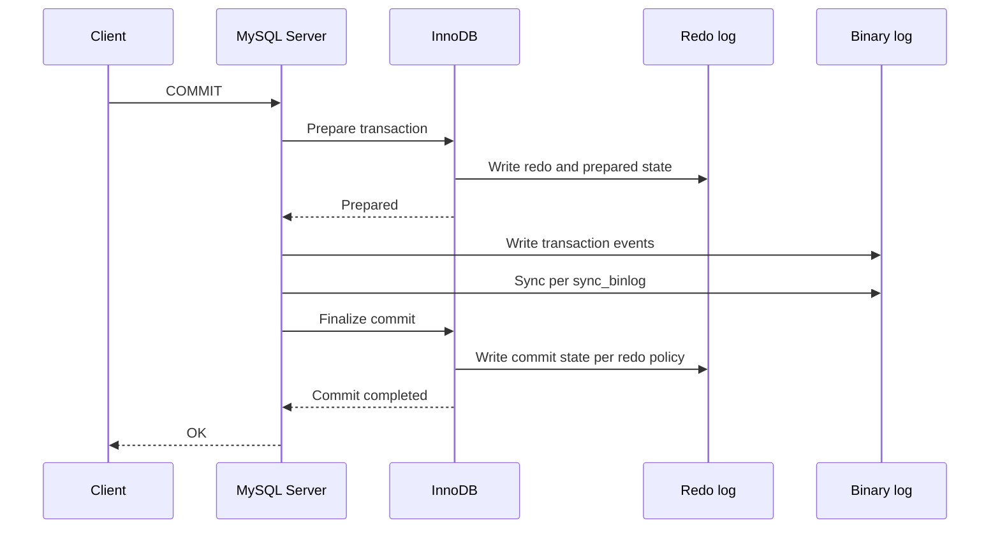

# Transactions

## Coordinating Redo, Binary Log, and Commit Durability

An InnoDB transaction can be recorded in two logging systems for different purposes: the redo log helps InnoDB recover data state after a crash, while the binary log records server-level changes for replication and point-in-time recovery. When binary logging is enabled, MySQL must coordinate these two logs to prevent a situation where a transaction is considered committed in InnoDB yet missing from the binary log, or vice versa.

This coordination is tied to the two-phase commit mechanism, group commit, and the options `innodb_flush_log_at_trx_commit` and `sync_binlog`. Understanding these components helps choose the right configuration balance between data durability, write performance, and recovery capability after power loss or server failure.

### 1. Why Does MySQL Need Both Redo Log and Binary Log?

The redo log belongs to InnoDB. It records the information needed to replay changes onto data pages when InnoDB restarts after a crash. InnoDB follows the write-ahead logging (WAL) principle: the required redo information must be durably written before the corresponding data pages are flushed to data files. As a result, a committed transaction can still be recovered even if the data pages were not yet written to disk.

The binary log (binlog) belongs to the MySQL server layer. It records data-modification events in the configured format, typically `ROW`, `STATEMENT`, or `MIXED`. Replicas read the binlog from the source to re-execute changes; the `mysqlbinlog` tool can read the log to replay events after a backup, supporting point-in-time recovery (PITR).

| Component | Scope and Content | Primary Purpose | Not a Substitute For |
| --- | --- | --- | --- |
| InnoDB redo log | Log of changes needed to recover InnoDB pages | Crash recovery, ensuring committed changes can be recovered | Binlog for replication and PITR |
| Binary log | Server-level transaction events; format depends on `binlog_format` | Replication, change history, and PITR | Redo log for InnoDB internal crash recovery |
| InnoDB undo log | Undo information and older data versions | `ROLLBACK`, MVCC, and consistent reads | Redo log or binlog |

The redo log typically describes changes at InnoDB's internal level; the binlog describes logical events at the server level. They are not identical copies. A single transaction may generate many redo records while being represented as a single transaction event group in the binlog.

If `log_bin` is off, MySQL does not write a binary log and there is no need to coordinate commits between redo and binlog. InnoDB still needs the redo log for crash recovery. If `log_bin` is on, recording transactions into both logs must be coordinated.

### 2. Two-Phase Commit Coordinating InnoDB and Binary Log

When binary logging is enabled and a transaction uses InnoDB, MySQL uses a two-phase commit mechanism between the storage engine and the binary log. It can be understood in the following logical sequence:

1. **Prepare in InnoDB:** InnoDB writes the necessary redo records and transitions the transaction into the prepared state. This state enables recovery and deciding whether to commit or roll back after a server crash.
2. **Write the binary log:** MySQL writes the transaction's events to the binlog. Completed transactions are recorded along transaction boundaries so replicas and recovery tools can recognize a complete group of changes.
3. **Sync the logs:** MySQL syncs the binlog according to the `sync_binlog` policy; InnoDB syncs redo according to the `innodb_flush_log_at_trx_commit` policy. These are critical milestones determining which data is truly durable before a power failure or OS crash.
4. **Commit in InnoDB:** After the coordinated log-writing phase finishes, MySQL instructs InnoDB to finalize the commit. Once the transaction is confirmed successful, the server returns the result to the client.

The following diagram shows the logical relationship between components; group commit can batch multiple transactions into a single log write or sync:



In practice, MySQL organizes commits into internal stages and can optimize the ordering of writes, syncs, and commits. Therefore, the diagram should be read as a coordination model rather than a literal I/O call sequence for every version. When the highest durability is needed for InnoDB transactions with binlog enabled, configuring both logs to sync on every commit is a common choice.

### 3. Crash Scenarios During Commit

Two-phase commit helps MySQL resolve incomplete states when the server stops mid-way while writing the two logs. Upon restart, InnoDB performs crash recovery using redo; coordination with the binlog determines the fate of transactions in the prepared state.

| Time of Crash | Potential Remaining State | Recovery Action |
| --- | --- | --- |
| Before InnoDB prepare | Transaction lacks a durable prepared state | Uncommitted changes are rolled back |
| After prepare but before transaction is written to binlog | InnoDB has a prepared transaction without a matching commit record in the binlog | The transaction is rolled back during recovery |
| After binlog is durably written but before InnoDB completes commit | Binlog contains the transaction; InnoDB has the prepared state | Recovery uses the decision recorded in the binlog to complete the InnoDB commit |
| After both logs are synced but before the client receives a response | The transaction is durably committed, though the client may not know the outcome | The transaction persists after restart; the client must check the outcome before resending the operation |

The last case is critical for applications. If the connection drops right after sending `COMMIT`, the client may not know whether the transaction succeeded. Resending a payment, order creation, or balance deduction without a deduplication mechanism can apply the effect twice. Applications should use an idempotency key, a unique request ID, or query transaction status to handle indeterminate outcomes.

Coordinated recovery is only meaningful when the required logs still exist and were durably written per configuration. If the OS or storage hardware is allowed to delay syncing, a power outage can lose the most recent log segments and break the assumption that both sides saved safely.

### 4. innodb_flush_log_at_trx_commit: Redo Log Durability

The `innodb_flush_log_at_trx_commit` variable determines how InnoDB writes and flushes the redo log buffer. For InnoDB, this is one of the most important settings for transaction durability.

| Value | Key Behavior | Risk on OS Crash or Power Loss |
| --- | --- | --- |
| `1` | Writes redo and requests a flush to storage on every commit | Highest protection level per InnoDB's design |
| `2` | Writes redo to the OS buffer on every commit; flushes to storage periodically, typically about once per second | Recent commits can be lost if the OS or machine stops abruptly |
| `0` | InnoDB writes and flushes redo periodically, typically about once per second; does not write redo on every commit | Recent commits can be lost when the MySQL process, OS, or machine stops |

With value `1`, InnoDB asks the OS to sync redo down to storage on every commit. This does not mean every transaction always causes an isolated disk write: group commit allows multiple transactions to share a single flush. The policy still requires an appropriate sync point for each commit group.

With value `2`, redo data is transferred from the InnoDB buffer to the OS buffer on commit, while flushing to the storage device happens periodically. If only the `mysqld` process crashes while the OS stays up, data already in the OS buffer usually survives; however, you cannot rely on that when the OS or power stops.

Value `0` defers both writing redo from the InnoDB buffer and flushing periodically. If the MySQL process stops before the next scheduled write, redo for the most recent transactions may not have left process memory.

The default flush interval is typically about one second and can be influenced by scheduling, system load, and I/O. Do not interpret this as a strict guarantee that at most exactly one second of data can be lost in every failure.

### 5. sync_binlog: Binary Log Durability

The `sync_binlog` variable controls how often MySQL requests the binary log to be synced to storage.

| Value | Key Behavior | Consequence |
| --- | --- | --- |
| `1` | Syncs the binlog on every commit group via group commit | Highest binlog durability; commonly paired with `innodb_flush_log_at_trx_commit=1` |
| `0` | Does not request binlog sync per commit group; the OS decides when to write to storage | A trailing portion of the binlog can be lost if the OS or machine stops |
| `N` greater than `1` | Syncs after every `N` writes/commit groups per the binlog sync mechanism | Improves write performance in some workloads at the risk of losing recent log groups |

`sync_binlog=1` does not mean every transaction performs an isolated sync system call. Group commit lets multiple transactions be written to the binlog and then share a single sync. Therefore, value `1` can achieve much better throughput than a naive assumption of one `fsync` per transaction.

If the binary log is used for replication or PITR, losing the tail of the log can leave replicas missing events or prevent recovery from reaching the desired point in time. A synced binlog is only part of the guarantee; InnoDB transactions also need durable redo so source data recovers consistently.

### 6. Pairing Both Variables to Choose a Durability Level

When binary logging is enabled, both variables must be considered together:

| `innodb_flush_log_at_trx_commit` | `sync_binlog` | Operational Characteristics |
| --- | --- | --- |
| `1` | `1` | Commonly chosen configuration when prioritizing commit durability and consistency between InnoDB and the binlog |
| `1` | `0` or `N` greater than `1` | Redo is protected more strictly than the binlog; an OS/power failure can omit binlog events for changes that still exist in InnoDB |
| `0` or `2` | `1` | The binlog can be more durable than redo; after a crash, InnoDB state might lack changes that the binlog already recorded |
| `0` or `2` | `0` or `N` greater than `1` | Both sides can lose recent commits; higher risk of divergence between source data and binlog history |

If the goal is maximum durability for InnoDB transactions when binary logging is active, the common baseline configuration is:

```ini
[mysqld]
innodb_flush_log_at_trx_commit = 1
sync_binlog = 1
```

Both settings increase synchronous I/O demands. For throughput-prioritized systems, operations teams may consider lower values after load testing and clearly defining acceptable data loss on failure. The decision must account for the server's role, data reconstruction capability, RPO policy, and how heavily replicas depend on the binlog.

Log settings cannot compensate for storage hardware that reports flush completion while data remains in volatile cache. Real durability also depends on the OS, filesystem, storage controller, device caches, and backup power. The storage infrastructure must honor the flush requests MySQL sends.

### 7. Group Commit and Log Sync Overhead

If every transaction forced the server to write and sync redo and the binlog independently, high write workloads could bottleneck on synchronous I/O counts. Group commit batches multiple transactions into a single group to share write and sync overhead.

Conceptually, binlog group commit consists of stages:

1. **FLUSH:** transactions move their binlog cache contents into the binary log in a coordinated order.
2. **SYNC:** the server syncs the binlog per the `sync_binlog` policy; multiple transactions in the group can share a single sync.
3. **COMMIT:** the storage engine finalizes the commit for transactions in the group.

InnoDB also coordinates redo flushing with commit stages to satisfy write-ahead logging rules. Internal details can vary across versions and configurations, but group commit aims to reduce synchronous I/O per transaction while preserving required ordering and commit boundaries.

Variables such as `binlog_group_commit_sync_delay` and `binlog_group_commit_sync_no_delay_count` allow tuning batching in supported versions. Increasing wait time can form larger groups and reduce sync overhead, at the cost of higher commit latency. Adjust these only after measuring throughput, p95/p99 latency, and actual I/O characteristics.

Do not disable log syncing merely to boost a short-term benchmark and treat that result as safe operational performance. Benchmarks must use the same durability policy intended for production.

### 8. Binary Log in Replication and Point-in-Time Recovery

Replicas do not read the source's redo log. Replicas receive the binary log from the source and apply events to replay changes on the target machine. Therefore, binary logs must be retained long enough for replicas to catch up, and managed alongside backup workflows.

PITR typically consists of two parts:

1. Restore a consistent backup while recording the binlog position or GTID corresponding to the backup point.
2. Use `mysqlbinlog` to replay events after the backup marker up to just before or at the desired recovery time.

Example viewing binary log status and related settings:

```sql
SHOW VARIABLES
WHERE Variable_name IN (
    'log_bin',
    'binlog_format',
    'sync_binlog',
    'innodb_flush_log_at_trx_commit',
    'innodb_flush_log_at_timeout'
);

SHOW BINARY LOG STATUS;
```

`SHOW BINARY LOG STATUS` exists in newer MySQL versions; older versions may use `SHOW MASTER STATUS`. Consult the documentation for your running version when writing operational procedures.

After identifying the right log file and time range, you can inspect or export events with `mysqlbinlog`:

```bash
mysqlbinlog \
  --start-datetime="2026-11-19 08:00:00" \
  --stop-datetime="2026-11-19 09:30:00" \
  mysql-bin.000125 > replay.sql
```

This is an example exporting events in a time window for inspection before replaying. During actual recovery, use the exact file, position, or GTID from the backup, verify server timezones and timestamps, and clearly define the stop point to avoid replaying unintended transactions. Never pick a marker based solely on filename or displayed time without cross-checking backup metadata.

Binlogs must be backed up or shipped to durable storage if used for PITR. Keeping logs only on the same disk as data files will not protect recovery history if that device fails completely. Binlog retention must exceed the maximum time backups might need for recovery and how far replicas might lag.

### 9. Inspecting Configuration and Building a Verification Procedure

Before changing system variables, record the running configuration and determine the MySQL version:

```sql
SELECT VERSION();

SHOW VARIABLES LIKE 'log_bin';
SHOW VARIABLES LIKE 'binlog_format';
SHOW VARIABLES LIKE 'sync_binlog';
SHOW VARIABLES LIKE 'innodb_flush_log_at_trx_commit';
SHOW VARIABLES LIKE 'innodb_flush_log_at_timeout';
```

A runtime change via `SET GLOBAL` does not automatically mean the setting persists across restarts. On supported versions, `SET PERSIST` can save the value for subsequent startups; this operation requires appropriate administrative privileges and must follow system change-management procedures:

```sql
SET GLOBAL innodb_flush_log_at_trx_commit = 1;
SET GLOBAL sync_binlog = 1;
```

These commands only change runtime values. To persist configuration across restarts, update the server config file or use a persist mechanism appropriate for your version and operational policy. Do not change these directly on production without evaluating I/O cost and having a rollback plan.

A verification procedure should include these steps:

1. Record current values of both durability variables, `log_bin`, `binlog_format`, log sizes, and write latency.
2. Use a test environment to run a clearly identifiable transaction, then verify the transaction appears in both InnoDB data and the binlog.
3. Test reading the binlog with `mysqlbinlog`, verifying `BEGIN`/`COMMIT` boundaries or corresponding transaction events.
4. Test restoring from backup plus binlog to a specific point; do not merely check that backup and binlog files exist.
5. Perform crash or power-loss tests only in a controlled test environment. Never simulate power loss on a production server to verify durability.
6. Monitor commit times, I/O latency, replica lag, and binlog volume after making changes.

### 10. Limitations to Remember

- The two durability variables only govern redo and binlog flush policies; they do not replace backups, restore testing, or replication monitoring.
- The redo log serves InnoDB recovery, while the binlog serves replication and PITR. Do not treat one log type as a complete replacement for the other.
- Durable commit guarantees depend on the storage engine. Tables using non-transactional engines lack InnoDB's rollback and coordinated commit behavior.
- A transaction may have committed even if the client has not received a response. Applications must handle indeterminate outcomes with deduplication or status lookups.
- `innodb_flush_log_at_trx_commit=1` and `sync_binlog=1` are common defaults when prioritizing durability, yet storage hardware must still honor flush requests properly.
- Never delete binlog files manually inside the data directory. Use MySQL-supported log management mechanisms and ensure replicas and backups no longer need the files being purged.

### 11. Checklist When Designing Commit Durability

1. Confirm transactional tables use InnoDB and whether binary logging is enabled.
2. Clearly distinguish the roles of redo, binlog, and undo logs.
3. Evaluate the `innodb_flush_log_at_trx_commit` / `sync_binlog` pair against RPO and recovery requirements.
4. Measure flush and group commit impact using workloads close to production.
5. Store binlogs alongside backup metadata or GTIDs to support PITR.
6. Periodically test restores and binlog replay; monitor replica lag and log retention times.
7. Design applications to tolerate clients losing connection right after `COMMIT`.

When you understand how the redo log and binary log coordinate during two-phase commit, operators can choose durability settings intentionally, explain post-crash outcomes, and build reliable backup, replication, and PITR workflows for MySQL.
