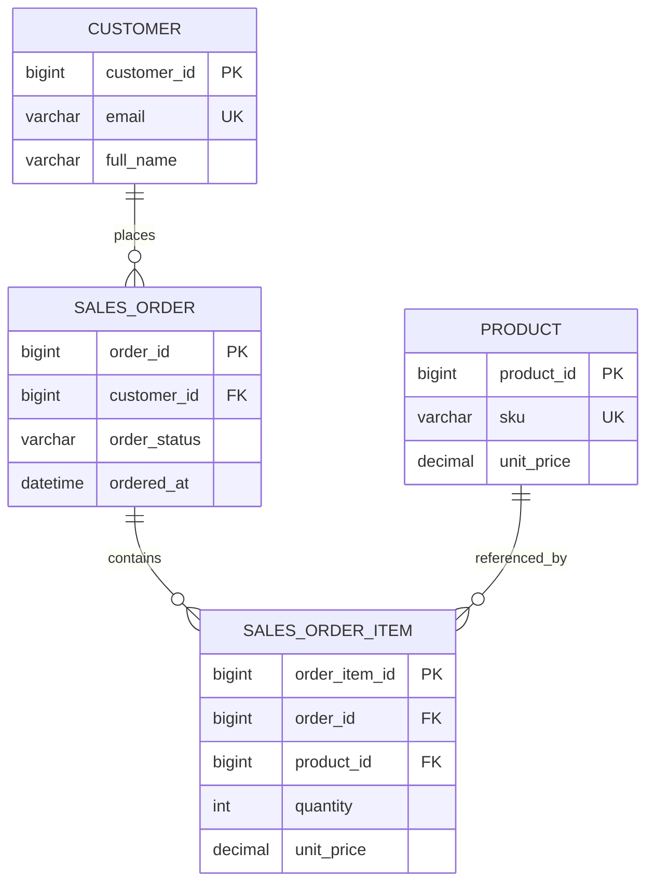

# Preparing Schemas, Sample Data, and Edge Cases

A MySQL practice exercise is valuable when learners can recreate the environment, know the exact input data, predict outcomes, and test abnormal situations. If a schema lacks constraints, sample data is overly simplistic, or edge cases are missing, a query may work on a tiny example yet fail when encountering real-world data.

This lesson builds a small practice environment for an ordering system. You will create a schema covering customers, products, orders, and order items; load reproducible sample data; verify relationships and totals; and then test valid cases, invalid cases, and common boundary limits. Examples use InnoDB, `utf8mb4`, and syntax compatible with MySQL 8.0.16 or later so that `CHECK` constraints are enforced.

## Learning Objectives

After this lesson, you will be able to:

- Prepare a dedicated schema, choose data types, and define appropriate keys, indexes, and relationships.
- Create consistent sample data with valid foreign keys that can be verified via queries.
- Distinguish `NULL`, empty strings, default values, and zero values.
- Test edge cases for unique keys, foreign keys, quantities, prices, dates/times, and Unicode characters.
- Use transactions to test data and clean up the practice environment in a controlled manner.

## 1. Preparing a Safe Environment

Practice in a MySQL instance or sandbox database that you are authorized to modify. Do not run this lesson's create, delete, or data-loading statements on a production database or a schema containing data that must be preserved. The examples use the database name `mysql_practice_vi`; if this name is already used in your organization, change it to a separate sandbox name.

Before creating the schema, inspect the version, SQL mode, time zone, and character sets of the connection session:

```sql
SELECT
    VERSION() AS mysql_version,
    @@SESSION.sql_mode AS session_sql_mode,
    @@SESSION.time_zone AS session_time_zone,
    @@SESSION.character_set_client AS client_character_set,
    @@SESSION.character_set_connection AS connection_character_set,
    @@SESSION.character_set_results AS results_character_set,
    @@SESSION.collation_connection AS connection_collation,
    @@character_set_server AS server_character_set,
    @@collation_server AS server_collation;
```

SQL mode affects how MySQL handles invalid data, truncated values, and malformed dates/times. Under strict mode, many out-of-range values are rejected; under non-strict mode, some cases may be converted and emit warnings. When testing invalid data, read the message and run `SHOW WARNINGS` immediately after the statement being checked.

Version note: MySQL only enforces `CHECK` constraints starting from version 8.0.16. Older versions may accept the syntax while ignoring the check. If using an older version, do not treat `CHECK` as a data protection layer; upgrade the environment or add validation at the application layer according to project policy.

## 2. Designing the Schema Before Writing DDL

We use a simple model with four tables:

| Table | Role | Key Relationships |
|---|---|---|
| `customer` | Buyer information | One customer can have many orders |
| `product` | Product catalog | One product can appear in many order items |
| `sales_order` | General order details | Each order belongs to one customer |
| `sales_order_item` | Products and quantities in an order | Each line belongs to one order and references one product |

Entity relationship diagram:



Several design decisions to understand before creating the tables:

- Use `BIGINT UNSIGNED` for identifier keys and use the exact same data type for the corresponding foreign key columns. Type, `UNSIGNED` attribute, and width must match between both sides of a relationship.
- Use `DECIMAL(12,2)` for prices because it is an exact decimal type with fixed precision. Do not use `FLOAT` or `DOUBLE` to store monetary values requiring exact reconciliation.
- Use `VARCHAR` for emails, names, SKUs, and notes because their lengths vary. Length limits are part of the data contract, not merely a display choice.
- Use `DATETIME` for order timestamps in this example. `DATETIME` stores the exact date/time value written without automatic conversion by session time zone like `TIMESTAMP`; however, `NOW()` and `CURRENT_TIMESTAMP` still return time in the session time zone. If the convention is to store UTC, the application must establish a consistent connection time zone, such as `SET time_zone = '+00:00'`.
- Use foreign keys to prevent orders from referencing nonexistent customers and order items from referencing nonexistent orders or products.
- Use `UNIQUE` to prevent duplicate emails, duplicate SKUs, and the same product appearing twice in the same order. The last rule suits a model that aggregates quantity into one line; if business rules allow multiple lines for the same product, use a line sequence number instead of this constraint.
- Use `CHECK` for value domains such as non-negative prices, positive quantities, and valid statuses. More complex business rules still need validation in the application or business workflow.

The `utf8mb4_unicode_ci` collation in the example is case-insensitive and applies linguistic comparison rules. Thus, emails or SKUs differing only in uppercase/lowercase may be treated as duplicates. If the system requires different comparison rules, intentionally choose the collation and data normalization rules; do not change collations arbitrarily after data already exists.

## 3. Creating the Database and Tables

Run the following in a fresh sandbox schema that does not already have tables with the same names:

```sql
CREATE DATABASE IF NOT EXISTS mysql_practice_vi
    CHARACTER SET utf8mb4
    COLLATE utf8mb4_unicode_ci;

USE mysql_practice_vi;

CREATE TABLE customer (
    customer_id BIGINT UNSIGNED NOT NULL AUTO_INCREMENT,
    email VARCHAR(254) NOT NULL,
    full_name VARCHAR(120) NOT NULL,
    phone VARCHAR(30) NULL,
    created_at DATETIME NOT NULL DEFAULT CURRENT_TIMESTAMP,
    PRIMARY KEY (customer_id),
    CONSTRAINT uq_customer_email UNIQUE (email),
    CONSTRAINT chk_customer_email_not_blank
        CHECK (CHAR_LENGTH(TRIM(email)) > 0),
    CONSTRAINT chk_customer_name_not_blank
        CHECK (CHAR_LENGTH(TRIM(full_name)) > 0)
) ENGINE = InnoDB
  DEFAULT CHARACTER SET = utf8mb4
  COLLATE = utf8mb4_unicode_ci;

CREATE TABLE product (
    product_id BIGINT UNSIGNED NOT NULL AUTO_INCREMENT,
    sku VARCHAR(40) NOT NULL,
    product_name VARCHAR(160) NOT NULL,
    unit_price DECIMAL(12,2) NOT NULL,
    active TINYINT UNSIGNED NOT NULL DEFAULT 1,
    PRIMARY KEY (product_id),
    CONSTRAINT uq_product_sku UNIQUE (sku),
    CONSTRAINT chk_product_sku_not_blank
        CHECK (CHAR_LENGTH(TRIM(sku)) > 0),
    CONSTRAINT chk_product_price_nonnegative
        CHECK (unit_price >= 0),
    CONSTRAINT chk_product_active
        CHECK (active IN (0, 1))
) ENGINE = InnoDB
  DEFAULT CHARACTER SET = utf8mb4
  COLLATE = utf8mb4_unicode_ci;

CREATE TABLE sales_order (
    order_id BIGINT UNSIGNED NOT NULL AUTO_INCREMENT,
    customer_id BIGINT UNSIGNED NOT NULL,
    order_status VARCHAR(20) NOT NULL DEFAULT 'PENDING',
    ordered_at DATETIME NOT NULL DEFAULT CURRENT_TIMESTAMP,
    note VARCHAR(500) NULL,
    PRIMARY KEY (order_id),
    KEY idx_sales_order_customer_date (customer_id, ordered_at),
    CONSTRAINT chk_sales_order_status
        CHECK (order_status IN ('PENDING', 'PAID', 'CANCELLED', 'COMPLETED')),
    CONSTRAINT fk_sales_order_customer
        FOREIGN KEY (customer_id)
        REFERENCES customer (customer_id)
        ON UPDATE RESTRICT
        ON DELETE RESTRICT
) ENGINE = InnoDB
  DEFAULT CHARACTER SET = utf8mb4
  COLLATE = utf8mb4_unicode_ci;

CREATE TABLE sales_order_item (
    order_item_id BIGINT UNSIGNED NOT NULL AUTO_INCREMENT,
    order_id BIGINT UNSIGNED NOT NULL,
    product_id BIGINT UNSIGNED NOT NULL,
    quantity INT UNSIGNED NOT NULL,
    unit_price DECIMAL(12,2) NOT NULL,
    PRIMARY KEY (order_item_id),
    UNIQUE KEY uq_order_item_order_product (order_id, product_id),
    KEY idx_order_item_product (product_id),
    CONSTRAINT chk_order_item_quantity_positive
        CHECK (quantity > 0),
    CONSTRAINT chk_order_item_price_nonnegative
        CHECK (unit_price >= 0),
    CONSTRAINT fk_order_item_order
        FOREIGN KEY (order_id)
        REFERENCES sales_order (order_id)
        ON UPDATE RESTRICT
        ON DELETE RESTRICT,
    CONSTRAINT fk_order_item_product
        FOREIGN KEY (product_id)
        REFERENCES product (product_id)
        ON UPDATE RESTRICT
        ON DELETE RESTRICT
) ENGINE = InnoDB
  DEFAULT CHARACTER SET = utf8mb4
  COLLATE = utf8mb4_unicode_ci;
```

Indexes are chosen based on relationships and expected queries. Primary keys and unique keys automatically create corresponding indexes. The `idx_sales_order_customer_date` index supports filtering orders by customer and sorting by timestamp within a customer. The `idx_order_item_product` index supports looking up order items by product; the unique index starting with `order_id` also supports looking up line items for a given order.

Do not add indexes to every column. Every index consumes storage and increases the cost of inserts, updates, and deletes. Start from the queries you need to serve, then verify with `EXPLAIN` on a sufficiently representative dataset.

## 4. Loading a Reproducible Sample Dataset

Use explicit IDs so query results and tests are easy to compare. In real applications, `AUTO_INCREMENT` typically generates IDs; specifying IDs here keeps the training dataset deterministic.

```sql
START TRANSACTION;

INSERT INTO customer
    (customer_id, email, full_name, phone)
VALUES
    (101, 'an.nguyen@example.test', 'Nguyễn An', '0901000101'),
    (102, 'binh.tran@example.test', 'Trần Bình', NULL),
    (103, 'chi.le@example.test', 'Lê Chi', '0903000103');

INSERT INTO product
    (product_id, sku, product_name, unit_price, active)
VALUES
    (201, 'LAP-001', 'Laptop', 24990000.00, 1),
    (202, 'MOUSE-001', 'Wireless Mouse', 299000.00, 1),
    (203, 'MON-001', 'Monitor', 4590000.00, 1),
    (204, 'TRIAL-001', 'Trial Service', 0.00, 1);

INSERT INTO sales_order
    (order_id, customer_id, order_status, ordered_at, note)
VALUES
    (1001, 101, 'PENDING', '2025-01-10 09:15:00', NULL),
    (1002, 102, 'PAID', '2025-01-11 14:30:00', 'Paid'),
    (1003, 101, 'CANCELLED', '2025-01-12 08:00:00', 'Cancelled order, no line items yet');

INSERT INTO sales_order_item
    (order_item_id, order_id, product_id, quantity, unit_price)
VALUES
    (5001, 1001, 201, 1, 24990000.00),
    (5002, 1001, 202, 2, 299000.00),
    (5003, 1002, 203, 1, 4590000.00);

COMMIT;
```

The price in `sales_order_item` is the price at the time of sale. You should not always read the current price from `product` to recalculate old orders, because product prices can change after a customer places an order. This is why the line-item table stores its own snapshot of `unit_price`.

Order `1003` intentionally has no line items yet. The model allows creating an order first and adding products later in a multi-step workflow. If business rules require every confirmed order to have at least one line item, enforce that condition at the order confirmation step or through appropriate business design; a simple foreign key cannot enforce an aggregate condition across rows.

## 5. Verifying Schema and Data After Loading

First, verify table definitions and storage engine:

```sql
SHOW CREATE TABLE customer;
SHOW CREATE TABLE product;
SHOW CREATE TABLE sales_order;
SHOW CREATE TABLE sales_order_item;
```

Check expected row counts:

```sql
SELECT 'customer' AS table_name, COUNT(*) AS row_count FROM customer
UNION ALL
SELECT 'product', COUNT(*) FROM product
UNION ALL
SELECT 'sales_order', COUNT(*) FROM sales_order
UNION ALL
SELECT 'sales_order_item', COUNT(*) FROM sales_order_item;
```

The initial output should show 3 customers, 4 products, 3 orders, and 3 order items. If the counts differ, inspect the transaction, insert errors, and data state before proceeding.

Check orders and order totals:

```sql
SELECT
    o.order_id,
    c.full_name,
    o.order_status,
    o.ordered_at,
    COALESCE(SUM(oi.quantity * oi.unit_price), 0.00) AS order_total
FROM sales_order AS o
JOIN customer AS c
    ON c.customer_id = o.customer_id
LEFT JOIN sales_order_item AS oi
    ON oi.order_id = o.order_id
GROUP BY
    o.order_id,
    c.full_name,
    o.order_status,
    o.ordered_at
ORDER BY o.order_id;
```

The output should contain three orders. Order `1001` has a total of `25588000.00`, order `1002` has a total of `4590000.00`, and order `1003` has a total of `0.00` because it has no line items yet. `LEFT JOIN` retains orders without line items; `COALESCE` converts a `NULL` sum into zero for clear reporting output.

Find orders that have no line items:

```sql
SELECT o.order_id, o.order_status, o.ordered_at
FROM sales_order AS o
LEFT JOIN sales_order_item AS oi
    ON oi.order_id = o.order_id
WHERE oi.order_item_id IS NULL;
```

With the initial dataset, the query returns order `1003`. This is an intentional edge case that helps check whether a query accidentally drops records when using `INNER JOIN`.

## 6. Edge Cases to Prepare

Edge cases are values near limits, missing data, duplicate data, or unusual data shapes. Not all edge cases are invalid data; some are valid cases that queries often mishandle.

| Category | Data to Test | Expected Outcome |
|---|---|---|
| Required value | `email = NULL` | Rejected by `NOT NULL` |
| Empty string | `email = ''` or whitespace-only | Rejected by `CHECK` in versions that enforce `CHECK` |
| Unique data | Existing email or SKU | Rejected by `UNIQUE` |
| Collation | Email differing only by letter case | Under `utf8mb4_unicode_ci`, treated as a duplicate |
| Foreign key | Order referencing a nonexistent customer | Rejected by foreign key |
| Quantity | `quantity = 0` | Rejected by `CHECK` |
| Price | `unit_price = 0.00` | Valid, e.g., a free product |
| Negative price | `unit_price < 0` | Rejected by `CHECK` |
| Out-of-range price | Price exceeding `DECIMAL(12,2)` capacity | Rejected in strict mode; check errors/warnings |
| Duplicate line item | Same product appearing twice in one order | Rejected by the example's `UNIQUE` rule |
| Leap day | `2024-02-29` | Valid |
| Nonexistent date | `2025-02-29` | Rejected in strict mode; handling depends on SQL mode |
| Unicode | Names with diacritics or supplementary-plane characters | Stored properly when using `utf8mb4` and a matching client connection charset |
| Empty relationship | Order with no line items yet | Valid under the current schema; queries must handle it properly |

Clearly distinguish these concepts:

- `NULL` represents a missing or unknown value. `NULL = NULL` does not evaluate to true; use `IS NULL` or `IS NOT NULL`.
- An empty string `''` is a string value of length zero. A whitespace-only string does not automatically become `NULL` either.
- `DEFAULT` is applied when an `INSERT` statement omits the column or uses the `DEFAULT` keyword; it does not automatically replace explicit `NULL` values passed in.
- A price of `0.00` can be a valid business value, such as a trial or promotional item. Do not forbid zero prices if business requirements allow them.
- With `utf8mb4`, a single character can occupy up to four bytes. `VARCHAR(n)` length is measured in characters, though actual storage size also depends on encoding and content.

## 7. Hands-On Verification of Each Case

The statements below are designed to be run individually. For statements marked **expected to fail**, observe the error and proceed to the next statement; do not combine everything into a single script that aborts on the first error.

### 7.1. Valid Boundary Values

A zero price is valid under the schema:

```sql
INSERT INTO product (sku, product_name, unit_price)
VALUES ('FREE-002', 'Free documentation', 0.00);

SELECT sku, product_name, unit_price
FROM product
WHERE sku = 'FREE-002';

DELETE FROM product
WHERE sku = 'FREE-002';
```

Vietnamese names and Unicode characters must also be stored and read back accurately:

```sql
INSERT INTO customer (email, full_name)
VALUES ('unicode@example.test', 'Nguyễn Ánh 🌱');

SELECT email, full_name
FROM customer
WHERE email = 'unicode@example.test';

DELETE FROM customer
WHERE email = 'unicode@example.test';
```

If characters turn into question marks or garbled symbols, check the charset of the database, table, column, and client connection. Setting the charset on the database alone is not enough if the application connects with a different charset.

### 7.2. Required Values and Empty Strings — Expected to Fail

```sql
-- Violates NOT NULL
INSERT INTO customer (email, full_name)
VALUES (NULL, 'Test User');

-- Violates CHECK because email is empty
INSERT INTO customer (email, full_name)
VALUES ('', 'Test User');

-- Violates CHECK because email contains only whitespace
INSERT INTO customer (email, full_name)
VALUES ('   ', 'Test User');
```

If your MySQL version does not enforce `CHECK`, the two empty-email statements may be accepted. That is why you must verify the version and `SHOW CREATE TABLE` instead of assuming constraints are already protecting your data.

### 7.3. Uniqueness and Collation — Expected to Fail

The following email duplicates loaded data. With a case-insensitive collation, an uppercase variant is also treated as a duplicate:

```sql
INSERT INTO customer (email, full_name)
VALUES ('an.nguyen@example.test', 'Duplicate Name');

INSERT INTO customer (email, full_name)
VALUES ('AN.NGUYEN@EXAMPLE.TEST', 'Different name but duplicate email per collation');
```

Unique constraints are enforced at the database level, so they still protect data when multiple concurrent requests write simultaneously. Pre-checking with `SELECT` in the application cannot replace `UNIQUE`, because two requests could both check, see nothing exists, and then both try to insert.

### 7.4. Foreign Keys and Delete Rules — Expected to Fail

An order referencing a customer not present in the table:

```sql
INSERT INTO sales_order (customer_id, order_status, ordered_at)
VALUES (999999, 'PENDING', '2025-02-01 10:00:00');
```

Customer `101` already has orders, so that customer cannot be deleted while the foreign key uses `ON DELETE RESTRICT`:

```sql
DELETE FROM customer
WHERE customer_id = 101;
```

The `RESTRICT` rule prevents deletions that would leave orphaned orders. If business requirements call for deleting an account while retaining transaction history, it is usually better to design a deactivation status or appropriate data anonymization rather than cascading deletes across all orders.

### 7.5. Value Domains and Duplicate Line Items — Expected to Fail

```sql
-- Quantity must be greater than 0
INSERT INTO sales_order_item (order_id, product_id, quantity, unit_price)
VALUES (1001, 203, 0, 4590000.00);

-- Product 201 already exists in order 1001
INSERT INTO sales_order_item (order_id, product_id, quantity, unit_price)
VALUES (1001, 201, 1, 24990000.00);

-- Status is not in the allowed set
INSERT INTO sales_order (customer_id, order_status, ordered_at)
VALUES (103, 'UNKNOWN', '2025-02-01 10:00:00');

-- Negative price is invalid
INSERT INTO product (sku, product_name, unit_price)
VALUES ('NEGATIVE-001', 'Negative price product', -1.00);
```

Expected errors correspond to the `CHECK` on quantity, `UNIQUE` on order/product pair, `CHECK` on status, and `CHECK` on price. Exact error codes may differ by version and violation type; rely on the error message and the constraint named in it.

### 7.6. Dates/Times and Data Type Capacity

The leap day in 2024 is valid:

```sql
INSERT INTO sales_order (customer_id, order_status, ordered_at, note)
VALUES (103, 'PENDING', '2024-02-29 23:59:59', 'edge-date-leap-day');

SELECT order_id, ordered_at
FROM sales_order
WHERE note = 'edge-date-leap-day';

DELETE FROM sales_order
WHERE note = 'edge-date-leap-day';
```

The date `2025-02-29` does not exist. Test it in a strict session and check both errors and warnings if any:

```sql
INSERT INTO sales_order (customer_id, order_status, ordered_at, note)
VALUES (103, 'PENDING', '2025-02-29 10:00:00', 'edge-invalid-date');

SHOW WARNINGS;
```

`DECIMAL(12,2)` holds up to 10 integer digits and 2 fractional digits. The value `9999999999.99` is at the upper limit; `10000000000.00` exceeds the representable range. When testing out-of-range prices, observe the behavior in the active SQL mode and do not accept silently converted data.

```sql
-- Maximum representable value, expected to succeed
INSERT INTO product (sku, product_name, unit_price)
VALUES ('PRICE-MAX', 'Product at upper price limit', 9999999999.99);

SELECT sku, unit_price
FROM product
WHERE sku = 'PRICE-MAX';

DELETE FROM product
WHERE sku = 'PRICE-MAX';

-- Exceeds DECIMAL(12,2) limit, expected to fail in strict mode
INSERT INTO product (sku, product_name, unit_price)
VALUES ('PRICE-OVER', 'Product exceeding limit', 10000000000.00);

SHOW WARNINGS;
```

## 8. Testing Transactions and Verifying Rollback

InnoDB supports transactions for data operations. Try inserting a temporary order and rolling it back:

```sql
START TRANSACTION;

INSERT INTO sales_order (customer_id, order_status, ordered_at, note)
VALUES (103, 'PENDING', CURRENT_TIMESTAMP, 'rollback-demo');

SELECT order_id, customer_id, order_status, note
FROM sales_order
WHERE note = 'rollback-demo';

ROLLBACK;

SELECT COUNT(*) AS remaining_rows
FROM sales_order
WHERE note = 'rollback-demo';
```

The final query must return `0`. This exercise demonstrates rollback for DML on InnoDB. Do not generalize that every DDL statement can be rolled back in the same way: many DDL operations in MySQL cause an implicit commit or follow separate transaction rules. Create schemas before data transactions and do not use `ROLLBACK` as a way to undo migrations.

## 9. Cleaning Up and Recreating the Environment

The reset statements below delete the tables and all data in the practice schema. Only run them after confirming you are connected to the right sandbox database and no data needs to be retained. Drop child tables before parent tables to avoid foreign key violations:

```sql
USE mysql_practice_vi;

DROP TABLE IF EXISTS sales_order_item;
DROP TABLE IF EXISTS sales_order;
DROP TABLE IF EXISTS product;
DROP TABLE IF EXISTS customer;
```

After resetting, re-run the table creation and sample data loading sections. You do not need to drop the entire database if your goal is only to rebuild the lesson's four tables.

## 10. Checklist Before Starting a MySQL Practice Exercise

- Confirmed the right server, sandbox database, MySQL version, and privileges of the current account.
- Checked SQL mode, time zone, charset, and collation of the connection session.
- Defined primary keys, foreign keys, unique constraints, value domains, and `NULL` policies.
- Chose semantically appropriate data types: `DECIMAL` for money, suitable numeric types for quantities, `utf8mb4` for multilingual text.
- Created indexes based on relationships and expected queries, while understanding write and storage overhead.
- Loaded sample data in parent-before-child order and verified row counts.
- Included data for normal cases, valid empty values, missing values, duplicates, and boundary values.
- Identified which statements are expected to succeed, which are expected to fail, and why.
- Know how to roll back data transactions and safely reset the sandbox schema.

A good practice environment lets learners repeat the same test and explain the result. The schema defines structure and data rules; the sample dataset establishes a verifiable state; edge cases reveal how the system reacts when data is missing, duplicated, out of domain, or right at the limit. Once all three parts are prepared, subsequent lessons on queries, indexes, transactions, and MySQL tuning will stand on a consistent foundation.
