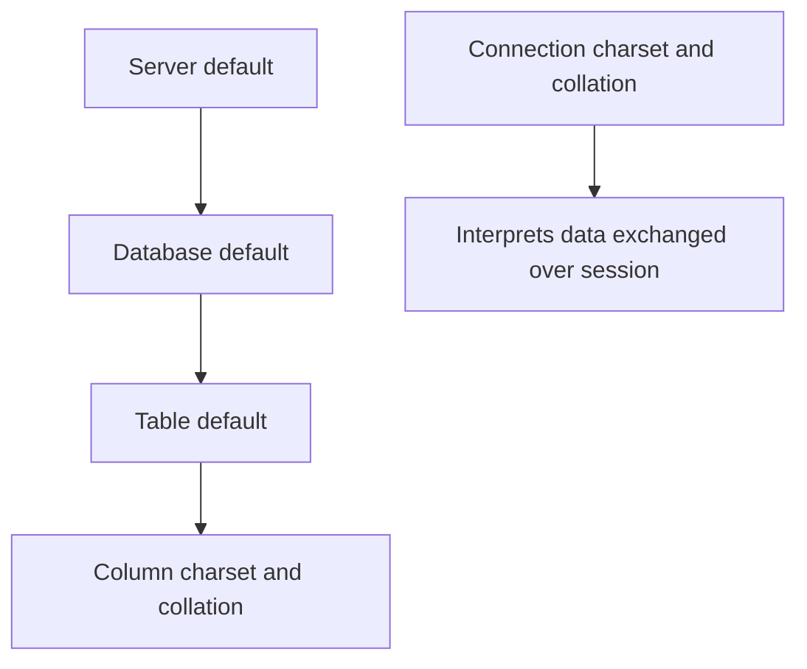
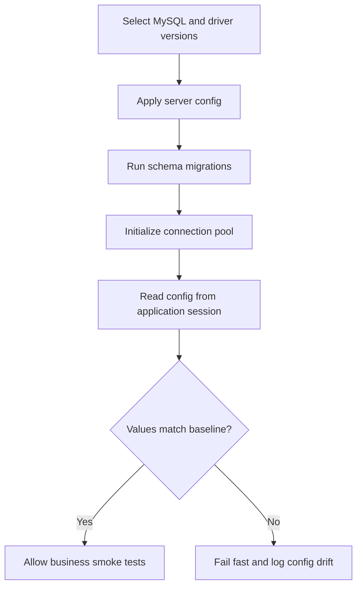

# Configuring Reproducible Character Sets, Collations, Time Zones, and SQL Modes

A MySQL environment can run without throwing errors yet still produce different results across developer laptops, CI, and production. Sometimes the cause does not lie in the SQL statement itself, but in implicit configuration: one machine uses a different character set or comparison rule, a connection runs in a different time zone, or the SQL mode allows data that another environment rejects.

This lesson belongs to the **DATABASE_MYSQL** module. The module aims to help you master MySQL from table design, data types, keys, and SQL queries to indexes, transactions, and concurrency control; while practicing reading execution plans, optimizing queries, managing access control, performing backups, and troubleshooting relational database operations. In the **Practice Environment** chapter, we establish foundational settings so that the same schema and application behave consistently across multiple environments.

The goal of this lesson is to know how to choose settings, place them at the right scope, verify the actual values of each connection, and incorporate critical settings into a repeatable deployment workflow. Primary examples use MySQL 8.0 or later. If a project uses another version, check the list of supported collations and system variables before applying them verbatim.

## 1. Why Standardize Environment Configuration?

Imagine the same account registration feature running on a developer's laptop and a staging server. On the laptop, `Nguyen Van An` and `nguyễn văn an` might compare as equal; on the staging server, they might be treated as different. A string containing an emoji might save cleanly in one environment but fail or get mangled in another. A timestamp filter query might return orders from a different day because two connections use different time zones. An `INSERT` missing valid data might turn into a warning on one machine but be rejected on another.

Differences usually stem from four configuration groups:

| Group | Governing Configuration | Consequence When Inconsistent |
|---|---|---|
| Character set | How characters are encoded when storing and exchanging data | Corrupted Vietnamese characters, emojis, or altered data over connections. |
| Collation | How strings are compared, sorted, and tested for equality | Filtering, `ORDER BY`, `UNIQUE`, and join results may differ. |
| Time zone | How date/time values are interpreted and displayed | Timestamps shift by hours, or date-based query predicates return the wrong rows. |
| SQL mode | Rules MySQL applies when parsing and executing SQL | Invalid data emits a warning in one place but is rejected in another; grouping queries may succeed in one environment and fail in another. |

A setting can be applied at the server, database, table, column, or session level. Therefore, checking only the server configuration file is insufficient. Applications commonly use connection pools; each physical connection has its own session and can receive different settings.

An environment is reproducible when:

1. The MySQL and driver versions are clearly pinned.
2. Default character set and collation are explicitly declared for databases and schemas.
3. Storage time zone, server time zone, and session time zone follow a unified convention.
4. SQL mode is explicitly chosen and verified on application connections.
5. Configuration and initialization scripts are version-controlled, repeatable, and accompanied by verification statements.

## 2. Character Set and Collation

### 2.1. Two Concepts Solving Different Problems

A **character set** defines the set of characters that can be represented and how those characters are encoded into bytes. A **collation** defines how strings belonging to a character set are compared and sorted.

For example, the same character set can have multiple collations:

- A case-insensitive collation can treat `MySQL` and `mysql` as equal when comparing.
- An accent-insensitive collation can treat `a` and `á` as equal during comparisons.
- A case- and accent-sensitive collation enforces stricter rules.
- A binary collation compares strings by their raw binary values.

MySQL collation names often indicate their comparison properties. For instance, in `utf8mb4_0900_ai_ci`, `ai` stands for accent-insensitive and `ci` stands for case-insensitive. `utf8mb4_0900_as_cs` is both accent-sensitive and case-sensitive. Specific suffixes depend on the collation and version; verify the exact collation in use rather than guessing solely from its name.

The character set determines which data can be represented; the collation determines how strings are compared. Choosing the right character set but an unsuitable collation can still break search or uniqueness rules.

### 2.2. Why Use `utf8mb4`?

For modern applications, `utf8mb4` is the right choice for Unicode data. It supports characters outside the Basic Multilingual Plane, including many emojis and supplementary symbols.

Do not confuse `utf8mb4` with the historical `utf8` name in MySQL. In many older MySQL versions, `utf8` is an alias for `utf8mb3`, which represents at most three bytes per character. `utf8mb4` supports up to four bytes. Newer versions have deprecated `utf8mb3` and recommend migrating to `utf8mb4`.

For example, if a user name column uses a charset without full Unicode support, basic Vietnamese text might still save while an emoji or rare character triggers an error. Testing with ASCII letters alone will miss this bug.

### 2.3. Configuration Scopes for Charset and Collation

MySQL has defaults at multiple levels. You can visualize the application order when creating new objects as follows:



- **Server:** `character_set_server` and `collation_server` are server-level defaults.
- **Database:** each database has its own default charset and collation. Creating a table without specifying them inherits the database defaults.
- **Table:** a table has a default charset and collation; new columns can inherit these values.
- **Column:** string-type columns can declare their own charset and collation, overriding the table default.
- **Connection/session:** `character_set_client`, `character_set_connection`, `character_set_results`, and `collation_connection` govern how data is sent, interpreted, and returned on the current connection.

Defaults at higher levels primarily affect objects created afterward. Changing a database's default collation does not automatically convert existing columns in old tables. To convert existing data, you must plan a separate migration.

### 2.4. Declaring Explicitly When Creating Databases and Tables

With MySQL 8.0, you can create a database with an explicitly chosen charset and collation:

```sql
CREATE DATABASE shop_db
    CHARACTER SET utf8mb4
    COLLATE utf8mb4_0900_ai_ci;

USE shop_db;

CREATE TABLE customers (
    customer_id BIGINT UNSIGNED NOT NULL AUTO_INCREMENT,
    email       VARCHAR(255) NOT NULL,
    full_name   VARCHAR(150) NOT NULL,
    PRIMARY KEY (customer_id),
    UNIQUE KEY uk_customers_email (email)
) ENGINE = InnoDB
  DEFAULT CHARACTER SET = utf8mb4
  COLLATE = utf8mb4_0900_ai_ci;

CREATE TABLE customer_notes (
    note_id BIGINT UNSIGNED NOT NULL AUTO_INCREMENT,
    customer_id BIGINT UNSIGNED NOT NULL,
    note_text TEXT CHARACTER SET utf8mb4 COLLATE utf8mb4_0900_as_cs,
    PRIMARY KEY (note_id)
) ENGINE = InnoDB;
```

In this example, the database and table use an accent-insensitive, case-insensitive collation. Only `note_text` uses an accent-sensitive and case-sensitive collation to illustrate that a column can have its own rule. In real projects, do not choose column-specific collations arbitrarily; tie them to concrete search and comparison requirements.

Collation also affects unique indexes. If an email column has a unique key under a case-insensitive collation, values differing only in letter case are treated as duplicates. That may match the application's identity rules, but it must be an intentional decision. Email comparison rules must be designed around business requirements rather than relying blindly on collation defaults.

`utf8mb4_0900_ai_ci` is a collation introduced in the MySQL 8.0 series. If a project requires compatibility with MySQL 5.7 or another DBMS, this collation may not exist. For MySQL 5.7, a common choice is `utf8mb4_unicode_ci`; verify support on the exact target version before writing migrations.

### 2.5. Connection Character Set

Even when a table already uses `utf8mb4`, an application can still transmit corrupted data if the connection interprets bytes under a different charset. Key session variables to inspect include:

- `character_set_client`: the charset the client uses to send statements.
- `character_set_connection`: the charset MySQL uses when converting and processing literal strings in statements.
- `character_set_results`: the charset used to return results to the client.
- `collation_connection`: the collation used for string comparisons in connection context when no more specific collation applies.

The following statement sets charset and collation for the current connection:

```sql
SET NAMES utf8mb4 COLLATE utf8mb4_0900_ai_ci;
```

`SET NAMES` updates the `character_set_client`, `character_set_connection`, `character_set_results`, and `collation_connection` variables for the current session. It does not alter the database's default charset or convert existing columns. When an application connects through a driver, configure the driver properly and inspect session variables after connecting; never rely on an operator having run `SET NAMES` in an interactive SQL window.

With JDBC, use a MySQL Connector/J version compatible with your server and configure the connection according to the driver documentation. Modern drivers can negotiate the appropriate charset; if the application needs session initialization, use the driver's or connection pool's connection configuration mechanism. The time zone section below illustrates how to set connection properties. Avoid forcing legacy `characterEncoding` values without verifying the charset mapping of the Connector/J version in use.

### 2.6. Converting an Existing Schema

Changing the database default does not mean existing data has been converted to `utf8mb4`. Inspect existing tables and columns:

```sql
SELECT
    TABLE_NAME,
    TABLE_COLLATION
FROM information_schema.TABLES
WHERE TABLE_SCHEMA = DATABASE()
  AND TABLE_TYPE = 'BASE TABLE'
ORDER BY TABLE_NAME;

SELECT
    TABLE_NAME,
    COLUMN_NAME,
    CHARACTER_SET_NAME,
    COLLATION_NAME
FROM information_schema.COLUMNS
WHERE TABLE_SCHEMA = DATABASE()
  AND CHARACTER_SET_NAME IS NOT NULL
ORDER BY TABLE_NAME, ORDINAL_POSITION;
```

`ALTER TABLE ... CONVERT TO CHARACTER SET ...` can convert string columns in a table. This is a data-modifying operation that can affect column types/lengths, indexes, unique keys, lock duration, and disk space. Before running it on live data, back up, test on a comparably sized copy, check for duplicate values under the target collation, and schedule a deployment window.

Example syntax:

```sql
ALTER TABLE customers
    CONVERT TO CHARACTER SET utf8mb4
    COLLATE utf8mb4_0900_ai_ci;
```

Do not run conversion statements merely to "make everything look uniform." Explicitly determine the desired collation, its impact on unique indexes, and how the application handles values previously considered distinct that now compare as equal.

## 3. Time Zones in MySQL

### 3.1. Distinguishing OS, Server, and Session Time Zones

MySQL has several values that must be distinguished:

- `system_time_zone` reflects the operating system time zone detected by MySQL at startup. This is system information, not a variable for applications to change per request.
- `@@global.time_zone` is the server's default time zone for new connections. Its default is typically `SYSTEM` unless configured otherwise.
- `@@session.time_zone` is the time zone of the current connection. When a new session is created, it inherits the global default; existing connections do not automatically change just because the global setting changes.

Check these values:

```sql
SELECT
    @@system_time_zone AS system_time_zone,
    @@global.time_zone AS global_time_zone,
    @@session.time_zone AS session_time_zone,
    NOW() AS session_now,
    UTC_TIMESTAMP() AS utc_now;
```

`NOW()` returns the timestamp in the session time zone. `UTC_TIMESTAMP()` returns the UTC timestamp. Even if both are called nearly simultaneously, they can display an offset difference matching the session time zone.

### 3.2. Differences Between `TIMESTAMP` and `DATETIME`

This is a critical distinction when designing schemas:

| Type | How It Stores and Displays | Best Suited For |
|---|---|---|
| `TIMESTAMP` | MySQL converts values from session time zone to UTC on write and from UTC back to session time zone on read. | An actual instant on the timeline, such as order creation time or payment time. |
| `DATETIME` | Stores date and time as entered calendar values; does not automatically convert by session time zone on read/write. | Local wall-clock time with business meaning, such as an appointment at 09:00 at a venue. |

Example testing the behavior:

```sql
SET SESSION time_zone = '+00:00';

CREATE TEMPORARY TABLE time_probe (
    event_timestamp TIMESTAMP,
    event_datetime  DATETIME
);

INSERT INTO time_probe (event_timestamp, event_datetime)
VALUES (NOW(), NOW());

SELECT event_timestamp, event_datetime
FROM time_probe;

SET SESSION time_zone = '+07:00';

SELECT event_timestamp, event_datetime
FROM time_probe;
```

After switching the session to `+07:00`, the same `TIMESTAMP` value is displayed in the new time zone and shifts by seven hours compared to the UTC display. The `DATETIME` value retains the exact stored date/time components. This is why you must clearly decide whether a column represents an absolute point in time or a local calendar time.

A common convention for transactional systems is to store event instants in UTC—using `TIMESTAMP` or an explicit UTC convention with `DATETIME`—and convert to the user's time zone at the presentation layer. For local appointments, you sometimes also need to store the IANA time zone (for example, `Asia/Ho_Chi_Minh`) alongside the local date/time to preserve exact meaning if time zone rules change.

### 3.3. Setting the Session Time Zone to UTC

Set the session time zone for the current connection:

```sql
SET SESSION time_zone = '+00:00';
```

Set the server-level default for new connections:

```sql
SET GLOBAL time_zone = '+00:00';
```

`SET GLOBAL` does not automatically alter existing open sessions. If the application uses a connection pool, existing physical connections may continue holding the old time zone. Re-initialize or refresh connections through a controlled procedure.

To persist across restarts, declare it in the MySQL configuration file:

```ini
[mysqld]
default-time-zone = '+00:00'
```

With MySQL 8.0, some dynamic system variables can be persisted across restarts using `SET PERSIST`, for example:

```sql
SET PERSIST time_zone = '+00:00';
```

`SET PERSIST` requires appropriate administrative privileges and writes the configuration into MySQL's persistent configuration store. Version-controlled deployment configuration files are generally easier to audit and review when reproducing environments. Not every system variable supports `SET PERSIST`; check the variable's attributes and version before using it.

### 3.4. Named Time Zones and Time Zone Tables

MySQL can use offsets like `'+00:00'` and `'+07:00'` or named time zones like `'Asia/Ho_Chi_Minh'`. Named time zones are advantageous when you need to follow historical rules and daylight saving time transitions for a region. For MySQL to recognize named time zones, the time zone tables in the system database must be populated and kept up to date.

If the time zone tables lack the needed data, setting a named time zone may raise an error or fail to work as expected. On Unix systems, administrators typically use the `mysql_tzinfo_to_sql` utility to load data from the OS zoneinfo database into MySQL; restart or refresh as instructed by the running version after updating. On other platforms, follow the appropriate procedure to load time zone data.

If the application only needs UTC, the `'+00:00'` offset is simple and does not depend on loading named time zone tables. If business logic requires local time zones, verify the time zone tables and store the region identifier alongside calendar data when needed.

### 3.5. Configuring Time Zones in Java Applications

MySQL's time zone and the JVM time zone are two separate settings. A Java application might run its JVM in the OS time zone while the MySQL session uses `SYSTEM` or another value. Establish a clear convention in both the driver and the application layer.

Example with a MySQL Connector/J version supporting `connectionTimeZone` and `forceConnectionTimeZoneToSession`:

```properties
spring.datasource.url=jdbc:mysql://localhost:3306/shop_db?connectionTimeZone=UTC&forceConnectionTimeZoneToSession=true
```

`connectionTimeZone=UTC` declares the connection time zone the driver uses for time conversions. `forceConnectionTimeZoneToSession=true` instructs the driver to set the MySQL session time zone to match the connection time zone. Check the Connector/J documentation for your exact version; older drivers had different property names or behaviors.

At the Java layer, use time APIs with clear semantics: `Instant` for an absolute instant, `LocalDate` for a calendar date without time, `LocalDateTime` for a date/time without a time zone, and `ZonedDateTime` when a regional time zone must be preserved. Do not convert every value into `LocalDateTime` and assume it is always UTC.

## 4. SQL Mode

### 4.1. What Does SQL Mode Control?

SQL mode is a set of rules that alters how MySQL parses and executes statements. It can affect whether MySQL rejects or accepts data, how it handles invalid values, how certain syntax is interpreted, and requirements for grouping queries.

Common modes include:

| SQL Mode | General Effect |
|---|---|
| `STRICT_TRANS_TABLES` | Enables strict behavior for transactional tables; many invalid or out-of-range values trigger errors instead of silently converting to another value. Details also depend on table type and statement. |
| `ONLY_FULL_GROUP_BY` | Requires non-aggregated expressions in `SELECT`, `HAVING`, and `ORDER BY` to conform to grouping rules or functional dependencies recognized by MySQL. |
| `NO_ENGINE_SUBSTITUTION` | Prevents silently substituting a storage engine when the requested engine is unavailable; raises an error instead. |
| `ANSI_QUOTES` | Treats double quotes as identifier quotes rather than string literals. Can break legacy SQL that uses double quotes for strings. |
| `NO_BACKSLASH_ESCAPES` | Changes how backslashes are handled inside string literals. Can affect SQL generated by applications. |

Modes can be combined into a comma-separated list. Never enable a mode merely because its name sounds more standard; test its impact on existing SQL and application libraries.

### 4.2. Why Use Strict Mode?

Suppose a `quantity` column is an integer, but an application sends a string that cannot be converted into a number. In non-strict mode, depending on the statement and version, MySQL may emit a warning and replace the invalid value with a default or adjusted value. The application might never realize the data was altered.

With strict mode, invalid inputs are typically rejected immediately on write. Failing early catches bugs at the boundary between the application and database, keeping data in a much more controllable state. However, enabling strict mode can expose legacy data or statements that previously relied on silent conversion. Run regression tests before applying it to a live system.

### 4.3. `ONLY_FULL_GROUP_BY` Protects Grouping Semantics

Suppose an `orders` table has multiple orders per customer. The following query may be invalid when `ONLY_FULL_GROUP_BY` is enabled:

```sql
SELECT customer_id, order_status, COUNT(*)
FROM orders
GROUP BY customer_id;
```

A customer can have multiple orders with multiple `order_status` values, so MySQL has no single deterministic `order_status` to return for each customer group. The query must state the intended meaning, such as counting orders by both customer and status:

```sql
SELECT customer_id, order_status, COUNT(*) AS order_count
FROM orders
GROUP BY customer_id, order_status;
```

Or if the goal is simply counting total orders per customer, remove `order_status` from the `SELECT` list. Disabling `ONLY_FULL_GROUP_BY` can cause MySQL to pick an indeterminate value from the group; that masks a logic bug rather than fixing the query.

### 4.4. Viewing and Setting SQL Mode

Check global and session modes:

```sql
SELECT
    @@GLOBAL.sql_mode AS global_sql_mode,
    @@SESSION.sql_mode AS session_sql_mode;
```

Set for the current session:

```sql
SET SESSION sql_mode =
    'STRICT_TRANS_TABLES,ONLY_FULL_GROUP_BY,NO_ENGINE_SUBSTITUTION';
```

Set the default for new connections:

```sql
SET GLOBAL sql_mode =
    'STRICT_TRANS_TABLES,ONLY_FULL_GROUP_BY,NO_ENGINE_SUBSTITUTION';
```

The current session does not automatically pick up the new value when `SET GLOBAL` is run. New connections inherit the global value at session creation time. To persist across restarts, declare `sql-mode` in the server configuration file or use `SET PERSIST` if the variable and version support it.

Example in a configuration file:

```ini
[mysqld]
sql-mode = "STRICT_TRANS_TABLES,ONLY_FULL_GROUP_BY,NO_ENGINE_SUBSTITUTION"
```

The list above is an illustrative baseline for a new project, not an optimal list for every system. Different MySQL versions have different default modes. When specifying an explicit list, you replace the default list; therefore, decide whether to retain any other modes your application relies on. Record the chosen list in project configuration and verify it via `@@SESSION.sql_mode`.

## 5. Placing Settings at the Right Scope

Three common scopes behave differently:

| Scope | How to Set | Effect |
|---|---|---|
| Session | `SET SESSION ...` | Current connection only; lost when the connection closes. |
| Global runtime | `SET GLOBAL ...` | Default for new sessions; does not automatically update existing sessions and is normally lost after restart unless persisted. |
| Persistent/server config | Configuration file or `SET PERSIST` when supported | Survives restarts according to MySQL's configuration mechanism. |

Required privileges vary by operation and version. `SET GLOBAL` and `SET PERSIST` usually require elevated administrative privileges; ordinary business applications should not hold privileges to alter server-wide settings.

A practical division of responsibility:

- Server default charset/collation and default time zone: configure in the server config file or corresponding deployment mechanism.
- Database, table, and column charset/collation: declare in migrations/schemas so every environment creates the exact same structure.
- Connection charset, time zone, and SQL mode: configure in the driver or connection pool, then verify at the session level.
- Runtime global config changes: perform through a reviewed administrative process, document the change, and inspect existing connections.

Do not have an application account run `SET GLOBAL` on every startup. That requires excessive privileges and can create race conditions among application instances starting simultaneously. Server configuration belongs to server deployment; session configuration belongs to connection initialization.

## 6. A Version-Controlled Sample Configuration

Suppose a project chooses MySQL 8.0, uses `utf8mb4`, a default accent- and case-insensitive collation, UTC, and an explicit SQL mode set. You can store server configuration in `my.cnf` or a config file mounted into a container:

```ini
[mysqld]
character-set-server = utf8mb4
collation-server = utf8mb4_0900_ai_ci
default-time-zone = '+00:00'
sql-mode = "STRICT_TRANS_TABLES,ONLY_FULL_GROUP_BY,NO_ENGINE_SUBSTITUTION"
```

For MySQL 5.7, choose a collation supported on that version, such as `utf8mb4_unicode_ci`; do not copy `utf8mb4_0900_ai_ci` to a version that lacks it.

After server initialization, the database-creation migration also declares explicitly:

```sql
CREATE DATABASE IF NOT EXISTS shop_db
    CHARACTER SET utf8mb4
    COLLATE utf8mb4_0900_ai_ci;
```

Table-creation migrations continue specifying engine, charset, and collation whenever required by the schema. That way, new databases do not depend on defaults that might differ across machines.

At the connection layer, every physical connection should be initialized consistently. You can use driver configuration to negotiate charset and set time zone, and use a connection initialization hook to set session SQL mode if required by the project. Example SQL for a session:

```sql
SET NAMES utf8mb4 COLLATE utf8mb4_0900_ai_ci;
SET SESSION time_zone = '+00:00';
SET SESSION sql_mode =
    'STRICT_TRANS_TABLES,ONLY_FULL_GROUP_BY,NO_ENGINE_SUBSTITUTION';
```

You do not necessarily need to run `SET NAMES` manually if the driver already configures the charset properly. What matters is ensuring actual session values match the project's baseline. When using a connection pool, apply configuration in the connection-creation hook and verify after borrowing a connection; never assume every connection retains identical state after being returned to the pool.

## 7. Verifying the Environment with SQL

A configuration is only trustworthy when it can be verified. Store a verification script in your operational toolkit or run it as a post-deployment smoke test.

### 7.1. Checking Server/Connection Version and Charset

```sql
SELECT
    VERSION() AS mysql_version,
    @@character_set_server AS server_charset,
    @@collation_server AS server_collation,
    @@character_set_client AS client_charset,
    @@character_set_connection AS connection_charset,
    @@character_set_results AS results_charset,
    @@collation_connection AS connection_collation;
```

Check defaults of the current database:

```sql
SELECT
    SCHEMA_NAME,
    DEFAULT_CHARACTER_SET_NAME,
    DEFAULT_COLLATION_NAME
FROM information_schema.SCHEMATA
WHERE SCHEMA_NAME = DATABASE();
```

Check table and column collations using the queries in section 2.6. Never check `@@character_set_server` alone: an older column may still use a different charset or collation.

### 7.2. Checking Time Zones

```sql
SELECT
    @@system_time_zone AS system_time_zone,
    @@global.time_zone AS global_time_zone,
    @@session.time_zone AS session_time_zone,
    NOW() AS session_now,
    UTC_TIMESTAMP() AS utc_now;
```

If the baseline requires UTC, the application session should show `@@session.time_zone` as `+00:00` or an equivalent UTC value per the chosen configuration. Do not look only at `@@global.time_zone`, because a connection pool may hold sessions created before the global setting was changed.

### 7.3. Checking SQL Mode

```sql
SELECT
    @@GLOBAL.sql_mode AS global_sql_mode,
    @@SESSION.sql_mode AS session_sql_mode;
```

Compare `@@SESSION.sql_mode` on an actual application connection against the configured list. Inspect a connection borrowed from the pool after the application starts, not only a standalone administrative session.

### 7.4. Testing Unicode Storage and Comparison Rules

You can use a temporary table for a quick session check:

```sql
SET NAMES utf8mb4 COLLATE utf8mb4_0900_ai_ci;

CREATE TEMPORARY TABLE charset_probe (
    value_text VARCHAR(100)
        CHARACTER SET utf8mb4
        COLLATE utf8mb4_0900_ai_ci
);

INSERT INTO charset_probe (value_text)
VALUES ('Tiếng Việt có dấu'), ('Mặt trời ☀️'), ('MySQL'), ('mysql');

SELECT value_text, HEX(value_text)
FROM charset_probe;

SELECT
    _utf8mb4'Mysql' COLLATE utf8mb4_0900_ai_ci =
    _utf8mb4'mysql' COLLATE utf8mb4_0900_ai_ci AS case_insensitive_match;
```

The `HEX` query reveals the stored bytes for each string. The final comparison demonstrates a case-insensitive collation. Testing on real data still needs to examine accents, special characters, and business rules; a simple probe does not prove every case is handled properly.

## 8. Integrating Verification into Application Startup

A deployment workflow can be broken into these steps:

1. **Pin versions:** specify MySQL server and Connector/J versions in deployment config to prevent uncontrolled automatic upgrades.
2. **Apply server config:** apply config files for default charset, collation, time zone, and SQL mode; restart or reload as required by each variable.
3. **Run migrations:** create databases, tables, indexes, and constraints with explicitly declared charset/collation.
4. **Initialize connections:** configure the driver and pool to set up sessions matching the application baseline.
5. **Smoke test:** read system variables from an application connection to verify charset, collation, time zone, and SQL mode.
6. **Record results:** log the version and non-sensitive configuration values for easy comparison across local, CI, staging, and production.

The verification flow can be illustrated as follows:



If configuration does not match, the application should fail startup or mark the instance unready depending on impact. A mere warning log can leave the system running in a divergent state that is only discovered after data has been written incorrectly.

Values recorded in startup logs should include MySQL version, server and database charset/collation, connection charset/collation, session time zone, and session SQL mode. Never log passwords, URLs containing credentials, or sensitive data alongside these values.

## 9. Common Errors and How to Handle Them

| Symptom | Possible Cause | Investigation Direction |
|---|---|---|
| Corrupted Vietnamese text or emojis | Mismatched client, connection, column, or result charset | Check session charset variables and column charset/collation; isolate whether corruption occurs on send, store, or read. |
| Search is not case-insensitive as expected | Column or expression collation does not match business rules | Check `COLLATION_NAME`; determine whether `_ci`, `_cs`, `_ai`, `_as`, or binary comparison is required. |
| Inserting data reports duplicate despite different strings | Unique index uses a collation treating the strings as equivalent | Check the unique column's collation and the intended identity rules. |
| Timestamps shifted by several hours | Inconsistent session time zone, JVM time zone, or `TIMESTAMP`/`DATETIME` mapping | Compare `NOW()`, `UTC_TIMESTAMP()`, `@@session.time_zone`, and driver configuration. |
| New machine has correct time, but running app is still wrong | Global time zone changed, but connection pool retains old sessions | Inspect individual connections; apply init SQL or recycle connections safely. |
| `INSERT` rejected after deployment | Stricter SQL mode or input data violates type/constraints | Compare `@@session.sql_mode`, read the specific SQL error, and fix input data or validation logic. |
| `GROUP BY` query fails in CI | `ONLY_FULL_GROUP_BY` differs across environments | Rewrite the query so every non-aggregated column is well-defined within each group. |
| Changed database default, yet columns still differ | Defaults only affect newly created objects | Check `information_schema.COLUMNS` and plan a dedicated conversion migration if needed. |

Never resolve issues by disabling strict mode, changing collations, or setting `time_zone` arbitrarily just to make errors disappear. First identify which setting differs, what the intended business behavior is, and which scope needs to be fixed.

## 10. Practice Exercises

### Exercise 1: Create a Database with Explicit Configuration

Create a `practice_shop` database using `utf8mb4` and a collation available on your MySQL version. Create a `members` table with a unique key on email. Inspect the charset/collation of server, database, table, and column via `information_schema`.

**Requirement:** record your MySQL version and explain why `utf8mb4_0900_ai_ci` cannot be used by default on MySQL 5.7.

### Exercise 2: Observe Collations

Create two columns or two expressions using case-sensitive and case-insensitive collations. Compare `MySQL` with `mysql`, then test a pair of Vietnamese strings with and without diacritics.

**Requirement:** explain why collation can change the results of `WHERE`, `ORDER BY`, and unique keys.

### Exercise 3: Observe `TIMESTAMP` and `DATETIME`

Create a temporary table with one `TIMESTAMP` column and one `DATETIME` column. Set the session time zone to UTC, insert `NOW()` into both columns, switch the session to `+07:00`, and read them back.

**Requirement:** record the output and explain which type is converted upon display. Give a business use case for each type.

### Exercise 4: SQL Mode and Grouping Queries

Check `@@SESSION.sql_mode`. Enable `ONLY_FULL_GROUP_BY` and run a query selecting a non-aggregated column not included in `GROUP BY`. Then fix the query so the result is well-defined.

**Requirement:** explain why disabling the mode is not the right fix for an ambiguous grouping query.

### Exercise 5: Verify a Connection Pool

Start a Java application with a connection pool. Create a diagnostic endpoint or task that reads `@@session.time_zone`, `@@session.sql_mode`, `@@character_set_connection`, and `@@collation_connection` through a connection borrowed from the pool.

**Requirement:** verify the values across multiple connection acquisitions and after restarting the application. Add this check to an automated smoke test.

## 11. Reproducible Configuration Checklist

Before considering a MySQL environment ready, verify:

- [ ] MySQL Server and driver versions are pinned.
- [ ] Server has `character_set_server=utf8mb4` and an appropriate collation.
- [ ] Database, tables, and columns have charset/collation matching the schema.
- [ ] Application connections use the intended charset and collation.
- [ ] String comparison rules match business search and unique key requirements.
- [ ] Server and session time zones are defined; the application uses a consistent UTC convention for absolute timestamps.
- [ ] Schema chooses `TIMESTAMP` or `DATETIME` according to exact data semantics.
- [ ] Application session SQL mode matches the documented baseline.
- [ ] Settings are stored in version-controlled deployment configuration or migrations.
- [ ] A smoke test reads actual configuration values from an application connection.

## 12. Summary

Character sets govern how characters are represented; collations govern how strings are compared. Session time zone affects how MySQL reads and writes `TIMESTAMP`, whereas `DATETIME` preserves the calendar value. SQL mode defines how the server handles many SQL and data validation scenarios. All three configuration groups operate across different server, schema, or session scopes.

To make environments reproducible, explicitly declare server configuration, specify charset/collation in migrations, initialize each connection according to the application baseline, and verify via SQL. When local, CI, and production all report equivalent values, discrepancies caused by implicit configuration drop significantly and bugs can be caught right at deployment time.
